# 第 3 部分：
安全、管理与监控 Google Cloud 解决方案

在本部分中，我们将重点关注如何保护您的环境，如何使用各种工具管理 GCP，以及如何监控服务运行情况。

本书的这一部分包含以下章节：

- 第 15 章，安全与合规
- 第 16 章，Google Cloud 管理选项
- 第 17 章，监控您的基础设施

## 15
安全与合规

GCP 的安全性从一开始就已内置，绝非事后考虑！在 GCP 提供的每项服务中，您都会看到安全是首要考虑的。在公有云时代，确实一次安全漏洞不仅会造成直接的财务影响，还可能对公司的未来业务产生不利影响。因此，GCP 认为最好的方式是纵深防御，而非单一技术，并且它提供的<|message|>安全远超客户通常能够负担得起的本地复制方案。在本章中，我们将了解在考试中取得成功需要理解的关键主题，并尝试概述安全以及 GCP 对其的重视程度。

在本章中，我们将涵盖以下主题：

- 安全简介
- Cloud Identity
- 资源管理器
- IAM
- 组织策略
- 服务账号
- 防火墙规则和负载均衡器
- Cloud Security Scanner
- 监控和日志记录
- 加密
- GCP 中的渗透测试
- 行业法规
- CI/CD 安全概述
- 其他安全服务

### 安全简介

让我们从对 GCP 安全方法做一个简要介绍开始本章。正如我们之前提到的，安全不是事后考虑，而是内置于其服务中。但在我们甚至考虑保护服务之前，我们需要承认 GCP 对安全有整体性的看法。这可以通过限制物理数据中心访问以及在软件栈中使用定制硬件和加固版操作系统来体现。

> **重要提示**
> Google 使用了以安全为出发点的定制硬件，并在软件栈中使用了加固版 Linux，该系统会监控二进制修改并强制执行受信任的服务器启动。

存储是任何云提供商的关键服务，GCP 在所有存储服务上默认提供静态加密。这可以支持客户加密密钥，也可以代表客户管理密钥。在物理存储磁盘上，退役磁盘的扇区将被清零，如果数据无法删除，磁盘将被多级破碎机销毁。但是请注意，如果客户删除数据，物理删除可能需要 180 天。

此外，主要的安全问题之一是来自外部组织的攻击。为了保护我们免受互联网攻击，Google 提供了在前端注册的能力，这将检查传入网络连接的证书是否正确，并提供对 **分布式拒绝服务 (DDoS)** 攻击的防护。此外，使用 GCP 负载均衡器将提供额外的保护，而云 VPN 和直接连接则提供更多加密选项。

Google 大量投资于其基础设施的安全，该基础设施采用渐进式安全层设计。作为快速参考，让我们简要了解一下这些主要的基础设施安全层：

- **保护底层基础设施：** Google 采用多层物理保护。在设计和建设数据中心时，访问仅限于极少数 Google 员工。生物识别、金属探测、车辆屏障和激光入侵检测系统只是提供物理保护层所使用的一些技术。

除此之外，Google 还设计服务器主板和网络设备，使 Google 能够审查合作的供应商，并对组件提供的<|message|>安全属性进行审计和验证。定制硬件安全芯片使 Google 能够在硬件层面安全地识别和验证 Google 设备。

最后，Google 对内核、BIOS 和基础操作系统等底层组件使用加密签名，以确保服务器机器正在启动正确的软件栈。
- **保护服务部署：** 服务是开发者编写的应用程序二进制文件，希望在 Google 的基础设施上运行。运行在 Google 基础设施上的每个服务都将有一个关联的服务账号身份，并由客户端使用以确保与预期服务器的通信。Google 在应用层对服务间通信使用加密身份验证和授权。
- **保护数据存储：** Google 的各种存储服务可以配置为使用中央密钥管理系统中的密钥在写入物理存储之前加密数据。这使 Google 的基础设施能够将其自身与潜在威胁例如恶意磁盘固件隔离开来。硬盘和 SSD 中使用的硬件加密支持也可以跟踪每个驱动器的生命周期。
- **保护互联网通信：** Google 的基础设施由大量物理机器组成，通过局域网和广域网连接，因此需要防御 DoS 攻击。这通过仅将一小部分机器直接暴露给外部互联网流量来帮助实现。还有诸如 Cloud Armor 之类的服务，可帮助防止 DoS 攻击。

此外，多因素身份验证也有助于保护互联网通信。
- **运营安全：** Google 还需要安全地运营基础设施。Google 拥有代码库和框架，可消除 Web 应用中的 XSS 漏洞，以及自动检测安全漏洞的工具。他们还提供漏洞赏金计划，奖励任何能够发现漏洞的人，并在入侵检测方面投入大量精力。

> **考试提示**
> 我们将讨论的安全深度超过了您在考试中取得成功所需的程度；然而，对于云架构师的角色来说，了解这些信息至关重要。对于考试，我们建议您重点关注以下几个方面：了解 Cloud IAM 角色，了解 Cloud Identity 是什么，了解 **密钥管理服务 (KMS)** 的作用，了解 **客户提供加密密钥 (CSEKs)** 与 **客户管理加密密钥 (CMEKs)** 之间的区别，了解静态加密和传输中加密，并了解 PCI 合规性。

### 共享责任模型

在深入研究安全选项之前，重要的是要指出，与其他主要公有云厂商一样，GCP 也有所谓的共享责任协议。正如我们之前提到的，Google 在其基础设施安全方面投入了大量精力。然而，作为平台的消费者，我们也有责任。

Google 不对操作系统中存在的内容负责。了解共享责任原则对考试很重要。Google 不会对您架构中的所有内容负责，因此我们必须准备好承担我们应有的责任。对于考试，我们应该理解，所提供的不同 GCP 服务意味着 Google 和客户将承担不同程度的责任。例如，让我们看一下 Cloud Storage。Google 将管理存储的加密和提供服务的硬件，并允许审计日志记录。然而，它不对存储在 Cloud Storage 上的内容或用于访问它的网络安全负责。同样，对内容的访问和身份验证将由所有者负责。将此与例如 BigQuery 进行比较，后者是 PaaS 方案。在这种情况下，Google 将承担网络安全和身份验证的责任。


以下图表显示了客户在每种服务模型中预期需要管理的对象。从左到右，我们可以看到完全自管理的本地数据中心与 SaaS 服务之间的差异：

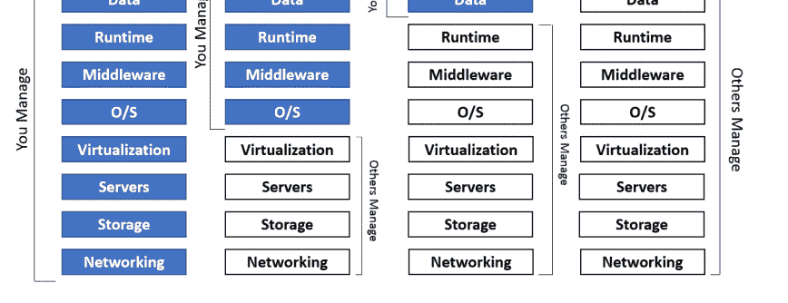

图 15.1 – 共享责任模型

现在我们已经从高层次介绍了安全，接下来让我们开始了解 GCP 中的 Cloud Identity。

## Cloud Identity

Cloud Identity 是 Google 作为身份即服务（IDaaS）解决方案提供的关键 GCP 服务。这是一项可选服务，也可以采用更基础的方法将单个权限应用于服务或项目。然而，对于企业组织而言，使用身份服务更有意义。它使企业能够从单一视图中管理谁可以访问其 GCP 组织中的资源和服务。Cloud Identity 可作为独立产品用于基于域的用户账户和组。我们应该在本书的早期就指出，Google 还为 Google Workspace 用户提供了一个类似的管理面板。控制台的工作方式相同，用户和域管理也有很多相似之处。你可能希望进一步详细研究，但对于本书以及更重要的是考试，我们将仅专注于 GCP Cloud Identity。

与可减少用户管理开销的许多本地目录类似，GCP 允许我们通过 Cloud Identity 在云中集中管理用户。它提供了一个集中、单一的视图来管理用户、组和设置，被称为 Google 管理控制台。要使用 Cloud Identity，你的域名应已启用以接收电子邮件，从而允许你现有的网页和电子邮件地址正常使用。你的 GCP 组织将拥有一个 Cloud Identity，而组织是资源层次结构中的根节点。它被视为你项目的超节点。

需要注意的是，Cloud Identity 有两个版本。一个是免费的，一个是高级订阅。高级订阅提供额外的功能，例如设备管理以及安全和应用管理。完整的比较可以在这里找到：https://support.google.com/cloudidentity/answer/7431902?hl=en。最后，你必须明白 Cloud Identity 并非通过 GCP 控制台控制，而是通过 Google 管理控制台控制。一旦登录到管理控制台，你将能够添加用户、创建组、分配成员并禁用用户。

以下是 **Google 管理** 控制台页面的截图：

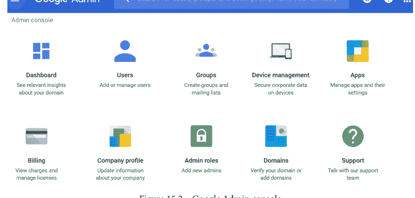

图 15.2 – Google 管理控制台

手动添加用户在工作量方面被视为开销，如果你有大型环境需要管理，则不可扩展。Cloud Identity 的全部意义在于简化用户和组的管理，因为不太可能有组织能负担得起一个人来添加、删除和管理事物。这就是 Google Cloud Directory Sync（GCDS）的用武之地。许多组织将拥有 LDAP 数据库，例如 Microsoft Active Directory（AD）。GCDS 可以将组织的 AD 或 LDAP 数据库同步到 Cloud Identity，并且具有高度可扩展性。同步仅为单向——即从本地到 GCP——因此你的现场数据库永远不会被破坏。GCDS 允许管理员执行增量同步和计划同步并手动执行任务。如果我们需要撤销用户的权限或确实禁用用户，则结果是即时的。

当我们开始使用 Cloud Identity 进行身份验证时，Google 默认存储和管理所有身份验证和密码，但可以禁用此选项。可以通过使用多因素工具添加双重验证。还有一种替代方案是使用单点登录（SSO），这是一种基于 SAML 2.0 的身份验证，也包括多因素身份验证（MFA）。最后，可以在 Cloud Identity 的密码管理功能中设置密码复杂度，以符合企业可能已有的现有策略：

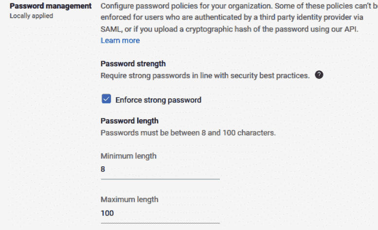

图 15.3 – 密码管理

在前面的截图中，我们可以看到密码管理屏幕的示例。在下一节中，我们将查看 GCP 资源管理器。

## 资源管理器

GCP 资源管理器允许你创建和管理对象（如组织、文件夹和项目）的层次结构分组。让我们看一个例子，我们有一个组织 brgerrard.co.uk，并在其下有几个文件夹以增加结构。文件夹是可选的，但可用于对项目进行分组。对这些文件夹的访问将按层次模型工作，这意味着如果你对 Departments 文件夹拥有完全访问权限，则此权限将继承到例如 Google Cloud Architect Project 文件夹，如以下截图所示：

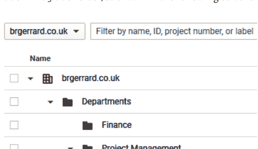

图 15.4 – 资源管理器

一个很好的例子是 GCP 中开发、测试和生产环境的分离。每个环境使用单独的项目，允许你仅授予需要访问资源的人员访问权限。以下截图显示了 GCP 层次结构的设置方式：

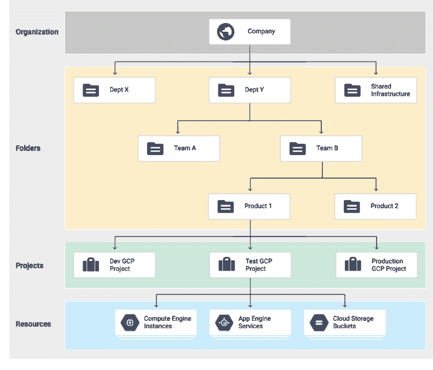

图 15.5 – GCP 层次结构（来源：https://cloud.google.com/resource-manager/docs/cloud-platform-resource-hierarchy，许可：https://creativecommons.org/licenses/by/4.0/legalcode）

重要的是要理解，在更高级别设置权限会导致权限继承。例如，向用户授予 Dept Y 文件夹的权限意味着用户还将对所有子文件夹和项目应用相同的权限。因此，设计组织和权限时非常重要，只能授予履行所请求角色所需的资源访问权限。

在下一节中，我们将查看身份和访问管理。

## 身份和访问管理（IAM）

GCP 为我们提供了创建 GCP 资源并管理谁可以访问它们的能力。它还允许我们仅授予必要的特定访问权限，以防止任何不需要的访问。它允许我们满足职责分离的任何要求。这被称为最小权限的安全原则，我们将很快详细讨论。首先，我们将看一下 IAM 的一些关键概念。在 Cloud IAM 中，我们可以向成员授予访问权限。成员可以属于以下任何一种类型：

- **Google 账户：** 这些代表与 GCP 交互的人员，例如开发人员。
- **服务账户：** 这些属于你的应用程序而不是最终用户。我们将在本章后面 *服务账户* 部分更详细地介绍服务账户。
- **Google 群组：** 这些是 Google 账户和服务账户的有名集合，是向用户集合授予访问策略的好方法。Google 群组可与 IAM 结合使用以授予角色访问权限。一个重要的例外是，如果群组属于同一组织，则群组只能被分配项目的拥有者角色。
- **Google Workspace 域：** 此域代表在组织的 Google Workspace（前身为 G Suite）中创建的所有 Google 账户的集合。
- **Cloud Identity 域：** 与 Google Workspace 类似，此域代表组织中的所有 Google 账户。

以下是与访问管理相关的一些概念：

- **资源：** 资源是项目、Compute Engine 实例或 Cloud Storage 存储桶。
- **权限：** 权限规定了对资源允许的操作，并以 <service>.<resource>.<verb> 的形式显示；例如，`compute.instance.list`。权限不能直接分配给用户。
- **角色：** 角色是权限的集合。为了向用户提供对资源的访问，我们授予他们角色而不是直接向用户分配权限。角色有三种类型——即 **基础**、**预定义** 和 **自定义**——我们将在本章后面讨论。请注意，基础角色最初被称为 *原始角色*。


- **IAM 策略**：IAM 策略是一组语句的集合，用于定义谁拥有何种类型的访问权限。您可以将策略附加到资源上，并在资源被访问时使用它来强制执行访问控制。

> **重要说明**
> 在 IAM 中，您将向 *主体* 授予访问权限。这些主体可以是以下类型之一：Google 群组、Google 账号、服务账号、Cloud Identity、Google Workspace 域、所有经过身份验证的用户或所有用户。

现在我们对 IAM 有了一些背景知识，让我们继续看一些示例。我们之前提到过最小权限原则，现在我们知道应该只授予所必需的访问权限。

我们将在以下示例中查看 `Google Cloud Architect Project` 文件夹的权限。我们可能有一个用户应该能够在所有文件夹中创建项目，但我们也可能有另一个用户只能在特定文件夹中创建项目。在下面的屏幕截图中，我们正在授予名为 `konrad@brgerrard.co.uk` 的用户 **项目创建者** 角色：

## 文件夹 "Google Cloud Architect Project" 的权限

这些权限会影响此文件夹及其所有资源。了解更多

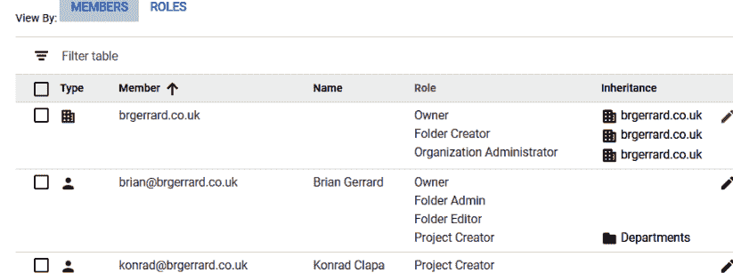

图 15.6 – 应用权限

**基本** 角色是在 Cloud IAM 之前存在的。这些是旧的 **所有者**、**编辑者** 和 **查看者** 角色。由于这些角色有限，应用其中任何一个角色意味着授予广泛的权限范围。这并不完全遵循我们的最小权限原则！然而，我们应该理解，可能存在一些我们希望使用原始角色的情况。例如，我们可能在一个小型跨职能团队中工作，IAM 的粒度并不必需。同样，如果我们在测试或开发环境中工作，那么我们可能不希望应用完全的细粒度权限。

如果我们想要更细粒度，应该使用 **预定义** 角色并基于工作职能来设定角色。这些角色由 Google 创建和维护，因此每当 Google Cloud 添加新功能或服务时，权限都会自动更新。以下以 **App Engine** 的预定义角色为例：

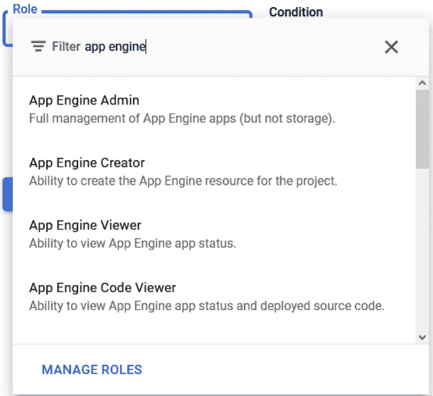

图 15.7 – 预定义角色

如果我们想要创建具有特定权限的角色，而不是使用 Google 提供的集合，那么我们可以使用 **自定义** 角色。这些可以根据我们的需求提供更细粒度的控制，但需要注意的是它们由用户管理，因此会带来额外开销。然而，它们可以防止对其他资源的非预期访问。在创建自定义角色之前，我们应始终检查现有的预定义角色 – 或预定义角色的组合 – 是否已满足我们的需求。

逐个授予角色访问权限可能很繁琐，理想情况下，我们应该使用群组来控制访问。作为示例，让我们从我们的 Cloud Identity 管理控制台创建一个名为 `Project Creator` 的新群组。回顾 **身份和访问管理 (IAM)** 部分中的 *图 15.2*，我们可以通过浏览到 **群组** 字段并点击 **添加新群组** 来完成此操作：

- 1. 为群组命名，如以下屏幕截图所示：

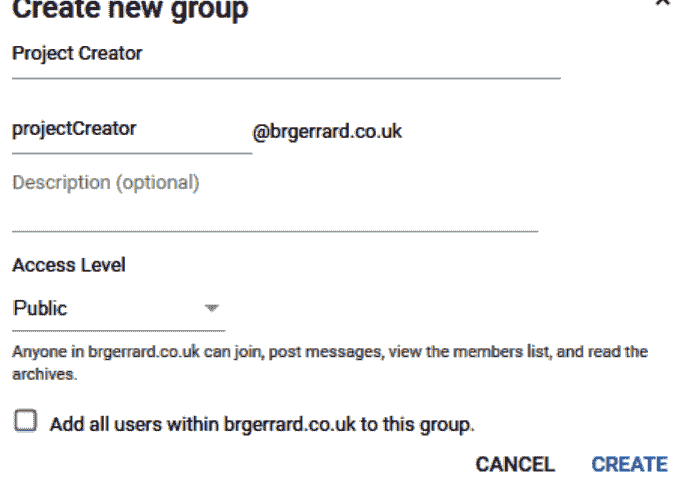

图 15.8 – 创建新群组

2. 在我们的 GCP 控制台中将其应用到资源。在此示例中，我们将群组分配给一个文件夹：

## 向 "Google Cloud Architect Project" 文件夹添加成员、角色

在下方输入一个或多个成员。然后为这些成员选择一个角色，以授予他们访问您资源的权限。可以授予多个角色。了解更多

新成员
projectcreator@brgerrard.co.uk
角色
项目创建者
有权创建新的 GCP 项目。
+ 添加另一个角色
保存 取消

图 15.9 – 添加群组成员

现在，我们可以集中控制对资源的权限，而无需在 GCP 控制台中深入文件夹结构。这也提供了职责分离以提高安全性。现在我们已经创建了项目，我们希望允许用户仅创建 VM 实例。

假设作为项目所有者，我们希望允许一名工程师创建 VM 实例，但希望另一名工程师对该计算资源只有只读访问权限。同样，我们可以在 Cloud Identity 中为此目的创建两个新群组；我们称它们为 vmviewer 和 vmadmin。我们可以为这些群组分配相关角色。使用预定义角色意味着它们由 Google 管理，任何添加到角色的额外权限都意味着您的成员会自动获得这些权限。

我们的 vmviewer 群组现在已在项目级别分配了 Compute Viewer 角色，如以下屏幕截图所示。请注意，我们也可以添加条件。IAM 条件是一个或多个规则，在与之关联的角色被允许之前必须评估为真。例如，您可能只希望 IAM 角色在一天中的特定时间适用：

图 15.10 – 分配角色

我们的 vmadmin 群组现在已在项目级别分配了 Compute Instance Admin 角色：

图 15.11 – 分配角色

我们也可以使用 gcloud CLI 来添加权限。此命令行允许我们管理与 GCP API 的交互。例如，如果我想将编辑者角色分配给 redwing 项目中的 brian@brgerrard.co.uk，那么我可以运行以下命令：

```
gcloud projects add-iam-policy-binding redwing -
member='user:brian@brgerrard.co.uk' -role='roles/editor'
```

此命令的输出将确认 brian@brgerrard.co.uk 已被授予编辑者角色。

此 gcloud projects 命令行也可以用于更多功能。请注意，我们将在第 16 章《Google Cloud 管理选项》中更深入地探讨 gcloud 命令行。

> **重要说明**
> 如果您想更深入地使用，请参阅官方文档：https://cloud.google.com/sdk/gcloud/reference/projects/。

最后，关于 IAM，我们讨论了谁有权对资源执行操作。我们也应注意组织策略关注的内容。这些策略允许我们对资源设置限制。组织策略将允许我们禁用用户可用的某些选项。这些限制是使用约束完成的，可以应用于 GCP 服务或 GCP 服务列表。例如，假设我们不希望默认网络可用。我们可以设置一个约束来跳过默认网络创建，从而防止在此网络上创建任何新的 VM 实例。

之前，我们提到过服务账号的重要性。我们现在将更深入地研究它们。

# 服务账号

服务账号用于调用服务的 API，从而将用户从直接参与中移除。它们属于应用程序或 VM 实例。默认情况下，我们创建的每个 GCP 项目在启用项目使用 Compute Engine 时都会创建一个默认服务账号：

- 1. 我们可以通过导航到 GCP 控制台上的 **IAM 与管理 | IAM | 服务账号** 来创建新的服务账号。我们也可以使用 gcloud CLI 创建新的服务账号。例如，假设我们需要一台具有 Cloud Storage 访问权限的 VM。以下屏幕截图显示我们正在创建一个名为 AccessCloudStorage 的新服务账号：

## 服务账号详情

图 15.12 – 添加服务账号

2. 一旦我们决定将服务账号用于我们的资源，我们就可以决定是否要向服务账号授予特定角色。以下屏幕截图显示在分配角色时我们有可选选择：

## 授予此服务账号对项目的访问权限（可选）

授予此服务账号对 qwiklabs-gcp-04-57af14ff7666 的访问权限，以便它有权在您的项目资源上完成特定操作。了解更多

图 15.13 – 授予此服务账号对项目的访问权限


3. 可选地，我们可以向需要以此服务账号执行操作的<|message|>用户或组授予访问权限：

### 授予用户访问此服务账号的权限（可选）

授予需要以此服务账号执行操作的<|message|>用户或组访问权限。了解更多

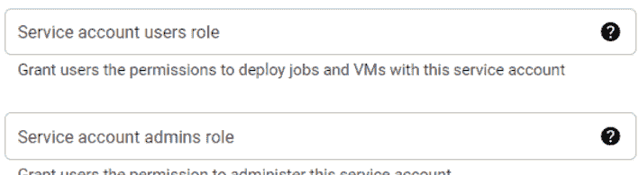

图 15.14 – 分配角色

如果我们重新审视创建虚拟机实例的过程，我们可以在 Identity and API access 选项下分配此服务账号：

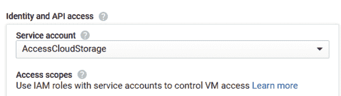

图 15.15 – Identity and API access

这将允许服务账号承担服务账号身份以进行 API 请求的身份验证。正如我们之前提到的，我们可以看到我们有将我们创建的账号分配给服务账号的选项。

如果选择默认服务账号，你会注意到有选择访问范围的选项。访问范围决定了 API 调用对服务的访问级别。最佳实践是为每个服务单独选择每个 API 的访问权限以提高安全性。以下是当前可用的完整 API 列表：

Access scopes
Allow default access
Allow full access to all Cloud APIs
Set access for each API

BigQuery
None

Bigtable Admin
None

Bigtable Data
None

Cloud Datastore
None

Cloud Debugger
None

Cloud Pub/Sub
None

Cloud Source Repositories
None

Cloud SQL
None

Compute Engine
None

Service Control
Enabled

Service Management
Read Only

Stackdriver Logging API
Write Only

Stackdriver Monitoring API
Write Only

Stackdriver Trace
Write Only

Storage
Read Only

Task queue
None

User info
None

图 15.16 – API 列表

服务账号使用服务账号密钥进行管理。有两种类型的服务账号密钥：

- **Google Cloud-managed**：Google Cloud-managed 密钥由 Compute Engine 和 App Engine 等服务使用，无法下载。
- **User-managed**：User-managed 密钥由 GCP 用户创建，可以下载和管理。你对 user-managed 密钥负全责。

我们将在本章的 *Encryption* 部分讨论密钥管理。

在结束对服务账号的讨论之前，最后一点需要注意的是，服务账号仍应遵循我们关于 IAM 所学到的相同原则。服务账号应仅获得该服务所需的最小权限集。

> **Exam Tip**
> 对于考试而言，这一主题是关键，以便你理解身份、角色和资源。我们在前几章中简要涉及了 IAM，但现在，我们希望更详细地研究它。在阅读进一步内容之前，需要注意的一些原则将在本章中更详细地解释如下：IAM 角色是可以分配给用户、组或服务账号的权限组；有不同类型的角色；我们应遵循最小权限原则；并且在可能的情况下，使用组来控制访问，而不是授予单个用户的访问权限。

在本节中，我们介绍了服务账号。我们解释了它们是一种特殊的账号类型，可以将用户从直接参与中移除，并且它们是 Google IAM 的重要组成部分。在下一节中，我们将查看访问控制列表，它是 IAM 的替代方案。

## Cloud Storage 访问管理

除了使用 IAM 权限来限制对 Cloud Storage 的访问外，还可以使用 **Access Control Lists (ACLs)** 来保护它。ACLs 应在你希望对对象而不是整个存储桶设置权限时使用，例如，要访问特定存储桶中的单个对象。这是因为 Cloud IAM 会将权限应用于存储桶中的所有对象。了解这一点至关重要，因为从可管理性角度来看，单独管理这些对象并不理想，如果存储桶中所有对象的权限有共同之处，则应使用 IAM 来控制访问。

ACL 由定义可以执行的操作的权限以及定义谁可以执行该操作的范围组成。当对存储桶发出请求时，ACL 将在适用时授予用户权限；否则，请求将导致 403 Forbidden 错误。存储桶中的对象只能被授予 Owner 或 Reader 权限，如以下屏幕截图所示：

### 编辑 notes.txt 权限

如果你不依赖单个对象级权限，可以开始在存储桶级别统一管理所有权限。转到存储桶的 Permissions 选项卡开始。了解更多

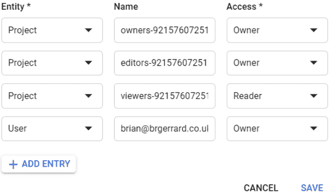

图 15.17 – GCP 存储桶文件权限

> **Important Note**
> 除了 ACL 之外，GCP 还提供 Storage Legacy bucket Owner、Storage Legacy bucket Reader 和 Storage Legacy bucket Writer 的传统角色。

与 IAM 一样，我们应遵循最小权限原则。如果你需要使用 ACL，则不要在不需要时应用所有者角色。你应注意确保存储桶不会不必要地公开（通过分配 allUser 角色）。为存储桶分配错误的权限是现实世界中非常典型的安全漏洞，在应用 ACL 之前应仔细考虑。

在考试前你应该了解的最后一点信息是使用签名 URL 的用法。此选项允许你授予访客访问权限，以便他们无需 Google 账号即可从存储中上传或下载。访问可以是时间限制的，并且可以为拥有该 URL 的任何人授予读取或写入访问权限。我们可以通过运行以下命令使用 gsutil 创建签名 URL：

```
gsutil signurl -d 10m Desktop/private-key.json gs://example-bucket/cat.jpeg
```

在此示例中，我们使用 private-key.json 作为我们的服务账号私钥来公开 example-bucket 中的 cat.jpeg 存储桶对象。

> Exam Tip
> 请记住，我们绝不应授予用户或服务超出所需范围的权限。始终使用最小权限原则。

接下来，我们将查看 Organization Policy Service。

## Organization Policy Service

Organization Policy Service 为我们提供对组织云资源的编程控制。这允许集中控制以配置组织资源的配置方式。此外，它有助于开发团队保持在合规边界内，并帮助项目所有者快速移动而无需担心或破坏合规性。

重要的是要强调 Organization Policies 与我们之前讨论的 IAM 不同。虽然 IAM 专注于允许管理员根据权限授权谁可以对特定资源执行操作，但 Organization Policies 专注于允许管理员对特定资源设置限制以确定它们如何配置。组织策略是一组限制，作为管理员，我们定义策略以强制对组织、文件夹或项目实施限制。

为了定义此类策略，我们会选择一种特定类型的限制，称为 **constraint**。约束应用于 Google Cloud 服务或服务列表。本质上，这是定义受控行为的蓝图。约束具有类型，要么是 list 要么是 Boolean。正如你所猜测的，list 约束将评估管理员设置的一组允许或拒绝的值。例如，这可以是可以连接到虚拟机的允许 IP 地址列表。Boolean 约束将要么强制执行要么不强制执行。

当策略设置在资源上时，该资源的所有后代默认会继承该策略。具有 **Organization Policy Administrator** 角色的用户可以在需要例外时修改此继承。

违规是指服务以违反组织策略限制的状态行事的情况。这可能发生在新策略对服务已处于的状态或操作设置限制时。

要创建 Organization Policy，请导航到 **IAM & Admin | Organization Policies**。这将列出可用的策略：

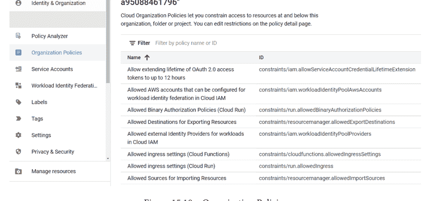

图 15.18 – Organization Policies


作为示例，以下策略已被选中。每个策略都描述了约束条件以及其当前的应用方式。我们可以看到，默认情况下它将被继承。如果我们被允许编辑策略，我们可以编辑策略并更改有效策略：

## Cloud IAM 中工作负载的允许外部身份提供者

可在 Cloud IAM 中为工作负载身份验证配置的身份提供者，以 URI/URL 指定。

适用于

项目 "qwiklabs-gcp-03-a95088461796"

继承

已继承

ID

constraints/iam.workloadIdentityPoolProviders

有效策略

允许

全部

推荐

无

图 15.19 – 策略描述

重申一下，组织策略对于考试成功非常重要理解。请确保您了解它们与 IAM 的区别。

接下来，让我们回顾防火墙规则和负载均衡器。

## 防火墙规则和负载均衡器

我们在第 10 章《GCP 中的网络选项》中已经介绍过网络，但我们想回顾一下从安全角度来看重要的内容。

如果 Compute Engine 实例不需要相互通信，那么我们应该将它们托管在不同的虚拟私有云（VPC）网络上。此外，如果我们有一个由不同网络层上的服务器组成的应用程序，那么每个服务器都应该位于不同的子网中。让我们以传统的 Web 应用和数据库应用程序为例。我们希望将每个层分割到不同的子网中。

防火墙规则是保护网络的明显选择。正如您现在所知，VPC 允许您隔离网络以实现计算资源之间的分段。防火墙规则允许您通过根据方向、源或目标、协议和优先级允许或拒绝流量来控制入站和出站流量的流动。以下屏幕截图显示了新防火墙规则的创建：

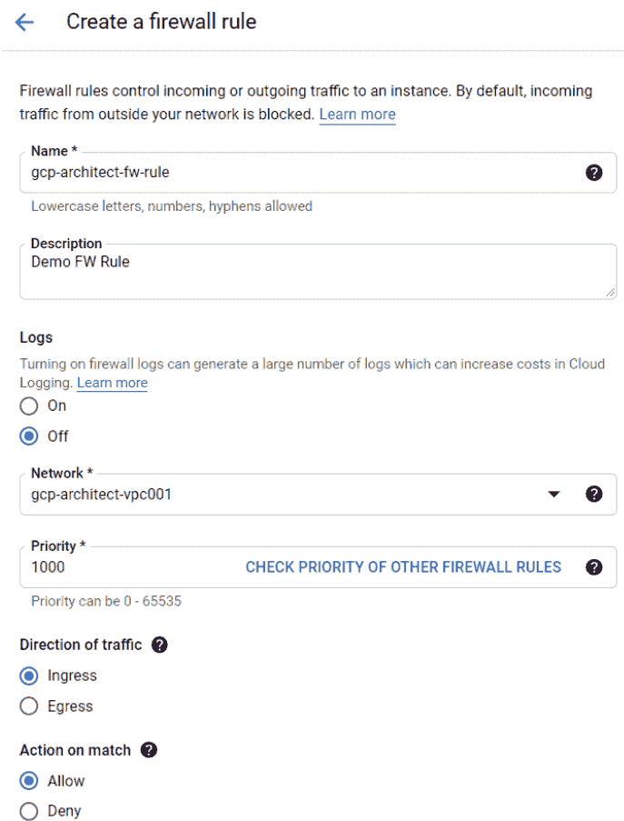

图 15.20 – 新防火墙规则

需要注意的是，GCP 中的防火墙规则是有状态的，这意味着如果一条规则由一个方向上的 **Allow** 规则发起，则流量将被自动允许返回。同样，您还应该了解，所有 VPC 都有两条默认规则。第一条允许所有传出连接到任何 IP 地址，而第二条阻止所有传入流量。这些被分配了最低优先级，这意味着它们可以很容易地被您的自定义规则覆盖。应用于新 VPC 的其他规则允许所有协议和端口在实例之间的入站连接。其他规则允许 ICMP 流量（`ping/trace route`）、SSH 和 RDP 从任何源到 VPC 中的任何目标。

与 IAM 一样，对于防火墙规则，我们也应使用最小权限原则。也就是说，我们应该只允许应用程序所需的通信，并限制任何不需要的内容。被认为是一种良好做法的做法是创建一个优先级较低的规则来阻止所有流量，然后在上面叠加具有更高优先级的相关规则。

GCP 中的负载均衡器也提供额外的安全性。负载均衡器支持 SSL 和 HTTPS 代理以实现传输中加密。要求至少有一个签名的 SSL 证书安装在负载均衡器的目标 HTTPS 代理上，您可以选择使用自管理 SSL 证书或 Google 管理的 SSL 证书。看起来很明显，如果您需要使用 HTTPS 流量，则应选择 HTTPS 负载均衡器，但对于非 HTTPS 流量，您应使用 SSL 负载均衡器。

在下一节中，我们将介绍 Cloud Web Security Scanner。

## Cloud Web Security Scanner

将应用程序安全视为与基础设施安全同等重要是很重要的。应用程序是攻击的主要目标之一，GCP 通过 Web Security Scanner 服务来帮助实现这一点。当然，我们知道安全是一个极其重要的主题，Cloud Web Security Scanner 支持我们轻松检测服务中的漏洞。

当您创建扫描时，您可以将其设置为扫描您的 Compute Engine 实例、App Engine 实例或 GKE 实例托管的 URL，同样也可以排除 URL。它将检测常见的漏洞，例如 flash 注入、混合内容、明文密码和 XSS。我们还可以设置扫描计划或手动执行。

**重要说明**
需要注意的是，Cloud Scanner 可以对您的应用程序产生真实负载，因此性能应予以考虑，因为某些扫描可能需要数小时才能完成。同样，在使用此服务时应谨慎，因为它可能会在网页的评论区发布评论，或在页面上提示注册时生成多封电子邮件。因此，良好的做法是在测试环境中扫描您的应用程序，并在启动扫描前备份应用程序的状态。

以下屏幕截图显示我们正在创建新的扫描。首先，我们必须导航到 **App Engine | Security Scan**。我们必须然后点击 **Enable API**。我们现在准备创建新的扫描：

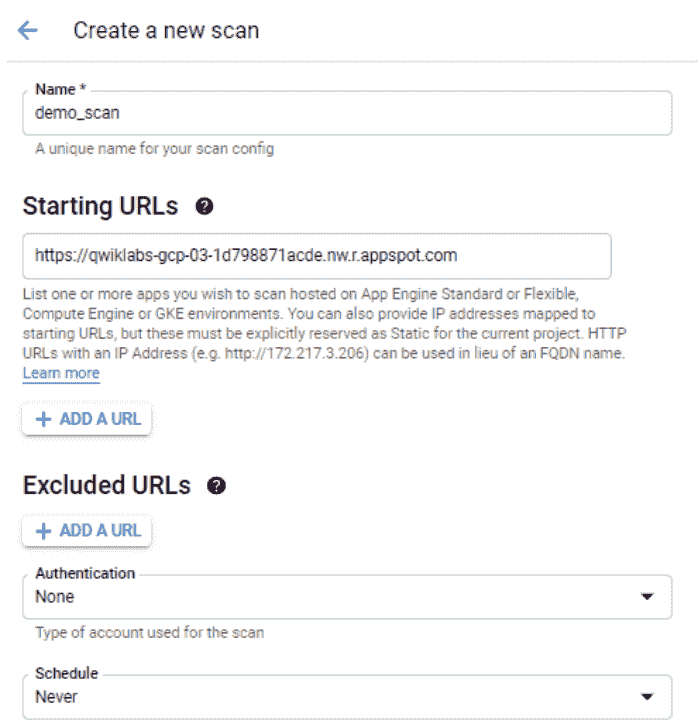

图 15.21 – 新安全扫描

当我们运行扫描后，我们将收到结果，其中会标记任何漏洞，如以下屏幕截图所示。我们还可以查看扫描的日期和扫描的持续时间：

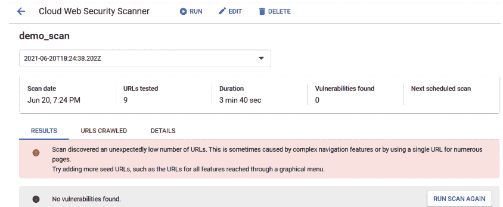

图 15.22 – 安全扫描结果

在本节中，我们查看了 Cloud Web Security Scanner 并向您展示了如何设置新的扫描。在下一节中，我们将涉及监控和日志记录。

## 监控和日志记录

我们将在第 17 章《监控您的基础设施》中更详细地介绍监控，但从安全角度来看再次提及是明智的。Cloud Operations 是 Google 用于监控和管理服务、容器、应用程序和基础设施的服务。Cloud Operations 提供错误报告、调试、警报、跟踪和日志记录。

日志记录有助于保护 GCP 并最大限度地减少应用程序的停机时间。监控允许您监控可能标记异常的应用程序指标。此外，Cloud Operations Debugger 检查生产数据的状态并在没有任何性能开销的情况下比较源代码。日志记录允许实时指标日志记录并保留一段时间，具体取决于日志类型。如果您有安全要求需要更长时间保留日志，则可以将它们导出到 Cloud Storage，后者为长期提供经济实惠的存储。

## 加密

加密是敏感数据的基本安全形式。以最简单的形式，加密是将明文数据转换为乱码字符字符串的过程。我们无法阅读这些字符串，更重要的是，如果系统没有解密回明文格式的相关密钥，则无法读取它们。

加密是 GCP 安全的关键要素。默认情况下，GCP 提供静态加密，这意味着存储在 GCP 存储服务上的数据在无需用户进一步操作的情况下即已加密。这意味着无需额外的配置，即使这些数据以某种方式落入错误的人手中，数据也无法读取，因为他们没有正确的加密密钥来理解数据。

通过 GCP 加密敏感数据的能力确保客户的机密数据保持安全。其核心保护是 GCP KMS，Google 使用它来管理云服务的加密密钥。Cloud KMS 允许您生成、使用、轮换和销毁加密密钥，这些密钥可以由 Google 生成或从您的 KMS 系统导入。Cloud KMS 与 Cloud IAM 集成，因此您可以管理单个密钥的权限。例如，当我们创建新磁盘时，默认选项是使用 Google 管理的密钥。

现在，让我们来看看数据加密密钥和密钥加密密钥。

## 数据加密密钥与密钥加密密钥

用于加密数据片段的密钥称为 **数据加密密钥（DEK）**。这些密钥随后会被 **密钥加密密钥（KEK）** 包装。KEK 存储并在 Google Cloud 的 KMS 中管理，使 Google 能够从中央点跟踪和控制访问。不可能从 KMS 导出您的 KEK，并且所有密钥的加密和解密必须在 KMS 内部进行。此外，KMS 托管的密钥会备份用于灾难恢复。KEK 也会在一定时期内轮换，这意味着会创建一个新密钥。这使 GCP 能够遵守某些法规，例如 **支付卡行业数据安全标准（PCI DSS）**，并且被认为是一种安全最佳实践。GCP 默认每 90 天轮换一次密钥。

## CMEK 与 CSEK

GCP 提供额外的加密密钥管理方法，可能更符合客户的安全策略。


GCP 提供了客户管理 KEK 的能力，让我们能够控制密钥的生成、密钥的轮换以及密钥的过期。密钥仍将存储在 KMS 中，但我们将控制其生命周期。这被称为 CMEK。为了有效组织密钥，Google Cloud KMS 使用密钥环的概念将密钥分组在一起并将继承的权限推送到密钥。

我们可以通过执行多个步骤来创建我们的密钥。让我们开始吧：

1. 通过从 GCP 控制台浏览到 **Security | Key Management**，我们可以创建新的密钥环。密钥环将密钥分组在一起。我们必须做的第一件事是启用 IP，然后选择密钥环位置。我们可以选择一个区域，也可以选择 **global**。我们的决定会影响使用该密钥的应用程序的性能以及创建密钥时可用的选项。在以下示例中，我们选择了 **global**。全局位置是一种特殊的跨区域位置，其数据中心分布在世界各地，并且无法控制所选的确切数据中心。我们只有在应用程序分布在全球、读写操作不频繁且密钥没有地理驻留要求时才应使用 **global**：

## Create key ring

Key rings group keys together to keep them organized. In the next step, you’ll create keys that are in this key ring. Learn more

Project name
qwiklabs-gcp-03-e5a43cc9b75e

Key ring name *
gcp-architect-key-ring

Key ring location *
global

CREATE   CANCEL

Figure 15.23 – Create key ring

一旦我们创建了密钥环，我们将被提示创建密钥。我们可以在密钥环下创建多个密钥，这些密钥将负责加密和解密数据。创建新密钥时，您可以看到我们有设置密钥用途的选项；例如，密钥是否仅用于加密、解密或两者兼有。

> Tip
> 在决定选择哪个位置时，应考虑网络性能。

2. 我们要做的第一个选择是我们想要什么类型的密钥。我们有以下选项。正如我们选择了全局密钥环一样，我们无法选择外部管理的密钥。我们可以从描述中看出，生成的密钥是标准客户管理的加密密钥：

## What type of key do you want to create?

- Generated key
  A standard customer managed encryption key. The key material will be generated for you.
  Learn more
- Imported key
  For importing your key material into GCP. Learn more
- Externally managed key
  The key material will be stored in an external key manager. Learn more

Figure 15.24 – Selecting the type of key

3. 此外，我们还可以选择轮换周期以及密钥有效期的开始时间。创建密钥后，我们可以通过 GCP 控制台管理轮换周期、禁用和重新启用密钥，或完全删除密钥。以下屏幕截图显示了我们创建新密钥的过程：

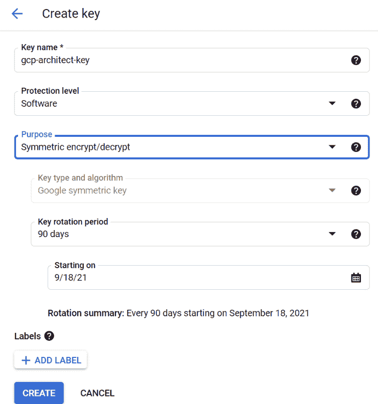

Figure 15.25 – Create key

KMS 密钥结构的一个重要方面是密钥版本。每个密钥可以有多个版本，按顺序编号，从 1 开始。我们可能使用相同的密钥但使用不同的密钥版本来加密文件。Cloud KMS 会自动识别用于加密的版本，并在版本仍启用时使用它来解密文件。如果版本已移动到禁用、销毁或计划销毁的状态，我们将无法解密文件。

4. 现在我们已经创建了密钥，让我们使用它。例如，如果我们想在 GCP 中创建一个新磁盘，我们在加密设置下有几个选项。要使用我们新创建的密钥，我们应选择 Customer-managed key 并在提示时从下拉菜单中选择我们的密钥，如以下屏幕截图所示：

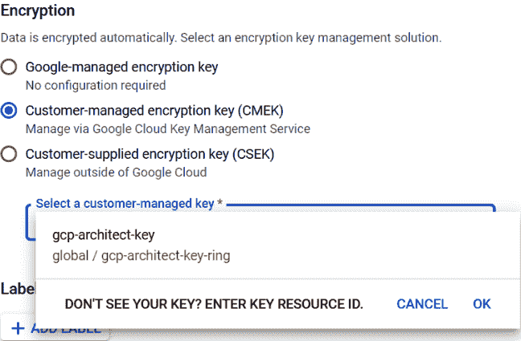

Figure 15.26 – Using Customer-managed encryption key (CMEK)

另一个可用的选项是 CSEK，其中密钥不存储在 KMS 中，Google 不管理密钥。CSEK 允许我们提供自己的 AES-256 密钥。如果我们提供此密钥，Cloud Storage 不会永久将其存储在 Google 的服务器上，也不会以任何方式管理我们的密钥。一旦我们为 Cloud Storage 操作提供了密钥，该密钥就会从 Google 的内存中清除。这意味着每次创建或使用存储资源时都必须提供该密钥。客户将承担全部责任，这意味着如果密钥丢失，则无法解密您的数据。在这里，我们将选择 Customer-supplied encryption key (CSEK) 选项并输入相关密钥。

现在，让我们开始了解一些行业法规。

## Industry regulations

同样重要的是要了解，安全不仅仅是防火墙规则或加密。Google 需要遵守全球法规和第三方认证。GCP 遵守的法规示例可以在其网页 https://cloud.google.com/security/compliance/#/ 上找到。建议您查看此页面以熟悉应满足的各种标准。其中一些将是众所周知的；例如，来自金融行业的法规，如 PCI DSS 或 ISO 27017，负责云供应商和客户之间的交互。

在本节中，我们将介绍 PCI 合规性。

## PCI compliance

许多组织处理金融交易，Google 必须竭尽全力保护其服务器上的信息。PCI 的一个例子可以将我们之前学到的内容与现实生活中的例子联系起来。如果需要设置特定的支付处理环境，Google 可以帮助客户实现这一目标。该架构的核心是我们本章学到的内容。为了保护环境，我们应使用 Resource Manager 创建单独的项目以隔离我们的游戏和 PCI 项目。我们可以利用 Cloud IAM 并将权限应用于这些单独的项目。记住最小权限原则！我们还可以使用防火墙规则来限制入站流量以保护环境。我们希望公众能够使用我们的支付页面，因此我们需要 HTTPS 流量由 HTTP(S) 负载均衡器保护，并且任何额外的支付处理应用程序可能需要与第三方进行双向访问。请查看文章 https://cloud.google.com/solutions/pci-dss-compliance-in-gcp 以更深入地了解 GCP 如何处理 PCI DSS 要求。

在下一节中，我们将回顾数据丢失防护。

## Data loss prevention (DLP)

删除 **Personal Identifiable Information (PII)** 也是行业内的一个关注点。Cloud DLP 为我们提供了一个强大的数据和去识别化平台。DLP 使用信息类型，也称为 infoTypes，来定义要扫描的内容。这些 infoTypes 是敏感数据类型，例如姓名、电子邮件地址、信用卡号或识别号码。Cloud DLP 如何帮助我们的一个例子是，我们可以自动从可能存储在 GCP 存储库中的此类敏感数据中进行涂黑。

我们还应注意，遵守 **European Union General Data Protection Regulation (GDPR)** 是 Google 从安全角度的首要任务之一，并且这些内置的 infoType 检测器提供 GDPR 合规性。

## Penetration testing in GCP

值得注意的是，如果您需要对 GCP 基础设施进行渗透测试，您不需要 Google 的许可，但必须遵守可接受使用政策，以确保测试仅针对您的项目。有趣的是，Google 提供了一个激励计划，如果发现错误或漏洞，奖励范围从 $100 到 $31,337！

## CI/CD security overview

随着 DevOps 越来越受欢迎，在构建管道、镜像和交付模型时考虑安全非常重要。Google Cloud 在构建 CI/CD 管道时提供了一些最佳实践。然而，它们像许多最佳实践一样是主观的，可能不适用于您的架构。尽管如此，考虑以下事项仍然很重要：

- **Branching model**: 重要的是要考虑对代码的更改将如何影响生产环境，因此可能需要功能分支来在对生产代码库进行任何合并请求之前测试更改。
- **Container image vulnerabilities**: 在创建要在管道中使用的镜像时，在镜像上传到 Artifact 或 Container Registry 时扫描漏洞也很重要。在这种情况下，可以使用 Cloud Build 在镜像构建后扫描镜像，然后阻止其上传到 Artifact Registry。这称为按需扫描。
- **Filesystem security**: 即使在容器中，防止潜在攻击者安装其工具也很重要。我们应避免在容器内以 root 身份运行，并在只读模式下启动容器。
- 容器的大小也应考虑，不仅从性能角度，而且从安全角度。较小的容器意味着更小的攻击面。许多较大的容器显示与已安装但与应用程序无关的程序相关的漏洞。

现在，让我们来看 Identity-Aware Proxy。


## Identity-Aware Proxy (IAP)

Google 通过 Cloud IAP 为运行在 GCP 上的 Cloud Engine 实例或应用程序提供额外的访问控制。这允许通过 HTTPS 验证用户的身份，并且仅在允许的情况下授予访问权限。该服务对于远程工作者尤其有用，因为它消除了使用本地网络通过公司 VPN 对用户请求进行身份验证的需求。相反，访问是通过可通过互联网访问的 URL 进行的。当远程用户需要访问应用程序时，请求会被转发到 Cloud IAP，并且如果允许则会授予访问权限。此外，没有传统 VPN 的开销，管理员的可管理性也得以简化。

启用 Cloud IAP 是一个简单的过程，但必须满足一些先决条件。你需要配置防火墙规则以阻止对托管应用程序的 VM 的访问，并且只允许通过 IAP 访问。接下来，你需要导航到 GCP 控制台中的 Security | Identity-Aware Proxy，在那里你会找到你的应用程序或 Compute Engine 资源的列表。只需单击蓝色单选按钮即可启用 IAP。

> **重要提示**
> 你可能首先会被要求进行 OAuth 同意。

最后，你可以从将出现的 information panel 中用相关成员填充 IAP 访问列表。以下屏幕截图显示了 IAP 已为 HTTPS 资源启用：

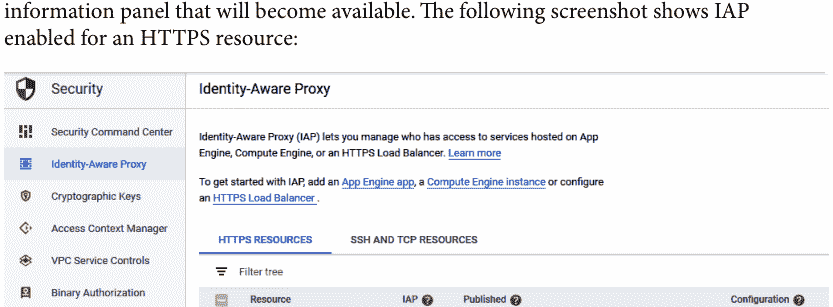

图 15.27 – Identity-Aware Proxy

现在我们已经对 IAP 进行了概述，让我们来看一些重要功能。

## TCP forwarding

IAP 具有端口转发功能，允许我们从公共互联网对后端进行 **Secure Shell (SSH)** 或 **Remote Desktop for Windows (RDP)**，从而防止这些服务公开暴露在互联网上。我们需要在到达目标资源之前通过授权和身份验证检查，从而降低从互联网连接这些服务的风险。

IAP 的转发功能允许我们连接到 Compute Engine 实例上的随机 TCP 端口。IAP 然后会在 localhost 上创建一个监听端口，将所有流量转发到我们的实例。IAP 然后会将客户端的所有流量包装在 HTTPS 中，并在我们成功通过身份验证后允许访问接口和端口。此身份验证过程基于配置的 IAM 权限。

我们应该注意一些限制。端口转发不适用于批量数据传输，因此 IAP 保留对服务滥用进行速率限制的权利。此外，在非活动 1 小时后，IAP 将自动断开我们的会话，因此使用此功能的应用应具有在断开连接后重新建立隧道的逻辑。

## Access Context Manger

Access Context Manager 为 Google Cloud Organization 管理员提供定义项目和 GCP 资源细粒度、基于属性的访问控制的能力。Access Context Manager 根据请求的上下文授予访问权限，例如用户的身份、设备类型或 IP 地址。它在传统的边界安全模型之上增加了另一层保护，在该模型中，网络内部的任何内容都被视为受信任。Access Context Manager 考虑到了移动劳动力和 **Bring Your Own Device (BYOD)**，这增加了边界安全模型未考虑的额外攻击向量。

## Chronicle

Google 安全套件中最新的引入之一是 **Chronicle**。虽然我们怀疑考试中不会就此进行提问，但我们认为值得对此说几句话。

Chronicle 是一种威胁检测解决方案，可帮助企业以速度和规模识别威胁。它可以搜索企业产生的大量安全和网络遥测数据，并对活动提供即时分析和上下文。

## Summary

安全方面有更深入的探讨，但对于考试，你必须理解安全是 Google 所有服务的重要部分，而非事后考虑。到目前为止，我们已经介绍了一些服务，以确保你的 GCP 基础设施安全。我们介绍了 Cloud Identity，介绍了 IAM 模型，并研究了加密。

在下一节中，我们将介绍额外的安全服务。

## Additional security services

GCP 提供了多个高级服务来帮助你保护基础设施和资源。在本节中，我们将简要介绍其他关键服务。

## Security Command Center (SCC)

SCC 为企业提供对其在多个 GCP 服务中的云数据的整体视图。SCC 的真正好处在于它协助收集数据和识别威胁，并且可以在任何业务影响发生之前采取行动。它还提供反映我们资源整体健康状况的仪表板。它还可以与其他 GCP 工具（如 Cloud Security Scanner）和第三方（如 Palo Alto Networks）集成。GCP 将 SCC 中的可能安全威胁称为 findings。要访问这些 findings，你必须拥有相关的 IAM 角色，其中包括 Security Center Findings Viewer 的权限，然后浏览到 SCC 的 Findings 选项卡。当然，像所有 GCP 服务一样，有 API 集成，允许我们列出任何 findings。SCC 还允许我们使用 security marks，这使我们能够注释资产或 findings 并使用这些标记进行搜索或过滤。

要使用 SCC，你必须从你的 GCP 组织中查看它。此外，你必须是组织管理员并拥有当前组织的 Security Center Admin 角色。这允许你选择所有当前和未来的项目以包含在内（如果愿意）。或者，我们可以根据发现的任何安全风险包含或排除单个项目。

Security Command Center 事件可以导出到 Chronicle，它专为安全威胁检测和调查而构建。它建立在 Google 基础设施之上，让我们能够利用 Google 的规模来减少调查时间。

## Forseti

Forseti 是一款开源安全工具，可帮助保护你的 GCP 环境。如果希望监控资源以确保访问控制与预期一致，则很有用。它还可用于在任何内容更改时通过电子邮件或 Slack 频道发布进行提醒。此外，它允许你对资源进行快照，以便你始终知道云的样子。它还可以通过将策略与当前状态进行比较并使用 GCP API 纠正任何违规行为，对敏感的 GCP 资源强制执行规则。

## Cloud Armor

Cloud Armor 使用 Google 的全球基础设施提供抵御 DDoS 攻击的规模化防御。它用于将访问你的 HTTPS 负载均衡器列入黑名单或白名单。这可用于防止恶意用户或流量联系你的资源，或更糟的是，基于规则集接管你的 VPC。以下屏幕截图显示了一项策略，该策略已设置为拒绝特定 IP 并返回 404 错误：

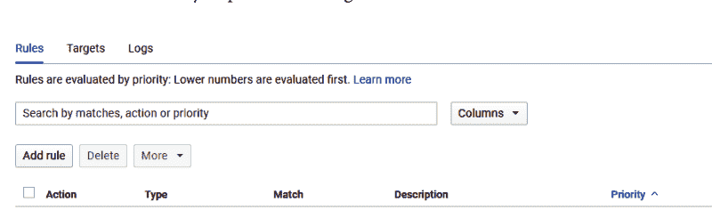

图 15.28 – Cloud Armor

通过单击 Targets 选项卡，我们可以看到该策略正在定位后端负载均衡器，如以下屏幕截图所示：

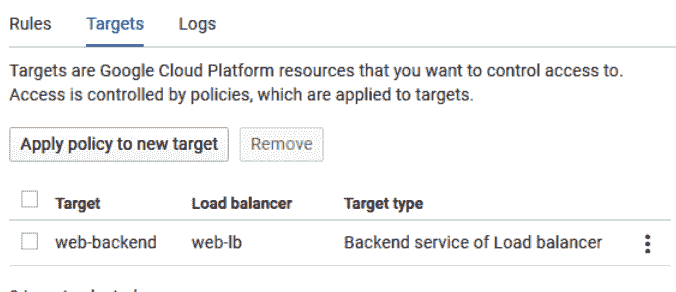

图 15.29 – Cloud Armor – Targets

Cloud Armor 日志允许我们查看任何访问尝试并告诉我们哪个源请求了访问。我们应该注意，这些日志是通过 Stackdriver 提供的，该内容在本章的 Monitoring and logging 部分进行了描述。这将在第 17 章 Monitoring Your Infrastructure 中更详细地介绍。

以下屏幕截图显示了 Cloud Armor 日志的一些示例输出：

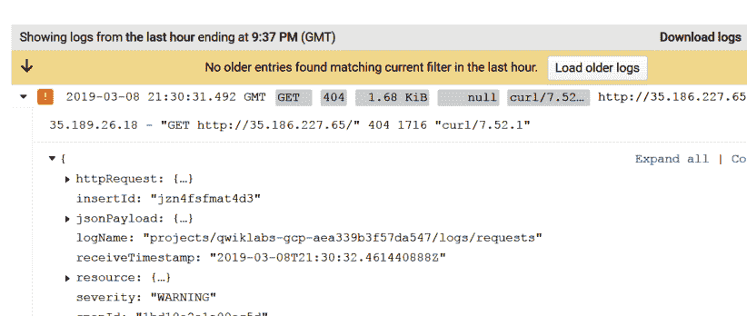

图 15.30 – Cloud Armor logs

## Secret Manager

Secret Manager 是一个方便且安全的系统，用于存储证书、密码或 API 密钥。将此敏感数据存储在中央位置可提供单一事实来源来管理、访问和审计 Google Cloud 中的机密。Secret Manager 还允许为每个机密设置访问策略。此外，可以为每次机密访问配置审计日志。此服务是 Hashicorp Vault 等第三方机密管理系统的替代方案。

在本节中，我们查看了 GCP 提供的一些其他安全服务。并非所有这些都将在考试中提问，但对每个服务的高层次了解是很有益的。

## Summary

安全方面有更深入的探讨，但对于考试，我们必须理解安全是 Google 所有服务的重要部分，而非事后考虑。在本章中，我们查看了 GCP 提供的许多服务，以确保我们的解决方案安全。在其他方面，我们介绍了 Cloud Identity，介绍了 IAM 模型，并研究了加密。在下一章中，我们将介绍 Google Cloud Management Options。

> Exam Tip
> 请记住，我们绝不应授予用户或服务超出其所需权限的权限。始终使用最小权限原则。

## Further reading

阅读以下文章以获取本章所涵盖内容的更多信息：

- **Cloud Identity**: https://cloud.google.com/identity/docs/
- **IAM**: https://cloud.google.com/iam/docs/
- **Encryption**: https://cloud.google.com/storage/docs/encryption/
- **Cloud IAP**: https://cloud.google.com/iap/docs/
- **Security Command Center**: https://cloud.google.com/security-command-center/docs/


- **Cloud Armor**: https://cloud.google.com/armor/docs/
- **Google Cloud Security Foundations Guide**: https://services.google.com/fh/files/misc/google-cloud-security-foundations-guide.pdf
- **Best Practices Guides**: https://cloud.google.com/security/best-practices#section-1

## 16
Google Cloud 管理选项

本章描述如何利用各种可用的管理选项，以便您可以轻松管理 **Google Cloud Platform (GCP)** 服务。在之前的章节中，我们已经涉及了可用于管理 Google 服务的命令行工具。在本章中，我们将更详细地查看这些工具，其中包括 `gcloud`、`cbt`、`bq` 和 `gsutil`。

> **考试提示**
> 您必须了解用于管理特定服务的最高效命令行工具。复习并理解本章中的每个命令行工具，并确保您可以快速将其映射到 GCP 服务。例如，如果我们被要求使用命令行工具创建一个新的存储桶，我们应该立即知道需要使用 `gsutil`。
> 
> 我们还建议您更深入地查看 `gsutil` 命令行并理解它们，以便您可以设置生命周期策略。

随着本章对每个管理选项的介绍，您可以预期了解如何访问它并从示例中获得实践知识。您还可以预期看到可在现实世界中使用的基于代码的命令，但对于考试成功也很重要需要理解。我们将首先查看使用 **应用程序编程接口 (APIs)**，然后再查看剩余的工具。

在本章中，我们将介绍您可以使用的各种管理选项。具体来说，我们将涵盖以下主题：

- 使用 API 管理资源
- 使用 Google Cloud Shell
- GCP **软件开发工具包 (SDK)**
- 探索 Cloud Deployment Manager
- 定价计算器
- 其他需要考虑的事项

## 使用 API 管理资源

API 使用现在非常普遍。API 是应用程序的访问点，为开发人员在与之通信的方式上提供灵活性，极大地提高了他们的效率。

> **重要说明**
> GCP 为其服务的 API 提供了完整的文档。我们建议您查看 https://cloud.google.com/apis/ 并点击您希望了解更多信息的特定服务。

API 使用不同的身份验证服务，具体取决于 API 调用来自何处以及它们请求的资源：

- **API 密钥**：这些是可以用于 API 调用不需要访问用户数据时的加密字符串。这些非常适合让开发人员快速上手。密钥在 GCP 控制台下的 **APIs & Services | Credentials** 中创建。然后这些密钥在 API 请求中使用。
- **OAuth 客户端 ID**：这些基于范围，意味着不同的权限将授予不同的 ID。如果开发人员需要请求用户数据，则使用此方法。
- **服务账号**：这些属于 **虚拟机 (VM)** 实例的应用程序。请参阅 *第 15 章，安全与合规*，以获取有关服务账号的更深入信息。

让我们看一个使用 API 的示例。如前所述，我们可以浏览到 GCP 控制台中的 **API & Services**，然后选择 **ENABLE APIS AND SERVICES**。如果我们搜索 `Compute Engine`，如以下屏幕截图所示，我们可以选择 **TRY THIS API**：

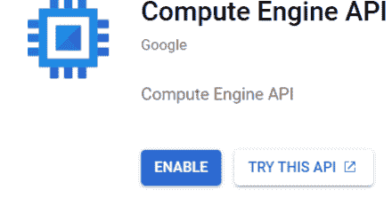

图 16.1 – 启用 API

这将带我们进入 **Compute Engine API** 文档页面。这是 GCP 提供的一项不错的功能，可帮助我们在其所有服务中使用 API 调用。如果可以滚动浏览文档，我们将看到与 GCE 相关的所有 API 调用的列表。让我们寻找一种可用于创建新实例的方法；即在 `v1.instances.insert` 列表下：

Compute Engine > Documentation > Reference

### 方法：instances.insert

在指定的项目中使用请求中包含的数据创建实例资源。

图 16.2 – API 示例

如果我们点击此方法，它将带我们进入一个页面，允许我们通过 API 请求 VM 实例。我们首先需要注意的是右侧的菜单，在那里我们可以选择 OAuth 2.0 作为我们的身份验证方法。这允许我们使用登录 GCP 控制台的相同用户授权 API 调用。有些必填信息需要填写，用红色标出：

- **project**：这是您的 GCP 项目的 ID。
- **zone**：这是您希望 VM 驻留的区域。

以下屏幕截图显示了这些字段的示例填充：

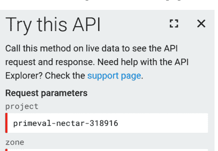

图 16.3 – 试用此 API

我们还需要用有关请求的信息填充请求正文。让我们查看以下示例中所需的内容。我们需要提供有关机器类型、机器名称以及磁盘和映像类型的信息：

```
{
  "machineType": "zones/us-central1-f/machineTypes/n1-standard-1",
  "name": "test001",
  "disks": [
    {
      "initializeParams": {
        "sourceImage": "projects/debian-cloud/global/images/family/debian-9"
      },
      "boot": true,
```

```
"interface": "SCSI"
}
],
"networkInterfaces": [
{
"network": "global/networks/default"
}
]
}
```

经过初步验证后，我们可以通过点击 **Authorize and execute** 执行请求。响应代码 **200 OK** 意味着我们的请求已成功执行：

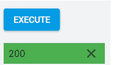

图 16.4 – API 返回代码

仔细查看，我们可以看到有关用户、URI 和区域的信息：

```
{
"id": "5737119379050389182",
"name": "operation-1625514064727-5c6657c67cea7-42560a30-2bf3bace",
"zone": "https://www.googleapis.com/compute/v1/projects/primeval-nectar-318916/zones/us-central1-f",
"operationType": "insert",
"targetLink": "https://www.googleapis.com/compute/v1/projects/primeval-nectar-318916/zones/us-central1-f/instances/test001",
"targetId": "6541634553944923838",
"status": "PENDING",
"user": "gcparchitectbook@gmail.com",
"progress": 0,
"insertTime": "2021-07-05T12:41:06.131-07:00",
```

```
"selfLink": "https://www.googleapis.com/compute/v1/projects/primeval-nectar-318916/zones/us-central1-f/operations/operation-1625514064727-5c6657c67cea7-42560a30-2bf3bace",
"kind": "compute#operation"
}
```

现在，让我们通过创建一个新磁盘来看另一个示例。我们可以简单地搜索 v1.instances.insert 方法。同样，我们需要填充项目和区域。请求正文也是必需的：

```
{
  "name": "newdisk001",
  "sizeGb": 10
}
```

点击 Authorize and execute 后，我们再次可以看到响应：

```
{
  "id": "4514886327875854282",
  "name": "operation-1625514277056-5c665890fb0fa-1bd73387-5f597370",
  "zone": "https://www.googleapis.com/compute/v1/projects/primeval-nectar-318916/zones/us-central1-f",
  "operationType": "insert",
  "targetLink": "https://www.googleapis.com/compute/v1/projects/primeval-nectar-318916/zones/us-central1-f/disks/newdisk001",
  "targetId": "3511243588531838922",
  "status": "RUNNING",
  "user": "gcparchitectbook@gmail.com",
  "progress": 0,
  "insertTime": "2021-07-05T12:44:37.706-07:00",
  "startTime": "2021-07-05T12:44:37.713-07:00",
  "selfLink": "https://www.googleapis.com/compute/v1/projects/primeval-nectar-318916/zones/us-central1-f/operations/operation-1625514277056-5c665890fb0fa-1bd73387-5f597370",
  "kind": "compute#operation"
}
```

我们建议您探索 GCP API 的 Explorer 页面，以查看核心 GCP 服务中有哪些 API 可用。在接下来的部分中，我们将查看可供我们使用的更多命令行工具。

## 使用 Google Cloud Shell

GCP 套件中的主要管理工具是 Google Cloud Shell。这是一个免费的 g1-small Google Compute Engine (GCE) 实例，提供命令行访问，以便您可以通过 Linux shell 管理 GCP 基础设施。这里有趣的是，它可以直接从您的 GCP 控制台访问，只需点击右上角的 shell 访问按钮即可：


图 16.5 – 启动 Google Cloud Shell

激活后，控制台屏幕将分为两部分，Google Cloud Shell 将在浏览器中可见：

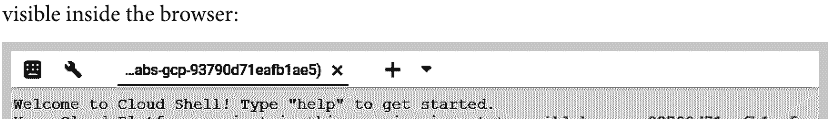

图 16.6 – Google Cloud Shell

不需要额外的授权步骤，因此我们可以安全地管理项目和资源，而无需安装任何其他管理工具集。此外，本章中将介绍的 SDK 命令行作为标准打包。此外，Google Cloud Shell 还预装了管理工具，如 MySQL 客户端、Docker 和 kubectl。最后，您的开发人员还可以访问不同的语言，包括 Go、Python、Node.js 和 Ruby。有关已安装功能的完整最新列表，我们建议您访问 https://cloud.google.com/shell/docs/features#tools。

Google Cloud Shell 配备 5 GB 的持久磁盘存储，挂载到您的 $HOME 目录。这意味着您可以在会话之间安全地存储脚本或用户配置并安装任何所需的软件包。请注意，$HOME 目录之外的任何保存内容将在会话终止时丢失；即在空闲一小时后。


我们可以使用控制台 shell 的设置从本地机器上传和下载，如以下屏幕截图所示：

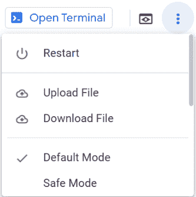

图 16.7 – 上传文件和下载文件选项

Google Cloud Shell 的代码编辑器也可以用于浏览来自持久存储的文件夹路径。我们可以通过点击 Cloud Shell 菜单栏中的铅笔图标轻松访问它：


图 16.8 – Cloud Shell 菜单

从这里，我们可以直接在 Cloud Shell 中更新脚本或文件。Cloud Shell 虚拟实例还附带了标准基于 Linux 的编辑器，如 nano 和 vim。注意，在撰写本文时，代码编辑器处于 beta 阶段：

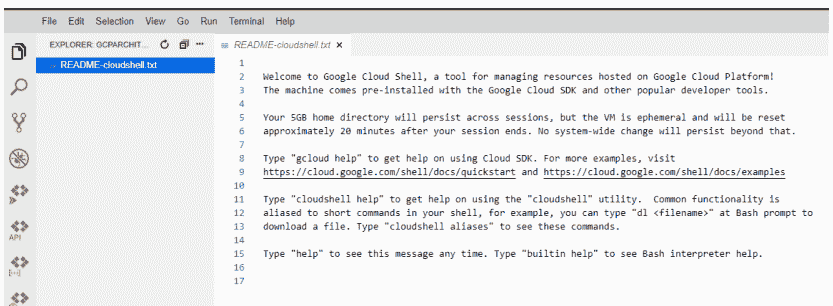

图 16.9 – Cloud Shell 编辑器

现在我们已经介绍了 Google Cloud Shell，让我们继续并查看 GCP SDK。

## The GCP SDK

本节将描述如何使用 Google Cloud SDK。SDK 是一组工具，允许您管理 GCP 资源和应用程序，并包括 gcloud、gsutil 和 bq 命令行工具。正如预期的那样，安装此套件有一些先决条件。SDK 可以在 Linux、macOS 和 Windows 操作系统上运行，并要求您安装 Python 2.7.x。随附的一些工具可能有额外的要求。请参阅 https://cloud.google.com/sdk/install 了解具体的系统和操作系统要求。

## gcloud

gcloud 是 GCP 的主要命令行工具，允许您在 GCP 环境中执行常见任务。gcloud 有许多用例；例如，创建和管理 GCE 实例、Cloud SQL 实例、Kubernetes Engine 集群、Dataproc 集群、DNS 区域和 Cloud Deployment Manager 部署。

当您首次使用 gcloud 时，建议查看使用指南。在命令中添加 -h 将提供以下指南：

```
google3167498_student@cloudshell:/home (qwiklabs-gcp-cf3e4b1a188f0368)$ gcloud -h
Usage: gcloud [optional flags] <group | command>
  group may be          access-context-manager | alpha | app | asset | auth |
                        beta | bigtable | builds | components | composer |
                        compute | config | container | dataflow | dataproc |
                        datastore | debug | deployment-manager | dns |
                        domains | endpoints | filestore | firebase |
                        functions | iam | iot | kms | logging | ml |
                        ml-engine | organizations | projects | pubsub | redis |
                        resource-manager | services | source | spanner | sql |
                        topic
  command may be        docker | feedback | help | info | init | version

For detailed information on this command and its flags, run:
  gcloud --help
```

图 16.10 – gcloud help

要获取有关此命令及其标志的详细信息，我们可以运行以下命令：

```
gcloud --help
```

这将列出更多详细信息 – 试试看并查看您收到的输出！按空格键继续查看详细输出或按 Q 退出。

> **Important Note**
> `gcloud` 针对托管在 GCP 上的功能和资源提供命令参考，我们建议您查看。可以在 https://cloud.google.com/sdk/gcloud/reference/ 找到。

让我们看看如何使用 gcloud 创建新的 VM 实例。

我们还将向您展示如何使用 gcloud 通过 SSH 连接到我们的 VM、创建新磁盘并将其附加到我们的 VM 实例。请按照以下步骤操作：

- 1. 要创建 VM，我们应使用以下语法：
  ```
  gcloud compute instances create <instance name> --zone <zone name>
  ```
  这里，<instance name> 是您的 VM 实例的名称，<zone> 是实例将被部署到的区域。
- 2. 以下示例将在 us-central1-f 区域中创建一个名为 myinstance 的新 VM 实例：
  ```
  gcloud compute instances create myinstance --zone us-central1-f
  ```
- 3. 一旦我们创建了实例，gcloud 还允许我们连接到实例并管理它。这是对 SSH 命令的轻量级封装，将处理身份验证和实例名称到 IP 地址的解析。连接默认将使用运行命令的用户凭据启动 SSH 会话：
  ```
  gcloud compute ssh <instance name> --zone <zone name>
  ```
  这里，<instance name> 是您的 GCE VM 实例的名称，<zone> 是实例所在的区域。
- 4. 以下示例将使用以下 SSH 命令连接到 us-central1-f 区域中的名为 myinstance 的新 VM 实例：
  ```
  gcloud compute ssh myinstance --zone us-central1-f
  ```
- 5. gcloud 还允许我们执行第二天操作。作为示例，让我们在已创建的 VM 实例上添加一个磁盘。首先，我们需要使用以下语法创建磁盘：
  ```
  gcloud compute disks create <disk name> --zone <zone name>
  ```
  这里，<disk name> 是我们正在创建的磁盘的名称，<zone name> 是磁盘将被创建的区域。
- 6. 以下示例将在 us-central1-f 区域中创建一个名为 newdisk001 的新磁盘：
  ```
  gcloud compute disks create newdisk001 --zone us-central1-f
  ```
  我们应该注意，在前面的示例中，我没有使用可选的 size 标志。我们应该注意标准 HDD 的默认磁盘大小为 500 GB。此外，您可以看到我们已在与实例相同的区域中创建了磁盘。
- 7. 最后，我们需要将磁盘附加到我们的实例。这可以使用以下语法完成：
  ```
  gcloud compute instances attach-disk <instance name> attach-disk <disk name> --zone <zone>
  ```
  这里，<instance name> 是您的 GCE VM 实例的名称，<disk name> 是您想要附加到 VM 实例的磁盘的名称，<zone name> 是实例所在的区域。
- 8. 以下示例将把一个名为 newdisk001 的磁盘附加到 us-central1-f 区域中的名为 myinstance 的 VM 实例：
  ```
  gcloud compute instances attach-disk myinstance --disk newdisk001 --zone us-central1-f
  ```

最后，明智的做法是提及 gcloud 中可能存在的 alpha 和 beta 命令。Alpha 命令通常尚未准备好用于生产，可能仍处于开发阶段。它们可能会在没有任何通知的情况下更改，并且其中一些仅可通过邀请完全访问。Beta 命令通常几乎完全开发并正在生产中测试。然而，这些也可能在没有任何通知的情况下更改。

## gsutil

在本节中，我们将描述 gsutil 的使用方法。其主要目的是确保您了解 gsutil 的主要用例并展示实际场景的示例。gsutil 是一个 Python 应用程序，可用于管理 Cloud Storage 资源，并且可以从 Cloud Shell 触发。通过使用 gsutil，我们可以执行以下操作：

- - 创建和删除存储桶。
- - 管理对这些存储桶及其对象的访问。
- - 复制和移动存储数据。
- - 列出存储桶的内容。
- - 在我们的 Cloud Shell 实例中传输数据（请注意，这不仅限于 Cloud Shell）。

> **Important Note**
> 您需要了解 gsutil 语法的工作方式为 gsutil <action> gs://<bucket name>/<resource name> 格式。
> 
> <action> 的示例可以是 mb，用于创建存储桶。这里，gs:// 是表示 Cloud Storage 中资源的前缀。<bucket name>/<object name> 可以是 cloudarchitect/notes.txt，例如。有关 gsutil 命令的完整范围，请参阅 https://cloud.google.com/storage/docs/gsutil。

使用 gsutil 创建存储桶是一个不错的开始。存储桶是您可以存储数据的<|message|>


2. 现在我们已经创建了一个新的存储桶，让我们向其中添加一个文件。在本示例中，我将在本地持久化的 Google Cloud Shell 存储上创建一个新文件。假设我们在 Cloud Shell 环境中有一个名为 examnotes.txt 的文件。这可以按照 Using Google Cloud Shell 部分所述进行上传。要将其复制到我们的存储桶中，我们可以使用以下语法：

```
gsutil cp <file to copy> gs://<bucket name>
```

这里，<file to copy> 是你希望复制到存储桶中的文件，而 <bucket name> 是你希望文件驻留的全局唯一存储桶名称。在下面的示例中，我们将把一个名为 examnotes.txt 的文件复制到名为 cloudarchitect001 的存储桶中：

```
gsutil cp examnotes.txt gs://cloudarchitect001
```

3. 上一个命令的输出将确认此次复制的成功。我们还应注意，使用 cp 时可以指定选项来扩展命令。例如，-n 选项将防止覆盖现有文件的内容。-r 选项将复制整个目录树，重要的是，-m 将允许我们执行并行的多线程/多处理复制。我们可以使用以下语法列出存储桶的内容以确保文件存在：

```
gsutil ls gs://<bucket name>
```

这里，<bucket name> 是你希望列出资源的存储桶名称。让我们列出我们的 cloudarchitect001 存储桶的资源：

```
gsutil ls gs://cloudarchitect001
```

4. 如果我们希望从存储桶中删除文件，可以使用以下语法：

```
gsutil rm gs://<bucket name>/<object name>
```

这里，<bucket name> 是我们资源所在的存储桶名称，而 <object name> 是我们希望删除的对象。让我们从 cloudarchitect001 存储桶中删除 examnotes.txt：

```
gsutil rm gs://cloudarchitect001/examnotes.txt
```

5. 最后，如果我们希望完全删除存储桶（记住，资源会产生费用！），可以使用以下语法：

```
gsutil rb gs://<bucket name>
```

这里，<bucket name> 是我们希望删除的存储桶名称。让我们删除我们的 cloudarchitect001 存储桶：

```
gsutil rb gs://cloudarchitect001
```

请注意，我们也可以使用 -r 标志运行此命令，这将删除存储桶及其所有内容。

## bq

现在，让我们来看一下 BigQuery 的命令行工具。BigQuery 已在第 13 章《分析大数据选项》中进行了更详细的描述，因此在本节中，我们不会深入探讨该服务。然而，一般来说，与 BigQuery 交互的主要方式是加载、导出、查询、查看和管理数据。我们可以通过 Cloud Shell 使用 bq 命令行工具来实现这一点。

> **重要说明**
> 从 bq 命令行使用 BigQuery 可能很复杂，建议查阅 bq 命令行工具参考页面以获取完整详细信息：https://cloud.google.com/bigquery/docs/bq-command-line-tool。

让我们来看一些常见用例。在以下示例中，我们将创建一个新的数据集、创建一个表，然后对其进行查询：

- 1. 以下语法用于以最简单的形式创建新的数据集：

```
bq --location=<location> mk --dataset <dataset name>
```

这里，<location> 是数据集位置，而 <dataset name> 是你新数据集的名称。位置可以是多区域，例如 US 或 EU，也可以是区域位置，例如 us-west2 或 europe-north1。

- 2. 让我们以 US 的多区域位置创建一个名为 newdataset 的新数据集：

```
bq --location=US mk --dataset newdataset
```

> **重要说明**
> 可以设置一些可选标志。最好为数据集的默认表的默认表配置过期时间，为你的表的过期时间，以及为分区表的分区过期时间。

3. 现在，让我们以最简单的形式创建一个新的空表。为此，我们可以使用以下语法：

```
bq mk -t <dataset name>.<table name> <schema>
```

这里，<dataset name> 是你希望创建新表的数据集的名称，<table name> 是要创建的表的名称，而 <schema> 是 [FIELD:DATA_TYPE] 格式的内联模式定义。也可以使用指向本地计算机上 JSON 文件的路径。<schema> 参数可能有点令人困惑，但为了澄清，这就像 Excel 文件中的一列。

4. 让我们在名为 newdataset 的数据集中创建一个名为 newtable 的新表。我们将创建两列名为 examname 和 result，我们希望用字符（Unicode）数据填充它们；即 STRING 数据：

```
bq mk -t newdataset.newdataset \
 examname:STRING,result:STRING
```

5. 最后，让我们看看如何使用 bq 运行查询。为此，我们需要使用以下语法：

```
bq query '<SQL query>'
```

这里，<SQL query> 是你希望 BigQuery 在数据上执行 SQL 查询。<SQL query> 将包含有关要从特定数据集和表中查询的数据的信息。如果我们想连接到未设为默认的项目，我们也可以在 SQL 请求中指定这一点。如果我们要查询表的完整路径，它将如下所示：

```
<projects>.<dataset>.<table>
```

为了澄清这一点，让我们看一个示例。GCP 提供了一些示例数据集和表供我们使用。让我们在名为 samples 的数据集中的一个名为 Shakespeare 的表上执行 bq 查询。该数据集和表位于 Google 允许我们连接的公共项目 bigquery-public-data 下。

在本示例中，我们想看看单词 beloved 在莎士比亚作品中出现了多少次。我们将通过表中的列 word 和 corpus 进行搜索。此外，请注意我们将查询类型指定为 #standardSql：

```
bq query "#standardSql SELECT word, corpus, COUNT(word) FROM \
`bigquery-public-data.samples.shakespeare`\
WHERE word LIKE '%beloved%' GROUP BY word, corpus"
```

## 重要说明

请注意，``` 在 `bigquery-public-data.samples.shakespeare` 中是反引号，而不是撇号。

这将返回以下结果：

```
| word | corpus | f0_ |
+--------+--------------------------------+------+
| beloved | cymbeline | 1 |
| beloved | romeoandjuliet | 1 |
| beloved | winterstale | 1 |
| beloved | tamingoftheshrew | 1 |
| beloved | hamlet | 1 |
| beloved | twogentlemenofverona | 1 |
| beloved | tempest | 1 |
| beloved | timonofathens | 1 |
| beloved | kinglear | 1 |
| beloved | sonnets | 1 |
| beloved | coriolanus | 1 |
| beloved | 1kinghenryiv | 1 |
| beloved | juliuscaesar | 1 |
| beloved | 3kinghenryvi | 1 |
| beloved | antonyandcleopatra | 1 |
| beloved | comedyoferrors | 1 |
| beloved | periclesprinceoftyre | 1 |
| beloved | titusandronicus | 1 |
| beloved | rapeof lucrece | 1 |
| beloved | measureforemeasure | 1 |
| beloved | midsummersnightsdream | 1 |
| beloved | merchantofvenice | 1 |
| beloved | asyoulikeit | 1 |
| beloved | othello | 1 |
| beloved | troilusandcressida | 1 |
| beloved | 2kinghenryvi | 1 |
| beloved | twelfthnight | 1 |
| beloved | kinghenryviii | 1 |
+--------+--------------------------------+------+
```

图 16.11 – bq 输出

为了考试成功，我们应该了解 bq 命令行的强大功能，但最重要的是确保我们了解用于查询 BigQuery 表的命令行工具。

## cbt

在本节中，我们将发现 Cloud Bigtable 的命令行工具 – cbt。用 Go 编写的 CLI 允许我们与 Bigtable 进行基本交互。与我们之前查看的其他命令行工具不同，我们必须使用 Cloud Shell 和 gcloud 命令安装此组件。

我们也在 *第 12 章《探索 GCP 中的存储和数据库选项 – 第 2 部分* 中更深入地研究了此服务，但在查看命令行工具之前，我们应该提醒自己 Bigtable 是一种高性能 NoSQL 数据库服务，使用实例、集群和节点。Bigtable 是你的集群和节点的容器：

```
gcloud components install cbt
```

请注意，如果你收到 Cloud SDK 组件管理器已禁用的反馈，那么你也可以运行以下命令：

```
sudo apt-get install google-cloud-sdk-cbt
```

你可能已经注意到我们查看的不同工具的语法略有不同，而 cbt 也不例外。cbt 的用法如下：

```
cbt <command>
```

让我们看一个在 Bigtable 中创建名为 myfirstinstance 的新实例的示例。我们必须添加额外的标志。让我们看看语法：

```
cbt createinstance <instance id> <display name> <cluster id> <zone> <number of nodes> <storage type>
```

这里，<instance id> 是你希望赋予 Bigtable 实例的标识符，<display name> 是 Bigtable 实例的显示名称，<cluster id> 是节点集群的标识符，<zone> 是实例将被部署到的区域，<number of nodes> 是集群中的虚拟机实例数量，而 <storage type> 是我们希望为虚拟机实例使用的存储类型。这可以设置为 SSD 或 HDD。

让我们看看如果我们想创建一个 ID 为 instance001、显示名称为 myfirstinstance、集群 ID 为 cluster001、在 europe-west2-a 区域部署三个节点并使用 SSD 存储的新实例，其语法会是什么样的：

```
cbt createinstance instance001 myfirstinstance cluster001 europe-west2-a 3 SSD
```


如果我们查看控制台内部，可以验证它是否已正确创建：

## Overview

| Instance ID | Instance name | Type | Storage |
|---|---|---|---|
| instance001 | myfirstinstance | Production | SSD |

### cluster001

| CPU utilization | Rows | Throughput |
|---|---|---|
| Average: — %<br>Hottest node: — % | Read: —/s<br>Write: —/s | Read: —/s<br>Write: —/s |

| Cluster ID | Zone | Nodes | Storage utilization |
|---|---|---|---|
| cluster001 | europe-west2-a | 3 | — / — |

Figure 16.12 – Overview

> **Important Note**
> 你也可以使用 `gcloud` 命令来创建 Bigtable 实例。`gcloud` 让我们可以创建生产或开发环境，其中开发环境性能有限且没有 SLA。如果需要创建开发 Bigtable 实例，则使用 `gcloud`。

## Exploring Cloud Deployment Manager

在本节中，我们将查看最有用的管理工具之一 – Google Cloud Deployment Manager。了解 Cloud Deployment Manager 的概念对于考试成功非常重要。

Deployment Manager 允许我们自动化创建和配置各种 GCP 资源的过程。我们可以使用 YAML 文件以声明式格式编写应用程序所需的所有资源，这可确保部署可重复且结果一致。YAML 是一种人类可以轻松阅读的数据序列化语言。总的来说，Deployment Manager 可以被称为基础设施即代码（IaC）。你可能对 Ansible 或 Terraform 等工具有所了解，并且会认识到你可以通过缩进来嵌套元素，而不是使用某些其他语言中使用的任何大括号或方括号。

> **Exam Tip**
> Deployment Manager 是一个非常大的主题，并且有深入课程可供你获得进一步的知识。对于考试，我们将解释成功所需的核心知识。

Deployment Manager 的一些组件是基础的。配置文件包含我们想要部署的所有资源及其属性。

配置文件以资源字符串开头，后面跟着一系列条目，每个条目具有以下字段：

- **Name:** 我们正在部署的资源名称；例如，`vm001`。
- **Type:** 这指定了此资源的基类型。有许多可用的资源类型，它们与我们希望部署的资源类型相关。例如，新 VM 实例的资源类型将为 `compute.v1.instance`。请注意，`v1` 代表生产就绪。
- **Properties:** 这指定了创建资源所需的属性。例如，如果我们希望从 GUI 部署新的 VM 实例，我们需要填充诸如操作系统类型、磁盘类型以及映像和网络接口等必填字段。这些将在配置文件的 `properties` 部分中填充。

> **Important Note**
> 资源类型的完整列表可以在此处找到：https://cloud.google.com/deployment-manager/docs/configuration/supported-resource-types。

让我们看看如何构建我们的第一个示例配置文件。在本章的 Using Google Cloud Shell 部分中，我们提到了 Cloud Shell 编辑器。让我们打开它并创建一个新文件。为此，只需右键单击你的用户 ID 并选择 New File：

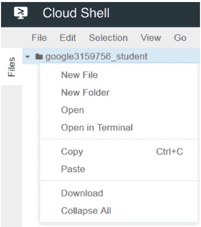

Figure 16.13 – Cloud Shell – New File

为文件命名 – 例如，vm001.yaml – 并单击 OK 以创建它。我们现在准备编辑。在此示例中，代码将执行以下操作：

- 在 europe-west4-a 区域中创建一台 VM。
- 将其大小设置为 g1-small 机器类型。
- 使用 centos-6 作为我们的映像。
- 创建一个持久启动磁盘。
- 将 VM 添加到默认网络。
- 添加访问配置作为外部 NAT。

完成的配置文件如下所示：

```
resources:
- name: vm001
  type: compute.v1.instance
  properties:
```

```
zone: europe-west4-a
  machineType: https://www.googleapis.com/compute/v1/projects/primeval-nectar-318916/zones/europe-west4-a/machineTypes/g1-small
  disks:
  - deviceName: boot
    type: PERSISTENT
    boot: true
    autoDelete: true
    initializeParams:
      sourceImage: https://www.googleapis.com/compute/v1/projects/centos-cloud/global/images/centos-stream-8-v20210721
  networkInterfaces:
  - network: https://www.googleapis.com/compute/v1/projects/primeval-nectar-318916/global/networks/default
  accessConfigs:
  - name: External NAT
    type: ONE_TO_ONE_NAT
```

现在，让我们保存它并使用此配置文件部署一台 VM。同样，我们将使用 Cloud Shell 工具使用 Deployment Manager 命令行语法执行此操作：

```
gcloud deployment-manager deployments create <deployment name> --config <config file>
```

这里，<deployment name> 是你整体部署的名称。请记住，VM 实例名称在我们的配置文件中指定，而 <config file> 是我们之前创建的配置文件的名称。让我们看一个使用我们的 vm001.yaml 配置文件创建名为 deployment01 的新部署的示例：

```
gcloud deployment-manager deployments create deployment01 --config vm001.yaml
```

如果我们浏览到 GCP 控制台中的 **Deployment Manager**，我们可以确认它已部署：

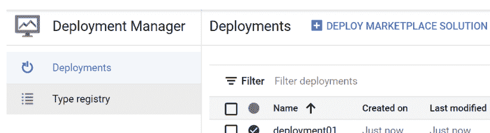

Figure 16.14 – Deployment Manager

我们还可以浏览到 GCP 控制台中的 Compute Engine 并确认 VM 实例存在：

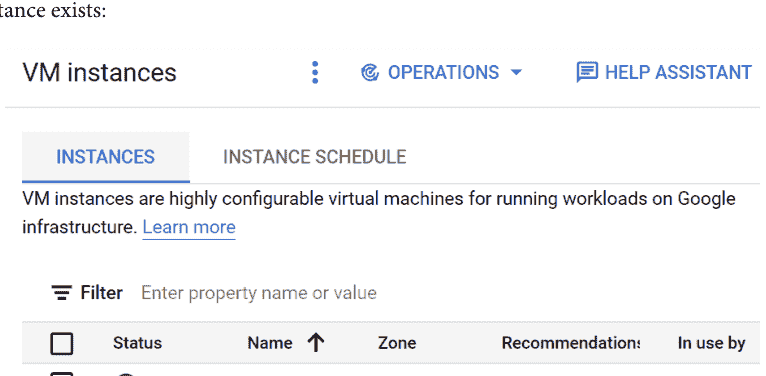

Figure 16.15 – VM instance

因此，虽然我们花时间创建了一个配置文件，但我们只部署了一个 VM 实例。Deployment Manager 允许我们部署完整的环境。为此，我们应该使用模板。模板允许我们将配置文件的一部分抽象为可在部署之间重用的独立构建块。

模板是与配置文件分开的文件。它也是用不同的语言编写的 – Jinja 或 Python – 并作为类型导入并在配置文件中使用。

模板允许我们从配置文件传递变量，这意味着它们可以保持相当静态，我们只需从配置文件传递编辑后的变量。我们需要修改配置文件以反映我们想要调用模板文件。这可以通过在配置文件的顶部添加模板的路径来完成。我们还可以编辑配置文件以反映我们想要传递的变量。

让我们看一个示例。我们希望为创建 debian-9 VM 保留一个静态模板，但我们希望传递主机名、区域和机器类型等变量。让我们按如下方式创建一个新的配置 YAML 文件。让我们将其命名为 createdbytemplate.yaml。请注意，我们已将 vm-template.jinja 添加为类型，并且我们的变量已设置为属性：

```
imports:

  - path: vm-template.jinja


resources:

  - name: newinstance

    type: vm-template.jinja

    properties:

      name: createdbytemplate

      zone: europe-west4-a
      type: g1-small
```

现在，我们需要配置我们的模板文件，其中将包含要传递的变量的值。请注意，我们的主机名、机器类型和区域在以下格式的括号内设置：

```
{{ properties["variable name"] }}
```

这里，variable name 是从配置文件传递的字符串。以下代码是我们的 Jinja 模板文件：

```
resources:
- name: {{ properties["name"] }}
  type: compute.v1.instance
  properties:
    zone: {{ properties["zone"] }}
    machineType: zones/{{ properties["zone"] }}/machineTypes/{{ properties["type"] }}
    disks:
    - deviceName: boot
      type: PERSISTENT
      boot: true
      autoDelete: true
      initializeParams:
        sourceImage: projects/debian-cloud/global/images/family/debian-9
    networkInterfaces:
    - network: global/networks/default
```

我们可以保存它并将其命名为 vm-template.jinja。现在，我们可以使用我们的 gcloud 命令调用我们的 createdbytemplate.yaml 文件：

```
gcloud deployment-manager deployments create templatedeployment --config createdbytemplate.yaml
```

现在，我们可以检查控制台以验证我们是否有一个名为 createdbytemplate 的新 VM：


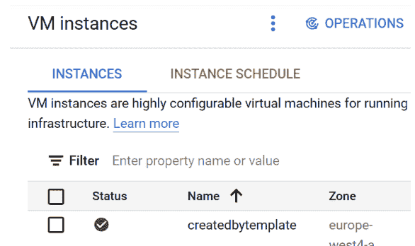

# 图 16.16 – 新的 VM 实例

我们也可以在 gcloud 命令中指定变量属性。在下面的示例中，我们有一个名为 vm-template1.jinja 的新模板，它期望主机名和区域的变量：

```
resources:
- name: {{ properties["name"] }}
  type: compute.v1.instance
  properties:
    zone: {{ properties["zone"] }}
    machineType: zones/{{ properties ["zone"] }}/machineTypes/g1-small
    disks:
    - deviceName: boot
      type: PERSISTENT
      boot: true
      autoDelete: true
      initializeParams:
        sourceImage: projects/centos-cloud/global/images/centos-stream-8-v20210721
    networkInterfaces:
    - network: global/networks/default
    accessConfigs:
    - name: External NAT
      type: ONE_TO_ONE_NAT
```

再次，让我们使用我们的 gcloud 命令来创建它。但是，我们需要将名称指定为 vm002，区域指定为 europe-west4-a：

```
gcloud deployment-manager deployments create
deployment002 --template vm-template1.jinja --properties
name:vm002,zone:europe-west4-a
```

让我们检查我们的 GCP 控制台并确认我们现在有一个名为 vm002 的 VM 实例，位于 europe-west4-a 区域：

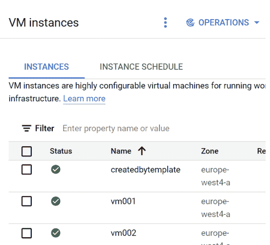

图 16.17 – 实例

到目前为止，我们只查看了单个 VM 部署，但我们也可以通过 Deployment Manager 部署多个 VM。

让我们看一个示例，我们想要部署一个由不同区域中的 Web 应用程序和 DB 服务器组成的三层应用程序。我们可以扩展之前的模板以添加所需的信息。请注意，我们现在指定了三个单独的资源。让我们创建一个名为 vm-template2.jinja 的新模板文件：

```
resources:
- name: {{ properties["webname"] }}
  type: compute.v1.instance
```

```
properties:
  zone: {{ properties["webzone"] }}
  machineType: zones/{{ properties ["webzone"] }}/
machineTypes/{{ properties["type"] }}
  disks:
  - deviceName: boot
    type: PERSISTENT
    boot: true
    autoDelete: true
    initializeParams:
      sourceImage: projects/centos-cloud/global/images/
centos-stream-8-v20210701
  networkInterfaces:
  - network: global/networks/default
  accessConfigs:
  - name: External NAT
    type: ONE_TO_ONE_NAT

- name: {{ properties["appname"] }}
  type: compute.v1.instance
  properties:
    zone: {{ properties["appzone"] }}
    machineType: zones/{{ properties ["appzone"] }}/
machineTypes/{{ properties["type"] }}
    disks:
    - deviceName: boot
      type: PERSISTENT
      boot: true
      autoDelete: true
      initializeParams:
        sourceImage: projects/centos-cloud/global/images/
centos-stream-8-v20210701
    networkInterfaces:
    - network: global/networks/default
    accessConfigs:
    - name: External NAT
```

```
type: ONE_TO_ONE_NAT

- name: {{ properties["dbname"] }}
  type: compute.v1.instance
  properties:
    zone: {{ properties["dbzone"] }}
    machineType: zones/{{ properties ["dbzone"] }}/machineTypes/{{ properties["type"] }}
    disks:
      - deviceName: boot
        type: PERSISTENT
        boot: true
        autoDelete: true
        initializeParams:
          sourceImage: projects/centos-cloud/global/images/centos-stream-8-v20210701
    networkInterfaces:
      - network: global/networks/default
    accessConfigs:
      - name: External NAT
        type: ONE_TO_ONE_NAT
```

现在，我们需要更新我们的配置文件。让我们创建一个新文件并将其命名为 multi.yaml。让我们添加以下文本：

```
imports:
  - path: vm-template2.jinja

resources:
  - name: newinstance
    type: vm-template2.jinja
    properties:
      webname: web001
      webzone: europe-west2-a
      appname: app001
      appzone: europe-west4-b
```

```
dbname: db001
dbzone: europe-west6-c
type: g1-small
```

现在，我们可以运行以下命令来触发名为 multideployment 的部署：

```
gcloud deployment-manager deployments create multideployment --config multi.yaml
```

现在，让我们从 Cloud Shell 检查我们的结果：

```
The fingerprint of the deployment is NdvSfAvJTKQnTfuYocnBQ==
Waiting for create [operation-1556477906253-5879bc0b3f6a3-e71eb3bb-b27e918e]...done.
Create operation operation-1556477906253-5879bc0b3f6a3-e71eb3bb-b27e918e completed successfully.
NAME TYPE STATE ERRORS INTENT
app001 compute.v1.instance COMPLETED []
db001 compute.v1.instance COMPLETED []
web001 compute.v1.instance COMPLETED []
```

图 16.18 – 多部署

我们可以通过 GCP 控制台确认我们的部署。让我们查看 Deployment Manager 菜单，在那里我们可以看到我们的部署已成功：

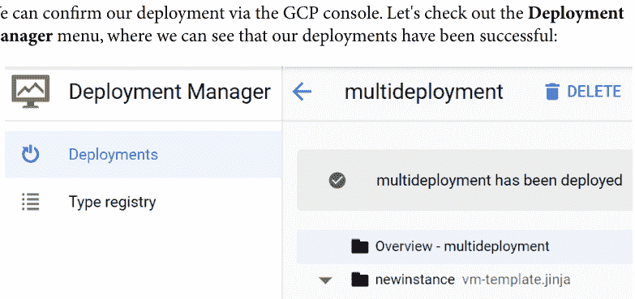

图 16.19 – 结果

我们还可以看到每个 VM 实例都已部署到正确的区域：

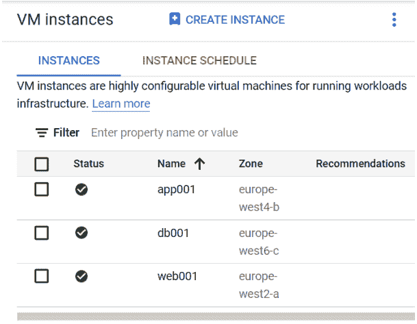

图 16.20 – 实例

这就是我们如何为仅 VM 实例类型配置模板的方式。我们还可以将模板扩展到其他类型的服务，例如网络。作为最后一个示例，让我们看看如何创建模板和配置文件来创建网络和防火墙规则集。在此示例中，我们需要有三个单独的模板：一个用于我们的网络，一个用于我们的子网，一个用于我们的防火墙规则。

让我们先看我们的网络。这很简单。请注意，我们现在使用的是 compute.v1.network 类型，并且我们有单个属性。我们将其设置为 false 以避免自动创建相应的子网。名称是从我们的配置文件传递的变量。让我们将此文件保存为 network.jinja：

```
resources:
- name: {{ env["name"] }}
  type: compute.v1.network
  properties:
    autoCreateSubnetworks: false
```

接下来，我们可以创建一个子网模板。同样，我们将名称作为变量传递，该变量将从我们的配置文件传递。我们还将传递有关 IP 范围和要附加到的网络的信息，我们将使用 network.jinja 模板创建该网络，以及创建子网所在的区域。让我们将其保存为 subnet.jinja：

```
resources:
- name: {{ env["name"] }}
  type: compute.v1.subnetwork
  properties:
    ipCidrRange: {{ properties["iprange"] }}
    network: {{ properties["network"] }}
    region: {{ properties["region"] }}
```

最后，让我们创建一个模板，以便我们可以创建一个防火墙规则。同样，我们将从配置文件传递名称，但这次我们将名称附加一个硬编码值。我们还将设置要附加此规则的网络，并传入防火墙规则的协议。让我们将此模板保存为 firewall.jinja：

```
resources:
- name: {{ env["name"] }}-firewall-rule
  type: compute.v1.firewall
  properties:
    network: {{ properties["network"] }}
    sourceRanges: ["0.0.0.0/0"]
    allowed:
      - IPProtocol: {{ properties["Protocol"] }}
        ports: ["80"]
```

现在，我们需要我们的配置文件。我们将导入所有三个模板，而不是像之前的示例中那样导入单个文件。这并没有什么真正的复杂性——我们只需为每个要导入的模板添加一行额外内容。这里需要注意的关键点之一是确保子网和防火墙规则连接到正确的网络。我们可以按如下方式传递变量：

```
$(ref.custom-net.selfLink)
```

这里，`custom-net` 是我们正在创建的网络的名称。此名称作为变量传递。让我们将此配置文件保存为 `config.yaml`：

```
imports:
- path: network.jinja
- path: subnet.jinja
- path: firewall.jinja

resources:
- name: custom-net
  type: network.jinja

- name: custom-subnet
  type: subnet.jinja
  properties:
    iprange: 10.10.0.0/16
    network: $(ref.custom-net.selfLink)
    region: us-central1

- name: custom
  type: firewall.jinja
  properties:
    network: $(ref.custom-net.selfLink)
    Protocol: TCP
```

最后，让我们将这些文件上传到我们的 Cloud Shell 环境并触发我们已经熟悉的 `gcloud` 命令：

```
gcloud deployment-manager deployments create networking --config config.yaml
```

让我们看看此命令在 Cloud Shell 中的输出是什么样的：

```
The fingerprint of the deployment is 2A6YxCYsxQ_e04Se7N6RpW==
Waiting for create [operation-1556741126674-587d909dcd9bd-cld90539-9a25356a]...done.
Create operation operation-1556741126674-587d909dcd9bd-cld90539-9a25356a completed successfully.
NAME                TYPE                STATE       ERRORS  INTENT
custom-firewall-rule compute.v1.firewall COMPLETED   []
custom-net          compute.v1.network  COMPLETED   []
custom-subnet       compute.v1.subnetwork COMPLETED   []
```

图 16.21 – Google Cloud Shell 输出


还有一个最终的文件我们也应该讨论。模式文件用作指南，向用户展示如何与模板交互并使用模板。例如，让我们看一个配置文件的示例，该文件将要求将 zone 作为变量传递给模板。我们可以为用户提供有关其使用方式的信息，以及需要设置哪些变量：

```
info:
  title: VM Instance Template
  author: Cloud Architect
  description: Creates a new instance
  version: 0.1

imports:
  - path: vm-template.jinja

required:
  - zone

properties:
  zone:
    type: string
    description: zone where VM will reside
```

> **重要提示**
> Google 提供了一些很棒的 Deployment Manager 示例，我们可以将其下载并在我们的免费层环境中使用。我们建议您下载并查看一个更复杂、更进一步的 Cloud Deployment Manager 模板，网址为 https://github.com/GoogleCloudPlatform/deploymentmanager-samples。

在下一节中，我们将介绍 Cloud Deployment Manager 的替代方案：Terraform。

# Terraform

Terraform 是一个开源工具，可让我们以声明方式配置 Google Cloud 资源。我们应该注意，它并不独属于 Google Cloud。Terraform 可以部署 AWS、Azure 和 VMware 等厂商的资源，仅举几例。与 Cloud Deployment Manager 一样，Terraform 也使用 IaC 方法，并记录下我们希望环境呈现的期望状态。不应对后端进行任何修改，Terraform 应该是事实来源。这与 Deployment Manager 类似，后者创建存储已部署资源信息的清单文件。然而，Terraform 使用其结构化语言 HashiCorp Configuration Language（HCL），这是我们上一节中看到的 YAML 文件方法的替代方案。对于首次接触 IaC 的人来说，这可能会带来一点更陡峭的学习曲线。Terraform 通过提供程序与 GCP 集成，该提供程序负责理解与底层基础设施的 API 交互。Terraform 的 Google 提供程序用于配置我们的 GCP 基础设施，由 Google 的 Terraform 团队和 HashiCorp 的 Terraform 团队共同维护，尽管他们也接受社区贡献！

使用 Google Cloud Shell，Terraform 会自动进行身份验证，我们可以直接从 Terraform 的 Google Provider 文档页面开始尝试。许多示例都有 Open in Google Cloud Shell 按钮，允许我们启动一个交互式 Cloud Shell 会话，其中加载了示例并且 Terraform 已准备就绪。

现在，让我们看一个部署 Cloud Storage 存储桶的示例。我们不会详细介绍 Terraform HCL 代码，因为它超出了本书的范围，但了解其大致外观是很有帮助的。Terraform 有一些主要命令来部署资源。首先，我们必须运行 terraform init，它会查找我们需要的特定提供程序并下载它们。Terraform 的一个好处是其漂移检测，即运行下一个 Terraform 命令 terraform plan 时，会显示我们想要应用的配置与已部署内容之间的差异。运行 plan 时不会部署任何内容。要执行计划，我们必须运行 terraform apply 命令。

对于我们的示例，我们将查看如何创建 Google Storage 存储桶。让我们通过从 https://github.com/terraform-google-modules/terraform-google-cloud-storage 仓库执行 git clone 命令来克隆一些 GitHub 上的 Terraform 模块代码。

接下来，我们必须更改目录到 /terraform-google-cloud-storage/examples/simple_bucket 并运行 terraform init，它会查找我们需要的特定提供程序并下载它们：

```
Initializing the backend...
Initializing provider plugins...
- Finding hashicorp/google versions matching ">= 3.43.0, < 4.0.0"...
- Installing hashicorp/google v3.74.0...
- Installed hashicorp/google v3.74.0 (self-signed, key ID 34365D9472D7468F)

Partner and community providers are signed by their developers.
If you'd like to know more about provider signing, you can read about it here:
https://www.terraform.io/docs/cli/plugins/signing.html

Terraform has created a lock file .terraform.lock.hcl to record the provider selections it made above. Include this file in your version control repository so that Terraform can guarantee to make the same selections by default when you run "terraform init" in the future.

Terraform has been successfully initialized!
```

图 16.22 – terraform init 输出

当我们运行 terraform plan 命令时，会提示我们输入存储桶名称和项目的 ID。它不会部署任何内容。在此示例中，我们可以看到我们正在创建名为 cloudarchitectupdate001 的新多区域存储桶，位置在 EU：

```
Terraform will perform the following actions:

# google_storage_bucket.bucket will be created
+ resource "google_storage_bucket" "bucket" {
    + bucket_policy_only        = (known after apply)
    + force_destroy             = false
    + id                        = (known after apply)
    + location                  = "EU"
    + name                      = "cloudarchitectupdate001"
    + project                   = "primeval-nectar-318916"
    + self_link                 = (known after apply)
    + storage_class             = "STANDARD"
    + uniform_bucket_level_access = true
    + url                       = (known after apply)
    + versioning {
      + enabled = true
    }
  }

Plan: 1 to add, 0 to change, 0 to destroy.
```

图 16.23 – terraform plan 输出

要执行计划，我们必须运行 terraform apply 命令。输出将类似于以下内容：

```
google_storage_bucket.bucket: Creating...
google_storage_bucket.bucket: Creation complete after 1s [id=cloudarchitectupdate001]
Apply complete! Resources: 1 added, 0 changed, 0 destroyed.
```

图 16.24 – terraform apply 输出

最后，我们可以浏览到控制台中的 Cloud Storage 并确认我们的新存储桶已在正确位置创建：

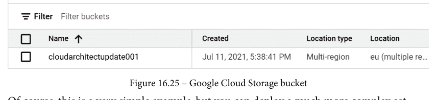

图 16.25 – Google Cloud Storage 存储桶

当然，这是一个非常简单的示例，但您可以使用多个 VM、GKE 集群、负载均衡器等部署更复杂的资源集。如果您对 Terraform 模板的语法复杂性感到畏惧，请不要担心！Google 提供了一套现成的模板供您使用和学习。

# Cloud Foundation Toolkit

Cloud Foundation Toolkit（CFT）（https://cloud.google.com/foundation-toolkit）为 Deployment Manager 和 Terraform 提供即用型模板。之前的 Terraform 示例中用于创建 Cloud Storage 存储桶的代码直接来自这些现成模板。它们的设计目的是让我们能够在 Cloud 平台内快速构建可重复的企业级基础。这些模板是节省时间的工具，我们可以在其基础上进行构建以进行定制，从而为业务增添价值。它们还能让我们专注于应用程序，而不是繁琐的基础设施任务。

在下一节中，我们将介绍定价计算器。

# Pricing Calculator

Google 在计算在 GCP 运行应用程序的成本方面提供了帮助。无需在每个服务的文档中检查价格，您可以使用 GCP 定价计算器。该计算器可通过 https://cloud.google.com/products/calculator 在线获取。它允许您选择用于应用程序的服务和配置。您还可以添加估计的存储和网络需求。总价将为您计算：

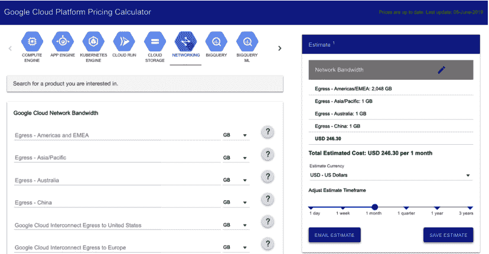

图 16.26 – 定价计算器

在这里，您可以看到 GKE 集群上五个节点、500 GB 磁盘空间的成本示例。要添加估计的出站网络流量，只需选择 NETWORKING 图标并定义流量的去向即可：

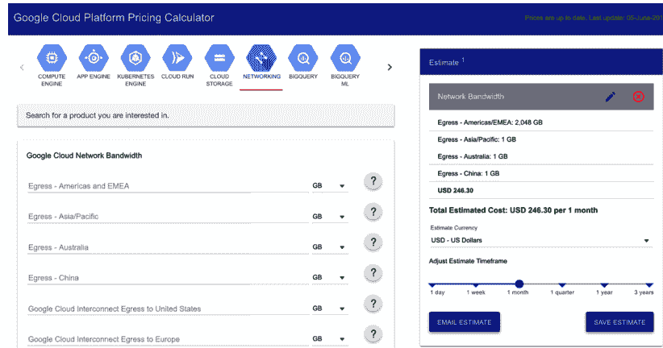

图 16.27 – 定价计算器 – 网络

让我们再看一个示例，这次是针对 Cloud Storage。在此示例中，我们向您展示在新加坡使用 1 TB Cloud Storage 的费用。我们估计每月将有 500,000 次 A 类操作和 500,000 次 B 类操作。请注意，当您在计算器中添加操作时，它期望的数字单位为百万。在我们的示例中，我们输入了 0.5 百万：


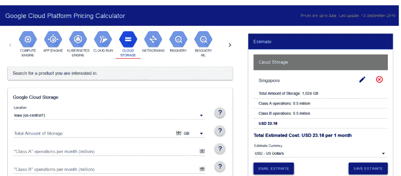

图 16.28 – 定价计算器 – 存储

我们鼓励你访问该网站并熟悉不同的示例。

## 需要考虑的额外事项

还有一些管理工具需要我们考虑。考试时，了解以下内容也很重要：

- **Cloud Source Repositories**：这是在 GCP 上托管的完整功能的 GitHub 仓库，支持应用程序的协作开发。你可以使用 `gcloud` 命令来创建代码、提交代码和管理新仓库。更多信息请参阅 https://cloud.google.com/source-repositories/docs/。
- **Cloud Build**：这是一项 GCP CI/CD 服务，将在 GCP 基础设施上执行你的构建。它可以从 Google Cloud Storage、Cloud Source Repositories、GitHub 或 Bitbucket 导入源代码。更多信息可在第 6 章《使用 Google Kubernetes Engine 管理 Kubernetes 集群》中找到，以及此处：https://cloud.google.com/cloud-build/docs/。
- **Cloud Scheduler**：这是一项完全托管的 cron 作业调度服务。它可用于在 App Engine 上触发作业、发送 Pub/Sub 消息，甚至访问 HTTP(S) 端点。
- **Container Registry**：这为我们在 GCP 平台上提供了私有的 Docker 仓库存储。我们可以使用 `gcloud` 命令将镜像推送到我们的仓库，然后我们可以使用 HTTP 端点从任何 GCE 实例甚至我们的硬件中提取这些镜像。更多信息可在 *第 6 章《使用 Google Kubernetes Engine 管理 Kubernetes 集群》* 中找到。
- **Cloud Endpoints**：这充当 API 管理系统，允许我们在任何 Google Cloud 后端管理我们的 API。一旦你在 Cloud Endpoints 中部署了 API，你就可以创建一个开发者门户供用户交互、访问和查看文档。

## 总结

在本章中，我们回顾了可用于管理 GCP 服务的主要管理工具。需要重申的是，你应该了解哪些服务可由哪个命令行工具管理以及基本命令行结构。让我们回顾一下我们将使用每个工具做什么：

- `gcloud` 可用于管理许多 GCP 服务，但最常用于管理 Compute Engine 虚拟机实例、Cloud SQL 实例、Kubernetes Engine 集群和 Cloud Deployment Manager 部署。
- 使用 `cbt` 管理 Bigtable。
- 使用 `bq` 管理 BigQuery。
- 使用 `gsutil` 管理 Cloud Storage。我们需要了解创建存储桶、复制数据和删除存储桶的不同语法。
- Deployment Manager 可用于在模板和配置文件中自动化各种 GCP 服务。
- 定价计算器。

请记住，Google 提供免费试用层，你可以在其中使用这些命令行工具并熟悉创建和管理不同服务。

在下一章中，我们将了解如何监控我们的 GCP 服务。

## 延伸阅读

阅读以下文章以获取有关本章所涵盖内容的更多信息：

- **APIs Explorer:** https://developers.google.com/apis-explorer/#p/
- **gsutil:** https://cloud.google.com/storage/docs/gsutil
- **cbt:** https://cloud.google.com/bigtable/docs/quickstart-cbt
- **gcloud:** https://cloud.google.com/sdk/gcloud/
- **bq:** https://cloud.google.com/bigquery/docs/bq-command-line-tool
- **Cloud Deployment Manager:** https://cloud.google.com/deployment-manager/docs/

## 17
监控你的基础设施

在本章中，我们将了解 GCP 监控。我们将讨论 Google Cloud 的运维套件是什么，以及为什么你需要它。它以前被称为 Stackdriver。我们将解释它提供的所有服务。我们还将介绍一些基本配置，让你很好地了解如何利用它来监控你的 Google Cloud 服务，例如 Google Compute Engine (GCE) 或 Google Kubernetes Engine (GKE)。

本章将涵盖以下主题：

- Google Cloud 运维套件简介
- 配置 Google Cloud 运维套件
- Cloud Monitoring
- Cloud Logging
- 应用性能管理 (APM)

**考试提示**
监控是一个庞大的主题，可能感觉有些令人不知所措。一旦你了解了 Google Cloud 运维套件的三个主要功能，即监控、日志记录和 APM，我们希望你专注于考试中会测试的内容。确保你知道可以使用 Google Cloud 运维套件监控哪些 GCP 服务。特别注意 GCE，无论是性能监控还是可用性监控。很好地理解审计日志，并确保你知道如何追踪谁对你的项目及其相关资源进行了更改。登录 GCP 控制台并浏览活动和审计日志。预期你可能会被问到在哪里找到特定类型的日志！最后，Qwiklabs 将帮助你更好地理解该服务，我们强烈建议你查看可用的实验。

## 技术要求

为了获得 Google Cloud 运维套件的实践经验，我们建议你使用 Qwiklabs。Google Cloud 运维套件任务可以在此处找到：https://www.qwiklabs.com/quests/35?locale=en。

**重要说明**
你需要购买积分才能注册该任务。

## Google Cloud 运维套件简介

我们已经学习了许多服务，现在是时候更仔细地了解监控选项了。Google 提供了一款与 GCP 集成的工具，称为 Google Cloud 运维套件（以前称为 Stackdriver）。Stackdriver 成立于 2012 年，是一款软件即服务 (SaaS) 平台，可实现跨不同云层的统一监控。2014 年，它被 Google 收购，并在 2016 年作为 GCP 服务公开发布。

目前，Google Cloud 运维套件可以监控 GCP 和 AWS。然而，与前者的集成要强大得多。Google Cloud 运维套件是一组提供以下服务的工具：

- Monitoring
- Logging
- Debugging
- Tracing
- Error Reporting
- Profiling

监控和日志记录是无代理的，但为了获得更有信息量的指标和日志，应安装代理。实际上，有两种类型的代理可以安装在你的实例上：基于 `collectd` 软件的监控代理，以及基于 `fluentd` 软件的日志代理。

在下面的图表中，你可以看到一个架构图，突出显示了一个 GCE 虚拟机实例以及安装在其上的代理。虚拟机实例默认与 Logging 和 Monitoring 通信。代理向各自的服务报告：

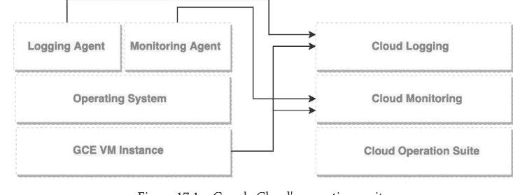

图 17.1 – Google Cloud 运维套件

GCP 是一个面向开发者的平台，它提供了许多可直接与你的应用程序集成的监控相关服务。Google Cloud 运维套件允许你同时监控基础设施和应用程序。非常重要的一点是，开发者在设计应用程序时从一开始就需要考虑监控和日志记录。对于受支持的每种编程语言，都有库可促进与 Google Cloud 运维套件的日志集成。确保你查看受支持的语言，以便充分利用它们！

在本章中，我们将了解如何使用 Google Cloud 运维套件监控 GCP。请仔细阅读本章并完成推荐的 Qwiklabs，因为这是考试的关键主题。

现在我们对 Google Cloud 运维套件是什么有了基本的了解，让我们看看每项服务的成本。


# 成本

使用 Google Cloud 的运维套件，您只需为所使用的资源付费。费用可通过 Cloud Billing 报表和警报进行控制。

以下 Google Cloud 运维套件服务可免费使用：

- Cloud Debugger
- Error Reporting
- Cloud Profiler

以下服务在超出月度限制后可能会产生费用：

- Cloud Logging
- Cloud Monitoring
- Cloud Trace

我们故意不列出实际价格，因为价格可能会发生变化。

> 重要提示
> 请查看以下链接以了解最新、最详细的价目表：https://cloud.google.com/monitoring#pricing。

# 配置 Google Cloud 的运维套件

> 考试提示
> 对于 Stackdriver，过去需要手动创建监控工作区。在引入 Google Cloud 的运维套件后，就不再需要这样做了。当您从 Google 控制台导航到 Cloud Monitoring 时，您会看到在项目创建后，该项目已被自动启用监控，并成为所谓的范围项目。

Google Cloud 的运维套件按项目启用。最佳实践是，如果您只使用一个项目，则应为该项目启用它。如果您有多个项目，则应专门为监控创建一个单独的项目。这称为范围项目。从该项目中，您可以指定要监控的其他项目。它们将成为被监控项目。请记住，您不会为额外项目付费，因此这不会产生任何额外成本。

现在，让我们看看如何开始使用 Google Cloud 的运维套件：

1. 从汉堡菜单进入 **Monitoring**。然后选择 **Overview**：

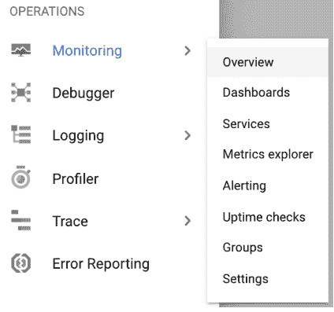

图 17.2 – 访问 Cloud Monitoring

2. 这会带您进入 Cloud Monitoring 主屏幕。正如您所见，您有一个格式良好的面板，汇总了与您的 GCP 资源监控相关的最重要的信息，例如资源 **Dashboards**、事件 **Uptime checks** 等：

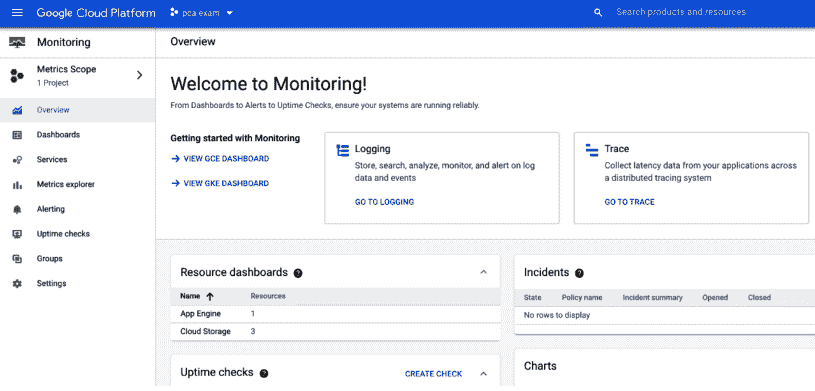

图 17.3 - Cloud Monitoring Overview 屏幕

3. 在多项目场景中，通过在左侧窗格中点击 **Metrics Scope**，然后点击 **Add Cloud projects to metrics scope** 链接 (https://console.cloud.google.com/monitoring/settings/add-projects?project=pca-exam-314409) 为每个项目启用监控：

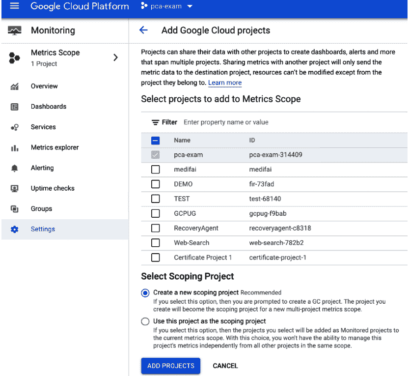

图 17.4 – 添加 Google Cloud 项目

现在我们可以看到带有所选项目的指标范围设置。您可以将项目添加到当前范围项目进行监控，也可以创建一个新的范围项目。选择好项目后，点击 ADD PROJECTS 按钮：

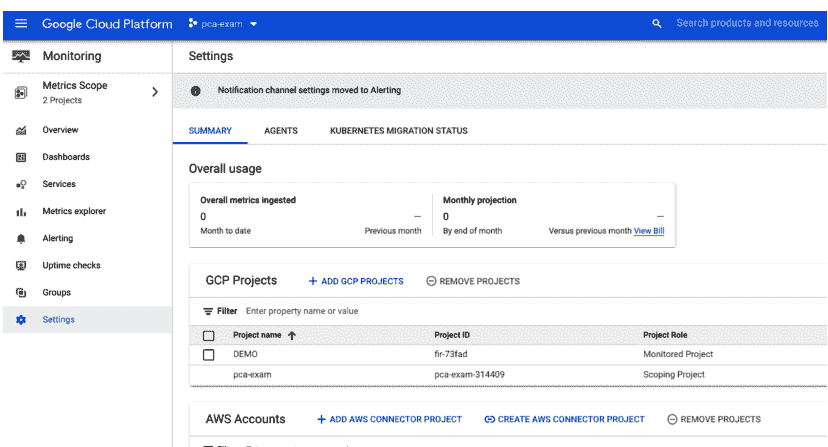

# 图 17.5 – Metrics Scope – Settings

4. 您可以选择是否要监控 AWS 资源。这需要您在 AWS 中创建一个 IAM 角色，并列出权限。如果您只使用 GCP，则可以点击 Skip AWS Setup 启动监控。

> 考试提示
> Google Cloud 运维套件也能够监控您 AWS 账户的日志数据。您必须将 AWS 资源与一个 Google Cloud 项目关联。该项目充当与 AWS 的连接器。

现在我们已经配置了 Google Cloud 的运维套件，让我们来看一下监控服务。

# Cloud Monitoring

使用 Monitoring 服务，您可以发现并监控所有 GCP 资源和服务。Monitoring 控制台允许您查看所有资源、创建警报策略、查看正常运行时间检查、组和自定义仪表板。它还允许您导航到调试、跟踪、日志记录和错误报告控制台。

让我们看看这里可以配置什么。我们将研究以下主题：

- Groups
- Dashboards
- Alerting policies
- Change screen
- Uptime checks
- Monitoring agents

# Groups

诸如 VM 实例、应用程序和数据库等资源可以被分组到逻辑组中。这使我们能够一起管理它们并在仪表板中显示它们。约束用于定义筛选资源的标准。它们可以基于名称、区域、应用程序等。组可以相互嵌套，嵌套深度可达六层：

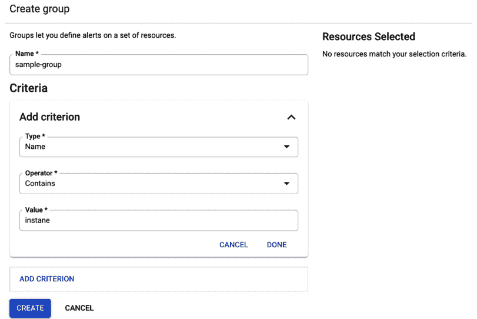

图 17.6 – 创建组

上图显示了创建新组的屏幕。我们可以使用多个标准来筛选要添加到组的资源。

# Dashboards

仪表板允许我们在一个视图中对不同指标进行可视化。我们可以创建多个仪表板，其中包含基于预定义或用户定义指标的图表。这使我们能够创建包含最重要的指标的自定义面板。图表可视化指标，有助于很好地了解您的环境性能。

请注意，对于 VM 实例，我们除了标准指标外还可以看到基于代理的指标。基于代理的指标会在您进入 Dashboards 并点击 +CREATE DASHBOARD 按钮时列出。接下来，从库中选择一个图表并点击 Metric 下拉菜单：

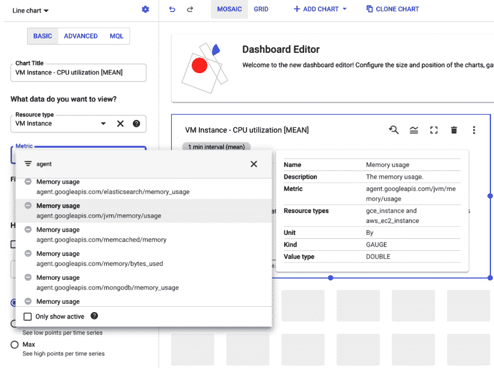

图 17.7 – Dashboards

# Alerting policies

可以配置警报策略，以便在事件和指标阈值达到时创建通知。策略可以有一个或多个条件来触发警报，并会创建在 Cloud Monitoring 控制台中可见的事件。

可以为处理打开的事件选择以下操作：

- **Acknowledge**
- **Silence Associated condition**
- **View Policy**
- **Edit Alerting Policy**

这些操作的菜单在您点击右上角的三点图标时打开：

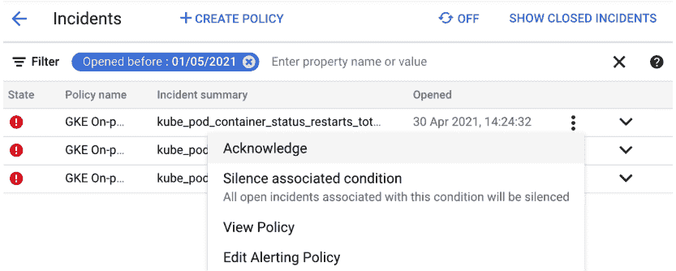

图 17.8 – Alerting policies

事件可以被确认为已知问题或已解决。关于通知，可以配置电子邮件、短信等多种形式。可使用的渠道可从下拉菜单中选择，如下图所示：

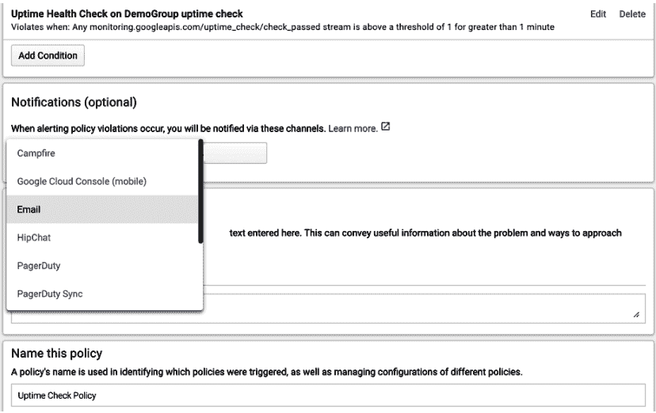

图 17.9 – Notifications

为了进一步指导操作找到可能的解决方案，还可以将文档链接附加到警报。

# Uptime checks

正常运行时间检查用于从全球不同位置检查服务的可用性。它们可以与警报策略结合使用，并在仪表板中显示。检查可以使用 HTTP、HTTPS 或 TCP 进行，可用于 URL、App Engine、Elastic Load Balancing (ELB)、Kubernetes 的负载均衡器服务以及 Amazon EC2 和 GCE 实例。探测间隔可设置为 1、5、10 或 15 分钟：

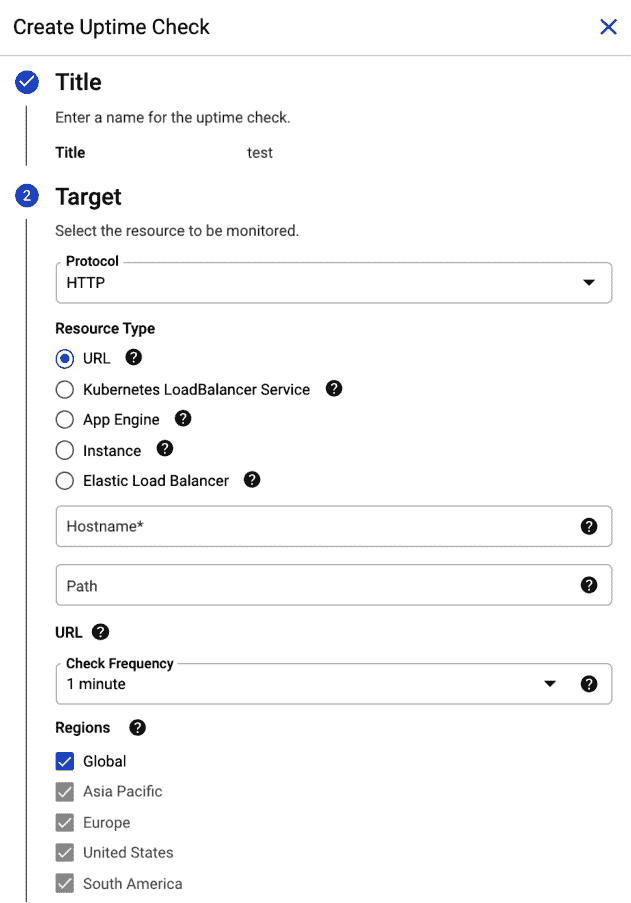

图 17.10 – Uptime check

您还需要选择从哪些区域执行检查。您至少需要检查三个区域：

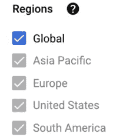

图 17.11 – Regions

在后续部分中，您可以添加主机标头、更改端口、添加自定义标头并对其进行加密。您也可以在适用时添加身份验证：

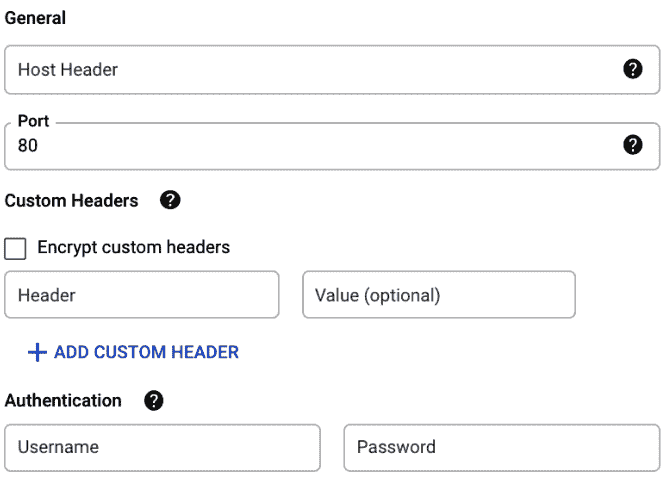

图 17.12 – Advanced settings

在 **Response Validation** 部分，您可以设置 **Response Timeout** 并为响应设置内容匹配：

# Response Validation

指定数据以及该数据如何与实际响应数据进行比较。

图 17.13 – Response Validation

最后，您可以设置警报和通知。您可以选择应使用哪个通知渠道发送通知。如果尚未存在渠道，您可以从此处创建一个新的：

# Alert & Notification

定义 Uptime Check Alert Condition。

图 17.14 – Alert & Notification


> 考试提示
> 请记住，要使正常运行时间检查正常工作，必须创建防火墙规则。要检查正常运行时间服务器的 IP，请前往正常运行时间检查控制台并下载规则列表。有关如何操作的详细信息，请查看文档：https://cloud.google.com/monitoring/uptime-checks/。

## 监控代理

要充分利用 Cloud Monitoring，可以在实例上安装监控代理以收集额外的指标。默认情况下，监控代理会收集磁盘、CPU、网络和进程指标；不过也可以收集额外的指标。

监控代理是一个基于 collectd 的代理，可以安装在 GCP 和 AWS 实例上。代理还可以配置为监控许多应用程序，包括 Apache Web 服务器、Tomcat、Kafka、Memcached 和 Redis。

在 Linux 上安装代理非常简单，只需执行以下两个命令：

```
curl -sSO https://dl.google.com/cloudagents/add-monitoring-agent-repo.sh
```

```
sudo bash add-monitoring-agent-repo.sh --also-install
```

要在 Windows 机器上安装代理，请在 PowerShell 中运行以下命令：

```
(New-Object Net.WebClient).DownloadFile("https://repo.stackdriver.com/windows/StackdriverMonitoring-GCM-46.exe", "${env:UserProfile}\StackdriverMonitoring-GCM-46.exe") & "${env:UserProfile}\StackdriverMonitoring-GCM-46.exe"
```

更多说明可在 https://cloud.google.com/monitoring/agent/install-agent#agent-install-windows 找到。

> 考试提示
> 要监控实例内存，您需要使用监控代理！

## Cloud Logging

Cloud Logging 是第二重要的服务。它允许您存储和分析日志，以及来自 GCP 和 AWS 的事件。基于日志，可以创建警报。它还提供了一个强大的 API，允许日志既可被管理和注入。这意味着任何第三方应用程序都可以利用 Google Cloud 的运维套件用于日志记录目的。收集的日志在 Legacy Logs Viewer 中可见，在那里它们可以被过滤并导出以供进一步分析或归档，或与第三方解决方案集成。有许多类型的日志，其中一些默认未启用。基于日志的指标使用日志条目，可以用于创建仪表板图表和自定义警报。现在，让我们更详细地了解如何使用日志。我们将介绍以下主题：

- Logs Viewer
- Basic log filtering
- Advanced filtering
- Exporting logs
- Logging agent
- Log-based metrics
- Cloud Audit Logs
- Activity
- Retention

## Legacy Logs Viewer

> **考试提示**
> **Legacy Logs Viewer** 是 Stackdriver 中使用过的工具。您仍可从 Google Cloud 的运维套件中访问它。此工具的新版本具有完全不同的用户体验，称为 **Logs Explorer**。我们将在下一节中查看它。请保留本节以备参考，以防考试中出现相关问题。

Legacy Logs Viewer 是一个控制台，允许您查看、过滤和导出日志。请记住，日志与单个 GCP 项目相关联：

Figure 17.15 – Legacy Logs Viewer

要能够查看其他项目的日志，您需要切换视图。可以使用 API 从多个项目获取日志。日志可以使用基本或高级过滤进行过滤，以精确定位特定事件。

## Logs Explorer

Logs Explorer 是 Google Cloud 运维套件中的一个新工具，允许您检查 GCP 日志。当您在 GCP 控制台中打开 Cloud Logging 服务时，它会作为默认窗格弹出：


Figure 17.16 – Accessing Cloud Logging

使用 Logs Explorer，您可以选择以两种不同的范围查看日志：

- Scope by project – 允许您搜索和查看单个项目的日志
- Scope by storage – 允许您查看用作接收器的存储桶中的日志

第二个选项非常方便，因为它允许您在浏览接收器日志时获得与项目中仍保留的日志相同的体验：


Figure 17.17 – Refine scope

要找到您感兴趣的日志，您可以通过简单地从过滤器选择的对象的列表中选择一个过滤器然后选择一个值来定义查询：

Logs explorer
OPTIONS
REFINE SCOPE
Project
New features are available in the Logs explorer.
Query
Recent (2)
Saved (0)
Suggested (3)
Resource +
Log name
Severity
Select resource
Search resource filters
Kubernetes Node
Kubernetes Pod
Metric type
OS Patch Job
Service Account
Stackdriver Notification Channel
Subnetwork
VM Instance
Search instance_id
All instance_id
INSTANCE_ID
1080228512014207575
1672071981735813276
2701302113299800956
4721548050940506507
5638987979155252508
8309969565773668901
String preview
resource.type="gce_instance"
Reset
Cancel
Add

Figure 17.18 – Resource filters

第二个过滤器允许您选择要显示的日志类型，如以下屏幕截图所示：


Figure 17.19 – Log name

第三个过滤器允许选择严重性级别：


Figure 17.20 – Severity

从右上角的链接，您可以进入菜单，在其中选择时间范围：


Figure 17.21 – Time range selection

您也可以从预定义的时间跨度或自定义时间跨度中选择。最后，当我们运行查询时，我们会得到显示机器何时启动的日志：


Figure 17.22 – Filtered logs

此时的严重性为 INFO 级别。

前面的示例显示了资源类型为 GCE 实例且严重性为 INFO 及以上的日志。

## Exporting logs

日志记录接收到的日志条目可以导出（复制）到 Cloud Storage 存储桶、BigQuery 数据集和 Cloud Pub/Sub 主题。您通过配置日志接收器来导出日志，接收器随后会随着日志到达日志记录而继续导出日志条目。接收器包括一个目标和一个选择要导出的日志条目的过滤器。请记住，只有在配置接收器后创建的日志才会被导出：

1. 要设置导出，请转到 Cloud Logging 窗口中的 Logs Router 并点击 CREATE SINK：


Figure 17.23 – Logs Router

2. 在 Sink details 中，填写接收器的名称和描述：


Figure 17.24 – Sink details

3. 在 **Sink destination** 部分，您可以选择要接收日志的服务。这些包括以下内容：

- Cloud Logging bucket
- BigQuery data set
- Cloud Storage bucket
- Cloud Pub/Sub topic
- Splunk
- Other project:

# 2 Sink destination

Select the service type and destination for logs routing sink


Figure 17.25 – Sink destination

4. 在选择要包含在接收器中的日志部分，您可以添加一个过滤器来定义要接收的日志。如果将其留空，则所有日志都将被包含。我们可以使用之前创建的简单过滤器。这将为我们提供 GCE VM 实例的日志：

# 3 Choose logs to include in sink

Create an inclusion filter to determine which logs are included in logs routing sink


Figure 17.26 – Choose logs to include in sink

5. 如果您想检查过滤器是否正常工作，请点击 PREVIEW LOGS。这将带您进入 Logs Explorer：


Figure 17.27 – Logs preview

6. 如我们所见，所有 GCE 日志现在都可见，因为过滤器未指定任何额外参数，例如日志类型。

7. 最后，您可能希望从接收器中排除一些日志。在此部分中，您选择排除过滤器的名称。通过设置排除率，您可以决定应过滤掉日志的百分比。100% 的比率意味着所有匹配过滤器的日志都将被排除：


Figure 17.28 – Choose logs to filter out of sink


8. 你现在可能想知道为什么我要导出日志。导出日志有以下几个用例：

- BigQuery 可用于使用 SQL 进行分析和查询。
- Pub/Sub 导出允许与第三方解决方案集成。
- Cloud Storage 导出是归档日志最具成本效益的选项。

你可以使用专用的安全信息和事件管理（SIEM）工具，例如 Splunk 来进行进一步的日志分析。

## Logging agent

Logging agent 是一个基于 fluentd 的应用程序，同时支持 Linux 和 Windows 机器。它允许将来自常见第三方应用程序和系统软件的日志流式传输到 Cloud Logging。该代理已包含在 App Engine 和 GKE 的镜像中。对于 Compute Engine 和 Amazon EC2，需要进行安装。Linux 上代理的安装非常简单，需要执行以下两个命令：

```
curl -sSO https://dl.google.com/cloudagents/add-logging-agent-repo.sh
sudo bash add-logging-agent-repo.sh --also-install
```

默认情况下，代理会为预定义的应用程序流式传输日志。google-fluentd.conf 可以被修改以指示应流式传输的额外日志。

## Ops Agent

你可能会想知道为什么需要安装两个代理才能获得监控和日志记录功能。Google 正在通过引入一个名为 Ops Agent 的单一代理来解决这个问题。

截至撰写本文时，Ops Agent 仍处于预 GA 阶段，尚未得到 Google 的完全支持。Ops Agent 是 Logging 和 Monitoring 代理的组合。它提供更高的吞吐量和更好的资源效率。由于目前支持的功能数量有限，在迁移到 Ops Agent 之前请先查阅文档：https://cloud.google.com/stackdriver/docs/solutions/agents/ops-agent。

## Log-based metrics

日志可用于创建基于日志的指标。Cloud Logging 可以在每次出现匹配项时累积由过滤器定义的日志。此数据随后会暴露给 Monitoring，并可进一步用于创建仪表板和警报策略。

例如，包含特定 404 错误消息的日志可以在 1 分钟的时间段内进行计数并作为指标公开。

基于日志的指标可以是系统指标或用户定义指标：

- **System metrics**：这些由 Cloud Logging 预定义。
- **User-defined metrics**：这些指标由用户基于过滤条件按项目创建。

在下面的屏幕截图中，我们可以看到系统指标和用户定义指标的示例：


图 17.29 – 基于日志的指标

## Cloud Audit Logs

为了更好地了解 *谁做了什么？*、*在哪里？* 和 *何时？*，可以使用 Cloud Audit Logs。日志按项目、文件夹或组织存储，类型如下：

- Admin Activity
- System Event
- Data Access
- Policy Denied

前两种默认启用且无法停用。第三种默认禁用，因为它可能产生大量信息。审计日志为大多数 GCP 服务生成。要获取服务的完整列表，请参阅以下文档：https://cloud.google.com/logging/docs/audit/。

日志可以从 Legacy Logs Viewer 访问，就像任何其他日志一样，但查看它们需要特定的权限。以下是我们之前提到的每种审计日志类型的简短描述：

- **Admin Activity audit logs**：包含有关修改资源元数据或配置的操作的信息。这可能包括例如 VM 实例的创建或权限的更改。要查看日志，需要 Logging/Logs Viewer 或 Project/Viewer 角色。要在基本过滤下仅查看这些日志，请选择 `activity` 日志类型。
- **System Event audit logs**：包含 Compute Engine 系统事件的信息。这可能是例如 VM 实例的实时迁移。要查看日志，需要 Logging/Logs Viewer 或 Project/Viewer 角色。要在基本过滤下仅查看这些日志，请选择 `system_events` 日志类型。
- **Data Access audit logs**：包含有关创建、修改或读取用户提供数据的操作的信息。要查看日志，需要 Logging/Private Logs Viewer 或 Project/Owner 角色。要在基本过滤下仅查看这些日志，请选择 `data_access` 日志类型。
- **Policy Denied audit logs**：记录由于安全策略违规而导致用户或服务账号被拒绝访问时的日志。这些日志默认生成，并且你的 Cloud 项目会为日志存储付费。要查看这些日志，需要 Logging/Logs Viewer 或 Project/Viewer 角色。

在下面的屏幕截图中，你可以看到对 Admin Activity 审计日志进行过滤的示例：


图 17.30 – Logs Explorer

虽然 Admin Activity 和 System Event 日志不收取费用，但启用 Data Access 日志可能会产生额外费用。BigQuery 拥有自己的 Data Access 日志，它们单独处理且无法停用。

## Activity

审计日志也可以从主 GCP 控制台屏幕中的 ACTIVITY 选项卡查看，该选项卡位于 Google Cloud operations suite 控制台之外。从主 GCP 控制台屏幕，点击左上角的 ACTIVITY，这将带你进入日志列表，如下图所示：


图 17.31 – ACTIVITY

日志被缩写，并可按类别、资源和时间段进行过滤。通过选择条目，你可以看到进一步的详细信息。为了缩小日志列表的范围，你可以使用预定义过滤器，可在右上角找到。选择过滤器并按 OK 应用，如下图所示：


图 17.32 – Activity categories

## Retention

Retention 定义日志在 Cloud Logging 中存储的时间。超过规定期限后，日志将被删除。根据日志类型，保留时间不同。请参阅以下日志类型及其保留期列表：

- **Admin Activity:** 400 天
- **Data Access:** 30 天
- **System Event:** 400 天
- **Policy Denied:** 30 天

请注意，日志可以被导出并归档更长时间。我们已在本书本章的 *Exporting logs* 部分解释了如何导出日志。

## Google Cloud's operations suite for GKE

Google Cloud's operations suite for GKE 是 GKE Legacy Logging and Monitoring 的演进版，该版本已于 2021 年 3 月 31 日弃用并停用。

Cloud Operations for GKE 为 GKE 集群提供在集群和工作负载级别的可观测性功能。它显示了所有最重要的 GKE 集群资源，并允许你深入到工作负载容器生成的日志。

对于所有新的 GKE 集群，该功能默认启用。你可以自行决定想要的监控和日志记录级别。请注意，你可以将其限制为仅系统（Kubernetes 集群）的日志记录和监控，也可以包括工作负载（应用程序）。所有选项都可在 GKE 集群配置向导中看到，点击 Select logging and monitoring type 表单中的下拉菜单后可见。可用选项如下：

- System and workload logging and monitoring
- System logging and monitoring only (beta)
- System and workload logging only (Monitoring disabled)
- System monitoring only (Logging disabled):


即使 Legacy and Logging and Monitoring 仍在屏幕上可见，也不应再使用它。

## GKE dashboard

> Tip
> 请注意，截至撰写本书时，Google Cloud's operations suite for GKE 仅适用于运行在 Google Cloud 上的 GKE 集群。这意味着它不包括运行在本地或裸机服务器上的 GKE 集群。

GKE dashboard 是 GKE 集群最重要的指标的单一视图，包括以下内容：

- GKE 集群的打开警报时间线
- 命名空间、节点、工作负载、服务、Pod 和容器的 CPU、内存和磁盘利用率等指标
- Pod 和容器的日志：


图 17.34 – GKE dashboard


GKE 仪表盘将有关 GKE 集群和工作负载的所有关键信息整合到一个窗口中。它非常方便用于浏览 Kubernetes 资源并精确定位影响应用程序的问题。

## APM

APM 是一组开发人员用来了解他们能够多快以及多可靠地运行应用程序的工具。它包含三个服务：

- Trace
- Debugger
- Profiler

这些工具集成到应用程序的代码中。应用程序无需托管在 GCP 上，而可以在任何云中甚至本地运行，只要有连接即可。APM 源自 Google 的站点可靠性工程（SRE）团队工具集。因此，是时候我们站在 SRE 的角度思考了！

## Trace

Cloud Trace 允许您跟踪微服务应用程序中的延迟。它显示应用程序响应的总体时间，但也可以显示每个微服务的详细延迟。这使您能够精确定位延迟的根本原因。

跟踪显示在 GCP 控制台中，并且可以生成分析报告。默认情况下，它已安装在 Google App Engine（GAE）标准环境中，但可与 GCE、GKE、GAE 灵活以及非 GCP 机器一起使用。需要使用 Cloud Trace SDK 或 API 集成跟踪机制。

## Debugger

这允许您在不停止应用程序的情况下调试代码中的错误。开发人员可以请求正在运行的应用程序的实时快照，捕获调用堆栈和局部变量。可以在代码中注入调试日志点以显示附加信息。甚至可以在生产环境中进行此操作，而不会影响最终用户。

默认情况下，它已安装在 GAE 标准环境中，但可与 GCE、GKE、GAE 灵活以及非 GCP 机器一起使用。它不需要日志代理。

## Profiler

Cloud Profiler 显示您的代码消耗了多少资源。随着应用程序代码的更改，资源需求可能会意外增加。Profiler 允许您在生产环境中精确定位这些问题。它使用一个称为分析器代理的代码片段附加到应用程序的主代码上，并定期发送资源使用信息。它目前支持 Java、Go 和 Node.js，可与 GCE、GKE、GAE 灵活以及非 GCP 机器一起使用。以下屏幕截图展示了使用 CPU 配置文件的 Cloud Profiler 示例：


图 17.35 – Profiler（来源：https://cloud.google.com/profiler/docs/quickstart. 许可：https://creativecommons.org/licenses/by/4.0/legalcode）

## Error Reporting

Error Reporting 允许您在单一位置收集和汇总应用程序产生的错误。收集的错误可以分组并在集中式界面中显示。这样，您可以看到特定时间段内发生了多少次崩溃。

该服务的工作方式与 Cloud Logging 非常相似，但它允许您仅过滤最重要的错误并精确定位崩溃的根本原因。Error Reporting 与 Cloud Functions、App Engine、GCE、GKE 和 AWS EC2 配合使用。默认情况下，它已为 App Engine 标准环境启用。支持多种语言，例如 Go、Java、.NET、Node.js、PHP、Python 和 Ruby。有两种方式可以利用错误报告：

- 您可以使用 Cloud Logging API 并发送格式正确的错误消息。
- 您可以调用专用的 Error Reporting API。

Error Reporting 中的信息保留 30 天。

## Summary

在本章中，我们了解了 Google Cloud 的运维套件以及如何监控 GCP 服务、资源和应用程序。我们研究了三个主要功能：**Monitoring**、**Logging** 和 **APM**。

为增强监控和日志记录功能，请在实例上安装代理。监控允许监控预定义指标。日志记录允许您创建基于日志的指标。可以在条件上创建警报策略，并将通知发送到您选择的端点。跟踪有助于了解应用程序组件（包括微服务和负载均衡器）的延迟。调试允许您查看导致错误的代码快照，而无需停止应用程序。Profiler 显示应用程序不同组件使用了多少资源。最后，Error Reporting 聚合应用程序的错误日志并在时间轴图表上显示它们。

在考试中，一些问题可能会要求您熟悉多个案例研究，这些案例研究应在参加考试前熟悉。这些案例研究解释了虚构的业务和解决方案概念。在下一章中，我们将介绍如何查找这些案例研究，并将查看一个示例案例研究并分析它，以便设计适当的解决方案。

## Further reading

如果您想了解更多关于 Google Cloud 运维套件的信息，请使用官方 Google 文档：

- **Google Cloud's operations suite docs**：https://cloud.google.com/stackdriver/docs/
- **Monitoring agent**：https://cloud.google.com/monitoring/agent/
- **Logging agent**：https://cloud.google.com/logging/docs/agent/
- **Debugger**：https://cloud.google.com/debugger/docs/setup/python
- **Profiler**：https://cloud.google.com/profiler/docs/about-profiler
- **Error Reporting**：https://cloud.google.com/error-reporting/docs/setup/compute-engine
