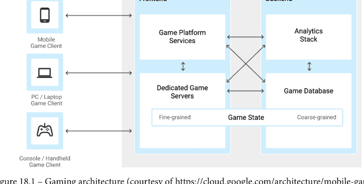
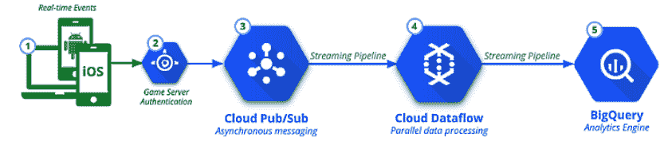
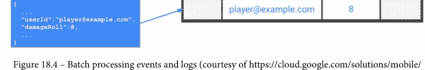
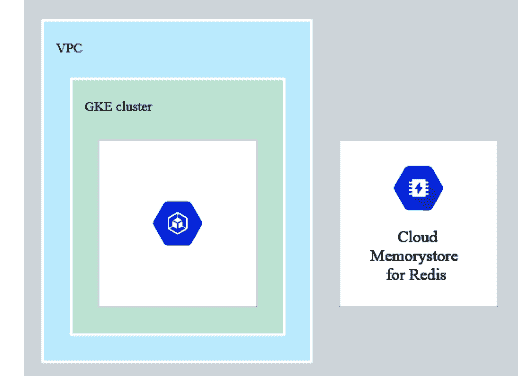

# Section 4:
Exam Focus

本节将重点介绍一个示例案例研究和模拟问题。这将帮助您更实际地理解考试。

本书的这一部分包含以下章节：

- Chapter 18, Case Studies
- Chapter 19, Test Your Knowledge

## 18

## Case Studies

正如我们在 *Chapter 1, GCP Cloud Architect Professional* 中很早就提到的，Google 专业架构师考试涉及参考一组特定的案例研究。约 30% 的考试问题将涉及一个或多个这些案例研究。虽然您可以在参加考试前访问这些案例研究，但您不会知道考试中会出现哪些案例研究。然而，您在考试中可以访问它们，因此无需记住每一个！可以将其视为 Google 对我们友善并提供额外的准备材料。在考试中，当您被问及案例研究相关问题时，您将拥有分屏，可以同时查看案例研究和问题。

本章将涵盖以下主题：

- 理解如何应对考试案例研究
- 案例研究中我们寻找什么？
- 附加案例研究

## Understanding how to approach the exam case studies

问题将明确说明您需要参考的案例研究。截至撰写时，考试指南网页上有四个案例研究可供使用。虽然一些名称可能与考试前一版本中熟悉的名称相同，但自原始考试发布以来，这些名称已发生了显著变化：

- **Mountkirk Games**：https://services.google.com/fh/files/blogs/master_case_study_mountkirk_games.pdf
- **Helicopter Racing League**：https://services.google.com/fh/files/blogs/master_case_study_helicopter_racing_league.pdf
- **EHR Healthcare**：https://services.google.com/fh/files/blogs/master_case_study_ehr_healthcare.pdf
- **TerramEarth**：https://services.google.com/fh/files/blogs/master_case_study_terramaearth.pdf

在考试前阅读这些案例研究非常重要。您应将其作为学习计划的一部分。每个案例研究都涉及一家需要与 Google Cloud Platform（GCP）集成的企业。您会找到业务概述和解决方案概念，而您的任务是将这些概念和需求映射到 GCP 服务。

查看这些案例研究的主要目标是尝试分配可以映射到 GCP 服务的关键词。然而，其中也有大量信息只是为了充实案例研究。区分哪些信息不需要以及哪些信息很重要非常重要。例如，如果有构建可靠且可重复环境的<|message|>要求，可能明智的做法是开始考虑 Cloud Deployment Manager，它为您提供可重复的部署流程。同样，如果技术要求表明公司希望能够根据需求进行扩展或缩减，那么我们可能会倾向于考虑自动扩缩器、负载均衡器和管理实例组。了解每个服务的用例是案例研究的关键。好消息是我们可以在考试前预先审阅案例研究！

在本章中，我们将详细查看上述案例研究之一，尝试展示考试中他们希望您做什么，以及您应如何处理接收到的信息并尝试将其映射到相关的 GCP 服务。

重要说明
在阅读案例研究时，建议您同时参考 GCP 解决方案页面：https://cloud.google.com/solutions。
此外，建议您参考 GCP 架构中心以获取参考架构：https://cloud.google.com/architecture/。

## 我们在案例研究中寻找什么？

让我们仔细看看 Google Cloud 提供的其中一个案例研究。我们选择了 Mountkirk Games。在首次通读该案例研究时，我们可以看到它被分解为六个不同的部分，让我们更详细地查看每个部分：

- 公司概览
- 解决方案概念
- 现有技术环境
- 业务需求
- 技术需求
- 执行声明

每个部分中的摘录都引用了案例研究的文本。需要提醒的是，完整文档可以在本章开头提到的网址中查看。

## 公司概览

让我们看看公司概览：

> “Mountkirk Games 为移动平台制作在线、基于会话的多人游戏。他们在成功将本地环境迁移到 Google Cloud 后，最近开始扩展到其他平台。
> 
> 他们最近的努力是创建一个复古风格的第一人称射击游戏（FPS），该游戏允许数百名同时玩家从多个平台和位置加入特定地理位置的数字竞技场。一个实时数字横幅将显示所有活跃竞技场中所有顶尖玩家的全球排行榜。”

来源：https://services.google.com/fh/files/blogs/master_case_study_mountkirk_games.pdf。

许可：https://creativecommons.org/licenses/by/4.0/legalcode。

那么，从这里我们可以提取哪些信息来帮助我们形成解决方案架构呢？嗯，我们可以看到这个概览引导我们思考移动平台，因此我们应该开始思考移动游戏架构的起点，以及前端架构应该是什么，后端架构应该是什么。我们可以看到我们需要能够应对多人游戏需求，这可能需要复杂的相互关联的表。我们还需要存储会话，因此我们需要研究对此所需的配置，以及其他一些关键要素，例如多个平台和位置。我们还需要一个排行榜，我们可以通过分解组件来实现。最后，我们应该考虑用户体验。查询到我们后端的速度会直接影响最终用户，以及我们游戏的整体成功。

第一段告知我们核心业务是面向移动平台的在线游戏。立即，我们应该意识到移动游戏平台会产生大量实时数据，并且有大量设备连接到它们，所有这些都将来自不同类型的连接（Wi-Fi、3G-5G 等）。这是一个相当独特的行业。

第二段开始暗示一些潜在的 GCP 服务。例如，它提到将有一个实时数字横幅，其中包含顶尖玩家的排行榜。我们可以尝试将其转化为适合此架构的 GCP 服务：

- 我们需要一个流式服务。我们知道哪项服务可以处理流式处理模式？如果你想到 **Pub/Sub**，那就正确了。
- 我们如何将这些事件转换为排行榜？我们可能需要一个 **Dataflow** 管道来清理数据并确保消息格式良好，然后将其转换为结构化数据。
- 该转换然后可以添加到 **BigQuery** 表格式中，将某人的用户名与 *kills* 数量匹配以列出顶尖玩家。
- **Data Studio** 也可用于创建交互式排行榜，从 BigQuery 消费并展示数据。

这只是为了让我们开始思考架构。也许有人会争辩说我们不需要 Dataflow，并且 BigQuery 可以直接从云存储桶查询数据，但这会是一个可扩展的设计吗？如果来自移动设备的事件引入了额外字段，我们是否需要重新审视这一点？

## 解决方案概念

现在，让我们看看解决方案概念：

> “Mountkirk Games 正在构建一款他们预计会非常受欢迎的多人游戏。他们计划将游戏后端部署在 Google Kubernetes Engine 上，以便能够快速扩展并使用 Google 的全球负载均衡器将玩家路由到最近的区域游戏竞技场。为了使全球排行榜保持同步，他们计划使用多区域 Spanner 集群。”

来源：https://services.google.com/fh/files/blogs/master_case_study_mountkirk_games.pdf。

许可：https://creativecommons.org/licenses/by/4.0/legalcode。

解决方案概念只为我们提供了几行信息，但仍然提供了关键信息。他们告诉我们设计需要使用某些服务，但为什么他们希望使用这些服务？此外，我们应该思考哪些服务应设计为典型游戏基础设施的前端和后端组件。

以前端为例。他们希望使用 Google Kubernetes Engine（GKE），但他们可以使用其他各种选项。他们可以使用 App Engine 或 Cloud Run，这两种也提供与云负载均衡的完全集成。然而，这两者都是完全托管的，而 GKE 为开发人员提供了更多控制权，并且历史上游戏已在 GKE 上以大规模部署，使用专用游戏服务器方法：

图 18.1 – 游戏架构（转自 https://cloud.google.com/architecture/mobile-gaming-analysis-telemetry，许可：https://creativecommons.org/licenses/by/4.0/legalcode）

## 现有技术环境

现在，让我们回顾现有环境和需求：

> “现有环境最近已迁移到 Google Cloud，并且有五款游戏通过 lift-and-shift 虚拟机迁移带了过来，只有少数例外。
> 
> 每个新游戏都存在于一个隔离的 Google Cloud 项目中，该项目嵌套在维护大部分权限和网络策略的文件夹下方。低流量的旧游戏已合并到一个项目中。开发和测试也有单独的环境。”

来源：https://services.google.com/fh/files/blogs/master_case_study_mountkirk_games.pdf。

许可：https://creativecommons.org/licenses/by/4.0/legalcode。

## 业务需求

现在，让我们看看业务需求：

> “支持多种游戏平台。
> 
> 支持多个区域。
> 
> 支持游戏功能的快速迭代。最小化延迟。
> 
> 针对动态扩展进行优化。
> 
> 使用托管服务和资源池。
> 
> 最小化成本。”

来源：https://services.google.com/fh/files/blogs/master_case_study_mountkirk_games.pdf。

许可：https://creativecommons.org/licenses/by/4.0/legalcode。

## 技术需求

我们现在有几个技术需求：

> “根据游戏活动动态扩展。
> 
> 在接近实时的全球排行榜上发布计分数据。
> 
> 将游戏活动日志存储为结构化文件以供将来分析。
> 
> 使用 GPU 处理在服务器端渲染图形以支持多平台。
> 
> 支持旧游戏最终迁移到此新平台。”

**来源：** https://services.google.com/fh/files/blogs/master_case_study_mountkirk_games.pdf。

**许可：** https://creativecommons.org/licenses/by/4.0/legalcode。

当你阅读这些需求时，会想到哪些服务？几乎每一行都有一些关键词或短语：动态扩展、日志、迁移和延迟等。我们应该将这些映射到 GCP 服务。例如，如果我们看到根据游戏活动扩展的需求，我们可能会开始思考能够满足此需求的服务。例如，Pub/Sub 能够从移动设备摄取事件并按需扩展。

## 执行摘要

我们案例研究的最后一部分是执行摘要：

> “我们的上一款游戏是第一次使用 Google Cloud，结果非常成功。我们能够以以前从未有过的方式分析玩家行为和游戏遥测数据。这种成功使我们能够押注于完全迁移到云端，并开始使用云原生设计原则构建全新的游戏。我们的新游戏迄今为止是最雄心勃勃的，将为我们打开支持除移动之外更多游戏平台的大门。延迟是我们最优先考虑的问题，尽管成本管理是下一个最重要的挑战。与我们的第一款基于云的游戏一样，我们已经习惯于云能够实现高级分析功能，以便我们可以快速迭代部署错误修复和新功能。”

**来源：** https://services.google.com/fh/files/blogs/master_case_study_mountkirk_games.pdf。

**许可：** https://creativecommons.org/licenses/by/4.0/legalcode。

有一个明确的信息，即延迟和成本管理是高管们最主要关注的问题。他们还专注于尽可能快速地发布新迭代，这应该让我们联想到 DevOps 原则。分析也被提及为一个重要事项，但这能否帮助我们实现成本节约？在与我们的分析输出格式相关的设计上进行投资可以带来显著的成本节约。**BigQuery** 能在这里帮助我们吗？

## 形成解决方案

在第一次梳理后，我们已经成功提取了几个关键词并将其映射到特定的 GCP 服务。下一步是尝试从中形成一个解决方案。这些服务如何相互关联，以构建一个可用的设计并与公司提出的要求相关联？考试不会要求你做出端到端的解决方案——它会问哪些服务更适合满足特定问题的需求。然而，对此有一个想法也会让你作为 GCP 云架构师受益匪浅。

## 分析平台

案例研究的一个关键收获是，我们将以高速处理移动数据流，但同时也会处理一些批处理数据。让我们快速查看 Google Solutions 网页以获取指导。如果我们查看 https://cloud.google.com/architecture/mobile-gaming-analysis-telemetry 上的移动指南，我们会看到用于构建移动游戏分析平台的参考架构。让我们专注于如何处理来自移动设备的实时事件。如果我们查看以下图表，我们可以看到它与我们的需求相吻合：

图 18.2 – 事件的实时处理（转自 https://cloud.google.com/architecture/mobile-gaming-analysis-telemetry，许可：https://creativecommons.org/licenses/by/4.0/legalcode）

我们可以看到，使用 Cloud Pub/Sub 借助其事件驱动设计帮助我们即时处理数据。这是摄取实时事件流的理想服务，并且可以被多个目标消费。Pub/Sub 还充当队列，用于获取新消息并将其推送到管道中的下一个服务。消息到达时此操作会立即执行。

我们还必须容纳批处理数据。同样，此参考架构向我们展示了如何完成此操作。移动设备可以将数据上传到 Cloud Storage，这是一种以经济高效的方式存储对象数据的方法：

图 18.3 – 批处理事件和日志（转自 https://cloud.google.com/solutions/mobile/mobile-gaming-analysis-telemetry，许可：https://creativecommons.org/licenses/by/4.0/legalcode）

此过程中的下一步是 Cloud Dataflow，它充当我们的数据处理服务。我们可以创建单独的管道作业来处理实时和批处理数据，以确保数据格式良好并符合 BigQuery 模式。Dataflow 具有时间窗口触发器，允许它根据事件实际发生的时间而不是发送或接收的时间来处理事件。

最后，BigQuery 帮助我们满足分析需求并报告大量数据。BigQuery 是一种托管服务，并且可以提供快速扩展，这两者都是执行摘要所要求的。

下图显示了 Dataflow 管道处理数据并将我们的 userId 映射到击杀数并以 BigQuery 表格式呈现的示例。我们现在可以直观地看到这如何有助于满足我们实时排行榜的需求：

图 18.4 – 批处理事件和日志（转自 https://cloud.google.com/solutions/mobile/mobile-gaming-analysis-telemetry，许可：https://creativecommons.org/licenses/by/4.0/legalcode）

## 前端平台

我们的前端需求非常明确。我们需要使用 GKE 快速扩展，并使用全球负载均衡器将玩家路由到区域游戏竞技场。

我们在本章前面已经提到过这一点，但为什么我们特别要求使用 GKE，而我们有其他可能满足要求的选项，例如使用托管服务？简而言之，Google 建议使用 Kubernetes 部署生产规模的 **专用游戏服务器** 集群。这些专用服务器提供游戏逻辑并有助于最大限度地减少用户感知的延迟。客户端游戏应用通常会直接与这些游戏服务器通信。

使用 GKE，我们可以为运行基于会话的多人服务器设计可扩展的架构。此架构使我们能够满足另一个关键技术要求，即根据游戏活动动态扩展。缩放管理器进程将根据需求自动启动和停止用作 GKE 节点的虚拟机实例。所有机器的配置都可以通过托管实例组来处理。

## 后端平台

我们的后端服务将仅与前端和后端服务交互；即客户端不会直接与这些服务交互。我们还要求使用 Cloud Spanner 来保持排行榜同步。Cloud Spanner 将提供全球一致性，保持世界各地玩家的历史记录或库存。然而，Cloud Spanner 单独并不适合维护频繁更新的排行榜。对于此，我们应考虑引入诸如 Redis 之类的东西，并根据需要定期将高分保存到长期存储中。通过使用 Cloud **Memorystore**，我们可以实现此要求：

图 18.5 – 排行榜基础设施（转自 https://cloud.google.com/architecture/using-memorystore-for-redis-as-a-leaderboard，许可：https://creativecommons.org/licenses/by/4.0/legalcode）

上图显示了排行榜的基础设施。排行榜可以由 VPC 网络内的 GKE 集群和单独的 Memorystore 实例组成。

## 其他考虑

在技术要求中，注意到对遗留游戏的最终迁移应得到我们设计的支持。据我们所知，遗留游戏已整合到一个项目中，这很有帮助，因为我们应该将这些环境隔离，并在迁移完成后销毁它。Google 为此提供了一个迁移指南，可在 https://cloud.google.com/architecture/dedicated-game-server-migration-guide 找到。

## Mountkirk 总结

现在我们已经形成了解决方案，我们可以确信我们理解了业务需求以及如何使用适当的服务。你应该注意不要期望案例研究中看到的内容与问题之间存在简单的联系。它并不总是像例如哪种存储服务最符合要求那样简单。一些问题可能会引用案例研究，但可能会增加案例研究中未出现的额外要求；例如，Mountkirk 可以使用什么 IAM 策略来隔离开发和生产？案例研究中没有具体提到 IAM，但我们仍应期望看到类似的问题。

## 其他案例研究

我们还想查看截至撰写时可用的另外三个案例研究。我们希望你现在已经清楚如何分解这些案例研究，并理解关键在于找到有助于我们映射到 GCP 服务的关键词。我们不会对其他案例进行如此深入的探讨，但我们希望你在阅读案例研究时能够在没有指导的情况下开始形成解决方案。

## EHR Healthcare

我们现在将查看 EHR Healthcare 案例研究。同样，我们将回顾可以从在线文档中获得的信息。在案例研究结束时，我们将提供分析。我们希望你在阅读时写下让你注意到的服务，并将你的发现与我们的分析进行比较：

## 公司概述：

> “EHR Healthcare 是向医疗行业提供电子健康记录软件的领先供应商。EHR Healthcare 以服务形式向跨国医疗办公室、医院和保险提供商提供其软件。”

## 解决方案概念：

> “由于医疗保健和保险行业的快速变化，EHR Healthcare 的业务每年呈指数级增长。他们需要能够扩展其环境、调整其灾难恢复计划，并推出新的持续部署能力以快速更新其软件。Google Cloud 已被选为取代其当前的托管设施。”

## 现有技术环境：

> “EHR 的软件目前托管在多个托管设施中。其中一个数据中心的租约即将到期。”

> 面向客户的应用基于 Web，并且许多最近已被容器化以在 Kubernetes 集群组上运行。数据存储在关系型和 NoSQL 数据库的混合中（MySQL、MS SQL Server、Redis 和 MongoDB）。

> EHR 在本地托管了与保险提供商的多个遗留文件和 API 集成。这些系统计划在未来几年内被替换。目前没有升级或迁移这些系统的计划。

"用户通过 Microsoft Active Directory 进行管理。监控目前通过各种开源工具进行。警报通过电子邮件发送，并且经常被忽略。"

## Business requirements:
"尽快上线新的保险提供商。
为所有面向客户的系统提供至少 99.9% 的可用性。
提供系统性能和使用的集中可见性并主动采取行动。
提高提供医疗趋势洞察的能力。
降低所有客户的延迟。
保持监管合规。
降低基础设施管理成本。
根据提供商数据进行预测并生成行业趋势报告。"

## Technical requirements:
"维护与本地系统和云提供商连接的保险提供商的遗留接口。
提供一种一致的方式来管理基于容器的面向客户的应用程序。
在本地系统和 Google Cloud 之间提供安全且高性能的连接。
提供一致的日志记录、日志保留、监控和警报功能。
维护和管理多个基于容器的环境。
动态扩展和配置新的环境。
创建接口以从新提供商处摄取和处理数据。"

## Executive statement:
> "我们的本地部署策略多年来一直有效，但需要投入大量时间和金钱来培训我们的团队使用截然不同的系统、管理相似但独立的环境以及应对停机。许多停机都是由于系统配置错误、应对流量高峰的能力不足以及监控实践不一致造成的。我们希望使用 Google Cloud 来利用可扩展、 resilient 的平台，该平台可以无缝跨越多个环境，并提供一致且稳定的用户体验，使我们能够为未来的增长做好准备。"

Source: https://services.google.com/fh/files/blogs/master_case_study_ehr_healthcare.pdf.

License: https://creativecommons.org/licenses/by/4.0/legalcode.

## Analysis

这里有很多信息需要消化。但让我们专注于获取关键词并尝试形成一个关于将使用哪些服务的画面。

让我们尝试总结一下它在告诉我们什么。我们知道他们为医疗行业提供健康记录软件，并且我们知道它为医疗办公室等提供 SaaS 解决方案。让我们更仔细地查看案例研究。有几件事应该引起注意：

- 他们正从本地基础设施迁移到基于云的基础设施，并且已将基于 Web 的应用程序容器化。他们还希望在需要时动态扩展的同时降低基础设施管理成本。扩展也是我们在执行摘要中提到的导致问题的因素，并且面向客户的应用程序必须是基于容器的。我们应该考虑 GKE 在这里。GKE 提供了一种简单的方法，使用他们现有的容器化应用程序来部署和扩展面向客户的 Web 应用。使用 GKE 意味着 GKE 下的基础设施不仅托管而且还受管理，从而提供了他们所需的托管成本节约。此外，我们可以将 Web 应用部署为可根据客户需求扩展的负载均衡的副本集。

- 查看业务需求，其中一个很快引起注意的是，他们必须对系统性能和使用情况进行集中可见性。我们也可以在技术需求中看到类似的要求，即他们需要一致的监控和警报功能。这些应该大声呼喊 **Google Cloud operations**。Cloud Logging 和 Cloud Monitoring 允许我们搜索、分析、监控和警报数据和事件。他们还需要日志保留。为节省成本，我们可以利用 **Cloud Storage**。
- 他们还需要本地系统与 GCP 之间高性能的连接，因此我们应该考虑 **Google Cloud Hybrid Connectivity** 选项，在这里，特别是在专用互连方面，这与 *高性能* 同义。
- 解决方案概念提到调整其 **Disaster Recovery (DR)** 计划。它还提到数据存储在关系型和 NoSQL 数据库的混合中。当我们考虑数据库的 DR 时，我们应该考虑多区域、高可用性实例。**Cloud SQL** 实例通过同步复制到不同区域的持久磁盘提供高可用性。
- 解决方案概念还提到持续部署能力。此时，我们应该考虑所有 CI/CD 相关事物以及 **Cloud Build** 和 **Artifact Registry**。这两个产品也有助于维护和管理多个基于容器的环境的需求。
- 解决方案还需要在监管合规方面保持合规。例如 HIPPA 是保护可识别个人的健康信息的美国标准集。为了遵守此标准，我们可以使用 **Cloud Identity** 用于客户组织。由于他们目前使用 Active Directory 数据库进行用户管理，我们可以轻松集成 Cloud Identity，使用组访问项目资源并要求身份验证以修改或使用它们。
- 他们还希望从新提供商处摄取和处理数据。我们能否想到 GCP 服务可能如何帮助我们？可以 – **Pub/Sub** 用于摄取？**BigQuery** 用于处理？

当你查看这个案例研究时，还有哪些其他服务会引起你的注意？也许你注意到预测行业趋势的需求，并开始考虑 BigQuery ML。尝试思考这些如何协同工作。这个案例研究似乎高度关注扩展和警报，因此思考 GKE 和 Google Cloud operations 如何帮助这里。

## TerramEarth

我们现在将查看 TerramEarth 案例研究。同样，我们将回顾可以从在线文档中得出的内容。在案例研究结束时，我们将提供分析。我们希望你在阅读时写下引起你注意的服务，并将你的发现与我们的分析进行比较：

## Company overview:
> "TerramEarth 制造采矿和农业行业的重型设备。他们目前在 100 个国家拥有超过 500 家经销商和服务中心。他们的使命是打造让客户更高效的产品。"

## Solution concept:
> "目前有 200 万辆 TerramEarth 车辆在运行，我们看到每年 20% 的增长。车辆在运行期间从许多传感器收集遥测数据。少量关键数据实时从车辆传输以促进车队管理。其余传感器数据在收集、压缩后，每天车辆返回基地时上传。每辆车通常每天产生 200 到 500 兆字节的数据。"

## Existing technical environment:
> "TerramEarth 的车辆数据聚合和分析基础设施位于 Google Cloud 中，并为全球各地的客户提供服务。越来越多的传感器数据从其两个主要制造工厂捕获并发送到包含其遗留库存和物流管理系统的私有数据中心。私有数据中心已配置多个网络互连到 Google Cloud。面向经销商和客户的 Web 前端在 Google Cloud 中运行，允许访问库存管理和分析。"

## Business requirements:
> "预测并检测车辆故障，并在可能的情况下及时向经销商运送零件进行维修。
> 
> 降低云运营成本并适应季节性。
> 
> 提高开发工作流程的速度和可靠性。"

允许远程开发者在不损害代码或数据安全性的情况下保持生产力。

为开发者创建面向经销商和合作伙伴的自定义 API 服务创建一个灵活且可扩展的平台。"

## Technical requirements:
"为其遗留系统创建新的 HTTP API 访问抽象层，以实现在不中断操作的情况下逐步迁移到云。

现代化所有 CI/CD 管道，以允许开发者在高度可扩展的环境中部署基于容器的负载。

允许开发者在不损害安全和治理要求的情况下运行实验。

为内部和合作伙伴开发者创建一个自助服务门户，以便创建新项目、请求数据分析作业的资源，并集中管理对 API 端点的访问。

使用云原生解决方案进行密钥和机密管理，并针对基于身份的访问进行优化。

改进和标准化应用程序和网络监控与故障排除所需的工具。"

## Executive statement:
"我们的竞争优势一直是我们对客户的关注，我们能够提供卓越的客户服务并最大限度地减少车辆停机时间。在将多个系统迁移到 Google Cloud 之后，我们正在寻求提供一流的在线车队管理服务给客户并改善经销店运营的新方法。我们的 5 年战略计划是通过实现对我们数据的访问、提高车辆的自主操作能力以及创建将剩余遗留系统迁移到云的路径，来创建一个新的产品合作伙伴生态系统。"

Source: https://services.google.com/fh/files/blogs/master_case_study_terramearth.pdf.

License: https://creativecommons.org/licenses/by/4.0/legalcode.

# 分析

我们首先应该意识到的第一件事是，我们正在看一家公司，其中遥测数据特别重要。我们需要从庞大的车队自动收集地理位置和其他传感器数据，这意味着我们希望从这些数据中提取意义，使其对业务产生价值。我们可以通过使用管道来处理遥测数据。我们还需要查看每个处理阶段可以使用哪些产品。让我们开始吧：

- **数据输入：** 我们应该考虑 **Pub/Sub**、**BigQuery**、**Cloud Storage** 导入或流式传输，以及 **Cloud Logging**。Pub/Sub 是此场景的绝佳选择，因为它在一个全球服务中提供实时且可靠的消息传递。
- **处理：** 我们在这里应该考虑 **Dataflow** 和 **Pub/Sub**。此阶段是我们将数据转换为适合存储的格式。传入数据可以以两种模式处理——流式或批处理。就映射到我们的解决方案概念而言，这可以针对我们的关键数据实时进行；其余传感器数据可以每天上传。Dataflow 可以处理流式数据和批处理数据。
- **存储：** 我们应该考虑 **Cloud Storage**、**BigQuery** 或 **Bigtable**。在这里，我们将存储长期数据。
- **可视化和分析：** 我们应该考虑 **BigQuery** 和 **Cloud SQL**。

还有哪些关键点值得注意，哪些服务是合适的？API 在场景中被提及了几次——供开发人员创建自定义 API 服务以及为内部和合作伙伴开发人员提供自助服务门户。我们的想法可能会想到 **Cloud Endpoints** 或 **Apigee**，以及哪项服务更适合这些需求。在此场景中，Apigee 可能是一个更合适的解决方案。虽然 Cloud Endpoints 门户允许我们创建一个开发人员门户，可以生成可与我们的 API 交互的网页，但此服务仅适用于 GCP。需求指出我们还应支持合作伙伴开发人员。Apigee 文档告诉我们，“开发人员门户是您 API 计划的门面，为内部、合作伙伴和第三方开发人员提供所需的一切。”

安全当然是我们公司的关键关注点。他们还在需求中明确表示希望“使用云原生解决方案进行密钥和机密管理，并优化基于身份的访问。”我们知道 Cloud **Key Management Service (KMS)** 可以支持需要特定密钥管理程序的一系列合规性要求。这是以可扩展且云原生的方式完成的。对于基于身份的访问，我们应该考虑 **Cloud Identity。**

最后，需求中提到了预测。我们应该考虑 ML 服务来满足这些需求。

# 直升机竞速联赛

我们现在将查看直升机竞速联赛案例研究。同样，我们将回顾在线文档中可以找到的内容。在案例研究结束时，我们将提供分析。我们希望您在阅读时写下让您注意到的服务，并将您的发现与我们的分析进行比较。

## 公司概述：

> “直升机竞速联赛（HRL）是一个全球性的直升机竞速体育联赛。HRL 每年举办世界锦标赛和多个地区联赛比赛，参赛队伍竞争以获得世界锦标赛的席位。HRL 提供付费服务，在全球范围内直播比赛，并提供每场比赛的实时遥测和预测。”

## 解决方案概念：

> “HRL 希望将其现有服务迁移到新平台，以扩大其对托管 AI 和 ML 服务的使用，以促进比赛预测。此外，随着新粉丝参与这项运动，尤其是在新兴地区，他们希望将内容（实时和录制）的服务更接近其用户。”

## 现有技术环境：

> “HRL 是一家以公共云为先的公司；其关键任务应用的核心运行在其当前的公共云提供商上。视频录制和编辑在赛道上进行，内容在云中进行编码和转码（视需要）。
> 
> 企业级连接和本地计算由卡车装载的移动数据中心提供。他们的比赛预测服务完全托管在其现有的公共云提供商上。他们的现有技术环境如下：
> 
> 现有内容存储在其现有公共云提供商的对象存储服务中。
> 
> 视频编码和转码在为每个作业创建的 VM 上执行。
> 
> 比赛预测使用在当前公共云提供商的 VM 上运行的 TensorFlow 执行。”

# 业务需求：

> “HRL 的所有者希望扩展其预测能力并降低新兴市场观众的延迟。他们的需求如下：
> 
> 支持将预测模型向合作伙伴公开的能力。
> 
> 在比赛期间和比赛前提高预测能力：
> 
> 比赛结果。
> 
> 机械故障。
> 
> 观众情绪。
> 
> 增加遥测并创建更多见解。
> 
> 衡量粉丝对新预测的参与度。
> 
> 增强广播的全球可用性和质量。
> 
> 增加并发观众数量。
> 
> 最小化运营复杂性。
> 
> 确保符合法规。
> 
> 创建商品化收入来源。”

# 技术需求：

> “保持或提高预测吞吐量和准确性。
> 
> 降低观众延迟。
> 
> 提高转码性能。
> 
> 创建观众消费模式和参与度的实时分析。
> 
> 创建数据仓库以处理大量比赛数据。”

# 执行声明：

> “我们的 CEO S. Hawke 希望将高肾上腺素的赛车带给世界各地的粉丝。我们倾听粉丝的意见，他们希望获得增强的视频流，其中包括比赛内事件的预测（例如超车）。我们当前的平台允许我们预测比赛结果，但缺乏支持比赛期间实时预测以及处理整个赛季结果的能力。”

Source: https://services.google.com/fh/files/blogs/master_case_study_helicopter_racing_league.pdf.

License: https://creativecommons.org/licenses/by/4.0/legalcode.

# 分析

需求中首先应该注意的是，这是一个机器学习（ML）非常重要案例研究。他们的驱动力是为其赛车提供游戏内预测。ML 模型可以部署到生产环境中以提供这些预测——提供离线或在线预测。当然，在这里，很明显我们需要在线预测。

再次，为了满足这些需求，我们必须思考如何摄取数据以及如何转换和丰富数据。一旦我们将 ML 作为需求看到，我们应该考虑 TensorFlow，它将实现和训练 ML 模型。我们还需要诸如 Pub/Sub 之类的东西来摄取事件，以及 Dataflow 来处理数据。Cloud Machine Learning Engine 可用于反馈预测分析。我们也可以考虑 Vertex AI 平台，这是一个无服务器平台，可以大规模训练、调优和提供 TensorFlow 模型。这可以帮助我们进行在线预测。

延迟也是一个问题，公司希望尽可能为其观众减少延迟。对于实时预测来说，这变得非常重要，因为观众会期望立即获得。为优化模型服务，我们应该考虑使用更小的模型，通过减少输入特征的数量并确保删除模型中所有不相关部分。此外，我们应该考虑将事件存储在低延迟数据库中，例如 Bigtable。

还有什么其他值得注意的地方？我们很想听听您的设计！

# 总结

到目前为止，您已经了解了考试案例研究的大致情况。在本章中，我们逐节分解了 Mountkirk 案例研究，并确定了我们可以映射到服务的关键词。对于剩余的案例研究，我们希望您能够完整地阅读每一个案例研究并提取关键词。

我们无法在本章中提供答案，但我们希望展示关键词可以映射到服务，这将为您在考试中带来优势。它也迫使我们确保我们理解一项服务及其主要用例。正如我们所见，数据是这些用例中的一个非常重要的主题。请确保您了解处理数据的选项，并确保其处于可用于分析的格式。这是您最后一次提醒，使用 https://cloud.google.com/architecture，因为它可以极好地将您的用例与服务联系起来。

> **考试提示**
> 请记住，在本次考试中无需提供端到端的解决方案设计即可成功，但了解每个 GCP 服务的用例是关键目标。

# 进一步阅读

要了解本章涵盖内容的更多信息，请查看以下资源：

- **解决方案：** https://cloud.google.com/solutions/
- **架构：** https://cloud.google.com/architecture/
- **更多解决方案：** http://gcp.solutions/

