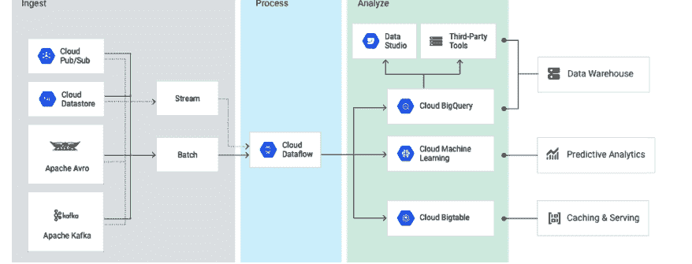
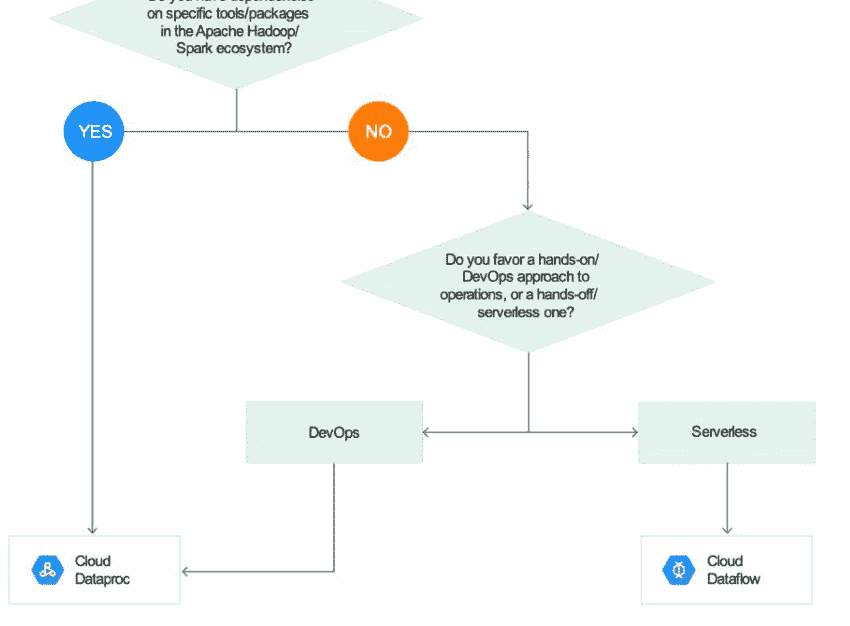
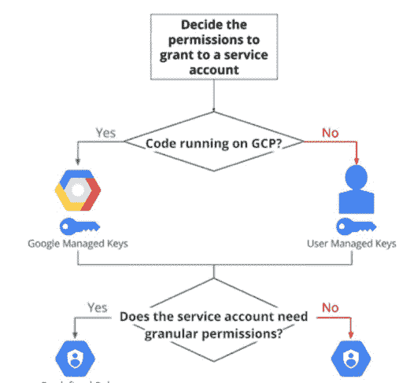
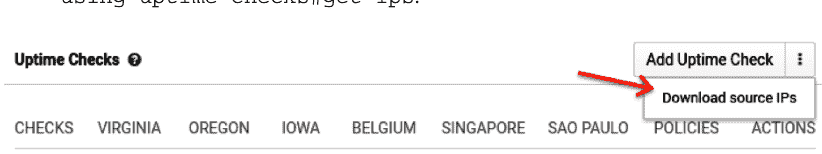
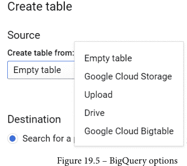

## 19

## 测试你的知识

是时候测试你所学知识了。以下是四个模拟考试来帮助你。祝你好运！

## 模拟测试一

1. Company X 需要将数据保留 5 年以满足审计要求。他们计划每年访问此存储不超过一次。应选择哪种存储选项？
- A. Google Cloud Bigtable
- B. Google Cloud Multi-Regional Storage
- C. Google Cloud Archive Storage
- D. Google Cloud Nearline Storage
- E. Google Cloud BigQuery

2. Company X 希望为物联网传感器数据选择合适的存储系统。有 2,000 个传感器每秒发送温度数据。Company X 希望对累积的数据进行进一步分析。请选择最合适的选择：
- A. Google Cloud Bigtable
- B. Google Cloud Datastore
- C. Google Cloud Spanner
- D. Google Cloud SQL

3. 你已在项目 X 中部署了一个虚拟机实例到 GCP。此实例上已安装特定配置和软件。为了将此镜像与其他只能访问项目 Z 的团队共享，你会建议什么？
- A. 创建快照。使用快照创建自定义镜像。将镜像与其它项目共享。
- B. 创建快照并将其存储在 Google 存储上。
- C. 使用第三方工具对实例执行文件级备份。将镜像复制到 Google 存储。将镜像导入项目 Z。
- D. 使用 Google Transfer Services。

4. Company X 希望分析数据。他们使用的是本地和 GCP 基础设施混合的混合云，并且需要分析流数据和批处理数据。请选择能够满足此要求的适当 GCP 服务：
- A. Google Cloud Dataproc
- B. Google Cloud BigQuery
- C. Google Cloud Compute Engine and Apache Airflow
- D. Google Cloud Dataflow

5. Company X 使用 Hadoop 分析数据。他们使用的是本地和 GCP 基础设施混合的混合云。他们希望将数据分析迁移到 GCP，但希望以最小的努力进行迁移。应使用哪项服务？
- A. Google Cloud Dataproc
- B. Google Cloud Dataflow
- C. Google Cloud Composer
- D. Google Compute Engine

6. Customer X 将数据存储在 Google Datastore 上。他们使用的是本地和 GCP 基础设施混合的混合云。两个平台上的应用程序都需要访问 Datastore。应使用哪种解决方案来启用访问？
- A. 对 GCP 实例使用 Google 管理的密钥。对本地实例使用用户管理的密钥。
- B. 对所有实例使用 Google 管理的密钥。
- C. 对 GCP 实例使用 Google 管理的密钥。对本地实例使用 Firebase 身份验证。
- D. 对 GCP 实例使用 Google 管理的密钥。对本地实例使用第三方工具。

7. Company X 在 GCP 中使用多个配置的项目。他们对计费可见性和管理有特殊要求。根据以下陈述，选择适当的答案：CTO 应该能够控制不同项目的预算，而项目经理只能查看其项目的计费信息。
- A. 将计费管理员角色设置为 CTO 管理的所有项目。将计费查看者角色设置为其项目的项目经理。
- B. 将计费管理员角色设置为随机项目的项目经理。将计费查看者角色设置为其项目的项目经理。
- C. 将计费管理员角色设置为项目和项目经理。
- D. 将所有者角色设置为项目和项目经理。

8. 你正在使用正常运行时间检查监控一项服务。服务被报告为从不同的 GCP 区域不可用。你知道服务正在运行。如何解决监控问题？
- A. 从正常运行时间检查控制台下载源 IP 并为服务创建入站防火墙规则。
- B. 从正常运行时间检查控制台下载源 IP 并为服务创建出站防火墙规则。
- C. 使用 GCP 外部的第三方工具创建正常运行时间检查。
- D. 在托管该服务的所有实例上安装 Cloud operations 监控代理。

9. Company X 希望在 GCP 中创建开发和生产环境。分离这些环境的最佳实践是什么？
- A. 为每个环境创建两个单独的项目。仅向开发团队授予对开发项目的访问权限。仅向运营团队授予对生产环境的访问权限。
- B. 为每个环境创建两个单独的项目。向开发团队和生产团队授予对两个项目的访问权限。
- C. 创建一个项目和两个 VPC。向开发团队和生产团队授予对该项目的访问权限。
- D. 为每个团队创建两个单独的 Google 账号。

10. Company X 希望分析来自传感器的传入数据。数据可能乱序到达。你需要确保数据按正确顺序排列。应使用哪些服务以最小化工作量？
- A. IoT Core、Pub/Sub 和 Dataflow
- B. IoT Core、Pub/Sub 和 Dataproc
- C. IoT Core、Pub/Sub 和 Google Kubernetes Engine (GKE)
- D. IoT Core、Pub/Sub 和 GCE

11. Company X 使用 App Engine 部署了应用程序。他们希望将该应用程序的新版本发布到生产环境。他们希望仅对一组用户进行测试。最合适的解决方案是什么？
- A. 部署应用程序的新版本。使用流量拆分将部分请求重定向到新版本。
- B. 将应用程序部署到单独的项目并指示用户使用新的 URL 连接到它。
- C. 将应用程序迁移到 GKE 并使用蓝绿部署。
- D. 将应用程序迁移到 GKE 并使用滚动更新。

12. Company X 使用 App Engine 灵活环境。他们部署了应用程序的新版本。应用程序崩溃了。代码存储在 GitHub 上。如何进行最快的恢复？
- A. 删除新应用程序并从 GitHub 部署新应用程序。
- B. 将应用程序回滚到之前的版本。
- C. 在旧版本和新版本之间拆分流量，比例为 10% 到 90%。
- D. 向 GCP 支持开票以将应用程序回滚到上一个版本。

13. Company X 使用 Google Cloud 的 operations suite 来监控其 GCP 环境。他们希望存储日志并能够分析它们。对他们来说最好的解决方案是什么？
- A. 创建到 Pub/Sub 的接收器。
- B. 创建到 Spanner 的接收器。
- C. 创建到 BigQuery 的接收器。
- D. 创建到 Bigtable 的接收器。

14. Company X 使用 GKE 集群。你希望增加集群中的节点数量。运行哪条命令最合适？
- A. 运行 `gcloud container clusters increase` 命令以更改节点数量。
- B. 运行 `gcloud container clusters resize` 命令以更改节点数量。
- C. 运行 `kubectl container cluster scale` 命令以更改节点数量。
- D. 运行 `gcloud container cluster resize` 命令以更改节点数量。

15. Company X 希望将 MySQL 数据库迁移到云端。他们希望使用托管服务。请选择最合适的选择。
- A. 使用 Compute Engine 实例并部署 MySQL。
- B. 使用 App Engine 实例并部署 MySQL。
- C. 使用 Cloud SQL。
- D. 使用 Cloud Spanner。

16. Company X 正在创建一个应用程序来分析其 Facebook 资料上的评论。他们希望以最简单的方式分析是否存在负面评论。应使用哪项服务？
- A. TensorFlow
- B. Google AutoML
- C. Google ML Engine
- D. Natural Language API

17. Company X 希望利用 ML 根据过去的数据估算材料成本。他们应使用哪种类型的模型？
- A. 回归
- B. 分类
- C. 多类分类模型

18. Company X 希望为项目预算设置警报。实现此目的的最佳方式是什么？
- A. 使用所需百分比创建预算警报。
- B. 向 Google 支持开票以设置硬配额。
- C. 创建 cron 作业以检查计费，并在超过阈值时发送电子邮件。
- D. 对附加到账户的信用卡设置限制。

19. Company X 希望将数据存储在 Cloud Storage 中。数据每季度访问一次。一年后，数据将被归档。最具成本效益的解决方案是什么？
- A. 将数据存储在多区域存储桶中。设置 365 天的自动归档策略。
- B. 将数据存储在区域存储桶中。设置 365 天的自动归档策略。
- C. 将数据存储在 Nearline 存储桶中。设置对象生命周期策略，将数据在 365 天后移动到 Archive 存储桶。
- D. 将数据存储在 Nearline 存储桶中。创建 cron 作业，在 365 天后将数据移动到 Archive 存储桶。

20. Company X 希望设置一个静态网站。最快且最具成本效益的解决方案是什么？
- A. 使用 Cloud Launcher 部署 Apache Server。
- B. 使用预定义 Web 服务器的 App Engine。
- C. 使用 Cloud Compute Engine 和启动脚本安装 Apache Server。
- D. 使用 Cloud Storage 托管内容。

# 模拟测试二

1. 公司 X 想要一个标准化、可重新部署的 Hadoop 集群，并且需要托管服务所不提供的选项。哪种解决方案最适合？
A. Cloud API
B. Deployment Manager
C. Dataflow
D. TensorFlow

2. 公司 X 希望将其后端平台连接到托管的 NoSQL 数据库服务。预计数据库可能会增长到 PB 级别。作为架构师，他们询问您哪种 GCP 服务最能满足这些要求而无需重构任何应用程序。最佳选择是什么？
A. MySQL
B. Bigtable
C. Firebase
D. Redis

3. 选择服务账号的不同类型（选择三项）：
A. User-managed
B. Automated
C. Google-managed
D. G Suite
E. Google APIs

4. 公司 X 有两个项目，由不同的 VPC 分隔，需要能够相互通信。哪种网络服务允许这样做？
A. VPC peering
B. Cloud Load Balancing
C. Dedicated Interconnect
D. VPN

5. 公司 X 希望在云中使用容器。他们希望继续以开发者为中心并采用代码优先的策略。最佳解决方案是什么？
A. App Engine standard
B. Containers on Compute Engine
C. Cloud Run
D. App Engine flexible

6. 您的 IT 经理正在查看云厂商的数据存储服务。他的 DBA 告知他主要要求是强一致性和高可用性，并且有潜力增长到 PB 级别。最佳存储解决方案是什么？
A. Cloud SQL
B. Cloud Storage
C. Cloud Datastore
D. Cloud Spanner

7. 公司 X 需要符合 PCI 标准。哪种 GCP 服务组合有助于满足这些要求？
A. Cloud Monitoring、Cloud Trace 和 Cloud Spanner
B. Cloud Monitoring、Cloud Logging 和 BigQuery
C. Cloud Error Reporting、Cloud Debugger 和 Datastore
D. Cloud Tagging、Cloud Trace 和 BigQuery

8. 公司 X 的存储工程师需要将数据从其 AWS S3 存储桶迁移到其 GCP 存储桶。最佳解决方案是什么？
A. Storage Transfer Service
B. Transfer Appliance
C. Online transfer
D. BigQuery data transfer

9. 一家公司网页面向全球用户提供服务。他们希望确保用户无论身在何处都能以最有效的方式获取内容。哪种负载均衡解决方案最能满足这些要求？
A. Network Load Balancing
B. Internal Load Balancing
C. HTTP(S) Load Balancing
D. TCP Proxy Load Balancing

10. 公司 X 希望通过云实现自动扩缩容。他们希望以标准化方式跨多个区域部署，同时受益于负载均衡。哪种 GCP 服务最适合此场景？
A. Deployment Manager
B. Managed instance groups
C. Google Compute Engine manager
D. Instance fleet

11. 您正在创建新的防火墙规则，并希望根据其用途识别特定目标，例如 Web 服务器。您应该使用哪种过滤器？
A. Zones
B. Network tags
C. Instance groups
D. Targets

12. 您已将实例部署到与现有实例相同的 VPC 中。当您尝试使用 SSH 连接到外部 IP 地址时，连接被拒绝。为什么会这样？
A. 允许 SSH 的防火墙规则仅限于内部流量。
B. 实例未分配外部 IP。
C. 您没有启动 SSH 所需的正确自定义身份和访问管理（IAM）角色。
D. 您应该使用 Google API 进行外部 SSH。

13. 目前，您的 IT 部门在公司内部工时应用程序发布新软件更新时报告了大量错误。这些错误在 QA 期间未被发现。您被要求设计一种新策略，以将错误降至最低并恢复对 IT 部门的信心。哪种选项最适合此场景？
A. 建议您每年仅部署一次更新。
B. 仅将更新的一部分部署到生产环境。
C. 在 QA 期间多次执行测试。
D. 使用金丝雀部署方法。

14. 您的公司希望将其本地网络连接到 GCP VPC，以便在各站点之间动态交换路由。您会建议哪种服务？
A. Cloud Router
B. Cloud Interconnect
C. External peering
D. Cloud DNS

15. 您计划使用 VPC peering 连接 VPC 网络。哪种网络模式最适合？
A. Auto mode networks
B. VPC VPN networks
C. Custom mode
D. Sub-networking mode

16. 您被要求研究将本地网络扩展到 GCP VPC 网络的不同方法。您的经理提醒您，您的网络带宽为 1 Gbps。最佳选择是什么？
A. Dedicated Interconnect
B. Partner Interconnect
C. VPC Interconnect
D. VPN Interconnect

17. 公司 X 希望将数据中心扩展到云端。您受聘为外部顾问，负责建议最佳混合连接选项。他们告知您，他们需要访问 GCP 上的私有计算资源，但不担心应用层加密。哪种选项最符合他们的需求？
A. Cloud VPN
B. Partner Interconnect
C. Direct Peering
D. Carrier Peering

18. 您希望以低延迟在全球范围内提供所有内容。您应该使用哪种 GCP 服务？
A. Cloud CDN
B. Cloud VPN
C. Google CloudFront
D. Cloud Endpoints

19. 您希望根据传入端口对系统进行负载均衡。您应该使用哪种负载均衡概念？
A. Network Load Balancing
B. TCP Load Balancing
C. HTTP(S) Load Balancing
D. SSL Proxy Load balancing

20. 您希望允许访问发布消息到 Cloud Pub/Sub 主题。您的安全团队提醒您应尽可能精细。您应该使用哪种类型的 IAM 角色？
A. Primitive role
B. Predefined role
C. Custom role
D. Policy-based role
E. Topic role

# 模拟测试三

1. 您使用 Cloud Build 服务构建容器镜像。您希望访问诸如其镜像构建所在的 Google Cloud 项目等信息。推荐的方式是什么？
A. 在构建配置文件中使用替换项，在构建时替换特定变量。
B. 在构建中运行 gcloud 命令。
C. 运行 API 调用以获取信息。
D. 无法访问此信息。

2. 您在 Linux 发行版上运行 Web 应用程序。您希望完全消除修补操作系统的开销。哪种选项最符合您的要求？
A. 将应用程序容器化并使用托管的基础镜像。
B. 使 VM 成为只读。
C. 为您的 VM 使用 Alpine（精简）镜像。
D. 使用 Google 的操作系统修补服务。

3. 您被要求将经典的 LAMP 应用程序容器化。您应遵循的最佳实践是什么（选择两个选项）？
A. 每个容器打包一个应用程序。
B. 将所有应用程序打包到单个容器中。
C. 删除不必要的工具。
D. 使用公共镜像。

4. 您已将应用程序迁移到 GKE，并希望了解应用程序对由单个微服务不可用引起的故障的反应。最简单的方法是什么？
A. 编写脚本随机杀死微服务。
B. 在 GKE 集群上启用 Istio 并使用故障注入。
C. 部署应用程序，使用编辑过的 YAML 文件删除与要测试的微服务相关的代码。
D. 将微服务移至 GCE VM 并在测试期间关闭 VM。

5. 您正在为应用程序添加新功能，并决定使用 Cloud Functions。您的应用程序在 VPC 内的 GCE VM 上运行。Cloud Function 需要直接网络访问该 VM。如何实现？
A. 使用 private services access。
B. User Serverless VPC Access。
C. 使用 Private Google Access。
D. 使用 Private Service Connect for Google APIs。

6. 您希望根据自己创建的自定义指标来扩缩容托管实例组（MIG）。哪种选项符合您的要求？
A. 创建 Cloud schedule 和 Cloud function 查询指标然后扩缩容 MIG。
B. 创建 Cloud operations suite 警报以触发扩容事件。
C. 设置 MIG 从组中所有 VM 导出自定义指标。
D. MIG 不支持自定义指标。

7. 您希望衡量托管在 GKE 集群上的 Web 应用程序的性能。哪种选项最符合您的需求？
A. 定期对用户进行客户满意度调查。
B. 创建 Cloud Monitoring 健康检查。
C. 使用第三方 SaaS 解决方案定期检查 HTTP 400 响应。
D. 使用 Cloud Monitoring 定义并设置 SLI 和 SLO。

8. 您希望确保只有经过身份验证和授权的用户才能访问运行在 GKE 集群上的应用程序。Google 推荐的设计是什么？
A. 创建具有专有身份验证和授权机制的前端容器。
B. 使用 Identity-Aware Proxy 和 GKE Ingress。
C. 将应用程序移至 Cloud Run 并设置授权。
D. 使用 LDAP 将应用程序与 Active Directory 集成。

9. 你想通过公共互联网使用 RDP 和 SSH 安全地连接到你的 GCE 虚拟机。最佳实践是什么？
A. 使用 IAP TCP 转发。
B. 为所有虚拟机设置公共 IP 地址。
C. 使用 VPN 隧道连接到 VM。
D. 在虚拟机上安装第三方远程桌面工具。

10. 你的公司位于 GCP 区域可用的欧洲国家之一。你将为该国家的客户提供服务。你希望确保不允许在该 GCP 区域之外部署资源。这如何实现？
A. 使用组织策略。
B. 在 Google 控制台的 Admin 菜单中禁用其他区域。
C. 使用 gcloud regions disallow 命令禁用其他区域。
D. 在结算帐号设置中禁用其他区域。

11. 根据 CIS 基准，你希望禁止某些虚拟机使用外部 IP 地址。这如何实现？
A. 使用组织策略。
B. 在 GCP 项目上设置元数据。
C. 将 VPC 配置为私有。
D. 将子网配置为私有。

12. 你希望你的云原生应用程序能够以安全的方式访问 GCP 服务。Google 推荐的做法是什么？
A. 将 Google 服务帐号令牌存储在 Kubernetes Secrets 中。
B. 将 Google 服务帐号令牌存储在容器镜像中。
C. 将 Google 服务帐号令牌存储在私有容器注册表中。
D. 使用 Workload Identity。

13. 你计划为你的新客户部署一个登陆区。客户希望确保网络团队和计算团队之间有明确的职责分离。你将使用哪种架构？
A. 单主机项目中的共享 VPC 和多个服务项目
B. 每个项目一个 VPC
C. 单个 VPC 和多项目，通过 VPC 对等连接到该单个项目
D. 单个 VPC 和多项目，通过 VPN 隧道连接到该单个项目

14. 你想在容器中运行你的应用程序并能够在混合云和多云环境中迁移它。默认情况下，应用程序将在 GCP 中运行。你希望确保应用程序能够自动扩展。你应该选择哪项服务？
A. Google Compute Engine
B. Google App Engine
C. Google Cloud Run
D. Google Cloud Functions

15. 你在混合环境中运行云原生工作负载，使用 GKE 和本地 Kubernetes 集群。你希望确保 Kubernetes 集群以统一的方式配置。这如何实现？
A. 在每个集群上应用 Kubernetes ConfigMaps。
B. 将本地集群附加到 Anthos 并使用 Config Management。
C. 在所有集群上安装 Istio 并使用 CRDs。
D. 在所有集群上安装 Config Connector 并使用 CRDs。

16. 你正在设计一个云原生应用程序，该应用程序将存储需要由在 Google Cloud 中运行的其他应用程序查询的数据。你决定使用 Cloud Run。最佳存储选项是什么？
A. 将数据存储在 GCS 存储桶上。
B. 将应用迁移到 GKE 而不是使用 PVC。
C. 从 Cloud Run 连接到 Cloud SQL 服务。
D. Cloud Run 不允许你存储持久数据。

17. 你想在运行在两个 GCP 区域的 Cloud Run 服务之间进行用户流量的负载均衡。Google 推荐的做法是什么？
A. 使用无服务器网络端点组（NEGs）和外部 HTTP(S) 负载均衡器。
B. 使用 Anthos Service Mesh。
C. 使用 Anthos ingress。
D. 使用多集群服务。

18. 你正在开发一个内部应用程序，并希望应用程序将日志发送到 Cloud Logging。哪个选项最适合你的需求？
A. 在实例上安装自定义 Fluentd 代理。
B. 配置 Cloud Logging 代理以包含你的应用程序日志。
C. 创建一个 cron 作业和脚本，定期调用 Cloud Logging API 发送日志。
D. 使用 Cloud Logging 代理收集自定义日志是不可能的。

19. 你想在运行在不同 Anthos GKE 集群的服务之间分发用户流量。哪个选项最适合你的需求？
A. 使用多集群服务。
B. 使用 Anthos Multi Cluster Ingress。
C. 使用在单独 GKE 集群上运行的第三方 ingress。
D. 使用网络负载均衡器。

20. 你已将应用程序的新版本部署到 Cloud Run。你看到新版本中的更改在界面中包含一个错误。你希望尽快回滚到上一个版本。选择正确的方法：
A. SSH 到容器并更改代码。
B. 使用 MANAGE TRAFFIC 功能将上一个版本的流量百分比设置为 100。
C. 撤销代码中的更改，构建新的容器镜像，并部署新版本。
D. 删除服务并使用上一个版本使用的容器镜像重新部署它。

## Mock test four

1. OS Login 可以通过在哪个级别设置元数据值来启用和禁用（选择所有适用项）？
A. VM
B. 项目
C. 组织
D. 文件夹

2. 作为安全分析师，你正在寻找为项目和资源定义细粒度的基于属性的访问控制的能力。哪项服务提供此功能？
A. Access Context Manager
B. Cloud Armor
C. Organization Policy Service
D. Data Loss Prevention

3. 存储管理员已向你提供了有关你请求的新的 Cloud Storage 存储桶的信息。你使用 Cloud Shell 设置 1 个月的保留期，但收到类似以下错误：400 cannot be set for a bucket that has a retention policy。最可能的问题是什么？
A. 存储桶仅支持以秒为单位的保留期。
B. 你没有存储桶的完全权限。
C. 存储桶已启用版本控制。
D. 存储桶使用客户管理的加密密钥。

4. 你已创建并修改了持久启动磁盘，并且需要保存状态以创建新实例。GCP 提供什么来协助你？
A. 实例模板
B. 本地 SSD
C. 公共镜像
D. 自定义镜像

5. 你希望创建一个 BigQuery 表。有哪些数据源选项可用（选择所有适用项）？
A. 上传
B. 空表
C. Google Cloud Storage
D. Cloud Spanner
E. Bigtable
F. Pub/Sub 事件

6. 你想使用现成的模板部署 GCP 资源。一位同事推荐了 Cloud Foundation Toolkit（CFT）。它提供什么（选择所有适用项）？
A. Deployment Manager 的模板
B. 安装了 ct 和 bq 的 Cloud Shell 访问
C. Terraform 的模板
D. Cloud Formation 的模板

7. 你目前在本地 VMware 上运行企业应用程序。你希望它们尽快在 Google Cloud 上运行。哪项服务可以帮助你？
A. Cloud Migration Services
B. 创建 Interconnect 网络并执行 vMotion
C. Migrate for Compute Engine
D. Cloud operations suite

8. 你被要求设计一个高可用解决方案，以安全地将本地网络连接到你的 VPC 网络。你应该使用哪项服务？
A. Cloud VPC
B. Cloud Routing
C. HA Tunneling
D. HA VPN

9. 你目前可以访问专用于托管仅你的项目虚拟机的 Compute Engine 实例，但有人要求你是否可以降低成本。在调查过程中，你注意到并非所有虚拟机都在使用所有资源。你可以深入研究什么来帮助降低成本？
A. 共同责任模型
B. 在独占租户虚拟机上超额分配 CPU
C. 迁移到 HPC 就绪的虚拟机实例
D. 在独占租户虚拟机上超额分配内存

10. 你需要将磁盘数据移动到不同的项目。正确的流程是什么？
A. 在项目 A 中备份磁盘，在项目 B 中基于备份的磁盘创建新磁盘，并将新磁盘附加到项目 B 中的实例。
B. 备份项目 A 中的 VM，将 VM 同步到项目 B，并在项目 B 中启动备份。
C. 在项目 A 中创建磁盘快照，编辑快照配置以指向项目 b，并编辑项目 B 中的实例以使用快照。
D. 在项目 A 中创建磁盘快照，在项目 B 中基于快照创建新磁盘，并将新磁盘附加到项目 B 中的实例。

11. 你的公司正在寻找一种解决方案，将轻量级数据在到达时进行转换并存储为结构化数据。哪些服务最适合此场景？
A. Cloud Storage、Cloud Run 和 BigQuery
B. Pub/Sub、Dataflow 和 Bigtable
C. Cloud Storage、BigQuery 和 Cloud Run
D. Dataflow、Pub/Sub 和 Bigtable

12. 你正在为一些开发人员创建新项目。你希望限制他们部署到特定位置的资源。你应该使用哪个 IAM 功能？
A. Workload Identity
B. 标签
C. 资源保留策略
D. 组织策略

13. 你正在 BigQuery 中设置一个新数据集并希望优化存储。你的同事表示最好删除不需要的表和分区。你应该设置什么？

- A. 表过期时间
- B. 表删除策略
- C. 查询优化策略
- D. 数据集过期时间

14. 你被要求调查一种混合连接解决方案，该方案符合以下要求：

- 低延迟
- 高可用性
- 大数据传输

哪项服务最符合你的需求？

- A. Interconnect
- B. Peering
- C. VPC
- D. VPN

15. 你需要将 TB 级数据从本地机器迁移到现有的云存储存储桶。你希望一次性完成此操作。最合适的服务是什么？

- A. Cloud Storage Transfer Service
- B. Transfer Appliance
- C. BigQuery Data Transfer Service
- D. Cloud Storage Transfer appliance

16. 你被要求在 Cloud SQL 中设置复制。你被告知主要要求是通过使副本更靠近应用程序的区域可用，从而提高读取性能。你应该选择哪种复制类型？

- A. HA read replicas
- B. 跨区域只读副本
- C. 外部只读副本
- D. 多区域只读副本

17. 你有一个使用 Bigtable 的延迟敏感型应用程序，并且希望防止集群中各节点之间的流量不均衡。Google 为实现此目标的建议是什么？

+ A. 确保你的集群已启用 Bigtable QPS。
+ B. 确保你的集群内存使用率低于 50%。
+ C. 确保你的集群 CPU 负载低于 50%。
+ D. 确保你的集群已禁用 Bigtable GPS。

18. 你正在 GCP 后端开发软件服务，并且希望仅向你信任的其他开发者公开 API 以供使用。哪项服务最符合你的需求？

+ A. Apigee
+ B. Cloud APIs service
+ C. Cloud Endpoints
+ D. GKE

19. 你正在寻找一个 Google 服务，你可以在其中从 Cloud Storage 导入源代码，然后生成容器镜像。哪项服务符合你的需求？

+ A. Cloud Run
+ B. Cloud Pipelines
+ C. Cloud CI/CD
+ D. Cloud Build

20. 哪种混合连接服务使用 BGP 为你的 VPC 网络提供服务？

+ A. Cloud Router
+ B. Cloud Interconnect
+ C. Cloud Network Connectivity Center
+ D. Cloud

## Answers to mock test one

+ 1. C: Archive storage is the most cost-effective option. For more information, refer to https://cloud.google.com/storage/.
+ 2. A: Bigtable is a petabyte-scale, fully managed NoSQL database service for large analytical and operational workloads. It is ideal for ad technology, financial technology, and IoT. For more information, refer to https://cloud.google.com/bigtable/.
+ 3. A: Custom images can be created from snapshots and shared across projects. For more information, refer to https://cloud.google.com/compute/docs/images/create-delete-deprecate-private-images.
+ 4. D: "Cloud Dataflow is a fully managed service for transforming and enriching data in stream (https://cloud.google.com/solutions/big-data/stream-analytics/) (real-time) and batch (historical) modes with equal reliability and expressiveness – no more complex workarounds or compromises needed. And with its serverless approach to resource provisioning and management, you have access to virtually limitless capacity to solve your biggest data processing challenges, while paying only for what you use." For more information, refer to https://cloud.google.com/dataflow/:

Figure 19.1 – Dataflow diagram (Source: https://cloud.google.com/dataflow/. License: https://creativecommons.org/licenses/by/4.0/legalcode)

5. A: Cloud Dataproc is a fast, easy-to-use, fully managed cloud service for running Apache Spark and Apache Hadoop clusters in a simpler, more cost-efficient way. For more information, refer to https://cloud.google.com/dataproc/:

Figure 19.2 – Dataproc diagram (Source: https://cloud.google.com/dataproc/. License: https://creativecommons.org/licenses/by/4.0/legalcode)

6. A: Refer to the following diagram to understand the best practices:

Figure 19.3 – Service accounts (Source: https://cloud.google.com/iam/docs/understanding-service-accounts. License: https://creativecommons.org/licenses/by/4.0/legalcode)

7. A: IAM best practice is to set the minimum-required privileges. For more information, refer to https://cloud.google.com/blog/products/gcp/iam-best-practice-guides-available-now.

8. A: You need to open firewall rules to allow uptime checks. For more information, refer to https://cloud.google.com/monitoring/uptime-checks/using-uptime-checks#get-ips:

Figure 19.4 – Uptime checks (Source: https://cloud.google.com/monitoring/uptime-checks/#monitoring_uptime_check_list_ips-console. License: https://creativecommons.org/licenses/by/4.0/legalcode)

> "Your use of uptime checks is affected by any firewalls protecting your service:
> 
> If the resource you are checking isn't publicly available, you must configure the resource's firewall to permit incoming traffic from the uptime check servers. Refer to Getting uptime-check IP addresses at https://cloud.google.com/monitoring/uptime-checks/using-uptime-checks#get-ips to download a list of the IP addresses.
> If the resource you are checking doesn't have an external IP address, uptime checks are unable to reach it."

9. A: Based on best practice with the fewest possible privileges. For more information, refer to https://cloud.google.com/docs/enterprise/best-practices-for-enterprise-organizations.

10. A: Dataflow will accommodate the processing of late data. Dataflow is a managed Apache Beam service.

However, data isn't always guaranteed to arrive in a pipeline chronologically or at predictable intervals. Beam tracks a watermark, which is the system's notion of when all data in a certain window can be expected to have arrived in the pipeline. Once the watermark progresses past the end of a window, any further element that arrives with a timestamp in that window is considered late data. For more information, refer to https://beam.apache.org/documentation/programming-guide/.

11. A: Use traffic splitting to redirect a subset of traffic to the correct version of the application. For more information, refer to https://cloud.google.com/appengine/docs/standard/python/splitting-traffic.

12. B: The fastest way is to roll back the application.

> "We don't want to mess around with our code; we need to fix this right now. Users are upset! Go back to the list of versions and check the box next to the version that was deployed first. Now, click the MAKE DEFAULT button located above the list. Traffic immediately switches over to the stable version. Crisis averted!
> 
> That was easy.
> 
> You can now delete the buggy version by checking the box next to the version and then clicking the DELETE button located above the list."

For more information, refer to https://cloud.google.com/community/tutorials/how-to-roll-your-app-engine-managed-vms-app-back-to-a-previous-version-part-1.

13. C: BigQuery datasets provide big data analysis capabilities. For more information, refer to https://cloud.google.com/logging/docs/export/configure_export_v2 and https://cloud.google.com/logging/.

14. B: The gcloud container clusters resize parameter is used for resizing the GKE cluster. For more information, refer to https://cloud.google.com/sdk/gcloud/reference/container/clusters/resize.

15. C: "Cloud SQL is a fully managed database service that makes it easy to set up, maintain, manage, and administer your relational PostgreSQL and MySQL databases in the cloud." For more information, refer to https://cloud.google.com/sql/.

16. D: Sentiment analysis inspects the given text and identifies the prevailing emotional opinion within the text, especially with a view to determining a writer's attitude as positive, negative, or neutral. For more information, refer to https://cloud.google.com/natural-language/docs/analyzing-sentiment.

17. A: For more information, refer to https://developers.google.com/machine-learning/crash-course/descending-into-ml/linear-regression.

18. A: "You can apply budget alerts to either a billing account or a project, and you can set the budget alert at a specific amount or match it to the previous month's spend. The alerts will be sent to billing administrators and billing account users when spending exceeds a percentage of your budget." For more information, refer to https://cloud.google.com/billing/docs/how-to/budgets.

19. C: For more information, refer to https://cloud.google.com/storage/docs/lifecycle.

20. D: For more information, refer to https://cloud.google.com/storage/docs/static-website.

## Answers to mock test two

1. B: Deployment Manager. Requirements are a non-managed service and one that is standardized. Deployment Manager allows for repeatable deployments. For more information, refer to https://cloud.google.com/deployment-manager/ https://cloud.google.com/deployment-manager/.

2. **B:** Bigtable 和 Redis 是唯一的 NoSQL 选项。这里的关键词是“重构”。
3. **A, C, E:** 如需了解更多信息，请参阅 https://cloud.google.com/iam/docs/service-accounts。
4. **A:** VPC 对等连接允许在两个 VPC 网络之间进行连接，无论它们是否属于同一个项目。如需了解更多信息，请参阅 https://cloud.google.com/vpc/docs/using-vpc-peering。
5. **D:** App Engine 的灵活环境以开发者为中心，采用代码优先策略。如需了解更多信息，请参阅 https://cloud.google.com/appengine/docs/flexible/。
6. **D:** Cloud Spanner 可以扩展到 PB 级数据，并满足高可用性和强一致性的要求。如需了解更多信息，请参阅 https://cloud.google.com/spanner/。
7. **B:** Cloud Monitoring、Cloud Logging 和 BigQuery。如需了解更多信息，请参阅 https://cloud.google.com/blog/products/gcp/oro-how-gcp-smoothed-our-path-to-pci-dss-compliance。
8. **A:** Storage Transfer Service。如需了解更多信息，请参阅 https://cloud.google.com/storage-transfer/docs/overview。
9. **C:** HTTP(S) 负载均衡。如需了解更多信息，请参阅 https://cloud.google.com/load-balancing/docs/choosing-load-balancer
10. **B:** 受管实例组；具体来说，区域受管实例组可通过将实例分布到同一区域内的多个区域来提高可用性。如需了解更多信息，请参阅 https://cloud.google.com/compute/docs/instance-groups/distributing-instances-with-regional-instance-groups。
11. **B:** 添加到 GCE 实例的标签也可用于确定入站和出站规则上的防火墙规则。如果 Web 服务器应用于 VM 并添加到防火墙规则中，则它将受到影响。如需了解更多信息，请参阅 https://cloud.google.com/vpc/docs/firewalls。
12. **A:** 默认 VPC 规则中指定了 default-allow-internal，这允许同一网络中的其他 VM 实例向 VM 实例发起入站连接。如需了解更多信息，请参阅 https://cloud.google.com/vpc/docs/firewalls#default_firewall_rules。
13. **D:** 使用金丝雀部署方法。如需了解更多信息，请参阅 https://cloud.google.com/blog/products/gcp/how-release-canaries-can-save-your-bacon-cre-life-lessons?hl=de。

14. A: Cloud Router 使用 BGP 在您的 VPC 中学习新的子网，并在本地网络上公告它们。如需了解更多信息，请参阅 https://cloud.google.com/router/docs/concepts/overview。

15. C: 自定义模式网络。如需了解更多信息，请参阅 https://cloud.google.com/vpc/docs/vpc。

16. B: Partner Interconnect。Dedicated Interconnect 需要 10 GB，且其他选项不存在。如需了解更多信息，请参阅 https://cloud.google.com/interconnect/docs/how-to/choose-type。

17. A: Cloud VPN 满足要求。如果需要应用层加密，则应考虑 Partner Interconnect 或 Direct Interconnect。如果需要连接到 G Suite，则应考虑 Carrier Peering。如需了解更多信息，请参阅 https://cloud.google.com/hybrid-connectivity/。

18. A: Cloud 内容分发网络在全球众多位置进行缓存，从而降低延迟。如需了解更多信息，请参阅 https://cloud.google.com/cdn/docs/overview。

19. A: Network Load Balancing 可以根据传入地址、端口和协议类型对系统负载进行平衡。如需了解更多信息，请参阅 https://cloud.google.com/load-balancing/docs/network/。

20. B: 预定义角色。如需了解更多信息，请参阅 https://cloud.google.com/iam/docs/overview。

## Answers to mock test three

1. A: “Substitutions are helpful for variables whose value isn't known until build time, or to reuse an existing build request with different variable values. Cloud Build provides built-in substitutions or you can define your own substitutions. Use substitutions in your build's steps and images to resolve their values at build time.” For more information, refer to https://cloud.google.com/build/docs/configuring-builds/substitute-variable-values。

2. A: Managed base images follow security best practices – in addition to being maintained with regular patching and testing, they can be rebuilt from scratch reproducibly. By comparing them to the original source, we can verify that no flaws were introduced. For more information, refer to https://cloud.google.com/blog/products/containers-kubernetes/exploring-container-security-let-google-do-the-patching-with-new-managed-base-images。

3. A and C: “When you start working with containers, it's a common mistake to treat them as virtual machines that can run many different things simultaneously. A container can work this way but doing so reduces most of the advantages of the container model. Because a container is designed to have the same life cycle as the app it hosts, each of your containers should contain only one app.” “To protect your apps from attackers, try to reduce the attack surface of your app by removing any unnecessary tools. For example, remove utilities like netcat, which you can use to create a reverse shell inside your system. If netcat is not in the container, the attacker has to find another way.”

For more information, refer to https://cloud.google.com/architecture/best-practices-for-building-containers。

4. B: Istio allows you to inject faults to test the resiliency of your application.

For more information, refer to https://istio.io/latest/docs/tasks/traffic-management/fault-injection/。

5. B: “Serverless VPC Access enables you to connect from a serverless environment on Google Cloud (Cloud Run, Cloud Functions, or the App Engine standard environment) directly to your VPC network. This connection makes it possible for your serverless environment to access Compute Engine VM instances, Memorystore instances, and any other resources with an internal IP address.”

For more information, refer to https://cloud.google.com/vpc/docs/private-access-options and https://cloud.google.com/vpc/docs/configure-serverless-vpc-access。

6. C: “You can create custom metrics using Cloud Monitoring and write your own monitoring data to the Monitoring service. This gives you side-by-side access to standard Google Cloud data and your custom monitoring data, with a familiar data structure and consistent query syntax. If you have a custom metric, you can choose to scale based on the data from these metrics.”

For more information, refer to https://cloud.google.com/compute/docs/autoscaler/scaling-stackdriver-monitoring-metrics。

7. D: “Service monitoring has a set of core concepts, which are introduced here:

- Service-Level Indicator (SLI): a measurement of performance
- Service-Level Objective (SLO): a statement of desired performance”

For more information, refer to https://cloud.google.com/stackdriver/docs/solutions/slo-monitoring and https://sre.google/sre-book/service-level-objectives/。

8. B: When an application or resource is protected by IAP, it can only be accessed through the proxy by members (https://cloud.google.com/iam/docs/overview#concepts_related_identity), also known as users, who have the correct Identity and Access Management (IAM) role (https://cloud.google.com/iam/docs/understanding-roles). When you grant a user access to an application or resource by IAP, they're subject to the fine-grained access controls implemented by the product in use without requiring a VPN. When a user tries to access an IAP-secured resource, IAP performs authentication and authorization checks.

For more information, refer to https://cloud.google.com/iap/docs/concepts-overview。

IAP is integrated through Ingress for GKE. This integration enables you to control resource-level access for employees instead of using a VPN.

For more information, refer to https://cloud.google.com/iap/docs/cloud-iap-context-aware-access-howto。

9. A: If you are connecting from anywhere over the public internet, it's best to enable Identity-Aware Proxy TCP forwarding for your project.

For more information, refer to https://cloud.google.com/compute/docs/instances/connecting-to-windows。

10. A: Policies to restrict public IP addresses but allow some exceptions。

11. A: By default, all VM instances are allowed to use external IP addresses.

The allowed/denied list of VM instances must be identified by the VM instance name, in the form: projects/PROJECT_ID/zones/ZONE/instances/INSTANCE.

For more information, refer to https://cloud.google.com/resource-manager/docs/organization-policy/org-policy-constraints。

12. D: Workload Identity is the recommended way to access Google Cloud services from applications running within GKE, due to its improved security properties and manageability. For information about alternative ways to access Google Cloud APIs from GKE, refer to https://cloud.google.com/kubernetes-engine/docs/how-to/workload-identity。

13. A: "Shared VPC lets organization administrators delegate administrative responsibilities, such as creating and managing instances, to Service Project Admins while maintaining centralized control over network resources such as subnets, routes, and firewalls." For more information, refer to https://cloud.google.com/vpc/docs/shared-vpc.

14. C: Knative provides an open API and runtime environment that enables you to run your serverless workloads anywhere you choose – fully managed on Google Cloud, on Anthos on Google Kubernetes Engine (GKE), or on your own Kubernetes cluster. Knative makes it easy to start with Cloud Run and later move to Cloud Run for Anthos, or start in your own Kubernetes cluster and migrate to Cloud Run in the future. By using Knative as the underlying platform, you can move your workloads freely across platforms, while significantly reducing the switching costs. For more information, refer to https://cloud.google.com/knative.

15. B: "With Anthos Config Management, you can create a common configuration across all your infrastructure, including custom policies, and apply it both on-premises and across clouds. Anthos Config Management evaluates changes and rolls them out to all Kubernetes clusters so that your desired state is always reflected."

For more information, refer to https://cloud.google.com/anthos/config-management.

16. C: Cloud SQL is a fully managed database service that helps you set up, maintain, manage, and administer your relational databases in the cloud. For more information, refer to https://cloud.google.com/sql/docs/mysql/connect-run.

17. A: "A Network Endpoint Group (NEG) specifies a group of backend endpoints for a load balancer. A serverless NEG is a backend that points to a Cloud Run (https://cloud.google.com/run/docs), App Engine (https://cloud.google.com/appengine/docs), or Cloud Functions (https://cloud.google.com/functions/docs) service."

"If a backend service contains several NEGs, the load balancer balances traffic by forwarding requests to the serverless NEG in the closest available region. However, backend services can only contain one serverless NEG per region. To make your Cloud Run service available from multiple regions, you will need to set up cross-region routing. You should be able to use a single URL scheme that works anywhere in the world yet serves user requests from the region closest to the user. If the closest region is unavailable or is short on capacity, the request will be routed to a different region."

For more information, refer to https://cloud.google.com/load-balancing/docs/https/setting-up-https-serverless#multi_region_lb.

18. B: Besides the list of default logs (https://cloud.google.com/logging/docs/agent/default-logs) that the Logging agent streams by default, you can customize the Logging agent to send additional logs to Logging or to adjust agent settings by adding input configurations.

For more information, refer to https://cloud.google.com/logging/docs/agent/logging/configuration#configure.

19. B: "Multi Cluster Ingress (MCI) is a cloud-hosted multi-cluster Ingress controller for Anthos GKE clusters. It's a Google-hosted service that supports deploying shared load balancing resources across clusters and across regions." For more information, refer to https://cloud.google.com/kubernetes-engine/docs/concepts/multi-cluster-ingress.

20. B: Cloud Run allows you to specify which revisions should receive traffic and to specify traffic percentages that are received by a revision. This feature allows you to roll back to a previous revision, gradually roll out a revision, and split traffic between multiple revisions.

For more information, refer to https://cloud.google.com/run/docs/rollouts-rollbacks-traffic-migration.

# Answers to mock test four

+   1. A and B: Metadata values can be added at the VM and project level. For more information, refer to https://cloud.google.com/compute/docs/instances/managing-instance-access.

+   2. A: Access Context Manager offers fine-grained, attribute-based access control for projects or resources. For more information, refer to https://cloud.google.com/access-context-manager/docs/overview.

+   3. C: Retention policies cannot be enabled if versioning is set, as they are mutually exclusive features. For more information, refer to https://cloud.google.com/storage/docs/bucket-lock.

+   4. D: Custom images meet our requirements to save the state of our boot disk and create new instances based on this. For more information, refer to https://cloud.google.com/compute/docs/images/create-delete-deprecate-private-images.

5. A, B, C, and E are all applicable selections when creating a BigQuery table:

6. A and C: For more information, refer to https://cloud.google.com/foundation-toolkit. The Cloud Foundation Toolkit (CFT) offers templates for both Deployment Manager and Terraform.

7. C: For more information, refer to https://cloud.google.com/migrate/compute-engine/docs/4.2/getting-started. Migrate for Compute Engine can help to migrate from on-premises VMware private clouds into GCP.

8. D: For more information, refer to https://cloud.google.com/network-connectivity/docs/vpn/concepts/overview#ha-vpn.

9. B: For more information, refer to https://cloud.google.com/compute/docs/nodes/overcommitting-cpus-sole-tenant-vms. Overcommitting CPU on sole-tenant machines allows us to share CPU resources across our VMs and therefore reduce cost.

10. D: This is the correct procedure for moving disk data across projects. For more information, refer to https://cloud.google.com/compute/docs/disks/create-snapshots.

11. A: "Lightweight" is the keyword here. Lightweight data transformation is a use case for Cloud Run. Cloud Run transforms lightweight data as it arrives and stores it as unstructured data. In this example, a file can be uploaded to Cloud Storage, and an event is triggered and delivered to a Cloud Run service. Data is then structured and stored in a BigQuery table. As answer A is the only option that mentions Cloud Run, this is the correct answer. For more information, refer to https://cloud.google.com/run.

12. D: Organizational policies can help us restrict where GCP resources are deployed. For more information, refer to https://cloud.google.com/resource-manager/docs/organization-policy/defining-locations.

13. A: For more information, refer to https://cloud.google.com/bigquery/docs/best-practices-storage. Setting a table expiration time on our Big Query table will delete data when the time is exceeded. This option is useful if you need access to only the most recent data. It is also useful if you are experimenting with data and do not need to preserve it.

14. A: Interconnect fulfills the requirements for low-latency, highly available, large-data transfers. For more information, refer to https://cloud.google.com/network-connectivity/docs/interconnect#docs.

15. A: The Cloud Storage Transfer Service is ideal for one-off transfers of TBs' worth of data. For more information, refer to https://cloud.google.com/storage-transfer/docs/on-prem-overview.

16. B: Cross-region read replicas are a great fit for this use case. For more information, refer to https://cloud.google.com/sql/docs/mysql/replication.

17. B: For more information, refer to https://cloud.google.com/bigtable/docs/performance. This capacity also provides a buffer for traffic spikes or key-access hotspots, which can cause imbalanced traffic among nodes in the cluster.

18. C: For more information, refer to https://cloud.google.com/endpoints. Cloud Endpoints lets us develop APIs on any GCP backend and then share our APIs with other developers.

19. D: For more information, refer to https://cloud.google.com/build/docs/overview. Cloud Build can import from various sources and deliver artifacts as part of a serverless CI/CD pipeline.

20. A: Cloud routes use BGP. For more information, refer to https://cloud.google.com/network-connectivity/docs/router/concepts/overview.

