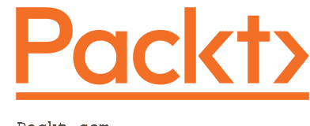
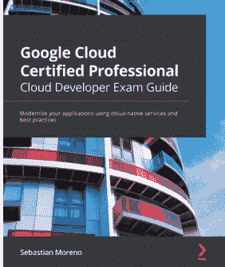
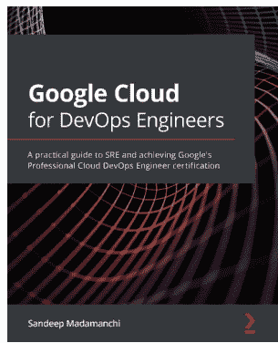

## Index

## A

- Access Context Manager 475
- Access Control Lists (ACLs) 298, 458
- access scope 456
- ACID 297
- Active Directory (AD) 445
- admin cluster 215, 222
- agents 432
- Amazon Elastic Kubernetes Service (EKS) 214
- American National Standards Institute (ANSI) 48
- Andromeda 265
- Anthos
  - about 46
  - components 210, 211
  - Google Cloud Run 236-238
  - migrating 235, 236
  - pricing 239
  - quotas and limitations 238
- Anthos Binary Authorization
  - about 234, 235
  - platforms 234
- Anthos clusters
  - about 211
  - deployment options 213
  - on AWS 217
  - on Azure 219
  - on bare metal 221, 222
  - on VMware (GKE on-prem) 214
- Anthos clusters, on AWS
  - components 218
  - deploying 219
  - load balancing 219
- Anthos clusters, on Azure
  - components 219, 220
  - deploying 221
  - load balancing 221
  - management service 220
  - user cluster 221
- Anthos clusters, on bare metal
  - load balancing modes 223
  - reference link 223
  - summary 223
  - types 222, 223
- Anthos clusters, on VMware (GKE on-prem)
  - components 214-216
  - deploying 217
  - load balancing 216
- Anthos, components
  - Anthos clusters 211
- Anthos Connect Agent 212
- fleets 212, 213
- Anthos Config Management
  - about 224-226
  - components 224, 225
- Anthos Connect Agent 212
- Anthos, enabling for GKE
  - reference link 214
- Anthos Multi Cluster Ingress (MCI)
  - about 233, 234
  - reference link 234
- Anthos, price list
  - reference link 239
- Anthos Service Mesh
  - Istio 227, 228
  - Service-Level Objectives (SLOs) 232
  - service management 227
  - summary 232
  - using 230, 231
- Apache Hadoop
  - ecosystem components 396
- Api.ai 432
- Apigee 576
- APM
  - about 554
  - Cloud Profiler 555
  - Cloud Trace 554
  - debugger 554
- App Engine
  - access, securing with IAM 125
  - components 106, 107
  - cron jobs 122, 123
  - deploying 110-115
  - environment types 108
  - firewall rules 119
  - flexible environment 109, 110
  - IAM roles 125
  - limits 125
  - Memcache 124
  - pricing 126
  - quotas 125
  - right location, selecting 107
  - scaling 121
  - settings 120
  - standard environment 109
  - traffic, migrating 118, 119
  - traffic, splitting 117
  - versions 116
  - working with 108
- App Engine, pricing
  - reference link 126
- App Engine, scaling
  - automatic scaling 121
  - basic scaling 121
  - manual scaling 121
- App Engine, settings
  - custom domain 120
  - SSL certificates 121
- application backends
  - about 243
  - IoT backends 243
  - mobile backends 243
  - third-party API integrations 243
- application profiles 360
- application programming interfaces (APIs)
  - using, to manage resources 482-487
- application programming interfaces (APIs), resources
  - API keys 482
  - OAuth client IDs 483
  - Service Accounts 483
- Application-Specific Integrated Circuits (ASICs) 421
- Artifact Registry 180, 181, 573
- Artificial Intelligence (AI) 412
- attestations 234
- autohealing 92, 93
- AutoML 433, 434
- AutoML Natural Language 434
- AutoML Tables 434
- AutoML Translation 434
- AutoML Video Intelligence 434
- AutoML Vision 434
- auto-scaling 156
- autoscaling policy 85-91
- AWS
  - Anthos clusters on 217
- Azure Kubernetes Service (AKS) 214

## B

- Backup Admin 355
- bias 415
- big data
  - about 367
  - end-to-end big data solution 368
  - options, analyzing 367
- big data services 51, 52
- BigQuery
  - about 381, 562, 566, 573, 576
  - Connected Sheets 384
  - data, exporting 389-391
  - data, importing 389-391
  - datasets 382, 383
  - features 382
  - Federated Queries 384
  - IAM 392
  - limits 393
  - materialized views 385
  - pricing 393
  - quotas 393
  - storage 391
  - storage and compute separation 384
  - Storage Read API 392
  - tables 383
  - using 386-388
- BigQuery Admin 392
- BigQuery BI Engine 385
- BigQuery (bq) 494-496
- BigQuery Data Editor 392
- BigQuery Data Owner 392
- BigQuery dataset 34
- BigQuery Data Transfer Service 391
- BigQuery Data Viewer 392
- BigQuery GIS 385
- BigQuery Job User 392
- BigQuery Metadata Viewer 392
- BigQuery ML Engine 385
- BigQuery Omni 385
- BigQuery Read Sessions User 392
- BigQuery User 392
- Bigtable
  - about 48, 356-358, 576, 579
  - access, securing with IAM 365
  - capacity, planning 362
  - configuration 358
  - data consistency 362
  - instance, creating 362-365
  - limits 365
  - pricing 366
  - quotas 365
  - table, creating 362-365
- Bigtable Admin 365
- Bigtable configuration
  - application profiles 360-362
  - clusters 359
  - instances 358
  - nodes 359
  - replication 360
  - schema 359
- Bigtable Reader 365
- Bigtable User 365
- Bigtable Viewer 365
- Border Gateway Protocol (BGP) 49
- Bring Your Own Device (BYOD) 475
- Business Intelligence (BI) 385

## C

- CAP theorem 348
- Cask Data Application Platform (CDAP) 399
- certified architect
  - benefits 4, 5
- change data capture (CDC) 405
- Chicago Taxi Trips 386
- Chronicle 475
- CI/CD security overview
  - about 473
  - branching model 473
  - container image vulnerabilities 473
  - filesystem security 473
- Classless Inter-Domain Routing (CIDR) 265
- client-side encryption 298
- cloud
  - about 14
  - characteristics 15
  - models 15
- Cloud APIs
  - reference link 482
- Cloud Architect
  - reference link 10
- Cloud Armor 50, 477, 478
- Cloud Audit Logs 549, 550
- Cloud Bigtable (cbt) 496-498
- Cloud Build
  - about 181, 519, 573
  - reference link 519
- Cloud Dataflow
  - about 375
  - additional options 379
  - browsing 376
  - graph view 380
  - IAM 380
  - limits 381
  - pricing 381
  - query results 380
  - quotas 381
  - service design 375
  - templates, using 376-378
- Cloud Data Fusion. See Data Fusion
- Cloud Datastore
  - about 48
  - creating 318-323
  - using 318-323
- Cloud Deployment Manager
  - exploring 498-513
  - reference link, for resource types 499
  - reference link, for template 513
- Cloud DNS 50, 285
- Cloud Endpoints 520, 576
- Cloud External Key Manager (Cloud EKM) 348
- Cloud Filestore 47
- Cloud Firestore
  - about 48, 316, 317
  - Cloud Datastore, creating 318-323
  - Cloud Datastore, using 318-323
  - Datastore mode, versus Native mode 323
  - in Datastore mode 317, 318
  - in Native mode 317, 318
  - pricing 325
  - upgrading 318
- Cloud Foundation Toolkit (CFT) 516
- Cloud Function Admin 260
- Cloud Function Developer 260
- Cloud Function Invoker 260
- Cloud Functions
  - about 16, 19, 44, 46
  - deploying 249
  - deploying, with gcloud command 258
  - deploying, with Google Cloud Console 249-257
  - pricing 261
  - triggers, defining 259
- Cloud Functions, considerations
  - about 247
  - Cloud SQL connectivity 248
  - cold start 248
  - environment variables 248
  - internal resources, connecting in VPC network 248
  - local emulator 249
- Cloud Functions, key characteristics
  - about 242
  - autoscaling 243
  - event-driven 242
  - serverless 242
  - stateless 243
- Cloud Functions, types
  - about 245
  - Background functions 246
  - HTTP functions 246
- Cloud Functions, use cases
  - about 243
  - application backends 243
  - real-time data processing systems 244
  - smart applications 244
- Cloud Function Viewer 260
- Cloud Identity 21, 443-445, 573, 576
- Cloud Identity and Access Management (IAM) 298
- Cloud Interconnect
  - about 50
  - dedicated Interconnect 50
  - partner Interconnect 50
- Cloudiot Admin 398
- Cloud IoT Core
  - about 397, 398
  - IAM 398
  - limits 398
  - pricing 399
  - quotas 398
  - service diagram 397
- Cloudiot Device Controller 398
- Cloudiot Editor 398
- Cloudiot Provisioner 398
- Cloudiot Viewer 398
- Cloud Key Management Service (KMS) 348, 576
- Cloud Logging
  - about 538, 576
  - ACTIVITY tab 550, 551
  - Cloud Audit Logs 549, 550
  - Legacy Logs Viewer 538, 539
  - log-based metrics 548
  - Logging agent 547
  - Logs Explorer 539-543
  - logs, exporting 544-547
  - Ops Agent 547
  - retention 551
- Cloud Machine Learning Engine 579
- Cloud Memorystore 568
- Cloud Monitoring
  - about 529
  - alerting policies 532, 533
  - dashboards 531
  - groups 530, 531
  - Monitoring agent 537
  - uptime checks 534-537
- Cloud NAT 50, 279
- Cloud Natural Language API 423-427
- Cloud Profiler 555
- Cloud Pub/Sub. See Pub/Sub
- Cloud Router 49
- Cloud Run
  - about 46, 185
  - building 187
  - pricing 206, 207
  - quotas and limits 205
  - revisions 187
  - using 186
- Cloud Run admin 205
- Cloud Run containers
  - about 188
  - requirements 188
- Cloud Run developer 205
- Cloud Run (fully managed), for Anthos
  - versus Cloud Run, for Anthos 238
- Cloud Run invoker 205
- Cloud Run triggers
  - about 188, 189
  - Cloud Scheduler 189
  - Cloud Task 189
  - deploying, to Cloud Run 190-200
  - Eventarc 189
  - HTTPS or gRPC request 189
  - new revision, deploying 201-204
  - Pub/Sub 189
- Cloud Run viewer 205
- Cloud Scheduler 519
- Cloud Source Repositories
  - about 519
  - reference link 519
- Cloud Spanner
  - about 48, 346
  - access, securing with IAM 354, 355
  - data consistency 348
  - encryption 348
  - IAM 355
  - instance configuration 346, 347
  - instance, creating 349-354
  - limits 355
  - node count, selecting 347
  - point-in-time recovery (PITR) 349
  - pricing 356
  - processing units 347
  - quotas 355
  - replication 347
  - TrueTime 348
- Cloud Spanner, replicas types
  - read-only 347
  - read/write 347
  - witness 347
- Cloud Speech-to-Text API 422
- Cloud SQL
  - about 48, 325-329, 573, 576
  - access, securing with IAM 340
  - backup 338, 339
  - creating 330-335
  - database migration service 340
  - data consistency 329
  - high availability 338
  - instance cloning 340
  - managing 330-335
  - pricing 341
  - quotas and limits 341
  - read replicas 335-337
  - recovery 338, 339
- Cloud Storage 518, 573, 576
- Cloud Storage access
  - management 458-460

Cloud Storage FUSE 302
Cloud Storage Transfer Service
  about 313, 314
  Transfer Appliance 314
Cloud Text-to-Speech API 423
Cloud TPUs 421, 422
Cloud Trace 554
Cloud Translation API 423
Cloud Vertex AI
  about 420
  reference link 420
  using 420, 421
Cloud Video Intelligence API
  about 431, 432
  features 431
Cloud Vision API
  about 428-431
  reference link 428
Cloud VPN
  about 279
  classic VPN 281
  HA VPN 280
Cloud Web Security Scanner 464-466
color 414
Colossus 358
Composer
  about 406
  reference link 406
Compute Engine 16
computing services
  about 44-46
  options 45, 46
Config Controller
  about 226
  reference link 226
Connected Sheets 384
constraint 461
Container-as-a-Service (CaaS) 44
containerd
  URL 132
Container-Optimized OS (COS) 71, 149
Container Registry 520
container runtime 132
Container runtime contract
  reference link 188
containers
  about 131, 132
  advantages 132
Content Delivery Network (CDN) 264
continuous delivery 131
continuous deployment 131
continuous integration 131
cron jobs 122, 123
Cross-VPC connectivity
  about 269
  shared VPC 270
  VPC Network Peering 270, 271
custom databases 48
custom domains
  IAM roles 205
  mapping 204
  reference link 205
Customer-Managed Encryption Keys (CMEKs) 298
  about 442
  versus Customer-Supplied Encryption Keys (CSEKs) 468-471
Customer-Supplied Encryption Keys (CSEKs) 298, 442
Custom Resource Definitions (CRDs) 226

## D

Data Catalog
  about 407
  reference link 407
data consistency 297
Dataproc Admin 396
data encryption key (DEK)
Dataproc cluster
dataflow 48, 576
versus key encryption keys (KEK) 467
high availability modes 395
Dataflow Admin 380
master nodes 395
Dataflow Developer 380
preemptible worker nodes 395
Dataflow pipeline 562
single node 395
Dataflow Viewer 381
standard modes 395
Dataflow Worker 381
worker nodes 395
Data Fusion
Dataproc Editor 396
  about 399
Dataproc Viewer 396
  core concepts 399
Dataproc Worker 396
  execution environments 404
datasets, BigQuery
  IAM 405
  about 382
  instances 399-403
  creating 382, 383
  limits 405
Datastore mode
  Cloud Firestore 317, 318
  versus Native mode 323
  pricing 405
  quotas 405
Datastream API 405
Data Studio
  about 406, 562
  reference link 406
Datafusion Admin 405
Datafusion Runner 405
Datafusion Viewer 405
DaemonSets
  reference link 146
Datalab
  about 406
  reference link 406
debugger 554
decoupling 368
dedicated game servers 568
data loss prevention (DLP) 472
device manager 398
Dataprep
Dialogflow 432
  about 16, 406
  reference link 406
Dialogflow CX 433
Dialogflow ES 433
Dataproc
  about 48, 393, 394
  architecture 394-396
  IAM 396
  limits 397
  quotas 397
Dialogflow Trial 433
Directed Acyclic Graphs (DAGs) 406
Disaster Recovery (DR) 573
Distributed Denial-of-Service (DDoS) attack 50
Dockerfile 110

## E

Domain Name System (DNS)
  about 284
  Cloud DNS 285
  DNSSEC 285
  resolution 284

EHR Healthcare 560, 570
Helicopter Racing League 560, 577
Mountkirk Games 560
TerramEarth 560, 574
External HTTP(S) 274

EHR Healthcare
  about 570
  analysis 572, 573
  business requirements 571
  company overview 570
  executive statement 572
  existing technical environment 570
  reference link 560
  solution concept 570
  technical requirements 571

Elastic Block Storage (EBS) 217
Elastic Load Balancer (ELB) 217

encryption
  about 467
  CMEKs, versus CSEKs 468
  data encryption key (DEK), versus key encryption key (KEK) 467
  end-to-end big data solution 368
End-to-End (E2E) 51
environs 212
equal-cost multi-path (ECMP) 278
Error Reporting 555
evaluation data 414

Eventarc
  reference link 189
event-driven data processing 244
events 247
exam case studies
  additional case studies 570
  approaching 560

## F

Federated Queries 384
firewall rules 119, 462-464
fleet-aware resources 212
fleet-enabled components 213
fleet host project 212
fleets 212
flexible environment 109
Forseti 477
free-tier GCP account
  reference link 24
fulfillment 433
Function-as-a-Service (FaaS) 44

## G

GCE instance
  deploying 58-64
gcloud
  about 489-491
  reference link 490
GCP architecture center
  reference link 561
GCP cloud architect
  analytics platform 566, 567
  backend platform 568, 569
  considerations 569
  frontend platform 568
GCP features
  about 17
  carbon neutral 18
developer-focused 17
Global scope 17
Google Cloud's operations suite 17
ML services 17
pricing 17
security 18
service-level agreement (SLA) 18
GCP Firewall 50
GCP locations
  about 18, 19
  network edge location 18
  region 18
  zone 18
GCP ML, options
  about 418
  AutoML 418
  Pretrained ML models 418
  TensorFlow 418
  Vertex AI 418
GCP networking
  exploring 264, 265
GCP Professional Architect exam
  expectation 10
  hints and tips 11, 12
  registering for 5-9
GCP resource manager
  about 20, 21
  billing 29
  folders 22
  organizations 21
  permissions, granting 28
  project management 24-27
  projects 22
  scope 22
GCP resource manager, billing
  account roles 40
  accounts, managing 29-33
  budgets and alerts 39, 40
  information, exporting 34-39
  project, assigning 33, 34
GCP resource manager, scope
  global resources 23
  regional resources 23
  zonal resources 24
GCP SDK
  about 489
  BigQuery (bq) 494-496
  Cloud Bigtable (cbt) 496-498
  gcloud 489-491
  gsutil 492, 493
GCP solutions page
  reference link 561
General Availability (GA) 155
General Data Protection Regulation (GDPR) 473
GKE Autopilot
  about 148
  reference link 148
GKE cluster
  application, deploying 171-176
  creating 151-160
  networking 161-171
  second-day operations 176
GKE cluster, second-day operations
  auto-repair 177
  autoscaling 178
  auto-upgrades 177
  resizing 178
  upgrading 176, 177
GKE on-prem clusters
  installation link 217
global resources 23
Google App Engine (GAE) 44
Google Cloud Buildpacks
  reference link 193
Google Cloud Certified Professional Cloud Architect 5
Google Cloud Datastore
  access, securing with IAM 323, 324
  quotas and limits 324
Google Cloud Directory Sync (GCDS) 445
Google Cloud Essentials
  reference link 10
Google Cloud Hybrid Connectivity 573
Google Cloud operations 573
Google Cloud Platform (GCP)
  about 15, 16, 43, 211, 560
  penetration testing, performing 473
  private access options 290, 291
Google Cloud Run. See Cloud Run
Google Cloud SDK
  reference link 489
Google Cloud Shell
  using 487-489
Google Cloud's operations suite
  about 17, 524, 525
  configuring 526-529
  cost 526
  for GKE 552
Google Cloud Storage
  about 297, 298
  bucket, creating 302-306
  bucket locations 299
  bucket, using 302-306
  Cloud Storage Transfer Service 313, 314
  data consistency 301
  data, transferring 312
  FUSE adapter 302
  IAM 315
  life cycle management 306
  limits 315
  object holds 311
  pricing 316
  quotas 315
  retention locks 311
  retention policies 311
  storage classes 299-301
  versioning 306-311
Google Cloud VMware Engine
  about 46, 96
  use cases 96, 98
Google Cloud VMware Google Compute Engine (GCE)
  about 44, 57, 487
  containers on 93, 94
  deployment options 64
  IAM roles 98-100
  instance groups 81-83
  instance templates 81-83
  limitations 98
  quotas 98
  Windows container, running 94, 95
Google Compute Engine (GCE), deployment options
  accidental deletion, preventing 71
  automatic restart 74, 75
  availability policy 74
  boot disk 66
  confidential VM service 71
  container 71
  Deletion rule 75, 76
  existing disks 69, 70
  GPUs 79-81
  labels 70
  metadata 72
  node affinity labels 76-78
  preemptibility 73
  region 64
  reservations 71
  Shielded VM 75
  snapshots 66-68
  startup script 72, 73
  TPUs 79-81
  zone 65
Google Compute Engine (GCE), instance groups
  location, setting 84, 85
  managed instance groups 81
  Port Name Mapping 85
  types 81
  unmanaged instance groups 81
Google Kubernetes Engine (GKE)
  about 44, 71, 147, 148
  Artifact Registry 180, 181
  Cloud Build 181
  cluster management 151
  Container-Optimized OS (COS) 149
  containers, building best practices 182
  dashboard 553
  Google Cloud's operations suite 552
  IAM 179
  migrating 235, 236
  node pool 148
  pricing 183
  quotas and limits 182
  role-based access control (RBAC) 180
  storage 149, 150
Google-Managed Encryption Keys 298
Google Network 17
Google Workspace 21
Graphics Processing Units (GPUs) 79-81
gRPC
  URL 187
gsutil
  about 492, 493
  reference link 492

## H

Hadoop Distributed File System (HDFS) 396
HashiCorp Configuration Language (HCL) 514
HBase 356
Helicopter Racing League
  about 577
  analysis 579
  business requirements 578
  company overview 577
  executive statement 579
  existing technical environment 577
  reference link 560
  solution concept 577
  technical requirements 578
Hello World 110
hierarchical firewall policies 289, 290
hosting services 44-46
HTTP 397
hybrid connectivity
  about 279
  Cloud VPN 279
  connectivity method, selecting 282, 283
  interconnects 281
  Network Connectivity Center 283
  peering 282
hyperparameter tuning 416

## I

IAM roles
  about 98-100
  Cloud Run admin 205
  Cloud Run developer 205

Cloud Run invoker 205
Cloud Run viewer 205
身份和访问管理 (IAM)
  关于 53, 179, 260, 315, 448-454
  Cloud Identity Domain 448
  Cloud Storage 访问
    管理 458-460
  Google 账号 448
  Google 群组 448
  Google Workspace 域 448
  IAM 策略 449
  组织策略服务 460-462
  权限 448
  资源 448
  角色 448
  服务账号 448, 454-458
  用于保护对
    App Engine 的访问 125
  用于保护对 Bigtable 的访问 365
  用于保护对
    Cloud Spanner 的访问 354, 355
身份即服务 (IDaaS) 21, 53, 443
身份感知代理 (IAP) 50, 474
身份服务 53
行业法规
  关于 472
  访问上下文管理器 475
  Chronicle 475
  CI/CD 安全概览 473
  数据丢失防护 (DLP) 472
  身份感知代理 (IAP) 474
  PCI 合规 472
  在 GCP 中进行渗透测试 473
  TCP 转发 475
infoTypes 472
基础设施即服务 (IaaS) 44
基础设施即代码 (IaC) 499
基础设施安全层
  数据存储，保护 441
  互联网通信，保护 441
  低级基础设施，保护 441
  运营安全 442
  服务部署，保护 441
每秒输入/输出操作 (IOPS) 47
实例，Data Fusion
  基础实例 399
  开发者实例 399
  版本，选择 401
  企业实例 399
  管道，创建 403
  管道，部署 403
  查看 401, 402
意图 432
互联网信息服务 (IIS) 94
物联网 (IoT) 356, 369
互联网服务提供商 (ISP) 264
Istio
  关于 227, 228
  配置 228, 229
  参考链接 228
  用于执行任务 228
  使用 229, 230

## K
密钥加密密钥 (KEK)
  与数据加密密钥 (DEK) 对比 467
密钥管理服务 (KMS) 298
Knative
  URL 185
Kubernetes
  关于 132
  架构 133
  对象 135, 136
Kubernetes 架构
  主节点 133, 134
  工作节点 135
Kubernetes 对象
  部署 138, 139
  命名空间 140
  Pod 137
  ReplicaSets 138
  服务 141
  服务类型 142-146
Kubevirt
  URL 223

## L
标签 137
学习率参数 416
旧版日志查看器 538, 539
限制 260
负载均衡器
  关于 49, 462-464
  比较 276
  选择 277, 278
负载均衡
  关于 216, 272, 273
  外部，与内部对比 274
  全球负载均衡，与
    区域负载均衡对比 273
  模式 216
  类型 274, 275
  与代理对比 274
基于日志的指标 548
日志记录 466
日志浏览器 538-543
Looker 407

## M
机器学习 (ML)
  关于 15, 52, 80, 385, 412, 579
  数据，收集 414
  数据，准备 414
  评估 416
  超参数调优 416
  模型，选择 414
  预测 416
  步骤 413
  训练 415
机器学习 (ML)，类型
  半监督 ML 418
  有监督学习 417
  无监督学习 417
机器学习服务 52
管理工具
  考虑因素 519, 520
主节点
  关于 133, 134
  进程 134
Memcache
  关于 124
  服务级别 124
微服务 130, 131
模型训练 412
受监控项目 526
监控 466
Mountkirk Games
  关于 561
  业务需求 564
  公司概览 561, 562
  执行摘要 565
  现有技术环境 564
  参考链接 560
  解决方案概念 563
  解决方案，形成 566
  总结 569
  技术需求 565
MQTT 397
多集群入口 (MCI) 213
多集群路由 360
多因素身份验证 (MFA) 445
多区域实例 346

## N
纳米 (nm) 414
NAT
  关于 278
  Cloud NAT 279
  NAT 网关 278
国家标准与技术研究院
  参考链接 14
原生模式
  Cloud Firestore 317
  与 Datastore 模式对比 323
自然语言 API
  参考链接 424
网络 265
网络附加存储 (NAS) 47
网络连接中心 283
网络服务 49, 50
节点池 148
节点污点 148

## O
离线预测 579
在线预测 579
在线监考考试
  关于 11
  参考链接 11
Ops Agent 547
光学字符识别 (OCR) 428
组织策略服务 460-462

## P
支付卡行业数据安全标准 (PCI DSS) 467
PCI 合规 472
渗透测试
  在 GCP 中执行 473
PersistentVolumeClaim (PVC) 150
PersistentVolumes (PVs) 150
个人身份信息 (PII) 472
平台即服务 (PaaS) 44
Pod 容忍度 148
时间点恢复 (PITR) 349
存在点 (PoPs) 233, 264
端口名称映射 85
预训练 ML 模型
  关于 422
  Cloud Natural Language API 423-427
  Cloud Speech-to-Text API 422
  Cloud Text-to-Speech API 423
  Cloud Translation API 423
  Cloud Video Intelligence API 431, 432
  Cloud Vision API 428-431
定价 100-102
定价计算器
  关于 517-519
  参考链接 517
定价模型，BigQuery
  固定费率 393
  按需 393
处理 576
分析器代理 555
项目属性
  项目 ID 22
项目名称 22
项目编号 22
Prometheus 228
协议桥 398
Pub/Sub
  关于 368, 562, 573, 576, 579
  IAM 374
  限制 374
  消息 369
  定价 375
  发布者 369
  配额 374
  订阅 369
  订阅，创建 370-373
  主题 369
  主题，创建 370, 371
  用例 370
Pubsub Admin 374
Pubsub Editor 374
Pub/Sub Lite 374
Pubsub Publisher 374
Pubsub Subscriber 374
Pubsub Viewer 374
Python Flask Web 服务器 110
读写一致性 362
实时文件处理 244
实时流处理 244
区域实例 347
区域资源 23
Windows 远程桌面 475
远程桌面协议 (RDP) 62
资源管理器 446, 447
恢复管理员 355
基于角色的访问控制 (RBAC) 96, 180
路由策略 360
运行时环境 245

## S
范围项目 526
Secret Manager 479
安全外壳 (SSH) 475
安全 440
安全指挥中心 (SCC) 476
安全信息和事件管理 (SIEM) 547
安全服务
  关于 476
  Cloud Armor 477, 478
  Forseti 477
  Secret Manager 479
  安全指挥中心 (SCC) 476
选择器 137
半监督 ML 418
服务账号
  关于 454-458
  Google Cloud 管理的 458
  用户管理的 458
服务等级协议 (SLA) 48, 73

## Q
快速用户数据报互联网连接 (QUIC) 274
配额 260
Cloud Run 配额和限制 参考链接 205
配额，类型
  速率限制 260
  资源限制 260
  时间限制 260
Qwiklabs 10
服务等级指标 (SLIs) 232, 264
服务等级目标 (SLO) 18, 232
服务管理
  使用 Anthos Service Mesh 227
服务项目 270
共同责任模型 442
签名 URL 298
单集群路由 360
单点故障 (SPOF) 18
单点登录 (SSO) 445
站点可靠性工程 (SRE) 554
智能应用
  关于 244
  聊天机器人和虚拟助手 244
  轻量级 API 和 Webhook 244
  视频和图像分析 244
软件即服务 (SaaS) 16, 524
软件定义网络 (SDNs) 49
固态硬盘 (SSD) 66
排序字符串表 (SSTable) 358
Spanner Admin 354
Spanner 数据库管理员 354
Spanner 数据库读取者 354
Spanner 数据库用户 354
Spanner 查看者 354
语音合成标记语言 (SSML) 423
Stackdriver 17, 90
标准语音 423
标准环境 109
StatefulSets
  参考链接 146
存储 440, 576
存储选项
  选择 294-296
Storage Read API 392
存储服务
  探索 47, 48
子网 265
糖含量 414
有监督学习
  关于 417
  分类 417
  回归 417

## T
表分区，BigQuery
  摄取时间 384
  整数范围 384
  时间单位列 384
表，BigQuery
  关于 383
  分区表 383
目标池 275
TCP 转发 475
TensorFlow 418, 419, 579
TensorFlow Playground
  URL 419
张量处理单元 (TPUs) 79-81
终端服务器 63
Terraform 514-516
TerramEarth
  关于 574
  分析 576
  业务需求 574
  公司概览 574
  执行声明 575
  现有技术环境 574
  参考链接 560
  解决方案概念 574
  技术需求 575
时间序列数据 359
训练数据 412, 414
事务处理系统 348
触发器 247
TrueTime 348

## U
无监督学习
  关于 417
  关联 417
  聚类 417
Pub/Sub 用例
  平衡工作负载 370
  分布式事件通知 370
  日志记录 370
用户集群 222
用户定义指标 531

## V
vCenter 214
Vertex AI 平台 579
虚拟机实例 109
虚拟机 (VMs) 16, 214
虚拟私有云 (VPC)
  关于 49, 98, 267, 462
  关于 265, 266
  连接性 267, 268
  成本 268, 269
跨 VPC 连接性 269
防火墙规则 285, 286
模式 266
共享 VPC，与 VPC 对等对比 271
VPC Flow Logs 269
虚拟私有云 (VPC)，防火墙规则
  默认规则 286, 287
  拒绝规则 288
  防火墙日志 289
  隐含规则 287
  流量规则 287
  用户定义规则 288
虚拟专用网络 (VPN) 49
虚拟可信平台模块 (vTPM) 75
Vision API 16
可视化 576
VMware Engine API 97
VMware (GKE on-prem)
  Anthos 集群在 214 上
VMware vSphere 214
VPC 网络对等 270, 271

## W
WaveNet 语音 423
Webassessor 6
广域网 (WAN) 283
Windows 容器
  在 Google Compute Engine (GCE) 上运行 94, 95
工作节点 135

## Y
YAML 不是标记语言 (YAML) 134

## Z
区域资源 24

Packt.com

订阅我们的在线数字图书馆，即可全面访问超过 7,000 本书籍和视频，以及领先行业的工具，帮助您规划个人发展并推进职业生涯。更多信息，请访问我们的网站。

## Why subscribe?

- 花更少时间学习，花更多时间编码，借助来自 4,000 多名行业专业人士的实用电子书和视频
- 使用专为你打造的技能计划提升学习效果
- 每月免费获得一本电子书或视频
- 全文可搜索，便于快速获取重要信息
- 复制粘贴、打印和书签收藏内容

您是否知道 Packt 为每本出版的书籍都提供电子书版本，提供 PDF 和 ePub 文件？您可以在 packt.com 升级到电子书版本，作为印刷书籍的客户，您有权享受电子书折扣。更多详情请联系 customercare@packtpub.com。

在 www.packt.com，您还可以阅读大量免费技术文章，订阅各类免费通讯，并获得 Packt 书籍和电子书的独家折扣和优惠。

## Other Books You May Enjoy

如果您喜欢这本书，您可能对 Packt 出版的以下其他书籍感兴趣：

## Google Cloud Certified Professional Cloud Developer Exam Guide

Sebastian Moreno

ISBN: 978-1-80056-099-4

- 掌握 Google Cloud Platform 开发的基础知识
- 发现云中应用程序的安全最佳实践
- 找到创建和现代化遗留应用程序的方法
- 了解如何在 Google Cloud 中管理和数据库
- 探索站点可靠性工程、监控、日志记录和调试的最佳实践
- 通过案例研究帮助您熟练掌握 GCP 的实际实施

## Google Cloud for DevOps Engineers

Sandeep Madamanchi

ISBN: 978-1-83921-801-9

- 对用户旅程进行分类并探索衡量 SLIs 的不同方式
- 探索用于监控面向用户系统的四个黄金信号
- 了解心理安全以及其他 SRE 文化实践
- 使用构建触发器和手动调用创建容器
- 深入研究 Kubernetes 工作负载和潜在的部署策略
- 通过私有集群、Binary Authorization 和 Shielded GKE 节点保护 GKE 集群
- 熟练掌握监控、指标资源管理器、正常运行时间检查和警报
- 了解日志如何通过 Cloud Logging API 摄取

## Packt is searching for authors like you

如果您有兴趣成为 Packt 的作者，请访问 authors.packtpub.com 并立即申请。我们已与数千名像您一样的开发人员和技术专业人士合作，帮助他们与全球技术社区分享见解。您可以提交通用申请，申请我们正在招聘作者的特定热门主题，或提交您自己的想法。

## Share Your Thoughts

现在您已完成 *Professional Cloud Architect Google Cloud Certification Guide*，我们很想听听您的想法！如果您是在 Amazon 购买的本书，请点击此处直接前往该书在 Amazon 的评论页面并分享您的反馈，或在您购买的网站上留下评论。

您的评论对我们和技术社区非常重要，将帮助我们确保提供卓越质量的内容。

