## 致谢

作者谨向家人，尤其是妻子，以及同事们给予我们的理解、耐心和支持表示感谢。我们还要感谢众多政府机构和技术联络点，他们背后的资助支持了本书所反映的研究成果：国防部——海军航空系统司令部、海军海系统司令部、空军和陆军、NASA 以及美国能源部。我们还承认我们从 Wiley 出版社工作人员那里获得的支持、理解和鼓励。最后但同样重要的是，我们感谢我们的执行编辑 Richard Thompson 提供的后勤、编辑、协调和联络方面的支持——尤其是与 Wiley 员工的联络。

## 用于 PHM 系统中预后预测的核心预后框架

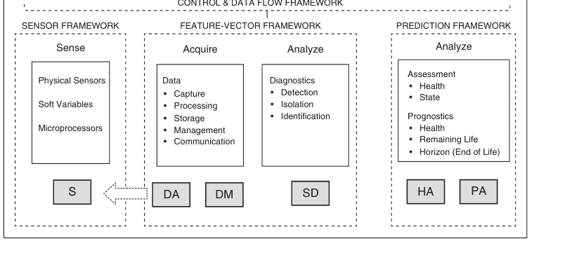

图 1.1 PHM 系统中的核心预后框架。来源：基于 IEEE (2017)。

## PHM：框架图

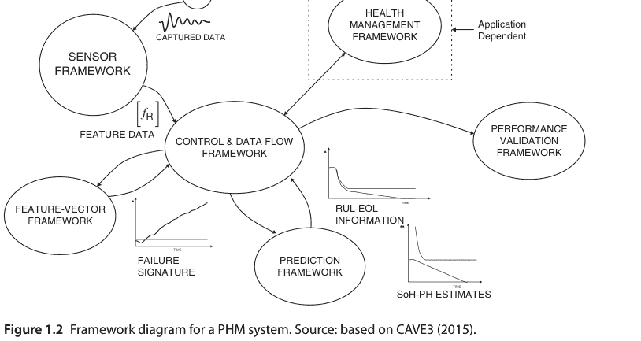

图 1.2 PHM 系统的框架图。来源：基于 CAVE3 (2015)。

基于可靠性理论和统计的经典方法：本章将介绍和讨论这些经典方法的核心思想和方法。首先，将概述可靠性工程的基本思想和方法，然后简要讨论预后健康管理不同要素的主要思想。本章包含一些成本最小化和成本效益模型。

本章的主要目标是为这一复杂科学领域提供一个总体概述。关于用于支持 PHM 系统中预后预测的基于启发式的方法对基于状态的数据进行建模的详细描述和模型开发将在后续章节中介绍。

### 1.1.2 章节组织

本章其余部分组织如下，以介绍和讨论一种基于启发式的方法来建模 CBD 特征：

- 1.2 可靠性理论基础
本节介绍了可靠性建立的基础：失效分布、概率和可靠性、概率密度函数及其关系、失效率、以及期望值和方差。

- 1.3 极端应力水平下的失效分布
本节介绍了失效和极端应力、累积损伤、以及指数和威布尔失效和分布的模型。

- 1.4 参数估计中的不确定性度量
本节介绍了处理不确定性的度量指标的介绍，如似然、方差和协方差。

- 1.5 预期失效次数
本节介绍了维修、更换和部分维修活动对评估失效次数以及部分维修导致有效年龄下降的影响和相互作用。

- 1.6 系统可靠性与预后和健康管理
本节基于基于状态的维护 CBM 提出了一个 PHM 系统的框架，并向读者介绍该框架、CBD 和特征、以及 CBM，后者可以将特征转化为用于处理以产生预后信息的曲线。

- 1.7 预后信息
本节介绍适用于预后信息的基本概念和度量：RUL、SoH、预后视界 PH、预后距离 PD 和收敛。

- 1.8 成本与效益决策
本节简要概述了设备生命周期不同阶段的决策问题及其数学建模，并附有若干说明性数学模型。

- 1.9 PHM 简介：总结
本节总结了本章所介绍的材料。

## 1.2 可靠性理论基础

工程系统及其组件和元件会受到退化影响，最终导致失效。相比其他组件更早失效的组件被认为可靠性较低。类似物体的失效，例如组件和组件组，并不会在同一时间点发生；失效会随时间分布。

### 1.2.1 失效率分布

特定物体的失效时间 TTF 通常使用概率论建模，表示大量相同物体的平均行为，而不是特定物体的行为。它被视为随机变量，用 $X$ 表示。$X$ 的累积分布函数 CDF 是失效发生在或早于时间 $t$ 的概率：

$$F(t)=P(X\leq t) \tag{1.1}$$

通常假设物体在 $t=0$ 时开始运行，因此 $F(t)=0$ 当 $t\leq 0$ 时。此外，$F(t)$ 当 $t\to\infty$ 时趋于 1：该函数是非递减的。在可靠性工程中，最常用的分布类型如下：

- 1. *指数*分布：
  
      $$F(t)=1-e^{-\lambda t},\qquad t\geq 0 \tag{1.2}$$
  
      其中参数 $\lambda>0$ 决定寿命。
  
- 2. *威布尔*分布：
  
      $$F(t)=1-e^{-(t/\eta)^\beta},\qquad t\geq 0 \tag{1.3}$$
  
      其中 $\eta>0$ 被称为*尺度*，$\beta>0$ 被称为*形状*。
  
- 3. *伽马*分布：
  
      $$F(t)=\int_0^t\frac{x^{k-1}e^{-x/\theta}}{\theta^k\Gamma(k)}\,dx,\qquad t\geq 0 \tag{1.4}$$
  
      其中 $k$ 表示形状参数，$\theta$ 表示尺度参数。此外，$\Gamma(k)$ 是 $k$ 处的伽马函数值。非常经常，变量 $\lambda=\frac{1}{\theta}$ 在应用中使用。
  
- 4. *正态*分布：
  
      $$F(t)=\phi\left(\frac{t-\mu}{\sigma}\right),\qquad -\infty<t<\infty \tag{1.5}$$
  
      其中 $\mu$ 是实参数且 $\sigma>0$。
  
- 5. *对数正态*分布：
  
      $$F(t)=\phi\left(\frac{\ln(t)-\mu}{\sigma}\right),\qquad t>0 \tag{1.6}$$
  
      其中 $\mu$ 是实值且 $\sigma>0$。这里 $\phi(t)$ 是标准正态分布函数，定义在式 (1.7) 中：
  
      $$\phi(t)=\int_{-\infty}^{t}\frac{1}{\sqrt{2\pi}}e^{-x^2/2}\,dx \tag{1.7}$$
  
      这没有精确的简单公式；只有函数近似可用，或可从对应函数表获得 $\phi(t)$ 在任意特定 $t$ 值下的值。
  
- 6. *逻辑*分布：
  
      $$F(t)=\frac{1}{1+e^{-z}}=\frac{e^z}{1+e^z},\qquad z=\frac{t-\mu}{\sigma},\qquad -\infty<t<\infty \tag{1.8}$$
  
      其中 $\mu$ 和 $\sigma>0$ 是模型参数。

7. 耿贝尔分布：

$$F(t) = 1 - e^{-e^{z}} \text{ with } z = \frac{t - \mu}{\sigma} \qquad -\infty < t < \infty \tag{1.9}$$

其中 μ 和 σ 的含义与之前相同。该分布常被称为对数威布尔分布。

8. 对数逻辑分布：

$$F(t) = \frac{e^{x}}{1 + e^{x}} \text{ with } x = \frac{\ln(t) - \mu}{\sigma} \qquad t > 0 \tag{1.10}$$

其中式 (1.10) 还有另一种替代公式：

$$F(t) = \frac{t^{\beta}}{\alpha^{\beta} + t^{\beta}} \tag{1.11}$$

其中 α, β > 0 且 α = e^{μ} 且 β = 1/σ

9. 对数耿贝尔分布：

$$F(t) = 1 - e^{-e^{x}} \text{ with } x = \frac{\ln(t) - \mu}{\sigma} \qquad t > 0 \tag{1.12}$$

10. 对数伽马分布：

$$F(t) = \int_{0}^{t} \frac{\lambda (\lambda \ln(x))^{\alpha -1} e^{-\lambda \ln(x)}}{\Gamma(\alpha) x} dx \qquad t > 0 \tag{1.13}$$

其中 λ 和 α 为正参数。

指数和威布尔分布的 CDF 分别在图 1.3 和 1.4 中示出。

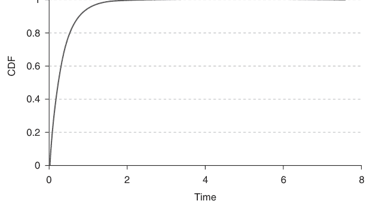

图 1.3 λ = 3 时指数 CDF 的图。

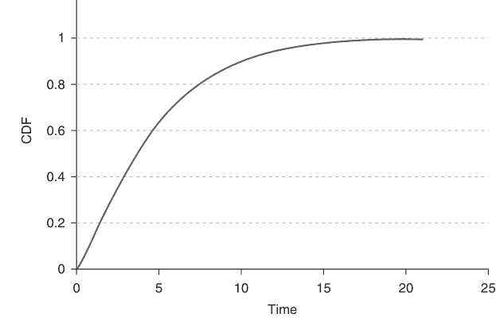

图 1.4 β = 1.2 且 η = 5 时威布尔 CDF 的图。

### 1.2.2 概率与可靠性

大多数概率值都可以通过使用 X 的 CDF 确定。失效发生在或早于时间 t 的概率为 F(t)，物体在时间 t 仍在工作的概率为 F(t) 的补集，

```
P(X > t) = 1 − F(t) = R(t)    (1.14)
```

它被称为 X 的可靠性函数。有时也用 F̄(t) 表示。失效发生在时间区间 [t₁, t₂] 内的概率为

```
P(t₁ < X ≤ t₂) = F(t₂) − F(t₁)    (1.15)
```

# 示例 1.1 假设随机变量 X 为参数 λ = 1 的指数分布。则

```
F(t) = 1 − e^{−t}
```

```
P(X > 2) = 1 − (1 − e^{−2}) = 0.1353
```

```
P(1 < X < 2) = (1 − e^{−2}) − (1 − e^{−1}) = e^{−1} − e^{−2} = 0.3679 − 0.1353 = 0.2326
```

# 示例 1.2 假设接下来随机变量 X 为 β = 1.5 且 η = 5 的威布尔分布。

则 F(t) = 1 − e^{−(t/5)^{1.5}}，因此

```
P(X > 2) = 1 − (1 − e^{−(2/5)^{1.5}}) = e^{−0.2530} ≈ 0.7765
```


或

$$P(1 < X < 2) = \left(1 - e^{-\left(\frac{2}{5}\right)^{1.5}}\right) - \left(1 - e^{-\left(\frac{1}{5}\right)^{1.5}}\right) = e^{-(0.2)^{1.5}} - e^{-(0.4)^{1.5}} = 0.9144 - 0.7765 \approx 0.1379$$

### 1.2.3 概率密度函数

$X$ 的概率密度函数（PDF）是 $F(t)$ 的导数：

$$f(t) = F'(t) \tag{1.16}$$

- **1.** *指数PDF：* 容易看出，在指数情形下

  $$f(t) = \lambda e^{-\lambda t} \tag{1.17}$$

- **2.** *威布尔PDF：*

  $$f(t) = \frac{\beta}{\eta^{\beta}} t^{\beta-1} e^{-\left(\frac{t}{\eta}\right)^{\beta}} \tag{1.18}$$

- **3.** *伽马PDF：* 伽马PDF是式(1.4)的被积函数：

  $$f(t) = \frac{t^{k-1} e^{-\frac{t}{\theta}}}{\theta^{k} \Gamma(k)} \tag{1.19}$$

- **4.** *正态PDF：* 正态PDF具有闭式表示：

  $$f(t) = \frac{1}{\sigma \sqrt{2\pi}} e^{-\frac{(t-\mu)^2}{2\sigma^2}} \tag{1.20}$$

- **5.** *对数正态PDF：*

  $$f(t) = \frac{1}{t \sigma \sqrt{2\pi}} e^{-\frac{(\ln(t)-\mu)^2}{2\sigma^2}} \tag{1.21}$$

- **6.** *逻辑斯蒂PDF：*

  $$f(t) = \frac{e^{z}}{\sigma (1+e^{z})^2}, \quad z = \frac{t - \mu}{\sigma} \tag{1.22}$$

- **7.** *冈贝尔PDF：*

  $$f(t) = \frac{1}{\sigma} e^{z - e^{z}}, \quad z = \frac{t - \mu}{\sigma} \tag{1.23}$$

- **8.** *对数逻辑斯蒂PDF：*

  $$f(t) = \frac{e^{x}}{\sigma t (1 + e^{x})^2}, \quad x = \frac{\ln(t) - \mu}{\sigma} \tag{1.24}$$

- **9.** *对数冈贝尔PDF：*

  $$f(t) = e^{x - e^{x}} \cdot \frac{1}{\sigma t}, \quad x = \frac{\ln(t) - \mu}{\sigma} \tag{1.25}$$

- **10.** *对数伽马PDF：*

  $$f(t) = \frac{\lambda^{\alpha}(\ln t)^{\alpha-1} e^{-\lambda \ln t}}{\Gamma(\alpha) t} \tag{1.26}$$

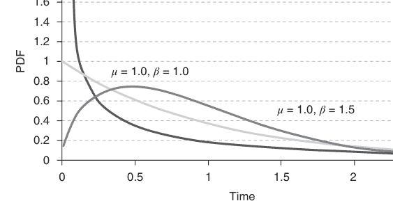

**图1.7.** 威布尔PDF曲线图。

以及

$$P(t_1 < X \le t_2) = \int_{t_1}^{t_2} f(x)\,dx \tag{1.29}$$

### 示例1.3

假设随机变量 $X$ 服从参数 $\lambda = 1$ 的指数分布。则

$$f(t) = 1 \cdot e^{-1 \cdot t} = e^{-t}$$

因此

$$P(X > 2) = \int_{2}^{\infty} e^{-t}\,dt = \left[-e^{-t}\right]_{2}^{\infty} = 0 + e^{-2} = 0.1353$$

并且

$$P(1 < X < 2) = \int_{1}^{2} e^{-t}\,dt = \left[-e^{-t}\right]_{1}^{2} = -e^{-2} + e^{-1} = 0.2326$$

如示例1.1所示。

### 示例1.4

接下来假设 $X$ 服从参数 $\beta = 1.5$ 和 $\eta = 5$ 的威布尔分布。则

$$f(t) = \frac{1.5}{5^{1.5}} t^{0.5} e^{-(\frac{t}{5})^{1.5}}$$

因此

$$P(X > 2) = \int_{2}^{\infty} \frac{1.5}{5^{1.5}} t^{0.5} e^{-(\frac{t}{5})^{1.5}}\,dt = \left[-e^{-(\frac{t}{5})^{1.5}}\right]_{2}^{\infty} = 0 + e^{-(0.4)^{1.5}} = 0.7765$$

### 1.2.4 分布之间的关系

正态与对数正态、逻辑斯蒂与对数逻辑斯蒂、伽马与对数伽马、冈贝尔与对数冈贝尔分布之间存在紧密的联系。若 $X$ 服从正态分布，则 $e^X$ 服从对数正态分布；若 $X$ 服从逻辑斯蒂分布，则 $e^X$ 服从对数逻辑斯蒂分布；若 $X$ 服从冈贝尔分布，则 $e^X$ 服从对数冈贝尔分布；若 $X$ 服从伽马分布，则 $e^X$ 服从对数伽马分布。

指数分布、威布尔分布、伽马分布和对数正态分布的分布函数定义域为 $[0, \infty)$ 区间：也就是说，它们对正自变量有定义。然而，在正态情形下，$t$ 可以是任意实值。如果 $X$ 只能取正值，而我们仍想使用正态分布，则必须修改式 (1.20)：

$$f_+(t) = \frac{1}{A \sigma \sqrt{2\pi}} e^{-(t-\mu)^2/(2\sigma^2)} \tag{1.30}$$

其中

$$A = \int_0^\infty f(t)\,dt = 1 - F(0) = 1 - \Phi(-\mu/\sigma) = \Phi(\mu/\sigma) \tag{1.31}$$

因此，相应的CDF如下：

$$F_+(t) = \int_0^t f_+(x)\,dx = \frac{1}{A}\bigl(F(t) - F(0)\bigr) = \frac{\Phi((t-\mu)/\sigma) - \Phi(-\mu/\sigma)}{\Phi(\mu/\sigma)} \tag{1.32}$$

指数随机变量在可靠性分析中很少使用，因为它不能对物体的退化或老化进行建模。为了说明这一缺点，考虑一个年龄为 $T$ 的物体，求它还能额外工作 $t$ 个单位时间的概率。这是一个条件概率：

$$P(X > T + t \mid X > T) = \frac{P(X > T + t)}{P(X > T)} = \frac{R(T + t)}{R(T)} = \frac{e^{-\lambda(T+t)}}{e^{-\lambda T}} = e^{-\lambda t} = R(t)$$

这表明该概率不依赖于物体的年龄 $T$。也就是说，无论物体的年龄如何，生存概率都保持不变。

不同分布类型之间的其他重要关系可总结如下。若威布尔变量中的 $\beta = 1$，则它变为参数 $\lambda = 1/\eta$ 的指数分布。接下来假设 $X_1, X_2, \ldots, X_k$ 是参数相同的独立指数变量，参数为 $\lambda$；则它们的和 $X_1 + X_2 + \cdots + X_k$ 是参数为 $k$ 和 $\theta = 1/\lambda$ 的伽马变量。类似地，若 $X$ 服从参数为 $\lambda$ 的指数分布，则 $X^\alpha$ 服从参数 $\beta = 1/\alpha$ 和 $\eta = 1/\lambda^\alpha$ 的威布尔分布。正态变量基于中心极限定理来表征，该定理断言：设 $X_1, X_2, \ldots, X_N, \ldots$ 是一列独立同分布的随机变量；则它们的部分和 $\sum_{k=1}^N X_k$ 在 $N \to \infty$ 时收敛于正态分布。

### 1.2.5 失效率

失效率（或风险率）在数学上定义如下：

$$\rho(t) = \lim_{\Delta t\to 0} \frac{P(t < X < t + \Delta t \mid t < X)}{\Delta t} \tag{1.33}$$

分子是在物体在时间 $t$ 正常工作的条件下，它在接下来的 $\Delta t$ 个时间段内发生故障的概率。若 $\Delta t = 1$，则该分数给出物体在下一个单位时间间隔内发生故障的概率。通过简单计算，

$$\frac{P(t < X < t + \Delta t \mid t < X)}{\Delta t} = \frac{P(t < X < t + \Delta t)}{\Delta t\, P(t < X)} = \frac{F(t + \Delta t) - F(t)}{\Delta t\, P(X > t)}$$

它收敛于下式：

$$\rho(t) = \frac{f(t)}{R(t)} \tag{1.34}$$

也就是说，$\rho(t)$ 可以基于 $X$ 的PDF和可靠度函数容易地计算。TTF分布通过其PDF（$f(t)$）、CDF（$F(t)$）、可靠度函数（$R(t)$）和失效率（$\rho(t)$）来表征。如果这些函数中任何一个已知，则其余三个可以容易地确定，如下所示。

若 $f(t)$ 已知，则 $F(t) = \int_0^t f(x)\,dx$，$R(t) = 1 - F(t)$，且 $\rho(t) = f(t)/R(t)$。

若 $F(t)$ 已知，则 $f(t) = F'(t)$，$R(t) = 1 - F(t)$，且 $\rho(t) = f(t)/R(t)$。

接下来假设 $R(t)$ 已知。则 $F(t) = 1 - R(t)$，$f(t) = F'(t)$，且 $\rho(t) = f(t)/R(t)$。

最后，假设 $\rho(t)$ 已给出。根据其定义

$$\rho(t) = \frac{f(t)}{R(t)} = \frac{f(t)}{1 - F(t)} = -\frac{-f(t)}{1 - F(t)}$$

并通过积分

$$\int_0^t \rho(x)\,dx = -\int_0^t \frac{-f(x)}{1 - F(x)}\,dx = \left[-\ln(1 - F(x))\right]_{x=0}^t = -\ln(1 - F(t)) + \ln(1)$$

所以

$$\ln(1 - F(t)) = -\int_0^t \rho(x)\,dx$$

这意味着

$$F(t) = 1 - e^{-\int_0^t \rho(x)\,dx} \tag{1.35}$$
$$f(t) = F'(t)$$
$$R(t) = 1 - F(t) = e^{-\int_0^t \rho(x)\,dx}$$

### 指数分布的失效率

在指数情形下，

$$\rho(t) = \frac{\lambda e^{-\lambda t}}{e^{-\lambda t}} = \lambda \tag{1.36}$$

它是一个常数，不依赖于物体的年龄。这一关系也表明指数随机变量不包含退化。

### 威布尔分布的失效率

在威布尔情形下，

$$\rho(t) = \frac{\beta}{\eta^{\beta}} t^{\beta-1} \tag{1.37}$$

其形状随 $\beta$ 的值不同而变化，如图1.8所示。

**图1.9.** 伽马变量的失效率。

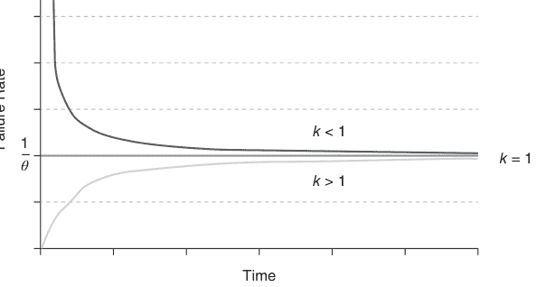

**图1.10.** 标准正态变量的失效率。

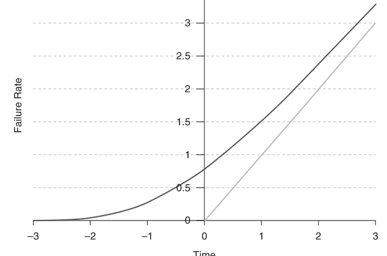

容易证明，$\rho_n(t)$ 严格递增且关于 $t$ 是凸的，$\rho_n(0) = \sqrt{2/\pi}$，$\lim_{t\to -\infty} \rho_n(t) = 0$，且 $\lim_{t\to \infty} \rho_n(t) = \infty$。此外，当 $t \to \infty$ 时，$45^\circ$ 线是其渐近线。$\rho_n(t)$ 的形状如图1.10所示。

### 正态分布的失效率

若 $X$ 是参数为 $\mu$ 和 $\sigma$ 的正态变量，则 $\rho(t) = \frac{1}{\sigma} \rho_n\left(\frac{t-\mu}{\sigma}\right)$，$\lim_{t\to -\infty} \rho(t) = 0$，且 $\lim_{t\to \infty} \rho(t) = \infty$。此外，当 $t \to \infty$ 时，其渐近线为 $(t-\mu)/\sigma^2$。

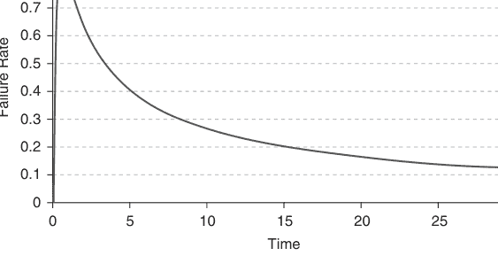

**图1.11.** 参数 $\mu = 0$ 和 $\sigma = 1$ 的对数正态变量的失效率。

### 对数正态分布的失效率

对数正态变量 $X$ 的失效率如图1.11所示。它是一条丘形曲线，在 $t^*$ 处取得最大值，$t^*$ 可按如下方式确定。存在唯一值 $\bar t$ 使得 $\rho_n(\bar t) = \bar t + \sigma$，于是 $t^* = \exp(\mu + \sigma \bar t)$。显然

$$\lim_{t\to 0+} \rho(t) = \lim_{t\to \infty} \rho(t) = 0$$

### 逻辑斯蒂分布的失效率

逻辑斯蒂变量的失效率为

$$\rho(t) = \frac{1}{\sigma(1 + e^{-z})} \quad \text{with} \quad z = \frac{t - \mu}{\sigma} \tag{1.40}$$

### 冈贝尔分布的失效率

对于冈贝尔分布，

$$\rho(t) = \frac{1}{\sigma} e^{z} \quad \text{with} \quad z = \frac{t - \mu}{\sigma} \tag{1.41}$$

这是一个简单的指数函数。

### 对数逻辑斯蒂分布的失效率

类似地，对于对数逻辑斯蒂变量：

$$\rho(t) = \frac{e^{x}}{\sigma t (1 + e^{x})} \quad \text{with} \quad x = \frac{\ln(t) - \mu}{\sigma} \tag{1.42}$$

### 对数冈贝尔分布的失效率

对于对数冈贝尔分布，

$$\rho(t) = \frac{e^{x}}{\sigma t} = \frac{1}{\sigma} e^{x(1-\sigma)-\mu} \quad \text{with} \quad x = \frac{\ln(t) - \mu}{\sigma} \tag{1.43}$$

如前所述。


## 对数伽马失效率

对数伽马变量的失效率为

\[
\rho(t) = \frac{y^{\alpha-1} e^{-(\lambda+1)y}}{\int_y^\infty u^{\alpha-1} e^{-\lambda u}\,du}, \quad \text{其中 } y = \ln(t) \tag{1.44}
\]

图1.12至图1.14展示了其中一些失效率的图形。

### 示例1.5

假设某变量的失效率为 \(\rho(t) = t^2\)。那么，由式(1.35)可得：

\[
F(t) = 1 - e^{-\int_0^t \tau^2\,d\tau} = 1 - e^{-t^3/3}
\]

这表明该变量为威布尔变量，其中 \(\beta = 3\)，\(\eta = 3^{1/3}\)。

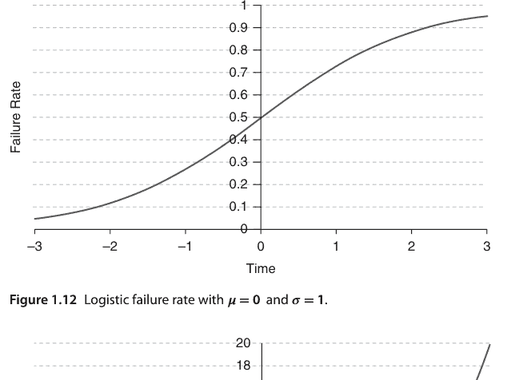

图1.12：Logistic失效率，其中 \(\mu = 0\)，\(\sigma = 1\)。

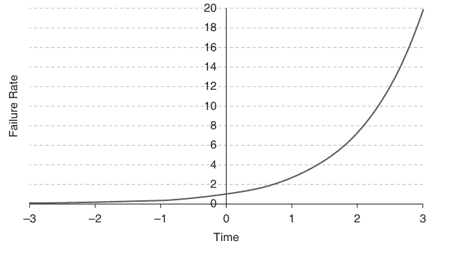

图1.13：Gumbel失效率。

**表1.1** 期望与方差。

| 分布类型 | 参数 | 定义域 | \(E(X)\) | \(\operatorname{Var}(X)\) |
|---|---|---|---|---|
| 指数分布 | \(\lambda\) | \([0, \infty)\) | \(1/\lambda\) | \(1/\lambda^2\) |
| 威布尔分布 | \(\beta, \eta\) | \([0, \infty)\) | \(\eta\Gamma(1 + 1/\beta)\) | \(\eta^2[\Gamma(1 + 2/\beta) - \Gamma^2(1 + 1/\beta)]\) |
| 伽马分布 | \(k, \theta\) | \([0, \infty)\) | \(k\theta\) | \(k\theta^2\) |
| 正态分布 | \(\mu, \sigma^2\) | \((-\infty, \infty)\) | \(\mu\) | \(\sigma^2\) |
| 对数正态分布 | \(\mu, \sigma^2\) | \([0, \infty)\) | \(\exp(\mu + \sigma^2/2)\) | \((e^{\sigma^2} - 1)\exp(2\mu + \sigma^2)\) |
| Logistic分布 | \(\mu, \sigma\) | \((-\infty, \infty)\) | \(\mu\) | \(\sigma^2\pi^2/3\) |
| Gumbel分布 | \(\mu, \sigma\) | \((-\infty, \infty)\) | \(\mu - \sigma\gamma\) | \(\pi^2\sigma^2/6\) |
| 对数Logistic分布 | \(\mu, \sigma\) | \((0, \infty)\) | \(e^{\mu}\Gamma(1 + \sigma)\Gamma(1 - \sigma)\) | \(e^{2\mu}[\Gamma(1 + 2\sigma)\Gamma(1 - 2\sigma) - (\Gamma(1 + \sigma)\Gamma(1 - \sigma))^2]\) |

期望值由以下积分给出：

\[
E(X) = \int_0^\infty 2t e^{-2t}\,dt = \left[\frac{2t e^{-2t}}{-2}\right]_0^\infty - \int_0^\infty \frac{2 e^{-2t}}{-2}\,dt
\]

其中使用分部积分，取 \(u = 2t\)，\(v' = e^{-2t}\)。

因此，

\[
E(X) = \int_0^\infty e^{-2t}\,dt = \left[\frac{e^{-2t}}{-2}\right]_0^\infty = 0 + \frac12 = \frac12
\]

\(X\) 的二阶矩如下：

\[
E(X^2) = \int_0^\infty 2t^2 e^{-2t}\,dt = \left[\frac{2t^2 e^{-2t}}{-2}\right]_0^\infty - \int_0^\infty \frac{4t e^{-2t}}{-2}\,dt
\]

其中再次使用分部积分，取 \(u = 2t^2\)，\(v = e^{-2t}\)。由 \(E(X)\) 可得：

\[
E(X^2) = \int_0^\infty 2t e^{-2t}\,dt = \frac12
\]

因此

\[
\operatorname{Var}(X) = \frac12 - \left(\frac12\right)^2 = \frac14
\]

注意 \(X\) 是参数 \(\lambda = 2\) 的指数分布，我们通过积分得到的结果与表1.1中第一行的公式相符。

本节内容可在大多数概率统计入门教材和可靠性工程入门教材中找到。例如，可参见 Ayyub 和 McCuen (2003)、Ross (1987, 2000)、Milton 和 Arnold (2003)、Elsayed (2012)、Finkelstein (2008) 或 Nakagawa (2008)。

### 1.3.2 累积损伤模型

最后，我们简要讨论累积损伤关系，其中首先假定逆幂律成立。设 \(V(t)\) 表示随时间变化的应力；则寿命-应力关系为：

\[
L(V(t)) = \left(\frac{A}{V(t)}\right)^n \tag{1.60}
\]

其中，与式(1.55)相比，\(A = K^{-1/n}\)。

### 指数失效分布

如果TTF分布为指数分布，则 \(m(t, V) = L(V(t))\)。定义

\[
I(t, V) = \int_0^t \left(\frac{V(\tau)}{A}\right)^n d\tau \tag{1.61}
\]

该积分为累积损伤，则可靠度函数变为 \(e^{-I(t,V)}\)，因此概率密度函数(PDF)的形式为：

\[
f(t, V) = \left(\frac{V(t)}{A}\right)^n e^{-I(t,V)} \tag{1.62}
\]

### 威布尔失效分布

如果TTF分布为威布尔分布，则可靠度函数为 \(e^{-(I(t,V))^\beta}\)，其中 \(I(t, V)\) 由式(1.61)给出，相应的概率密度函数变为：

\[
f(t, V) = \beta \left(\frac{V(t)}{A}\right)^n (I(t, V))^{\beta-1} e^{-(I(t,V))^\beta} \tag{1.63}
\]

### 指数失效分布与阿伦尼乌斯寿命应力

接下来假设采用阿伦尼乌斯寿命应力模型式(1.47)。如果TTF服从指数分布，则类似于式(1.61)，我们有：

\[
I(t, V) = \int_0^t \frac{1}{C} e^{-B / V(\tau)} d\tau \tag{1.64}
\]

相应的概率密度函数变为：

\[
f(t, V) = \left(\frac{1}{C} e^{-B / V(t)}\right) e^{-I(t,V)} \tag{1.65}
\]

### 威布尔失效分布与阿伦尼乌斯寿命应力

如果TTF分布为威布尔分布，那么与之前的情况类似，\(\eta(t, V) = L(t, V)\)，因此类似于式(1.62)，我们得到相应的概率密度函数：

\[
f(t, V) = \beta \left(\frac{1}{C} e^{-B / V(t)}\right) (I(t, V))^{\beta-1} e^{-(I(t,V))^\beta} \tag{1.66}
\]

### 1.3.3 一般指数模型

接下来，我们展示一般指数关系的情况：

\[
L(V(t)) = C e^{B V(t)} \tag{1.67}
\]

在这种情况下

\[
I(t, V) = \int_0^t \frac{1}{C} e^{-B V(\tau)} d\tau \tag{1.68}
\]

其对数形式为：

\[
l(C, B) = -N \ln(C) - B \sum_{k=1}^{N} \frac{1}{V_k} - \frac{1}{C} \sum_{k=1}^{N} \frac{t_k}{e^{B / V_k}}
\]

然后对该式进行极大化。

已有若干关于加速试验的书籍和文章，包括 Nelson (2004)。

## 1.4 参数估计中的不确定度量

首先考虑仅依赖于一个参数 \(\theta\) 的概率密度函数，该参数通过有限样本来确定。设 \(f(t|\theta)\) 表示概率密度函数，令 \(t_1, t_2, \ldots, t_N\) 为样本元素。似然函数为：

\[
L(\theta) = \prod_{k=1}^{N} f(t_k|\theta)
\]

其对数写为：

\[
l(\theta) = \sum_{k=1}^{N} \ln(f(t_k|\theta)) \tag{1.75}
\]

然后对该式进行极大化，以获得未知参数 \(\theta\) 的最佳估计。通过重复抽样，我们得到不同的样本元素，从而得到不同的 \(\theta\) 估计值。\(\theta\) 的值取决于样本元素的随机选择，因此它也是一个随机变量。其不确定性可以通过方差来描述。将式(1.75)的极大化解记为 \(\theta^*\)。

Fisher信息量定义为 \(l(\theta)\) 在 \(\theta = \theta^*\) 处对 \(\theta\) 的二阶导数的负值：

\[
I = -\left.\frac{\partial^2 l(\theta)}{\partial \theta^2}\right|_{\theta=\theta^*} \tag{1.76}
\]

并且可以证明，\(\theta\) 的方差是 \(I\) 的倒数：

\[
\operatorname{Var}(\theta) = \frac{1}{I} \tag{1.77}
\]

(Frieden 2004; Pratt 等 1976)。

### 示例1.9

假设 \(X\) 服从正态分布，其方差 \(\sigma^2\) 已知，但期望 \(\mu\) 未知。在这种情况下：

\[
L(\mu) = \prod_{k=1}^{N} \frac{1}{\sigma\sqrt{2\pi}} e^{\frac{-(t_k - \mu)^2}{2\sigma^2}} = \frac{1}{(\sigma\sqrt{2\pi})^N} e^{-\frac{1}{2\sigma^2} \sum_{k=1}^{N} (t_k - \mu)^2}
\]

因此

\[
l(\mu) = -N \ln(\sigma\sqrt{2\pi}) - \frac{1}{2\sigma^2} \sum_{k=1}^{N} (t_k - \mu)^2
\]

该式必须被极大化。首先注意，当 \(\mu \to -\infty\) 或 \(\mu \to +\infty\) 时，由于 \(l(\mu)\) 趋于 \(-\infty\)，所以最大值在内部取得。通过求导：

\[
\frac{\partial l(\mu)}{\partial \mu} = \frac{1}{\sigma^2} \sum_{k=1}^{N} (t_k - \mu) = \frac{1}{\sigma^2} \left(\sum_{k=1}^{N} t_k - N \mu\right) = 0
\]

这意味着极大似然估计为：

\[
\mu^* = \frac{1}{N} \sum_{k=1}^{N} t_k = \bar{t}
\]

即样本均值。

这给出了参数 \(\mu\) 的期望。为了得到 \(\mu\) 的方差，我们首先计算Fisher信息量：

\[
I = - \frac{\partial^2 l(\mu)}{\partial \mu^2} = \frac{N}{\sigma^2}
\]

这表明 \(\mu\) 的方差为 \(\sigma^2/N\)，因此对于较大的 \(N\)，\(\mu\) 可以用均值为 \(\mu^*\)、标准差为 \(\sigma/\sqrt{N}\) 的正态分布来近似。

### 示例1.10

接下来假设 \(X\) 服从参数 \(\lambda\) 未知的指数分布。如果 \(t_1, t_2, \ldots, t_N\) 为样本元素，则

\[
L(\lambda) = \prod_{k=1}^N \lambda e^{-\lambda t_k} = \lambda^N e^{-\lambda \sum_{k=1}^N t_k}
\]

其对数形式为：

\[
l(\lambda) = N \ln(\lambda) - \lambda \sum_{k=1}^N t_k
\]

当 \(\lambda \to 0\) 或 \(\lambda \to \infty\) 时，\(l(\lambda)\) 的值趋于负无穷，因此最优值在内部取得。由于

\[
\frac{\partial l(\lambda)}{\partial \lambda} = \frac{N}{\lambda} - \sum_{k=1}^N t_k
\]

似然估计为：

\[
\lambda^* = \frac{N}{\sum_{k=1}^N t_k} = \frac{1}{\bar{t}}
\]

Fisher信息量显然为：

\[
I = - \frac{\partial^2 l(\lambda)}{\partial \lambda^2} = \frac{N}{\lambda^2}
\]

而 \(\lambda\) 的方差为 \(\lambda^{*2} / N\)。

如果分布依赖于多个参数——例如，其概率密度函数为 \(f(t|\theta_1, \ldots, \theta_n)\) ——那么似然函数为：

\[
L(\theta_1, \ldots, \theta_n) = \prod_{k=1}^N f(t_k|\theta_1, \ldots, \theta_n)
\]

其对数形式为：

\[
l(\theta_1, \ldots, \theta_n) = \sum_{k=1}^N \ln(f(t_k | \theta_1, \ldots, \theta_n))
\]

此时Fisher信息量是一个矩阵，即 \(l(\theta_1, \ldots, \theta_n)\) 的负Hessian矩阵：

\[
I(\theta_1, \ldots, \theta_n) =
\begin{pmatrix}
-\frac{\partial^2 l}{\partial \theta_1^2} & -\frac{\partial^2 l}{\partial \theta_1 \partial \theta_2} & \cdots & -\frac{\partial^2 l}{\partial \theta_1 \partial \theta_n} \\
-\frac{\partial^2 l}{\partial \theta_2 \partial \theta_1} & -\frac{\partial^2 l}{\partial \theta_2^2} & \cdots & -\frac{\partial^2 l}{\partial \theta_2 \partial \theta_n} \\
\vdots & \vdots & \ddots & \vdots \\
-\frac{\partial^2 l}{\partial \theta_n \partial \theta_1} & -\frac{\partial^2 l}{\partial \theta_n \partial \theta_2} & \cdots & -\frac{\partial^2 l}{\partial \theta_n^2}
\end{pmatrix}
\]

可以证明，\(I(\theta_1, \ldots, \theta_n)\) 的逆矩阵给出 \((\theta_1, \ldots, \theta_n)\) 的协方差矩阵。

### 示例1.11

现在设 \(X\) 为具有未知参数 \(\mu\) 和 \(\sigma^2\) 的正态变量。由示例1.9可知：

\[
l(\mu, V) = -\frac{N}{2} \ln(V) - N \ln(\sqrt{2\pi}) - \frac{1}{2V} \sum_{k=1}^N (t_k - \mu)^2
\]

其中我们使用简化记号 \(V = \sigma^2\)。注意：

\[
\frac{\partial l}{\partial \mu} = -\frac{1}{2V} \sum_{k=1}^N 2(t_k - \mu)(-1) = \frac{1}{V} \left(\sum_{k=1}^N t_k - N \mu\right)
\]

一阶条件意味着 \(\mu\) 的似然估计为：

\[
\mu^* = \frac{1}{N} \sum_{k=1}^N t_k = \bar{t}
\]

类似地

\[
\frac{\partial l}{\partial V} = -\frac{N}{2V} + \frac{1}{2V^2} \sum_{k=1}^N (t_k - \mu)^2
\]


$$
\frac{\partial^2 l}{\partial V^2}=\frac{N}{2V^2}-\frac{1}{2}\cdot\frac{2}{V^3}\sum_{k=1}^{N}(t_k-\mu)^2
$$

在点 $(\mu^*,V^*)$ 处，

$$
\frac{\partial^2 l}{\partial\mu^2}=-\frac{N}{V},\quad \frac{\partial^2 l}{\partial\mu\partial V}=0,\quad \frac{\partial^2 l}{\partial V^2}=\frac{N}{2V^2}-\frac{1}{V^3}NV=-\frac{N}{2V^2}
$$

因此

$$
I(\mu,V)=\begin{pmatrix}\frac{N}{V}&0\\0&\frac{N}{2V^2}\end{pmatrix}
$$

其逆矩阵为

$$
\operatorname{Cov}(\mu,V)=\begin{pmatrix}\frac{V}{N}&0\\0&\frac{2V^2}{N}\end{pmatrix}=\begin{pmatrix}\frac{\sigma^2}{N}&0\\0&\frac{2\sigma^4}{N}\end{pmatrix}
$$

所以

$$
\operatorname{Var}(\mu)=\frac{\sigma^2}{N},\quad \operatorname{Var}(\sigma^2)=\frac{2\sigma^4}{N},\quad \operatorname{Cov}(\mu,\sigma^2)=0
$$

## 1.5 预期失效次数

在给定时间段 $[0,t]$ 内的预期失效次数是对象（可以是元件、单元、组件甚至整个系统）可靠运行的一个重要特征。显然，这一期望值取决于我们对失效的处理方式。本节将讨论三种情况：最小维修、部分维修和失效更换。我们还将包括执行维修或更换所需的时间长度。

本节内容基于更新理论，其基础可参见 Cox (1970) 和 Ross (1996) 等文献。

### 1.5.1 最小维修

首先考虑最小维修的情况，每次维修需要 $T$ 时间，在此期间对象不运行。设 $S_1$ 表示首次失效的时间，$M(t)$ 表示区间 $[0,t]$ 内失效的预期次数，$X_t$ 表示该区间内失效的实际次数。则

$$
M(t)=E(X_t)=E_{S_1}\bigl(E(X_t\mid S_1)\bigr) \tag{1.78}
$$

其中

$$
E(X_t\mid S_1)=\begin{cases}
0 & \text{若 } t<S_1\\
1 & \text{若 } S_1<t<S_1+T\\
1+M(t-T)-M(S_1) & \text{若 } t>S_1+T
\end{cases} \tag{1.79}
$$

因此

$$
M(t)=\int_0^{t-T}\bigl(1+M(t-T)-M(s)\bigr)f(s)\,ds+\int_{t-T}^{t}f(s)\,ds
$$

其中 $f(t)$ 是 TTF 的概率密度函数，所以

$$
\begin{aligned}
M(t)&=F(t-T)\bigl(1+M(t-T)\bigr)-\int_{0}^{t-T}M(s)f(s)\,ds+F(t)-F(t-T)\\
&=M(t-T)F(t-T)+F(t)-\int_{0}^{t-T}M(s)f(s)\,ds
\end{aligned} \tag{1.80}
$$

在 $T=0$ 的特殊情况下，该积分方程修改为

$$
M(t)=M(t)F(t)+F(t)-\int_{0}^{t}M(s)f(s)\,ds \tag{1.81}
$$

其中 $M(0)=0$。我们将证明，对于失效率 $\rho(\tau)$，

$$
M(t)=\int_{0}^{t}\rho(\tau)\,d\tau \tag{1.82}
$$

通过代入法可解该方程。首先注意到，根据图 1.15 所示的积分域，

$$
\begin{aligned}
\int_{0}^{t}M(s)f(s)\,ds
&=\int_{0}^{t}\int_{0}^{s}\rho(\tau)\,d\tau\,f(s)\,ds
=\int_{0}^{t}\int_{\tau}^{t}\rho(\tau)f(s)\,ds\,d\tau\\
&=\int_{0}^{t}\rho(\tau)\bigl[F(t)-F(\tau)\bigr]\,d\tau
=\int_{0}^{t}\rho(\tau)\,d\tau\,F(t)-\int_{0}^{t}\rho(\tau)\bigl(1-R(\tau)\bigr)\,d\tau\\
&=M(t)F(t)-M(t)+\int_{0}^{t}\frac{f(\tau)}{R(\tau)}R(\tau)\,d\tau
=M(t)F(t)-M(t)+F(t)
\end{aligned}
$$

因此式 (1.81) 的右侧变为

$$
M(t)F(t)+F(t)-\bigl[M(t)F(t)-M(t)+F(t)\bigr]=M(t)
$$

式 (1.82) 的简单公式表明 $\{X_t\}$ 是一个到达率为 $\rho(t)$ 的非齐次泊松过程，这具有几个重要的推论。

**图 1.15** 积分域。

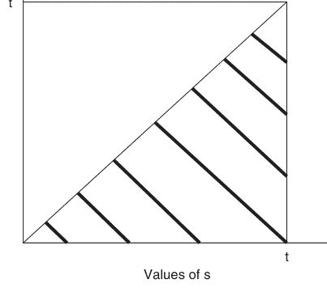

如果失效是独立的，则 $X_t$ 是期望为 $\lambda=M(t)$ 的泊松变量，因此

$$
P(X_t=n)=\frac{M(t)^n}{n!}e^{-M(t)} \tag{1.83}
$$

假设可修复失效发生在时间 $0<t_1<t_2<\cdots$，且维修是即时完成的。设 $F_k(t)$ 表示 $t_k$ 的累积分布函数。则

$$
F_k(t)=P(t_k\le t)=P(X_t\ge k)=\sum_{n=k}^{\infty}\frac{M(t)^n}{n!}e^{-M(t)} \tag{1.84}
$$

相应的概率密度函数是其导数，

$$
\begin{aligned}
f_k(t)=F_k'(t)
&=\sum_{n=k}^{\infty}\left(\frac{nM(t)^{n-1}}{n!}\rho(t)e^{-M(t)}+\frac{M(t)^n}{n!}e^{-M(t)}(-\rho(t))\right)\\
&=\sum_{n=k}^{\infty}\left(\frac{M(t)^{n-1}}{(n-1)!}-\frac{M(t)^n}{n!}\right)e^{-M(t)}\rho(t)\\
&=\frac{M(t)^{k-1}}{(k-1)!}e^{-M(t)}\rho(t)
\end{aligned} \tag{1.85}
$$

### 例 1.12

在 $X$ 为指数分布的特殊情况下，$\rho(t)=\lambda$ 且 $M(t)=\lambda t$，因此

$$
f_k(t)=\frac{(\lambda t)^{k-1}}{(k-1)!}\lambda e^{-\lambda t}=\frac{\lambda^k t^{k-1}e^{-\lambda t}}{(k-1)!} \tag{1.86}
$$

这是一个参数为 $k$ 和 $\theta=1/\lambda$ 的伽马概率密度函数。

### 例 1.13

如果 $X$ 服从韦布尔分布，则 $\rho(t)=\frac{\beta}{\eta^\beta}t^{\beta-1}$ 且 $M(t)=\left(\frac{t}{\eta}\right)^\beta$，因此

$$
f_k(t)=\frac{\left(\frac{t}{\eta}\right)^{\beta(k-1)}}{(k-1)!}\frac{\beta}{\eta^\beta}t^{\beta-1}e^{-\left(\frac{t}{\eta}\right)^\beta}
=\frac{\beta t^{\beta k-1}e^{-\left(\frac{t}{\eta}\right)^\beta}}{(k-1)!\,\eta^{\beta k}} \tag{1.87}
$$

### 1.5.2 失效更换

接下来假设发生失效时进行失效更换，这需要 $T$ 时间来完成。然后，与前面的情况类似，

$$
E(X_t\mid S_1)=\begin{cases}
0 & \text{若 } t<S_1\\
1 & \text{若 } S_1<t<S_1+T\\
1+E(X_{t-S_1-T}) & \text{若 } t>S_1+T
\end{cases} \tag{1.88}
$$

因此，式 (1.78) 意味着

$$
\begin{aligned}
M(t)
&=\int_{t-T}^{t}f(s)\,ds+\int_{0}^{t-T}\bigl(1+M(t-s-T)\bigr)f(s)\,ds\\
&=F(t)-F(t-T)+F(t-T)+\int_{0}^{t-T}M(t-s-T)f(s)\,ds\\
&=F(t)+\int_{0}^{t-T}M(t-s-T)f(s)\,ds
\end{aligned}
$$

如果 $t\le T$，则积分为零，因此

$$
M(t)=\begin{cases}
F(t) & \text{若 } t\le T\\[2pt]
\displaystyle F(t)+\int_{0}^{t-T}M(t-T-s)f(s)\,ds & \text{若 } t>T
\end{cases} \tag{1.89}
$$

如果更换是瞬时的，则 $T=0$，因此

$$
M(t)=F(t)+\int_{0}^{t}M(t-s)f(s)\,ds \tag{1.90}
$$

给出了 $M(t)$ 的方程。这个积分方程的解没有简单的公式。然而，使用拉普拉斯变换提供了一个有趣的见解。设 $M^*(s)$、$F^*(s)$ 和 $f^*(s)$ 分别表示 $M(t)$、$F(t)$ 和 $f(t)$ 的拉普拉斯变换。则从式 (1.90) 可得

$$
M^*(s)=F^*(s)+M^*(s)f^*(s)
$$

这意味着

$$
M^*(s)=\frac{F^*(s)}{1-f^*(s)}=\frac{\frac{1}{s}f^*(s)}{1-f^*(s)}
$$

如果 $g(t)$ 表示 $\frac{f^*(s)}{1-f^*(s)}$ 的拉普拉斯逆变换，则

$$
M(t)=\int_{0}^{t}g(\tau)\,d\tau \tag{1.91}
$$

表明 $\{X_t\}$ 再次是一个到达率为 $g(t)$ 的非齐次泊松过程。

设 $0<t_1<t_2<\cdots$ 表示失效的时间。则 $z_k=t_{k+1}-t_k$（$k=0,1,\ldots$ 且 $t_0=0$）是概率密度函数为 $f(t)$ 的独立随机变量。则 $t_k$ 的密度 $f_k(t)$ 是 $f(t)$ 的 $k$ 重卷积：

$$
f_k(t)=f(t)*f(t)*\cdots*f(t)
$$

注意

$$
E(t_k)=E(z_1)+E(z_2)+\cdots+E(z_k)=E(z_1)k=\mu k,
$$

其中 $\mu$ 是 TTF 的均值。类似地，

$$
\operatorname{Var}(t_k)=\operatorname{Var}(z_1)+\operatorname{Var}(z_2)+\cdots+\operatorname{Var}(z_k)=\operatorname{Var}(z_1)k=\sigma^2 k
$$

其中 $\sigma^2$ 是 TTF 的方差值。如果 $z_k$ 服从指数分布，则 $t_k$ 服从伽马分布；如果 $z_k$ 服从伽马分布，则 $t_k$ 也服从伽马分布；如果 $z_k$ 服从正态分布，则 $t_k$ 也服从正态变量。

基于这些值，在其他情况下，$t_k$ 的概率密度函数可以用具有给定期望和方差的对数正态或伽马变量来估计；并且可以为用户选择的任何显著性水平构建置信区间。

如果维修或更换需要 $T$ 时间，则第 $k$ 次失效的时间为 $\bar{t}_k=t_k+(k-1)T$，其累积分布函数为

$$
\bar{F}_k(t)=P\bigl(t_k+(k-1)T\le t\bigr)=P\bigl(t_k\le t-(k-1)T\bigr)
=\begin{cases}
0 & \text{若 } t\le (k-1)T\\[2pt]
F_k\bigl(t-(k-1)T\bigr) & \text{其他情况}
\end{cases} \tag{1.92}
$$

其中 $F_k(t)$ 是 $f_k(t)$ 的累积分布函数。

### 1.5.3 部分维修导致失效次数减少

接下来假设执行部分维修，导致失效次数减少因子 $\alpha<1$。然后，与前面的情况类似，

$$
E(X_t\mid S_1)=\begin{cases}
0 & \text{若 } t<S_1\\
1 & \text{若 } S_1<t<S_1+T\\
1+\alpha\bigl(M(t-T)-M(S_1)\bigr) & \text{若 } t>S_1+T
\end{cases} \tag{1.93}
$$

因此

$$
\begin{aligned}
M(t)
&=\int_{t-T}^{t}f(s)\,ds+\int_{0}^{t-T}\Bigl[1+\alpha\bigl(M(t-T)-M(s)\bigr)\Bigr]f(s)\,ds\\
&=F(t)-F(t-T)+F(t-T)+\alpha M(t-T)F(t-T)-\alpha\int_{0}^{t-T}M(s)f(s)\,ds\\
&=\begin{cases}
F(t) & \text{若 } t\le T\\[2pt]
F(t)+\alpha M(t-T)F(t-T)-\alpha\displaystyle\int_{0}^{t-T}M(s)f(s)\,ds & \text{若 } t>T
\end{cases}
\end{aligned} \tag{1.94}
$$

再次假设 $T=0$ 的即时维修。则 (1.94) 修改为

$$
M(t)=F(t)+\alpha M(t)F(t)-\alpha\int_{0}^{t}M(s)f(s)\,ds \tag{1.95}
$$

### 1.5.4 部分维修导致有效役龄减少

最后考虑部分维修将对象的有效役龄减少因子 $\alpha<1$ 的情况。则我们有

$$
E(X_t\mid S_1)=\begin{cases}
0 & \text{若 } t<S_1\\
1 & \text{若 } S_1<t<S_1+T\\
1+M\bigl(t-S_1-T+\alpha S_1\bigr)-M(\alpha S_1) & \text{若 } t>S_1+T
\end{cases} \tag{1.96}
$$

因为在时间 $t$ 时，有效役龄为 $(t-S_1-T)+\alpha S_1$，其中第一项是区间 $[S_1+T,t]$ 的长度，第二项是维修后时间 $S_1+T$ 时的有效役龄。因此

$$
\begin{aligned}
M(t)
&=\int_{t-T}^{t}f(s)\,ds+\int_{0}^{t-T}\Bigl[1+M\bigl(t-s-T+\alpha s\bigr)-M(\alpha s)\Bigr]f(s)\,ds\\
&=\begin{cases}
F(t) & \text{若 } t\le T\\[2pt]
F(t)+\displaystyle\int_{0}^{t-T}\Bigl[M\bigl(t-s-T+\alpha s\bigr)-M(\alpha s)\Bigr]f(s)\,ds & \text{若 } t>T
\end{cases}
\end{aligned} \tag{1.97}
$$

如果 $T=0$，则

$$
M(t)=F(t)+\int_{0}^{t}\Bigl[M\bigl(t-s+\alpha s\bigr)-M(\alpha s)\Bigr]f(s)\,ds \tag{1.98}
$$

注意，$\alpha=1$ 的情况对应于最小维修，且式 (1.95) 和 (1.98) 应按预期简化为式 (1.81)。式 (1.81)、(1.90) 和 (1.95) 通常称为更新方程（Mitov 和 Omey 2014）。


FFP 签名已被预测算法成功处理，以产生系统健康状况和剩余寿命的准确估计。通过进一步将 FFP 签名数据转换为退化进展签名（DPS）数据，然后将 DPS 数据转换为功能失效签名（FFS）数据，可提高准确性。由采用卡尔曼类滤波、随机游走和/或其它趋势算法的预测算法处理的 FFS 数据可产生非常准确的预测估计，并从例如初始误差 50% 快速收敛到 20 个以下数据样本内的 10%。这种快速、准确的收敛对于 PHM 系统中的 CBM 非常有用（Hofmeister et al. 2016, 2017a,b）。

### 1.6.1 基于 CBM 的 PHM 系统的通用框架

图 1.16 说明了构成 CBM 框架的 PHM 系统。该系统监控、捕获和处理 CBD 以提取指示设备、组件、组件和系统子系统中健康状态（SoH）的签名。提取的签名被处理以产生预测信息，例如 SoH 和 RUL，然后进一步处理以管理系统的维护和后勤（CALCE 2015；Hofmeister et al. 2016）。

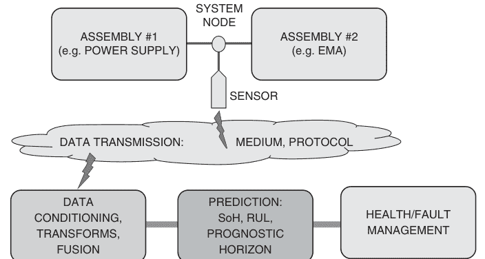

图 1.16 PHM 系统的高级框图。

图 1.17 是 CBM 框架的示例说明。该框架由以下部分组成：

- (i) 一个传感器框架，
- (ii) 一个特征向量框架，
- (iii) 一个预测框架，
- (iv) 一个健康管理框架，
- (v) 一个性能验证框架，以及
- (vi) 一个控制和数据流框架。

传感器框架包括在系统内部节点捕获信号的传感器。智能传感器提供初始数据调理，例如模数数据转换和数字信号处理，并产生并传输 FD，例如标量值。特征向量框架提供额外的数据调理，包括数据融合和转换以创建签名，例如用作预测框架输入数据的 FFS，后者产生预测信息。健康管理框架处理预测信息以创建诊断、预测和后勤指令和操作，以维护系统的健康和可靠性。性能验证框架提供手段和方法来产生预测性能指标以评估预测信息的准确性。控制和数据流框架管理 PHM 功能和操作（CALCE 2015；Pecht 2008；Kumar and Pecht 2010）。

预测目标的可靠性 $R(t)$（参见公式 (1.14)）是预测目标将在所需时间内令人满意运行的概率。可靠性与寿命和平均故障间隔时间（MTBF）之间的关系如下（Speaks 2005）。理论上，平均故障间隔时间可通过概率推理作为 TTF 的期望值获得：

$$\mathrm{MTBF}=\int_0^\infty tf(t)\,dt$$

其中 $f(t)$ 是 PDF。通过检查多个测试单元，可以实际获得

$$\mathrm{MTBF}=(NT)/F$$

其中 $N$ = 测试单元数，$T$ = 测试时间，$F$ = 测试故障数。

到时间 $T$ 的故障数的相对频率显然为 $F/N$，它是 TTF 在时间 $t=T$ 时的 CDF 的估计量。如果分布是指数分布，则其参数可由下式估计

$$1-e^{-\lambda T}=F/N \tag{1.101}$$

因此 $\lambda$ 的估计值为

$$\lambda=-\frac{1}{T}\ln\left(1-\frac{F}{N}\right) \tag{1.102}$$

然后 CDF 由 $F(t)=1-e^{-\lambda t}$ 给出，可靠性函数为 $R(t)=e^{-\lambda t}$，恒定故障率为 $\lambda$。我们之前推导了这些结果；例如参见公式 (1.2)。如果 TTF 的分布具有一个以上的参数，则 $\lambda$ 提供的信息不足以估计 $R(t)$。例如，方差可通过重复测试估计，因此对于通常的两个参数（例如 Weibull、gamma、正态等）可获得两个方程。

MTBF 是适用于一组预测目标 $N$ 的统计量，不适用于估计系统中特定预测目标的寿命或 RUL。

**示例 1.16** 作为 MTBF 用法的示例，假设 MTBF 被确定为 500 天。那么特定预测目标将在规格范围内继续运行 500 天的概率 = 0.368（36.8%）：指数值 (−1)。特别注意，MTBF 不用于估计预测目标的故障时间。

### 1.6.2 PHM 与系统可靠性的关系

PHM 与系统可靠性有什么关系？例如，假设 PHM 系统设计为准确预测系统中每个预测目标的功能失效时间；进一步假设该系统的故障/健康管理框架能够在功能失效的实际时间之前更换和/或修复每个预测目标；还假设对每个预测目标进行维护的时间发生在检测到退化之后；并且还假设在 PHM 启用系统中更换和/或修复预测目标的时间小于更换和/或修复意外停机的所需时间。在这种 PHM 启用系统中，系统的有效 MTBF 增加，因此系统的可靠性也增加。除了提高系统的可靠性外，PHM 还降低了维护系统的成本，因为预测目标的使用寿命增加，并且通常计划性停机比意外停机在时间和材料上花费更少。

任何数量的传统建模方法都可作为 PHM 启用系统的基础平台，可分为基于模型的预测、数据驱动预测或混合驱动预测（见图 1.18）。

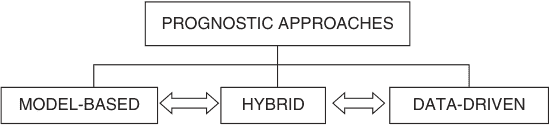

**图 1.18** 预测方法的分类。

基于模型的方法通常在预测估计中提供潜在更高的精度和准确性，但难以应用于复杂系统。数据驱动方法更容易应用，但预测估计的精度和准确性可能较低。混合驱动方法提供高度的精度和准确性，并适用于复杂系统，包括车载和离车系统，利用两种方法（Pecht 2008；Medjaher and Zerhouni 2013）。

在第 2 章中，我们将更详细地回到这些概念和方法。

### 1.6.3 退化进展签名（DPS）和预测

CBM 系统，例如本书中介绍的系统，使用 CBD 方法。随着系统中预测目标从无损伤状态（零退化）进展到损伤状态（退化），然后到失效状态，系统一个或多个节点的一个或多个信号会发生变化。这种信号变化可以被 PHM 系统感知、测量、收集和处理，以产生用于故障和/或健康管理的高度准确的预测信息。例如，假设系统中电源损坏，输出的纹波电压随电源中损坏量（累积退化）增加而变化并增加。进一步假设纹波电压的幅度可以被 PHM 系统中的传感器框架感知、测量和收集。CBD 幅度的收集形成 FFP 签名，如图 1.19 所示。

显然，由于测量不确定性和噪声的影响，FFP 曲线并不平滑。现在假设该 PHM 系统中的特征向量框架由数据调理算法组成，这些算法对基于 CBD 的 FFP 签名进行滤波、平滑、融合和转换，形成 DPS 数据：一条传输曲线。理想的 DPS 在无退化时具有恒定的稳态值；它随退化程度线性增加；并且在退化程度达到最大值时达到最大幅度：物理失效发生。对于此示例，这种理想的 DPS 显示为图 1.20 中具有正斜率的线；还显示了退化开始发生的时间点和物理失效发生的时间点。


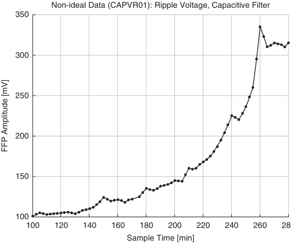

**图 1.19** FFP 签名的示例 – 曲线状（凸形）、噪声较大的特性曲线。

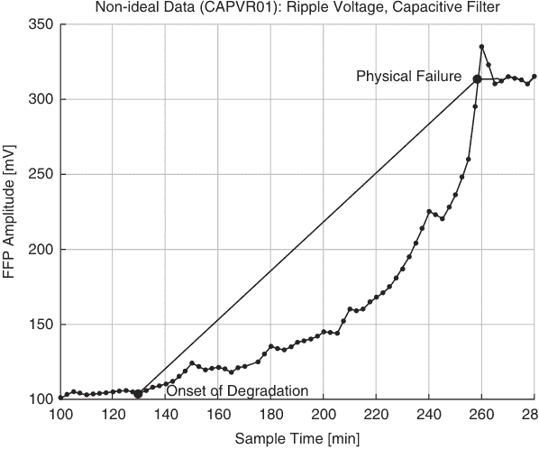

**图 1.20** 叠加在 FFP 签名上的理想 DPS 传输曲线。

## 归一化非理想数据（CAPVR01）及传输曲线

图 1.22 归一化并转换后的 FFP 和 DPS 转换为 FFS。

### 理想 FFS：CAPVR01 的 CBD 传输曲线

图 1.23 理想 FFS – CBD 的传输曲线。

## 三条模拟 DPS 传输曲线

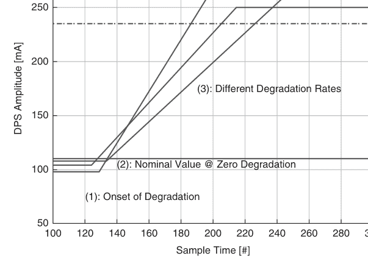

图 1.24 DPS 传输曲线的变异性。

不同的退化速率；以及 (iv) 每个预测目标在物理失效时的振幅不同。图中包含可靠性工程师为噪声（下方）和功能失效（上方）指定的阈值水平线。

现在假设 PHM 系统及其预测算法被设计为将时钟时间转换为相对于退化检测的相对时间；并且假设 PHM 系统及其预测算法将 FFS 值截断为 0 和 100。则 FFS 变换的图如图 1.25 所示。

当 FFS 数据为输入时，设计预测算法以产生准确的预测信息变得非常容易。例如，在任意相对采样时间（ST）下，对应的采样振幅（SA）用于使用以下方程计算估计失效时间（FT）、RUL 和 SoH：

FT = 100 ST / SA = 失效时间 (1.103)

RUL = FT − ST = 剩余使用寿命 (1.104)

SoH = 100 RUL / FT = 健康状态 (1.105)

### 示例 1.17 一个预测算法如何从 FFS 中的数据产生预测信息的示例如图 1.26 所示。对于任意给定的 FFS 数据点，例如振幅 SA = 40.2 且 ST = 36，使用公式 (1.103) 计算估计失效时间 FT = 89.5，然后使用公式 (1.104) 计算估计 RUL = 53.5，然后使用公式 (1.105) 计算估计 SoH = 59.8%。

## 三条模拟 DPS 传输曲线

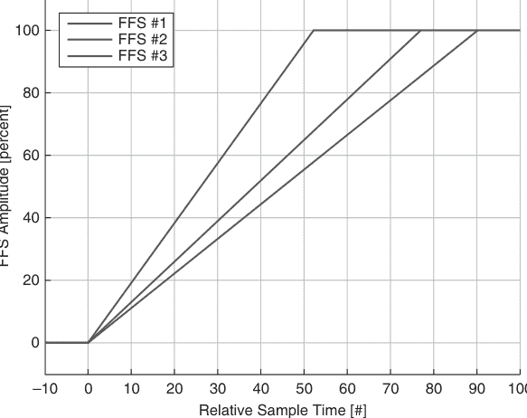

图 1.25 如图 1.23 所示的 DPS 图的 FFS 变换。

## 三条模拟 DPS 传输曲线

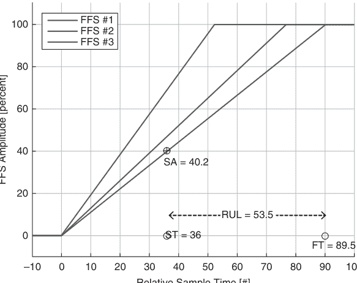

图 1.26 FFS 及预测信息。

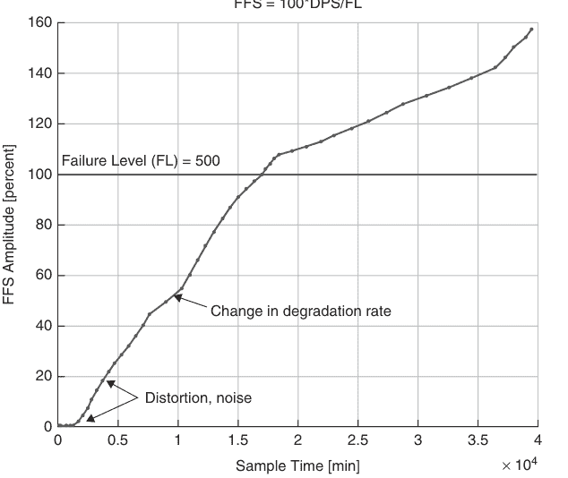

图 1.27 表现出失真、噪声和退化速率变化的 FFS 传输曲线。

### 1.6.5 非理想 FFS 与预测

在实践中，通常不可能获得理想的 FFS 传输曲线。相反，曲线会存在噪声和失真，并会表现出与退化速率变化相关的变化 – 类似于图 1.27 所示。小扰动可能源于测量不确定性，与预测对象的实际 SoH 和/或 RUL 没有关系或意义：在这种情况下，预测算法应采用方法来滤除或以其他方式减轻这些变化。另一方面，FFS 变化可能是由预测目标中累积损伤速率的真实、显著变化引起的：在这种情况下，预测算法应采用方法来识别并考虑这些退化速率的变化，这应修改 SoH 和 RUL 的估计。减轻和考虑信号变异性的两种原因是在预测算法设计中相互竞争的目标：在实践中，为了设计满足两个目标的预测算法，算法需要纳入适当的折中设计。在本书后续章节中，您将看到 FFS 变异性如何被成功处理的示例。

## 1.7 预测信息

预测信息包括以下重要指标：RUL、SoH 和 PH。图 1.28 显示了理想 RUL 和理想 PH 的示例图：（i）相对于退化开始的估计失效时间是 PH，且可靠性工程师指定的初始值完全正确；（ii）退化开始被精确地在预测目标开始退化时检测到；（iii）退化达到指定失效水平的时间被精确检测到；以及（iv）预测算法的 FFS 输入是理想的。PH 和 RUL 图表完全线性，没有噪声或失真 – RUL 是从 200 天到 0 天的精确线性进展。

同样，图 1.29 显示了理想 SoH 和理想 PH 精度的图。SoH 是从 100% 到 0% 的精确线性进展，且 PH 精度在退化开始之前和之后完全为 100%。

## 理想 PH 和 RUL

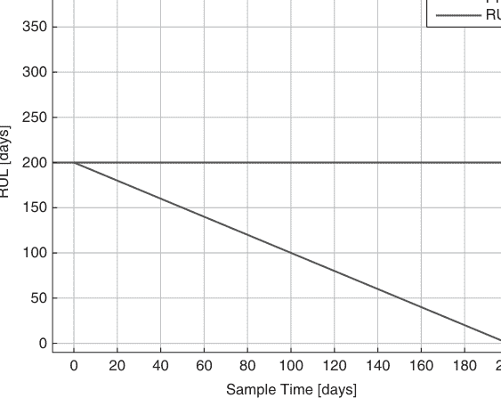

图 1.28 理想 RUL 和理想 PH 的示例图。

### 1.7.1 非理想性：初始估计误差与剩余使用寿命（RUL）

预测信息非理想性的主要原因是可靠性工程师定义的预测目标估计 TTF（初始 RUL 估计）与退化开始到功能失效之间的实际 TTF 之间的差异。估计的初始 TTF 值与实际 TTF 值完全相等的情况极不可能，因此会出现初始估计误差。例如，在图 1.28 和 1.29 中，定义的 TTF 值为 200 天，且与功能失效时的真实 TTF 值完全相等。但假设可靠性工程师估计退化开始后的 TTF 为 300 天。在这种情况下，当退化被检测到时，估计的 RUL 将为 300 天，而实际 TTF 为 200 天 – 初始误差为 100 天，如图 1.30 所示。

## 理想 SoH 和 PA（PH 精度）

图 1.29 理想 SoH 传输曲线和 PH 精度的示例图。

## 除初始误差外理想的 RUL

图 1.30 具有 100 天初始估计误差的 RUL 示例。

### 1.7.2 存在初始估计误差时 RUL 估计的收敛

设计预测算法是期望的，其（i）减轻非退化引起的 FFS 变异性且（ii）响应由退化引起的 FFS 变异性。一种设计方法是把 FFS 数据点视为具有惯性和动量的粒子。粒子不会表现出快速变化；相反，它们倾向于保持速度和方向。一个令人满意的设计目标是采用振幅和速度变化的阻尼因子。另一种设计方法是为从零退化状态（左下角）到最大退化状态（右上角）进展的粒子开发随机游走解 – 该解采用类似卡尔曼的滤波（Hamilton 1994；Bucy and Joseph 2005）：（i）使用 FFS 模型的先前数据点；（ii）计算下一个数据点的预测位置；（iii）将 FFS 模型调整到下一个数据点的预测位置与实际位置之间的调整位置；（iv）使用阻尼因子和系数调整 FFS 模型；（v）使用调整后的 FFS 模型估计功能失效可能发生的时间；以及（vi）计算 RUL、SoH 和 PH 等预测信息。

**示例 1.18** 图 1.31 是将此类解应用于初始估计误差的示例。除了高值的初始估计误差外，可靠性工程师可能会指定一个与预测目标相比偏低的 TTF 值。假设对于一个预测目标，可靠性工程师指定退化开始后的估计 TTF 为 100 天，而该目标实际需要 200 天才会功能失效：具有类似卡尔曼的随机游走解将类似于图 1.32 所示。

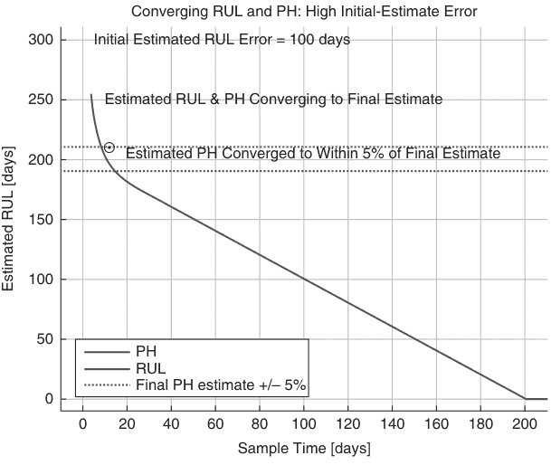

**图 1.31** 高值初始估计误差的随机游走与类似卡尔曼滤波解。


- 设计预测算法时所使用的阻尼。阻尼因子越大，收敛到所需精度水平所需的 FFS 数据点数量就越多。
- 初始估计 TTF 的值。初始误差越大，需要处理的 FFS 数据点越多才能收敛到所需精度水平。
- CBD 采样的速率。采样率越慢，即使处理的数据量保持不变，数据点之间的时间间隔也会增加，到达所需精度水平所需的时间也越长。

预测算法未能满足收敛效率要求的失败可能由设计以外的许多因素引起，包括 (i) 规范中的错误，例如 TTF 的初始估计值；(ii) 传感器框架的设计或运行规范；以及 (iii) 不足的数据处理，导致 FFS 输入中出现过度有害的偏移误差、失真和噪声。

## 1.7.5 FFS 数据中非理想性的其他来源

FFS 数据中非理想性的其他来源包括但不限于以下内容：(i) 检测退化开始和功能失效时间时的偏移误差；(ii) 由于使用噪声裕度的效应导致的 FFS 数据失真；(iii) 与例如数据转换器的量化误差相关的测量不确定性；(iv) 由环境效应如电压和温度引起的未滤除的变异性；

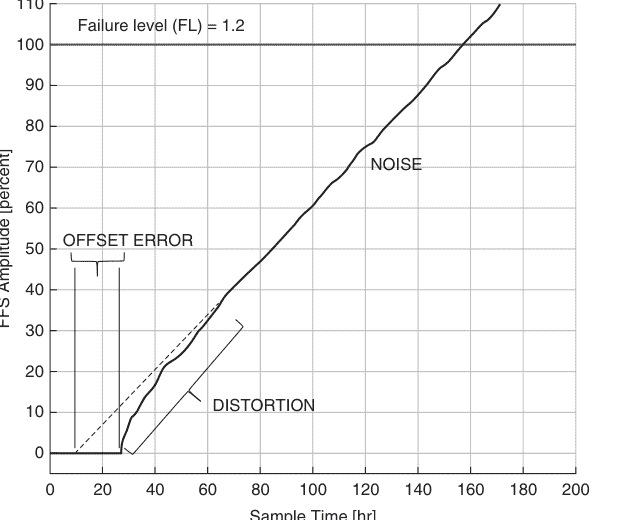

图 1.33 表现出偏移误差、失真和噪声的 FFS 数据示例。

以及 (v) 预测目标的运行和/或环境变化时自愈效应的影响。图 1.33 说明了非理想的 FFS 及其非理想性原因的一些影响。

## 1.8 成本与收益的决策

在任何设备的生命周期中，都会出现关于选择购买哪种或最佳设备；选择、检查、维护和维修策略；以及确定预防性更换的最佳时间以避免可能导致额外损坏或事故的昂贵故障的艰难决策。本节简要概述了设备生命周期不同阶段的决策问题及其数学建模，并提供了一些说明性数学模型。

### 1.8.1 产品选择

通常有几种相似设备的替代选择可供购买，选择必须基于多个标准。这就导致我们使用多目标优化技术。(Szidarovszky et al. 1986) 总结了求解此类问题的不同概念和算法，因此我们不会给出那些细节；相反，本书的这一节将提供一个说明性示例以提供其使用思路。

**示例 1.20** 假设一家公司需要一台特殊机器，并且有几种可能的选择。选择基于多个标准，例如价格、预期寿命、可维护性、可修复故障的修复能力以及操作机器时工人的便利性。表 1.2 给出了三种替代方案的估计目标值。

这里，价格和预期寿命是已知数据。在没有具体数据的情况下，其他三个因素只是关于一个选项有多好的主观衡量，只能根据使用相同设备的公司的经验来估计；便利性可通过销售公司的演示进一步评估。没有硬性数值值的目标通常用 0–100 标度来表征其好坏程度，其中 0 表示不可接受，100 表示最令人满意的替代方案。

请注意，更低的价格更好；然而，对于所有其他因素，更大的值被认为更好，因为更长的寿命是可取的，其他的是满意度衡量。这些目标按其给出的形式无法比较；我们需要将它们转换为统一的共同度量。最合乎逻辑的方法是将价格和

**表 1.2** 购买机器的决策表。

|  | 价格 ($) | 预期寿命 (年) | 可维护性 | 修复可修复故障 | 便利性 |
|---|---:|---:|---:|---:|---:|
| 机器 1 | 5000 | 8 | 60 | 50 | 80 |
| 机器 2 | 5800 | 15 | 70 | 70 | 50 |
| 机器 3 | 6300 | 20 | 90 | 80 | 60 |

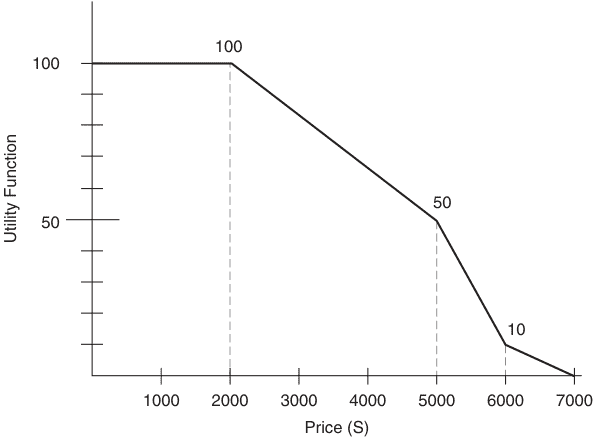

**图 1.34** 价格的效用函数。

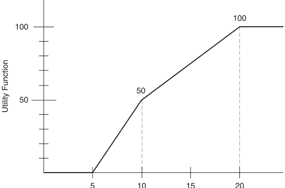

**图 1.35** 预期寿命的效用函数。

预期寿命数据转换为显示决策者对这些值满意程度的度量。为此，决策者为这两个目标构建效用函数，显示其对不同值的满意度。图 1.34 和 1.35 显示了这两个目标的效用函数。

如果在预定时间间隔进行维护而不检查项目的状况，我们指的是预定维护。如果项目定期监控，则可以执行基于状态的维护。这可能导致在不改变其所需功能的情况下改善项目；或在项目的所需功能被改变时对其进行修改。如果检测到故障，则在诊断故障后进行纠正。最后，检查项目的运行以确保维修正确且成功完成。

在本节中，将介绍一些最优维护调度的数学模型。

# 预定维护

首先，我们介绍一个预定维护行动的调度模型。考虑一台受预防性维护措施影响的设备，这些措施以均匀的时间网格执行。在维护行动之间，仅在发生故障时执行最小维修。设 h 表示连续维护行动之间的时间长度。在没有维护的情况下，设 F(t)、f(t)、R(t) 和 ρ(t) 分别表示不可修复故障时间的 CDF、PDF、可靠性函数和故障率。

除了 h 的值外，还可以引入另外两个决策变量。一个表征维护水平，因此每次维护行动后设备的有效年龄减少 u，其中 0 < u < h。还必须确定设备计划运行多长时间，这可以用正整数 n 表示，表明当第 n 次维护到期时，设备被更换。因此，维护行动在时间 h、2h、...、(n−1)h 执行，并在时间 nh 更换设备。对于 k = 1, 2, ..., n，设 Fₖ(t)、fₖ(t) 和 ρₖ(t) 分别表示设备在区间 [(k−1)h, kh] 内的 CDF、PDF 和故障率。那么显然

Fₖ(t) = F(t − (k − 1)u), fₖ(t) = f(t − (k − 1)u) and ρₖ(t) = ρ(t − (k − 1)u)      (1.107)

在开发成本最小化模型之前，必须提出一个重要约束。设备的可靠性不得低于用户选择的阈值 r₀：

Rₙ(nh) = 1 − Fₙ(nh) = 1 − F(nh − (n − 1)u) ≥ r₀      (1.108)

意味着

nh − (n − 1)u ≤ F⁻¹(1 − r₀)      (1.109)

例如，在 Weibull 分布的情况下，式 (1.108) 可以写为

e^{−((nh−(n−1)u)/η)^β} ≥ r₀

对两边取对数我们得到

( (nh − (n − 1)u)/η )^β ≤ −ln(r₀)

或

nh − (n − 1)u ≤ η{−ln(r₀)}^{1/β}      (1.110)

这是一个线性约束。

单位时间内的预期净成本被最小化。必须考虑以下因素：

- 预防性更换的成本为 $c_p$，而故障更换的成本为 $c_f>c_p$。
- 可修复故障可能以故障率 $\rho(t)$ 发生。然后，假设最小维修，任何区间 $(t_1,t_2)$ 内此类故障的预期数量为 $M(t_1,t_2)=\int_{t_1}^{t_2}\rho(\tau)d\tau$。每次维修成本为 $c_r$。
- 每次维护行动的成本取决于维护水平：$a+bu$ 假设线性约束式 (1.110)。
- 工作设备的收益生成密度假定为 $A-BT$，其中 $T$ 是设备的有效年龄。因此，有效年龄 $T_1$ 和 $T_2$ 之间产生的收益为积分
  

  $$\int_{T_1}^{T_2}(A-BT)dT=\left[AT-\frac{BT^2}{2}\right]_{T_1}^{T_2}=(T_2-T_1)\left(A-\frac{B(T_1+T_2)}{2}\right).$$
- 在时间 $t$ 更换设备后，假设其残值为 $Ve^{-wt}$，其中 $V$ 是新设备的价值，随着时间的推移，设备价值呈指数下降。

在计算单位时间预期成本时，我们必须考虑两种情况：

**情况 1.** 设备在计划更换时间之前未发生不可修复故障。则单位时间的净成本为

$$\frac{1}{nh}\left\{c_p+(n-1)(a+bu)+c_r\sum_{l=1}^{n}\left(M(lh-(l-1)u)-M((l-1)h-(l-1)u)\right)-Ve^{-wnh}-\sum_{k=1}^{n}h\left(A-\frac{B((l-1)h-(l-1)u+lh-(l-1)u)}{2}\right)\right\}.$$

第一项是预防性更换的成本，第二项是维护行动的总体成本，第三项是维修的成本。最后两项代表残值和产生的收益。

最后一项可以进一步简化：

$$hAn-\frac{Bh}{2}\left[\sum_{k=1}^{n}\left(l(2h-2u)+n(-h+2u)\right)\right]$$
$$=hAn-\frac{Bh}{2}\left[n(n+1)(h-u)+n(2u-h)\right]=\frac{2hAn+Bhn(n(u-h)-u)}{2}.$$

让我们将式 (1.112) 表示为 $COST_1(n,h,u)$。

**情况 2.** 不可修复故障发生在时间 $t\in((k-1)h,kh]$。则单位时间的净成本为

$$\frac{1}{t}\left\{c_f+(k-1)(a+bu)+c_r\sum_{l=1}^{k-1}\left[M(lh-(l-1)u)-M((l-1)h-(l-1)u)\right]+M(t-(k-1)u)-M((k-1)h-(k-1)u)-Ve^{-wt}\right\}.$$


\[
-\frac{2hA(k-1)+Bh(k-1)((k-1)(u-h)-u)}{2}
-(t-(k-1)h)\left[A-\frac{B(t+(k-1)h-2(k-1)u)}{2}\right]\tag{1.114}
\]

其中我们使用了式 (1.113) 将 \(k-1\) 代替 \(n\)，以及式 (1.111) 对区间 \(((k-1)h-(k-1)u, t-(k-1)u)\)。

注意在计算维修成本和产生的收益时，除了区间 \((0,h]\)、\([h,2h]\)、\(\ldots\)、\([(k-2)h,(k-1)h]\) 外，还必须考虑最后一个区间 \([(k-1)h,t]\)。式 (1.114) 可记为 \(\mathrm{COST}_2(t,k,h,u)\)。

那么在一次完整周期（直至更换）期间的单位时间期望净成本为

\[
\mathrm{COST}_1(n,h,u)(1-F_n(nh))+\sum_{k=1}^{n}\int_{(k-1)h}^{kh}\mathrm{COST}_2(t,k,h,u)f_k(t)\,dt\tag{1.115}
\]

其关于决策变量 \(0<u<h\)、\(n\in\{1,2,\ldots\}\) 最小化。我们必须假设收益产生密度为正：\(A-Bnh\ge 0\)；否则机器会产生亏损。

前述公式考虑了一类可修复和不可修复故障。如果考虑 \(I\) 类可修复故障，则式 (1.112) 和 (1.114) 的第三项在 \(c_r\) 前有关于 \(i\) 的二次求和，其中 \(c_r\) 被 \(c_{ri}\) 替换；并且 \(M\) 必须被 \(M_i\) 替换。这些表示类型 \(i\) 的可修复故障的成本和数量。接下来假设有 \(J\) 类不可修复故障，其 CDF 为 \(F^{(j)}(t)\)，\(j=1,2,\ldots,J\)。令故障时间记为 \(X^{(j)}\)，\(j=1,2,\ldots,J\)。第一次不可修复故障发生在 \(X=\min\{X^{(1)},X^{(2)},\ldots,X^{(J)}\}\)，其 CDF 为

\[
\begin{aligned}
F(t)&=P(\min\{X^{(j)}\}\le t)=1-P(\min\{X^{(j)}\}>t)\\
&=1-P\left(\bigcap_{j=1}^{J}(X^{(j)}>t)\right)
=1-\prod_{j=1}^{J}P(X^{(j)}>t)
=1-\prod_{j=1}^{J}\left(1-F^{(j)}(t)\right)
\end{aligned}
\]

通过假设不可修复故障彼此独立。

## 最优协调

在下一个相关模型中，将讨论若干台机器维护行动的最优协调。考虑一个拥有 \(K\) 台机器的机器车间，其使用寿命均为 \(N\) 个时间周期。这些机器的维护必须最优调度以降低设置成本。令

\[
x_{ki}=\begin{cases}
1 & \text{if machine } k \text{ is maintained at time period } i\\
0 & \text{otherwise}
\end{cases}
\]

对于 \(i=1,2,\ldots,N\) 和 \(k=1,2,\ldots,K\)。

约束条件如下：

- 对于机器 \(k\)，连续两次维护行动之间的时间差不得超过 \(m_k\)：必须在前 \(m_k\) 个时间周期内至少进行一次维护：
  \[
  \sum_{j=1}^{m_k} x_{kj}\ge 1 \qquad (k=1,2,\ldots,K)
  \]
  且一般地
  \[
  \sum_{j=i+1}^{i+m_k} x_{kj}\ge x_{ki} \qquad (i=1,2,\ldots,N-m_k;\ k=1,2,\ldots,K)\tag{1.116}
  \]
  如果 \(x_{ki}=0\)，则该约束无限制。而如果 \(x_{ki}=1\)，则 \(x_{k,i+1},\ldots,x_{k,i+m_k}\) 中至少有一个等于 1。

- 令
  \[
  z_i=\begin{cases}
  1 & \text{if at least one maintenance is done at period } i\\
  0 & \text{otherwise}
  \end{cases}\quad (i=1,\ldots,N)
  \]
  则我们要求
  \[
  z_i \le \sum_{k=1}^{K} x_{ki} \le Kz_i \qquad (i=1,\ldots,N)\tag{1.117}
  \]
  如果在周期 \(i\) 未进行维护，则所有 \(x_{ki}=0\)，所以 \(z_i=0\)。如果在周期 \(i\) 至少进行一次维护，则 \(\sum_{k=1}^{K} x_{ki}\ge 1\)，所以 \(z_i\) 必须不为 0，且该不等式的右边允许其等于 1。

- 每个时间周期内的维护行动最大数量不得超过 \(M\)：
  \[
  \sum_{k=1}^{K} x_{ki}\le M \qquad (i=1,\ldots,N)\tag{1.118}
  \]

目标函数是最小化进行维护的时间周期数：

\[
\text{Minimize}\quad \sum_{i=1}^{N} z_i\tag{1.119}
\]

该问题是一个线性二元优化问题，可通过常规方法求解。

我们也可以最小化总成本：

\[
\text{Minimize}\quad \sum_{i=1}^{N} C z_i+\sum_{i=1}^{N}\sum_{k=1}^{K} c_{ki}x_{ki}\tag{1.120}
\]

其中 \(C\) 为设置成本，\(c_{ki}\) 为机器 \(k\) 在时间周期 \(i\) 的维护成本。

关于最重要的维护模型和方法的一个全面总结，例如见 (Valdez-Flores and Feldman 1989)、(Nakagawa 2006, 2008)、(Jardine 2006) 和 (Wang 2002)。

## 1.8.3 基于状态的维护或更换

接下来，我们介绍一种 CBM 或更换模型，如果维修不可行或不经济时使用 (Hamidi et al. 2017)。考虑一台机器在运行 \(t\) 个时间周期后以速率 \(u(t)\) 产生效用，其中包括其产生的效用价值减去所有运行成本。假设在时间 \(T\) 时传感器显示退化过程的开始，导致效用生产下降，同时由于退化水平增加，运行和更换成本也增加。在制定数学模型以求出维修或更换的最优时间时，使用以下记号：

- \(\alpha =\) 退化系数
- \(\beta =\) 维修或更换增加成本系数
- \(x =\) 计划的维修或更换时间
- \(u(t)e^{-\alpha(t-T)} =\) 在时间 \(t > T\) 时产生的效用价值密度
- \(Ke^{\beta(x-T)} =\) 在时间 \(x\) 时的维修或更换成本

因此，单位时间的总净利润可以表示为

\[
g(x)=\frac{\int_0^T u(t)\,dt+\int_T^x u(t)e^{-\alpha(t-T)}\,dt-Ke^{\beta(x-T)}}{x}\tag{1.121}
\]

其关于决策变量 \(x\) 最大化。首先注意 \(g(x)\) 的导数符号与

\[
G(x)=\left[u(x)e^{-\alpha(x-T)}-\beta Ke^{\beta(x-T)}\right]x-\left[\int_0^T u(t)\,dt+\int_T^x u(t)e^{-\alpha(t-T)}\,dt-Ke^{\beta(x-T)}\right]
\]

相同，其中

\[
G(T)=(u(T)-\beta K)T-\int_0^T u(t)\,dt+K
\]

且当 \(x\) 趋于无穷时 \(G(x)\) 趋于负无穷。

注意

\[
\begin{aligned}
G'(x)&=u'(x)e^{-\alpha(x-T)}x-\alpha u(x)e^{-\alpha(x-T)}x-\beta^2Ke^{\beta(x-T)}x+u(x)e^{-\alpha(x-T)}\\
&\quad-\beta Ke^{\beta(x-T)}-u(x)e^{-\alpha(x-T)}+K\beta e^{\beta(x-T)}\\
&=u'(x)e^{-\alpha(x-T)}x-\alpha u(x)e^{-\alpha(x-T)}x-\beta^2Ke^{\beta(x-T)}x<0
\end{aligned}
\]

因为 \(u(x)\) 为非递增。所以 \(G(x)\) 是 \(x\) 的严格递减函数。令 \(T^*>T\) 为必须进行维修或更换的最晚时间周期。

因此，我们有以下三种可能性：

- \(G(T)\le 0\)。则对所有 \(x>T\) 有 \(G(x)<0\)，所以 \(g(x)\) 下降，因此 \(T\) 是最优的 \(x\) 值。
- \(G(T^*)\ge 0\)。则对所有 \(x<T^*\) 有 \(G(x)>0\)，所以 \(g(x)\) 增加，因此 \(T^*\) 是最优的 \(x\) 值。
- 否则，\(G(T)>0\) 且 \(G(T^*)<0\)，存在唯一的 \(\bar{T}\in(T,T^*)\) 使得 \(G(\bar{T})=0\)。该 \(\bar{T}\) 值是最优的计划维修或更换时间。

在存在多台具有不同参数的机器且需要确定一个共同时间 \(x\) 以便一起维修或更换以降低设置成本的情况下，则式 (1.121) 推广为

\[
g(x)=\sum_i \frac{\int_0^{T_i} u_i(t)\,dt+\int_{T_i}^x u_i(t)e^{-\alpha_i(t-T_i)}\,dt-K_i e^{\beta_i(x-T_i)}}{x}\tag{1.122}
\]

其中求和是对所有相关机器进行的。与前一种情况类似，\(g(x)\) 的导数符号与

\[
G(x)=\left\{\sum_i \left[u_i(x)e^{-\alpha_i(x-T_i)}-K_i\beta_i e^{\beta_i(x-T_i)}\right]\right\}x-\sum_i \left\{\int_0^{T_i} u_i(t)\,dt+\int_{T_i}^x u_i(t)e^{-\alpha_i(t-T_i)}\,dt-K_i e^{\beta_i(x-T_i)}\right\}
\]

相同，并且进一步

\[
\begin{aligned}
G'(x)&=\sum_i \left\{u_i'(x)e^{-\alpha_i(x-T_i)}x-\alpha_i u_i(x)e^{-\alpha_i(x-T_i)}x-K_i\beta_i^2 e^{\beta_i(x-T_i)}x\right.\\
&\qquad \left.+u_i(x)e^{-\alpha_i(x-T_i)}-K_i\beta_i e^{\beta_i(x-T_i)}-u_i(x)e^{-\alpha_i(x-T_i)}+K_i\beta_i e^{\beta_i(x-T_i)}\right\}\\
&=\sum_i \left\{u_i'(x)e^{-\alpha_i(x-T_i)}x-\alpha_i u_i(x)e^{-\alpha_i(x-T_i)}x-K_i\beta_i^2 e^{\beta_i(x-T_i)}x\right\}<0
\end{aligned}
\]

因此，最优解取决于 \(G(T)\) 和 \(G(T^*)\) 的符号，如前一种情况。

接下来考虑一台机器的特殊情况，其中 \(u(t)\equiv u\) 且 \(\beta=0\)：即恒定生产率且维修/更换成本无增加。
则

\[
G(T)=uT-\beta KT-uT+K=K(1-\beta T)
\]

如果 \(\beta T<1\)，则最优时间大于 \(T\)。

**例 1.21** 作为说明性例子，令 \(\alpha=0.1\)，\(\beta=0.05\)，\(K=3.5\)，\(T=2\)，且 \(T^*=\infty\)，效用函数可定义为 \(u(t)=2.5\)。可以看出 \(G(T)>0\) 且唯一最优值为 \(\bar{T}=5.82\)。对应的单位时间总净效用值为 \(g(\bar{T})=1.50\)。图 1.36 显示了不同维修/更换时间下的目标函数。该图说明在 \(T=2\) 时检测到故障后，最好将机器运行至 \(\bar{T}=5.82\)。

## 1.8.4 预防性更换调度

接下来讨论预防性更换的最优时机。在发生故障时，不可预测的时间和可能的额外损害使得更换成本高于预防性更换。如果过早更换，则会损失有用的时间间隔；如果安排过晚，则可能发生故障，并伴随高更换成本和可能的损害及事故。在调度预防性更换时，应考虑多个因素。

令 \(X\) 表示不可修复故障时间的随机变量，当对象必须更换时。\(X\) 的 CDF、PDF、可靠性函数和故障率分别记为 \(F(t)\)、\(f(t)\)、\(R(t)\) 和 \(\rho(t)\)。令 \(c_p\) 和 \(c_f\) 分别表示预防性更换和故障更换的成本。假设预防性更换安排在时间 \(T\)；则期望更换成本为

\[
c_p R(T)+c_f F(T)
\]


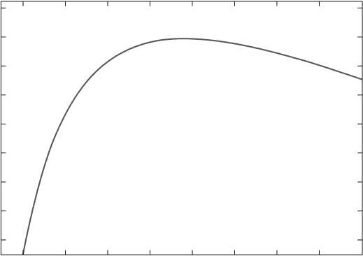

**图 1.36** 目标函数的形状。

而期望的循环长度表示为 $TR(T)+\int_0^T tf(t)\,dt$，可重写为 $\int_0^T R(t)\,dt$。如果相同的循环无限重复，则基于更新理论，每单位时间的期望成本可表示为

$$\frac{c_pR(T)+c_fF(T)}{\int_0^T R(t)\,dt}$$  (1.123)

其被最小化（Barlow and Proschan 1965; Aven and Jensen 1999）。在许多情况下——例如在快速变化的技术中——最优解必须基于单周期准则获得。每单位时间的成本表示为

$$\begin{cases}\dfrac{c_f}{X}, & \text{if } X\le T\\[4pt]\dfrac{c_p}{T}, & \text{if } X\ge T\end{cases}$$

其期望值为

$$\frac{c_p}{T}R(T)+\int_0^T\frac{c_f}{t}f(t)\,dt$$  (1.124)

然后对其进行最小化。在几种分布类型的情况下，最优解可以很容易地获得。

首先考虑式 (1.123) 中的模型。其导数与以下表达式符号相同

$$(-c_pf(T)+c_ff(T))\int_0^T R(t)\,dt-(c_pR(T)+c_fF(T))R(T)$$

或

$$(c_f-c_p)\left\{\int_0^T R(t)\,dt\,p(T)+R(T)\right\}-c_f$$  (1.125)

括号内表达式的导数为

```
R(T)ρ(T) + ∫₀ᵀ R(t)dt ρ'(T) − f(T) = ρ'(T) ∫₀ᵀ R(t)dt > 0
```

若 ρ(T) 为递增。于是式 (1.125) 为递增函数，且其在 T = 0 时的值为 −c_p < 0。当 T → ∞ 时，若 ρ(T) → ∞，则其收敛于无穷；否则若

```
(c_f − c_p) ∫₀^∞ R(t)dt ρ(∞) − c_f > 0
```

则收敛于正的极限。因此，在这些情况下存在唯一的 T̄ > 0 使式 (1.125) 为 0，且此即为唯一最优解。如果式 (1.125) 在无穷处的极限非正，则不存在有限最优解，设备必须在失效时更换。

式 (1.124) 的导数形式为

```
− c_p/T² R(T) − c_p/T f(T) + c_f/T f(T)
```

其符号与

```
(c_f − c_p)ρ(T) − c_p/T   (1.126)
```

相同。若 ρ(T) 递增，则该函数也递增；在 T = 0 时，其值收敛于 −∞；而当 T → ∞ 时，其极限为正。因此，同样存在唯一的解即唯一优化器。单调方程的解可通过标准计算机方法获得（Yakowitz and Szidarovszky 1989）。

## 示例 1.22  假设威布尔分布参数为 β = 1.5 和 η = 5，且 c_f = 200 和 c_p = 100。我们先前已证明威布尔分布的失效率为

```
ρ(t) = β/η^β t^{β−1}
```

且由式 (1.126) 给出的<|message|> 一阶条件可写为

```
(c_f − c_p) β/η^β T^{β−1} − c_p/T = 0
```

意味着

```
T = { c_p η^β / [β(c_f − c_p)] }^{1/β}
```

在此情况下

```
T = { 100(5)^{1.5} / [1.5(100)] }^{1/1.5} ≈ 3.816
```

### 1.8.5 模型变体与扩展

这些模型存在许多变体和扩展。其中一些将简要介绍。

首先假设预防性更换需要 $T_p$ 时间进行，而 $T_f$ 对失效更换相同。若我们考虑从更换开始运行的周期，则 $T_p$ 或 $T_f$ 必须计入循环长度。式 (1.123) 修改为

$$\frac{c_pR(T)+c_fF(T)}{T_pR(T)+T_fF(T)+\int_0^T R(t)\,dt} \tag{1.127}$$

而式 (1.124) 变为

$$\frac{c_p}{T+T_p}R(T)+\int_0^T\frac{c_f}{t+T_f}f(t)\,dt \tag{1.128}$$

这些简单模型未考虑任何额外因素：可修复失效的维修成本、机器生产的产品产生的收益、更换后的残值、备件到达的最优时间，以及执行维修和更换所需的时间。为开发更先进的模型，我们引入以下记号：

- $c_r$ = 每次维修的成本  
- $M(T)$ = 区间 $[0,T]$ 内可修复失效的期望次数  
- $u(T)$ = 区间 $[0,T]$ 内产生的收益  
- $S(T)$ = 设备使用寿命为 $T$ 后的残值  
- $\alpha$ = 备件单位库存成本  
- $\beta$ = 生产延误单位损失

还必须包含一个新的决策变量：

$W$ = 备件到达计划

为数学简便起见，我们引入以下函数。若设备需在时间 $t$ 安排更换，且备件在时间 $W$ 到达，则额外成本为

$$\gamma(t,W)=\begin{cases}(t-W)\alpha & \text{if } t\ge W \\(W-t)\beta & \text{if } t<W\end{cases}$$

第一种情况下产生库存成本；第二种情况下生产延误导致公司损失。

如果考虑长期期望成本，则式 (1.124) 推广为

$$\frac{(c_rM(T)+c_p-S(T)-u(T)+\gamma(T,W))R(T)+\int_0^T(c_rM(t)+c_p-S(t)-u(t)+\gamma(t,W))f(t)\,dt}{T_pR(T)+T_fF(T)+\int_0^T R(t)\,dt} \tag{1.129}$$

相应的单周期模型扩展为更复杂的目标函数：

$$\frac{c_p+c_rM(T)-S(T)-u(T)+\gamma(T,W)}{T+T_p}R(T)+\int_0^t\frac{c_f+c_rM(t)-S(t)-u(t)+\gamma(t,W)}{t+T_f}f(t)\,dt$$  (1.130)

两个模型均有两个决策变量，因此对其优化，商业软件是最好的选择。一种复杂的分析方法如下。先给定 $T$ 的值，对式 (1.129) 和 (1.130) 关于 $W$ 进行优化。显然，最优 $W$ 值取决于 $T$：$W=W(T)$。然后将 $W(T)$ 代入目标函数，此时它们仅依赖于 $T$，从而成为简单的单变量搜索算法，可用于寻找最优解。

如果同时考虑短期和长期目标，则必须使用多目标优化方法对这两个目标函数进行处理。

我们还可以在式 (1.121) 和 (1.122) 中纳入不可修复失效的可能性。在这种情况下，必须使用时间 $T$ 之后的 TTF 的条件 CDF，可按如下方式获得：

$$P(X<t\mid X>T)=\frac{P(T<X<t)}{P(X>T)}=\frac{F(t)-F(T)}{1-F(T)}$$  (1.131)

请注意，这些目标表示每单位时间的期望成本，而未考虑其不确定性，后者由每单位时间成本的方差表征。期望成本及其方差都应最小化，这再次导致应用多目标优化程序。

最后引入一个简单的模型，用于在设备生命周期中的任意区间内确定所需的维修包数量。类似的模型也可用于规划所需劳动力数量。为简化起见，假设在可修复失效情况下执行最小维修。据第 1.5.1 节可知，任意区间 $[t,T]$ 内的失效次数服从期望为

$$\lambda=M(T)-M(t)=\int_t^T\rho(\tau)\,d\tau$$  (1.132)

的泊松分布，意味着失效时间构成非齐次泊松过程。假设每次维修需要一个维修包单位。确定能保证所有失效维修均能以至少给定概率值 $1-p$ 完成的单位数是一个非常重要的问题。设 $Q$ 表示所需的可用包数；则在记号

$$X_{[t,T]}=\text{区间 }[t,T]\text{ 内实际失效次数}$$

下，我们要求

$$P(X_{[t,T]}\le Q)=\sum_{k=0}^{Q}\frac{\lambda^k}{k!}e^{-\lambda}=e^{-\lambda}\sum_{k=0}^{Q}\frac{\lambda^k}{k!}\ge 1-p$$

意味着

$$\sum_{k=0}^{Q}\frac{\lambda^k}{k!}\ge (1-p)e^{\lambda}$$  (1.133)

Cox, D. (1970). Renewal Theory. London: Methuen and Co.
Elsayed, E.A. (2012). Reliability Engineering. Hoboken, NJ: Wiley.
Eyring, H. (1935). The activated complex in chemical reactions. The Journal of Chemical Physics 3 (2): 107–115.
Finkelstein, M. (2008). Failure Rate Modeling for Reliability and Risk. London: Springer.
Frieden, B.R. (2004). Science from Fisher Information: A Unification. Cambridge, UK: Cambridge University Press.
Hamidi, M., Matsumoto, A., and Szidarovszky, F. (2017). Optimal schedule of repair or replacement after degradation is noticed. 46th Annual Meeting of the Western Decision Science Institute, Vancouver, Canada, 4–8 April.
Hamilton, J. (1994). Time Series Analysis. Princeton, NJ: Princeton University Press.
Hofmeister, J., Goodman, D., and Wagoner, R. (2016). Advanced anomaly detection method for condition monitoring of complex equipment and systems. 2016 Machine Failure Prevention Technology, Dayton, Ohio, US, 24–26 May.
Hofmeister, J., Goodman, D., and Szidarovszky, F. (2017a). PHM/IVHM: checkpoint, restart, and other considerations. 2017 Machine Failure Prevention Technology, Virginia Beach, Virginia, US, 15–18 May.
Hofmeister, J., Szidarovszky, F., and Goodman, D. (2017b). An approach to processing condition-based data for use in prognostic algorithms. 2017 Machine Failure Prevention Technology, Virginia Beach, Virginia, US, 15–18 May.
IEEE. (2017). Draft standard framework for prognosis and health management (PHM) of electronic systems. IEEE 1856/D33.
Jardine, A. (2006). Optimizing maintenance and replacement decisions. Annual Reliability and Maintainability Symposium (RAMS), Newport Beach, California, US, 23–26 January.
Kececioglu, D. and Jacks, J.A. (1984). The Arrhenius, Eyring, inverse power law and combination models in accelerated life testing. Reliability Engineering 8 (1): 1–9.
Kumar, S. and Pecht, M. (2010). Modeling approaches for prognostics and health management of electronics. International Journal of Performability Engineering 6 (5): 467–476.
Medjaher, K. and Zerhouni, N. (2013). Framework for a hybrid prognostics. Chemical Engineering Transactions 33: 91–96. https://doi.org/10.3303/CET1333016.
Milton, J.S. and Arnold, J.C. (2003). Introduction to Probability and Statistics. Boston, MA: McGraw Hill.
Mitov, K.V. and Omey, E. (2014). Renewal Processes. New York: Springer.
Nakagawa, T. (2006). Maintenance Theory and Reliability. Berlin/Tokyo: Springer.
Nakagawa, T. (2008). Advanced Reliability Models and Maintenance Policies. London: Springer.
National Science Foundation Center for Advanced Vehicle and Extreme Environment Electronics at Auburn University (CAVE3). (2015). Prognostics health management for electronics. http://cave.auburn.edu/rsrch-thrusts/prognostic-health-management-for-electronics.html (accessed November 2015).
Nelson, W. (1980). Accelerated life testing – step stress models and data analysis. IEEE Transactions on Reliability R-29 (2): 103–108.
Nelson, W. (2004). Accelerated Testing: Statistical Models, Test Plans, and Data Analysis. New York: Wiley.
O’Connor, P. and Kleyner, A. (2012). Practical Reliability Engineering. Chichester: Wiley.


Pecht, M. (2008). *电子产品预测与健康管理*. Hoboken, NJ: Wiley. Pratt, J.W., Edgeworth, F.Y., and Fisher, R.A. (1976). On the efficiency of maximum likelihood estimation. *Annals of Statistics* 4 (3): 501–514. Ross, M.S. (1987). *工程师和科学家概率与统计导论*. New York: Wiley. Ross, M.S. (1996). *随机过程*, 2e. New York: Wiley. Ross, M.S. (2000). *概率模型*, 7e. San Diego, CA: Academic Press. Saxena, A., Celaya, J., Saha, B. et al. (2009). On applying the prognostic performance metrics. Annual Conference of the Prognostics and Health Management Society (PHM09), San Diego, California, US, 27 Sep.–1 Oct. Speaks, S. (2005). Reliability and MTBF overview. Vicor Reliability Engineering. http://www.vicorpower.com/documents/quality/Rel_MTBF.pdf (accessed August 2015). Szidarovszky, F., Gershon, M., and Duckstein, L. (1986). *系统管理中多目标决策制定的技术*. Amsterdam: Elsevier. Valdez-Flores, C. and Feldman, R.M. (1989). A survey of preventive maintenance models for stochastically deteriorating single-unit systems. *Naval Research Logistics* 36: 419–446. Wang, H.Z. (2002). A survey of maintenance policies of deteriorating systems. *European Journal of Operational Research* 139 (3): 469–489. Yakowitz, S. and Szidarovszky, F. (1989). *数值计算导论*. New York: Macmillan.

## 进一步阅读

Filliben, J. and Heckert, A. (2003). Probability distributions. In: *Engineering Statistics Handbook*. National Institute of Standards and Technology. http://www.itl.nist.gov/div898/handbook/eda/section3/eda36.htm. Hofmeister, J., Wagoner, R., and Goodman, D. (2013). Prognostic health management (PHM) of electrical systems using conditioned-based data for anomaly and prognostic reasoning. *Chemical Engineering Transactions* 33: 992–996. Tobias, P. (2003a). Extreme value distributions. In: *Engineering Statistics Handbook*. National Institute of Standards and Technology. https://www.itl.nist.gov/div898/handbook/apr/section1/apr163.htm. Tobias, P. (2003b). How do you project reliability at use conditions? In: *Engineering Statistics Handbook*. National Institute of Standards and Technology. https://www.itl.nist.gov/div898/handbook/apr/section4/apr43.htm.

## 2
