## 预测与健康管理/监测(PHM)的方法

### 2.1 预测与健康管理/监测(PHM)方法导论

你在第1章学到，预测的目的在于能够准确检测并报告系统中未来的故障——预测故障进展。用于实现该目的的预测与健康管理/监测(PHM)中的预测方法可分为三大类：经典、基于使用和基于状态 [Hofmeister et al. 2017; Pecht 2008; Kumar and Pecht 2010; O’Connor and Kleyner 2012; Sheppard and Wilmering 2009]。经典预测方法可分为基于模型、数据驱动或混合驱动，如图2.1所示。

### 2.1.1 基于模型的预测方法

基于模型的预测方法包括建模和使用与可靠性、概率和失效物理(PoF)模型相关的表达式。此类模型用于研究和比较，例如材料、制造和利用对产品可靠性、鲁棒性和强度关系，通常在结构化、设计、受控的实验和寿命试验中进行。这样的建模可能提供较好的精度，但难以应用于复杂、已部署的系统 [Speaks 2005]。这些模型包括分布和概率模型；可靠性理论基础；以及基于可靠性测试的模型，如第1章中介绍的加速因子(AF)。其他方法将在后面讨论。

### 2.1.2 数据驱动的预测方法

数据驱动的预测方法包括统计和机器学习(ML)方法；与基于模型的预测方法相比通常更易应用；但在预测估计中可能产生较低的精度和准确性。统计方法包括参数和非参数模型，如 (Ross 1987) 和 (Hollander et al. 2014) 中所示；以及 K-最近邻(KNN)，一种用于根据邻居对对象进行分类或回归的非参数方法 [Medjaher and Zerhouni 2013]。机器学习包括线性判别分析(LDA)用于表征或分离多个对象、隐马尔可夫模型(HMM)用于建模具有隐藏状态的系统，以及主成分分析(PCA)用于将观测值转换为线性不相关的变量。

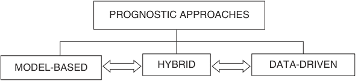

**图 2.1** 显示PHM三种方法的框图。来源：基于 Pecht (2008)。

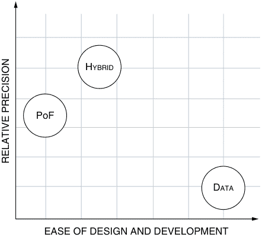

**图 2.2** 精度和复杂度：经典PHM方法的相对比较。

### 2.1.3 混合预测方法

混合方法同时采用模型驱动和数据驱动方法，以进一步提高准确性并/或更好地理解参数和对象的关系 [Medjaher and Zerhouni 2013]。缺点是计算处理和复杂度增加（见图2.2）。我们将在本章后面回到这些及其他方法。

### 2.1.4 本章目标

本章的目标是介绍支持PHM预测的经典方法论，然后介绍一种用于PHM的基于状态维护(CBM)的方法：一种基于CBD特征的方法，为第3章奠定基础。

### 2.1.5 本章组织

本章其余部分组织如下，用于介绍和讨论支持PHM预测的经典建模方法，并介绍我们对CBM的方法：

2.2 基于模型的预测

本节介绍基于模型的预测方法，包括分析建模、分布建模、PoF和可靠性建模、加速因子、与可靠性建模相关的复杂度、失效分布、失效率和随时间发生的失效，以及基于模型预测的优缺点。

### 2.3 数据驱动预测

本节介绍数据驱动预测方法，包括统计方法和机器学习——分类和聚类。

### 2.4 混合驱动预测

本节介绍混合驱动预测方法：基于模型与数据驱动预测相结合。

### 2.5 基于状态维护(CBM)的方法

本节介绍CBM方法，包括CBD特征建模、比较寿命消耗和PoF，以及CBD特征方法论。包含CBD特征建模的示例。

### 2.6 PHM方法：总结

本节总结本章所呈现的材料。

## 2.2 基于模型的预测

基于模型的方法使用分析模型和PoF模型。分析模型包括使用、统计和概率模型；并且可通过PoF模型和/或基于可靠性的模型进行验证。基于可靠性的模型与测试相关，例如加速寿命试验(ALTs)和回归分析：Pecht 偏爱PoF，其中生命周期载荷和失效机制被建模并应用于评估可靠性并评估新材料、结构和技术 [Pecht 2008]。需要指出的是，通常PoF建模在应用于系统时计算上不可行 [Sheppard and Wilmering 2009]。如图2.3所示的基于模型的预测简化方法包括模型开发和模型使用。

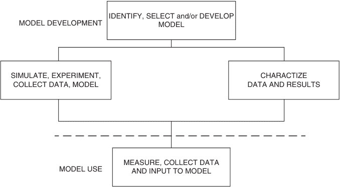

**图 2.3** 模型开发和使用的基于模型方法。

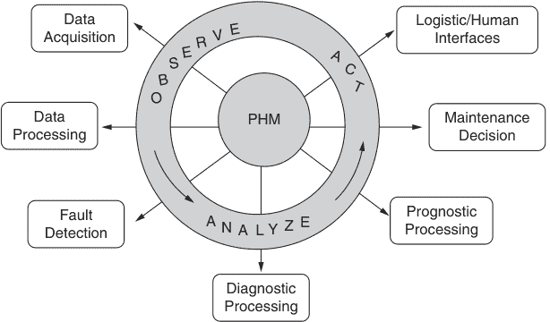

**图 2.4** 模型使用图。来源：基于 Medjaher and Zerhouni (2013)。

模型开发包括以下内容：(i) 识别、选择和/或开发模型；(ii) 通过仿真和/或实验产生数据以评估和验证模型；以及 (iii) 对数据进行表征以便后续数据测量、收集并输入模型，在模型使用时产生预测信息。模型使用包括以下内容（见图2.4）：(i) 获取数据，(ii) 处理数据，(iii) 检测故障，(iv) 执行诊断，(v) 执行预测，(vi) 做出决策，以及 (vii) 发布维护和后勤指令 [Medjaher and Zerhouni 2013]。

参考图2.4和2.5，标记为数据采集、数据处理、故障检测、诊断处理和预测处理的模块功能体现在传感器框架、特征向量框架、预测框架和性能验证框架中。预测信息传递给故障管理(FM)框架和/或写入输出文件，用于维护、后勤和图形用户界面相关的延迟决策和操作 [CAVE3 2015; Hofmeister et al. 2017]。

### 2.2.1 分析建模

分析模型，也称为物理模型，采用如表2.1所示的载荷参数来估计系统中特定预测目标如何从100%健康（未受损）状态变化到零健康（失效）状态，随着损伤累积 [Pecht 2008; Hofmeister et al. 2016, 2017; Vichare 2006; Vichare et al. 2007]。PHM系统执行健康监测，检测不健康状况，并使用例如故障树或状态图分析来识别并确定导致故障的最可能预测目标的位置。分析方法可分为两大类：*归纳*和*演绎*方法。

#### 分析建模：归纳方法

*归纳*方法基于推理，使用定性数据，从个别案例推导出一般结论。例如，这种方法可用于确定


## PHM for ELECTRONICS: FRAMEWORK DIAGRAM

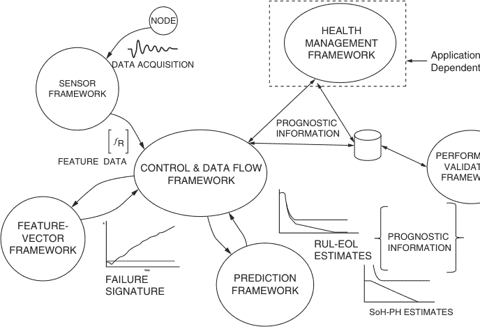

**Figure 2.5** A framework for CBM for PHM (CAVE3 2015).

**Table 2.1** Load types and examples.

| Load | Examples of load type |
|---|---|
| Electrical | Current, voltage, power, energy |
| Thermal | Ambient temperature, temperature cycles, gradients, ramp rates |
| Mechanical | Pressure, vibration, shock load, stress/strain, vibration rate |
| Chemical | Humidity, reactivity – inert, active, acid, base – reaction rate |
| Physical | Radiation, magnetic and electrical fields, altitude |

how the elimination or reordering of components in a design affects the overall operation, or how the elimination of a sensor affects the possible observation of a failure. There are many different methods for conducting inductive analysis, such as preliminary hazard analysis (PHA), failure mode and effect analysis (FMEA), and failure mode effect and criticality analysis (FMECA) and event tree analysis (Thomas 2006; Czichos 2013).

PHA is an initial study used in the early stages of designing systems to avoid costly redesign if a hazard is discovered later. It is a broad approach, and its main focus consists of the following elements:

- 1. Identify apparent hazards.
- 2. Assess the potential accidents (and their severity) that might occur as the consequence of a hazard.
- 3. Identify preventive measures to be used to reduce the risk.

FMEA first focuses on identifying potential failure modes, based on either PoF or earlier experience with the same or similar products. This information is used in the design and life-cycle phases of equipment, especially in support of diagnostics, maintenance, and prognostics. Effective FMEA is useful in identifying candidate signals and nodes to measure and capture leading indicators of failure that, when conditioned and collected, form signatures that are valuable for producing prognostic information (Hofmeister et al. 2017).

FMECA is an extension of FMEA that adds a criticality analysis to find the probabilities of different failure modes and the consequent severity of those failures. It is usually combined with event tree analysis, which is a forward, causal analytical technique. It gives the failure routes (responses) and consequences of a single failure event on related or higher-level system components. Following the path from the initial event, it helps to assess the probability of the outcomes; as a result, overall system analysis can be performed (ETA 2017).

## Analytical Modeling: Deductive Approach

The *deductive* approach is based on reasoning, using quantitative data, from general to specific events. For example, if a system failed, we wish to find out which component’s behavior was the cause of the problem. A typical example of the deductive approach is the well-known fault tree analysis (FTA). It is similar to an event tree, where the direction of the analysis starts at the highest level and proceeds to lower levels. Any fault tree is based on primary events that are not further developed. A directed graph is constructed, where the primary events are the nodes; then an arc or line is placed from an event to another event, if failure of the initial node might generate failure in the terminal node. Therefore, if a failure occurs in any element of the system, we can move along the graph’s tree, backward and forward, and find possible immediate reasons for the failing element and the failure mode. Thus we have the information required to know what to fix and how to fix it, to eliminate the problem (Thomas 2006; Czichos 2013).

Fault trees are closely related to Bayesian networks, if at each node failures are characterized by probability distributions determined by Bayesian rules from those of lower levels (Zhang and Poole 1996). A similar approach is offered by using Markov chains, when the degradation has several levels and the transition probabilities between the different levels are given, or shown from past observations (Ahmed and Wu 2013).

### Example 2.1
Consider a machine with two parts, both of which are subject to random failures. The system has four possible states:

- 1. Both are in working condition.
- 2. Part 1 is good; part 2 is broken.
- 3. Part 1 is broken; part 2 is good.
- 4. Both parts are broken.

The following conditional probabilities are assumed to be known:

$P(\text{part 1 breaks down}\mid\text{part 2 is good}) = P_{11}$

$P(\text{part 1 breaks down}\mid\text{part 2 is down}) = P_{12}$

$P(\text{part 2 breaks down}\mid\text{part 1 is good}) = P_{21}$

$P(\text{part 2 breaks down}\mid\text{part 1 is down}) = P_{22}$

Assume that no repair is possible and that at most one part can break down in a single time period. The transition matrix based on the previous probabilities is given as follows:

```
$$T = \begin{pmatrix} 1 - P_{11} - P_{21} & P_{21} & P_{11} & 0 \\ 0 & 1 - P_{12} & 0 & P_{12} \\ 0 & 0 & 1 - P_{22} & P_{22} \\ 0 & 0 & 0 & 1 \end{pmatrix}$$
```

The matrix elements give the transition probabilities from each state to all states (including itself):

```
$$P(1|1) = P(\text{none of the parts breaks down}) = 1 - P_{11} - P_{21}$$
```

```
$$P(2|1) = P(\text{part 2 breaks down|part 1 is good}) = P_{21}$$
```

```
$$P(3|1) = P(\text{part 1 breaks down|part 2 is good}) = P_{11}$$
```

```
$$P(2|2) = 1 - P_{12}$$
```

```
$$P(4|2) = P_{12}$$
```

```
$$P(3|3) = 1 - P_{22}$$
```

```
$$P(4|3) = P_{22}$$
```

```
$$P(4|4) = 1$$
```

All other transition probabilities are equal to zero. Notice that the sum of the elements in each row equals unity. In this example, we consider discrete time scales. Let $P_i(t)$ denote the probability that at time period $t$, the machine is in state $i$. Then by using the Total Probability Theorem (Papoulis 1984), we see that

```
$$P_1(t+1) = (1 - P_{11} - P_{21})P_1(t)$$
```

```
$$P_2(t+1) = P_{21}P_1(t) + (1 - P_{12})P_2(t)$$
```

```
$$P_3(t+1) = P_{11}P_1(t) + (1 - P_{22})P_3(t)$$
```

```
$$P_4(t+1) = P_{12}P_2(t) + P_{22}P_3(t) + P_4(t)$$
```

If we introduce the vector $P(t) = (P_1(t), P_2(t), P_3(t), P_4(t))$, then these equations can be written in a matrix form:

```
$$P(t+1) = P(t) * T \tag{2.1}$$
```

### Example 2.2
Consider the same machine as before, but under different conditions. The time to failure (TTF) distribution of both parts is exponential, with failure rate $\lambda$. When any part breaks down, repair starts; its length is also exponential, with parameter $\mu$. We consider a continuous time scale, when there is no “next time period” as

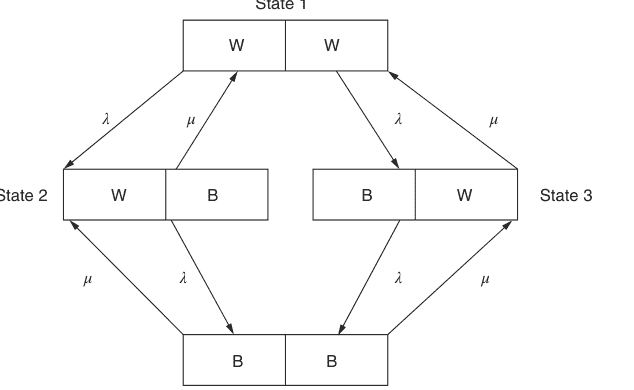

# Figure 2.6 Transition diagram.

in the discrete time case; therefore, the rate of change in the probabilities P_i(t) can be given. Figure 2.6 shows the diagram of the possible state transitions, where the rate of transitions is also given next to the arrows. It is assumed that at each time, only one broken part can go through repairs. Four differential equations can describe the process; and, similar to the discrete case, P_i(t) is the probability that the machine is in state i at time t.

In computing the rate of change P'_1(t) for state 1, we see that it can change four different ways: part 2 breaks down, part 1 breaks down, part 2 is repaired from state 2, or part 1 is repaired from state 3. The first two cases decrease the value of P_1(t), and the other two cases increase its value:

```
P'_1(t) = μP_2(t) + μP_3(t) - 2λP_1(t)
```

Similarly,

```
P'_2(t) = λP_1(t) + μP_4(t) - μP_2(t) - λP_2(t)
P'_3(t) = λP_1(t) + μP_4(t) - μP_3(t) - λP_3(t)
P'_4(t) = λP_2(t) + λP_3(t) - 2μP_4(t)
```

This is a system of linear differential equations that can be solved by simple algorithms using any known software packages, such as Mathematica (Yakowitz and Szidarovszky 1989).

### Example 2.3
Another form of fault tree is shown in Figure 2.7. Here, a fuel-error fault has been evaluated –using, for example, FMEA and/or FMECA – as most likely being caused by one of four failure modes: air flow, pressure, temperature, or fuel pump. In this example, a temperature error is determined to be the likely cause of the fuel error. The fault tree indicates a temperature error that is likely to be the result of


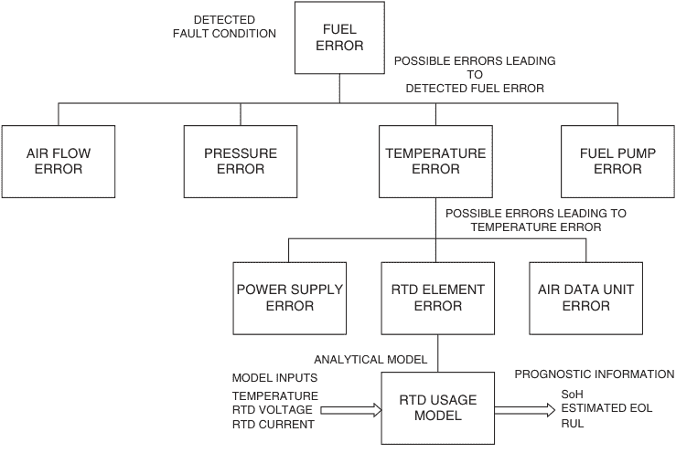

**图 2.7** 故障树示例，显示一个 RTD 故障和 RTD 使用模型。

三种失效模式：电源、电阻温度检测器（RTD）或大气数据单元。对于 RTD 失效，可采用合适的解析模型来产生预测信息。

**示例 2.4** 解析模型的一个简单示例是用于电容器和电阻器退化的功率模型。当施加功率时，由于温度升高而导致失效（Viswanadham and Singh 1998）：

$$t_f = A P^{-n}, \tag{2.2}$$

其中 $t_f$ 是失效时间，$A$ 和 $n$ 是常数，$P$ 是电功率。

统计模型（包括使用模型和分布模型）是联系因变量（如失效时间 $t_f$）与自变量（如式（2.2）中的功率 $P$）的预测表达式。

## 2.2.2 分布建模

当许多物理原因和/或复杂反应导致失效时，通常使用分布模型而不是物理模型。工程经验可以将特定的分布类型与给定的失效类型联系起来。分布模型的示例及相关应用见表 2.2（Medjaher and Zerhouni 2013; Viswanadham and Singh 1998; Hofmeister et al. 2006, 2013; Hofmeister and Vohnout 2011; Silverman and Hofmeister 2012）。

**表 2.2** 失效分布及示例应用。

| 分布 | 示例应用 |
| --- | --- |
| 指数分布 | 恒定应力引起的疲劳、磨损：电阻器 |
| 伽马分布 | 冲击和振动引起的失效：电路板、封装连接 |
| 对数正态分布 | 绝缘电阻失效、裂纹扩展和速率相关过程引起的失效：封装失效 |
| 耿贝尔分布 | 腐蚀、剪切断裂（强度）、介电击穿引起的失效：导体连接、互连 |
| 威布尔分布 | 寿命（使用）和击穿失效：电容器、电缆 |

以下分布构成的特征曲线对于复杂失效机理的建模非常有用（更完整的列表见第 1 章）：

- 指数分布：\(f(x,\theta)=\frac{1}{\theta}e^{-x/\theta}\)
- 伽马分布：\(f(x,\theta,k)=\frac{1}{\Gamma(k)\theta^k}x^{k-1}e^{-x/\theta}\)
- 对数正态分布：\(f(x,\mu,m,\sigma)=[e^{-(\ln(x-\mu)-m)^2/(2\sigma^2)}]/[(x-\mu)\sigma\sqrt{2\pi}]\)
- 耿贝尔分布：\(f(x,\sigma,\mu)=\frac{1}{\sigma}e^{-(x-\mu)/\sigma}\exp[-e^{-(x-\mu)/\sigma}]\)
- 威布尔分布：\(f(x,\beta,\eta,\gamma)=\frac{\beta}{\eta}\left(\frac{x-\gamma}{\eta}\right)^{\beta-1}e^{-((x-\gamma)/\eta)^\beta}\)

在工程应用中，威布尔分布（一种极值型分布）和对数正态分布经常用于建模，因为它们可以拟合大量应用的数据，尤其是失效以零为下限的寿命分布（Xu et al. 2015）。威布尔分布的通用性可通过以下示例寿命应用以及图 2.8 中的示例威布尔图得到证明：

- 河流的最大洪水位；最大阵风；蒸汽锅炉压力
- 轴承的疲劳寿命；粉末涂料材料的混合时间
- 金属丝的抗拉强度；梁的屈服强度
- 无源电子元件（如电阻器和电容器）的寿命
- 与时间相关的介电击穿（TDDB）现象；焊点中可检测高阻事件的数量

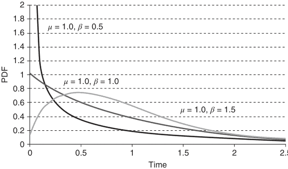

**图 2.8** 威布尔分布示例图。

## 2.2.3 失效物理（PoF）与可靠性建模

用于可靠性建模和仿真的 PoF 与恒定失效率（CFR）建模（基于指数分布）有很大不同，后者是以军用手册 217 系列（MIL-HDBK-217C）为基础的。自 20 世纪 80 年代以来，PoF 方法一直占主导地位：研究和纠正失效的根本原因，如疲劳、断裂、磨损和腐蚀，通过设计消除组件中磨损失效的原因，从而实现寿命设计要求。此类建模用于研究系统性能并减少失效。以下是 PoF 方法的总结（Weisstein 2015）：

1. 识别潜在的失效模式。
2. 设计并执行高加速寿命试验（HALT）或高加速应力试验（HAST），以验证并选择导致失效的主要失效模式。
3. 对失效模式进行建模，并使用统计分布将数据拟合到模型中。
4. 建立 PoF 模型的方程，以计算平均失效时间（MTTF）和/或平均失效间隔时间（MTBF）。
5. 在设计、材料和制造方面进行改进，以提高 MTTF 并满足要求。

PoF 方法的优点包括：

- 可靠性被设计进产品中。
- 在测试之前减少或消除失效。
- 提高已部署系统的可靠性。
- 降低运营成本。

系统的可靠性可以通过其组成部分的可靠性获得。

- 首先假设这些组成部分为串联组合，这意味着只有所有组成部分都处于工作状态时，系统才能工作。设 \(n\) 为组成部分的数量，并设 \(R_1(t), \ldots, R_n(t)\) 为各组成部分的可靠性函数。则整个系统的可靠性函数可表示为

$$R(t) = P(X > t) = P((X_1 > t) \cap (X_2 > t) \cap \ldots \cap (X_n > t))$$

其中 \(X_1, \ldots, X_n\) 表示各组成部分的失效时间。假设各组成部分相互独立，则

$$R(t) = P(X_1 > t)P(X_2 > t) \ldots P(X_n > t) = R_1(t)R_2(t) \ldots R_n(t) \tag{2.3}$$

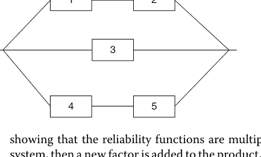

这表明可靠性函数是相乘的。如果向系统添加一个新的组成部分，则乘积中会新增一个因子，该因子小于 1，因此系统可靠性会降低。

- 接下来假设连接为并联，这意味着只要至少一个组成部分工作，系统就能工作。在这种情况下

$$R(t) = 1 - P(X < t) = 1 - P((X_1 < t) \cap (X_2 < t) \cap \ldots \cap (X_n < t))$$
$$= 1 - P(X_1 < t)P(X_2 < t) \ldots P(X_n < t)$$
$$= 1 - (1 - R_1(t))(1 - R_2(t)) \ldots (1 - R_n(t)) \tag{2.4}$$

如果向系统添加一个新的组成部分，则第二项会减小，因此 \(R(t)\) 会增大。

在许多系统中，组成部分的连接是串联和并联组合的混合形式。此时需要重复使用式（2.3）和式（2.4），如下例所示。

### 示例 2.5

考虑一个由五个组成部分组成的系统，其连接方式如图 2.9 所示。假设每个组成部分的可靠性函数均为 \(e^{-2t}\)。组成部分 1 和 2，以及组成部分 4 和 5 为串联连接，因此这些简单组合的可靠性函数为

$$R_{12}(t) = R_1(t)R_2(t) = e^{-2t} e^{-2t} = e^{-4t}$$

且

$$R_{45}(t) = R_4(t)R_5(t) = e^{-2t} e^{-2t} = e^{-4t}$$

接下来注意到，组合 1-2 和 4-5 与组成部分 3 为并联组合；因此，根据式（2.4），可得出系统的可靠性函数为

$$R(t) = 1 - (1 - R_{12}(t))(1 - R_3(t))(1 - R_{45}(t))$$
$$= 1 - (1 - e^{-4t})(1 - e^{-2t})(1 - e^{-4t})$$
$$= 1 - (1 - e^{-2t})(1 - e^{-4t})^2$$

例如，系统至少运行到时间 \(t = 1\) 的概率等于

$$R(1) = 1 - (1 - e^{-2})(1 - e^{-4})^2 = 1 - 0.8647 \times 0.9817^2 = 0.1167$$

## 2.2.4 加速因子（AF）

第 1 章讨论了当产品承受极端应力时 TTF 分布如何变化。当在极端条件下进行观测时，这些公式可以反向使用来估计失效时间：基于这些数据，可以估计正常条件下的 TTF 分布。这一概念被称为加速试验（AT）、ALT 等。

可靠性预测，例如基于加速试验（如 HALT）的 MTTF，是在产品承受极端应力时，根据测试结果对未来正常使用条件下较低应力水平下的较慢失效率进行的推算估计。此类预测假设使用了正确的寿命分布模型和正确的加速模型（Tobias 2003; Nelson 2004）。在加速模型中，应力水平 \(s\) 下的 TTF（或 \(t_F\)）由下式给出（Kentved and Schmidt 2012）：

$$t_F = A G(s) \tag{2.5}$$

其中 \(A =\) 常数，\(G(s) =\) 应力函数。

加速因子（AF）是两个不同应力水平下 TTF 的比值：

$$AF = t_{F1}/t_{F2} = G(s_1)/G(s_2) \tag{2.6}$$

用于可靠性估计（或使用建模）的加速因子包括以下内容（White and Bernstein 2008）：

### 阿伦尼乌斯温度定律

$$AF_T = \exp\left[\frac{E_a}{k}\left(\frac{1}{T_{\text{use}}} - \frac{1}{T_{\text{test}}}\right)\right] \tag{2.7}$$

其中

| 符号 | 含义 |
| --- | --- |
| \(T_{\text{use}}\) | 使用中的产品温度 |
| \(T_{\text{test}}\) | 实验室测试中的产品温度 |
| \(E_a\) | 损伤机理和材料的激活能 |
| \(k\) | 玻尔兹曼常数 = \(8.617 \times 10^{-5}\) eV/°K |

### 凯梅尼电压定律

$$AF_T = \exp\left[C_0 - \frac{E_a}{k T_j}\right] \exp\left[C_1 \left(\frac{V_{cb}}{V_{cbmax}}\right)\right] \tag{2.8}$$

此外，其中

| 符号 | 含义 |
| --- | --- |
| \(C_0, C_1\) | 材料常数 |
| \(T_j\) | 结温 |
| \(V_{cb}\) | 集电极-基极电压 |
| \(V_{cbmax}\) | 击穿前的最大集电极-基极电压 |

### 佩克温度-湿度定律

$$AF_{TM} = \left(\frac{M_{\text{use}}}{M_{\text{test}}}\right)^{-n} \exp\left[\frac{E_a}{k}\left(\frac{1}{T_{\text{use}}} - \frac{1}{T_{\text{test}}}\right)\right] \tag{2.9}$$


其中另外

| | |
|---|---|
| $M_{use} =$ | 使用中的湿度水平 |
| $M_{test} =$ | 测试中的湿度水平 |

该公式可从第1章讨论的温度-湿度关系推导得出。

## 科芬-曼森疲劳定律

$$AF_T = \left(\frac{\Delta T_{test}}{\Delta T_{use}}\right)^n \tag{2.10}$$

其中

| | |
|---|---|
| $\Delta T =$ | 产品在使用和实验室测试中的最高温度与最低温度之差。 |

注意，(2.10) 由逆幂律推导得出。

## 艾林公式

$$AF_T = \frac{\frac{1}{T_{use}} \exp\!\left(-\left(A - \frac{B}{T_{use}}\right)\right)}{\frac{1}{T_{test}} \exp\!\left(-\left(A - \frac{B}{T_{test}}\right)\right)} = \frac{T_{test}}{T_{use}} \exp\left(\frac{B}{T_{use}} - \frac{B}{T_{test}}\right) \tag{2.11}$$

类似的公式可由任何其他处理极端应力水平的已知规则推导得出，例如广义艾林公式、温度非热关系，或第1章讨论的一般对数线性定律。

## 2.2.5 与可靠性建模相关的复杂性

除了需要使用正确的分布模型和正确的加速模型之外，可靠性建模还因几乎无限种方法而变得更加复杂，例如表2.3中的方法。对于给定的应用，每种方法与其他方法相比都有各自的优势和劣势。

### 表2.3 可靠性程序和应用示例（White和Bernstein，2008年）

| 可靠性程序/方法 | 示例应用 |
|---|---|
| MIL-HDBK-217 | 军用 |
| Telcordia SR-332 | 电信 |
| CNET | 地面军用 |
| RDF-93和2000 | 民用设备 |
| SAE可靠性预测方法 | 汽车 |
| BT-HRD-5 | 电信 |
| Siemens SN29500 | 西门子产品 |
| NTT程序 | 商用和军用 |
| PRISM | 航空和军用 |
| FIDES | 航空和军用 |

可靠性建模更加复杂，因为每个程序版本模型中使用的拟合值存在变异性。这种差异性在表2.4所示的温度加速因子（AF）建模示例中得到了体现。

### 表2.4 温度加速模型示例（White和Bernstein，2008年）

| 程序 | 温度加速因子 |
|---|---|
| MIL-HDBK-217F | $AF_T = 0.1 \exp[-A(1/T_j - 1/298)]$ |
| HRD4 | $AF_T = 2.6\times10^4 \exp[-3500/T_j] + 1.8\times10^{13} \exp[-11600/T_j]$ 当 $T_j \ge 70^\circ C$ 时 |
| NTT | $AF_T = \exp[3480(1/339 - 1/T_j)] + \exp[8120(1/356 - 1/T_j)]$ |
| CNET | $AF_T = A_1 \exp[-3500/T_j] + A_2 \exp[11600/T_j]$ |
| Siemens | $AF_T = A \exp[E_a\cdot11605(1/T_{j1} - 1/T_{j2})] + (1 - A)\exp[-E_a\cdot11605(1/T_{j1} - 1/T_{j2})]$ |

除了建模中所用加速因子和参数值的差异外，分布模型也有不同的版本。例如，有三种不同的科芬-曼森模型，用于计算在加速试验期间焊点承受温度循环载荷时失效的可能测试循环数（$N_f$）（Viswanadham和Singh，1998年）：

$$N_f = A\cdot(\Delta T)^{1/2} \qquad \text{for } \Delta T < 0.5\, T_{MELT} \tag{2.12}$$

$$N_f = (f_u)^{1/3} (\Delta T_u)^{1.9} e^{(0.01\, T_j)} \qquad \text{for eutectic PbSn (90/10) solder} \tag{2.13}$$

$$N_f = (f_u)^{1/3} (1/T_u)^{2.0} e^{[\Delta E/k (T_i/T_u)]} \qquad \text{parameter } \Delta E \text{ equals } 0.4\ \text{eV} \tag{2.14}$$

其中下标u指的是使用值，下标t指的是测试值，参数T以°K为单位，f_u是模型参数。

### 示例2.6

作为可靠性建模测试的一个示例，假设一组32个Xilinx FG1156现场可编程门阵列（FPGA）器件按照以下方案进行高加速寿命试验（HALT）（Xilinx 2003；Hofmeister等人，2010年）：

- 测试周期：温度循环，直到32个FPGA中有30个失效。
- HALT的每个温度循环是在30分钟内从−55 °C到125 °C的过渡：3分钟斜坡和12分钟保温。
- FPGA采用菊花链类型的测试封装，其中焊球串联连接，从而捕获连接失效（高电阻开路）事件。
- 记录的每个FPGA失效（图2.10中的菱形符号）代表至少30次高电阻事件：
  - OPEN定义为测得电阻为500单位或更高，持续时间至少为2单位。
  - FAIL事件定义为一个温度循环内至少出现两次OPEN。
  - FAILURE定义为15次FAIL事件。
- 在给定温度循环中的单次OPEN不计为FAIL事件。
- HALT导致32个FPGA器件中有30个失效，如图2.10所示。

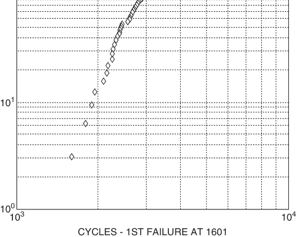

### 图2.10 HALT结果——32个FPGA器件中有30个失效（Hofmeister等人，2006年）

现在，假设一个预测目标，例如一个附着在纤维树脂（FR-4）印刷线路板（PWB）上的FPGA（以前有时仍称为印刷电路板PCB），其运行使得在任何给定的24小时时间段内，温度从低于−40 °C变化到超过100 °C，并具有不同的升温速率、不同的高温保温时间、不同的降温速率和不同的低温保温时间。还假设在任何给定的24小时时间段内，PWB承受不同大小和不同速率的振动与冲击（例如可能因安装在车辆发动机舱内而经历的情况）。此外，假设PWB包含十多个不同的FPGA，其中一些使用标准PbSn焊料，一些使用无铅焊球，一些使用带或不带staking的塑料栅格阵列（PGA）芯片封装，一些使用陶瓷柱栅格阵列（CCGA）；所有这些都安装在距离最大应力-应变中心不同距离的位置上。要高度准确地估计特定FPGA的主时钟输入引脚何时会失效，并因此导致PWB失效，是一项艰巨的任务（Javed，2014年）。

## 2.2.6 失效分布

当分布模型中的自变量变化时，给定曲线的变化率也随之变化，从而产生一族失效曲线，其失效分布具有一个TTF（失效时间），如图2.11所示。失效分布是一种概率密度函数（PDF），而TTF是该PDF的累积分布函数（CDF）的期望值或0.50值：请注意，TTF与MTTF不是同一个实体——有关此主题的更多内容将在第7章中介绍。

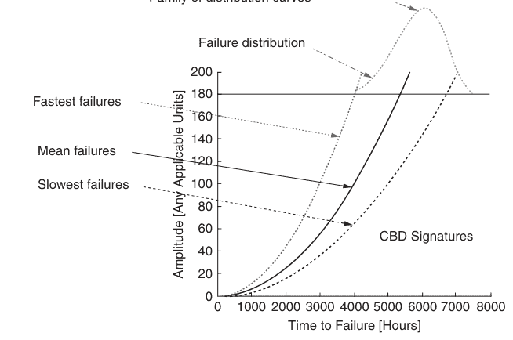

### 图2.11 失效曲线族、失效分布和TTF

## 2.2.7 多种失效模式：失效率和FIT

当预测目标容易出现不止一种主导失效模式时，必须在PoF（失效物理）方法中使用多个分布模型和/或多参数模型。例如，一个晶体管器件可能因温度循环而失效，也可能因与高电压相关的失效而失效。此时可应用两种分布模型：阿伦尼乌斯温度模型，式(2.7)；以及Kemeny分布，式(2.8)。一种简化的方法是假设所有失效都是随机的，并且所有失效模式同等主导。可以通过应用失效率求和模型和改进的AF来计算总体MTTF和失效率（FIT）值，以考虑使用和测试两种不同温度，如式(2.9)所示。1 FIT等于10亿个部件小时内发生1次失效（White和Bernstein，2008年）：

$$\text{Failure rate} = \lambda = \frac{\text{number of failures}}{(\text{number of tested parts})(\text{hours of test}) \cdot AF} \cdot 10^9\ \text{FIT} \tag{2.15}$$

## 2.2.8 基于模型的预测的优势与劣势

基于模型的预测有许多优势，包括以下几点：(i) 这种建模有助于更好地理解预测目标（尤其是器件）如何因制造工艺和材料中的缺陷和弱点而失效，以及它们如何以及为何因载荷和环境应力与应变而失效；(ii) 可以改进制造工艺、材料、电气和物理设计以及运行载荷和环境条件的控制，以提高可靠性；(iii) 可以简单地估计健康状态（SoH）和剩余使用寿命（RUL）。

基于模型的预测也有许多劣势，包括以下几点：(i) 对单模式失效之外的失效进行建模是复杂的；(ii) 简单的模型用于


非稳态以及多变且可变的环境载荷通常不存在；(iii) 对由数百或数千个不同部件组成的复杂大型系统进行建模变得极其困难，如果不是在计算上不可行；而且，或许最重要的是，(iv) 基于模型的方法不适用于系统中的特定预测目标，如图 2.11 所示：例如，MTTF 适用于同类预测目标的总体，而不适用于在特定系统、运行的非测试环境中部署的特定预测目标。

## 2.3 数据驱动预测

数据驱动（DD）预测（图 2.12）包含两种主要方法，即统计方法和机器学习（ML），它们使用采集的数据以统计和概率的方式产生预测信息，如决策、估计和预测。统计方法包括参数法和非参数法；ML 方法包括监督和无监督分类与聚类，以及回归和排序（Pecht 2008）。本书不讨论回归和排序。

### 2.3.1 统计方法

统计方法可分为参数法和非参数法（Pecht 2008），包括表 2.5 所示的方法。

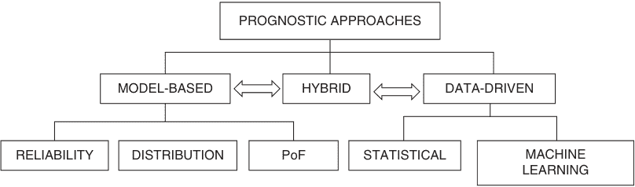

**图 2.12** 数据驱动方法的示意图。

**表 2.5** 参数法和非参数法。

| 参数技术 | 非参数技术 |
|---|---|
| 最大似然（MLE） | K-最近邻分类器（kNN） |
| 似然比检验（LRT） | 核密度估计（KDE） |
| 最小均方误差（MSE） | 卡方检验（CST） |
| 最大后验估计（MAP） |  |

#### 最大似然法

最大似然法（Ross 1987）是估计概率分布未知参数的常用方法。如第 1.4 节所述，设 \( f(t \mid \theta) \) 表示概率密度函数，其中 \( \theta \) 未知。假设我们从该分布中获得一个随机样本 \( t_1, t_2, \dots, t_N \)。似然函数定义为

$$
L(\theta) = f(t_1 \mid \theta) f(t_2 \mid \theta) \cdots f(t_N \mid \theta)
$$
(2.16)

它表示实际发生的抽样事件的概率。由于对数函数是严格递增的，因此不是最大化 \( L(\theta) \)，而是最大化其对数：

$$
\text{Maximize } \ln(L(\theta))
$$
(2.17)

并将最优 \( \theta \) 值作为未知参数的估计值接受。

**例 2.7**  
假设分布为 Weibull 分布，其中 \( \beta \) 的值已知而 \( \eta \) 的值未知。我们在第 1 章讨论过

$$
f(t \mid \beta, \eta) = \frac{\beta}{\eta} \left(\frac{t}{\eta}\right)^{\beta-1} e^{-(t/\eta)^\beta}
$$

因此

$$
L(\eta) = \frac{\beta^N}{\eta^{N\beta}} \left(\prod_{i=1}^N t_i\right)^{\beta-1} e^{-\eta^{-\beta} \sum_{i=1}^N t_i^\beta}
$$

所以

$$
l(\eta) = \ln(L(\eta)) = N \ln(\beta) - N\beta \ln(\eta) + (\beta-1) \ln\left(\prod_{i=1}^N t_i\right) - \eta^{-\beta} \sum_{i=1}^N t_i^\beta
$$

通过求导，

$$
\frac{\partial}{\partial \eta} l(\eta) = -\frac{N\beta}{\eta} + \beta \eta^{-\beta-1} \sum_{i=1}^N t_i^\beta
$$

因此，一阶条件可写为

$$
-\frac{N\beta}{\eta} + \frac{\beta}{\eta^{\beta+1}} \sum_{i=1}^N t_i^\beta = 0
$$

表明

$$
\eta = \left(\frac{1}{N} \sum_{i=1}^N t_i^\beta\right)^{1/\beta}
$$
(2.18)

#### 似然比检验

似然比检验（Casella and Berger 2002）通常用于确定估计的有效性。例如，设 \( \theta_0 \) 为概率密度函数 \( f(t \mid \theta) \) 的未知参数的估计值。似然比检验基于似然比

$$
r = \frac{L(\theta_0)}{\max_{\theta} L(\theta)}
$$
(2.19)

其中似然函数用 \( L(\theta) \) 表示，分母为 \( L(\theta) \) 的最大值。在其他情况下，比较两个估计值。设 \( \theta_1 \) 和 \( \theta_2 \) 为 \( \theta \) 的两个估计值；则

$$
r = \frac{L(\theta_1)}{L(\theta_2)}
$$
(2.20)

如果 \( r \) 的值很小，则在第一种情况下 \( \theta_0 \) 是不可接受的，在第二种情况下 \( \theta_2 \) 是更好的估计值。

**例 2.8**  
假设指数分布，参数为 \( \lambda \)，样本元素为 \( t_1, t_2, \dots, t_N \)。则

$$
f(t \mid \lambda) = \lambda e^{-\lambda t}
$$

所以

$$
L(\lambda) = \lambda e^{-\lambda t_1} \lambda e^{-\lambda t_2} \cdots \lambda e^{-\lambda t_N} = \lambda^N e^{-\lambda \sum_{i=1}^N t_i}
$$

因此，在比较两个估计值 \( \lambda_1 \) 和 \( \lambda_2 \) 时，似然比检验可写为

$$
r = \frac{\lambda_1^N e^{-\lambda_1 \sum_{i=1}^N t_i}}{\lambda_2^N e^{-\lambda_2 \sum_{i=1}^N t_i}} = \left(\frac{\lambda_1}{\lambda_2}\right)^N e^{(\lambda_2 - \lambda_1) \sum_{i=1}^N t_i}
$$
(2.21)

由式 (2.20) 得。

#### 最小均方误差

最小均方误差主要用于拟合具有未知参数的函数形式。例如，从样本中获得密度直方图，其点为 \( (t_1, f_1), (t_2, f_2), \dots, (t_N, f_N) \)，并且已知相应的概率密度函数为 \( f(t \mid \theta) \)。\( \theta \) 的最小二乘估计通过最小化总体平方误差获得：

$$
Q = \sum_{i=1}^N \left[ f(t_i \mid \theta) - f_i \right]^2
$$
(2.22)

**例 2.9**  
假设 \( f(t \mid \theta) = \theta e^{-\theta t} \)；则

$$
Q = \sum_{i=1}^N \left( \theta e^{-\theta t_i} - f_i \right)^2
$$
(2.23)

一阶条件可写为

$$
\frac{\partial Q}{\partial \theta} = 2 \sum_{i=1}^N \left( \theta e^{-\theta t_i} - f_i \right)\left( e^{-\theta t_i} - \theta t_i e^{-\theta t_i} \right) = 0
$$

这是一个非线性方程，可通过标准方法求解。

#### 最大后验估计

最大后验估计（Stein et al. 2002）基于贝叶斯原理。再次考虑依赖于未知参数 \( \theta \) 的概率密度函数 \( f(t \mid \theta) \)。似然函数为 \( L(\theta) \)，最大化以获得 \( \theta \) 的最佳估计。在实际情况下，通常最大化其对数。现在假设 \( \theta \) 的先验分布已知，其概率密度函数为 \( g(\theta) \)。根据贝叶斯定理，

$$
L(\theta \mid t_1, \dots, t_N) = \frac{L(\theta) g(\theta)}{\int L(\bar{\theta}) g(\bar{\theta})\, d\bar{\theta}}
$$
(2.24)

其中积分域为 \( \theta \) 的所有可能值的域。由于分母与 \( \theta \) 无关，我们只需优化 \( L(\theta) g(\theta) \)。

**例 2.10**  
假设正态分布，参数为 \( \mu \) 和 \( \sigma^2 \)，其中 \( \sigma^2 \) 已知且仅 \( \mu \) 未知。则

$$
L(\mu) = \prod_{i=1}^N \frac{1}{\sigma \sqrt{2\pi}} e^{-\frac{(t_i-\mu)^2}{2\sigma^2}}
$$

根据统计学，正态分布是其共轭先验，因此我们可以选择

$$
g(\mu) = \frac{1}{\bar{\sigma} \sqrt{2\pi}} e^{-\frac{(\mu-\bar{\mu})^2}{2\bar{\sigma}^2}}
$$

因此

$$
L(\mu) g(\mu) = \frac{1}{\bar{\sigma} \sqrt{2\pi}} e^{-\frac{(\mu-\bar{\mu})^2}{2\bar{\sigma}^2}} \prod_{i=1}^N \frac{1}{\sigma \sqrt{2\pi}} e^{-\frac{(t_i-\mu)^2}{2\sigma^2}}
$$

可以最大化。其对数等于

$$
-\ln(\bar{\sigma} \sqrt{2\pi}) - \frac{(\mu-\bar{\mu})^2}{2\bar{\sigma}^2} - N\ln(\sigma) - N\ln(\sqrt{2\pi}) - \sum_{i=1}^N \frac{(t_i-\mu)^2}{2\sigma^2}
$$

这是在 \( \mu \) 中凹函数，其导数具有特殊形式

$$
\frac{-2(\mu-\bar{\mu})}{2\bar{\sigma}^2} + \sum_{i=1}^N \frac{2(t_i-\mu)}{2\sigma^2}
= \frac{1}{\bar{\sigma}^2 \sigma^2} \left\{ -\sigma^2(\mu-\bar{\mu}) + \bar{\sigma}^2 \left( \sum_{i=1}^N t_i - N\mu \right) \right\}
$$

给出解

$$
\mu = \frac{\sigma^2 \bar{\mu} + \bar{\sigma}^2 \sum_{i=1}^N t_i}{\sigma^2 + N \bar{\sigma}^2}
$$
(2.25)

#### K-最近邻分类器

kNN 分类器（Cover and Hart 1967）基于以下简单过程。假设我们有 \( N \) 个向量；每个向量都附带一个类别标签。我们需要将给定的向量放入最合适的类别。我们选择一个正整数 \( k \ge 1 \) 并使用任意距离度量，例如欧几里得距离，从给定的 \( N \) 个向量中确定 \( k \) 个最近的向量。然后选出的 \( k \) 个最近向量通过选择 \( k \) 个最近向量中出现次数最多的类别来“投票”决定类别。通过这种方式，我们可以根据给定的样本将任意一组向量划分为给定类别。

在二维情况下，向量 \( (x_c, y_c) \) 和 \( (x_i, y_i) \) 的欧几里得距离为：

$$
D_i = \sqrt{(x_c - x_i)^2 + (y_c - y_i)^2}
$$
(2.26)

欧几里得距离基于毕达哥拉斯定理。如果维度大于二，设为 \( n \)，则类似地

$$
D_i = \sqrt{\sum_{j=1}^n \left( x_c^{(j)} - x_i^{(j)} \right)^2}
$$
(2.27)

其中向量 \( \boldsymbol{x}_c \) 的分量为 \( x_c^{(j)} \)，向量 \( \boldsymbol{x}_i \) 的分量为 \( x_i^{(j)} \)。

#### 核密度估计

该方法基于以下方程：

$$
p(x) = \frac{1}{Nh} \sum_{i=1}^N K\left( \frac{x - x_i}{h} \right)
$$
(2.28)

可以解释如下（Wand and Jones 1995）。设 \( x_1, x_2, \dots, x_N \) 为样本元素。选择一个核函数 \( K(x) \)，它是非负的且积分值为一（如任何概率密度函数的性质）。还选择一个参数 \( h > 0 \)，称为带宽。然后式 (2.28) 给出在点 \( x \) 处样本所生成的概率密度函数的估计值。表 2.6 给出了常用核函数的集合。

**表 2.6** 核函数。

| 核 | K(x) | 定义域 |
|---|---|---|
| 均匀 | 1/2 | (−1, 1) |
| 三角 | 1 − \|x\| | (−1, 1) |
| Epanechnikov | 3/4 (1 − x²) | (−1, 1) |
| 四次 | 15/16 (1 − x²)² | (−1, 1) |
| 三权重 | 35/32 (1 − x²)³ | (−1, 1) |
| 高斯 | (1/√(2π)) e^(−x²/2) | (−∞, ∞) |
| 余弦 | (π/4) cos(πx/2) | (−1, 1) |

#### 卡方检验

卡方检验（Ross 1987）用于检验给定样本是否来自具有特定分布的总体，因此它不提供分布；它只能用于检查用户选择的分布是否合适。


隐藏变量的线性组合：

\[
\begin{aligned}
g(y_1) &= \bar{w}_{11} z_1 + \bar{w}_{21} z_2 \\
g(y_2) &= \bar{w}_{12} z_1 + \bar{w}_{22} z_2 \\
g(y_3) &= \bar{w}_{13} z_1 + \bar{w}_{23} z_2
\end{aligned}
\tag{2.32}
\]

在式 (2.30) 和 (2.32) 中，系数 \(w_{ij}\) 和 \(\bar{w}_{ij}\) 为未知数，其取值由使 resulting 输入/输出关系

\[
g(y_j) = \bar{w}_{1j} \sum_{i=1}^{3} w_{1i} f(x_i) + \bar{w}_{2j} \sum_{i=1}^{3} w_{2i} f(x_i)
\]

与测量的输入和输出数据拟合最佳来确定。

假设我们有 \(N\) 个输入-输出数据集：

\[
(x_1^{(k)}, x_2^{(k)}, x_3^{(k)}, y_1^{(k)}, y_2^{(k)}, y_3^{(k)}) \qquad (k = 1, 2, \ldots, N)
\]

则类似于最小二乘法，整体拟合以

\[
Q = \sum_{k=1}^{N} \left[ g(y_j^{(k)}) - \bar{w}_{1j} \sum_{i=1}^{3} w_{1i} f(x_i^{(k)}) - \bar{w}_{2j} \sum_{i=1}^{3} w_{2i} f(x_i^{(k)}) \right]^2
\tag{2.33}
\]

为度量达到最小，其中未知数是 \(w_{ij}\) 和 \(\bar{w}_{ij}\) 值。优化可以通过使用软件包或使用反向传播等特殊神经网络算法来完成。

在实际情况下，选择神经网络的结构（隐藏层的数量及其上的节点数），并确定权重 \(w_{ij}\) 和 \(\bar{w}_{ij}\)。

对于优化，通常只使用数据集的一半；另一半随后用于验证，此时 \(Q\) 是基于未用于确定权重的数据计算的。如果 \(Q\) 足够小，则接受网络的结构和权重；否则，选择新的结构（增加新的隐藏层和/或增加节点），并重复该过程。权重的最佳选择通常称为网络的训练。

## 支持向量机

支持向量机（Cortes and Vapnik 1995）可描述为两组向量的情况。假设有 \(N\) 个训练数据点 \((\mathbf{x}_1, y_1), \ldots, (\mathbf{x}_N, y_N)\)，其中 \(y_i = +1\) 或 \(-1\)，表示向量 \(\mathbf{x}_i\) 所属的类别。目标是找到一个最大间隔超平面，将数据集 \((\mathbf{x}_i, y_i)\) 分为两组。在其中一个组中，\(y_i = +1\)；在另一个组中，\(y_i = -1\)。超平面被选择使得超平面与任一组中最接近的点之间的距离最大化。如果训练向量是线性可分的，则存在一个向量 \(\mathbf{w}\) 使得超平面 \(\mathbf{w}^T \mathbf{x} + b = 0\) 满足以下性质：

\[
\mathbf{w}^T \mathbf{x}_i + b \ge 1 \quad \text{if } y_i = 1
\]

\[
\mathbf{w}^T \mathbf{x}_i + b \le -1 \quad \text{if } y_i = -1
\]

这些关系可以概括为

\[
y_i(\mathbf{w}^T \mathbf{x}_i + b) \ge 1 \quad \text{for all } i = 1, 2, \ldots, N
\tag{2.34}
\]

为了最大化超平面 \(\mathbf{w}^T \mathbf{x}_i + b = 1\) 和 \(\mathbf{w}^T \mathbf{x}_i + b = -1\) 之间的距离，我们需要最小化 \(\mathbf{w} = (w_i)\) 的长度：

\[
D = \sqrt{\sum w_i^2}
\tag{2.35}
\]

受约束 \(y_i(\mathbf{w}^T \mathbf{x}_i + b) \ge 1\) 的限制。向量 \(\mathbf{w}\) 和标量 \(b\) 定义分类器为

\[
\mathbf{x} \rightarrow \operatorname{sign}\{\mathbf{w}^T \mathbf{x} + b\}
\]

最接近分离超平面的向量称为 *支持向量*。

## 决策树分类器

决策树分类器技术（Rokach and Maimon 2008）基于包含测试问题和条件的逻辑树。该过程使用关于测试记录的属性的一系列精心选择的问题。根据对一个问题的回答，会提出一个精心选择的后续问题；根据回答，要么提出新的问题，要么过程以关于对象所属类别的决策终止。一个典型的日常例子是医生向病人提出的一系列问题以做出正确的诊断。

## 朴素贝叶斯分类器

朴素贝叶斯分类器技术（Webb et al. 2005）也基于 \(m\) 个类别 \(C_1, \ldots, C_m\)。属性向量 \(\mathbf{x}\) 属于类别 \(C_i\) 当且仅当对于条件概率，

\[
P(C_i|\mathbf{x}) > P(C_j|\mathbf{x})
\tag{2.36}
\]

对所有 \(j \ne i\) 成立。根据贝叶斯定理

\[
P(C_i|\mathbf{x}) = \frac{P(\mathbf{x}|C_i)P(C_i)}{P(\mathbf{x})}
\]

并且由于 \(P(\mathbf{x})\) 与类别无关，最优类别 \(C_i\) 通过最大化

\[
P(\mathbf{x}|C_i)P(C_i)
\tag{2.37}
\]

来选择。\(P(C_i)\) 的值通常取为属于类别 \(C_i\) 的样本向量的相对频率。朴素贝叶斯分类器假设类别条件独立性为

\[
P(\mathbf{x}|C_i) = \prod_k P(x_k|C_i)
\]

其中向量 \(\mathbf{x}\) 的分量为 \(x_k\) 值。

## 隐马尔可夫链

隐马尔可夫链（Ghahramani 2001）是前面在例 2.1 中说明的有限马尔可夫链的概率扩展。状态是未知的，但除了状态转移矩阵之外，还为其分配某些概率值。状态不能直接观察，但会针对每个状态可能产生输出的输出进行观察，其概率各不相同。这种马尔可夫模型称为 *隐*：由于状态是隐藏的，只能观察到其输出。

## 主成分分析

PCA（Jolliffe 2002）是一种统计方法。假设有 \(N\) 个向量，它们通常彼此密切相关。该技术使用线性变换将观测集合转换为一组线性不相关的变量集合，称为主成分。该方法在数学上基于矩阵分析的思想。

## 独立成分分析

独立成分分析（Stone 2004）是一种从多元或多维数据中寻找潜在因子或成分的程序。设随机变量的观测值表示为 \(x_1(t), x_2(t), \ldots, x_N(t)\)。该方法找到一个矩阵 \(M\) 和变量 \(y_j(t)\) 使得

\[
\mathbf{y} = M\mathbf{x}
\tag{2.38}
\]

其中 \(\mathbf{y}\) 和 \(\mathbf{x}\) 的分量分别为 \(y_j\) 和 \(x_i\)。目标是找到最小数量的独立成分 \(y_j\)。

## 基于 HMM 和基于 SVN 的方法

基于 HMM 的方法（Ghahramani 2001）和基于支持向量网络 SVN 的方法（Cortes and Vapnik 1995）都常用于无监督 ML。

## 粒子滤波

粒子滤波（Andrieu and Doucet 2002）是一种基于大量样本的顺序蒙特卡洛方法。当样本元素数量趋于无穷时，PDF 的估计收敛于真实值。

## 层次分类器

KNN 过程非常接近一种众所周知的聚类算法，有时称为层次分类器（Alpaydin 2004）。假设我们有 \(N\) 个向量并希望将其组织成 \(k\) 个簇，其中同一簇内向量的距离需要尽可能小。在初始步骤中，每个向量都是一个单元素簇。在每个后续步骤中，簇的数量减少一个，直到达到所需簇的数量为止。每个簇由其元素的代数平均值表示，然后确定这些平均向量的距离。选择两个最接近的平均值，并合并其簇。这样，我们在每一步中都会少一个簇。

## 模糊 C 均值分类器

模糊 C 均值分类器方法（Bezdek et al. 1999）允许每个数据点属于两个或多个簇。设 \(x_1, \ldots, x_N\) 为数据集，\(u_{ij}\) 表示数据向量 \(x_i\) 属于簇 \(j\)（\(j = 1, 2, \ldots, K\)）的隶属度。隶属度值通过以下迭代过程确定：

- Step 1: 选择初始的 \(u_{ij}\) 值，\(u_{ij}(0)\)。
- Step 2: 在每个后续步骤 \(k\) 中，计算每个簇的中心向量为

\[
c_j = \frac{\sum_{i=1}^{N} u_{ij(k)}^m x_i}{\sum_{i=1}^{N} u_{ij(k)}^m}
\]

**表 2.8** 基于模型和数据驱动的预测的某些优点和缺点。

| Model-based prognostics | Data-driven prognostics |
|---|---|
| **Advantages** |  |
| High precision compared to data-driven | Less dependence on material and electrical properties |
| Deterministic | Low cost of design and development |
| Thresholds can be defined and related to performance measures such as stability | Easier to apply to complex systems |
| Useful for evaluating performance of materials and electrical properties |  |
| **Disadvantages** |  |
| Difficult to apply to complex systems | Lower precision compared to model-based |
| High cost of design and development | non-deterministic |
| Complexity and variability of model parameters related to material and electrical properties of materials | Not useful for evaluating performance of material and electrical properties of prognostic targets |

需要计算系统 RUL。第二阶段包括使用模型和阈值来检测故障的开始，评估系统 SoH 的状态，并预测未来的 SoH 和 RUL。模型经过验证并拟合到旨在模拟实际使用条件的生活基和应力基实验和测试的数据。随后开发传感器并用于收集现场系统的现场数据，以监控和管理这些系统的健康状况（Medjaher and Zerhouni 2013）。

混合方法的优点是相对精度高于仅使用基于模型的方法所能达到的精度，也高于仅使用数据驱动方法所能达到的精度（图 2.15）。当 PoF 基于模型适应传感器数据并且适应后的模型用于产生预测信息时尤其如此。缺点是模型适应传感器数据的复杂性增加。

**图 2.15** PHM 方法的相对比较 – PoF、数据驱动和混合。

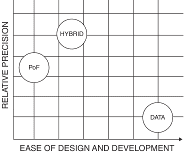


## 2.5 基于状态维护（CBM）的一种方法

现代的具备预测功能的系统包括 (i) 用于支持预测的预测方法 和 (ii) 健康管理。在此类系统中，预测使能服务感知、收集和处理基于状态的数据（CBD）以提供预测信息；健康管理服务则利用该预测信息进行预测，以做出与维护和服务相关的决策并发布指令：CBM。其主要能力如下：先进的诊断以检测故障的先行指标，先进的预测以预测剩余使用寿命 RUL，以及先进的维护和后勤以管理系统的健康状况（Hofmeister et al. 2013；IEEE 2017）。

一种 CBM 方法是将 CBD 用作传统模型的输入，例如 PoF 和可靠性，以产生与特定预测目标更密切相关的预测信息。这种方法仍然存在困难，尤其包括以下几点：建模的复杂性；开发、验证和鉴定模型所需的时间和成本；以及模型倾向于对特定环境和使用条件敏感。

CBM 的另一种方法是使用 CBD 特征的建模，而不是例如对预测目标进行 PoF 或可靠性建模。需要注意的是，传统建模，如 PoF，仍然是分析 CBD 的重要工具：理解和选择用于预测使能的特征和先行指标。

### 2.5.1 基于状态数据（CBD）特征的建模

基于 CBD 特征的 CBM 替代方法的示例如图 2.16 所示。传感器框架感知、收集并传输传感器输出数据到特征向量框架，后者执行数据处理，如数据调理、数据融合和数据转换，将 CBD 转换为故障进展特征：故障到失效进展（FFP）特征数据、退化进展特征（DPS）数据和功能失效特征（FFS）数据。

这些特征中的任何一个都可作为预测框架的输入，以产生诸如 RUL 估计、预测视界（PH）和健康状态 SoH 等预测信息，供健康管理框架处理，以便对系统的健康状况做出智能决策，并启动、管理并完成服务、维护和后勤活动，以维持健康并确保系统在功能规范内运行。

### 2.5.2 方法比较：寿命消耗与 CBD 特征

一种常见的基于模型的 PHM 方法是由马里兰大学帕克分校先进生命周期工程中心（CALCE）定义的寿命消耗方法。如图 2.17 中的简化图所示，该基于模型的方法（Pecht 2008）与使用 CBD 特征模型（Hofmeister et al. 2013）相似但不同。主要差异（见表 2.9）与建模和数据的差异有关：建模使用 (i) 物理、可靠性 和/或 统计建模 或 (ii) 基于经验数据——CBD 特征的建模；以及数据使用 (i) 环境、使用和运行数据，如电压、电流、

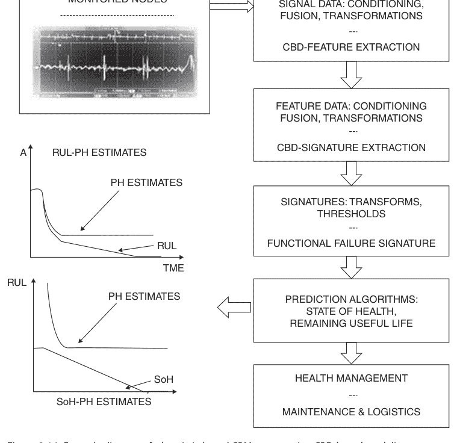

图 2.16 使用基于 CBD 的建模的启发式 CBM 系统示例图。

和温度 或 (ii) CBD 特征，在节点处使用环境、使用和运行数据来调理特征数据。

### 2.5.3 CBD-特征建模：一个例证

如图 2.18 所示的开关模式电源（SMPS）用于说明 CBD 特征的建模，并对电路或组件进行分析，在本例中为 SMPS 的输出滤波器。输出滤波器也已简化：例如，排除了反馈环、二极管和高频噪声滤波器等组件和子电路。此外，滤波器进一步简化为将电感、电容和电阻合并为三个无源元件（L1、C1 和 RL）。

示例备份与设置

假设要求你对 SMPS 进行预测使能，并且已知该电源因输出滤波器中使用的钽氧化物电容器故障而具有较高的故障率。故障和维修信息显示，电容器先短路然后烧断。短路故障导致电流升高，产生过载条件从而关闭 SMPS——但与此同时，损坏仍在继续，电容器烧断。随后，维护人员判定为无故障发现（NFF）/无法复现（CND）维修状况。SMPS 测试正常——在负载条件下，直流输出电压、纹波电压、噪声水平和电源的调节均在规格范围内。进一步拆卸电路卡组件（CCA）——一个封闭的金属框架——后检查，发现物理证据以颜色和气味的形式显示 22 个并联电容器中的 1 个已失效。拆卸（去焊）和测试电容器证实电容器已烧断，这降低了输出滤波器中的有效总电容。

此外假设客户对 SMPS 的预测使能规范包括以下要求：（i）预测系统应在功能失效前至少 200 个运行日检测到退化；以及（ii）预测系统应提供 RUL 估计，该估计应在功能失效发生前至少 72 个运行日、±2 天收敛到 5% 的精度内。功能失效定义为对象，如电源，不再在规格范围内运行的损坏程度。

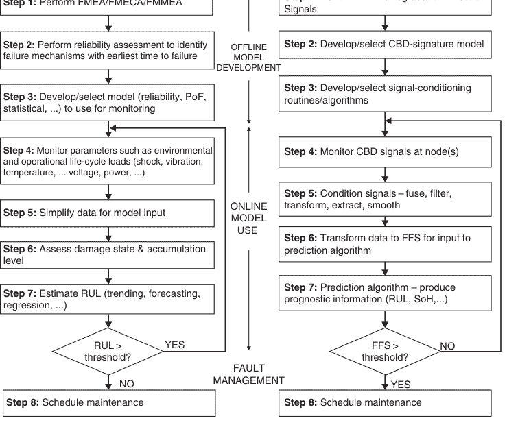

图 2.17 基于模型的方法与 CBD-特征方法对 PHM 的图示比较。

## 表 2.9 基于模型方法和启发式方法对 PHM 的关注点差异。

| 步骤 | 基于模型关注点 | 启发式关注点 |
|---|---|---|
| 1 | 识别失效模式、失效影响分析。 | 识别失效模式、失效影响分析；识别构成故障先行指标的节点和特征。 |
| 2 | 识别具有最早失效时间的失效模式。 | 表征与失效模式相关的特征的基本曲线。 |
| 3 | 开发用于预测失效时间的模型。 | 开发将 CBD 特征转换为故障到失效（FFP）退化进展特征（DPS）数据然后进一步转换为功能失效特征（FFS）数据的算法。 |
| 4 | 监测环境、使用和运行负载：模型输入。 | 监测信号：模型输入；根据需要监测选定的环境、使用和运行负载以调理信号。 |
| 5 | 简化和调理数据以供模型输入。 | 调理和转换数据。使用环境、使用和运行数据来调理数据而不是作为模型输入。 |
| 6 | 评估状态和累积损坏的程度。 | 使用 FFS 检测损坏并作为预测算法的输入。 |
| 7 | 产生预测信息。 | 相同 |
| 8 | 执行故障管理。 | 相同 |

## 图 2.18 具有输出滤波器的开关模式电源（SMPS）简化图。

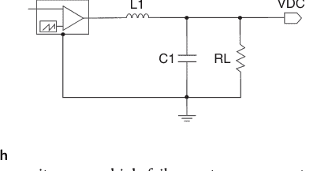

## 可靠性建模方法的评估

你恰好知道钽氧化物电容器是 SMPS 中故障率高的元件。PoF 分析显示，由电压和温度老化效应引起的以下主导失效模式：(i) 电容（C）、(ii) 耗散因子（DF）和 (iii) 绝缘电阻（IR）的变化（Alan et al. 2011）。IR 损失包括突发性雪崩失效，例如当 IR 下降到足够低以致漏电流升高到足以产生熔化电容器与封装外部引线连接的焊料的热量时发生。

## 示例 2.11 对于 IR 失效模式，以下统计分布模型可用于 MTTF 作为工作电压和温度的函数（Alan et al. 2011；Prokpowicz and Vaskas 1969）。

```
MTTF = (C / V^n) exp(E_a / kT)    (2.39)
```


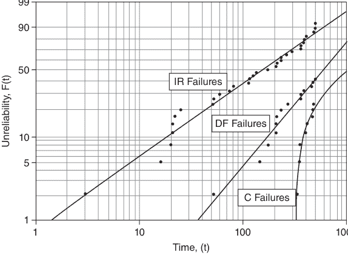

**图 2.19** 三种电容器失效模型的不可靠性图（Alan 等，2011）。

该公式是第 1 章中引入的温度-非热关系的一个特例，当时我们在通式中选择电压为 *U*，温度为 *V*，*Eₐ/k* 为 β。电压指数（*n*）和激活能（*Eₐ*）的值各不相同，且高度依赖于实验设置、材料以及制造电容器的物理结构。这很可能就是该模型以及其他用于 *C* 和 *DF* 变化的模型面临一个主要困难的原因，即存在很大的不确定性（建模的不可靠性），如图 2.19 所示。

使用式 (2.39) 模型的不可靠性可能源于模型中参数数量有限。如果使用一个考虑开关频率、工作温度、湿度、负载电流、输出电压中开关引起的尖峰等因素的模型，不确定性可能会得到改善。更确切地说（并且可能更准确），对 *L* 和 *R* 也可以采用类似的处理方式；并且由于 *R* 包含负载等因素：*显而易见，要建立一个精确、高精度的 PoF 和/或统计模型来预测某一实际现场使用中的电源其输出滤波器电容的失效时间是不切实际的，因为开发和验证该模型过于复杂且成本过高。*

也许更重要的是，对复杂系统进行传统建模的复杂性在计算上变得难以处理。

## 电容器失效的马氏距离建模

一种数据驱动的电容器失效建模方法是使用马氏距离（MD）方法，该方法在数据标准化后利用相关技术将多个参数降为单一参数。MD 值是在输入数据与代表健康状态的基线之间计算的，用于检测异常，具体如下（Alan 等，2011）。

假设我们有 *n* 个向量，每个向量有 *m* 个分量，每个分量代表一个参数。设 (*xᵢ₁, xᵢ₂, …, xᵢₘ*) 表示第 *i* 个向量。第 *k* 个参数的均值为

$$m_k=\frac{1}{n}\sum_{i=1}^{n}x_{ik}$$  (2.40)

第 $k^{th}$ 个参数的标准差类似地

$$s_k^2=\frac{1}{n-1}\sum_{i=1}^{n}(x_{ik}-m_k)^2$$  (2.41)

因此 $x_{ik}$ 的标准化值为

$$z_{ik}=\frac{x_{ik}-m_k}{s_k}$$  (2.42)

定义

$$Z_i=(z_{i1},z_{i2},\ldots,z_{im})$$

则标准化值的相关矩阵为

$$C=\frac{1}{n-1}\sum_{i=1}^{n}Z_iZ_i^T$$

最后，MD 值可通过下式获得

$$MD=\frac{1}{m}Z_iC^{-1}Z_i^T$$  (2.43)

其中 $T$ 表示转置。

MD 值不服从正态分布，需要通过 Box Cox 变换并最大化对数似然函数进一步转换。然而，在高度加速寿命试验中，MD 方法仅在 26 个样本中的 14 个中预测到了失效（Alan 等，2011）。即使准确度可以接受，仍然存在一些问题，例如如何预测电源因特定失效模式下电容损失而失效的时间。为解决这类问题，可以使用基于启发式的 CBD 建模，而不是传统模型。我们得出结论，无论是基于模型的方法还是数据驱动的方法，都可能无法满足分辨率、精度和预测准确度的要求。

还有其他技术可以将多个测量值缩减为单一健康指标。例如，多变量状态估计技术（Cheng 和 Pecht 2007）就是基于通过最小二乘法获得的样本向量的最佳健康估计。然而，也可以为样本向量及其估计值之间的距离选择其他度量。这些距离反映了 SoH，因为距离越小表示健康状况越好。其他例子包括自联想核回归（Guo 和 Bai 2011），一种基于核平滑的方法（Wand 和 Jones 1995），在第 2.3.1 节中讨论。在确定单一健康指标的序列后，生成的时间序列可用作本书所述所有流程的输入数据。

## CBD：噪声与特征

SMPS 的输出如图 2.20 顶部所示，噪声很大。它由直流电压（期望输出）加上各种形式的信号变化噪声组成

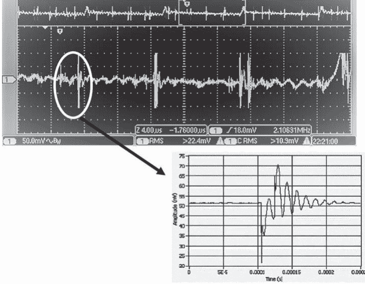

# 图 2.20 SMPS 输出示例。

包括以下内容：热噪声；纹波电压变化；开关噪声；谐波失真；以及对负载变化的响应，如阻尼振铃响应，图 2.20 底部所示为一个示例（Hofmeister 等，2017）。

噪声包含信息，当 CBD 中的噪声被适当隔离和调理后，失效的前兆指标可以作为特征数据（FD）提取出来。SMPS 输出节点上有用的 FD 包括但不限于纹波电压（幅度和频率）、开关幅度和频率，以及阻尼振铃响应中发现的其他特征。对一个电气系统中的组件、电路或组件板等对象进行预测使能的重要第一步是执行分析，如 PoF 和 FMEA，以识别与目标失效模式相关的感兴趣 FD。

## 示例 2.12 电路、PoF 和 FMEA 分析表明，所识别的失效模式应导致若干特征发生可测量的变化。在这些特征中，你决定关注纹波电压（幅度增大）和阻尼振铃响应中的谐振频率（f_R）增大，而不是衰减时间（1/τ）的变化或幅度（A_R）的变化；见图 2.21。

## CBD：预测要求

将所有可应用的 CBD 特征都选作签名中的 FD 是不符合成本效益的：你需要选择一个或多个 FD，以满足预测要求。重要要求包括：

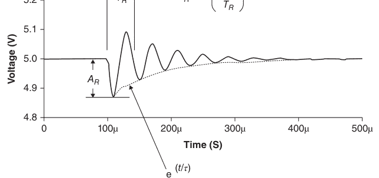

图 2.21 电路对突然刺激产生振铃响应的示例。

- 用于隔离、调理和提取一个或多个特征的传感器成本。成本包括传感器的重量、占用面积、功耗和可靠性。
- 传感器和 PHM 框架进行信号调理的成本。
- 预测距离（PD）：从检测到导致失效的损伤到功能失效发生的时间。功能失效定义为 SMPS 等对象不再在规格范围内运行时的损伤水平。
- 预测分辨率和未来可能发生功能失效的时间点的估计精度。
- 预测准确度（α）和 α-距离（PD_α）：RUL 和 SoH 的估计值必须在功能寿命结束（EoL）之前在此范围内收敛。

## 示例 2.13 假设客户对 SMPS 预测使能的规格要求如下：

- 预测系统应在功能失效前至少 200 个运行日检测到退化。
  - 你将其解释为最小 PH 必须等于 200 天的要求。与此相关的是你设计或选择传感器和数据调理算法的能力，以便在失效前提供足够的提前时间隔离 FD，并具有足够的噪声抑制和选择性。
  - 你还将其解释为以天为单位而非周或小时等作为所需的分辨率。
  - 你获得了客户确认。
- 预测系统应提供 RUL 估计值，该估计值应在功能失效前至少 72 个运行日（±2 天）内收敛至 5% 准确度以内。
  - 你将其解释为由于 ±2 天的精度要求，必须每天至少采样一次。
  - 你还将该规格解释为最小 PD_α 为 72 天的要求，且所有后续估计值均在 5% 准确度以内。
  - 你获得了客户确认。


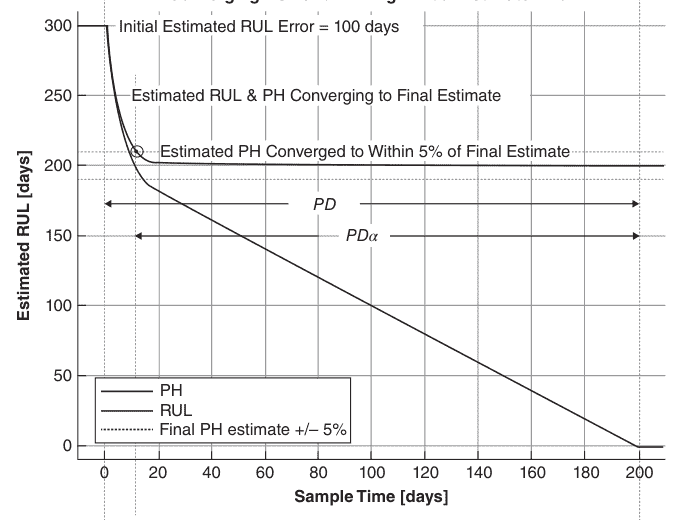

图 2.22 预后规范（PD 和 PDα）与 RUL 和 PH 的关系。

- 你创建一个图来说明 PD、PDα、RUL 和 PH 的关系（见图 2.22），并获得客户对预后规范相对于预后信息的解释的确认。

## CBD：测试床实验与效应分析

当你相当确定了解失效模式（问题）以及该失效对可测量信号的影响时，很可能你会得出结论，需要进行实验并执行进一步的效应分析。因此，你设计并搭建一个测试床，该测试床允许在示例 SMPS 中注入故障（滤波电容损失）。这样的测试床让你能够进行实验，以验证你对问题、可测量效应以及各种解决方案是否（或如何）满足预后要求的理解。

## 示例 2.14

很可能你会很快得出结论，使用纹波电压幅度作为 FD 是不令人满意的：有太多其他高幅度噪声源需要滤波和缓解。这促使你设计并开发一种原型方法，注入低功率的突变负载变化，从而使 SMPS 产生阻尼振荡响应：你的传感器可以隔离该响应、数字化，并使用数字信号处理（DPS）来提取 FD。

你使用 PoF 和 FMEA 来得出公式（2.44）的信号建模：存在直流分量（V_DC）；存在噪声（A_NOISE）；并且存在具有

## 节点 ID 4 的输入数据

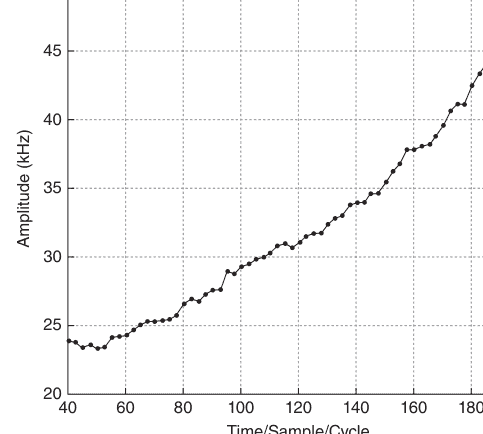

图 2.24 滤波电容退化时谐振频率的实验变化。

预测算法使用图形方法、类似卡尔曼的滤波方法以及随机游走求解方法，你对结果感到满意。

图 2.24 是 CBD 签名：频率的变化与退化（滤波电容损失）高度相关，可以用作输入到任何数量的预测算法中，以产生诸如 RUL 之类的预后信息。

## CBD：特征数据与退化函数

从推导公式（2.49）的结果出发，我们使用归纳分析建模方法陈述如下：

- 给定一个特征 FD，在没有退化的情况下其标称值为 FD₀，则
- 给定一个参数的退化，该参数在没有退化的情况下的值为 P₀，并且
- 设 dP 表示退化引起的 P₀ 值变化量，
- 那么给定特征的值是非退化特征值乘以参数变化的退化函数。

在公式（2.49）中，如果我们令 FD = ω，FD₀ = ω₀，P₀ = C₀ 且 dP = ΔC，则我们有

```
FD = FD₀ (1/√(1 − dP/P₀))
```

并且，一般而言，

```
FD = FD₀ f(dP, P₀) (2.50)
```

给定退化函数 f(dP, P₀) 的模型取决于，例如，退化的组件、失效模式和 PoF。这是一个重要结果，本书的后续章节将提供更多信息。

## 2.6 PHM 方法：总结

本章介绍了传统 PHM 方法的概述，包括基于模型的预后、数据驱动预后和混合驱动预后。基于模型的预后可能最准确，但它是最难应用于复杂系统的方法；数据驱动预后是最容易应用的方法，但也是最不准确的；混合驱动预后提供最大的准确性，也是最难应用的方法，尤其是在复杂系统上。CBD 方法用于 CBM 的简要介绍结束了本章：SMPS 的输出；从 CBD 的阻尼振荡响应中提取的有用 FD（谐振频率）的识别和选择；预后要求对运行要求和预后信息准确性的影响；以及用于辅助和验证 CBD 签名建模的测试床和仿真。一个重要结果是公式（2.50），它将签名变化与退化函数联系起来：

```
FD = FD₀ f(dP, P₀)
```

下一章将更详细地开发和描述该方法，并介绍将 CBD 签名转化为更适合由预测算法处理的签名的使用方法。

## 参考文献

Ahmed, W. and Wu, Y.W. (2013). Reliability prediction model of SOA using hidden Markov model. 8th China Grid Annual Conference, Changchun, China, 22–23 August.

Alan, M., Azarian, M., Osterman, M., and Pecht, M. (2011). Prognostics of failures in embedded planar capacitors using model-based and data-driven approaches. Journal of Intelligent Material Systems and Structures 22: 1293–1304.

Alpaydin, E. (2004). Introduction to Machine Learning. Cambridge, MA: MIT Press.

Andrieu, C. and Doucet, A. (2002). Particle filtering for partially observed Gaussian state space models. Journal of the Royal Statistical Society B 64 (4): 827–836.

Bezdek, J., Keller, J., Krishnapuram, R., and Pal, N. (1999). Fuzzy Models and Algorithms for Pattern Recognition and Image Processing. New York: Springer.

Casella, G. and Berger, R.L. (2002). Statistical Inference, 2e. Pacific Grove, CA: Duxbury.

Cheng, S. and Pecht, M. (2007). Multivariate state estimation technique for remaining useful life prediction of electronic products. Association for the Advancement of Artificial Intelligence. www.aaai.org.

Cortes, C. and Vapnik, V. (1995). Support-vector networks. Machine Learning 20 (3): 273–297.

Cover, T. and Hart, P. (1967). Nearest neighbor pattern classification. IEEE Transactions on Information Theory 13 (1): 21–27.

Czichos, H. (ed.) (2013). Handbook of Technical Diagnostics: Fundamentals and Application to Structures and Systems. Heidelberg/New York: Springer.

Faussett, L.V. (1994). Fundamentals of Neural Networks: Architecture, Algorithms and Applications. Upper Saddle River, NJ: Prentice Hall.

Fukunaga, K. (1990). Introduction to Statistical Pattern Recognition. San Diego, CA: Academic Press.

Ghahramani, Z. (2001). An introduction to hidden Markov models and Bayesian networks. Journal of Pattern Recognition and Artificial Intelligence 15 (1): 9–42.

Guo, P. and Bai, N. (2011). Wind turbine gearbox condition monitoring with AAKR and moving window statistic methods. Energies 4: 2077–2093.

Hofmeister, J., Goodman, D., and Wagoner, R. (2016). Advanced anomaly detection method for condition monitoring of complex equipment and systems. 2016 Machine Failure Prevention Technology, Dayton, Ohio, US, 24–26 May.

Hofmeister, J., Lall, P. and Graves, R. (2006). In-situ, real-time detector for faults in solder joint networks belonging to operational, fully programmed field programmable gate arrays (FPGAs). 2006 IEEE Autotest Conference, Anaheim, California, US, 18–21 September.

Hofmeister, J., Szidarovszky, F., and Goodman, D. (2017). An approach to processing condition-based data for use in prognostic algorithms. 2017 Machine Failure Prevention Technology, Virginia Beach, Virginia, US, 15–18 May.

Hofmeister, J. and Vohnout, S. (2011). Innovative cable failure and PHM toolset. MFPT: Applied Systems Health Management Conference, Virginia Beach, Virginia, US, 10–12 May.

Hofmeister, J., Vohnout, S., Mitchell, C. et al. (2010). HALT evaluation of SJ BIST technology for electronic prognostics. 2010 IEEE Autotest Conference, Orlando, Florida, US, 13–16 September.

Hofmeister, J., Wagoner, R., and Goodman, D. (2013). Prognostic health management (PHM) of electrical systems using conditioned-based data for anomaly and prognostic reasoning. Chemical Engineering Transactions 33: 992–996.

Hollander, M., Wolfe, D.A., and Chicken, E. (2014). Nonparametric Statistical Methods, 3e. Hoboken, NJ: Wiley.

IEEE. (2017). Draft standard framework for prognosis and health management (PHM) of electronic systems. IEEE 1856/D33.

Javed, K. (2014). A robust & reliable data-driven prognostics approach based on extreme learning machine and fuzzy clustering. Université de Franche-Comté, English, 21 July.

Jolliffe, I.T. (2002). Principal Component Analysis. New York: Springer.

Kentved, A. and Schmidt, K. (2012). Reliability – acceleration factors and accelerated life testing. Input to SEES meeting 2012-05-14. www.sees.se/$-1/file/delta-alt-sees-may-2012-ver-0.PDF.

Kumar, S. and Pecht, M. (2010). Modeling approaches for prognostics and health management of electronics. International Journal of Performability Engineering 6 (5): 467–476.

Lebold, M. and Thurston, M. (2001) Open standards for condition-based maintenance and prognostic systems. 5th Annual Maintenance and Reliability Conference (MARCON 2001), Gatlinburg, Tennessee, US, 6–9 May.

ManagementMania. (2017). ETA (event tree analysis) https://managementmania.com/en/eta-event-tree-analysis.

Medjaher, K. and Zerhouni, N. (2013). Framework for a hybrid prognostics. Chemical Engineering Transactions 33: 91–96. https://doi.org/10.3303/CET1333016.

National Science Foundation Center for Advanced Vehicle and Extreme Environment Electronics at Auburn University (CAVE3). (2015). Prognostics health management for electronics. http://cave.auburn.edu/rsrch-thrusts/prognostic-health-management-for-electronics.html (accessed November 2015).


