## 3 失效进展特征

### 3.1 失效特征简介

第2章介绍了用于故障预测与健康管理/监测（PHM）的三种经典预测方法：模型驱动、数据驱动和混合驱动。你还了解了基于使用和基于状态的方法。你学到了经典和基于使用的预测方法的主要缺点：它们不适用于系统中的特定预测目标，和/或它们是非确定性的，不适合应用于预测目标，和/或将它们适配到传感器数据是复杂的。你还学到了可以从传感器数据中提取失效的先行指标，并将其收集形成基于状态的数据（CBD）特征；对这种特征进行建模和处理是一种基于状态的维护（CBM）方法。图3.1展示了使用CBD特征的方法与经典PHM方法的关系；尽管框图表明这些方法不同，但基于状态的方法通常采用分析和建模技术，如可靠性建模、失效物理（PoF）分析和失效模式及影响分析（FMEA）（Hofmeister等，2013、2016、2017；Medjaher和Zerhouni，2013；Pecht，2008）。

### 3.1.1 本章目标

本章的主要目标是更深入地研究CBD特征，以及将这些特征转换为其他更适合作为输入提供给产生预测信息的预测算法的特征的期望性。这些其他特征是故障到失效的进展（FFP）特征、退化进展特征（DPS）和功能失效特征（FFS）。

次要目标是描述并展示这些特征如何用于可靠的基于状态的监测：检测退化的开始，监测因退化导致的损伤的不断增加，对损伤可能达到定义为功能失效的水平的时间进行预测估计，以及检测功能失效。

另一个目标是展示DPS数据和基于DPS的FFS相比CBD特征或FFP特征曲线的一个重要优势：前者更线性。本章将开发并提出一种量化基于FFP和基于DPS的FFS曲线的非线性的方法。

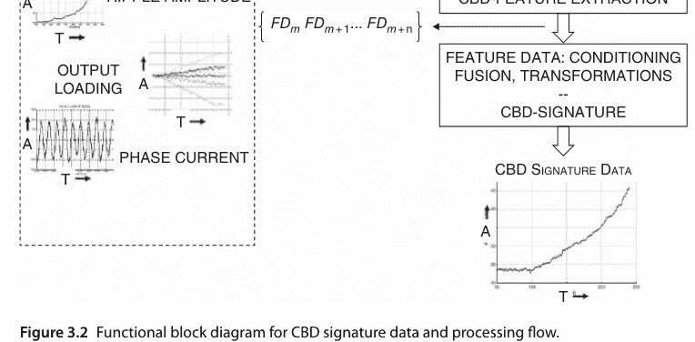

*图3.2 CBD特征数据和处理流程的功能框图。*

### 3.2.1 CBD特征

如图3.2所示，传感器位于预测关注节点，例如开关电源（SMPS）的输出端。该传感器设计用于捕获和处理CBD，例如图3.3所示，以支持FD的隔离和提取：失效的先行指标。隔离和提取特定FD值，例如SMPS对输出负载突变产生的阻尼振铃响应的谐振频率，几乎总是需要信号调理。信号调理包括但不限于以下内容：背景噪声和谐波滤波与抑制；将信号门控到特定的定时事件，以充分隔离感兴趣的特征；融合两个或多个信号，将两种数据类型转换为另一种数据类型——例如使用电压和电流信号计算阻抗；域变换，如时间-频率和频率-时间变换；以及融合信号以消除或减轻环境变化，例如电阻对温度的依赖性。第5章提供了有关信号调理的更多信息。

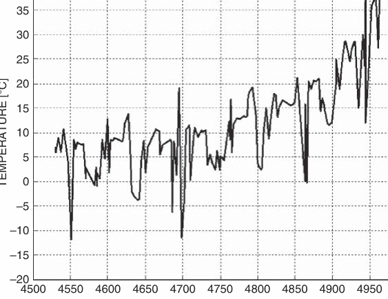

*图3.3 包含特征数据和噪声的CBD示例（FD + 噪声）。*

失效先行指标中的CBD数据点包括感兴趣的特征FD（信号中随退化进展而变化的部分），加上所有与退化和感兴趣特征无关的其他变化，称为噪声（N）：

$$
\text{CBD data} = FD + N
\tag{3.2}
$$

系统内节点处的信号通常不仅表现出感兴趣的特定CBD。图3.4显示了一个信号示例；该节点是SMPS的输出端，一个感兴趣的特定CBD是阻尼振铃响应，如图3.5所示，其理想化曲线如图3.6所示（Erickson 1999；Judkins等，2007；Judkins和Hofmeister，2007；Hofmeister等，2013、2016、2017）。

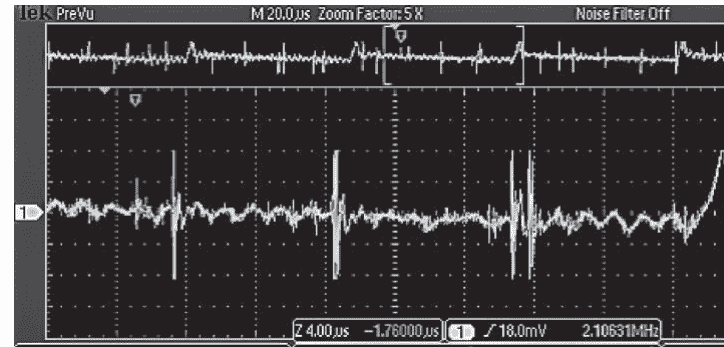

*图3.4 SMPS输出节点处的信号示例。*

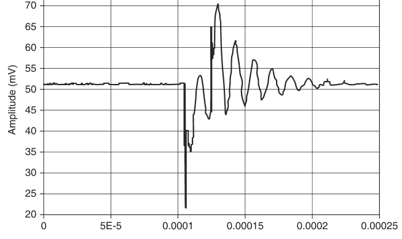

*图3.5 阻尼振铃响应示例（Judkins和Hofmeister，2007）。*

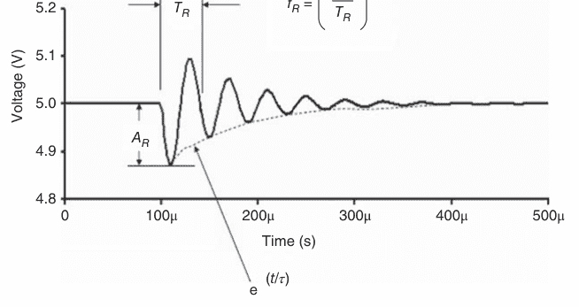

*图3.6 阻尼振铃响应的建模。来源：基于Judkins和Hofmeister（2007）。*

图3.4所示的信号包含多种类型的CBD和噪声，包括阻尼振铃响应、功率晶体管的开关噪声、纹波电压、脉宽调制器效应、电压和电流调节及反馈效应，以及背景噪声：

$$
\text{SMPS output} = CBD_1 + CBD_2 + \cdots + CBD_n + N_1 + N_2 + \cdots + N_m
\tag{3.3}
$$

其中$CBD_i$是信号项，$N_j$是噪声项。CBD项的一个示例是阻尼振铃响应，如图3.5所示。图3.6显示了理想化的阻尼振铃响应，其模型为

$$
V_0 = V_{DC} + A_R \{\exp(-t/\tau)\} \{\cos(\omega t + \phi)\}
$$

其中包含五个可能的感兴趣特征：直流（DC）电压$V_{DC}$、响应幅度$A_R$、阻尼时间常数$\tau$、频率$\omega$和相移$\phi$。

即使是噪声，通过适当的信号调理和处理，也可以用作CBD——例如，对SMPS中的噪声滤波子电路进行预测使能。用于预测使能应用的传感器的主要目标是隔离形成失效先行指标的CBD，在经过适当的信号调理后，这些CBD被转换为特征中的FD，用作预测算法的输入。

**示例3.1** 假设你被要求对客户在不同应用中使用的一个SMPS进行预测使能：一个具有保守失效要求的高端应用和一个失效要求不太严格的低端应用。你决定选择阻尼振铃响应的谐振频率（第2章中给出的示例）作为失效的先行指标：（i）滤波电容的损耗是主要失效模式；（ii）因此，随着电源因该损耗而退化，谐振频率增加；（iii）与例如纹波电压幅度的变化相比，谐振频率的变化对负载变化的依赖性较小。

从式(2.49)开始，设$C_0$表示未损坏电容的值，

$$
\omega \approx \omega_0\sqrt{\frac{C_0}{C_0-\Delta C}}
$$

其中以Hz为单位的频率由下式给出

$$
f=\omega/2\pi=FD
\tag{3.4}
$$

则信号模型变为

$$
FD=FD_0\sqrt{\frac{C_0}{C_0-\Delta C}}
\tag{3.5}
$$

其中，连接在SMPS输出节点上的智能传感器返回一个标量频率值FD。然后由式(3.2)和(3.5)可得

$$
FD=FD_0\sqrt{\frac{C_0}{C_0-\Delta C}}=CBD-N
\tag{3.6}
$$

图3.6显示了阻尼振铃响应的理想化曲线以及感兴趣的特征，如谐振频率$f_R=1/T_R$，这与式(3.4)相关联。

**示例3.2** 你设计并开发或获得一个向SMPS施加突变、低值负载变化的传感器。该负载突变引发阻尼振铃响应，传感器捕获并将其数字化，并使用数字信号处理（DSP）方法和技术计算谐振频率。传感器多次执行此操作：例如，在每小时一次的采样率下，在一秒的采样周期内执行100次。由此得到的100个频率值取平均，并从传感器输出为FD的单个值。

传感器输出为FD + N，绘制在图3.7中。

**示例3.3** 既然你已经选择了感兴趣的特征（频率）并有了模型（式(3.1)），你需要设计一个解决方案、开发一个测试台，并完成一个实验设计（DOE），用于验证你所选择的解决方案。回顾图3.1，你确定PHM解决方案需要处理数据中的以下变化性：

- 噪声，以频率变化性的形式（参见图3.1）。
- 在无退化情况下频率的标称值（$FD_0$）：$\Delta C=0$。
- 对于高端应用和低端应用，SMPS被定义为功能失效时的频率幅度。


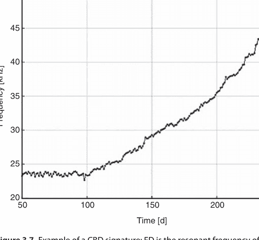

图3.7 CBD特征示例：FD是阻尼振铃响应的谐振频率。

通过与客户代表和工程师的交流，你确定你的设计和你使用的技术使你能够将0.6 kHz指定为噪声裕量（NM），以抑制未滤波噪声：该值是平均无损坏SMPS谐振频率标称值24 kHz的2.5%。你还将高端应用的失效等级（FL）定义为滤波电容损失60%，将低端应用的FL定义为滤波电容损失70%。

对SMPS规格的评估表明，制造差异会导致谐振频率在21 kHz至27 kHz之间变化。当你将这些信息应用于试验台设计，构建试验台，执行实验设计（DOE）并收集实验数据后，你最终得到如图3.8所示的绘图结果和表3.1所示的表格结果。

## CBD特征评估

将CBD特征作为预期预测算法的输入进行评估，可得出以下结论：

- 预测算法很可能生成满足客户准确性要求的预测信息估计值——剩余使用寿命（RUL）、健康状态（SoH）和预测时域（PH）——特别是在指定精度（PDₐ）内所需的最小预测距离（PD）方面。
- 正确处理CBD特征需要大量模型，尤其是在大型复杂系统中。
- 使用CBD特征作为PHM方法可能与传统模型驱动方法一样复杂。

**表3.1** 失效阈值范围：批次1和批次2。

| 边界条件 | 高端失效等级 | 低端失效等级 |
|---|---:|---:|
| 批次1：标称频率27 kHz | 43.2 | 45.9 |
| 批次2：标称频率21 kHz | 33.6 | 35.7 |

**示例3.4** 你评估CBD建模的结果，并决定需要对每个SMPS批次至少定义两个特征模型，其中标称谐振频率与标称值的偏差超过例如0.3 kHz（24 kHz的1.25%）；确切范围取决于具体应用。此外，制造差异会导致输出滤波电容变化，你计算得出给定SMPS的标称谐振频率范围为21 kHz至27 kHz（参照表3.1）：6 kHz的跨度和0.3 kHz的步长意味着你需要定义并使用20个基于CBD的模型。

## 3.2.2 FFP特征

简化建模的一种方法是将CBD特征数据归一化以生成FFP特征数据，同时对数据应用噪声裕量（见图3.9）。该过程是先从CBD中减去一个NM以得到FDᵢ值，然后减去一个标称FD₀值，并将结果除以标称FD₀值：

$$FD_i = CBD_i - NM \tag{3.7}$$

$$FFP_i = (FD_i - FD_0)/FD_0 \tag{3.8}$$

$$\text{FFP signature} = FFP = \{FFP_m, FFP_{m+1}, \ldots FFP_{m+n-1}, FFP_{m+n}\} \tag{3.9}$$

FFP特征比CBD特征更受青睐，因为噪声对预测精度的影响通过使用噪声裕量而得到缓解，并且归一化使幅度变为相对度量单位，而不是像kHz这样的度量单位。你不再需要为24 kHz标称频率建立一个模型、为24.3 kHz标称频率建立一个模型、为24.6 kHz标称频率建立一个模型等等，而只需要一个模型，从而在生成预测信息时降低了建模和处理复杂度。

**示例3.5** 你决定使用式(3.8)和以下参数值将CBD特征数据转换为FFP特征数据：$FD_0 = 24.0\ \text{kHz}$ 和 $NM = 0.6\ \text{kHz}$。所得FFP特征的绘图如图3.10中左侧的图所示。你检查该图后得出以下结论：

- 幅度值不再是Hz或kHz度量单位：它们是没有单位的相对度量单位。
- 你没有将y轴标注为[AU]（任意单位）或[ratio]（比值），而是选择使用更具信息性的名称[kHz/kHz]。
- 特征从大约0.1的值开始，而不是你预期的小于0的值。

图3.9 FFP特征与处理流程的功能框图。

## 示例3.6

你意识到使用固定的24 kHz作为标称频率会在FFP特征数据中引入一种偏移型误差。根据表3.1，你意识到要么需要使用27 kHz，要么需要使用校准。你评估你的预测要求，并选择在设计中使用以下方案：(i) 保持传感器设计不变；(ii) 采用基于节点的架构，该架构支持指定校准阶段，在该阶段中对来自传感器的若干样本进行平均、保存，并将结果用作标称频率。图3.10下方的图显示了使用校准后标称频率值的结果。

幅度小于或等于0的FFP特征点表示无损坏。功能失效等级取决于具体应用，正如两个功能失效阈值所示：高端应用为0.6（图3.11上方的图），低端应用为0.7（图3.11下方的图）。

## FFP特征：FD的标称值与校准

正如我们已经讨论过的，建模数据的一个普遍问题是数据中的变化：信号引起的噪声、热引起的噪声、运行引起的噪声、环境引起的噪声、制造引起的噪声等等。设计和开发PHM系统以实现可靠状态监测的一个重大挑战是减少和/或减轻此类变化，以降低数据处理复杂度，从而获得经济、可靠的结果。前面的示例介绍了

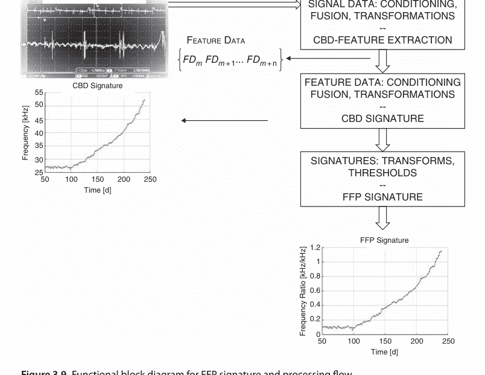

图3.11 FFP特征，标称频率的校准值，失效阈值为0.6和0.7。

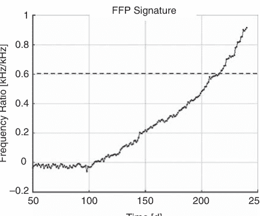

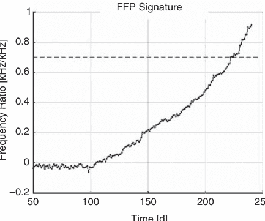

## FFP特征数据：与CBD特征数据相比的优势

与CBD特征相比，FFP特征需要更少的建模：每个失效等级一个模型，而CBD需要20个模型（参照3.4）。此外，与对CBD特征数据的处理相比，预测算法对FFP特征数据的处理大大简化：

- FFP点小于或等于0表示零退化状态：RUL = 最大值（指定值或系统确定值），SoH = 100%。
- FFP点大于0且小于指定失效阈值表示退化状态：0 < RUL < 最大值，0% < SoH < 100%。
- FFP点达到或超过失效阈值表示功能失效状态：RUL = 0，SoH = 0%。

## 3.2.3 将FFP转换为FFS

处理不同功能失效等级/阈值的一种方法是将FFP特征数据除以失效等级（FL）的值，同时乘以

## 基于FFP的FFS数据的缺点

基于FFP的FFS数据的一个缺点是特征通常是曲线的：它与原始CBD特征具有相同的特征曲线。

示例3.7 参见图3.12，当你使用FL = 0.6和FL = 0.7变换FFP特征时，会得到所示的绘图结果。这些图表明特征已被正确变换：尽管失效幅度相同（100%），但左侧图的失效时间发生在约215天，右侧图的失效时间发生在约230天。

## 3.2.4 将FFP转换为退化进程特征（DPS）

我们已经断言存在一种作为FFP特征变换的DPS；现在我们给出一个特定FFP的一般定义和推导。我们还将解释并证明，为什么DPS方法在实现PHM预测能力方面比其他基于CBD的方法（包括针对FFP特征的FFP和FFS）具有极大优势。此外，我们已经在前面解释并证明，基于CBD的方法在实现PHM预测能力方面比经典的模型驱动、数据驱动和混合驱动方法更具优势。

## DPS的定义

DPS是所关注参数值变化量dP的函数：

- 当没有退化时，参数值不变，dP = 0。
- 随着退化加剧，dP的幅值增大。

DPS_i = dP_i / P_0 (3.12)
DPS = { DPS_m, DPS_{m+1}, … DPS_{m+n-1}, DPS_{m+n} } (3.13)

然后，将dP_i定义为绝对值，dP_i = abs(dP_i)，则某个DPS点变为

DPS_i = abs(dP_i) / P_0 (3.14)

## 示例性FFP特征的DPS模型推导

DPS模型的推导从FFP特征中某一点的一般模型式(3.8)开始，

FFP_i = (FD_i - FD_0) / FD_0

对此我们应用所关注FD的模型，例如SMPS阻尼振铃响应的谐振频率模型，式(3.5)：

FD_i = FD_0 ( sqrt( C_0 / (C_0 - ΔC_i) ) )

令P_0 = C_0，dP_i = ΔC。则

FD_i = FD_0 ( sqrt( P_0 / (P_0 - dP_i) ) )

因此 sqrt( P_0 / (P_0 - dP_i) ) = FD_i / FD_0 → P_0 / (P_0 - dP_i) = (FD_i / FD_0)^2


因此，

$$P_0/(FD_i/FD_0)^2 = P_0 - dP_i$$

整理各项后，

$$P_0(FD_0)^2/(FD_i)^2 = P_0 - dP_i$$

即

$$(FD_0/FD_i)^2 = (P_0 - dP_i)/P_0 = 1 - dP_i/P_0$$

最后，

$$DPS_i = dP_i/P_0 = 1 - (FD_0/FD_1)^2 \quad (3.15)$$

## DPS与FFP的比较

与其衍生的FFP特征相比，DPS更具线性。当将式(3.15)应用于基于实验的FFP特征（如图3.11所示）时，结果就是图3.13上方图中的DPS。DPS及其FFP的比较显示在下方图中。

图3.13 图3.11所示数据的DPS和FFP特征。

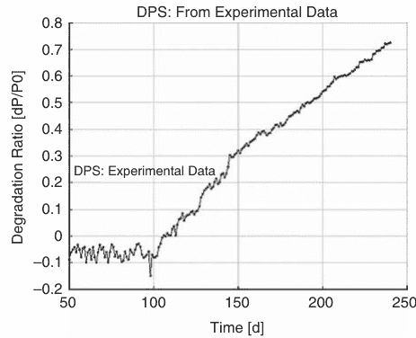

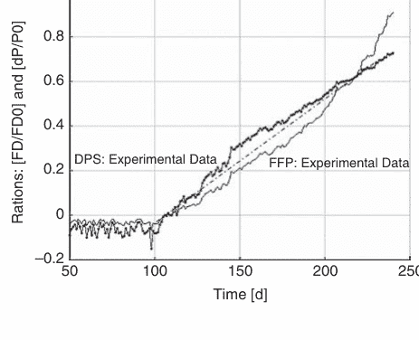

## 基于FFP和基于DPS的失效阈值的比较

比较图3.13中DPS和FFP的右侧图可以看出，在给定的时间点上，幅度是不同的。这意味着幅度比为0.4的FFP特征与相同幅度比下的DPS并不处于相同的退化水平。这是因为FFP特征的失效水平定义如下：

$$FL_{FFP} = FFP_i \tag{3.16}$$

由式(3.8)可得，

$$FL_{FFP} = (FD_i - FD_0)/FD_0$$

则

$$FD_i - FD_0 = FD_0FL_{FFP} \rightarrow FD_i = FD_0FL_{FFP} + FD_0$$

于是有

$$FD_0/FD_i = 1/(FL_{FFP} + 1)$$

根据式(3.15)，

$$FL_{DPS} = 1 - (1/(1 + FL_{FFP}))^2 \tag{3.17}$$

## 使用基于DPS的失效水平

由于FFP特征本身就是FFP，因此合理的做法是使用式(3.16)定义失效水平，然后用式(3.17)计算$dP/P_0$的等效水平。

**示例3.8** 假设你希望使用$FL_{FFP} = FD_i = 0.4$作为失效水平。要计算等效的$FL_{DPS}$，可以使用式(3.17)：

$$FL_{DPS} = 1 - (1/(1 + FL_{FFP}))^2 = 1 - (1/(1 + 0.4))^2$$

$$= 1 - (1/1.4)^2 = 0.49 = 0.5$$

图3.14显示了叠加在DPS上的$FL = 0.5$和叠加在FFS上的$FL = 0.4$：两者发生功能失效的时间相同，这是预期且理想的结果。

## 3.2.5 将DPS转换为基于DPS的FFS

与FFP类似，DPS在转换为基于DPS的FFS时更有用：将DPS数据特征除以失效水平（FL）的值，同时将结果乘以100，以创建与失效百分比相关的FFS数据：

$$FFS_{DPS_i} = 100\ DPS_i/FL \tag{3.18}$$

$$\text{DPS-based FFS} = FFS_{DPS} = \{FFS_{DPS_m}, FFS_{DPS_{m+1}}, \ldots, FFS_{DPS_{m+n}}\} \tag{3.19}$$

与基于FFP的FFS类似，所有失效水平都有统一的模型，预测算法对FFS特征数据的处理得到极大简化。

**示例3.9** 使用3.8的结果，将FFP数据转换为FFS，FL值为0.7；将DPS数据转换为FFS，FL值为0.65；然后

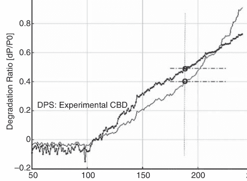

图3.14 FFP和DPS显示FL = 0.4和FL = 0.5。

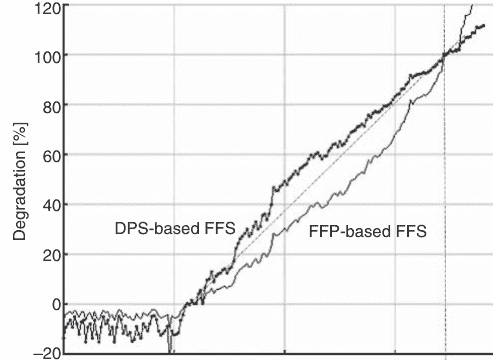

图3.15 基于DPS的FFS（FL = 0.65）和基于FFP的FFS（FL = 0.7）。

绘制结果。使用基于FFP的FFS时发生功能失效的时间与使用基于DPS的FFS时相同，如图3.15所示，图中在0%和100%点之间叠加了一条理想的FFS传递曲线。对图表的目视分析可得出定性评估：基于DPS的FFS与基于FFP的FFS相比弯曲程度更低。

## 3.3 模型验证

验证PHM系统中使用的所有模型非常重要：对每个模型进行仿真，并将模型与实验和/或实际现场数据进行比较。仿真数据结果与使用实验和/或现场数据获得的结果之间需要高度相关。很可能存在差异，但你应该能够解释这些差异，以便做出明智的决定，判断这些差异是否可接受，以及建模和处理更改是否必要和/或可取。

CBD建模的验证重点是将CBD特征表现出的特性曲线与通过仿真基于PoF和/或FMEA模型获得的理想曲线进行比较。建模的目标不是用模型仿真曲线精确复制CBD特征；而是确保模型仿真曲线的整体性：CBD特征、FFP特征、DPS数据和FFS数据的模型足够相关且准确。当FFS数据输入到PHM系统中的预测算法时，得到的预测信息需要满足可靠状态监测对准确性、收敛性和可靠性的要求。

### 3.3.1 特征分类

对通常会在不到一秒内从零退化（100%健康）退化到功能失效（0%健康）的部件启用预测功能几乎无用。相反，对于这种“雪崩”失效模式，真正能做的只有诊断检测、报告、补救行动和/或灾难规避和/或补救措施。我们感兴趣的是由退化引起的特征：那些变化与退化水平高度相关的特征。此外，从退化开始到导致功能失效的退化水平之间的时间必须足够长，以使预测系统能够检测退化、产生收敛到所需精度水平的预测估计，并在规定的最短时间（预测距离[PD]）内或之前完成。我们使用先前开发的一般形式对特征进行建模（第2章中的式(2.50)）：

```
FD_i = FD_0 f(dP_i, P_0) (3.20)
```

其中，f(dP, P_0)是退化模型，FD_i是特征数据点，FD_0是无退化时可测量特征的标称值，dP_i是参数值的变化量，P_0是无退化时该参数的标称值。

正如我们将在本章和下一章看到的，所使用的特征识别、调理和变换方法意味着我们无需确定或使用精确的参数值，但我们需要识别每个特征的类别，以选择正确的退化模型。与退化相关的特征源于可用幂函数或指数函数建模的失效模式。

尽管退化特征被建模为具有增大或减小幅度的幂函数或指数函数，但恒定特征仅在表示不存在退化时适用。我们只使用幅度增大的模型；具有减小幅度的特征会被转换为互补的幅度增大特征和退化模型——更多信息将在下一章中提供。参考图3.16和图3.17，退化特征根据退化过程中特征是具有减小还是增大的斜率角进一步分类：线性直线退化特征是一种特殊情况，被归类为具有恒定斜率角。斜率角是曲线切线与水平轴之间的夹角。

图3.16 特征示例：斜率角减小（上）和增大（下）。

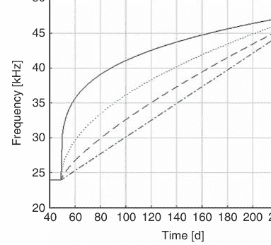

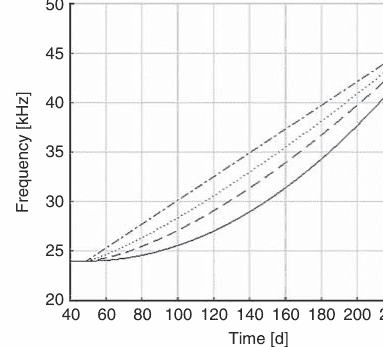

### 3.3.2 验证CBD建模

验证你选择和/或开发的模型与你选择用于处理的FD是否足够相关。例如，当系统产生一个特征

图3.17 特征的其他示例：斜率角减小（上）和增大（下）。

## 特征：斜率角减小

## 特征：斜率角增大

该特征具有减小的斜率角，你的CBD建模应产生一个具有减小斜率角的特征，并且两者应具有相同的变化率。

**示例3.10** 例如，使用式(3.2)，CBD数据 = FD + N，以及式(3.6)，FD_i = CBD_i − NM，并执行以下操作：

-   将NM设置为0.7 kHz，这是你之前确定并使用的值。
-   使用前面图3.8左侧所示的CBD，其FD₀计算为27.0 kHz。
-   检查数据以确定每天的恒定退化速率dP：

    dP ~ (0.75/140) 每天。

-   计算并绘制仿真FD点（图3.18）。
-   将仿真图与实验CBD特征减去0.7 kHz噪声裕量后的图（图3.19）进行比较。


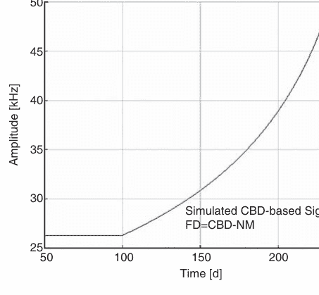

图 3.18 基于 CBD 的仿真特征：FD = CBD – NM。

## 示例 3.11

你比较这些图，并得出结论：它们之间高度相关。为了完成对公式 (3.2) 和 (3.6) 在你的应用中是否正确的验证，你检查了实验测试台的设计以及你要进行故障预测的 SMPS 的设计，并确定以下内容：

- SMPS 采用带电压反馈的脉冲宽度调制，使频率变化线性化：见图 3.19 底部图中的圆圈 1。
- 电容退化是一种注入式故障模式，其中电容被离散地移除，导致输出出现阶跃式变化：见图 3.19 底部图中的 (2)。

## 3.3.3 验证 FFP 建模

即使你不打算使用 FFP 特征，也需要验证你的 FFP 建模。你的建模应产生一条特征 FFP 曲线，该曲线就是特征 CBD 曲线，只是曲线向下平移；在无退化情况下，曲线位于 0 或 0 以下；度量单位已从物理单位（如电压、安培和电阻）变为数值比率（如[电压/电压]等）。

## 示例 3.12

验证 FFP 建模的一个示例是验证公式 (3.7) 和 (3.8) 在你的应用中是否正确：

FFP_i = (FD_i - FD_0)/FD_0
FFP 特征 = FFP = {FFP_m, FFP_{m+1}, ..., FFP_{m+n-1}, FFP_{m+n}}

- 使用仿真 FD 数据创建并绘制仿真 FFP 特征，如图 3.20 顶部图所示。

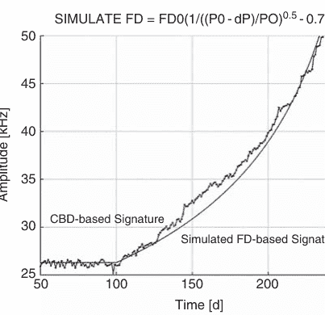

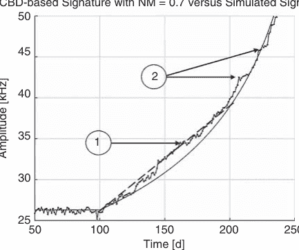

图 3.19 差异：实验特征与仿真特征。

- 比较仿真 FFP 特征和基于实验的 FFP 特征的图，如图 3.20 底部图所示。

## 3.3.4 验证 DPS 建模

与验证 FFP 建模类似，你需要验证你的 DPS 建模。

## 示例 3.13 使用公式 (3.16)，并同时使用仿真数据和实验数据绘制 DPS 数据：

- 使用平方根函数的仿真数据计算得到的 DPS 是理想的（见图 3.21 顶部图）。

图 3.20 仿真（顶部）与实验比较（底部）的 FFP 特征。

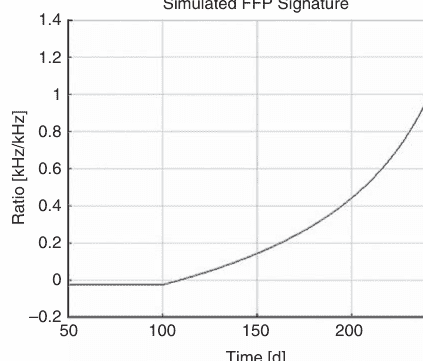

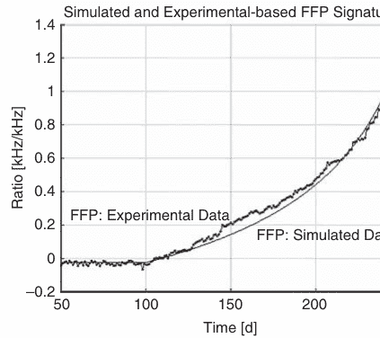

- 使用实验数据得到的 DPS 虽然不理想，但与基于 CBD 和基于 FFP 的特征相比，弯曲程度较低（见图 3.21 底部图）。

## 3.3.5 验证基于 DPS 的 FFS 建模

最后一步是验证基于 DPS 的 FFS 模型。

## 示例 3.14

将仿真 DPS 数据转换为基于 DPS 的 FFS（见图 3.22 顶部图），并验证其是否为理想状态（对于恒定退化速率）。然后将仿真结果与实验结果进行比较（图 3.22 右侧图）。

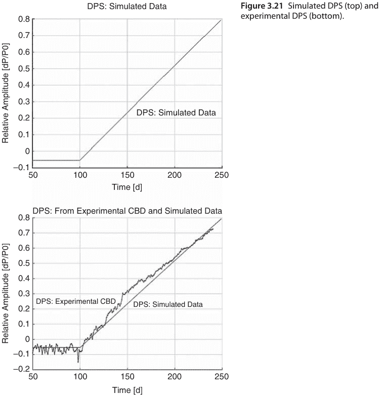

## 3.4 FFS 曲线评估：非线性

到目前为止，在本章中，我们已经成功开发并验证了用于生成特征的建模：

| 公式 | 说明 |
|---|---|
| $FD_i = CBD_i - NM$ | 特征数据点 – 公式 (3.7) |
| $FFP_i = (FD_i - FD_0)/FD_0$ | FFP 特征点 – 公式 (3.8) |
| $DPS_i = 1 - (FD_0/FD_i)^2$ | DPS 点 – 公式 (3.15) |
| $FFS_i = 100\,DPS_i/FL$ | FFS 点（使用 DPS 数据）– 公式 (3.18) |

最终变换使用公式 (3.18) 生成基于 DPS 的 FFS，以实现将 CBD 特征数据转换为 FFS 数据的目标：理想的基于 DPS 的 FFS 是一条直线

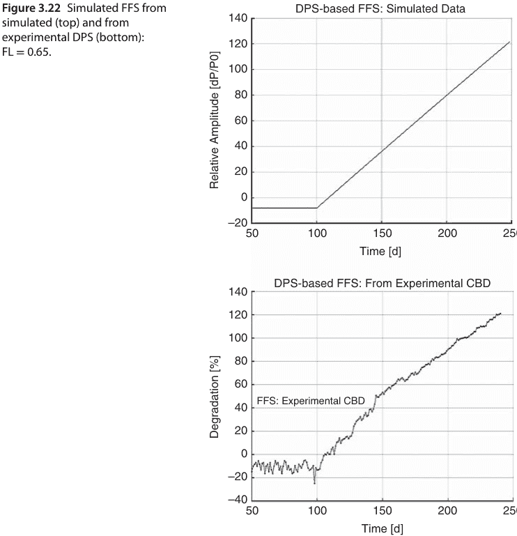

位于 0% 和 100% 数据点之间。在此之前，我们开发了一个模型，即公式 (3.10)，用于将 FFP 特征数据转换为基于 FFP 的 FFS 数据，并做出了以下定性评估：

基于 FFP 的 FFS 数据的一个缺点是特征通常是曲线形的：它与原始 CBD 特征具有相同的特征曲线。

图 3.15 包含三个示例 FFS 数据图：(i) 基于 DPS 的 FFS，(ii) 理想 FFS 传递曲线，以及 (iii) 基于 FFP 的 FFS。对这些曲线的定性评估可能包括以下内容：

- 示例基于 DPS 的 FFS 与理想 FFS 相比更弯曲。
- 示例基于 FFP 的 FFS 与理想 FFS 相比也更弯曲。
- 示例基于 DPS 的 FFS 与基于 FFP 的 FFS 相比弯曲程度更低。

但对图 3.15 中图形的目视检查表明，后一种定性评估并非对基于 DPS 的 FFS 与基于 FFP 的 FFS 之间的每个逐数据点比较都成立。我们需要的是定量评估——我们提倡一种基于积分非线性（INL）测量的定量方法来评估 FFS 曲线的非线性，该方法通常用于评估数据转换器输出传递曲线的线性度（Texas Instruments 1995; Carr and Brown 2000; Jenq and Qiong 2002）。

## 3.4.1 传感系统

传感系统包含被监测节点与预测系统输入端口之间的所有部分：节点、传感器以及所有中间框架。预测系统作用于传感系统的输入，生成用于提供未来故障预测的预测信息：传感硬件、数据/域转换器、信号调理、数据融合等。

在 PHM 系统中，传感系统向预测系统提供输入，预测系统处理来自传感系统的输入，以生成预测信息，包括 (i) RUL、(ii) SoH 和 (iii) PH。理想的 RUL 曲线是退化起始时间点与功能失效时间点之间的一条递减直线：该直线的幅度是功能失效与退化起始之间的时间。类似地，理想的 SoH 曲线是退化起始时间点与功能失效时间点之间的一条递减直线：理想 SoH 曲线的幅度从 100% 线性递减至 0%。理想的 PH 曲线是一条水平直线，由样本的当前时间与该时刻的 RUL 之和组成。

传感系统的线性度是对传感系统产生的测量曲线与理想曲线偏差程度的评估（TI 1995; Carr and Brown 2000）。传感系统的输出是 FFS，预测系统的理想 FFS 输入曲线是一条直线，在退化开始时刻之前值为 0，在被监测预测目标被视为功能失效的时刻值为 100。例如，图 3.22 左侧是理想 FFS 曲线的图，该图右侧是我们的示例基于 DPS 的 FFS 的图；如图所示，该曲线偏离了理想 FFS 曲线。

## 3.4.2 FFS 非线性

我们将功能失效特征非线性（FNL）定义为实际 FFS 与理想 FFS 之间偏差的度量，非常类似于对模数转换器（ADC）或传感器输出传递曲线的 INL 评估（Texas Instruments 1995; Carr and Brown 2000; Jenq and Qiong 2002）。逐点 FNL 是某个时间点实际 FFS 值与理想 FFS 值之间误差的度量（见图 3.23）。总误差（FNLₑ）提供了对 FFS 曲线非线性的评估（见图 3.24）。

# 计算 FFS 非线性（FNL）

计算 FNL 是使用 FFS 数据进行的一种后处理操作，因为我们需要首先计算退化起始时间点与功能失效发生时间点之间的总时间：

$$TTF = t_{FAILURE} - t_{ONSET} \tag{3.21}$$

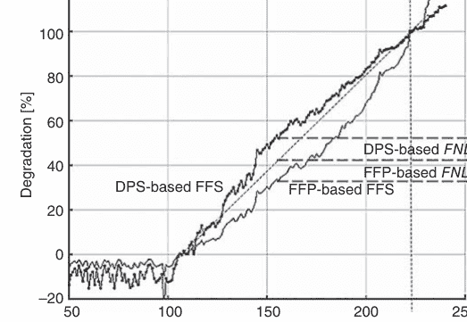

图 3.23 逐点 FNL 比较示意图。

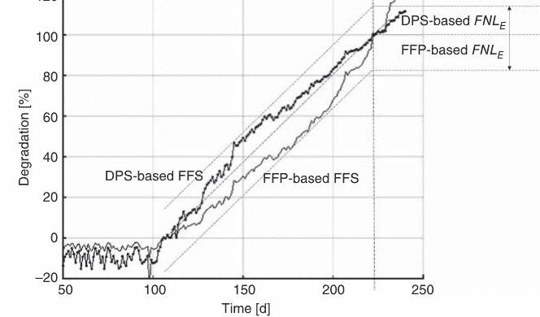

图 3.24 总 FNL_E 比较示意图。

然后，对于集合 {FFS_i} 中的每个点，我们创建一个理想点，
IDEAL_FFS_i = 100(t_i − t_ONSET)/TFF (3.22)
并计算逐点非线性，
FNL_i = FFS_i − IDEAL_FFS_i (3.23)
并计算总非线性，
FNL_E = max(abs({FNL_i})) (3.24)


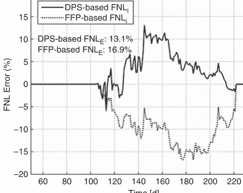

Figure 3.25 Example plot of FFP-based and DPS-based FNL_i.

where max is a maximum function and abs is an absolute-value function. Example plots on nonlinear errors are shown in Figure 3.25.

## Example 3.15

Previously, you used an FL value of 0.7 and created an FFP-based FFS (in 3.7); you transformed the FFP-based FL value of 0.7 to a DPS-based value of 0.65; then you created a DPS-based FFS (3.9); and you compared the results (Figure 3.15) and qualitatively concluded that the DPS-based FFS was less curvilinear compared to the FFP-based FFS. Now, verify the qualitative conclusion using Eqs. (3.21–3.24) for both sets of FFS data and make a quantitative assessment.

## 3.5 Summary of Data Transforms

Using an SMPS as an example, we described and showed the following signals and the transforms that were performed:

- SMPS output (left side of Figure 3.26). Analog voltage of direct current (DC) and alternating current (AC) component features and noise. One of the features is damped-ringing responses to abrupt changes in load.
- Ringing response (right side of Figure 3.26). An intelligent sensor might do the following: present a series of abrupt, low-power changes in load to the SMPS at timed intervals (sampling periods); capture the ringing responses; convert analog voltage to digital data; calculate an average frequency for each of several sinusoids in the response; calculate an average value of the average resonant frequency of each of the series of ringing responses; calculate the average frequency as a sample value; and output that average as a scalar CBD_i value.
- CBD signature (left side of Figure 3.27). Sensor data is transformed into a CBD signature by subtracting the value of a noise margin from each received CBD_i to

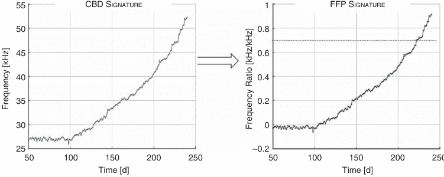

**Figure 3.27** CBD signature and FFP signature.

create a feature point, $FD_i$. The set of $FD_i$ values, $\{FD_i\}$, is a CBD signature, as in Eq. (3.7):

$$FD_i = CBD_i - NM$$

- **FFP signature** (right side of Figure 3.27). A set of $FD_i$ values is transformed into a set of $FFP_i$ values by subtracting from each $FD_i$ value a nominal value of FD and dividing the result by that nominal value. The set of $FFP_i$ values, $\{FFP_i\}$, is an FFP signature, as in Eq. (3.9):

$$FFP_i = (FD_i - FD_0)/FD_0$$

- **FFP-based FFS** (left side of Figure 3.28). An FFP set, $\{FFP_i\}$, is transformed into $\{FFS_i\}$ by dividing each value in the set by a functional-failure level, FL, and multiplying the result by 100, as in Eq. (3.10):

$$FFS_i = 100\ FFP_i/FL$$

- **DPS** (right side of Figure 3.28). An FFP set, $\{FFP_i\}$, is transformed into $\{DPS_i\}$ by transforming the FFP model into a new model that is a function of a parameter, $P_0$, and a change in that parameter, $dP$, and then solving for $dP_i/P_0$ in terms of the feature parameters $FD_i$ and $FD_0$, as in Eq. (3.15):

$$DPS_i = 1 - (FD_0/FD_i)^2$$ for this particular FFP model

- **DPS-based FFS** (Figure 3.29). A set of DPS values, $\{DPS_i\}$, is transformed into a DPS-based FFS, $\{FFS_i\}$ by dividing each $DPS_i$ value in the set by an $FL$ value and multiplying the result by 100, as in Eq. (3.18),

$$FFS_i = 100\ DPS_i/FL$$

- where $FL$ is calculated using Eq. (3.17):

$$FL_{DPS} = 1 - (1/(1 + FL_{FFP}))^2$$

### High-Level Procedure for Producing a DPS-Based FFP

A high-level procedure for producing a DPS-based FFP is the following (refer to Figure 3.30): (i) select one or more output nodes to monitor for prognostic purposes; (ii) develop or acquire sensors to isolate CBD leading indicators of interest and to extract selected FD; (iii) signal condition and transform the collected FD to produce a CBD-based signature – Eq. (3.6); (iv) further condition as necessary and transform CBD signature data into FFP signature data – Eqs. (3.7) and (3.8); (v) transform FFP signature data into DPS data using Eqs. (3.8) and (3.15); and (vi) transform DPS data into an FFS using Eqs. (3.17) and (3.18). You use Eqs. (3.21)–(3.24) to quantitatively assess the nonlinearity of FFS data.

### Qualitative Assessment

The biggest advantage of the DPS approach is that DPS-based FFS data is more linear compared to that based on FFP data. Additional advantages are the following:

- Similar to an FFP signature, the amplitude of $\{DPS_i\}$ data is dimensionless.
- The number of required models is reduced.

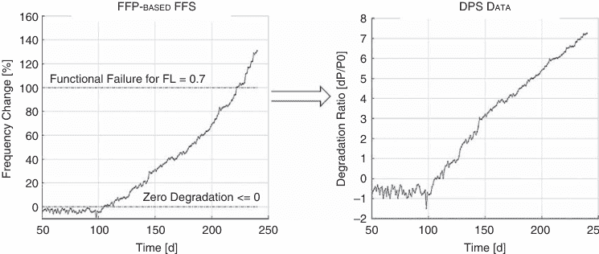

**Figure 3.28** FFP-based FFS and DPS.

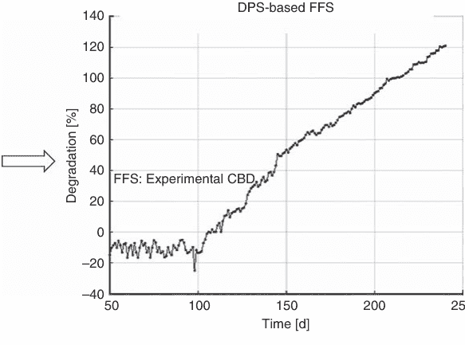

**Figure 3.29** DPS-based FFS.

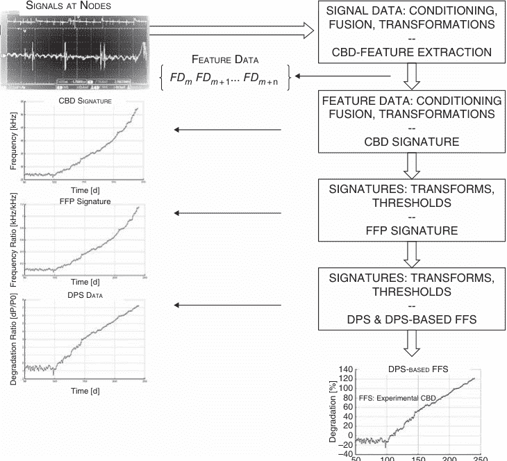

**Figure 3.30** Procedural diagram for producing a DPS-based FFS.

Using Eq. (3.14) and the results of the examples used to verify modeling, we make the following inductive observations regarding the set `{DPS_i}`, regardless of the type of an underlying FD model (such as a linear or power function) and regardless of how FD changes with respect to time:

- When a parameter `dPi` changes as a linear function with respect to time, `{DPS_i}` changes linearly with respect to time.
- When a parameter `dPi` changes as a power function with respect to time, `{DPS_i}` changes as a power function with respect to time.
- When a parameter `dPi` changes exponentially with respect to time, `{DPS_i}` changes exponentially with respect to time.

The biggest advantage is the following: `{DPS_i}` is less curvilinear than its underlying `{FFP_i}` signature data, and so `{DPS_i}` data is particularly useful as input to prediction algorithms for processing to predict a future time of failure for a prognostic target.

## 3.6 Degradation Rate

In the previous section of this chapter, we saw that an ideal DPS-based FFS is a linearly increasing line from 0 or less (no degradation) to 100 or more (functionally failed): an ideal DPS-based FFS is a straight line between the 0% and 100% points. Even a non-ideal DPS-based FFS was shown to be less curvilinear than its underlying FFP signature (refer back to Figure 3.29). The linearity of a DPS-based FFS is dependent on the linearity of the rate of change in a degrading parameter, `dD`: if the degradation rate with respect to time is constant, the DPS and the DPS-based FFS will be linear; otherwise the degree of non-linearity of the DPS and the DPS-based FFS is dependent on the degree of nonlinearity in the degradation rate.

### 3.6.1 Constant Degradation Rate: Linear DPS-Based FFS

As we have seen, an idealized DPS for a constant degradation rate results in an idealized linear DPS-based FFS. And even when a DPS is not ideal, the DPS-based FFS is more linear (less curvilinear) compared to the characteristic curve for its DPS. The examples and exemplary data we have been using are a result of assuming a constant degradation rate such as that modeled as follows:

$$dP_i = D_0(t_i)^\delta \tag{3.25}$$

in which `δ = 1.0` for a constant degradation rate and `t_i` equals

$$t_i = (t_S - t_D) \tag{3.26}$$

where `t_S` is the time of a sample and `t_D` is the time of the onset of degradation: `t_S ≥ t_D`.

**Example 3.16** Show that the DPS-based signature for our example is always linear given a constant degradation rate and nonlinear for a nonconstant degradation rate. Using Eqs. (3.25) and (3.12),

$$DPS_i = dP_i/P_0 = D_0/P_0(t_i)^\delta$$

so that for `δ = 1`, `DPS_i` is linear and nonlinear otherwise.

**Example 3.17** Show that the FFP-based signature for our example is always nonlinear, even when $\delta = 1$. Using Eq. (3.15),

$$DPS_i = 1 - (FD_0/FD_i)^2 \to FD_i/FD_0 = \sqrt{1 - (D_0/P_0)(t_i)^\delta}$$

and using Eq. (3.8),

$$FFP_i = (FD_i - FD_0)/FD_0 = FD_i/FD_0 - 1$$

$$= (1/\sqrt{1 - (D_0/P_0)(t_i)^\delta}) - 1$$

which is nonlinear for all nonzero values of $\delta$.

### 3.6.2 Nonlinear Degradation Rate

A non-idealized DPS occurs when the degradation rate is not constant: it is nonlinear with respect to time. However, we will see that even when a DPS is not ideal, a DPS-based curve is still more linear (less curvilinear) compared to its FFP signature.

**Example 3.18** Plot a DPS, $dP/P_0$, using Eq. (3.25), where $D_0 = 0.90/200$ is valid after the onset of degradation, degradation begins at $t = 51$, and $\delta = 1.0$ for a time period of 1 to 250 days. Compare the dotted-line plot in Figure 3.31 to the solid-line plot, in which $dP = (0.75/200)t^{1.05}$.

Notice that the differential nonlinearity (DNL) between the ideal, linear DPS and the non-ideal, curvilinear DPS transfer curves is very small. The nonconstant degradation rate, in this case, increases the nonlinearity of the CBD and FFP signature curves from that seen on the left side of Figure 3.32. The nonlinearity increases even further, as shown

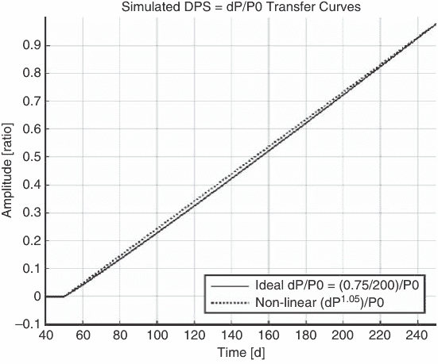

**Figure 3.31** Linear DPS (left side) and nonlinear DPS (right side) data plots.


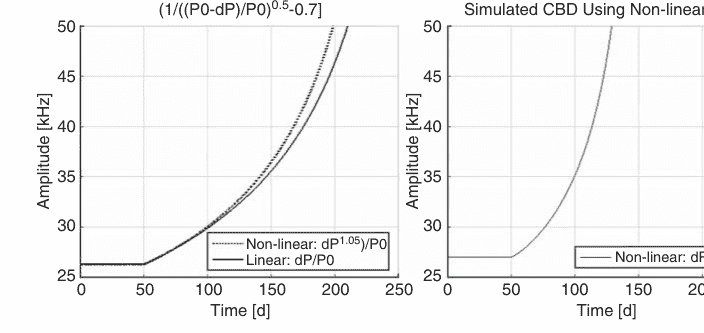

**图 3.32** 使用非线性和线性退化率的仿真CBD图。

在图3.32的右侧，当退化率的非线性进一步增强时：例如，dP = (0.75/200)t^2.0。

3.18中引入的DNL项以及相关术语积分非线性（INL）都是对两个模拟值之间偏差的度量：在本书中，这两个模拟值分别是理想（直线）特征和输入到预测算法的数据特征（如FFS）（Texas Instruments 1995）。在本书中，我们引入一个新术语——FFS非线性（FNL），它衡量理想RUL和理想SoH转移曲线与来自此类预测算法的RUL和SoH估计实际曲线之间的偏差（Hofmeister et al. 2018）。

### 示例 3.19

将你为图3.32右侧图创建的仿真数据转换为DPS数据，假设退化率恒定。这样操作时，你会创建一条非线性DPS转移曲线，如图3.33所示；图中还显示了理想DPS以作比较。尽管该DPS是非线性的，但它比其FFP特征数据更接近线性（可回顾图3.32右侧图）。

## 3.7 故障进展特征与系统节点

在第1章中，我们使用了一个用于CBM的PHM系统框架的示例说明。参考图3.34，该框架包括（i）传感器框架，（ii）特征向量框架，（iii）预测框架，（iv）健康管理框架，（v）性能验证框架，以及（vi）控制与数据流框架。传感器框架连接到一个节点；在一个系统中可能有数百或数千个节点，每个节点都是系统中CBD的一个来源：声学、电气、磁、机械应力与应变、振动、辐射、光学等。因此，采用基于节点的架构作为PHM系统的锚点是合理的，该系统收集CBD以实现可靠的工况监测，从而支持CBM。

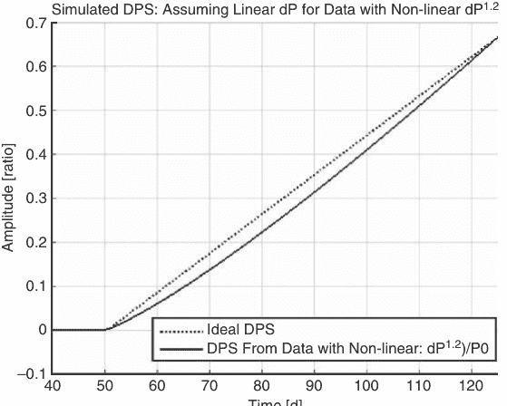

**图 3.33** 非恒定退化率下理想DPS与来自数据的DPS的比较。

电子设备的PHM：框架图

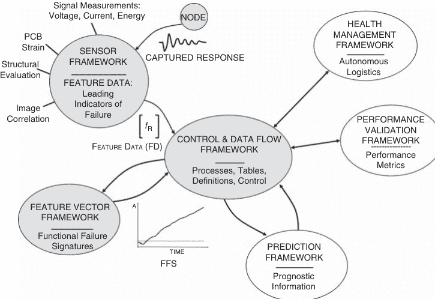

**图 3.34** 用于支持故障进展特征的基于节点的框架。

在本章中，我们介绍并讨论了连接在节点上用于监测信号的传感器，利用噪声容限隔离CBD和FD；校准作为FD标称值的使用；以及与CBD特征、FFP特征、DPS数据、FFS数据和预测（预测框架）相关的各种变换和数据处理。使用基于节点的架构作为PHM系统的框架是合理的，而不是例如在控制与数据流框架中为每个节点设计和开发细节。由传感器和驱动器组成的传感器框架在节点处捕获信号，执行数据调理，并产生FD。由处理器组成的特征向量框架执行额外的调理和变换，以创建FFS，作为产生预测信息的预测框架的输入数据。健康管理框架处理预测信息，以生成诊断、预测和后勤指令与行动，从而维持系统的健康与可靠性。性能验证框架提供产生预测性能指标的手段和方法，以评估预测信息的准确性。控制与数据流框架管理PHM的功能和行动（CAVE3 2015; Hofmeister et al. 2017; Kumar and Pecht 2010; Pecht 2008）。

## 3.8 故障进展特征：小结

本章阐述了将CBD特征转换为其他特征（FFP、DPS和FFS）的基本原理。你了解到，FFP和DPS都可以转换为FFS。你看到FFP是CBD的归一化版本，并且FFP大大减少了特征模型的数量；我们还证明了将FFP转换为FFS会产生一种非常适合输入到预测算法的特征：

- 1. 幅度值以百分比表示。
- 2. 幅度为0或更小表示未检测到退化。
- 3. 幅度为100或更大表示功能失效。

功能失效定义为一种SoH状态，在该状态下，预测目标不再在规范范围内运行。

你了解到，可以通过相对于参数标称未退化值（*P*₀）的参数值变化（*dP*）来求解特征，从而将FFP转换为DPS：*DPS* = (*dP/P*₀)；你还了解到，与FFP相比，DPS的弯曲程度更低，并且*DPS*有两种形式：相对于时间恒定和非恒定的退化率：

*f(DPS, t) = (d/dt)DPS*

你了解到，DPS与FFP一样可以转换为FFS，并且基于DPS的FFS最适合由预测算法处理——即使相对于时间的退化率不是恒定的。

你还了解到，需要根据所建模的特征来验证建模选择，并随着退化的进展，判断特征斜率角是减小还是增大，以帮助确定特征对应的退化函数：

*FD*ᵢ = *FD*₀*f(dP*ᵢ, *P*₀)

本章介绍了评估FFS曲线非线性的两个定量度量：逐点非线性和总非线性，使用式（3.23）和（3.24）：

FNL_i = FFS_i - IDEAL_FFS_i
FNL_E = max(abs({FNL_i}))

在下一章中，你将了解到，特征可以由有限数量的特性曲线有效建模：10个幂函数和4个指数函数。你还将了解到，启发式建模方法对于预测而言足够准确：基于传统方法（如FMEA和PoF）的正式建模并非必需。

## 参考文献

Carr, J.J. and Brown, J.M. (2000). Introduction to Biomedical Equipment Technology, 4e. Upper Saddle River, New Jersey: Prentice Hall.

Erickson, R. (1999). Fundamentals of Power Electronics. Norwell, MA: Kluwer Academic Publishers.

Hofmeister, J., Wagoner, R., and Goodman, D. (2013). Prognostic health management (PHM) of electrical systems using conditioned-based data for anomaly and prognostic reasoning. Chemical Engineering Transactions 33: 992–996.

Hofmeister, J., Goodman, D. and Wagoner, R. (2016). Advanced anomaly detection method for condition monitoring of complex equipment and systems. 2016 Machine Failure Prevention Technology, Dayton, Ohio, US, 24–26 May.

Hofmeister, J., Szidarovszky, F., and Goodman, D. (2017). An approach to processing condition-based data for use in prognostic algorithms. 2017 Machine Failure Prevention Technology, Virginia Beach, Virginia, US, 15–18 May.

Hofmeister, J.P, Goodman, D.L., and Szidarovszky, F. (2018). Transforming condition-based data signatures into functional failure signatures, IEEE 2018 Aerospace Conference, Big Sky, Montana, US, 3–9 March.

Jenq, Y.C. and Li, Q. (2002). Differential non-linearity, integral non-linearity, and signal to noise ratio of an analog to digital converter. Portland, Oregon: Department of Electrical and Computer Engineering, Portland State University.

Judkins, J.B. and Hofmeister, J.P. (2007). Non-invasive prognostication of switch mode power supplies with feedback loop having gain, IEEE Aerospace Conference 2007, Big Sky, Montana, US, 4–9 Mar.

Judkins, J.B., Hofmeister, J., and Vohnout, S. (2007). A prognostic sensor for voltage regulated switch-mode power supplies. IEEE Aerospace Conference 2007, Big Sky, Montana, US, 4–9 Mar, Track 11–0804, 1–8.

Kumar, S. and Pecht, M. (2010). Modeling approaches for prognostics and health management of electronics. International Journal of Performability Engineering 6 (5): 467–476.

Medjaher, K. and Zerhouni, N. (2013). Framework for a hybrid prognostics. Chemical Engineering Transactions 33: 91–96. https://doi.org/10.3303/CET1333016.

National Science Foundation Center for Advanced Vehicle and Extreme Environment Electronics at Auburn University (CAVE3). (2015). Prognostics health management for


electronics. http://cave.auburn.edu/rsrch-thrusts/prognostic-health-management-for-electronics.html (accessed November 2015).

Pecht, M. (2008). *Prognostics and Health Management of Electronics*. Hoboken, New Jersey: Wiley.

Texas Instruments. (1995). Understanding data converters. Application Report SLAA013.

## Further Reading

Filliben, J. and Heckert, A. (2003). Probability distributions. In: *Engineering Statistics Handbook*. National Institute of Standards and Technology. http://www.itl.nist.gov/div898/handbook/eda/section3/eda36.htm.

Tobias, P. (2003). Extreme value distributions. In: *Engineering Statistics Handbook*. National Institute of Standards and Technology. https://www.itl.nist.gov/div898/handbook/apr/section1/apr163.htm.

Tobias, P. (2003). How do you project reliability at use conditions? In: *Engineering Statistics Handbook*. National Institute of Standards and Technology. https://www.itl.nist.gov/div898/handbook/apr/section4/apr43.htm.
