## 4

## Heuristic-Based Approach to Modeling CBD Signatures

### 4.1 Introduction to Heuristic-Based Modeling of Signatures

Stresses and strains in systems, cyclic or otherwise, often cause accumulating fatigue damage in prognostic targets, resulting in changes in one or more measurable signals called *condition-based data* (CBD). Those changes are leading indicators of failure that can be extracted, conditioned, and transformed into dimensioned feature data (FD) and then into dimensionless fault-to-failure progression (FFP) signature data. Such data is highly correlated to the progression of a prognostic target from a state of 100% health (zero or insignificant degradation) to a state of zero health (degraded to a level defined as functionally failed). FFP signature data can be further conditioned and transformed into an FFP-based functional-failure signature (FFS) and/or into a degradation-progression signature (DPS) and then into a DPS-based FFS (Viswanadham and Singh 1998; Hofmeister et al. 2013, 2016, 2017; Kwon et al. 2010).

Referring to Figures 4.1 and 4.2, the development or selection of a set of models for CBD signatures of interest is a first step in transforming CBD signature data into an FFS for processing by a predication system to produce prognostic information in a prognostics and health management/monitoring (PHM) system. While it is certainly possible to use, for example, failure-mode and effects analysis (FMEA) and physics of failure (PoF) methods and to develop a degradation-signature model for each CBD signature of interest – such as we did in Chapter 3 – it is asserted that such rigorous, case-by-case modeling is not necessary. Instead, it is generally sufficient to match a CBD signature of interest to one produced by a known degradation-signature model and use that for transforming data into an FFS: a heuristic-based approach to CBD modeling. Differences in signatures due to modeling inexactitude shall be shown to be insignificant compared to differences in signatures due to noise, given a sufficiently robust prediction system, such as one that employs special techniques (similar to Kalman filtering) to model the signatures of data (filtering) and one that employs the concept of inertia and momentum wherein signals do not rapidly change in response to degradation (Hofmeister et al. 2017).

### 4.1.1 Review of Chapter 3

In Chapter 3, a switched-mode power supply (SMPS) was used as an exemplary prognostic target with an output filter that exhibited a failure mode in the form of loss of filtering capacitance. That loss of capacitance was modeled as a change (*dP*) in the value

of a parameter having a nominal value ($P_0$) to create a model to transform FFP signature data into DPS data (Erickson 1999; Judkins et al. 2007; Judkins and Hofmeister 2007).

Chapter 3 introduced the concept of a sensing system comprising everything between a monitored node and the input port of a system that provides diagnosis and/or prognosis for the monitored system, to include the remaining useful life (RUL), state of health (SoH), and prognostic horizon (PH).

An important function of a sensing system is transforming CBD into a linearized transfer curve. The linearity of a sensing system is an assessment of how the measured curve produced by the sensing system deviates from the ideal curve (Texas Instruments 1995; Carr and Brown 2000).

A set of models was developed in Chapter 3, including the following:

| Formula | Description | Reference |
|---|---|---|
| $FD_i = CBD_i - NM$ | FD point | Eq. (3.7) |
| $FFP_i = (FD_i - FD_0)/FD_0$ | FFP signature point | Eq. (3.8) |
| $FFS_i = 100\,FFP_i/FL_{FFP}$ | FFP-based FFS point | Eq. (3.10) |
| $DPS_i = dP_i/P_0 = 1 - (FD_0/FD_i)^2$ | DPS point | Eq. (3.15) |
| $FL_{DPS} = 1 - (1/(1+FL_{FFP})^2)$ | FL relationship | Eq. (3.17) |
| $FFS_i = 100\,DPS_i/FL_{DPS}$ | DPS-based FFS point | Eq. (3.18) |

FMEA and PoF methods were used to create models for an example CBD signature resulting from a square root function type of degradation that is inversely proportional to $dP$. Those models were used to illustrate signature transforms to create DPS-based FFS data particularly amenable to processing by a prediction system to support prognosis in a PHM system:

- **FFP.** Transforms unit-of-measure-dependent data into normalized data in dimensionless ratio values.
- **$FL_{FFP}$.** Specifies an FFP value at which functional failure is declared to occur. This value is used to calculate the equivalent DPS value at which functional failure occurs.
- **DPS.** Transforms curvilinear FFP data into linearized data.
- **$FL_{DPS}$.** Transforms FFP-based failure-threshold values to DPS-based failure-threshold values.
- **FFS.** Transforms failure-threshold-dependent DPS data into a transfer curve in percent values.

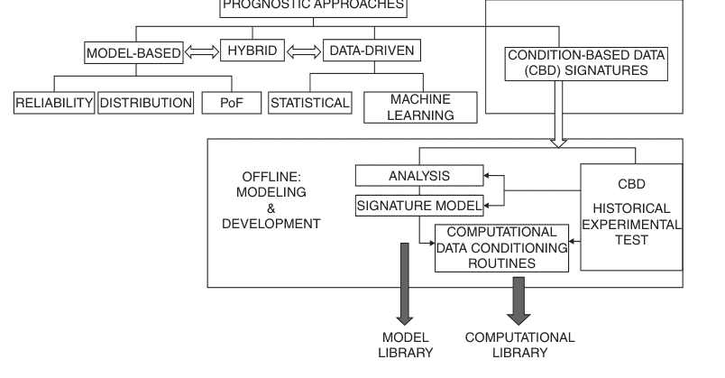

Figure 4.1 Block diagram for offline modeling of CBD signatures.

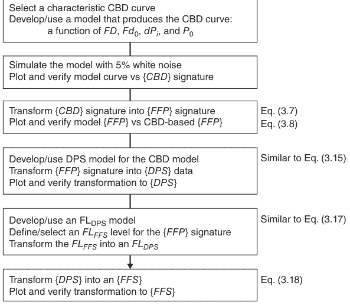

Figure 4.2 Flow diagram for developing signature models.

### 4.1.2 Theory: Heuristic Modeling of CBD Signatures

The theory for heuristic modeling of CBD signatures presented in this chapter is based on the following:

- We are given a failure mode in which the value of one or more parameters changes in value within a system.
- PoF analysis shows that a measurable signal based on how that parameter changes in response to degradation will produce a family of signatures.
- The difference between each signature in a family is related to the rate of change in a degradation parameter.
- In the presence of, for example, phase changes, the characteristics of a signature might change; however, all signatures within a family are likely to exhibit the same change at approximately the same level of degradation.
- Further, variations related to phase changes are likely to produce insignificant changes in estimated values.
- It is not necessary to develop a 100% accurate model of exactly how a dominant parameter changes in response to a failure mode for each and every target for prognostic enabling.

The theory predicts the following results, which apply to the soundness of a heuristic approach to modeling signatures:

- Different failure modes that result in similar changes in a parameter produce similar changes in measurable signals.
- Given a failure mode that causes a signature that is reasonably close to a signature from a known model, it is sufficient to use that known model to produce an FFS as input to prediction algorithms.
- A caveat is that the use of a known model that significantly differs from an exact PoF model might result in FFS data that produces prognostic information that fails to sufficiently meet accuracy requirements.

### 4.1.3 Chapter Objectives

In this chapter, the primary objective is to present and discuss a heuristic approach to modeling CBD signatures, as follows: (i) we first develop degradation-signature models that generate signatures with characteristic curves; and (ii) we then develop additional models that are used to transform signatures and define failure levels.

Subsequently, instead of developing specific models for specific CBD signatures, CBD signatures are matched to known characteristic curves produced by existing degradation-signature models. The corresponding transform models are used.

This approach is simpler compared to an approach using FMEA and PoF methods, such as the following: (i) develop a PoF-based degradation-signal model for every prognostic target; (ii) use that model to generate a characteristic curve; (iii) compare the generated curve to the curve of the CBD signature; (iv) modify, as necessary, the PoF-based model; (v) develop the other models for that CBD signature; and then (vi) use the developed models. Those models are for the following functions that produce characteristic signatures for matching to CBD signatures:

- Power functions for *n* = 0.25, *n* = 0.5, *n* = 0.75, *n* = 1.0, *n* = 1.25, *n* = 1.50, and *n* = 2:
  - Increasing and decreasing signatures,
  - Increasing and decreasing slope angles.¹
- Exponential functions for λ = *P*₀ and *P*₀ = 50, *P*₀ = 100, *P*₀ = 150, and *P*₀ = 200:
  - Increasing and decreasing signatures,
  - Increasing and decreasing slope angles.

The developed degradation-signature models are simulated and the results examined to verify that each model produces data having an expected characteristic signature. The sets of signatures are the following: CBD, FFP, degradation progression signature

> ¹ A special case occurs when a curve is a straight line: the slope angle is constant – neither increasing nor decreasing.


(DPS)，以及 FFS。用于将基于 FFP 的功能失效等级 $FL_{FFP}$ 转换到基于 DPS 的功能失效等级 $FL_{DPS}$ 的模型，通过将功能失效时间与针对 $FL_{FFP}$ 定义的值相关的时间进行比较来验证。我们在创建模拟 CBD 时使用任意测量单位，部分用于验证转换的正确性，也用于展示转换的实用性。

### 4.1.4 章节组织

本章的其余部分按以下方式组织，以介绍和讨论一种基于启发式的 CBD 签名建模方法：

- 4.2 一般建模考虑：CBD 签名
    - 本节介绍与 CBD 签名建模相关的一些一般性考虑，包括噪声裕度（NM）和特征的标称值。
- 4.3 CBD 建模：退化-签名模型
    - 本节介绍退化-签名模型的发展，从中开发出将 FFP 签名数据转换到 DPS 数据的模型。
- 4.4 DPS 建模：FFP 到 DPS 转换模型
    - 本节介绍将 FFP 签名数据转换到 DPS 数据的模型的发展。
- 4.5 FFS 建模：失效等级和签名建模
    - 本节介绍选择失效等级的考虑、将基于 FFP 的失效等级转换到基于 DPS 的失效等级的模型开发，以及将 DPS 数据转换到 FFS 数据的模型。
- 4.6 基于启发式的签名建模方法：总结
    - 本节总结本章所介绍的材料。

## 4.2 一般建模考虑：CBD 签名

PHM 系统的一个目标是收集和准备 CBD 以供处理，以便提供系统健康状况的预测；这种收集和准备处理的工作在传感系统中执行。为此，在我们的系统中，使用模型来表征签名；转换签名；定义功能失效被定义为发生的签名阈值；并创建从传感系统到 PHM 系统中的诊断/预测系统的输入的传输曲线。第一个考虑因素是需要尽可能多地滤除噪声以满足精度要求，其中 *噪声* 定义为与退化没有 100% 相关性的签名数据中的任何变化。例如，如果噪声在基于 CBD 的数据振幅中引入 20% 的变化，而我们被要求在 10% 精度内产生 RUL 估计，则我们会遇到问题。其他考虑因素包括以下内容：定义产生特征曲线的退化-签名模型；标称 FD 值；将 FFP 签名的特征曲线与退化-签名模型匹配；以及选择和使用一组模型来转换数据。与退化-签名模型相关的一组模型用于执行以下操作：将 FFP 签名数据转换到 DPS 数据，将基于 FFP 的失效等级转换到基于 DPS 的失效等级，并将 DPS 数据转换到 FFS 数据。

### 4.2.1 噪声裕度

出于实际目的，滤除所有噪声在技术上既不可行也不具有成本效益。下一步是通过使用具有足够大值的 NM 来减轻未滤除噪声的影响，从而明确声明数据值是由退化引起的：

$FD_i = CBD_i - NM$

这是式 (3.7)，其中

$CBD_i = CBD_{FD} + CBD_m + N_n$  (4.1)

其中 $CBD_m$ 和 $N_n$ 表示与感兴趣的退化无关的数据中任何未滤除的变化，而 $CBD_{FD}$ 表示与感兴趣的退化相关的数据，其中 NM 的大小定义如下：

$NM \ge \max\{CBD_m, N_n, m, n = 1, 2, ...\}$  (4.2)

当然，您使用的任何 NM 都会在预测信息中引入偏移类型的误差；有关该内容的更多细节将在后面的章节中介绍。

### 4.2.2 退化-签名模型的定义

式 (4.2) 中的 NM 用于减轻未滤除的噪声。理想情况下，所有噪声都被滤除，无需噪声裕度（$NM = 0$）。然后我们可以考虑更一般的关系：

$FD_i = CBD_i - NM = CBD_i = g(FD_0)f(dP_i, P_0) + C_0$

其中，一般而言，$g(FD_0)$ 等于常数值，且 $C_0$ 为包含噪声的常数。我们然后定义 $f(dP_i, P_0)$ 表示退化-签名模型。由该定义，

$f(dP_i, P_0) = FD_i/FD_0 - C_1 \quad (C_1 = C_0/FD_0)$  (4.3)

这是一个无量纲的单变量比值。本章后面，我们将定义一组退化-签名模型及其特征签名。

### 4.2.3 特征数据：标称值

一个重要步骤是确定在无退化情况下用于 $FD_i$ 的标称值 $FD_0$。一种确定方法是测量并平均预测目标样本总体中的若干数据样本：该方法引入了采样变化，正如我们在第 1 章中所见，其特征为方差和标准差等指标。采样变化发生的原因为无法制造具有完全相同未退化值的预测目标。

另一种方法是使用预测目标制造商/供应商指定的标称值——当然，我们然后必须考虑指定的或假定的制造/测量公差。一种更动态的方法是使用来自预测目标每个实例的数据样本，保存适用的样本平均值或样本均值，并将该值用于 $FD_0$。

这些只是可用的方法中的一些：我们需要评估、选择并实施必要的任何方法来滤除、抵消或以其他方式减轻噪声，从而使我们能够满足 PHM 系统的精度和精确度要求。

### 4.2.4 特征数据、故障到失效进展签名和退化-签名模型

由式 (3.8) 和 (4.3) 可得，

$FFP_i = (FD_i - FD_0)/FD_0 = FD_i/FD_0 - 1$

$f(dP_i, P_0) = FD_i/FD_0 - C_1$

我们将 FFP 签名数据与退化函数关联如下：

$FFP_i = f(dP_i, P_0)$  (4.4)

我们将退化-签名模型定义为 $dP_i$ 和 $P_0$ 的函数，其生成代表 FFP 签名的特征曲线。我们将开发这样的一组模型；并从这些模型中，我们将开发另一组模型来将 FFP 签名数据转换到 DPS 数据。

我们将感兴趣的 CBD 签名转换到 FFP 签名，并将该签名与已知退化-签名模型产生的签名匹配。然后我们使用 FFP 到 DPS 转换模型将 FFP 签名数据转换到 DPS 数据，然后将其进一步转换到用于 PHM 系统诊断/预测的输入的 FFS 数据。

### 4.2.5 将 CBD 签名转换到 FFS 数据的方法

将 CBD 签名转换到 FFS 数据的方法包括在传感系统中执行的一系列转换和计算：

- 将 CBD 签名转换到 FFP 签名。
- 将 FFP 签名转换到 DPS 数据。
- 定义功能失效发生的基于 FFP 的阈值等级：$FL_{FFP}$。
- 使用 $FL_{FFP}$ 值计算基于 DPS 的阈值等级，$FL_{DPS}$。
- 将 DPS 数据转换到 FFS 数据：$FFS_i = 100\ DPS_i/FL_{DPS}$。

**将 CBD 签名转换到 FFP 签名**

我们使用式 (3.8) 来分离感兴趣的特征数据（失效的先行指标）并确定我们需要什么水平的 NM 才能明确检测到损伤的存在：

$FD_i = CBD_i - NM$

我们使用特征数据的标称值 $FD_0$ 和式 (4.3) 和 (4.4) 的方法，完成 CBD 签名到 FFP 签名的转换：

$FFP_i = FD_i/FD_0 - C_1$

**将 FFP 签名数据转换到 DPS 数据**

将样本数据 $FFP_i$ 与退化签名 $f(dP_i, P_0)$ 匹配，我们将介绍其中一组。对于该组中的每个退化签名，我们将开发一个模型来将 FFP 签名数据转换到 DPS 数据：

$dP_i/P_0 = g(FFP_i)$  (4.5)

这是使用式 (4.4)、$f(dP_i, P_0)$ 的模型并求解 $dP_i/P_0$ 的结果。

除了开发 FFP 到 DPS 转换模型 $g(FFP_i)$ 外，我们还将创建图表以验证结果。


## 计算基于 DPS 的失效阈值

根据定义，FFS 将功能失效定义为当某个 *FFS*ᵢ 数据点的值达到或超过 100% 时发生。因此，为了将 DPS 数据转换为 FFS 数据，我们需要指定一个发生功能失效的 DPS 数据值。由于 FFP 特征是退化的函数，因此最好使用 FFP 特征来定义失效阈值，然后将该阈值转换为与 DPS 数据相关的值

$$FL_{FFP} = FFP_i$$ (4.6)

在定义的功能失效水平下。然后，根据式 (4.5)，基于 DPS 的失效阈值如下：

$$FL_{DPS} = g(FL_{FFP})$$ (4.7)

我们将使用式 (4.5) 和式 (4.6) 为每组典型退化特征建立一个 $FL_{FFP}$ 模型，然后开发相应的模型，将每个 $FL_{FFP}$ 模型转换为基于 DPS 的模型：$FL_{DPS}$。

## 将 DPS 数据转换为 FFS 数据

根据式 (3.18)，要将 DPS 数据转换为 FFS 数据，

$$FFS_{DPS_i} = 100\ DPS_i / FL_{DPS}$$ (4.8)

该值用作 PHM 系统预测系统的输入，每次一个数据点。

## 4.3　CBD 建模：退化特征模型

在本节中，我们将创建逼近感兴趣的 CBD 特征的退化特征模型：即由实际退化引起的那些特征。式 (4.4) 将 FFP 数据定义为与参数退化存在函数关系：

$$FFP_i = f(dP_i, P_0)$$

每个独特的 $f(dP_i, P_0)$ 都是一个退化特征模型，其值无量纲。对感兴趣的 CBD 特征的检查揭示了随着退化的进行，以下重要特征：

- 随着退化的进行，退化特征的振幅要么增大，要么减小。
- 退化特征表现出递减或递增的斜率角²，或视情况表现为垂直渐近，或水平渐近。
- 退化特征可以建模为幂函数或指数函数。
- 递减的退化特征可以转换为递增特征，以减少支持预测所需的退化特征模型的数量。
- 退化特征的一个特例是直线：斜率角恒定。在图中，此类直线包含在递增或递减斜率角的图例中。³

2　为简洁起见，尤其是在图中，使用“递减或递增角”代替“递减或递增斜率角”。
3　应理解，直线特征是一种特例。

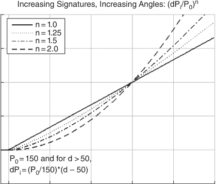

**图 4.4** 幂函数 #1：递增曲线，递增斜率角。

## 幂函数 #2：递减特征，递减或递增斜率角

以下模型是一个幂函数，它产生的特征递减，并具有递减或递增的斜率角，具体取决于幂 $n$ 的值（见图 4.5 和图 4.6）：

$f(dP_i,P_0)=-(dP_i/P_0)^n$  (4.10)

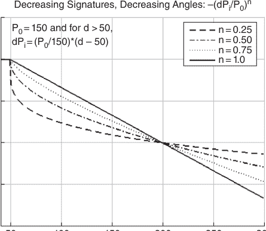

**图 4.5** 幂函数 #2：递减曲线，递减斜率角。

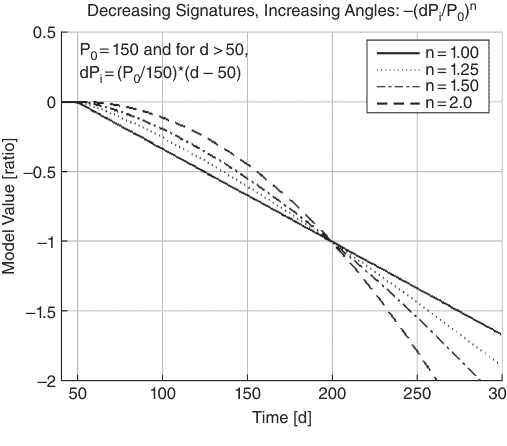

**图 4.6** 幂函数 #2：递减曲线，递增斜率角。

其中 *dPᵢ* 是数据采样时参数值的变化量（退化量），*P₀* 是参数未变化（无退化）时的值，*FD₀* 是当 *dPᵢ* = 0 时无退化情况下特征的标称值。

当 *n* 小于 1（*n* < 1.0）时，退化特征具有递减的斜率角（图 4.5）；当 *n* 大于 1（*n* > 1.0）时，特征具有递增的斜率角（图 4.6）；当 *n* = 1 时，特征的斜率角恒定。对式 (4.3) 和图形的检查表明，当 *dPᵢ* > *P₀* 时，图形可能不适用，除非参数是具有负值的有源组件：无源组件具有正值。

注意，当 *dPᵢ* = *P₀* 时，无论 *n* 的值如何，

$$-(dP_i/P_0)^n = -(P_0/P_0)^n = -1^n = -1$$

注意，式 (4.10) 是式 (4.9) 关于水平轴的镜像。

**示例 4.1**　当被要求计算式 (4.9) 在 *n* = 2.0、*dPᵢ* = 0 和 *dPᵢ* = *P₀* 时的斜率角时，计算得到的斜率角分别为 0° 和 −45°。斜率角按预期递增，如图 4.6 中的图形所示。

## 幂函数 #3：递增特征，垂直渐近

以下模型是一个幂函数，它产生的特征递增并变为垂直渐近（见图 4.7）：

$$f(dP_i,P_0) = [1/(1-dP_i/P_0)]^n - 1 \tag{4.11}$$

该模型意味着以下几点：

- 当 *dPᵢ* < *P₀* 时，对于所有 *n* 值，特征均递增。

# 递增特征，垂直渐近：[1/(1 − dP_i/P_0)]^n −1

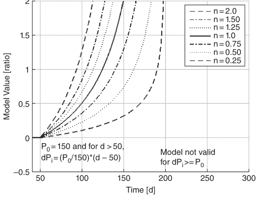

图 4.7 幂函数 #3：递增曲线，垂直渐近，dP_i < P_0。

- 当 dP_i → P_0 时，特征变为垂直渐近——这是一个不稳定的系统，参数值的微小变化会导致特征振幅的剧烈变化。
- 当 dP_i > P_0 时，该模型被声明为“无效”。

## 幂函数 #4：递减特征，垂直渐近

以下模型是一个幂函数，它产生的特征递减并变为垂直渐近（见图 4.8）：

```
f(dP_i, P_0) = 1 − [1/(1 − dP_i/P_0)]^n,    (4.12)
```

这是式 (4.11) 关于水平轴的镜像。该模型意味着以下几点：

- 当 dP_i < P_0 时，对于所有 n 值，特征均递减。
- 当 dP_i → P_0 时，特征变为垂直渐近——这是一个不稳定的系统，参数值的微小变化会导致特征振幅的剧烈变化。
- 当 dP_i > P_0 时，该模型被声明为“无效”。

## 幂函数 #5：递增特征，水平渐近

以下模型是一个幂函数，它产生的特征递增并变为水平渐近（见图 4.9）：

```
f(dP_i, P_0) = 1 − [1/(1 + dP_i/P_0)]^n    (4.13)
```

随着此类特征的幅值变得越来越水平，噪声幅值的变化开始主导由退化引起的信号幅值变化。定义功能失效的退化水平应等于或低于

# 递减特征，垂直渐近：1 –[1/(1 – dP_i/P_0)]^n

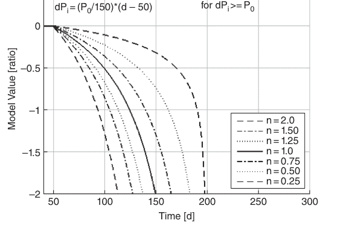

图 4.8 幂函数 #4：递减曲线，垂直渐近，dP_i < P_0。

# 递增特征，水平渐近：1 –[1/(1 + dP_i/P_0)]^n

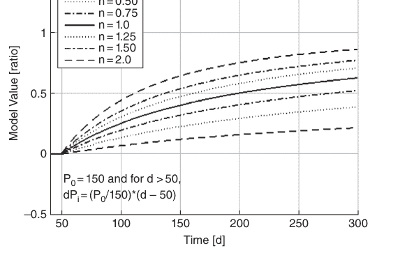

图 4.9 幂函数 #5：递增曲线，水平渐近。

样本之间信号幅值的增量变化等于噪声最大幅值的水平。

## 幂函数 #6：递减特征，水平渐近

以下模型是一个幂函数，它产生的特征递减并变为水平渐近（见图 4.10）：

```
f(dP_i, P_0) = [1/(1 + dP_i/P_0)]^n - 1, (4.14)
```

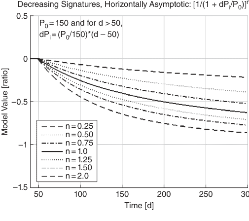

**图 4.10** 幂函数 #6：递减曲线，水平渐近。

这是式 (4.13) 关于水平轴的镜像。随着此类特征的幅值变得越来越水平，噪声幅值的变化开始主导由退化引起的信号幅值变化。定义功能失效的退化水平应等于或低于样本之间信号幅值的增量变化等于噪声最大幅值的水平。

## 幂函数 #7：递增特征，微弯曲，递减或递增斜率角

以下模型是一个幂函数，它产生的特征递增、微弯曲，并具有递减角（见图 4.11）或递增角（见图 4.12），具体取决于幂 *n* 的值：

$$f(dP_i,P_0)=(1+dP_i/P_0)^n-1$$  
(4.15)

乍一看，图中显示的特征可能看起来像直线；然而，除了 *n* = 1（直线曲线）之外，这些特征都是微弯曲的。

## 幂函数 #8：递减特征，微弯曲，递减或递增斜率角

以下模型是一个幂函数，它产生的特征递减、微弯曲，并具有递减（见图 4.13）或递增（见图 4.14）的斜率角，具体取决于幂 *n* 的值：

$$f(dP_i,P_0)=1-(1+dP_i/P_0)^n$$  
(4.16)

这是式 (4.15) 关于水平轴的镜像。

乍一看，这些特征可能看起来像直线；然而，除了 *n* = 1（直线曲线）之外，这些特征都是微弯曲的。


## 递增特征，递减角度：(1 + dP_i/P_0)^n −1

P0 = 150 且当 d > 50 时，dP_i = (P0/150)*(d − 50)

## 图 4.11 幂函数 #7：递增曲线，略微弯曲，斜率角度递减。

## 递增特征，递增角度：(1 + dP_i/P_0)^n −1

P0 = 150 且当 d > 50 时，dP_i = (P0/150)*(d − 50)

## 图 4.12 幂函数 #7：递增曲线，略微弯曲，斜率角度递增。

## 幂函数 #9：递增特征，垂直或水平渐近

以下模型用于产生特征签名随功率 n 的值而递增并垂直或水平渐近的幂函数（见图 4.15 和 4.16）：

```
f(dP_i, P_0) = 1 - (1 - dP_i / P_0)^n
```

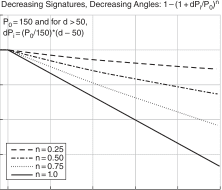

**图 4.13** 幂函数 #8：递减曲线，略微弯曲，斜率角度递减。

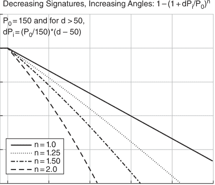

**图 4.14** 幂函数 #8：递减曲线，略微弯曲，斜率角度递增。

该模型意味着以下内容：

- 当 $dP_i < P_0$ 时，对于所有 n 值，特征都是递增的。
- 当 $dP_i \to P_0$ 时，特征变得垂直或水平渐近：系统接近不稳定。
- 当 $dP_i > P_0$ 时，该模型被声明为“无效”，并且系统被定义为已停止运行。

## 递增特征，垂直渐近：1 – (1 – dP_i/P_0)^n

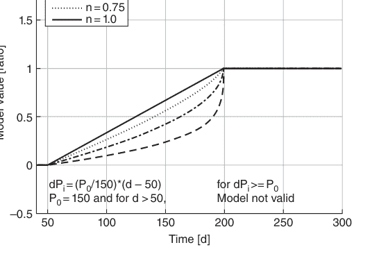

图 4.15 幂函数 #9：递增曲线，垂直渐近，dP_i < P_0。

## 递增特征，水平渐近：(1 – dP_i/P_0)^n –1

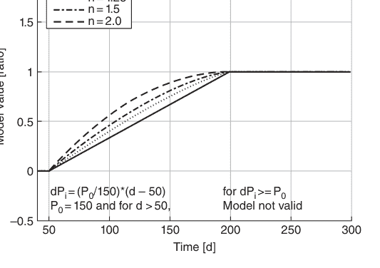

图 4.16 幂函数 #9：递增曲线，水平渐近，dP_i < P_0。

## 幂函数 #10：递减特征，垂直或水平渐近

以下模型用于产生特征签名随功率 n 的值而递减并垂直或水平渐近的幂函数（见图 4.17 和 4.18）：

```
f(dP_i, P_0) = (1 - dP_i/P_0)^n - 1, (4.18)
```

## 递增特征，垂直渐近：exp(dP_i/P_0)−1

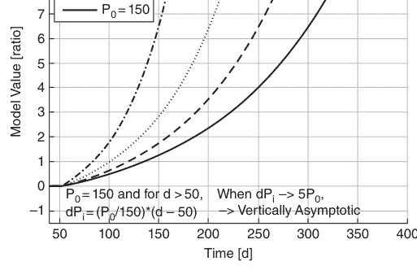

图 4.19 指数函数 #11：递增曲线，垂直渐近。

- 当 dP_i > P_0 时，该模型被声明为“无效”，并且系统被定义为已停止运行。

## 指数函数 #11：递增特征，近似垂直渐近

以下是指数函数的模型，该模型产生特征签名递增并变得越来越垂直渐近（见图 4.19）：

```
f(dP_i, P_0) = exp(dP_i / P_0) − 1
```

随着退化增加，特征在 dP_i ≥ 5P_0 时变得近似垂直渐近。建议将功能失效定义为在退化达到 dP_i = 2P_0 值时或之前发生。

## 指数函数 #12：递减特征，近似垂直渐近

以下是指数函数的模型，该模型产生特征签名递减并变得越来越垂直渐近斜率（见图 4.20）：

```
f(dP_i, P_0) = 1 − exp(dP_i / P_0)
```

这是关于水平轴相对于式 (4.19) 的镜像。随着退化增加，特征在 dP_i ≥ 5P_0 时变得近似垂直渐近。建议将功能失效定义为在退化达到 dP_i = 2P_0 值时或之前发生。

## 指数函数 #13：递增特征，水平渐近

以下是指数函数的模型，该模型产生特征签名递增并变得越来越水平渐近（见图 4.21）：

```
f(dP_i, P_0) = 1 − exp(−dP_i / P_0)
```

## 递减特征，垂直渐近：1 − exp(dP_i / P_0)

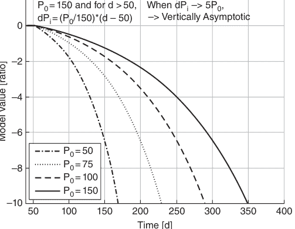

图 4.20 指数函数 #12：递减曲线，垂直渐近。

## 递增特征，水平渐近：1 − exp(−dP_i / P_0)

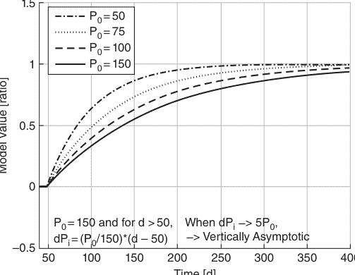

图 4.21 指数函数 #13：递增曲线，水平渐近。

随着退化增加，特征在 dP_i ≥ 5P_0 时变得水平渐近。建议将功能失效定义为在退化达到 dP_i = 2P_0 值时或之前发生。

## 指数函数 #14：递减特征，水平渐近

以下是指数函数的模型，该模型产生特征签名递减并变得越来越水平渐近（见图 4.22）：

```
f(dP_i, P_0) = exp(−dP_i / P_0) − 1,    (4.22)
```

## 递减特征，渐近：exp(-dP_i/P_0)-1

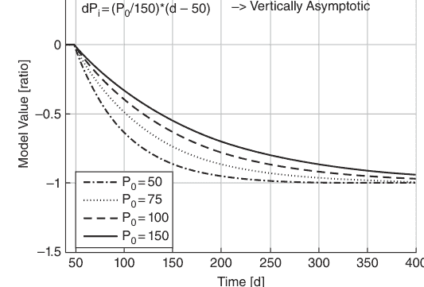

图 4.22 指数函数 #14：递减曲线，水平渐近。

这是关于水平轴相对于式 (4.21) 的镜像。随着退化增加，特征在 dP_i ≥ 5P_0 时变得水平渐近。建议将功能失效定义为在退化达到 dP_i = 2P_0 值时或之前发生。

## 4.3.2 代表性 FFP 退化特征的示例图

图 4.3–4.22 展示了 FFP 特征响应于退化增加的示例图。

## 4.3.3 将递减特征转换为递增特征

以下退化特征模型产生递减特征：

| 幂函数 #2，式 (4.10)： | f(dP_i, P_0) = -(dP_i/P_0)^n |
| 幂函数 #4，式 (4.12)： | f(dP_i, P_0) = 1 - [1/(1 - dP_i/P_0)]^n |
| 幂函数 #6，式 (4.14)： | f(dP_i, P_0) = [1/(1 + dP_i/P_0)]^n - 1 |
| 幂函数 #8，式 (4.16)： | f(dP_i, P_0) = 1 - (1 + dP_i/P_0)^n |
| 幂函数 #10，式 (4.18)： | f(dP_i, P_0) = (1 - dP_i/P_0)^n - 1 |
| 指数函数 #12，式 (4.20)： | f(dP_i, P_0) = 1 - exp(dP_i/P_0) |
| 指数函数 #14，式 (4.22)： | f(dP_i, P_0) = exp(-dP_i/P_0) - 1 |

为减少模型数量，通过执行以下操作将递减特征转换为递增特征：

```
f(increasing) = -f(decreasing)  (4.23)
```

## 表 4.1 递减特征和模型列表以及对应的递增模型。

| 特征名称 | 递减模型 | 递增模型 |
|---|---|---|
| 幂函数 #2 | $-(dP_i/P_0)^n$ | $(dP_i/P_0)^n$ |
| 幂函数 #4 | $1 - [1/(1 - dP_i/P_0)]^n$ | $[1/(1 - dP_i/P_0)]^n - 1$ |
| 幂函数 #6 | $[1/(1 + dP_i/P_0)]^n - 1$ | $1 - [1/(1 + dP_i/P_0)]^n$ |
| 幂函数 #8 | $1 - (1 + dP_i/P_0)^n$ | $(1 + dP_i/P_0)^n - 1$ |
| 幂函数 #10 | $(1 - dP_i/P_0)^n - 1$ | $1 - (1 - dP_i/P_0)^n$ |
| 指数函数 #12 | $1 - \exp(dP_i/P_0)$ | $\exp(dP_i/P_0) - 1$ |
| 指数函数 #14 | $\exp(-dP_i/P_0) - 1$ | $1 - \exp(-dP_i/P_0)$ |

## 示例 4.2

假设你有一个递减的 FFP 特征，并且假设你确定该特征由式 (4.10) 建模。使用式 (4.23) 将该特征转换为由式 (4.9) 建模的递增特征：

```
-f(dP_i, P_0) = -[-(dP_i/P_0)^n] = (dP_i/P_0)^n
```

使用示例 4.2 的方法，你可以将所有递减特征转换为递增特征。然后你得到表 4.1 中所示的结果。

## 4.4 DPS 建模：FFP 到 DPS 变换模型

在本节中，我们开发将 FFP 特征数据转换为 DPS 数据的模型。为此，我们从式 (4.4) 开始并求解式 (4.5)：

```
FFP_i = f(dP_i, P_0)  (4.24)
```

```
dP_i/P_0 = g(FFP_i)  (4.25)
```

解集 {dP_i/P_0} 是一个 DPS 数据集，{DPS_i}，即退化进展特征。

## 4.4.1 开发变换模型：FFP 到 DPS

我们将把 FFP 代入式 (4.24)，求解结果得到式 (4.25)，并验证解。验证应包括 (i) 产生 FFP 示例数据，(ii) 对特征进行视觉验证，(iii) 转换示例数据以产生基于 DPS 的特征，以及 (iv) 进行视觉验证以确保 DPS 基于特征是理想的传输曲线：一条直线。

## 幂函数 #1 的变换模型

由式 (4.9)，对于幂函数 #1 的退化信号模型，以及由式 (4.24)：

```
f(dP_i, P_0) = (dP_i/P_0)^n = FFP_i
```


由于

$$DPS_i = dP_i / P_0$$

我们有

$$DPS_i = (FFP_i)^{1/n} \tag{4.26}$$

图4.23显示了模拟的FFP签名图，图4.24显示了变换FFP签名后的DPS数据图：验证了变换方程(4.26)的建模。

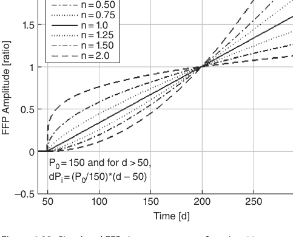

图4.23 模拟的FFP签名：幂函数 #1。

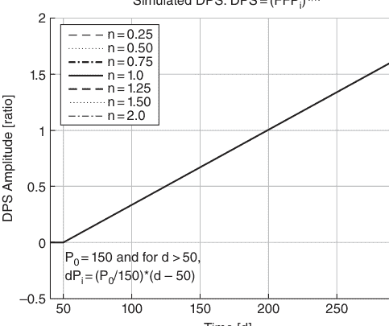

图4.24 模拟的基于FFP签名的DPS：幂函数 #1。

## 模拟的DPS：DPS = 1 − [1/(1 − FFP_i)]^{1/n}

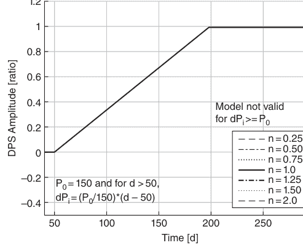

图4.26 模拟的基于FFP签名的DPS：幂函数 #3。

最后，

```
DPS_i = dP_i / P_0 = 1/(1 − FFP_i)^{1/n} − 1    (4.28)
```

图4.27显示了模拟的FFP签名图，图4.28显示了变换FFP签名后的DPS数据图：验证了变换方程(4.28)的建模。

## 模拟的FFP签名：FFP_i = [1 − 1/(1 + dP_i / P_0)]^n

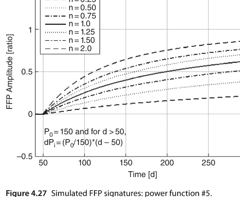

图4.27 模拟的FFP签名：幂函数 #5。

因此

$dP_i / P_0 = -\ln(1 - FFP_i)$

最后，

$DPS_i = dP_i / P_0 = \ln(1/(1 - FFP_i))$    (4.32)

图4.35显示了模拟的FFP签名图，图4.36显示了变换FFP签名后的DPS数据图：验证了变换方程(4.32)的建模。

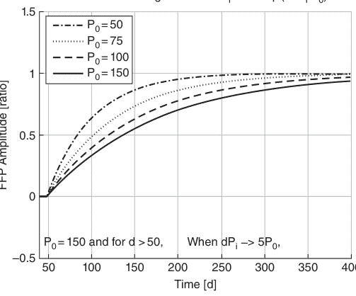

图4.35 模拟的FFP签名：指数函数 #13。

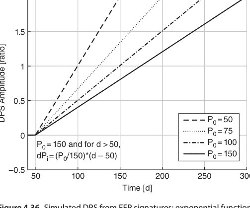

图4.36 模拟的基于FFP签名的DPS：指数函数 #13。

## 图4.38 模拟的FFP和DPS签名：n = 2.0时的幂函数 #3。

## 图4.39 模拟的FFP和DPS签名：n = 1.5时的幂函数 #5。

## 基于DPS的FL模型：幂函数 #7

根据方程(4.29)，对幂函数 #7 的FFP签名进行变换，并根据方程(4.7)：

```
FL_DPS = (FL_FFP + 1)^{1/n} - 1
(4.36)
```

## 示例4.6 对于幂函数 #7 签名，设 FL_FFP 为 0.85，n = 0.75，计算 FL_DPS 的值。通过绘制FFP签名、DPS来验证结果，

## FFP和DPS，n = 0.25：FFP_i = 1 − (1 − dP_i/P_0)^n

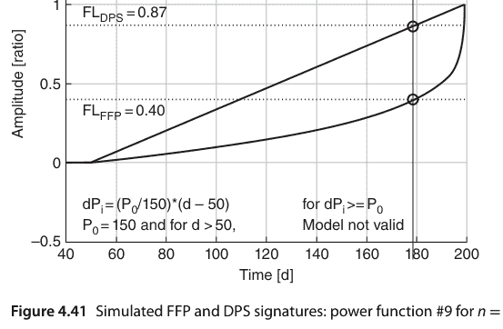

图4.41 模拟的FFP和DPS签名：n = 0.25时的幂函数 #9。

## 示例4.8 对于指数函数 #11 签名，设 FL_FFP 为 3.0，P_0 = 100，计算 FL_DPS 的值。通过绘制FFP签名、DPS和失效水平来验证结果：

```
FFP_i = exp(dP_i/P_0) − 1
```

```
DPS_i = ln(FFP_i + 1)
```

计算得到的 FL_DPS 值等于 1.39，图4.42中的图显示，FFP签名数据和DPS数据在同一时间点发生功能失效：验证了方程(4.38)。

## 基于DPS的FL模型：指数函数 #13

根据方程(4.32)，对指数函数 #11 的FFP签名进行变换，并根据方程(4.7)：

```
FL_DPS = ln(1/(1 − FL_FFP)) (4.39)
```

## 示例4.9 对于指数函数 #13 签名，设 FL_FFP 为 3.0，P_0 = 100，计算 FL_DPS 的值。通过绘制FFP签名、DPS和失效水平来验证结果：

```
FFP_i = 1 − exp(−dP_i/P_0)
```

```
DPS_i = ln(1/(1 − FFP_i))
```

```
FL_DPS = ln(1/(1 − FL_FFP))
```

计算得到的 FL_DPS 值等于 1.39，图4.43中的图显示，FFP签名数据和DPS数据在同一时间点发生功能失效：验证了方程(4.39)。

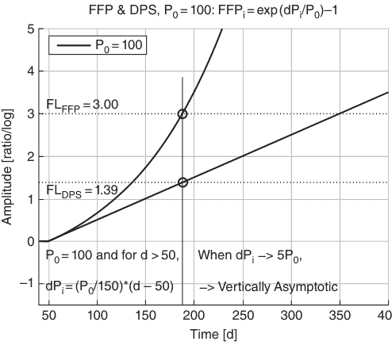

**图4.42** 模拟的FFP和DPS签名：P₀ = 100时的指数函数 #11。

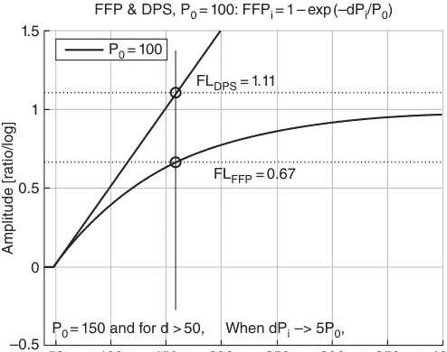

**图4.43** 模拟的FFP和DPS签名：P₀ = 150时的指数函数 #13。

## 4.5.2 失效水平的建模结果：基于FFP和基于DPS

指定一个基于FFP的失效水平（FL<sub>FFP</sub>）并将该值转换为基于DPS的失效水平（FL<sub>DPS</sub>），应使两种签名在同一时间点达到功能失效的阈值水平。图4.37–4.43中的图确认了各种退化签名在不同功能失效水平下的预期结果。

## 基于DPS的FFS，n = 1.5：FFP_i = [1/(1 - dP_i/P_0)]^n -1

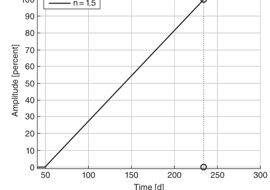

## FFP和DPS，n = 1.50：FFP_i = [1 - 1/(1 + dP_i/P_0)]^n

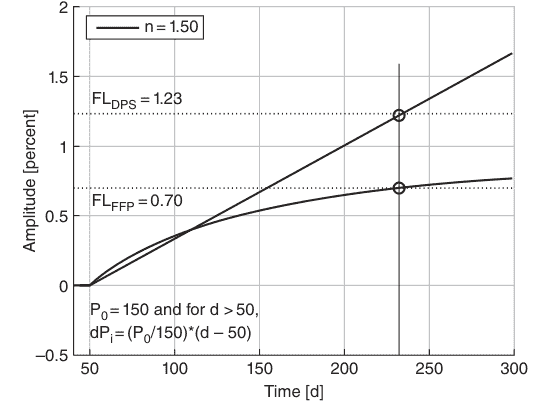

图4.45 示例图：FFS（顶部）以及FFP和DPS（底部）：幂函数 #5。

与基于CBD的数据的信噪比（SNR）一致的精度；用于采集基于CBD的数据的采样率；以及系统的测量精度，特别是用于处理和转换数据的传感器和数据转换器（数模转换器和模数转换器）。

表4.2列出了递增FFP函数及其模型、FFP到DPS的变换，以及FL(FFP)到FL(DPS)的模型。表中未显示DPS到FFS的变换：

```
FFS_DPSi = 100 DPS_i / FL_DPS
```

## 表4.2 模型：递减签名、递增签名、FFP到DPS、以及FL(FFP)到FL(DPS)。

| 递增签名函数 | FFP签名模型 | FFP到DPS的变换模型 | 基于FFP的FL到基于DPS的FL模型 |
|---|---|---|---|
| 幂函数 #1 | $(dP_i / P_0)^n$ | $(FFP_i)^{1/n}$ | $(FL_{FFP})^{1/n}$ |
| 幂函数 #3 | $[1/(1 - dP_i / P_0)]^n - 1$ | $1 - 1/(FFP_i + 1)^{1/n}$ | $1 - 1/(FL_{FFP} + 1)^{1/n}$ |
| 幂函数 #5 | $1 - [1/(1 + dP_i / P_0)]^n$ | $1/(1 - FFP_i)^{1/n} - 1$ | $1/(1 - FL_{FFP})^{1/n} - 1$ |
| 幂函数 #7 | $(1 + dP_i / P_0)^n - 1$ | $(FFP_i + 1)^{1/n} - 1$ | $(FL_{FFP} + 1)^{1/n} - 1$ |
| 幂函数 #9 | $1 - (1 - dP_i / P_0)^n$ | $1 - (1 - FFP_i)^{1/n}$ | $1 - (1 - FL_{FFP})^{1/n}$ |
| 指数函数 #11 | $\exp(dP_i / P_0) - 1$ | $\ln(FFP_i + 1)$ | $\ln(FL_{FFP} + 1)$ |
| 指数函数 #13 | $1 - \exp(-dP_i / P_0)$ | $\ln(1/(1 - FFP_i))$ | $\ln(1/(1 - FL_{FFP}))$ |

在下一章中，您将了解到签名并非理想状态：它们包含例如偏移误差、失真和噪声——包括由于反馈效应、多失效模式效应等引起的信号变化。下一章中还包含了减轻和/或改善此类非理想性的方法。

## 参考文献

Carr, J.J. 和 Brown, J.M. (2000). *生物医学设备技术导论，第4版.* Upper Saddle River, NJ: Prentice Hall.

Erickson, R. (1999). *电力电子基础.* Norwell, MA: Kluwer Academic Publishers.

Hofmeister, J., Goodman, D., 和 Wagoner, R. (2016). 用于复杂设备和系统状态监测的高级异常检测方法. 2016 Machine Failure Prevention Technology, Dayton, Ohio, US, 5月24–26日.

Hofmeister, J., Wagoner, R., 和 Goodman, D. (2013). 使用基于状态的数据进行异常和预测推理的电气系统预测健康管理（PHM）. *化学工程学报* 33: 992–996.

Hofmeister, J., Szidarovszky, F., 和 Goodman, D. (2017). 一种处理基于状态数据以用于预测算法的方法. 2017 Machine Failure Prevention Technology, Virginia Beach, Virginia, US, 5月15–18日.

Judkins, J.B. 和 Hofmeister, J.P. (2007). 具有增益反馈环路的开关电源的非侵入式预测，IEEE航空航天会议2007, Big Sky, Montana, US, 3月4–9日.

Judkins, J.B., Hofmeister, J., 和 Vohnout, S. (2007). 用于电压调节开关电源的预测传感器. IEEE航空航天会议2007, Big Sky, Montana, US, 3月4–9日, 分会11–0804, 1–8.

Kwon, D., Azarian, M.H., 和 Pecht, M. (2010). *互连失效中间阶段导致的数字信号特性退化*, 281–296. College Park, MD: 马里兰大学先进生命周期工程中心(CALCE).

德州仪器. (1995). 理解数据转换器. 应用报告 SLAA013.


Viswanadham, P. and Singh, P. (1998). *电子封装中的失效模式与机制*, 第7章, 283–307. New York, NY: Chapman and Hall.

## Further Reading

Filliben, J. and Heckert, A. (2003). Probability distributions. In: *Engineering Statistics Handbook*. National Institute of Standards and Technology. http://www.itl.nist.gov/div898/handbook/eda/section3/eda36.htm.

Tobias, P. (2003a). Extreme value distributions. In: *Engineering Statistics Handbook*. National Institute of Standards and Technology. https://www.itl.nist.gov/div898/handbook/apr/section1/apr163.htm.

Tobias, P. (2003b). How do you project reliability at use conditions? In: *Engineering Statistics Handbook*. National Institute of Standards and Technology. https://www.itl.nist.gov/div898/handbook/apr/section4/apr43.htm.
