## 5
## 非理想数据：影响与调理

### 5.1 非理想数据的介绍：影响与调理

基于条件的數據（CBD）包含特征数据（FD），这些特征数据形成与失效、损伤和退化高度相关的特征签名——尤其是由于温度、电压、电流、冲击、振动等引起的应力和应变累积效应导致的疲劳损伤。这些特征签名形成曲线并非理想，如图5.1所示；相反，基于CBD的特征签名包含噪声，它们被扭曲，并且会响应噪声而变化。这种非理想性，当故障到失效进展（FFP）特征签名被转换为退化进展特征签名（DPS），然后再转换为功能失效特征签名（FFS）时，会导致非理想的传输曲线和预后信息的误差。这些误差包括以下内容：（i）退化开始的时间与退化开始检测时间之间的偏移误差；以及（ii）非线性误差，降低了剩余使用寿命（RUL）、健康状态（SoH）和预后视界（PH）——或使用寿命终结（EOL）估计的准确性。

### 5.1.1 第4章回顾

第4章提出了一组七个特征模型，这些模型使得FFP特征签名具有理想的特征曲线，例如图5.2顶部绘制的曲线。这些理想特征被转换为理想的DPS传输曲线，即从振幅为0的原点开始并经过振幅为1的另一数据点的直线，例如图5.2底部绘制的曲线。图5.3顶部显示了两个特征签名：一个曲线状的FFP特征签名及其转换为线性DPS的转换。该DPS被转换为图5.3底部所示的FFS；该FFS是一种非常适合由预测系统处理以产生预后信息的传输曲线。

### 5.1.2 数据采集、处理和转换

在本章中，我们继续进行模型和方法开发的离线阶段：这些模型和方法旨在解决噪声引起的非线性效应。我们使用示例和描述来说明噪声对数据质量和最终传输曲线——传感系统的FFS——非线性的常见原因和影响。我们提出您可以用来减轻和/或改善非线性的方法

# 模拟FFP特征签名：FFPᵢ = 1 - exp(-dpᵢ/P₀)

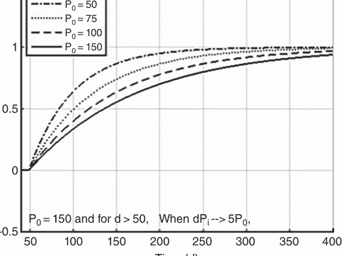

P₀ = 150 and for d > 50, When dPᵢ ->> 5P₀

# 模拟DPS：DPS = ln(1/FFPᵢ)

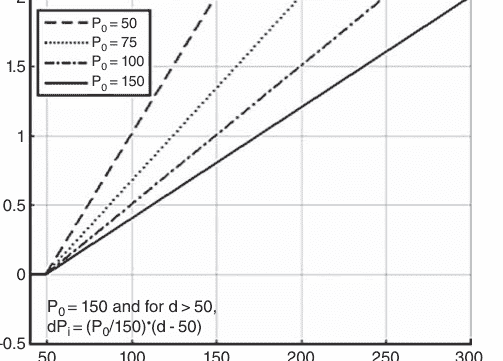

P₀ = 150 and for d > 50, dPᵢ = (P₀/150)*(d - 50)

Figure 5.2 Plots of a family of FFP signatures and DPS transfer curves.

### 5.1.3 章节目标

基于CBD的特征签名并非理想：相反，它们包含噪声，它们被扭曲，它们包含误差，等等。尽管我们可能，例如，有一个足够强大的智能传感器可以连接到SMPS的输出节点——以采样数据；执行Bessel、Butterworth或Chebyshev滤波；将模拟数据数字化；执行数字信号处理；并提取条件指标，例如该SMPS输出节点处纹波电压的振幅（V_R，一种FD）——我们可能会发现我们的特征签名噪声太大，无法在不进行进一步信号调理的情况下使用。

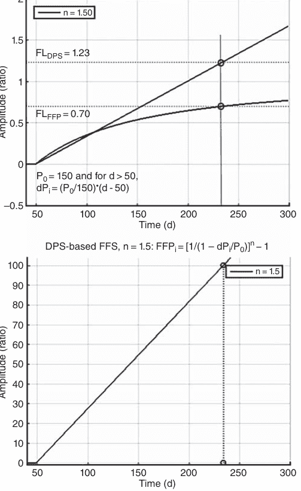

Figure 5.3 Plots of a curvilinear FFP, the transform to a linear DPS (top), and the transform to an FFS (bottom).

一种用于预后和健康管理/监测（PHM）的非理想CBD特征签名的启发式方法可以描述为在离线和在线阶段包含四个主要过程，如图5.4和5.5所示（IEEE 2017；Medjaher and Zerhouni 2013）：

- 1. 采集和处理数据以提高数据质量。
- 2. 转换数据以形成特征签名，这些特征签名适合预测处理以在精度要求范围内产生预后信息。

# SENSING SYSTEM
OFFLINE PHASE: Learning, Evaluation, and Development

Monitor Data

Extract Features:
Condition Indicators

Select Features:
Characterize, Evaluate,
Reduce, & Select

Create
Models & Methods

Library:
Models
Methods

Data Quality    Data Transformation, Conditioning    Data Modeling and Computational Methods

{CBD}i    {FD}i        {V_R_i}    {FFP}i    {DPS}i    (FL_FFP) (FL_DPS) {FFS}i

Figure 5.4 Offline phase to develop a prognostic-enabling solution of a PHM system.

# SENSING SYSTEM
ONLINE PHASE:
Data Acquisition and Manipulation

Library: Models &
Methods

Monitor Data

Extract Features:
Condition Indicators

Use
Models & Methods

{CBD}i    {FD}i = V_R_i    {FFP}i {DPS}i    (FL_FFP) (FL_DPS) {FFS}i

Data Acquisition    Data Manipulation: Transformation and Conditioning

Figure 5.5 Diagram of an online phase to exploit a prognostic-enabling solution.

- 3. 在离线阶段对退化特征签名和信号调理方法进行建模，然后使用这些模型和方法支持将数据转换为FFS。
- 4. 处理转换后的数据以产生预后信息。

在本章中，我们将使用第4章中开发的模型（过程#3）来转换示例数据（过程#2），以演示导致特征签名质量下降的原因和影响（过程#1），这降低了预后信息的准确性（过程#4）。目标是介绍和讨论误差的来源、这些误差对特征签名的显著影响，以及当采用时可通过移除、减少和/或避免此类原因和影响来改善和/或减轻误差的方法和技术。目标是提高作为PHM系统预测系统输入的FFS数据的线性度和准确性，从而提高用于提供所监测和管理系统健康状况预后的预后信息的准确性。

我们将启发式方法应用于一个装配系统中预后启用组件的示例，该组件在导致失效的退化作用下会产生噪声CBD。该示例将是一个SMPS，其中输出滤波器的电容随着退化进行而减小。目的包括以下内容：（i）说明与噪声相关的非线性误差；（ii）识别、列出、解释并演示导致非线性误差的一些更常见的原因和影响；以及（iii）提出并展示改善和/或减轻非理想性和/或非理想性影响的方法。

### 5.1.4 章节组织

本章的其余部分组织为介绍和讨论导致特征签名非理想性从而产生非线性误差的原因和影响。我们介绍和讨论各种方法和技术来改善和减轻这些影响：

5.2 Heuristic-Based Approach Applied to Non-Ideal CBD Signatures
本节总结了通过使用示例将启发式方法应用于CBD特征签名的总结。噪声被确定为实现预后信息高精度的问题。

5.3 Errors and Non-Ideality in FFS Data
本节介绍和讨论与非线性相关的话题，例如噪声裕度和偏移误差；测量误差、不确定性和采样；噪声的其他来源；以及FFS数据的数据平滑和非理想性。

5.4 Heuristic Method for Adjusting FFS Data
本节描述了一种调整FFS数据的方法、调整后的FFS数据和另一组数据集的数据调理。

5.5 Summary: Non-Ideal Data, Effects, and Conditioning
本节总结了本章介绍的材料。

## 5.2 Heuristic-Based Approach Applied to Non-Ideal CBD Signatures

CBD特征签名并非理想：它们包含偏移误差、失真和噪声——包括例如由于反馈效应和多失效模式效应引起的信号变化。本章包含用于减轻和/或改善此类非理想性的方法。在CBD特征签名的处理和将这些特征签名转换为作为预测系统输入的FFS的过程中引入了其他误差。

即使CBD完全没有与退化无关的噪声和变异，将传感器连接到节点以收集数据然后处理该数据也会引入数据误差。传感器可能执行噪声滤波或数据采样，或充当模拟-数字数据转换器（ADC），并且数字化数据使用数字信号处理（DSP）方法和技术进行处理，包括额外的滤波、数据融合、数据和域变换、数据存储和数据传输，所有这些都会引入数据误差。操作和环境变异，例如电压和温度变异，也是导致非理想数据的信号变异的来源（Texas Instruments 1995；Jenq and Qiong 2002；Hofmeister et al. 2013, 2016, 2017）。


+   9. 进行实验，收集新数据，应用一组传感解决方案，并评估示例 FFS 的非线性。选择最有前景的一组解决方案。
+   10. 选择适当的数据调理方法，以充分降低非线性，使其满足使用 FFS 产生的任何预测估计在准确性、分辨率和精度方面的要求。假设 PHM 系统的预测系统不会引入进一步的非线性误差。
+   11. 适应并实施数据调理步骤，如上所述，为 PHM 系统的传感系统框架提供解决方案。该解决方案包括传感器以及获取和操作用于检测、隔离和识别与系统健康相关的 CBD 特征所需的所有固件和/或软件计算例程；参见第 1 章（Carr and Brown 2000; Hofmeister et al. 2013; CAVE3 2015; IEEE 2017）中的图 1.1 和 1.2。

## 5.2.2 预测使能的示例目标

为说明目的，选择 SMPS 输出滤波器的电容作为预测目标，并选择输出纹波电压作为要提取为状况指示器并作为特征处理的 CBD 特征。该电源使用了一种设计，其中输出滤波电容的值足够大，使得纹波电压的幅度取决于负载的电阻率，而不取决于滤波电容的量。导致滤波电容损失的退化效应将导致输出纹波电压的幅度增加（Erickson 1999; Judkins et al. 2007; Singh 2014）。

## 获取数据、转换它并定性评估它

我们通过运行注入故障并捕获数据的实验来开始对 SMPS 进行预测使能的过程。我们验证了降低滤波电容会导致如图 5.6 所示的纹波电压：特征嘈杂且明显不是理想曲线。示例性数据集源自实际实验数据；已添加额外数据点，时间从分钟（加速测试）更改为小时，并且噪声幅度已更改以用于说明目的。特征源自平方根（n = 0.5）幂函数 #3 类型的退化。

### 示例 5.1 将我们开发的建模应用于图 5.6 所示的示例数据，并对结果进行评论：

+   根据曲线的形状，并使用第 4 章中的表 4.2：

|  |  |
|---|---|
| FFP-特征模型： | [1/(1 − dP_i/P_0)]^n − 1 |
| FFP 到 DPS 变换模型： | 1 − 1/(FFP_i + 1)^{1/n} |
| 从 FFP 基于到 DPS 基于的 FL 变换： | 1 − 1/(FL_FFP + 1)^{1/n} |

+   纹波电压的标称值为 99.3 mV（FD_0 = 99.3 mV）：退化开始前 10 个样本的计算平均值。
+   使用 0 作为噪声裕度（NM = 0 mV）。
+   定义功能失效为 FL_CBD = 250 mV，当 CBD 等于 250 mV 时。
+   实验中注入的退化开始于时间等于 98 小时。

+   - 实验数据显示 CBD 幅度为 250 mV 时，时间等于 153 小时。

首先，将 CBD 基于的特征转换为 FFP 特征，结合式（3.8）和（4.3），结果如图所示 5.7 顶部：

```
$$FFP_i = (CBD_i - FD_0 - NM)/FD_0 \tag{5.1}$$
```

然后使用 FFP 到 DPS 变换模型将 FFP 特征数据转换为 DPS 数据，并如图所示 5.7 底部所示绘制它。从

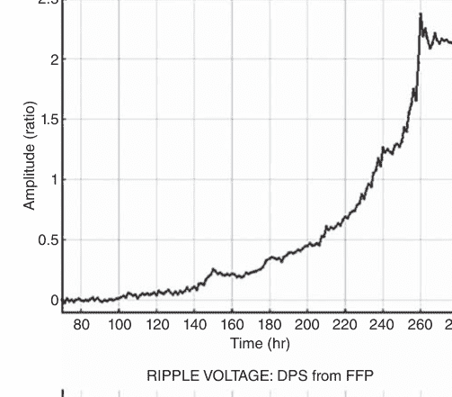

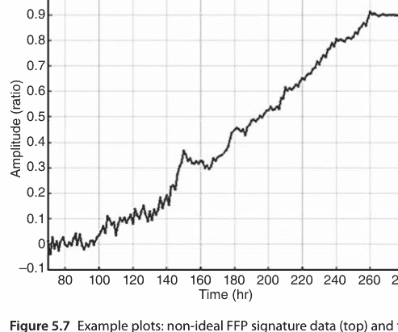

图 5.7 示例图：非理想 FFP 特征数据（顶部）和转换后的 DPS 数据（底部）。

FL_CBD = 250 mV（功能失效），计算 FL_FFP

FL_FFP = (FL_CBD - FD_0)/FD_0 = 1.55

你用它来计算 FL_DPS：

FL_DPS = 1 - 1/(FL_FFP + 1)^{1/n} = 1 - 1/2.55^2 = 0.85

以创建 FFS 数据，其绘制结果如图所示 5.8 顶部。理想的 FFS 图也包含在图 5.8 底部。对 FFS 数据与绘制的理想 FFS 进行定性比较似乎是令人满意的——尽管时间 <100 小时的数据值得怀疑，因为该数据表明存在退化。

## RIPPLE VOLTAGE: FFS from DPS

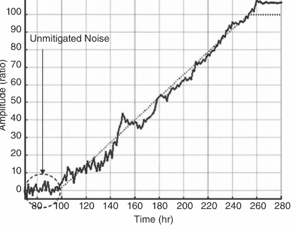

## RIPPLE VOLTAGE: FFS Nonlinearity

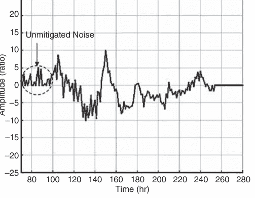

图 5.8 示例图：非理想和理想 FFS 数据（顶部）和 FNL（底部）。

## 表 5.1 FFS 非线性程序。

| 程序名称 | 程序表达式 |
|---|---|
| 计算失效时间（TTF） | $TTF = t_{FAILURE} - t_{ONSET}$ |
| 创建理想数据集 {$IDEAL\_FFS_i$} | $IDEAL\_FFS_i = 100\,(t_i - t_{ONSET})/TFF$ |
| 计算逐点非线性 {$FNL_i$} | $FNL_i = FFS_i - IDEAL\_FFS_i$ |
| 计算正非线性 ($FNL_P$) | $FNL_P = max({FNL_i})$ |
| 计算负非线性 ($FNL_N$) | $FNL_N = min({FNL_i})$ |
| 计算总非线性误差 ($FNL_E$) | $FNL_E = FNL_P - FNL_N$ |

## 定量评估数据

由于理想的 FFS 是一条直线传递曲线，因此可以通过采用第 3 章中的 FFS 非线性（FNL）方法进行结果的定量评估。你决定计算正非线性、负非线性和总非线性会很有信息量：

```
$FNL_P = max({FNL_i})$  (5.2)
```

```
$FNL_N = min({FNL_i})$  (5.3)
```

```
$FNL_E = FNL_P - FNL_N$  (5.4)
```

表 5.1 列出了定量评估 FFS 非线性的程序步骤。

### 示例 5.2 按照表 5.1 中概述执行 FNL 程序，然后绘制并评估结果。假设以下情况：

+   - 所需的 FFS 非线性应在最大预测距离（PD）的 75% 以内或之前保持在 ±10%（$PD_\alpha = PD_{10}$），该距离已知从退化开始（98 小时）开始，到功能失效（253 小时）结束，实验得知为 155 小时。
+   - 所需的 FFS 非线性应在最大 PD 的 50% 以内或之前保持在 5%（$PD_\alpha = PD_{10}$）。
+   - 退化开始前没有正的 FFS 非线性。

图 5.8 左侧的 FFS 数据的非线性被计算并绘制在图 5.8 右侧。表 5.2 列出了定量计算、规范和结果以及评估。评估为，“要求未满足”——如表中最右列所示。

你得出结论，结果未满足要求是由于退化开始于 100 小时之前数据中未缓解的噪声效应（见图 5.8）。

### 示例 5.3 由于 CBD 基于的特征表明存在约 2 mV 的噪声，使用 3.0 mV 的 NM 是合理的，这等于噪声加上 50% 的裕度（应急）。执行示例 5.1 和 5.2 中描述的变换、FNL 程序和评估。

## 表 5.2 示例 5.2 的计算、规范和结果列表。

| 名称 最大 PD | 计算/规范 PD = TTF = 155 小时 | 要求 N/A | 结果 → 准则 |
|---|---|---|---|
| PD 在 10% 以内 | PD₁₀% = 100 (PD − PD₁₀)/PD | 75% | PD₁₀ 在 34.5 h
77.7% → 满足 |
| PD 在 5% 以内 | PD₅% = 100 (PD − PD₅)/PD | 50% | PD₅ 在 109.5 h
29.4% → 未满足 |
| FNLₚ | FNLₚ = max({FNLᵢ}) | N/S | 10.0% |
| FNLₙ | FNLₙ = min({FNLᵢ}) | N/S | −10.0% |
| FNLₑ | FNLₑ = FNLₚ − FNLₙ | N/S | 20.0% |
| FNLₚ | 退化开始前 | 0% | ~5% → 未满足 |

N/A，不适用；N/S，未指定。

## 表 5.3 示例 5.3 的计算、规范和结果列表。

| 名称 最大 PD | 计算/规范 PD = TTF = 151.25 h | 要求 N/A | 结果 | Chg. |
|---|---|---|---|---|
| PD 在 10% 以内 | PD₁₀% = 100(PD − PD₁₀)/PD | 75% | PD₁₀ 在 65 h
57.7% → 未满足 | N |
| PD 在 5% 以内 | PD₅% = 100 (PD − PD₅)/PD | 50% | PD₅ 在 105.0 h
30.6% → 未满足 | P |
| FNLₚ | FNLₚ = max({FNLᵢ}) | N/S | 8.4% | P |
| FNLₙ | FNLₙ = min({FNLᵢ}) | N/S | −14.0% | N |
| FNLₑ | FNLₑ = FNLₚ − FNLₙ | N/S | 22.4% | N |
| FNLₚ | 退化开始前 | 0% | 0% → 满足 | P |

N/A，不适用；N/S，未指定。

使用 NM = 3.0 mV 带来了一个显著改进：退化不再在实际退化开始时间（98 小时）之前被检测到（FFSᵢ > 0）。相反，退化现在在稍晚的时间（103.75 小时）被检测到，并且功能失效在 253.75 小时被检测到。退化开始检测的 5.75 小时偏移误差导致计算的其他变化：比较图 5.8（NM = 0 mV）中的图与图 5.9（NM = 3.0 mV）中的图。表 5.3 列出了结果并指出结果是积极改进（P）还是负面变化（N）。

## 5.2.3 噪声是实现预测信息高精度的问题

正如我们刚才讨论的，噪声是实现预测信息高精度的问题：输入到预测系统中的 FFS 数据中的误差很可能导致预测信息中相应的误差。示例 5.2 说明了两个


## 5.3 FFS数据中的误差与非理想性

在本节中，我们介绍与噪声相关的话题：噪声的来源与影响，以及改善和/或缓解FFS数据中误差与噪声的方法。在本节的语境中，噪声是指任何与退化（即特定的失效模式或不断增加的损伤程度）无关的不期望信号或测量。所介绍的话题包括但不限于以下内容：

- 噪声裕量与偏移误差
- 测量误差、不确定性与采样
- 运行与环境变异性
- 非线性退化
- 多种退化模式

FFS数据中的大多数误差和噪声都是监测节点处原始信号中的噪声造成的。部分误差和噪声由用于采集、处理、存储和检索数据的硬件、固件和软件引入；另一些误差和噪声则由用于改善和/或缓解噪声及其影响的解决方案引入（Stiernberg 2008; Vijayaraghavan et al. 2008）。

需要理解的是，由于时间和金钱方面的开销，不可能改善所有形式的噪声。除了开销之外，还存在运行限制：通常（如果不是总是这样的话），改善噪声会导致解决方案的重量增加，并且驱动解决方案所需的功率也会增加。因此，当出于某种原因认为改善方法过于昂贵且噪声被评估为高到无法接受时，通常会采用缓解方法。

一个最重要的考虑如下：没有必要消除和/或缓解所有噪声源及其影响。相反，应消除、减少和/或缓解适当且充分的噪声源及其影响，以满足与预测目标相关的精度要求。

本节介绍的话题包括常见的导致噪声的变异性来源，例如：

- 由量化误差及其他与数字化相关的误差引起的变异性。
- 由与采样相关的测量误差引起的变异性。
- 由运行环境和周围环境引起的变异性，包括开关效应（尖峰、毛刺和陷波）和环境效应（温度、压力、气流等）。

我们本可以将整本书用于讨论噪声以及最终导致噪声的误差、噪声的来源以及应对噪声问题的措施，但我们不会这样做。相反，我们将重点放在可能导致您遇到精度问题的噪声上。

### 5.3.1 噪声裕量与偏移误差

一种常用的缓解方法是噪声裕量（NM），如式(5.1)所示，但使用NM或其他缓解方法往往会引入其他误差。与NM相关的一个主要误差是在检测退化开始时间时的偏移误差：

OFFSET_E = t_DETECT − t_ONSET (5.5)

该误差可表示为与预估预测距离相关的百分比误差：

$$OFFSET_{PDE}=100(OFFSET_E/PD_{EST})$$

$$PD_{EST}=TTF_{EST}=t_{FF}-t_{DETECT}$$

其中，$t_{FF}$ 是检测到功能失效的时间，$t_{DETECT}$ 是检测到退化的时间。

$$PD_{MAXIMUM}=TTF_{TRUE}=t_{EOL}-t_{ONSET}$$

其中，$t_{EOL}$ 是真实的寿命终止时间或功能失效时间，$t_{ONSET}$ 是真实的退化起始时间。预测距离的误差由下式给出：

$$PD_E=PD_{MAXIMUM}-PD_{EST}$$

**示例5.4** 使用示例5.2和5.3的数据和结果，计算示例5.3中使用的NM值所引入的偏移误差和PD误差。根据数据和式(5.8)，

$$PD_{MAXIMUM}=t_{EOL}-t_{ONSET}=253-98=155\ \text{hours}$$

使用NM后，根据式(5.7)和(5.9)计算预估PD和误差：

$$PD_{EST}=t_{FF}-t_{DETECT}=253.75-102.5=151.25\ \text{hours}$$

$$PD_E=PD_{MAXIMUM}-PD_{EST}=155-151.25=3.75\ \text{hours}$$

因此产生2.5%的误差。使用式(5.5)和(5.6)计算偏移误差：

$$OFFSET_E=t_{DETECT}-t_{ONSET}=103.75-98.0=5.75\ \text{hours}$$

$$OFFSET_{PDE}=100(OFFSET_E/TTF_{TRUE})=100(5.75/155)=3.7\%$$

在实现高精度和高可靠性的预测信息时，一个重要目标是将NM降低到可靠防止退化误检测所需的最小值，同时降低引入误差的水平。要做到这一点，不可避免地需要考虑其他方法来改善和/或缓解噪声及其影响，这意味着您必须意识到传感系统引入的常见噪声源和影响，以及您可能考虑在传感系统中采用的解决方案的优缺点。被监测的系统不会因PHM系统的传感或预测系统而得到改进。

### 5.3.2 测量误差、不确定性与采样

测量误差、不确定性与采样涉及在噪声及其影响可能被放大和/或注入信号的数据监测、采集、处理、存储和检索环节。在设计、开发和评估传感系统时，您需要考虑这一点。

我们以两个案例为例：第一种是传感器在一个节点对信号进行采样，将电压数字化，执行DSP以提取FD，将FD值从数字值转换为标量值，然后将该值传输到集线器，作为一个特征中的数据点进行收集和处理；第二种是电阻温度检测器

（RTD）型传感器，在其两端施加已知电压，可以测量流过温度敏感元件的电流，并将其数字化、转换为标量值，用作查表输入以提取温度值（ITS 1990）。这两种情况都充满了数据采集和处理环节，在这些环节中，噪声可能被注入、放大和/或转化：

- 由电源、运行环境和退化引起的变异性
- 由数据转换器引入的量化误差和其他误差
- 由于表达式简化引起的转换误差
- 测量之间的时间延迟
- 不适当的采样率
- ADC：输入范围和采样率
- 其他噪声源

#### 由电源、运行环境和退化引起的变异性

系统中所用的电源是噪声的一大来源：例如电压和电流源、发电机等能量源。这类源的输出并非恒定不变：它们的输出会因输入的波动以及输出节点的负载效应而变化；也会因环境（如温度、湿度、海拔和压力）而变化；还会因源本身内部的退化而变化。这种变异性通常会导致噪声：即与所关注的失效/退化模式无关的信号变化。

#### 示例5.5

例如，假设您希望对启动继电器的线圈启用预测功能。已知该线圈在退化过程中会表现出电阻变化，这是因为激活继电器所需的大电流会引起应力。由于拆卸和更换继电器以直接测量电阻会产生成本及其他考虑因素，您只能测量继电器的电压源、驱动继电器的电流以及继电器所在位置的环境温度。

您决定使用数据融合，$R_{RELAY} = V_{RELAY}/I_{RELAY}$，以消除电压源波动的影响。但$R_{RELAY}$是温度相关的——随着温度变化，$R_{RELAY}$也会变化。您决定使用以下方法将$R_{RELAY}$的计算值与实测温度数据融合：

```
$R_{RELAY} \approx R_0(1 + TC_R T_M) \rightarrow R_0 \approx (V_{RELAY}/I_{RELAY})/(1 + TC_R T_M)$
```

其中$R_0$是继电器线圈电阻的非退化值，$TC_R$是电阻温度系数，$T_M$是实测温度。但$R_0$的计算值会受到以下变异性的影响：$V_{RELAY}$是一个测量值，$I_{RELAY}$是一个测量值，$T_M$是一个测量值——测量不确定性适用于这三个量。此外，电阻-温度表达式只是近似，$TC_R$的值在整个温度范围内并非恒定（ITS 1990）。总而言之，在本例中，虽然这两种数据融合是降低噪声幅值的有效解决方案，但不可能消除电压和温度变化的影响，也不可能完全消除测量不确定性。

改善因电源波动引起的噪声影响的一种有效方法是至少再进行一次测量，该测量会因共同的噪声源而表现出类似的噪声影响，然后使用差分技术来抵消该噪声。


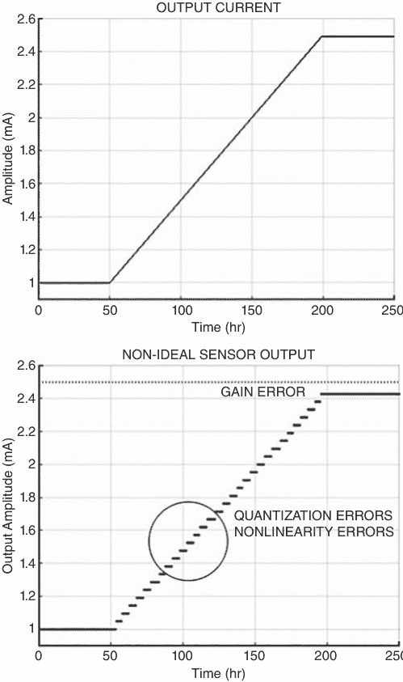

**图 5.11** 示例图：ADC 的理想输入与非理想输出。

除量化误差、偏移误差、阶跃误差、增益误差和非线性误差之外，其他误差也可能被引入数字数据中。产生这些误差的原因很多，包括：时钟抖动、孔径误差、采样保持输入级在保持期间的电压跌落、采样保持输入级因使用大电容而产生的热噪声，以及数据转换器各级中存在的非线性增益。

### 示例 5.7
假设使用前一个示例中的 ADC 来测量流过 RTD 传感器的电流。同时假设第二个相同型号的 ADC 用于测量施加在同一 RTD 两端的电压，并利用这两次测量结果来计算 RTD 传感元件的电阻，*R*<sub>RTD</sub> = *V*<sub>RTD</sub>/*I*<sub>RTD</sub>。那么，计算得到的电阻是融合了包含量化、非线性、增益及其他误差的噪声测量结果。

这个带有噪声的电阻值随后被用作查表（见表 5.4）的输入，以选择温度值：每一列代表一摄氏度的温度变化。温度是一种间接测量，涉及两次模数转换、一次数据融合，以及一次查表，而查表是一种数字化与数据类型转换（从电阻到温度）相结合的形式。噪声的影响可能被叠加放大，达到难以接受的程度。

如果你确定某个有源数据转换器（如 ADC）是导致噪声问题并需要修复的主要因素，你可以用具有更高 ENOB、更低非线性、更快采样率和/或更宽输入频率范围的数据转换器来替换它。然而，这样做的代价往往是你不可避免地要面对更高的运行成本、更大的重量以及驱动传感系统所需的更多电源功率。

当噪声问题追溯到因使用查找表而产生的量化误差时，你可能会考虑求解一个复杂表达式——查找表通常就是用来替代这种处理的。然而，请考虑此类解决方案的复杂性：例如，铂丝 RTD 应用中的查找表取代了对复杂的 Callendar-Van Dusen 表达式（ITS 1990）的求解：

$$R/R_0 = 1 + A\,T + B\,T^2 - C\,(T - 100)T^3$$

适用于

$$-200^\circ\mathrm{C} \leq T \leq 0^\circ\mathrm{C}$$

$$R/R_0 = 1 + A\,T + B\,T^2$$

适用于

$$0^\circ\mathrm{C} \leq T \leq 661^\circ\mathrm{C}$$

其中

$T$ = 以 °C 表示的温度，$R$ = 在温度 $T$ 下的电阻，$R_0$ = 在 0 °C 下的电阻
$A = \alpha(1 + \delta/100)$，$B = -(\alpha\,\delta)/(100^2)$，$C = -(\alpha\,\delta)/(100^4)$
$\alpha = (R_{100} - R_0)/(100 + R_0)$
$\delta = (R_0[1 + \alpha\,260] - R_{200})/(4.16\,R_0\,\alpha)$

求解更复杂的表达式以提高精度和降低噪声，通常需要更多内存来存储变量和参数值，需要更高的处理速度，并且运行成本更高。另一种方法是使用更简单但精度较低的表达式，例如示例 5.5 中使用的线性表达式：

R/R₀ = 1 + A T

其中 A 是电阻温度系数。关于使用线性、二次、三次或有理多项式函数进行拟合，有许多优秀的信息来源：例如，Mosaic Industries 网站就提供了关于电阻校准的文档。

你还可以采用插值、提取和数据平滑的方法与技术来减小噪声影响的幅度。

**表 5.4** 铂 RTD（ITS 1990）电阻-温度查找值示例。

| T | −10 |  |  |  |  |  |  |  |  |  |
|---|---:|---:|---:|---:|---:|---:|---:|---:|---:|---:|
|  | 96.09 | 95.69 | 95.30 | 94.91 | 94.52 | 94.12 | 93.73 | 94.34 | 92.95 | 92.55 | 92.16 |
| 0 | 100.0 | 99.61 | 99.22 | 98.83 | 98.44 | 98.04 | 97.65 | 97.26 | 96.87 | 96.48 | 96.09 |
| 0 | 100.00 | 100.39 | 100.78 | 101.17 | 101.56 | 101.95 | 102.34 | 102.73 | 103.12 | 103.51 | 103.90 |
| 10 | 103.90 | 104.29 | 104.68 | 105.07 | 105.46 | 105.85 | 106.24 | 106.63 | 107.02 | 107.40 | 107.79 |

## 测量延迟

多个变量（如电压和电流）的测量并非完全同时进行：在测量数据的采集、处理和存储之间存在时间差。在示例 5.5 中，电压和电流测量被融合以生成与温度相关的电阻值：

R = V/I

随后使用线性电阻-温度表达式和实测温度值，将这些电阻值转换为与温度无关的值：

R₀ ≈ (V/I)/(1 + TC_R T_M)

我们设计并执行了一项实验，使用测试平台通过大范围的供电电压和温度变化来模拟退化，以评估示例 5.5 中所述方法的有效性：温度、电压和电流的测量示例图如图 5.12 所示，计算所得电阻如图 5.13 所示。随着退化的进展，与温度无关的电阻值曲线变得越来越嘈杂。该噪声随后被归因于三个因素：(i) 测量之间的时间差异，(ii) 使用线性表达式关联电阻和温度时引入的转换误差，以及 (iii) 随电阻增大而产生的放大效应。

评估：(i) 试图通过改变数据采集和处理方法来降低噪声将代价高昂；(ii) 此类噪声确实会增加测量不确定性，但误差通常微乎其微；因此 (iii) 这种不准确程度是可以接受的。虽然最终没有要求或实施任何更改，但以下更改选项是可行的：(i) 使用更高的采样率，从而缩短测量之间的时间差，(ii) 使用更快的计算来进一步缩短测量之间的时间差，以及 (iii) 采用并行而非串行的测量方式。

## 采样率

采样是一种低通滤波形式，与传感系统的分辨率和精度有着重要关系。在本书中，我们指三种不同的采样率：系统在节点处执行信号采样的速率、从节点提取特征的速率（特征提取采样），以及 FD 采样的速率（数据采样）。

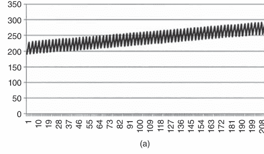

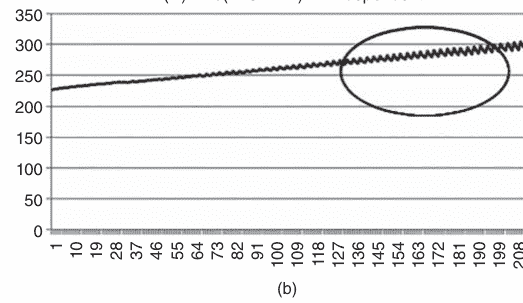

图 5.13 计算电阻的与温度相关 (a) 和与温度无关 (b) 的曲线图。

### 示例 5.8

你接到一个任务，要求使用基于频率响应的方法（而非你一直在研究的纹波电压法），为一台 SMPS 的故障预测功能制定一套工程规格。你获悉客户规格如下：

- 功能故障的提前预警必须至少提前 72 天。
- 在初次检测到即将发生的功能故障后 20 天内，RUL 估计值必须收敛到 10% 的精度以内，且精确度为 ±1 天；在 48 天内，RUL 估计值必须达到 5% 以内的精度。
- 在传感系统设计的当前阶段，你判定已有足够的信息可以进行初步实验，以制定一套工程规格草案。

你设计并执行了一组初步实验，确认 SMPS 产生了你熟悉的响应，示例见图 5.14。你分析了该响应并得出以下结论：

- 响应带有噪声，且正弦周期大致相等但确有变化：T1 ≠ T2 ≠ T3 ≠ T4 ≠ T5

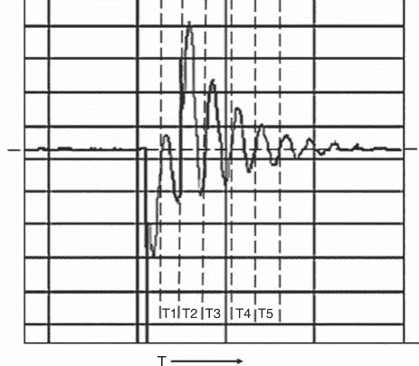

图 5.14 阻尼振铃响应示例。

- 标称频率约为 1 MHz（T̄ ≅ 1 µs）
- 功能故障时的频率约为 1.4 MHz。

±1 天的要求使你得出了以下设计规格：

- 节点采样率应为每 12 小时一次（见图 5.15）。
- 噪声信号、10% 和 5% 的精度要求以及实验数据使你得出了以下设计规格：
- 每次节点采样时，应提取 10 个响应样本。
- 应使用五个周期来计算每次响应的平均频率；
- 节点采样中 10 个响应各自的平均频率应再取平均值，作为该节点的样本平均值。
- 每个响应都应进行加窗处理（数据窗口：1 µs 延迟 + 6 µs 采样周期）。
- 传感器中使用的 ADC 应具有 12 位输出。
- 特征采样应每隔 1 ms 进行一次。

你审视并评估了你的设计，考虑了诸如频率响应之间的稳定时间等因素，这又引出了另一项设计规格：

这些初步规格成为 SMPS 故障预测设计下一阶段的输入：传感器的硬件设计和/或选型；ADC 的选型；传感器控制器的设计和/或选型；传感系统控制流和数据管理的软件设计；数据和通信协议、格式及收发器的设计和/或选型；微控制器的固件设计和编程；以及传感系统软件元件的设计和编程。


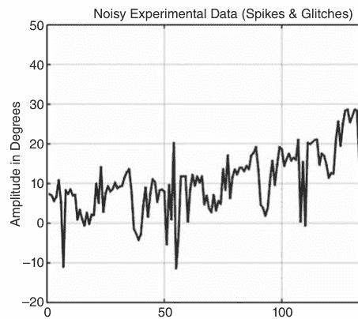

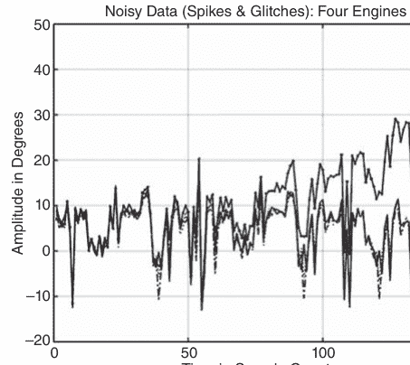

**图5.19** 实验数据：喷气发动机的温度测量值。

$\{X_{Di}\}$ 是一个CBD签名。当我们将此方法应用于例如同一架飞机上四台发动机各自的温度数据（图5.21中的上图）时，我们得到图5.21下图中所示的差分签名。

尽管图5.21中的一个差分距离签名在视觉上呈上升趋势，但计算例程会使用所有四个签名中的最大幅度值来创建单个差分退化签名，如图5.22所示：将其与图5.19中显示的原始温度数据进行比较。在第7章中，我们将提供一个示例，说明如何使用算法对该签名做进一步调节，以抑制大幅度扰动并进行数据平滑。

**含噪数据（尖峰与毛刺）：四台发动机**

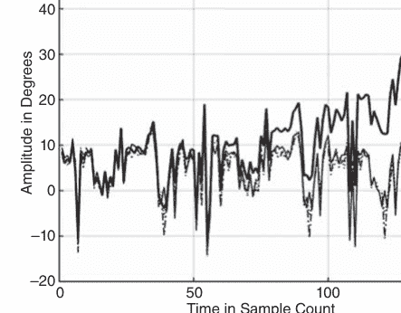

**差分距离签名比较：2台与4台发动机**

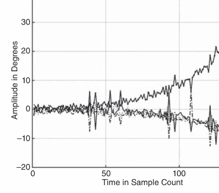

**图5.21** 温度数据与差分签名：一架飞机上的四台发动机。

### 示例5.12

仔细检查交叉幅度为0%处的签名后发现，由于数据中的噪声，存在两个交叉点，你得出这一结论。你决定采用移动平均法进行数据平滑：

- (i) 使用三个数据点的滚动平均值；
- (ii) 用初始化阶段采集到的第一个数据点填充一个三槽先进先出（FIFO）数据队列；
- (iii) 存储FIFO队列和指向队列中下一个槽位的指针；
- (iv) 当采集到下一个数据点时，将该值存储到数据队列中；
- (v) 更新并存储数据指针；
- (vi) 计算数据队列的滚动平均值；
- (vii) 使用滚动平均值作为当前幅度来计算FFP签名；
- (viii) 使用节点定义区域存储数据队列和指针；

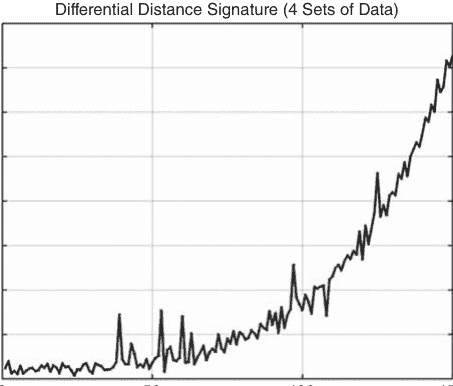

**图5.22** 复合差分距离签名。

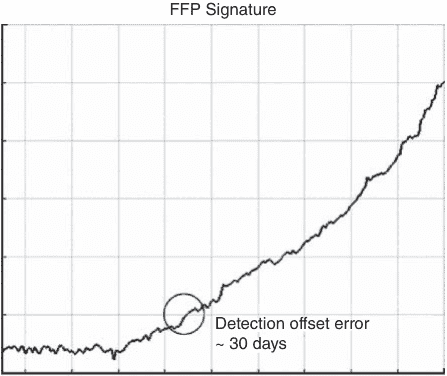

**图5.23** 含噪FFP签名示例。

- (ix) 将NM（噪声容限）从4%降低到2%。

图5.25显示了平滑后的FFP签名曲线图：检测退化的误差从15天改善到5天，误差降低了67%。

### 示例5.13

你评估图5.25中数据的特性曲线，并判断该签名可能是幂函数#3（幂为1/2）的结果。然后使用以下表达式（来自第4章）将FFP签名转换为DPS：

$$DPS_i = 1 - 1/(FFP_i + 1)^{1/n}$$

所得曲线图如图5.26所示。

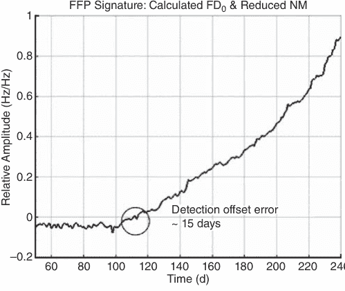

**图5.24** 含噪FFP签名示例：计算的标称FD值、降低的NM值。

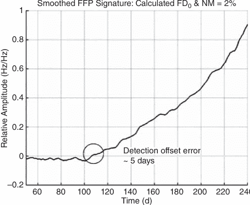

**图5.25** 平滑（3点移动平均）FFP签名示例。

### 示例5.14

你将功能故障定义为当FFP签名达到0.65时发生，该值转换为基于DPS的功能故障水平（FL）：

$$FL_{FFP} = 0.65 \rightarrow FL_{DPS} = 1 - 1/(FL_{FFP} + 1)^2 = 0.63$$

$FL_{DPS}$值用于将DPS数据转换为FFS数据，如图5.27所示。

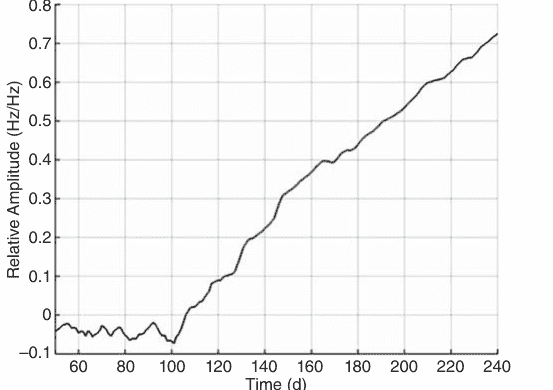

**图5.26** 由平滑FFP签名得到的DPS示例。

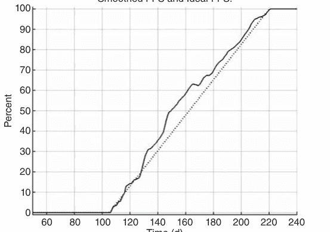

**图5.27** 由平滑FFP签名得到的FFS示例。

### 示例5.15

你使用表5.1中列出的过程计算并绘制逐点FNL：

$$TTF = t_{FAILURE} - t_{ONSET}$$
$$IDEAL\_FFS_i = 100(t_i - t_{ONSET})/TTF$$
$$FNL_i = FFS_i - IDEAL\_FFS_i$$

从而改善FFS数据的线性度，以进一步减少非线性（图5.31）。我们将总非线性从13.5%降低到8.0%。

在本节中，我们将相同的数据调节方法应用于图5.6所示的输入数据，以证明该方法可扩展到其他数据集。与图5.6所示类似的数据首先转换为FFP签名，如图5.32顶部所示。

### 调节FFP签名数据

我们执行调节过程的第一步，动态测量特征的平均值，而不是使用标称制造值：这让我们

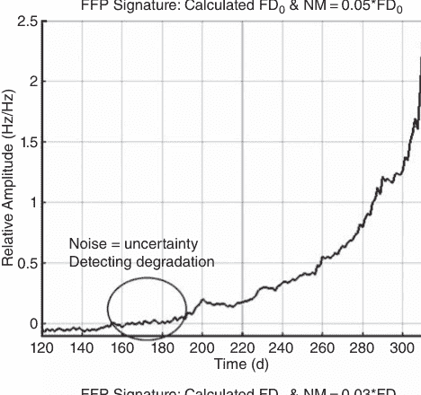

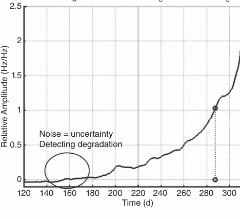

**图5.32** 纹波电压：未平滑（顶部）和平滑（底部）FFP签名曲线图。

可以使用较小的NM值。但噪声是一个问题，即使我们使用了相对较大的余量（标称特征值的5%）；如图所示，在检测退化开始时存在一个不确定区域。与其增大NM，不如对FFP数据进行平滑，然后评估所需NM的大小。

### 示例5.16

你采用四点滚动平均方法，评估结果，并决定可以降低NM而不是增大NM。结果如图5.32底部所示的FFP签名。FFP签名更加平滑，从而允许你降低NM值，最终减少了检测退化时的偏移误差。

你将FFP签名转换为DPS，然后定义当FFP签名超过1.0时发生功能故障：在该阈值下，纹波电压的幅度相比标称值加倍。你将$FL_{FFP}$值转换为$FL_{DPS}$值0.75：

$$FL_{FFP} = 1.0 \rightarrow FL_{DPS} = 1 - 1/(FL_{FFP} + 1)^2 = 0.75$$

并使用0.75阈值将DPS数据转换为FFS数据。图5.33顶部显示了来自未平滑FFP签名的DPS曲线图，底部显示了来自平滑FFP签名的DPS曲线图。相应的FFS数据曲线图如图5.34所示；两组曲线图外观存在明显差异。

数据分析表明，如曲线图所示，当数据点达到或超过指定故障阈值时，即检测到功能故障。

### 重新评估NM

在采用数据平滑后，重新评估你选择的NM值是一个好主意。通常你可以降低NM，这通常会减少任何偏移误差，例如在示例5.3中遇到的5.7小时。

### 示例5.17

在评估图5.33所示的曲线图后，你决定将NM从3.0 mV改为2.0 mV，并重新运行FFP、DPS、FL和FFS模型。NM为3.0 mV和NM为2.0 mV时的FFS曲线图如图5.34所示。对于NM为3.0 mV，检测到退化开始（FFS > 0）的时间为153.7天；对于NM为2.0 mV，检测时间为−151.3天：偏移误差从5.75天（3.7%）减少到3.25天（2.1%）。

### 调节FFS数据

FFP签名被转换为DPS，定义功能故障水平并转换为基于DPS的FL，然后将DPS数据转换为FFS数据。每生成一个FFS数据点，就对其应用5.4节中的启发式方法，以进一步线性化FFS数据。

## 5.5 小结：非理想数据、影响与调节

本章介绍了与非理想数据相关的主题。你了解到噪声是预测数据实现高精度的一个问题：当你采集、转换和评估数据时，这些问题会变得明显。

**未平滑FFP的DPS**

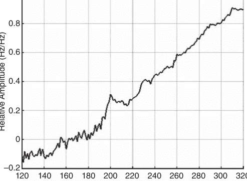

**平滑FFP的DPS**

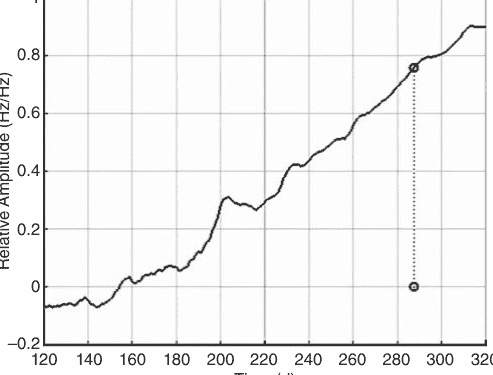

**图5.33** 纹波电压：未平滑（顶部）和平滑（底部）DPS数据曲线图。

噪声定义为与特定故障模式无关的数据中的任何变异性；必须充分降低和/或缓解噪声，以满足PHM系统对每个支持预测的设备、部件或组件的精度要求。

介绍了降低噪声和非线性影响的方法，涉及噪声容限、测量误差和不确定性、工作和环境条件、非线性退化以及多种退化模式。你还学习了调节FFS数据的启发式方法，以及如何评估数据调节和模型调整的最终结果。


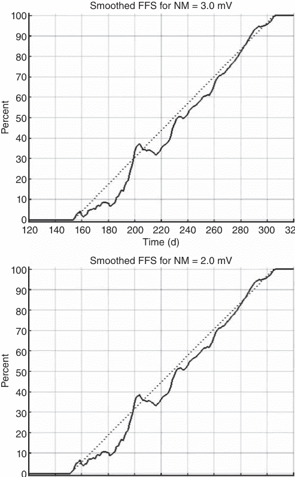

**Figure 5.34** NM = 3.0 mV 时的平滑 FFS（上方）和 NM = 2.0 mV 时的平滑 FFS（下方）。

在下一章中，你将学习与预测框架响应由向量框架产生的 FFS 数据时输出的预后信息相关的[content]


**Figure 5.34** Smoothed FFS for NM = 3.0 mV (top) and for NM = 2.0 mV (bottom).

In the next chapter, you will learn about important characteristics and metrics related to prognostic information output by a prediction framework in response to FFS data produced by a vector framework.

## References

- Baker, R.J. (2010). *CMOS Circuit Design, Layout, and Simulation*, 3e. Wiley-IEEE Press.
- Bechhoefer, E. and Kingsley, M. (2009). A review of time synchronous average algorithms. 2009 PHM Conference, San Diego, California, US, 27 Sep. – 1 Oct.
- Carr, J.J. and Brown, J.M. (2000). *Introduction to Biomedical Equipment Technology*, 4e. Upper Saddle River, New Jersey: Prentice Hall.
- Erickson, R. (1999). *Fundamentals of Power Electronics*. Norwell, MA: Kluwer Academic Publishers.
- Hofmeister, J., Goodman, D., and Wagoner, R. (2016). Advanced anomaly detection method for condition monitoring of complex equipment and systems. 2016 Machine Failure Prevention Technology, Dayton, Ohio, US, 24–26 May.
- Hofmeister, J., Szidarovszky, F., and Goodman, D. (2017). An approach to processing condition-based data for use in prognostic algorithms. 2017 Machine Failure Prevention Technology, Virginia Beach, Virginia, US, 15–18 May.
- Hofmeister, J., Wagoner, R., and Goodman, D. (2013). Prognostic health management (PHM) of electrical systems using conditioned-based data for anomaly and prognostic reasoning. *Chemical Engineering Transactions* 33: 992–996.
- IEEE. (2017). Draft standard framework for prognosis and health management (PHM) of electronic systems. IEEE 1856/D33.
- ITS. (1990). International Temperature Scale. National Institute of Standards and Technology.
- Jenq, Y.C. and Li, Q. (2002). Differential non-linearity, integral non-linearity, and signal-to-noise ratio of an analog-to-digital converter. Portland, Oregon: Department of Electrical and Computer Engineering, Portland State University.
- Judkins, J.B., Hofmeister, J., and Vohnout, S. (2007). A prognostic sensor for voltage regulated switch-mode power supplies. IEEE Aerospace Conference 2007, Big Sky, Montana, US, 4–9 Mar, Track 11–0804, 1–8.
- Medjaher, K. and Zerhouni, N. (2013). Framework for a hybrid prognostics. *Chemical Engineering Transactions* 33: 91–96. https://doi.org/10.3303/CET1333016.
- National Science Foundation Center for Advanced Vehicle and Extreme Environment Electronics at Auburn University (CAVE3). (2015). Prognostics health management for electronics. http://cave.auburn.edu/rsrch-thrusts/prognostic-health-management-for-electronics.html (accessed November 2015).
- Singh, S.P. (2014). Output ripple voltage for buck switching regulator. Application Report SLVA630A, Texas Instruments, Inc.
- Smith, S.W. (2002). *Digital Signal Processing: A Practical Guide for Engineers and Scientists*, 1e. Newnes Publishing.
- Stiernberg, C. (2008). Five tips to reduce measurement noise. National Instruments.
- Texas Instruments. (1995). Understanding data converters. Application Report SLAA013.
- Vijayaraghavan, G., Brown, M., and Barnes, M. (2008). Electrical noise and mitigation. In: *Practical Grounding, Bonding, Shielding and Surge Protection*. Elsevier.

## Further Reading

- Filliben, J. and Heckert, A. (2003). Probability distributions. In: *Engineering Statistics Handbook*. National Institute of Standards and Technology. http://www.itl.nist.gov/div898/handbook/eda/section3/eda36.htm.
- O’Connor, P. and Kleyner, A. (2012). *Practical Reliability Engineering*. Chichester, UK: Wiley.
- Pecht, M. (2008). *Prognostics and Health Management of Electronics*. Hoboken, New Jersey: Wiley.
- Tobias, P. (2003a). Extreme value distributions. In: *Engineering Statistics Handbook*. National Institute of Standards and Technology. https://www.itl.nist.gov/div898/handbook/apr/section1/apr163.htm.
- Tobias, P. (2003b). How do you project reliability at use conditions? In: *Engineering Statistics Handbook*. National Institute of Standards and Technology. https://www.itl.nist.gov/div898/handbook/apr/section4/apr43.htm.
