## 6 Design: Robust Prototype of an Exemplary PHM System

### 6.1 PHM System: Review

The design and development of a system to support prognostics and health management/monitoring (PHM) is complex, and there are many approaches to do so. Even though each such system (with the possible exception of demonstrations, test beds, and experiments) is unique, there are important design considerations. For example, (i) whether to use node-based, assembly-based, or some other architecture to sample and acquire data from nodes; (ii) data-handling requirements, such as conditioning, transforming, and fusing; (iii) resolution, precision, and accuracy requirements for predicting information; and (iv) checkpoint/restart (stop and resume operations). A robust PHM system needs to address these issues.

For illustrative purposes, this chapter is written directly to you, the reader, in the role of a lead design engineer of prognostic solutions who has been chosen to lead the design and development of a robust prototype PHM system. That system is to serve as a proof of feasibility for a customer and as a demonstration of the capabilities and expertise you and your team possess. This chapter is based on historical and case-study data.

Before introducing new issues and solutions, we will review all of the previous chapters, because you will need to appropriately select, adapt, and apply other approaches; a large number (but not all) of these have already been presented in this book.

#### 6.1.1 Chapter 1: Introduction to Prognostics

In Chapter 1, you learned that prognostics involves accurately detecting and reporting future failures in systems by detecting degradation (diagnostics) and creating information such as state of health (SoH) and remaining useful life (RUL). We defined core frameworks for a PHM system: a sensor framework, a feature-vector framework, and a prediction framework as shown in Figure 1.1 and repeated here in Figure 6.1. The primary focuses of that chapter were the foundation of reliability theory, failure distributions under extreme stress, uncertainty measures in parameter estimation, system reliability and prognostic health management, and prognostic information; we presented over 130 equations dealing with those topics for modeling.

Section 1.6 included a framework diagram for PHM, repeated in Figure 6.2. Section 1.7 included two figures that are repeated in Figures 6.3 and 6.4.

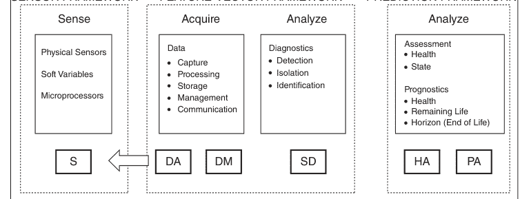

**Figure 6.1** Core prognostic frameworks in a PHM system. Source: after IEEE (2017).

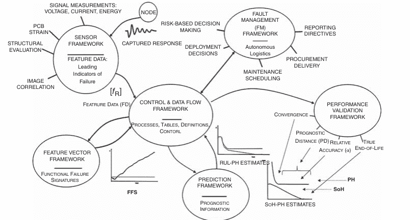

**Figure 6.2** A framework for CBM-based PHM. Source: after CAVE3 (2015).

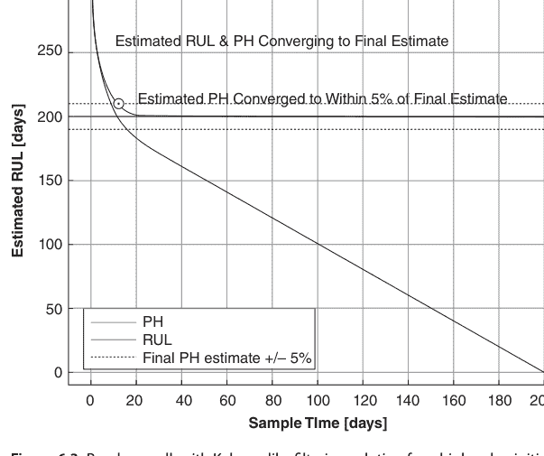

**Figure 6.3** Random walk with Kalman-like filtering solution for a high-value initial-estimate error.

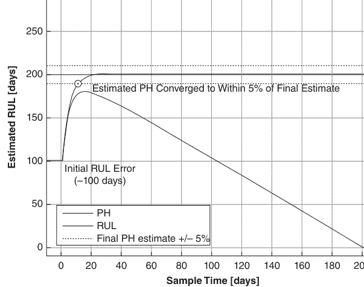

**Figure 6.4** Random walk with Kalman-like filtering solution for a low-value initial-estimate error.

#### 6.1.2 Chapter 2: Prognostic Approaches for Prognosis and Health Management

Chapter 2 described classical approaches to PHM: model-based, data-driven, and hybrid (see Figure 6.5). You learned that a model-based approach includes, for example, deductive and inductive analytical modeling, distribution modeling, physics of failure and reliability modeling, and other aspects – all of which lead to complexity. Two major data-driven approaches were presented – statistical and machine learning – along with a hybrid approach that used both and was the most complex. You learned the primary disadvantages of those classical approaches: they are not applicable to a specific prognostic target in a system; and/or they are nondeterministic and not suitable for applying to prognostic targets; and/or it is complex to adapt them to sensor data.

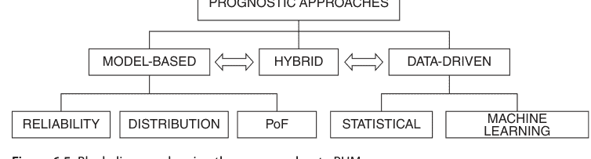

**Figure 6.5** Block diagram showing three approaches to PHM.

You also learned that modeling is a two-phase process, model development and model use, and that leading indicators of failure can be extracted from sensor data and collected to form condition-based data (CBD) signatures. Figure 6.6 illustrates an approach for modeling development and use for CBD, and Figure 6.7 compares the approaches.

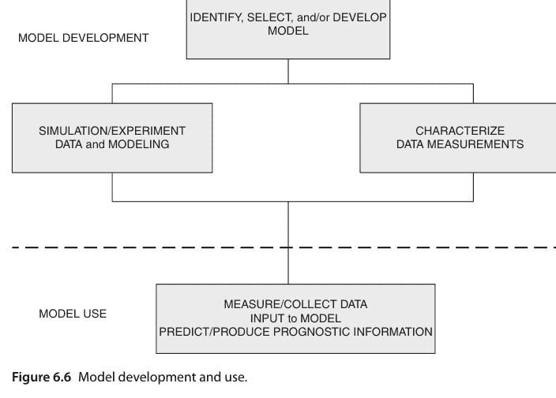

**Figure 6.6** Model development and use.

A heuristic-based approach for CBD was introduced: identify characteristic curves of failure modes, and then develop and use signature-based models. That approach is diagramed in Figure 6.8, and differences in focus of model-based and heuristic-based approaches to PHM are listed in Table 6.1. Keep in mind that although there are differences in focus, the approach often employs analysis and modeling techniques such as reliability modeling, physics of failure (PoF) analysis, and failure mode and effect analysis (FMEA) (Hofmeister et al. 2013, 2016, 2017, 2018a,b; Medjaher and Zerhouni 2013; Pecht 2008).


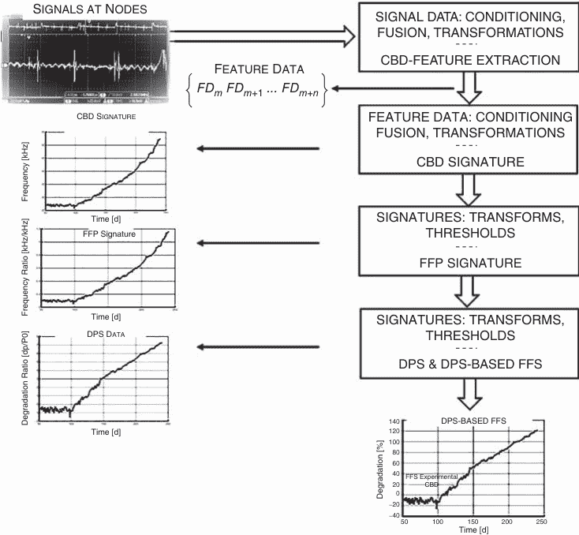

**图 6.9** 生成基于DPS的FFS的流程示意图。

对多种不同类型曲线的经验表明，FNL值越小，处理FFS时产生的预测信息越准确。

## 6.1.4 第4章：基于启发式的CBD签名建模方法

第4章提出了一组七种签名模型，这些模型生成的FFP签名具有理想的、特征性的曲线，例如图6.13左侧绘制的曲线。这些理想签名被转换为理想的DPS传递曲线，即从0振幅原点出发并经过另一个振幅为1的数据点的直线，如图6.13右侧所示。

## 6.1.5 第5章：非理想数据：影响与调理

第5章介绍了两个示意图，分别展示了在PHM系统中开发预测解决方案的离线阶段和在线阶段（图6.14和图6.15，Medjaher和

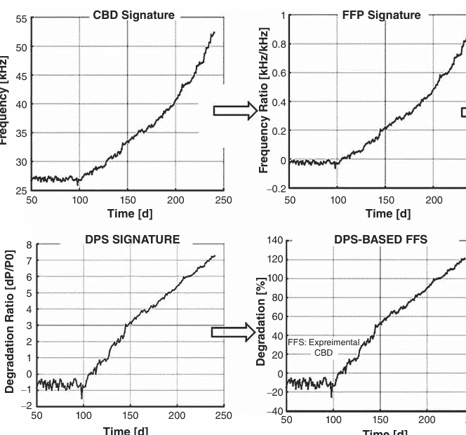

图 6.10 CBD、FFP、DPS和基于DPS的FFS示例。

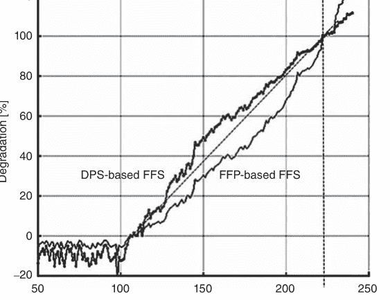

图 6.11 基于DPS的FFS和基于FFP的FFS。

## 模拟FFP签名：FFPᵢ = 1 - exp (-dPᵢ/P₀)

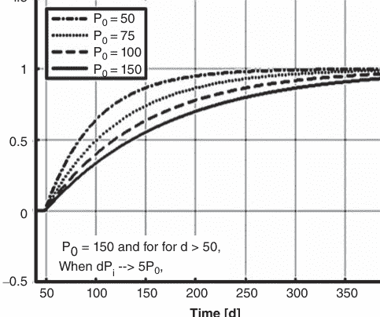

P₀ = 150，且当d > 50时，当dPᵢ --> 5P₀，

## 模拟DPS：DPS = ln(1/FFPᵢ)

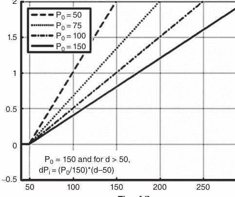

P₀ = 150，且当d > 50时，dPᵢ = (P₀/150)*(d-50)

图 6.13 一族FFP签名和DPS传递曲线的图。

这种方法是对CBD进行调理和变换的一个重要目标的示例：提高用作PHM系统预测系统输入的签名数据的线性度和准确性，从而改进用于提供被监控和管理系统健康预测的预测信息的准确性。

## 传感系统
离线阶段：学习、评估与开发

监控数据

提取特征：状态指示器

选择特征：表征、评估、缩减与选择

创建模型与方法

库：模型方法

数据质量 数据变换、调理 数据建模与计算方法

{CBD}i  {FD}i  {V_Ri}  {FFP}i {DPS}i (FL_FFP) (FL_DPS) {FFS}i

图 6.14 为PHM系统开发预测使能解决方案的离线阶段。

## 传感系统
在线阶段：
数据采集与处理

库：模型与方法

监控数据

提取特征：状态指示器

使用模型与方法

{CBD}i  {FD}i = V_R,i  {FFP}i {DPS}i (FL_FFP) (FL_DPS) {FFS}i

数据采集 数据处理：变换与调理

图 6.15 利用预测使能解决方案的在线阶段。

## 6.1.6 本章目标

前面几章介绍的方法为设计和开发单项预测解决方案奠定了坚实的基础。本章阐述了在设计和发展一个稳健的示例性PHM系统原型时的重要方面和考虑因素；这些信息以你作为此类PHM系统的首席设计师的身份呈现。

尽管单节点PHM解决方案在调查、表征、开发和演示简单、有限能力的单传感器或有限传感器系统解决方案方面很有用，但在一个具有多节点、不同类型传感器、单变量和多变量信号处理以及不同采样频率下变化采样率的真实复杂系统中，这些方案并不实用。对于预测而言，系统解决方案需要一个健壮的架构，包括框架、控制与数据流以及内存，以完成以下任务：(i) 充分记住过去——每个节点之前发生了什么；(ii) 感知现在——从每个节点采集测量数据；(iii) 处理当前数据并与过去结合以预测未来——为每个节点生成预测信息并据此采取行动。一个非常重要的考虑因素是，PHM系统不会永远运行：它会有意或无意地被暂停和恢复，被优雅地结束（关闭）和重启；也会被非优雅地结束（崩溃）并重新开始。PHM系统需要支持足够健壮的检查点（保存当前状态以备将来作为过去使用）和重启（恢复过去并继续运行），以满足客户关于预测监控和预测准确性的恢复与延续要求。

回顾图6.1和图6.2，本章将基于一个示例性PHM系统¹，该系统以你作为PHM系统设计师的角色呈现给你，该系统¹

¹ 一个原型示例性PHM系统的设计仿照了亚利桑那州图森市Ridgetop Group, Inc. 开发的开发套件。该PHM系统用于处理数据并生成本书中的示例插图和结果——尤其是在本章中。

## 差分距离签名（4组数据）

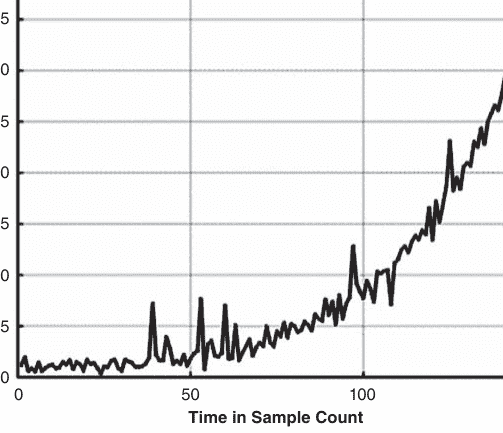

图 6.17 从融合差分距离调理后的CBD中提取的FD。

包含以下内容：

- 一个包含多个节点的传感框架。
- 一个包含多个程序模块的特征向量框架。
- 一个包含两个程序模块以提供预测信息的预测框架。
- 一个离线模式的性能验证框架。
- 一个支持以下功能的控制与数据流框架：(i) 环形节点传感，(ii) 不同的采样率和频率，(iii) 警报，以及 (iv) 检查点/重启。

## 6.1.7 本章组织结构

本章其余部分组织如下，以呈现和讨论与示例性PHM系统相关的主题，包括框架、控制与数据流以及检查点/重启：

6.2 PHM系统的设计方法
本节描述设计PHM系统的主要方法：为预测使能选择和评估候选目标及其故障模式；从离线阶段选择模型和计算程序；以及选择用于在线使用的架构。

6.3 采样与轮询
本节描述与连续采样、周期采样、周期突发采样和轮询相关的实际考虑因素和方面。这些考虑因素在PHM系统的设计和开发中非常重要。

## 6.4 初始设计规范

本节描述PHM系统初始设计中的重要考虑因素：测试/演示模式与实际运行模式；测试台的设计和使用；以及在设计和开发中使用测试台的结果。

## 6.5 交流相电流的特殊RMS方法

本节描述计算相电流均方根（RMS）值的特殊方法的必要性，以支持机电作动器（EMA）控制器中功率开关晶体管的预测使能。

## 6.6 诊断与预测程序

本节描述电源和EMA的诊断与预测程序。

## 6.7 规范：稳健性与能力

本节描述用于定义和控制PHM系统功能运行的基于节点的架构和基于节点的定义文件。

## 6.8 节点规范

本节提供关于指定系统节点定义和节点定义的详细信息，以管理PHM系统中的控制和数据流及处理。

## 6.9 系统验证与性能指标

本节通过计算和评估性能指标，提供了验证系统重要方面——预测信息准确性——的详细信息。这些指标包括退化检测、预测距离（PD）、预测视界（PH）估计的收敛性、RUL、PH和SoH估计。

## 6.10 系统验证：高级预测

本节描述使用高级版本预测程序ARULEAV相比基本预测程序DXARULE如何产生改进的性能指标。

## 6.11 PHM系统验证：EMA故障

本节描述使用高级程序ARULEAV处理与三种不同类型EMA故障相关的签名的结果。

## 6.12 PHM系统验证：功能集成

本节描述多个节点并发处理的结果。

## 6.13 总结：稳健的原型PHM系统

本节总结本章所呈现的内容。

## 6.2 PHM系统的设计方法

设计PHM系统时面临的主要考虑因素示例包括：

- 哪些故障模式是预测使能的候选目标？
- 这些故障模式中哪些组成子系统需要进行预测使能？
- 每个子系统中的组件和子组件，通常称为航线可更换单元（LRU），哪些需要进行预测使能？此类LRU通常被视为一个逻辑节点。

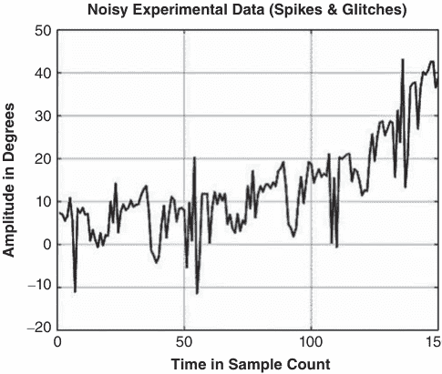

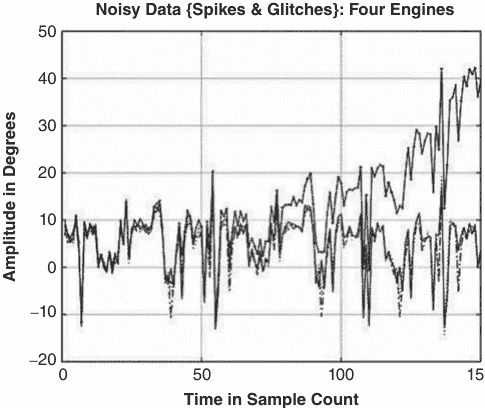

**图 6.16** 多个温度信号：差分距离调理前后对比。


- 目标失效模式是否源于可更换单元（SRU）中的退化，例如空气数据单元中的电路板组件（CCA）或传动装置中的齿轮？
- 是否可以使用现有传感器或传感器来检测与失效模式相关的退化？如果是，很好；否则，是否会增加一个或多个传感器以支持预测使能？如果是，很好；否则，该特定失效模式需要从候选列表中删除。
- 设计、开发、测试、验证、部署和维护每个预测使能候选目标的成本是多少？成本包括但不限于货币成本、部署解决方案所需的日历时间、解决方案所需的重量和功率、所需的人员技能，以及部署后解决方案的持续和维护成本。

### 6.2.1 选择和评估目标及其失效模式

本章假设您的团队和客户已经创建并筛选出候选目标列表，筛选至图 6.18 所示的执行器子系统，该子系统将用作示例 PHM 系统的预测目标。执行器子系统包含以下主要模块：电机驱动器（1）带 H 桥输出（2）和无刷直流电机（3）（BLDC）。EMA 驱动位置翼面（4），由开关模式电源（SMPS）（5）供电，并由定位指令（6）控制。

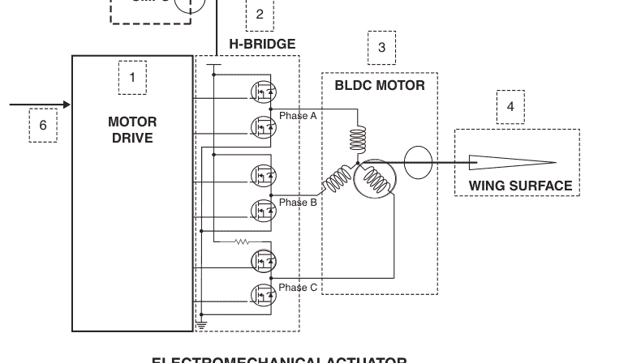

ELECTROMECHANICAL ACTUATOR

图 6.18 示例 EMA 子系统的框图。

您的预测使能团队需对四个主要失效模式进行预测使能：（i）SMPS 输出滤波器中的钽氧化物电容器易于短路失效并烧毁开路；（ii）H 桥中的功率开关金属氧化物半导体场效应晶体管（MOSFET）易于受损并在导通时表现出高值电阻；（iii）EMA 电机的线圈绕组易于受损导致电机功率损失；以及（iv）EMA 电机轴上的负载增加。

目标是设计和开发一个 PHM 系统，该系统收集所有传感器的数据；处理这些数据，每次一个数据点；并对每个数据点做出预测使能系统的预测。所得的 PHM 系统不仅仅是一个演示，其中每个节点从无退化状态进展到失效状态，然后才进行预测；而是，每个 LRU 都应作为一个完整系统进行处理，其中事先并不知道哪个 LRU 会退化、何时退化、退化的失效模式来源是什么，以及失效模式何时可能导致功能失效。

### 6.2.2 离线预测方法：选择结果

如前几章所述，需要采用一种或多种离线方法来完成设计和开发支持预测使能所需的模型和计算例程。第一步是评估将可用的传感器和传感器数据。参考图 6.18，您可以使用三组传感器数据：

- 定位指令（6）。
- SMPS（5）的输出电压。
- H 桥（2）的相电流测量值：相 A、相 B 和相 C。

您的团队决定在离线阶段使用 CBD 方法（图 6.19）来设计和开发原型 PHM 系统：使用历史、实验、测试和仿真数据以及 FMEA 来创建特征模型；并设计和开发一组计算例程来处理收集的传感器数据（图 6.20）。这些计算例程应将传感器数据调理和转换成语义特征数据（FFS）数据，作为预测算法程序模块的输入。

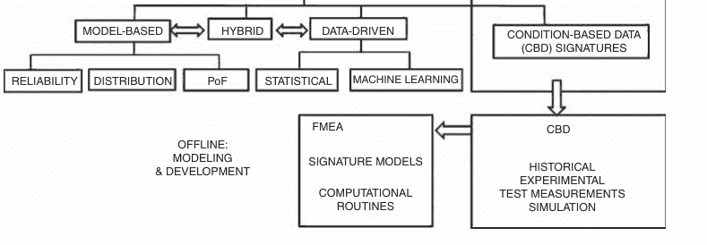

图 6.19 离线建模和开发图。

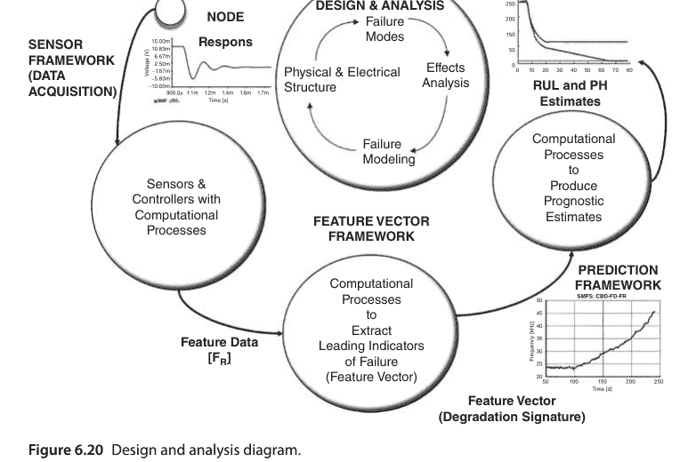

图 6.20 设计和分析图。

### 6.2.3 为在线阶段选择基础架构

原型 PHM 系统的运行是预测的在线阶段，即使用您的模型处理传感器数据以产生预测信息。评估离线阶段对 LRU、传感器、传感器数据和模型的成果后，您和您的团队提出使用基于图 6.19 所示的框架架构；客户批准。

现在您已获得批准的架构，需要准备、审查并获得一套初始设计规范的批准。

## 6.3 采样和轮询

采样是 PHM 系统设计中的重要考虑因素：您需要（i）评估、选择和规定连续采样与周期性采样（图 6.21）；以及（ii）确定采样率、采样频率和采样持续时间（图 6.22）。您需要为计划收集数据的每个节点提供规范。

### 6.3.1 连续 – 周期性采样

作为一般规则，您应使用连续采样（见图 6.21，顶部）来检测从零损伤状态迅速过渡到失效状态的意外故障——快到实际上检测损伤并估计未来失效时间不可行。采样是为了支持诊断，通过尽快检测损伤，旨在减轻对系统或因未检测到故障而导致的灾难的进一步损伤。使用周期性采样（见图 6.21，底部）当预期损伤开始与功能失效之间的时间距离足够长时：（i）在此采样间隔时间内没有紧急检测故障的需要，且（ii）您的客户希望将维护推迟到未来某个时间点——前提是客户对 PHM 系统提供的预测信息准确性有足够的信心。

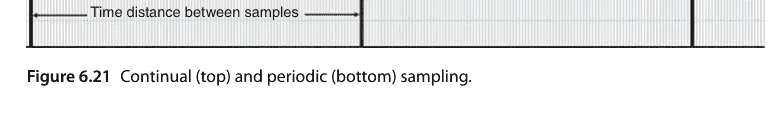

图 6.21 连续（顶部）和周期性（底部）采样。

### 6.3.2 周期性突发采样

您应注意，仅使用周期性采样通常会导致精度不足。很可能为了支持预测，您应使用周期性突发采样（图 6.22）。为此，您需要（i）选择采样周期；（ii）使用突发模式采样；（iii）选择采样频率；以及（iv）选择突发周期。这些设计决策必须满足预测信息精度要求。

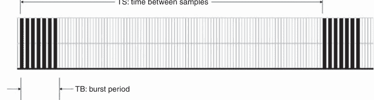

图 6.22 周期突发采样：采样周期（TS）和突发周期（TB）。

**示例 6.1** 您要进行预测使能的 SMPS 是一个为 EMA 供电的 DC-DC 转换器（图 6.23）。电源输出为 24 VDC，输出滤波电路电容为 4800 µF，由 22 个并联连接的钽氧化物电容器组成，这些电容器已知会短路失效并烧毁开路，因此每个电容器失效都会使滤波电容减少 220 µF。SMPS 具有纹波电压

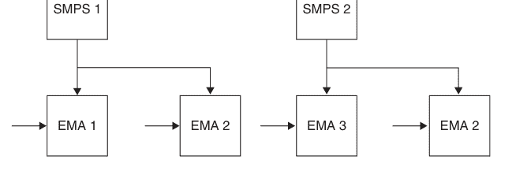

图 6.23 电源和 EMA 子系统的示例。

您的团队决定使用调用轮询（等待响应）进行轮询，原因包括系统中的传感器是*智能传感器*。在被轮询后，它们会唤醒并执行以下操作：（i）感测节点；（ii）执行一系列采样（突发模式）；（iii）将模拟数据转换为数字数据；（iv）计算突发模式采样的平均标量值；（v）注册该标量值；（vi）通知调用的 PHM 系统（*数据就绪*）；然后（vii）进入静止状态（*睡眠*）。这种轮询方式的优点包括以下几点：（i）PHM 系统决定何时收集数据，从而支持根据节点关键性和 SoH 确定监控速率的概念；（ii）传感器功耗更低；（iii）数据流量减少；以及（iv）支持以不同采样速率运行的多个节点。

## 6.4 初始设计规范

在设计和开发原型 PHM 系统之前，需要准备、审查和批准一套初始设计规范。这些规范包括您计划执行以下操作的计划：（i）使用图 6.6 所示的模型使用阶段；（ii）使用初始设计和分析阶段的结果（图 6.19 和 6.20）对多个 EMA 子系统（图 6.18）进行预测使能；以及（iii）对先前图 6.23 所示配置的系统进行预测使能。该系统包括以下内容：（i）每个 SMPS 输出处的电压传感器；（ii）每个 EMA 中的三个交流电流传感器；以及（iii）每个传感器输入处的定位指令。原型的要求包括以下内容：

1. 对每个 SMPS 进行单种失效模式的预测使能：输出滤波器，电容退化。
2. 对每个 EMA 进行多种失效模式的预测使能：
   - 功率开关晶体管，导通电阻退化。
   - 电机变压器，绕组退化。
   - 电机轴，负载过大。
3. 一个支持所有预测使能单元的单一系统（而不是为每个预测使能单元单独的系统）。
4. 对计划和非计划的单元和系统关机提供检查点/重启支持。
5. 原型中不需要故障管理和服务。

### 6.4.1 运行：测试/演示 vs. 实际

为了测试和/或演示您的原型 PHM 系统，使用实际设备实时进行是不切实际的——即使使用注入故障也需要太多时间。例如，您不应每秒更改一个值来模拟退化；相反，您应使用更大的间隔，也许五分钟，以允许测试设备、组件、组件和/或子系统达到平衡。而且您应注入会产生大量数据点的故障，例如 200 个或更多。对于五分钟间隔，对于单一预测使能模式，您的测试/演示将需要超过 15 小时才能完成——您的客户不会等待那么久。您需要规定您的团队将如何测试和验证原型 PHM 系统的设计和运行。


## TEST 模式

解决在短时间内演示逼真退化曲线相关的时间问题的一种方法是执行以下操作：

1. 获取、保存并使用在较长时间内收集的历史数据和/或实验/测试数据。
2. 从保存的文件中逐点读取获取的数据。
3. 对于每个这样的数据点，将采集时间转换为系统时钟时间。
4. 以 TEST 模式运行原型 PHM 系统，其中 PHM 系统时钟被加速。例如，真实时钟的每一秒被转换为采样时间的若干分钟。

您的客户接受您的建议，即原型 PHM 系统应支持两种操作模式：（i）使用实时进行采样和（ii）使用在加速测试期间收集并保存的数据进行采样。

### TEST 数据：已保存

当您以 TEST 模式操作原型 PHM 系统时，您需要决定如何处理数据被采集的时间与数据在测试和演示期间被处理的时间之间的差异——尤其是在多节点、多退化测试设置中。例如，第一个节点的测试数据可能是在相对真实时钟时间为 1.0、2.0、… 小时时采集的，而第二个节点的测试数据可能是在相对真实时钟时间为 20、40、… 分钟时采集的。如果您采用简单的环形轮询方式而不使用逼真的测试时钟，那么在经过四组采样后，原型 PHM 系统将对第一个节点在例如 4 秒内处理 8 小时的数据，而对第二个节点处理 80 分钟（1.33 小时）的数据。原型 PHM 系统发出的信息和警报将毫无意义：例如，考虑一下当客户看到图 6.27 中前两个警报之后的第三个警报时可能会如何反应。虽然您可能能够说服客户接受这种看似无意义的时间作为原型 PHM 系统以 TEST 模式运行的产物，但我们建议您采用更稳健的 TEST 时钟——尤其是当客户指出测试数据是基于原始历史数据得出的，而在该历史数据中退化已知是在约 50 天后达到，而非 2.0 小时时。

### TEST 数据：实时

当您使用实际的、注入故障的预测目标以 TEST 模式操作原型 PHM 系统时，有两个重要考虑：（i）注入故障值的变化分辨率与平衡或稳定时间相比；以及（ii）混合模式测试。您在监控实际预测目标时始终需要使用真实系统时钟，并且在处理带有保存采集时间的数据时需要使用模拟时钟。

模拟时钟的一种方法是使用数据采集时间作为节点时间，而不管实际真实时钟或模拟系统时钟如何。这意味着每个节点可能具有与其他节点不同的时间，如图 6.27 所示，其中 NODE 1 的时间不同于 NODE 2 的时间。

| Degradation alert | Time | Estimated RUL |
| --- | --- | --- |
| NODE 1 is 25% degraded | 2.00 hours | 36 hours |
| NODE 1 is 50% degraded | 3.00 hours | 35 hours |
| NODE 2 is 25% degraded | 1.00 hours | 200 hours |

**Figure 6.27** Example of alerts issued using an unrealistic PHM system clock and/or polling method.

另一种方法是创建系统 TEST 时钟并将数据采集时间转换为该 TEST 时钟。您需要确保您和客户对用于全功能操作、用于处理历史/测试数据以及用于演示的时钟的含义和规范达成完全一致。

### 数据：实时采集与批处理

从传感器实时采集数据，无论是在测试期间还是在实际操作期间，都需要一种设计来解决以下设计要点：（i）每个数据点是否将通过一系列程序步骤从数据采集到预测处理？（ii）是否将一批数据点进行批处理并保存以供以后处理？（iii）除了例如有源滤波和模数数据转换之外，是否会在实时进行其他数据调理（而不是例如近实时或批处理）？（iv）是否需要融合多测量数据以创建可提取的有用特征？如果是，需要哪些算法和/或计算例程？（v）需要哪些变换，例如时频域或特征-特征？

在实时采集和收集数据并不少见——例如，当飞机在飞行时——然后下载收集的数据以供后续处理。当数据被采集的时间与数据被处理的时间之间的间隔足够长时，这种处理被称为近实时。足够长是多长？这需要您和客户达成一致，以避免出现问题：例如，即使时间延迟小于一秒，您的客户也可能断言这太长了，并且您需要修复系统以使延迟小于 1 毫秒。另一个考虑因素是节点数据时间之间看似不一致的差异，例如图 6.27 中 NODE 1 的 3.00 小时随后是 NODE 2 的 1.00 小时；时间减少是因为 NODE 1 的数据是在 NODE 2 的数据之后收集的。

### 数据：注入故障

使用故障注入获得的实验数据可能表现出如图 6.28 所示的阶跃，因为注入故障变化之间的时间不足和/或用于注入故障的增量变化值过大。非真实退化导致的阶跃可能导致以下一项或两项：（i）FMEA 的错误分析/结果；以及（ii）过度激进的噪声缓解方法。实验故障注入的处理可能导致数据和时间失真。

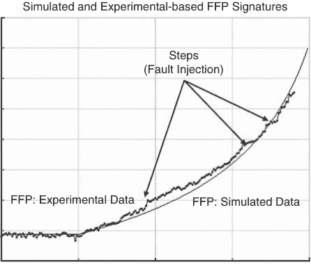

**Figure 6.28** Steps in test data due to low-resolution fault injection.

## 6.4.2 测试台

即使您可以使用历史数据，您仍需要设计和开发测试台以满足以下目标：（i）设计并运行实验以验证和演示您能够复制失效模式、检测退化并预测未来失效时间。在本节中，我们描述了一个合适的两部分测试台（Ridgetop 2013）：一部分用于电源，另一部分用于 EMA。您需要审查和批准测试台的设计和开发以及您打算如何使用测试数据。例如，您需要指定测试台数据将用于模型开发、模型验证以及测试和演示 PHM 能力。请记住：您的客户需要接受测试台及其预期用途作为必要且充分的。

### 测试台：电源部分

图 6.29 是您的团队可能为电源[1]设计和开发的测试台示例。电源和 EMA [2]是图 6.18 中所示的示例。该图说明了为解决实时采集数据并在稍后时间最终处理数据而采用的设计方法。

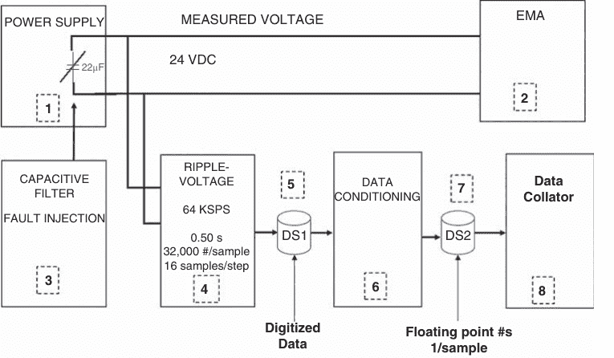

**Figure 6.29** Diagram of a test bed to inject faults into a power supply.

设计解决方案总结如下：

- **3.** 是可编程的故障注入方法。在可选择的间隔时间，电源的滤波电容值被降低。
- **4.** 是对电源输出进行采样的传感器，在每次故障注入之间的间隔内采样 16 次。传感器在半秒间隔内以 32,000 个样本的突发方式采样输出。输出电压被滤波以分离交流分量纹波电压和噪声，这些信号被数字化、变换为标量值并写入输出文件[5]。
- **6.** 是计算例程，读取 32,000 个标量值，计算平均值并写入单个浮点数。该数字和样本时间被写入为数据点到输出文件[7]。
- **8.** 是用于从电源和 EMA 采集的数据的数据整理器。

### 测试台：EMA 部分

图 6.30 是您的团队可能为由电源[1]供电的 EMA [2]设计和开发的测试台示例。该图说明了为解决实时采集数据并在稍后时间最终处理数据而采用的设计方法。设计解决方案总结如下：

- **9.** 是用于检测由 EMA [2]驱动的可移动表面位置的传感器。
- **10.** 是三个电流传感器，用于测量 EMA [2]中 BLDC 电机绕组中的三相电流（A、B 和 C）。

可编程故障注入方法：在可选择的间隔时间，降低滤波电容值。

- **11.** 是 EMA [2]中的控制器。
- **12.** 是三组两个功率开关晶体管，用于为 BLDC 电机提供交流电。
- **13.** 是 BLDC 电机中的绕组（三个之一）。
- **14.** 是 BLDC 电机的轴，用于定位可移动表面。
- **15.** 是输入到连接到 BLDC 电机控制器[11]的测试台控制器[16]的定位命令。
- **17.** 是 BLDC 电机绕组中的电流。当可移动表面被主动定位（移动）时，会出现大振幅电流。
- **18.** 是用于向任一功率开关晶体管的漏极注入电阻[19]的可编程开关。这模拟了已知的 PoF 机制（Celaya et al. 2010）。该失效模式导致 BLDC 绕组中电流流动的可测量变化。
- **20.** 是使用定位信息创建采样窗口[21]的窗口控制，以采集数据（见图 6.31），数据被数字化并写入输出文件[22]。窗口技术避免了在移动表面开始和结束时振幅极端变化引起的分析问题。
- **23.** 是包含算法和计算例程的程序模块，用于对数据进行调理、变换并提取特征数据（FD）到输出文件[24]。

图 6.30 中未显示另外两种故障注入方法：一种用于模拟损坏的电机绕组，另一种用于增加施加在电机上的负载。

您设计并进行使用测试台注入故障并采集 CBD 的实验。您应用第 1–5 章的方法和技术来提取、调理、融合，


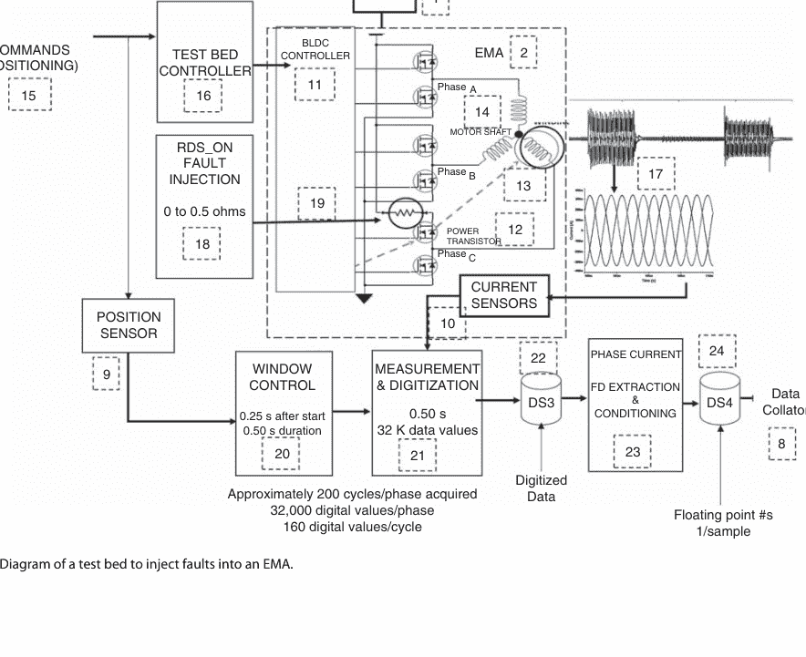

**图 6.30** 用于向 EMA 注入故障的测试台示意图。

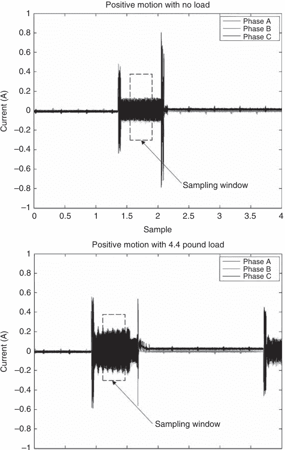

**图 6.31** 采样并加窗后的相电流：空载（上图）和额外负载（下图）。

对数据进行变换，并将 FD 表征为特征。你的 EMA 实验产生了非常嘈杂的数据，掩盖了与退化相关的电流变化；因此，你采用了如图 6.31 所示的加窗技术。右侧图中右半部分的增加幅度很小（甚至没有增加）——该实验及其他实验证实，出于预测性维护的目的，采样应在 EMA 向上移动负载而非向下移动负载时进行。

## 6.4.3 测试台：结果

你在初始设计和测试阶段使用该测试台，按帕累托排序针对以下失效模式进行故障注入：(i) 电源，滤波电容丢失；(ii) EMA，开关功率晶体管；(iii) EMA，电机轴上的负载过大；(iv) EMA，电机绕组。

### 电源

如图 6.32 所示，使用你的测试台进行的故障注入实验是成功的。

### EMA

EMA 实验的结果好坏参半：在 EMA 没有任何退化的情况下，测得的相电流除了噪声之外，在致动器运动中间一半行程中保持不变且幅值相等。检查图 6.33，并比较正常负载表面（上图）和过载表面（下图）的提升过程，可以看到相电流有所增加。

然而，尽管在功率开关晶体管的漏极中插入了数百毫欧的电阻，你仍无法检测到测得相电流的任何变化。你用退化晶体管模拟电源，并确认即使存在半欧姆的退化，电流幅值的变化也非常小（见图 6.34）：相对于 650 mA 的标称均方根（rms）值，变化小于 1.5%（9 mA）。后一项观察促使你更仔细地检查实验数据——尤其是高退化水平下的数据。

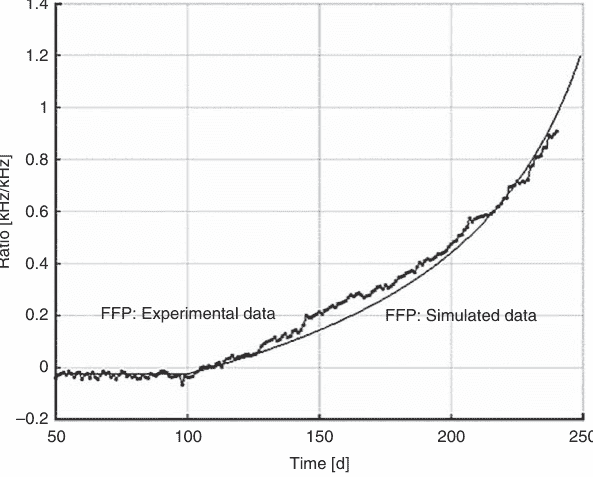

**图 6.32** 故障注入 SMPS 的 FFP 特征。

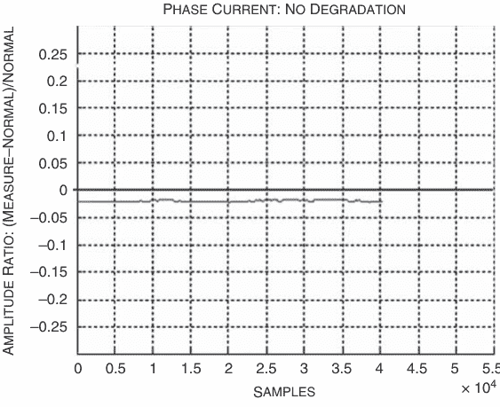
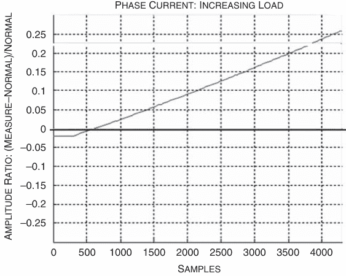

**图 6.33** 采样相电流：空载（上图）和额外负载（下图）。

## 6.5 交流相电流的特殊 RMS 方法

你进行了一项实验，对六个功率开关晶体管之一引入了严重退化，结果导致三相电流的参考电平发生偏移（图 6.35）。你观察到以下现象：(i) 相电流测得幅值发生非常小的变化；(ii) 相电流的参考电平发生显著偏移。PoF 分析和 FMEA 确认，由于电机三相绕组连接到浮动参考点，并且由于 H 桥的设计（参见图 6.30），观察到的偏移是预期结果。

**模拟相电流**

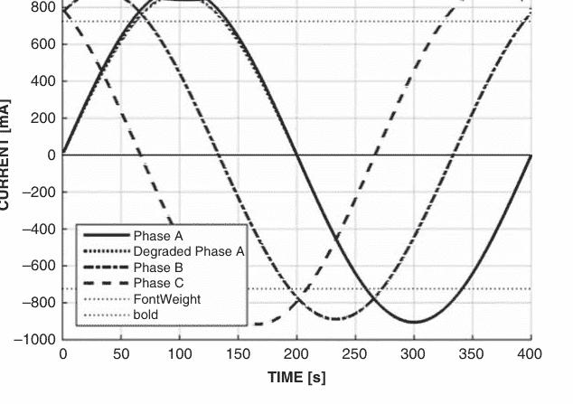

**图 6.34** 电流幅值：无退化（高），晶体管退化（幅值降低）。

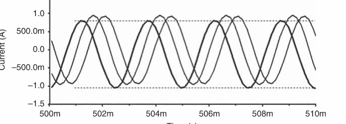

**图 6.35** 功率开关晶体管退化导致的电平偏移。

对 EMA 电路（图 6.30）的检查和 PoF 分析确认，参考电平（零交叉）的偏移是真实的，而非实验或测量误差：电平偏移是由于必须维持电流总和为零而引起的，即使功率开关晶体管退化导致了电流不平衡。你通过将 rms 计算拆分为两部分来解决测量幅值偏低的问题：正 rms 和负 rms。你只使用高于或低于所选阈值的电流值：即图 6.36 中的深色样本。

**模拟 A 相电流——截断**

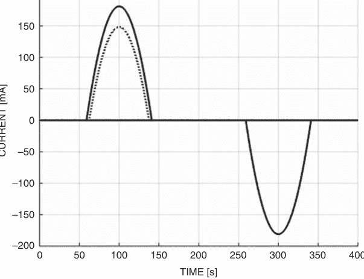

**图 6.37** 特殊 rms：阈值和截断。

设 N_S = 32 000 个样本脉冲串中相电流的最小负幅值。

则

p(s) = m(s)，当 m(s) ≥ 0.80 P_S 时，否则 p(s) = 0

n(s) = m(s)，当 m(s) ≤ 0.80 N_S 时，否则 n(s) = 0

P_RMS = (1/P) Σ_{s=1}^{s=n} p(s)  (6.1)

N_RMS = (1/N) Σ_{s=1}^{s=n} n(s)  (6.2)

### 6.5.3 特殊峰值 RMS 方法：FFP 计算例程

设 I_120 = 相电流的标称值，AT = 0.80。然后对于三相电流中的每一相，使用式 (6.3) 对每个数据点计算 FFP 的样本值。结果绘制在图 6.38 中：

P_PK = (P_RMS − (AT P_RMS)) 正特征数据  (6.3)

N_PK = (N_RMS + (AT N_RMS)) 负特征数据  (6.4)

**相电流：特殊 RMS**

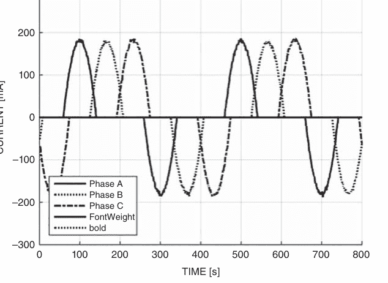

**图 6.38** 应用于三相电流的特殊 rms。

### 6.5.4 峰值 RMS 方法：EMA

你设计并运行了有无故障注入的实验，针对以下失效模式：

- 由于 EMA 所移动表面的卡滞、摩擦或重量过大，导致电机上的负载过大。
- 由于过热等原因导致的电机绕组退化，进而损坏绕组绝缘，使电机绕组短路。
- EMA 的 H 桥控制器中功率开关 MOSFET 退化，导致传输到电机的电压和功率降低。

#### 过大负载：FFP 特征计算例程

你获取有和没有过大负载的数据，应用式 (6.1)–(6.4)，然后使用式 (6.5) 对三相电流中的每一相进行特征数据的融合和变换，得到并绘制 FFP 数据点，如图 6.39 所示：

FFP = (P_PK − N_PK + 240)/120 正特征数据 (6.5)

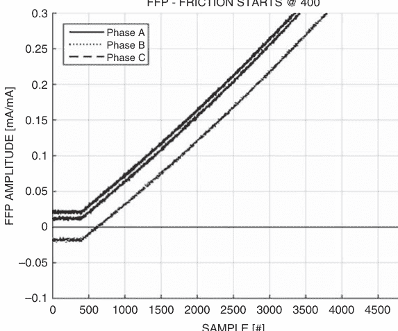

**图 6.39** 由负载引起的 FFP 特征。

#### 过大负载：FFS 计算例程

你分析了 FFP 计算例程的结果，并得出以下结论：

1. 尽管存在轻微弯曲，但特征足够线性，可满足要求。不执行 FFP 到 DPS 的变换。
2. 你需要应用约 0.025 的噪声裕度（NM），因为在没有退化的情况下，FFP 特征高于零阈值。
3. 你应该以数据平滑的形式应用噪声抑制。你决定使用点平均。
4. 你决定使用 0.25 的失效阈值——这大约相当于因重量和/或摩擦导致的额外负载引起的电流增加 25%。

你应用 NM（式 (6.6)）；你使用数据平滑来生成图 6.40 中所示的三条 FFP 特征。接下来，你选择幅值最高的 FFP；你选择失效阈值；并使用式 (6.7) 将该 FFP 变换为 FFS（图 6.41）。

```
FFP = FFP − 0.025   （应用 NM 后的 FFP）   (6.6)
FFS = 100 (FFP / 0.25)   （为 0.25 失效阈值获取 FFS）   (6.7)
```

#### 电机绕组：FFP 和 FFS 特征

你获取有和无注入短路绕组故障的数据，并应用与负载实验相同的方法。FFP 特征如图 6.42 所示。你观察到以下现象：

1. 只有一条 FFP 特征——即 C 相的特征——在上升，而不是三条都在上升。
2. 你可以使用与 EMA 负载情况相同的 FFS 计算例程（图 6.43）。
3. 特征行为不同：一条特征变化与三条特征上升，可用于诊断目的（故障隔离）。
4. 由于在无退化情况下相电流幅值存在差异，因此存在不可避免的偏移误差（见图 6.43）。

**平滑特征——绕组故障始于 1000**

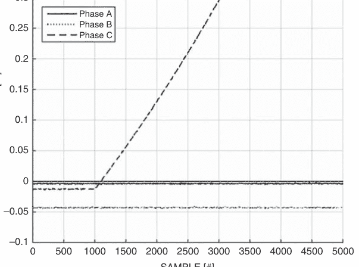

**图 6.42** 绕组故障导致的平滑 FFP 特征。

**单一 FFS——绕组故障始于 1000**

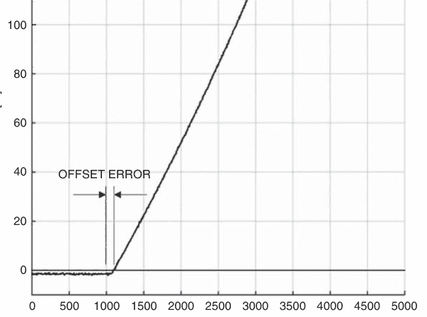

**图 6.43** FFS：EMA 绕组。


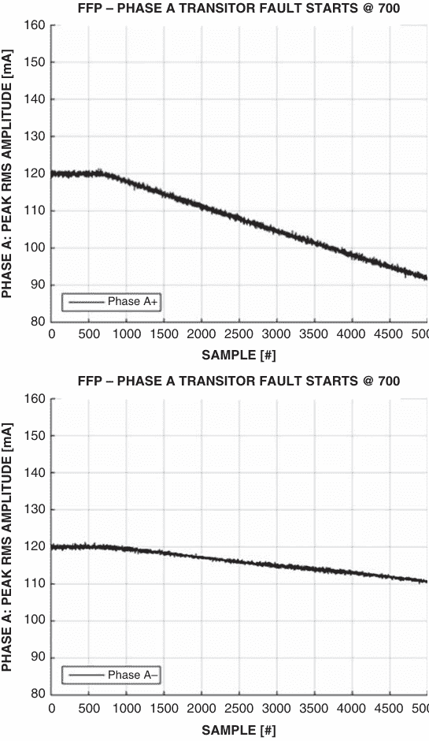

**图 6.44** 相 A 电流：相 A 正半部分晶体管故障。

## H 桥控制器：FFP 和 FFS 签名

您在 H 桥控制器中获取了有无注入导通电阻故障的数据。为此，您使 H 桥中相 A 部分正半部分的功率开关晶体管的导通电阻随时间增加。您绘制了如图 6.44–6.46 所示的相 A、相 B 和相 C 的特殊峰值 RMS 值。

### FFP – 相 B - 相 A 故障


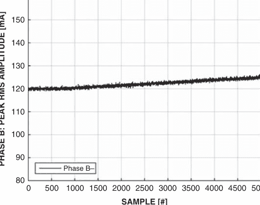

图 6.45 相 B 电流：相 A 正半部分晶体管故障。

结果并非您所预期：而不是仅在相 A 电流的正半部分出现下降，三相电流的正负半部分均发生了变化；另见图 6.47。在继续之前，您需要了解发生了什么。对电机电路的检查（图 6.48）使您得出结论，三台电机绕组的公共节点是浮动的，这意味着一个相电流幅度的变化会改变三相电流的参考电平。

### FFP – 相 C - 相 A 故障

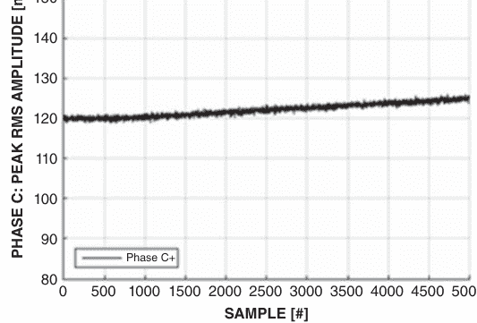

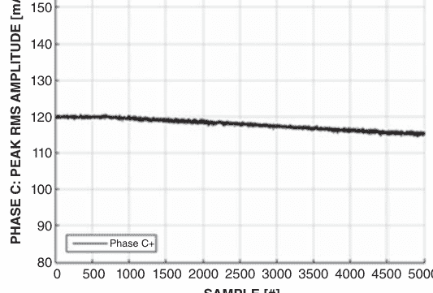

图 6.46 相 C 电流：相 A 正半部分晶体管故障。

随后您得出结论，可以按如下方式使用结果：

- 1. 求出所有三相电流各半部分的绝对值之和。
- 2. 使用最高值的和作为 FFP 数据点。
- 3. 故障位置位于 H 桥中幅度下降最大的部分。在本例中，即为相 A 电流的 H 桥正半部分（请回顾图 6.44 的顶部图）。
- 4. 这样得到的 FFP 如图 6.49 所示。

### FFP - 相 A 晶体管故障起始 @ 700

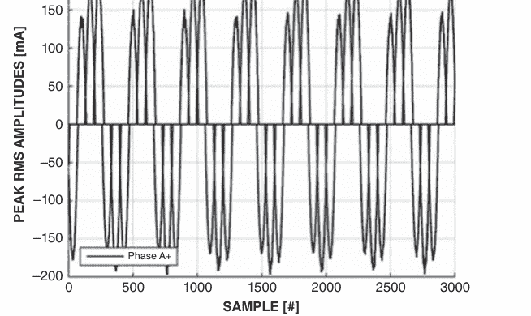

图 6.47 峰值-RMS 电流：相 A 正半部分晶体管故障。

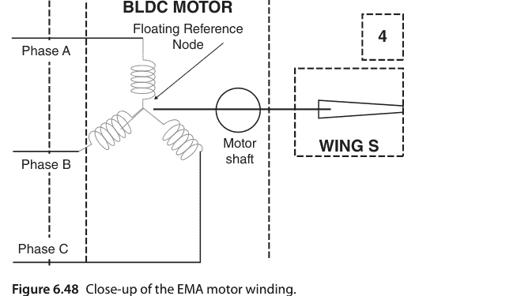

图 6.48 EMA 电机绕组的特写。

在检查了图 6.49 并回顾了您的实验和实验结果后，您得出了以下结论：

- 1. 您拥有一种诊断和预测 EMA 中 H 桥驱动器中功率开关晶体管失效的预测性解决方案。
- 2. 您使用以下方法将特征数据转换为 FFP 签名数据：

```
FFP = (ABS(P_PK) + ABS(N_PK) + 240)/120 sum absolute peak values    (6.8)
```

其中 120 = 无退化时的标称电流值。

### FFP - 相 A 晶体管故障起始 @ 700

图 6.49 FFP：H 桥故障，相 A 电流两半部分之和。

- 3. 您使用四点平均法来平滑 FFP 签名数据（见图 6.50）。
- 4. 您可以使用公式 (6.6) 和 (6.7) 将 FFP 签名数据转换为 FFS 数据（见图 6.51）。
- 在公式 (6.6) 中，将 0.025 改为 0.10 作为 NM 的进一步降噪步骤。

### 平滑后 FFP - 相 A 晶体管故障起始 @ 700

图 6.50 平滑后 FFP：H 桥故障。

### FFS - 相 A 晶体管故障起始 @ 700

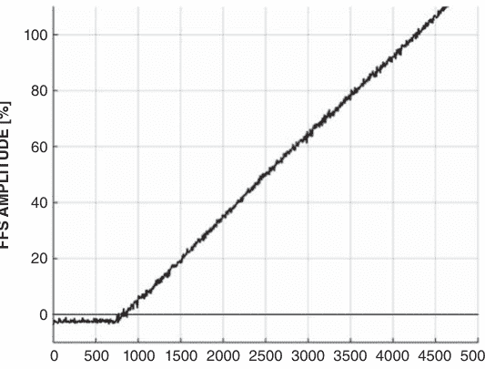

图 6.51 平滑后 FFS：H 桥故障。

- - 在公式 (6.7) 中，继续使用 0.25 作为功能失效（约电流降低 25%）。
- - 将五点平均法应用于 FFS 数据作为降噪的最后一步。

在设计评审期间，一位评审者质疑您使用公式 (6.8) 而不是以下公式（来自第 3 章）：

```
FFP_i = (FD_i - FD_0)/FD_0
(3.8)
```

您解释说，当特征的标称值 FD_0 小于 1 时，尤其是当功能失效阈值小于 1 时，使用替代模型更为合适：

```
FFP_i = (FD_i - FD_0)
(6.9)
```

## 6.6 诊断和预测程序

规范包括对 SMPS 电源和 EMA 的诊断和预测程序的描述。

### 6.6.1 SMPS 电源

电源的诊断程序很直接：将传感器数据转换为 FFP 签名，然后转换为 DPS 数据，然后转换为 FFS 数据；然后将 FFS 数据输入预测框架。当 SoH 小于 100 且大于 0 时，电源已退化。当 SoH 首次降至 100 以下时，可进行诊断。按节点定义指定的方式发出警报。

### 6.6.2 EMA

传感器框架中的传感器产生三组测量值，每组对应三相电流中的一相——正负标量值。传感器测量数据由计算例程（软件和/或固件）处理，以产生三对峰值-RMS 值：每相一对正负值。

**故障树处理：检测和诊断**

检查每相电流的正负特殊峰值 RMS 值的幅值：

- 1. 当某相的两个值均表现出幅值下降时：
  - 故障模式：该相开关功率晶体管的导通电阻增加。
  - 故障隔离：H 桥电路中幅值下降最大的相半部分的晶体管。
- 2. 当所有三相电流的两个值均表现出幅值增加时：
  - 故障模式：EMA 电机负载增加。
  - 故障隔离：EMA 电机上的摩擦或重量增加（或两者兼有）。
- 3. 当单个（或两个）相电流的两个值均表现出幅值增加时：
  - 故障模式：阻抗降低，例如电机绕组匝间短路。
  - 故障隔离：电流增加的相的电机绕组。
- 4. 否则，EMA 状态等于 *未发现故障*。

## 6.7 规范：鲁棒性和能力

客户批准了您的初始设计规范，并批准进一步设计和开发原型 PHM 系统，以通过同时监控、检测退化程度并为图 6.18 所示的系统配置发出适当的警报和预测信息来展示鲁棒性和能力：（i）未退化的电源，（ii）退化的电源，（iii）未退化的 EMA，（iv）具有退化功率 MOSFET 的 EMA，以及（v）电机轴上负载过大的 EMA。保存在图 6.29 中标记为 DS2 – |7| 的输出文件以及图 6.30 中标记为 DS4 – |24| 的输出文件提供输入数据以测试、验证和演示该系统。

一套用于鲁棒原型示例 PHM 系统的最终规范包括以下内容：（i）用于处理相电流的特殊均方根（RMS）方法；（ii）对电源的预测使能；以及用于功率开关 MOSFET 和电机负载的 EMA。最终规范需要支持您的主张，即您的团队将开发一个鲁棒的原型示例 PHM 系统，该系统能够提供所需的预测功能。

### 6.7.1 基于节点的架构

您的 PHM 系统需要定义每个节点的轮询模式，包括范围、定义和间隔。范围包括例如，用于处理收集数据的程序，以及与数据调理和预测相关的要求。基于这些和其他考虑，您设计了一个在线、基于节点的架构，如图 6.52 所示的注释图，其中包括您的 PHM 系统和其他系统。例如，您并非设计用于执行 CBM 的系统、用于执行自主后勤支持的系统，或用于支持和提供故障管理的系统。

您的 PHM 系统应包括以下主要功能和能力：

- - 系统控制和数据流。
- - 系统节点定义，以及两个 EMA 子系统的节点定义，每个子系统均由一个电源和两个 EMA 组合而成。
- - 数据集库：输入、输出和检查点/重启数据集，以支持可中断的 PHM 操作。
- - 计算库，包含您提供的程序模块和例程，用于执行数据调理、融合、转换以及支持 PHM 系统所需的任何其他操作。
- - 系统服务库，用于支持和提供例如图形和终端用户界面、消息和警报、信息显示和打印以及事件处理程序。

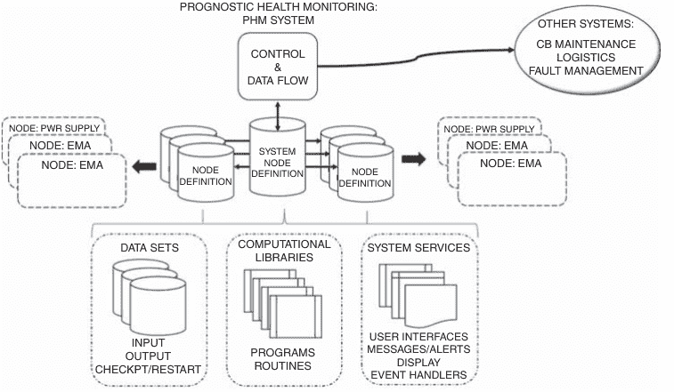

**图 6.52** 鲁棒 PHM 系统示例的框图。


## 工作范围

总体而言，一个健壮的 PHM 系统包括但不限于以下内容：

### 传感器硬件、固件和驱动程序

- 主采样率、突发模式（高频）采样在较低循环率下进行等。
- 基于频率与基于幅度的区别，电压与电流的区别等。
- 有源滤波、模数数据转换等。

### 向量程序模块

- 输入数量。
- 融合 – 数据和领域。
- 签名建模、变换和平滑。

### 预测程序

- 预测距离、准确性和收敛性。

### 服务程序

- 用户界面，如命令行、图形输入/输出和打印。
- 资源管理：编辑、选择和修改。
- 消息、数据记录和报告。
- 警报。
- 事件处理。

## 项目范围

对于本项目阶段，你和你的团队的工作范围如下：

- 系统节点定义（SND）的设计。
- 应用特定节点定义（NDEF）的设计。
- 任何所需输入、输出和检查点/重启数据集的设计。
- 根据需要和期望使用团队先前设计和开发的计算程序模块和例程来验证设计要素。那些模块和例程的设计和开发细节不包括在内。
- 根据需要和期望使用团队先前设计和开发的基础服务程序和例程来验证设计要素。那些服务、程序和例程的设计和开发细节不包括在内。
- 设计信息应按如下方式提供：
  - 使用终端用户界面（EUI，命令行）。图形用户界面（GUI）的设计被推迟。
  - 假设将有一个消息处理器来包含所有语言特定的文本。
  - 假设将有一个支持平台用于轮询和采样。
  - 异步事件处理被推迟到本项目阶段。
- 预测服务将包括以下内容：
  - 预测信息。
  - 预测准确性：评估和报告服务。

## 6.7.2 示例设计

你决定原型 PHM 系统中的节点是逻辑节点，可能包含一个以上的物理节点。例如，每个 EMA 都有三个物理节点，AC 测量传感器附着在其上。更实际的做法是认为一个 EMA 节点包含三个物理传感器，因此三个信号。参考回图 6.52，总共有六个节点：电源两个，EMA 四个。每个节点定义的架构如图 6.53 所示。

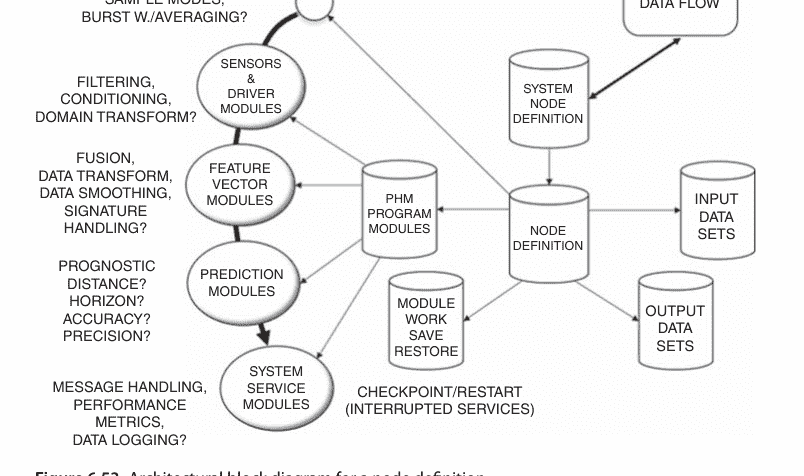

图 6.53 节点定义的架构框图。

你为原型 PHM 系统的示例设计包括以下内容：（i）系统节点定义；（ii）特定节点定义；（iii）一组程序模块，用于收集、调理和处理数据、产生预测信息以及系统服务；（iv）包含输入数据集的库；（v）包含输出数据集的库；以及（vi）用于保存和恢复操作信息的库，包括检查点/重启支持。

参考图 6.53，节点的主要框架是：（i）传感器附着其上的物理节点；（ii）传感器以及适用的其驱动模块和/或嵌入式固件；（iii）特征向量模块，包含处理传感器数据以产生预测框架输入签名的计算程序和例程；（iv）处理来自向量框架输入以产生预测信息的预测程序/算法；（v）系统服务，用于支持信息性和警报类型的消息、执行数据记录、分析和产生性能指标等；以及（vi）PHM 系统本身，提供操作流和数据流控制。

你的设计使用定义文件，如图 6.53 所示：（i）它们以明文格式维护，便于使用和可读性；（ii）它们灵活，可以适应广泛的支持要求；并且（iii）它们便于在 PHM 系统中以表驱动的方式实例化 NDEF：例如，两个电源的一个 NDEF 和四个 EMA 的另一个 NDEF。

```text
%***********************************
% System Node Definition file
%***********************************
NCPTLIB   = 'C:\DXPHMLIB\DXCPT\' ;   % Checkpoint-restart library
NCPTFNP   = 'SN_' ;                   % CPT filename prefix
NSMPINT   = '1' ;                     % Sampling interval, # hours
NSMPRATE  = '4' ;                     % Sampling rate, 4 times/NSMPINT
NSMPCLL   = '0' ;                     % Set sampling clock, hour
NSMPMODE  = 'TEST' ;                  % Test/demo, else real time
NSMPTSTP  = '1' ;                     % Test seconds per NSMPINT
%***
NDNUMID   = 50 ;                      % Assigned node number
NDLIB     = 'C:\DXPHMLIB\DXNDEF\' ; % Node definition library
NDFNAME   = 'DXNDPWR1.txt' ;          % Node definition fname.typ
NDIDNAME  = 'SMPS: 1,EMA' ;           % Name ID
NDNUMID   = 51 ;                      % Assigned node number
NDLIB     = 'C:\DXPHMLIB\DXNDEF\' ; % Node definition library
NDFNAME   = 'DXNDEMA1.txt' ;          % Node definition fname.typ
NDIDNAME  = 'EMA: 1,LEFT' ;           % Name ID
NDNUMID   = 52 ;                      % Assigned node number
NDLIB     = 'C:\DXPHMLIB\DXNDEF\' ; % Node definition library
NDFNAME   = 'DXNDEMA2.txt' ;          % Node definition fname.typ
NDIDNAME  = 'EMA: 2,LEFT' ;           % Name ID
NDNUMID   = 60 ;                      % Assigned node number
NDLIB     = 'C:\DXPHMLIB\DXNDEF\' ; % Node definition library
NDFNAME   = 'DXNDPWR2.txt' ;          % Node definition fname.typ
NDIDNAME  = 'SMPS: 2,EMA' ;           % Name ID
NDNUMID   = 61 ;                      % Assigned node number
NDLIB     = 'C:\DXPHMLIB\DXNDEF\' ; % Node definition library
NDFNAME   = 'DXNDEMA3.txt' ;          % Node definition fname.typ
NDIDNAME  = 'EMA: 3,RIGHT' ;          % Name ID
NDNUMID   = 62 ;                      % Assigned node number
NDLIB     = 'C:\DXPHMLIB\DXNDEF\' ; % Node definition library
NDFNAME   = 'DXNDEMA4.txt' ;          % Node definition fname.typ
NDIDNAME  = 'EMA: 4,RIGHT' ;          % Name ID
%***
ENDDEF    = -1 ;                      % end of node definition
```

图 6.54 系统节点定义的示例。

你为每个块准备了一套 NDEF 规范：（i）它们支持健壮原型 PHM 系统的功能和操作要求，并且（ii）你完全期望它们会随着设计和开发的进行以逐步方式更新。你定义的第一个节点定义是用于 NDNUMID = 50（参考回图 6.54）。

### 节点状态

节点状态块（图 6.56）包含三个条目：

- NDNUMID 是节点的数字标识符，其值如 SND 中指定。
- NODEINISW 是一个初始化开关，当节点初始化时设置为 1。

```text
%**Node monitoring rate - definition only
SRDEF      = 1 ;      % 1 = hourly, 2 = daily, 3 = weekly
SRMONITOR  = 36 ;     % Rate when SoH = 100          every 36 hours
SRWATCH    = 12 ;     % Rate when 100 > SoH > 50    every 12 hours
SRTRACK    = 1 ;      % Rate when SoH <= 50          every 1 hour
SRALERT    = 0.5 ;    % Rate when SoH <= 25          every 0.5 hour
```

图 6.57 NDEF：采样规范。

```text
%**ALERT SoH Thresholds: when SoH falls below threshold level
% -n means ignore ALERT threshold
AST1       = 100 ;    % Issue ALERT when SoH < threshold
AST2       = 75 ;     % Issue ALERT
AST3       = 50 ;     %       when
AST4       = 25 ;     %       SoH <= threshold
AST1SW     = 0 ;      % Warning issued when 1
AST2SW     = 0 ;      % else
AST3SW     = 0 ;      %   not
AST4SW     = 0 ;      %   issued
```

图 6.58 NDEF：警报规范。

- *AST3* 和 *AST3SW* 用于在 SoH 下降到 50% 以下时发出警报。
- *AST4* 和 *AST4SW* 用于在 SoH 下降到 25% 以下时发出警报。

### 特殊文件规范

特殊文件规范块（图 6.59）包含用于记录数据总线的三个特殊文件的规范的七个条目：

- *NDFCLOSE* 指定在处理完数据点后是否关闭特殊文件。
- *NDFID* 是包含原始数据的总线文件的 file ID。
- *NDBUSFN* 是包含来自传感器框架的数据的总线文件的 file name。
- *NVFID* 是包含来自向量框架的数据的总线文件的 file ID。
- *NVBUSFN* 是包含来自向量框架的数据的总线文件的 file name。
- *NPFID* 是包含来自预测框架的数据的总线文件的 file ID。
- *NPBUSFN* 是包含来自预测框架的数据的总线文件的 file name。

```text
%**Special Files
NDFCLOSE   = 0 ;      % close files after data pt - 0 = no, 1 = yes
NDFID      = -1 ;     % file id if open
NDBUSFN    = 'none' ; % file name after initialization
NVFID      = -1 ;     % file id if open
NVBUSFN    = 'none' ; % file name after initialization
NPFID      = -1 ;     % file id if open
NPBUSFN    = 'none' ; % file name after initialization
```

图 6.59 NDEF：特殊文件规范。


## Feature Vector Framework

Feature Vector 块包含三个部分——主部分、数据平滑部分和 FFP 到 DPS 转换部分：

FD = feature data = FD0*(1 + dP/P0)
FFP = (FD – FD0 – NM)/FD0 where NM = FNM*FD0/100 or
FFP = (FD – FD0 – NM) when FDNOMDIV = 0

主部分包含六个条目用于指定将 CBD 转换为 FD 的变换：

- *FNM* 指定 NM，即标称 FD 值（FD0）的百分比
- *FAILM* 指定百分比失效裕度：70 表示当 FFP = 0.70 时失效
- *FDNOM* 指定被视为标称 FD 值（FD0）的数据值
- *FDNOMV* 指定 FD0 的预期百分比方差
- *FDNOMMIN* 指定用于 FD0 的最小值。
  - 当测量的 FD0 小于 FDNOMMIN 时，使用 FDNOMIN。
  - 否则使用测量的 FD0。
- *FDNOMDIV* 指定是否执行除法（非零值）或不执行（零值）。

数据平滑部分包含四个条目用于数据平滑：

- *FD0PTS* 指定用于平均的 CBD 点数，以计算 FD0 的值。
  - 当指定为零（0）时，使用 FDNOM。
  - 当计算中的方差超过 FDNOMV 时，使用 FDNOM。
- *FDPTS* 指定用于平滑的 FD 点数进行平均。
- *FFPPTS* 指定用于平滑的 FFP 点数进行平均。
- *FFSPTS* 指定用于平滑的 FFS 点数进行平均。

FFP 到 DPS 转换部分包含两个条目用于将 FFP 特征数据转换为 DPS 数据：

- *XDPS* 指定用于选择 FFP 到 DPS 转换模型的 FFP 模型：
  - 0 表示不转换。
  - 1 表示使用 FFP = FD0*(dP/P0)^n。
  - 2 表示使用 FFP = FD0*([1/(1 - dP/P0)]^n - 1)。
  - 3 表示使用 FFP = FD0*(1-[1/(1 + dP/P0)]^n)。
  - 4 表示使用 FFP = FD0*((1 + dP/P0)^n - 1)。
  - 5 表示使用 FFP = FD0*(1 - (1 - dP/P0)^n)。
  - 6 表示使用 FFP = FD0*(exp(dP/P0) - 1)。
  - 7 表示使用 FFP = FD0*(1 - exp(-dP/P0))。
- *XDPSNV* 指定用于 n 或 lambda（寿命）的值。

## Prediction Framework

预测框架部分（图 6.61）包含两个条目用于指定在生成预测信息时使用的值：

- *PITTFF0* 指定退化开始后失效时间（TTF）值：
  - 默认值为 200 个采样周期。
- *PIFFSMOD* 指定输入数据的预期形状：
  - 1 表示凹形特征曲线。

```
%**Feature Vector          (A)
FNM      = 2.5 ;      % Noise margin - % of FD0
FAILM    = 70 ;       % Failure margin - % above 0
FDNOM    = 0 ;        % Feature Data (FD), Nominal value
FDNOMV   = 3 ;        % FD Nominal variance (%)
FDNOMMIN = 1 ;        % minimum nominal value: if less, perform DIV
FDNOMDIV = 0 ;        % 0 = subtract only (no division) - small signal
                      % else FFP = (FD - DIV)/DIV
```

```
(B)
FD0PTS   = 20 ;       % # data points to average to calculate FD0
FDPTS    = 4 ;        % Rolling FD (CBD) points to average: up to 4
FFPPTS   = 4 ;        % Rolling FFP points to average: up to 4
FFSPTS   = 4 ;        % Rolling FFS points to average: up to 4
```

```
%**FFP to DPS Transform    (C)
XDPS     = 0 ;        % none
%        = 1 ;        % FFP = FD0*(dP/P0)^n
%        = 2 ;        % FFP = FD0*([1/(1 - dP/P0)]^n - 1)
%        = 3 ;        % FFP = FD0*[1-{1/(1 + dP/P0)}^n]
%        = 4 ;        % FFP = FD0*([1 + dP/P0]^n - 1)
%        = 5 ;        % FFP = FD0*(1 - (1 - dP/P0)^n)
%        = 6 ;        % FFP = FD0*(exp(dP/P0) - 1)
%        = 7 ;        % FFP = FD0*(1 - exp(-dP/P0))
XDPSNV   = 1 ;        % n or Lambda (life) value
```

Figure 6.60 NDEF: feature-vector framework – (a) primary, (b) smoothing, (c) FFP-DPS transform.

```
%**Prediction (Prognostic) Information
PITTFF0  = 4800 ;     % estimated time (hours) after onset of damage
PIFFSMOD = 2 ;       % model 1=Concave, 2=Linear, 3=Convex, 4=complex
PIFFSNM  = 3 ;       % noise margin (%) for estimating begin degradation
```

Figure 6.61 NDEF: Prediction Framework.

- 2 表示线性曲线——这是默认值。
- 3 表示凸形曲线。
- 4 表示复杂（不规则）曲线。

- *PIFFSNM* 指定用于估计退化开始（BD）的 NM（%）。

关于 PIFFSMOD 的操作说明：您的 PHM 系统预装有一套基本的预测算法嵌入在名为 DXARULE（自适应剩余使用寿命估计器）的软件程序中，无需额外付费，因为它不提供对非线性输入数据的特殊处理（PIFFSMOD 被忽略）。您的客户可以选择获取并使用高级版本 ARULEAV。

## Performance Services/Graphics

性能服务/图形部分（图 6.62）包含三个与性能相关的规范条目：

- *PGSW* 为未来计划的功能（图形用户界面）保留。
- *PGALPHA* 指定用于评估预测精度的 alpha（精度）百分比。
- *PSSW* 指定是否（1）或不（0）将性能指标写入日志文件。

```
%**Performance Services/Graphics
PGSW      = 1 ;        % Future
PGALPHA   = 10 ;       % Prognostic alpha for Prognostic Horizon
PSSW      = 1 ;        % Write PI results to file, 0 = no, 1 = yes
```

Figure 6.62 NDEF: Performance Services/Graphics.

```
%**Input & Output Files***********************************
FDINLIB   = 'C:\DXPHMLIB\DXINDATA\' ;  % Input data library
OUTLIB    = 'C:\DXPHMLIB\DXOUTDATA\' ; % Output data library
INFILE    = 'DXDATFR1 ' ;               % File name for input data
OUTFILE   = 'DXDATFR1 ' ;               % File name for output data
INTYPE    = '.txt' ;                    % Input file type, text
OUTTYPE   = '.csv' ;                    % Output file type, text
```

Figure 6.63 NDEF: Input & Output Files.

## Input & Output Files

输入和输出文件部分（图 6.63）包含六个条目用于指定数据的输入和输出文件：

- *FDINLIB* 指定输入数据库。
- *OUTLIB* 指定输出数据库。
- *INFILE* 指定输入数据文件的名称。
- *OUTFILE* 指定输出数据文件的名称。
- *INTYPE* 指定输入数据文件的类型（.txt 为默认值）。
- *OUTTYPE* 指定输出数据文件的类型（.csv 为默认值）。

## Checkpoint Library and File Names

工作文件部分（图 6.64）包含九个条目用于指定保存和恢复操作环境以支持检查点和重启的工作文件的库名称、名称前缀和类型：

- *CPTLIB* 指定用于工作文件的检查点（和恢复）库。
- *CPTTYP* 指定工作文件的类型。
- *DDWFN* 指定设备驱动程序的工作文件名称前缀。
- *FVWFN* 指定特征向量程序的工作文件名称前缀。

```
%**Checkpoint Library & File Name**************************
CPTLIB    = 'C:\DXPHMLIB\DXCPT\' ;      % Checkpoint restore
CPTTYP    = 'csv'                     % file name type
DDWFN     = 'DDW_' ; % Device Driver work
FVWFN     = 'FVW_' ; % Feature Vector work
PIWFN     = 'PIW_' ; % Prognostic Information work
PSWFN     = 'PSW_' ; % Prognostic Services work
VSWFN     = 'VSW_' ; % Visual Services work (future)
EFWFN     = 'EFW_' ; % End File Services work (future)
PAWFN     = 'PAW_' ; % Performance Analysis work
```

Figure 6.64 NDEF: Checkpoint Library & File Name.

- *PIWFN* 指定用于预测信息程序的工作文件名称前缀。
- *PSWFN* 指定用于预测服务程序的工作文件名称前缀。
- *VSWFN* 指定用于可视化服务程序的工作文件名称前缀。
- *EFWFN* 指定用于结束文件程序的工作文件名称前缀。
- *PAWFN* 指定用于性能分析程序的工作文件名称前缀。

## Device Driver Program ID and Data Units of Measure

数据单位测量部分（图 6.65）包含三个条目用于定义输入数据的测量单位：

- *DDPID* 指定设备驱动程序的程序标识符。
- *DDUT* 指定用于时间单位的文本。
- *DDUA* 指定用于幅度单位的文本。

您选择此格式的原因是，未来您可能会决定为其他形式的数据指定测量单位，例如来自特征向量程序（FV PID）的数据。

## Program Identifiers

程序标识符部分（图 6.66）包含六个条目用于指定除设备驱动程序之外用于处理节点的程序的标识符（数值）：

- *FV PID* 指定特征向量程序的数字标识符。
- *PIPID* 指定预测信息程序的数字标识符。
- *PSPID* 指定预测服务程序的数字标识符。
- *VSPID* 指定可视化服务程序的数字标识符。
- *EFPID* 指定结束文件程序的数字标识符。
- *PAPID* 指定性能分析程序的数字标识符。

## End of Definition

程序标识符部分后面跟着一个结束定义（ENDDEF）条目（图 6.67），作为明确的结束而不是隐含的结束。

```
%**Device Driver Program ID and Units of Measure**************
DDPID    = 1 ;    % Required entry    DXDDTXT01
DDUT     = '[hr]' ; % Units of time
DDUA     = '[kHz]' ;% Units of amplitude
```

Figure 6.65 NDEF: Device Driver Program ID and Units of Measure.

```
%**Other Program IDs******************************************
FV PID   = 1 ;    % Required entry    DXFV1S01
PIPID    = 2 ;    % Required entry    DXARULE
PSPID    = 1 ;    % Optional entry    DXPS01
VSPID    = 0 ;    % Place holder
EFPID    = 0 ;    % Place holder
PAPID    = 0 ;    % Optional entry    DXPA01
```

Figure 6.66 NDEF: Other Program IDs.


%**End of Definition********************************
ENDDEF   = -9;      % end of node definition

图 6.67 NDEF：定义结束。

## 6.8.3 原型 PHM 系统的其他节点定义

由于你选择了一种灵活、稳健的方法——SND 和 NDEF 文件——来指定节点的处理方式，并且你在图 6.54 中对第一个节点定义使用了 NDNUMID = 50，因此其余五个节点的定义得到了简化：

- 你编辑了 SMPS 的测试文件，将时间度量单位从天改为小时，以保持一致。
- 你选择了合理且通用的阈值。

### 节点 NDNUMID = 60

对于该节点，即第二个 EMA 子系统中的 SMPS，请执行以下操作：复制第一个节点定义，更改输入文件名，并以新名称保存（见图 6.68）。

### 节点 NDNUMID = 51

对于该节点，即第一个 EMA 子系统中的第一个 EMA，请执行以下操作：复制节点 50 的节点定义，按图 6.69 所示进行更改，并将更新后的文件另存为 DXNDEMA1.txt。

### 节点 NDNUMID = 52、61 和 62

对于其他三个 EMA 节点，复制 DXEMA10，并另存为三个新的 NDEF 文件：DXNDEMA20、DXNDEMA30 和 DXNDEMA40。在这些文件中，将 INFILE 名称改为以下内容：DXDAT_CBD51.csv、DXDAT_CBD52.csv、DXDAT_CBD61.csv 和 DXDAT_CBD62.csv；同时将 OUTFILE 名称改为以下内容：DXDAT_OUT51.csv、DXDAT_OUT52.csv、DXDAT_OUT61.csv 和 DXDAT_OUT62.csv。

```
Copy DXNDPWR1.txt
Change INFILE from 'DXDATFR1' to 'DXDATFR2'
Change OUTFILE from 'DXDATFR1' to 'DXDATFR2'
Save NDEF as 'DXNDPWR2.txt'
```

图 6.68 为支持第二个 SMPS（节点 60）而进行的 NDEF 更新。

```
Copy DXNDPWR1.txt and rename to DXNDEMA1.txt
Change the following entries as indicated
INFILE   = 'DXEMA10' ;
OUTFILE  = 'DXEMA10' ;
INTYPE   = '.csv' ;
FAILM    = 25   % FFP FAILURE (when FFP = 0.25)
DDPID    = 2 ;   % DXDDCSV03
DDUA     = '[mA]' ;
FV PID   = 3 ;   % DXFV0303
```

图 6.69 为支持 EMA 1（节点 51）而进行的 NDEF 更新。

对于节点 62，将 NM 从 3 改为 1，因为进一步的实验表明 3% 的 NM 值过高。

## 6.9 系统验证与性能指标

PHM 系统验证的一个重要方面体现在如下问题上：预测估计的准确度如何？回答该问题的重要考量包括以下内容（Celaya 等，2010；Hofmeister 等，2013、2016、2017、2018a,b）：

- 检测到退化的时间，与退化开始的真实时间相比。偏移类误差不可避免，原因包括：噪声、采样时间点之间的离散间隔、测量不确定性、数据平滑（它往往使特征曲线向下并向左移动），以及数据在不同数据类型和域之间融合和转换时的舍入与精度损失。
- 检测到功能失效的时间，与功能失效的真实时间相比。偏移类误差不可避免，原因与检测误差相同。
- 所有后续 RUL 估计值均达到指定精度（α）的时间。一个有用的品质因数称为收敛效率（χ）。
- 所有后续预测时域（PH）估计值均达到指定精度（α）的时间。PH 定义为样本相对于检测到退化时点的相对时间，再加上 RUL 估计值（见图 6.70）。

表 6.1 列出了用于测量和计算与预测相关的性能指标的基本缩写词和术语。

### 6.9.1 偏移类误差

偏移误差的大小主要取决于你对数据进行了何种程度的调理，尤其是在消除和抑制噪声方面。

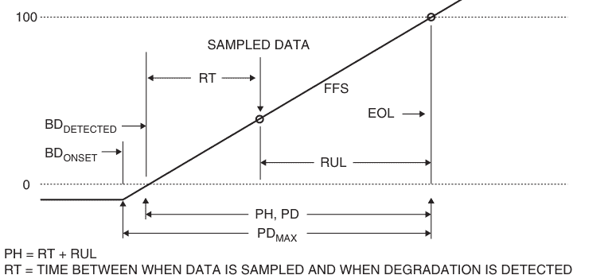

图 6.70 PH 与 BD、采样时间、RUL 和 EOL 的关系示意图。

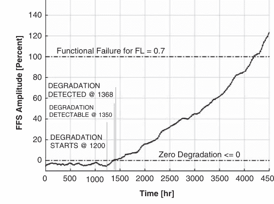

# 图 6.71 退化时间与 FFS 的关系。

## 退化检测

退化偏移误差（可参照图 6.43 和图 6.71）主要源于噪声、你所采用的噪声抑制措施，以及你所选择的采样率和精度。参见图 6.71，当测试时间为 1200 小时时，你向 SMPS 引入了退化；你的系统最早能在 FFS 大于 0 的 1350 时刻检测到该退化；而实际检测到退化是在 1368 时刻（采样间隔为 24 小时）。因此，退化偏移误差为 168 小时（参见表 6.2）。2,3

如果该误差的幅度不满足要求（即幅度不可接受），你需要执行以下一项或多项操作：

- 降低噪声量，例如在传感器硬件和/或固件中使用噪声滤波，和/或减少数据转换器和/或计算程序中的离散化和舍入误差。
- 缩短采样周期。例如，如果采样周期为 24 小时，而你在退化开始前 1 秒采样，则最小的退化偏移误差为 23 小时 59 秒。通常，你的系统会经历等于采样周期一半的退化偏移误差。
- 使用 NDEF 中的 FNM 减小你指定的 NM 值（见图 6.60）——前提是该裕量至少与信号中噪声的最大正值一样大。

减少和/或抑制退化偏移误差需要在成本（主要是传感器和数据转换器成本）与精度损失之间进行折衷，精度损失例如由数据平滑以及吞吐量/带宽（因采样率提高而降低）造成。

> 2 真实 EOL 也可称为实际 EOL 或基准真实 EOL。
> 3 美国国家航空航天局（NASA）在 2015 年 6 月使用“ground truth（基准真实）”一词，而非“ideal（理想）”或“actual（实际）”。

## 表 6.2（续）

| PTOF | 预测失效时间。预测目标预计发生功能失效的估计时间。其计算方式为检测到退化时的时间与 PH 估计值之和：PTOF = BD + PH |
| RA | 相对准确度。估计的 RUL 值相对于数据样本时刻实际 RUL 的准确度。RA 是一种仅在功能失效发生（确定 TFF）后才有意义的性能指标：RA (%) = 100*(1 − RUL/RUL0)，其中 RUL = 样本 n 处的估计 RUL，RUL0 = 样本 n 处的理想 RUL。将 RA 与准确度进行对比：RUL 准确度 (%) = 100*RUL/RUL₀。RA 适用于任何预测或预估，如 SoH 或 EOL。 |
| RT | 采样数据点与检测到退化时刻之间的相对时间：RT = (数据时间) − BDDETECTED |
| TTF | 失效前时间（参见 RUL）。组件、设备、装配件或系统发生失效所需的时间——即其使用寿命的终点。 |

图 6.72 精确确定功能失效发生时间的不确定性示意图。

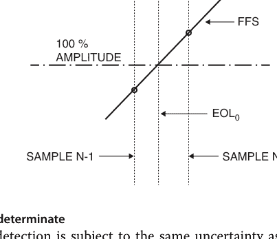

## 功能失效时间：不确定性/无法确定

功能失效（使用寿命终点）的检测与退化开始的检测一样存在不确定性，因为采样几乎总是在功能失效之前或之后发生，如图 6.72 所示，而不是恰好发生在 EOL₀。这是另一种偏移类误差。

从实际角度看，你不必担心这种偏移误差：请记住，PHM 系统的主要目的是足够早地检测到退化，以便启动并完成任何必要的补救措施，从而防止未来发生失效。为此，有一个有用的度量称为预测距离（PD）：即退化开始到功能失效发生之间的时间段。采样间隔需要远小于 PD（见图 6.73）。

### 6.9.2 确定预测距离的不确定性

确定 PD 时存在不可避免的误差，原因如下（见图 6.73）：(i) 噪声，尤其是传感器输出中的噪声；(ii) 数据调理，尤其是数据平滑；(iii) NM；(iv) 采样，尤其是采样周期。

理想情况下，PHM 系统中的传感器系统应当完全没有噪声——没有热噪声，没有交流声之类的谐波失真，没有电源开关噪声，没有信号耦合，也没有模数转换和数模转换之间的离散化和舍入误差。但实际情况并非如此。因此，PHM 系统不可能检测到退化开始的确切时间（真实 BD）：你需要对 BD 进行估计。

理想情况下，PHM 系统会在退化开始时对传感器数据进行采样——但这除非偶然，否则不会发生——即使你使用了不切实际的采样周期（如微秒级）。同样，你需要对 BD 进行估计。

理想情况下，采样数据中噪声的幅度会足够低，以至于你不必采用噪声抑制手段，例如使用滚动平均方法进行数据调理，或使用噪声裕量（NM）。采用噪声抑制的数据调理会导致传感系统的传递曲线（图 6.73 中的 FFS 曲线）向下和向左移动，该传感系统包括从被感测节点到预测程序输入端之间的所有部分，从而产生偏移类误差。

假设你不希望继续使用已退化的预测目标直至其实际失效，那么 PHM 系统所能做的最好的事情就是估计未来可能发生功能失效的时间。你所使用的预测程序——DXARULE 和 ARULEAV——正是如此：PH 输出是对估计的 BD 时间与可能发生功能失效时间之间间隔的估计。

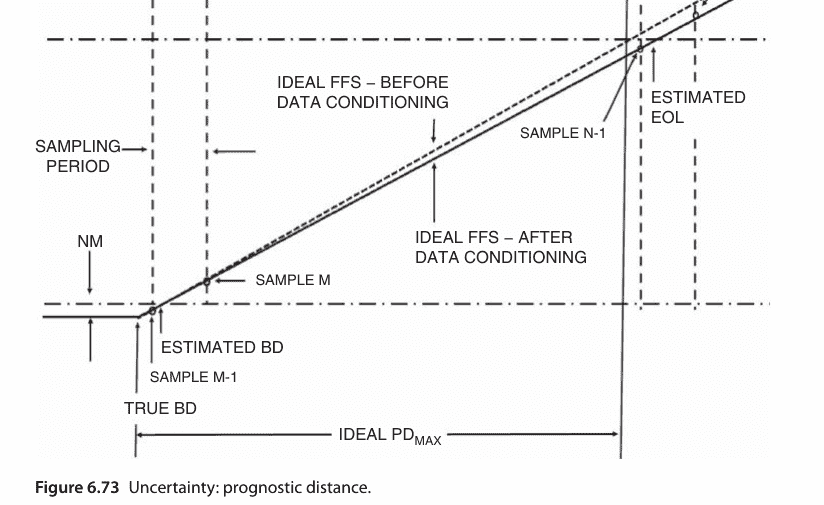

图 6.73 不确定性：预测距离。


其中 OFFSET 按如下方式计算：

设 $NM_{FFS}$ 表示以 FFS 值表示的 NM。
设 $FL_{FFS}$ 表示用于将 FFP 或 DPS 数据转换为 FFS 数据的值。
设 $NM_{FD}$ 表示以 FD 值表示的 NM。
设 $FNM$ 表示你在 NDEF 中指定的值（请参考图 6.60）。
设 $FD_0$ 表示无退化时的标称 FD 值。
设 $FDNOMMIN$ 表示你在 NDEF 中指定的值（请参考图 6.60）。

则

$NM_{FD} = (FNM/100)$ 当 $FD_0 \geq FDNOMMIN$

否则

$NM_{FD} = FNM$

则

$NM_{FFS} = (NM_{FD}/FL_{FFS})$

$OFFSET = NM_{FFS}(PITTFFO/2)$

**(6.11)**

**Example 6.2** 例如，当 PITTFFO 为 2000 小时且 $NM_{FFS}$ 为 0.030（3.0%）时，OFFSET 估计为 30 小时（0.03 倍 1000 小时）；并且如果 $TS$ 为 24 小时，则使用式 (6.10) 和 (6.11) 估计的 $PD_{EST\_MIN}$ 值变为 946 小时。如果该值不满足要求，则假设 PITTFFO 足够准确，你需要通过降低噪声来减小 OFFSET 以减小 NM 和/或你需要提高采样率以减小 TS。

**Example 6.3** 假设你被给出以下预测要求和规范陈述：

> “退化必须在失效前至少 1000 小时被检测到，并且 RUL 估计需要在失效前 240 小时 ±24 小时时至少在 10% 以内。”

其解释如下：

至少 1000 小时意味着 $PD_{EST\_MIN}$ 需要至少与 1000 小时一样大。
“在 240 小时内在 10% 以内”意味着 $PH_{10}$ 必须至少与 240 小时一样大。
24 小时和“在 10% 以内”意味着你需要最小采样率为 (2 次采样 /24 小时)*(100/10)：每 24 小时 20 次采样。这导致你选择设计的采样率为每小时一次；因此，在这种情况下 TS 为 1 小时。

但等等，$PH_{10}$ 对你的设计有何影响，以及你如何估计你的设计是否可能满足要求？这个问题在下一节中得到解答。

## 6.9.3 Estimating Convergence to Within $PH_α$

预测估计收敛到 $PH_α$ 以内的情况主要取决于以下因素，而这些因素是你可以改变的：(i) 你的预测程序的效率；(ii) 输入到你的预测程序的噪声程度；(iii) 输入到你的预测程序的线性度（或缺乏线性度）；以及 (iv) 你的设计的采样率和因此的采样周期。

### Convergence Efficiency

假设你在 PHM 系统中使用的预测程序采用类似卡尔曼的算法与随机游走算法相结合，将数据点视为具有权重和动量的粒子（数据点倾向于以给定的速度和方向继续移动）。那么，例如，一个预测程序可能以每数据点 20% 的速率从初始振幅误差收敛，而另一个则为 10%。

**Example 6.4** 你通过设计选择了一个 PITTFFO 值，你认为它可能比预期最快失效时间高出 50%。假设输入到预测算法接近理想。作为你设计评估的一部分，你创建一个表格，列出需要处理的数据点数预期以收敛到 25%、10% 和 5% 精度。当被问及，预测程序供应商 ARULEAV 声称该程序以每数据点约 20% 的收敛率校正初始偏移误差。更重要的是，供应商声称收敛还取决于噪声和输入特征中的非线性程度。因此你决定使用以每数据点 20% 校正收敛的预测程序与以每数据点 10% 收敛的另一个预测程序来评估你的设计性能。该评估总结在表 6.3 中，其中列出了两种预测程序的数据点数和收敛时间的差异。范围相当大——在示例中从 11 小时到 264 小时。

**Table 6.3 SMPS example: table of number of data points and times to converge to α.**

| Program | TS | \# Points (α=25%) | Time (α=25%) | \# Points (α=10%) | Time (α=10%) | \# Points (α=5%) | Time (α=5%) |
|---|---|---|---|---|---|---|---|
| Program 1 (20%) | TS = 12 h | 4 | 48 h | 8 | 96 h | 11 | 132 h |
| Program 1 (20%) | TS = 1 h | 4 | 4 h | 8 | 8 h | 11 | 11 h |
| Program 2 (10%) | TS = 12 h | 7 | 84 h | 16 | 192 h | 22 | 264 h |
| Program 2 (10%) | TS = 1 h | 7 | 7 h | 16 | 16 h | 22 | 22 h |

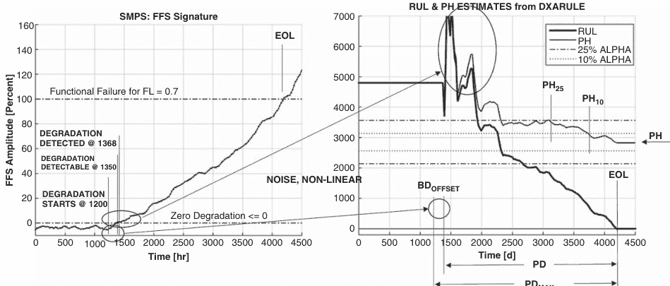

**Figure 6.77 Comparison: FFS and plots of RUL and PH estimates.**

并且性能指标变为

$PD_{FOM} = 1 - BD_{OFFSET} / PD_{MAX}$

**(6.12)**

对于你的 SMPS 退化测试（请参考图 6.71），$BD_{OFFSET}$ 计算为 168 小时，而 $PD_{MAX}$ 为 3000 小时（4200 − 1200），这意味着计算出的 $PD_{FOM}$ 值为 0.944。你的解释是存在约 6% 的偏移误差，主要是由于噪声和 NM。你可以通过降低 NM 来改善性能指标，但要实现显著降低，你需要降低数据中的噪声。$PD_{FOM}$ 主要与你对数据的调理程度和噪声缓解程度相关。

### PH Convergence

正如你所发现的，一个非常重要的性能指标，如果不是最重要的，就是 PH 收敛到精度 α 以内 ($PH_α$)：所有后续 PH 估计都在实际 PH 的 α 百分比以内。PH 收敛主要取决于预测算法如何处理数据中的扰动（噪声）和非线性。

那么，预测程序 DXARULE 的表现如何？幸运的是，你设计的 PHM 系统具有日志文件功能：你可以编写预测文件的输出日志文件（见图 6.78）以支持预测信息的后处理。头文件中最后三个条目是用于分析目的的可视化辅助：NDEF 文件中指定的 PGALPHA 值（10）、节点 ID（50）以及输出文件的名称。

从输出总线文件，你获得以下测量值：$BD_{DETECTED}$ 发生在 1368 小时，EOL（功能失效）发生在 4200 小时，$PH_{25}$ 发生在 3120 小时，且 $PH_{10}$ 发生在 3768 小时，这导致收敛性能指标的以下计算值：χ：$\chi_{25}$ = 38% 和 $\chi_{10}$ = 16%，这可能对你的客户来说是可以接受的，也可能不可接受。

## 6.9.5 Prognostic Information: RUL, SoH, PH, and Degradation

仍参考图 6.78，你可以看到输出总线文件中的最后四列包含以下预测信息：RUL、SoH、PH 和 BD_D——后者是检测到的退化开始的计算值。你绘制了 RUL 和 PH 列以创建图 6.77，你使用 BD_D 计算了 BD_OFFSET，并且你使用 SoH 列创建了图 6.79。

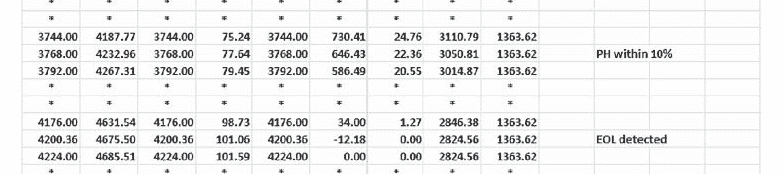

**Figure 6.78 Prognostic bus (log file).**

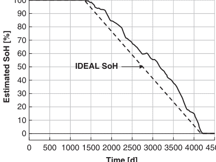

**Figure 6.79 SoH plot from DXARULE.**

## 6.10 System Verification: Advanced Prognostics

在审查了你的 SMPS 功能测试的验证结果后，你和你的客户决定使用高级版本的预测程序（ARULEAV）而不是基础程序（DXARULE）重新运行功能测试。你和你的客户对结果都非常满意。

### 6.10.1 SMPS: FFP Signature Directly to FFS

**Input Changes**

参考回图 6.66，你所做的唯一修改是将 PIPID 从 2 改为 1，即程序 ARULEAV 的 ID。相同的输入数据集被使用，并且与之前相同的调理被执行。

**Prognostic Information Results: Bus Output**

检查使用 ARULEAV 的输出总线文件（图 6.80）并与使用 DXARULE 的输出总线文件（图 6.78）进行比较可发现，退化的检测发生在同一时间（BD_D 在 1368 小时）和 EOL 的检测发生在同一时间（PH 在 4200 小时为 0）。然而 PH 估计有显著改善：$PH_{25}$ 在 2328 小时达到，而不是 3120 小时（$\chi_{25}$ = 67% 而不是 38%），并且 $PH_{10}$ 在 3696 小时达到，而不是 3768 小时（$\chi_{10}$ = 18% 而不是 16%）。

**Plots: RUL, PH, and SoH**

当你使用输出总线文件中的数据绘制 RUL、PH 和 SoH 估计（图 6.81）时，你首先注意到 RUL 和 PH 噪声显著减少。接下来，你注意到与使用 DXARULE 相比，图更线性：

标签中。注意不要漏掉任何一行，包括表格中的空行和星号行。

另外，注意原文中第一个表格的列数似乎不一致？第一行有12列？我们按原样复制，只翻译其中的英文短语。

让我们组织输出。

注意：原文中有些地方有换行，比如"determined\n\nby PITTFF0" 我们合并为一行。

另外，注意"Figure 6.83" 在最后，但前面有一个图片引用，然后有"**Figure 6.81**" 等等。我们需要保留图片引用。

现在，开始构建输出。

我们将按照原文顺序，逐段翻译。

注意：表格中的"*"行保留。表格中的数字和缩写保留。表格中的英文短语翻译。

对于第一个表格，我们只翻译"Degradation detected", "PH within 25%", "PH within 10%", "EOL detected" 这些。其他如"FS5"、"RUL"、"SoH"、"PH"、"BD_D" 保留。列标题中的"10 | 50 DXDATFR1.csv" 保留。

第二个表格类似。

第三个表格（表6.4）需要翻译表头和数据中的英文。

注意表6.4中"PI specifications" 翻译为"PI规范"，"BD" 保留，"EOL" 保留，"PD" 保留，"PH" 保留。子标题"PITTFF0 FFS NM" 保留，"At time estimated BD" 翻译为"估计BD的时间"，"At time estimated" 翻译为"估计时间"（但可能不完整，我们按原文）。"Maximum FOM" 翻译为"最大FOM"。"PH_ERROR = ..." 保留公式，但"time" 可以保留，因为公式。

数据行中"Initial PH error" 翻译为"初始PH误差"，"pts." 翻译为"点"。

注意"EMA load" 翻译为"EMA负载"，"EMA winding" 翻译为"EMA绕组"，"EMA power Transistor" 翻译为"EMA功率晶体管"。

现在，我们还需要注意原文中"Figure 6.80 Output file for SMPS using ARULEAV." 中的"Output file" 翻译为"输出文件"。

"Compare the plots in Figure 6.81 to those in Figures 6.77 and 6.79." 中的"plots" 翻译为"曲线图"。

"Prognostic Information Results: Bus Output" 翻译为"预测信息结果：总线输出"。

"Plots: RUL, PH, and SoH" 翻译为"曲线图：RUL、PH和SoH"。

"Final Design Specifications" 翻译为"最终设计规范"。

"PHM System Verification: EMA Faults" 翻译为"PHM系统验证：EMA故障"。

"EMA: Load (Friction) Type of Fault" 翻译为"EMA：负载（摩擦）类故障"。

"RUL & PH ESTIMATES from ARULEAV" 翻译为"来自ARULEAV的RUL和PH估计"。

"SoH ESTIMATES from ARULEAV" 翻译为"来自ARULEAV的SoH估计"。

注意"Figure 6.83 Plots of the RUL, PH, and SoH estimates using DPS-based FFS and ARULEAV." 翻译为"图6.83 使用基于DPS的FFS和ARULEAV得到的RUL、PH和SoH估计曲线。"

现在，我们还需要注意原文中有一个图片引用：`` 保留。

另外，注意"**Figure 6.81** Plots of the RUL, PH, and SoH estimates produced by ARULEAV." 中的粗体保留，翻译为"**图6.81** ARULEAV生成的RUL、PH和SoH估计曲线。"

现在，我们开始写输出。

确保所有内容都在[content]内。

我们逐行复制原文，替换翻译。

注意表格中的竖线和空格，保持原样。

让我们开始。

首先，[content] 开始。

然后第一个表格。我们复制表格，修改其中的英文短语。

表格第一行：`| [hr] | [kHz] | [hr] | FS5 | [hr] | RUL | SoH | PH | BD_D | 10 | 50 DXDATFR1.csv |` 保留。

第二行：`| * | 0 | 2667.85 | 0 | -5.2104 | * | 0 | 4800 | * | 100 | 4800 | * | 0 |  |  |` 注意这行有多个*，保留。

第三行：`| 1344 | 2755.4 | 1344 | -0.5761 | 1344 | 4800 | 100 | 4800 | 0 |  |  |` 保留。

第四行：`| 1368 | 2768.71 | 1368 | 0.1285 | 1368 | 4788.468 | 99.9087 | 4792.845 | 1363.624 | Degradation detected |  |` 将"Degradation detected"改为"检测到退化"。

第五行：`| * | * | * | * | * | * | * | * | * |  |  |` 保留。

第六行：`| 2304 | 3249.198 | 2304 | 25.5623 | 2304 | 2666.072 | 74.4301 | 3581.981 | 1388.091 |  |  |` 保留。

第七行：`| 2328 | 3282.208 | 2328 | 27.3096 | 2328 | 2510.77 | 72.7616 | 3450.68 | 1388.091 | PH within 25% |  |` 将"PH within 25%"改为"PH在25%以内"。

第八行：`| 2352 | 3307.971 | 2352 | 28.6733 | 2352 | 2388.819 | 71.25 | 3352.729 | 1388.091 |  |  |` 保留。

第九行：`| * | * | * | * | * | * | * | * | * |  |  |` 保留。

第十行：`| 3672 | 4100.302 | 3672 | 70.6141 | 3672 | 802.5878 | 25.9694 | 3090.517 | 1384.07 |  |  |` 保留。

第十一行：`| 3696 | 4123.131 | 3696 | 71.8225 | 3696 | 763.5184 | 24.8283 | 3075.448 | 1384.07 | PH within 10% |  |` 将"PH within 10%"改为"PH在10%以内"。

第十二行：`| 3720 | 4153.425 | 3720 | 73.426 | 3720 | 708.1646 | 23.2636 | 3044.094 | 1384.07 |  |  |` 保留。

第十三行：`| * | * | * | * | * | * | * | * | * |  |  |` 保留。

第十四行：`| 4176 | 4631.537 | 4176 | 98.7341 | 4176 | 29.7124 | 1.053 | 2821.642 | 1384.07 |  |  |` 保留。

第十五行：`| 4200.36 | 4675.505 | 4200.36 | 101.0614 | 4200.36 | -12.18 | 0 | 2804.11 | 1384.07 | EOL detected |  |` 将"EOL detected"改为"检测到寿命终止"。

第十六行：`| 4224 | 4685.512 | 4224 | 101.5912 | 4224 | 0 | 0 | 2804.11 | 1384.07 |  |  |` 保留。

第十七行：`| * | * | * | * | * | * | * | * | * |  |  |` 保留。

然后空行？原文表格后直接有"## Figure 6.80..."，我们保留。

接下来段落。

"## Figure 6.80 Output file for SMPS using ARULEAV." -> "## 图6.80 使用ARULEAV的SMPS输出文件。"

"PD and PDMAX are unchanged, and, therefore, PDFOM is unchanged. Compare the plots in Figure 6.81 to those in Figures 6.77 and 6.79." -> "PD和PDMAX保持不变，因此PDFOM也保持不变。将图6.81中的曲线图与图6.77和图6.79中的曲线图进行比较。"

"## 6.10.2 SMPS: FFP Signature to DPS to FFS" -> "## 6.10.2 SMPS：从FFP特征到DPS再到FFS"

"You and the customer approve another design change: transforming the FFP signature to DPS and then to a FFS transform, as described in Chapters 4 and 5." -> "你和客户批准了另一项设计变更：将FFP特征转换为DPS，然后再转换为FFS变换，如第4章和第5章所述。"

"### Input Changes" -> "### 输入更改"

"From your PoF and FMEA analyses and the characteristic curve, you decide to use a square root–based FFP to DPS transform, but with n = 0.45 instead of 0.5. Your node-definition changes are as follows:" -> "根据你的PoF和FMEA分析以及特性曲线，你决定使用基于平方根的FFP到DPS变换，但将n设为0.45而不是0.5。你的节点定义更改如下："

"- XDPS from 0 to 3 (refer back to Figure 6.60)." -> "- XDPS 从0改为3（参见图6.60）。"
"- XDPSNV from 1 to 0.45 (refer back to Figure 6.60)." -> "- XDPSNV 从1改为0.45（参见图6.60）。"
"- PIFFSMOD from 2 to 4 (refer back to Figure 6.61)." -> "- PIFFSMOD 从2改为4（参见图6.61）。"

"### Prognostic Information Results: Bus Output" -> "### 预测信息结果：总线输出"

"Examining the output bus file using ARULEAV (Figure 6.82) and comparing it with the output bus file using DXARULE (refer back to Figure 6.78) reveals that the detection of degradation occurs at the same time (at 1368 hours), and detection of EOL occurs at the same time (PH is zero at 4200 hours). There is significant improvement in PH estimates: PH25 is reached at 1560 hours compared to the previous 2328 and 3120 hours (PH25 ~ 94% instead of 67% or 38%), and PH10 is reached at 2760 hours compared to the previous 3696 hours and 3768 hours (PH10 ~ 53% instead of 18% or 16%). See Table 6.4 for a list of the performance measurements and metrics." -> "使用ARULEAV检查输出总线文件（图6.82），并将其与使用DXARULE的输出总线文件（参见图6.78）进行比较，可以发现退化检测发生在同一时间（1368小时），寿命终止（EOL）检测也发生在同一时间（PH在4200小时为零）。PH估计有显著改善：PH25在1560小时达到，而之前为2328小时和3120小时（PH25约94%，而不是67%或38%）；PH10在2760小时达到，而之前为3696小时和3768小时（PH10约53%，而不是18%或16%）。性能测量和指标列表见表6.4。"

"### Plots: RUL, PH, and SoH" -> "### 曲线图：RUL、PH和SoH"

"When you plot the RUL, PH data, and SoH estimates using data in the output bus file, you notice a further decrease in noise, and the plots are even more linear. Compare the plots in Figure 6.83 to those in Figure 6.81." -> "当你使用输出总线文件中的数据绘制RUL、PH数据和SoH估计值时，你会注意到噪声进一步降低，曲线更加线性。将图6.83中的曲线图与图6.81中的曲线图进行比较。"

然后图片引用：`` 保留。

"**Figure 6.81** Plots of the RUL, PH, and SoH estimates produced by ARULEAV." -> "**图6.81** ARULEAV生成的RUL、PH和SoH估计曲线。"

"## Final Design Specifications" -> "## 最终设计规范"

"The customer approves your changes to the design specifications for prognostic-enabling of the SMPS for degradation of the capacitance in the output filter: (i) use the advanced version, ARULEAV (PIPMOD = 1); (ii) use FFP to DPS signature transform (XDPS = 3); (iii) use 0.45 as a power value (XDPSNV = 0.45); and (iv) use a complex signature model in ARULEAV (PIFMOD = 4)." -> "客户批准你对SMPS输出滤波器中电容退化进行预测使能的设计规范所做的更改：（i）使用高级版本ARULEAV（PIPMOD = 1）；（ii）使用FFP到DPS特征变换（XDPS = 3）；（iii）使用0.45作为幂值（XDPSNV = 0.45）；（iv）在ARULEAV中使用复杂特征模型（PIFMOD = 4）。"

"Continue to use the remaining design specifications: (i) NM (FNM = 2.5); (ii) FFP failure threshold (FAILM = 70); (iii) number of points to calculate nominal FD value (FD0PTS = 20); (iv) number of rolling FD points for data smoothing (FDPTS = 4); (v) number of rolling FFP points for data smoothing (FFPPTS = 4); and (vi) number of rolling FFS points for data smoothing (FFSPTS = 4)." -> "继续使用其余设计规范：（i）NM（FNM = 2.5）；（ii）FFP失效阈值（FAILM = 70）；（iii）用于计算标称FD值的点数（FD0PTS = 20）；（iv）用于数据平滑的滚动FD点数（FDPTS = 4）；（v）用于数据平滑的滚动FFP点数（FFPPTS = 4）；（vi）用于数据平滑的滚动FFS点数（FFSPTS = 4）。"

然后第二个表格。我们复制并翻译其中的英文短语。

表格第一行：`| [hr] | [kHz] | [hr] | FS$ | [hr] | RUL | SoH | PH | BD_D | 10.00 | 50.00 | DXDATFR1.csv |` 保留。

第二行：`| 0.00 | 26.68 | 0.00 | -5.21 | 0.00 | 4800.00 | 100.00 | 4800.00 | 0.00 |  |  |  |` 保留。

第三行：`| * | * | * | * | * | * | * | * | * |  |  |  |` 保留。

第四行：`| 1344.00 | 27.55 | 1344.00 | -0.58 | 1344.00 | 4800.00 | 100.00 | 4800.00 | 0.00 |  |  |  |` 保留。

第五行：`| 1368.00 | 27.69 | 1368.00 | 0.13 | 1368.00 | 4786.05 | 99.91 | 4790.43 | 1363.62 |  |  |  |` 保留。

第六行：`| * | * | * | * | * | * | * | * | * |  |  |  |` 保留。

第七行：`| * | * | * | * | * | * | * | * | * |  |  | Degradation detected |` 将"Degradation detected"改为"检测到退化"。

第八行：`| 1536.00 | 28.17 | 1536.00 | 2.71 | 1536.00 | 3660.78 | 96.10 | 3809.15 | 1387.62 |  |  |  |` 保留。

第九行：`| 1560.00 | 28.31 | 1560.00 | 3.40 | 1560.00 | 3338.29 | 95.09 | 3510.66 | 1387.62 |  |  | PH within 25% |` 将"PH within 25%"改为"PH在25%以内"。

第十行：`| 1584.00 | 28.41 | 1584.00 | 3.97 | 1584.00 | 3222.19 | 94.26 | 3418.57 | 1387.62 |  |  |  |` 保留。

第十一行：`| * | * | * | * | * | * | * | * | * |  |  |  |` 保留。

第十二行：`| * | * | * | * | * | * | * | * | * |  |  |  |` 保留。

第十三行：`| 2760.00 | 35.34 | 2760.00 | 40.62 | 2760.00 | 1119.08 | 44.92 | 2491.23 | 1387.85 |  |  |  |` 保留。

第十四行：`| 2784.00 | 35.32 | 2784.00 | 40.55 | 2784.00 | 1146.64 | 45.03 | 2546.35 | 1384.29 |  |  | PH within 10% |` 将"PH within 10%"改为"PH在10%以内"。

第十五行：`| 2808.00 | 35.30 | 2808.00 | 40.40 | 2808.00 | 1149.24 | 44.56 | 2579.10 | 1378.14 |  |  |  |` 保留。

第十六行：`| * | * | * | * | * | * | * | * | * |  |  |  |` 保留。

第十七行：`| * | * | * | * | * | * | * | * | * |  |  |  |` 保留。

第十八行：`| 4176.00 | 46.32 | 4176.00 | 98.73 | 4176.00 | 0.32 | 0.01 | 2817.47 | 1358.85 |  |  |  |` 保留。

第十九行：`| 4200.36 | 46.76 | 4200.36 | 101.06 | 4200.36 | -24.04 | 0.00 | 2817.47 | 1358.85 |  |  | EOL detected |` 将"EOL detected"改为"检测到寿命终止"。

第二十行：`| 4224.00 | 46.86 | 4224.00 | 101.59 | 4224.00 | 0.00 | 0.00 | 2817.47 | 1358.85 |  |  |  |` 保留。

第二十一行：`| * | * | * | * | * | * | * | * | * |  |  |  |` 保留。

然后标题："## Figure 6.82 Output file for SMPS using DPS-based FFS and ARULEAV." -> "## 图6.82 使用基于DPS的FFS和ARULEAV的SMPS输出文件。"

"## Table 6.4 Performance measurements and metrics." -> "## 表6.4 性能测量与指标。"

然后表格：

| Prognostic target | PI specifications | BD | EOL | PD | PH |
| Name | PITTFF0 FFS NM | At time estimated BD | At time estimated | Maximum FOM | PH_ERROR = (PITTFF0/PD_MAX) 25% @ time χ [%] – pts. [#] 10% @ time χ [%] – pts. [#] |
| SMPS | 4800 [h] 3% | 1368 [h] 1261 [h] | 4200 [h] 4176 [h] | 2939 [h] 96.4% | Initial PH error = 63% 1560 [h] 2760 [h] 93.5% – 9 pts. 52.6% – 23 pts. |
| EMA load | 4800 [h] 2% | 504 [h] 441 [h] | 3168 [h] 3164 [h] | 2727 [h] 97.7% | Initial PH error = 76% 576 [h] 1368 [h] 97.3% – 3 pts. 68.3% – 19 pts. |
| EMA winding | 4800 [h] 2% | 1104 [h] 1067 [h] | 2760 [h] 2745 [h] | 1693 [h] 97.8% | Initial PH error = 184% 1320 [h] 1680 [h] 87.2% – 10 pts. 66.0% – 25 pts. |
| EMA power Transistor | 4800 [h] 1% | 960 [h] 958 [h] | 4440 [h] 4434 [h] | 3476 [h] 99.9% | Initial PH error = 38% 984 [h] 1512 [h] 99.3% – 2 pts. 84.1% |

翻译表头：

第一行：`| 预测目标 | PI规范 | BD | EOL | PD | PH |`
第二行：`| 名称 | PITTFF0 FFS NM | 估计BD的时间 | 估计时间 | 最大FOM | PH_ERROR = (PITTFF0/PD_MAX) 25% @ time χ [%] – pts. [#] 10% @ time χ [%] – pts. [#] |`

注意"At time estimated BD" 和 "At time estimated" 我们翻译为"估计BD的时间"和"估计时间"。但可能"At time estimated" 是指"EOL估计时间"，但原文没有EOL，我们按字面翻译。

数据行：

SMPS行：`| SMPS | 4800 [h] 3% | 1368 [h] 1261 [h] | 4200 [h] 4176 [h] | 2939 [h] 96.4% | 初始PH误差 = 63% 1560 [h] 2760 [h] 93.5% – 9点 52.6% – 23点 |`

注意"pts." 翻译为"点"。

EMA load行：`| EMA负载 | 4800 [h] 2% | 504 [h] 441 [h] | 3168 [h] 3164 [h] | 2727 [h] 97.7% | 初始PH误差 = 76% 576 [h] 1368 [h] 97.3% – 3点 68.3% – 19点 |`

EMA winding行：`| EMA绕组 | 4800 [h] 2% | 1104 [h] 1067 [h] | 2760 [h] 2745 [h] | 1693 [h] 97.8% | 初始PH误差 = 184% 1320 [h] 1680 [h] 87.2% – 10点 66.0% – 25点 |`

EMA power Transistor行：`| EMA功率晶体管 | 4800 [h] 1% | 960 [h] 958 [h] | 4440 [h] 4434 [h] | 3476 [h] 99.9% | 初始PH误差 = 38% 984 [h] 1512 [h] 99.3% – 2点 84.1% |`

注意"84.1%" 后面没有"– pts." 原文如此，保留。

然后继续：

"## 6.11 PHM System Verification: EMA Faults" -> "## 6.11 PHM系统验证：EMA故障"

"You propose, and your customer agrees, to always use the advanced version of ARULE (ARULEAV) because even though EMA signatures are linear, ARULEAV has demonstrated that it provides faster convergence from an initial error (determined by PITTFF0) compared to DXARULE. Accordingly, you change the PIPID from 2 (DXARULE) to 1 (ARULEAV) in the NDEF files for all four EMA nodes." -> "你提议并且客户同意，始终使用ARULE的高级版本（ARULEAV），因为尽管EMA特征是线性的，但ARULEAV已证明与DXARULE相比，它能从初始误差（由PITTFF0确定）更快地收敛。因此，你将所有四个EMA节点的NDEF文件中的PIPID从2（DXARULE）改为1（ARULEAV）。"

注意原文有换行，我们合并。

"Since the FFP signatures for the three types of EMA faults are already linear (Figures 6.41, 6.43, and 6.51), it is not necessary to perform FFP-to-DPS-to-FFS transforms. However, because your customer requests that sampling be changed from a 1-hour to a 24-hour interval, you should rerun your functional EMA tests, data conditioning, and transforms, and then input those FFS signatures into ARULEAV; then verify and accept the RUL, PH, and SoH estimates; and produce, verify, and accept the performance metrics." -> "由于三类EMA故障的FFP特征已经是线性的（图6.41、图6.43和图6.51），因此无需执行FFP到DPS再到FFS的变换。然而，由于客户要求将采样间隔从1小时改为24小时，你应该重新运行功能EMA测试、数据调理和变换，然后将这些FFS特征输入ARULEAV；然后验证并接受RUL、PH和SoH估计值；并生成、验证和接受性能指标。"

"## 6.11.1 EMA: Load (Friction) Type of Fault" -> "## 6.11.1 EMA：负载（摩擦）类故障"

"Your function test collects CBD, transforms that to FD, and creates FFP signature data, which is directly transformed into FFS data (Figure 6.84). This data is input to ARULEAV" -> "你的功能测试收集CBD，将其转换为FD，并创建FFP特征数据，该数据直接转换为FFS数据（图6.84）。此数据输入到ARULEAV"

然后：

"## RUL & PH ESTIMATES from ARULEAV" -> "## 来自ARULEAV的RUL和PH估计"

"## SoH ESTIMATES from ARULEAV" -> "## 来自ARULEAV的SoH估计"

"Figure 6.83 Plots of the RUL, PH, and SoH estimates using DPS-based FFS and ARULEAV." -> "图6.83 使用基于DPS的FFS和ARULEAV得到的RUL、PH和SoH估计曲线。"

注意原文最后没有"##" 在"Figure 6.83"前，我们保留。

现在，我们需要确保所有内容都在[content]内，并且没有遗漏。

检查原文是否有其他内容？原文以"[/content]"结束，我们输出时也要以"[/content]"结束。

注意原文中有些空行，我们保留适当的空行。

现在，我们组装输出。

注意：表格中的竖线数量要一致。我们复制原表格，只修改文本。

另外，注意第一个表格中第一行有"10 | 50 DXDATFR1.csv" 可能是一个单元格？我们保留。

现在，开始写最终答案。[content]

| [hr] | [kHz] | [hr] | FS5 | [hr] | RUL | SoH | PH | BD_D | 10 | 50 DXDATFR1.csv |
| * | 0 | 2667.85 | 0 | -5.2104 | * | 0 | 4800 | * | 100 | 4800 | * | 0 |  |  |
| 1344 | 2755.4 | 1344 | -0.5761 | 1344 | 4800 | 100 | 4800 | 0 |  |  |
| 1368 | 2768.71 | 1368 | 0.1285 | 1368 | 4788.468 | 99.9087 | 4792.845 | 1363.624 | 检测到退化 |  |
| * | * | * | * | * | * | * | * | * |  |  |
| 2304 | 3249.198 | 2304 | 25.5623 | 2304 | 2666.072 | 74.4301 | 3581.981 | 1388.091 |  |  |
| 2328 | 3282.208 | 2328 | 27.3096 | 2328 | 2510.77 | 72.7616 | 3450.68 | 1388.091 | PH在25%以内 |  |
| 2352 | 3307.971 | 2352 | 28.6733 | 2352 | 2388.819 | 71.25 | 3352.729 | 1388.091 |  |  |
| * | * | * | * | * | * | * | * | * |  |  |
| 3672 | 4100.302 | 3672 | 70.6141 | 3672 | 802.5878 | 25.9694 | 3090.517 | 1384.07 |  |  |
| 3696 | 4123.131 | 3696 | 71.8225 | 3696 | 763.5184 | 24.8283 | 3075.448 | 1384.07 | PH在10%以内 |  |
| 3720 | 4153.425 | 3720 | 73.426 | 3720 | 708.1646 | 23.2636 | 3044.094 | 1384.07 |  |  |
| * | * | * | * | * | * | * | * | * |  |  |
| 4176 | 4631.537 | 4176 | 98.7341 | 4176 | 29.7124 | 1.053 | 2821.642 | 1384.07 |  |  |
| 4200.36 | 4675.505 | 4200.36 | 101.0614 | 4200.36 | -12.18 | 0 | 2804.11 | 1384.07 | 检测到寿命终止 |  |
| 4224 | 4685.512 | 4224 | 101.5912 | 4224 | 0 | 0 | 2804.11 | 1384.07 |  |  |
| * | * | * | * | * | * | * | * | * |  |  |

## 图6.80 使用ARULEAV的SMPS输出文件。

PD和PDMAX保持不变，因此PDFOM也保持不变。将图6.81中的曲线图与图6.77和图6.79中的曲线图进行比较。

## 6.10.2 SMPS：从FFP特征到DPS再到FFS

你和客户批准了另一项设计变更：将FFP特征转换为DPS，然后再转换为FFS变换，如第4章和第5章所述。

### 输入更改

根据你的PoF和FMEA分析以及特性曲线，你决定使用基于平方根的FFP到DPS变换，但将n设为0.45而不是0.5。你的节点定义更改如下：

- XDPS 从0改为3（参见图6.60）。
- XDPSNV 从1改为0.45（参见图6.60）。
- PIFFSMOD 从2改为4（参见图6.61）。

### 预测信息结果：总线输出

使用ARULEAV检查输出总线文件（图6.82），并将其与使用DXARULE的输出总线文件（参见图6.78）进行比较，可以发现退化检测发生在同一时间（1368小时），寿命终止（EOL）检测也发生在同一时间（PH在4200小时为零）。PH估计有显著改善：PH25在1560小时达到，而之前为2328小时和3120小时（PH25约94%，而不是67%或38%）；PH10在2760小时达到，而之前为3696小时和3768小时（PH10约53%，而不是18%或16%）。性能测量和指标列表见表6.4。

### 曲线图：RUL、PH和SoH

当你使用输出总线文件中的数据绘制RUL、PH数据和SoH估计值时，你会注意到噪声进一步降低，曲线更加线性。将图6.83中的曲线图与图6.81中的曲线图进行比较。


**图6.81** ARULEAV生成的RUL、PH和SoH估计曲线。

## 最终设计规范

客户批准你对SMPS输出滤波器中电容退化进行预测使能的设计规范所做的更改：（i）使用高级版本ARULEAV（PIPMOD = 1）；（ii）使用FFP到DPS特征变换（XDPS = 3）；（iii）使用0.45作为幂值（XDPSNV = 0.45）；（iv）在ARULEAV中使用复杂特征模型（PIFMOD = 4）。

继续使用其余设计规范：（i）NM（FNM = 2.5）；（ii）FFP失效阈值（FAILM = 70）；（iii）用于计算标称FD值的点数（FD0PTS = 20）；（iv）用于数据平滑的滚动FD点数（FDPTS = 4）；（v）用于数据平滑的滚动FFP点数（FFPPTS = 4）；（vi）用于数据平滑的滚动FFS点数（FFSPTS = 4）。

| [hr] | [kHz] | [hr] | FS$ | [hr] | RUL | SoH | PH | BD_D | 10.00 | 50.00 | DXDATFR1.csv |
| 0.00 | 26.68 | 0.00 | -5.21 | 0.00 | 4800.00 | 100.00 | 4800.00 | 0.00 |  |  |  |
| * | * | * | * | * | * | * | * | * |  |  |  |
| 1344.00 | 27.55 | 1344.00 | -0.58 | 1344.00 | 4800.00 | 100.00 | 4800.00 | 0.00 |  |  |  |
| 1368.00 | 27.69 | 1368.00 | 0.13 | 1368.00 | 4786.05 | 99.91 | 4790.43 | 1363.62 |  |  |  |
| * | * | * | * | * | * | * | * | * |  |  |  |
| * | * | * | * | * | * | * | * | * |  |  | 检测到退化 |
| 1536.00 | 28.17 | 1536.00 | 2.71 | 1536.00 | 3660.78 | 96.10 | 3809.15 | 1387.62 |  |  |  |
| 1560.00 | 28.31 | 1560.00 | 3.40 | 1560.00 | 3338.29 | 95.09 | 3510.66 | 1387.62 |  |  | PH在25%以内 |
| 1584.00 | 28.41 | 1584.00 | 3.97 | 1584.00 | 3222.19 | 94.26 | 3418.57 | 1387.62 |  |  |  |
| * | * | * | * | * | * | * | * | * |  |  |  |
| * | * | * | * | * | * | * | * | * |  |  |  |
| 2760.00 | 35.34 | 2760.00 | 40.62 | 2760.00 | 1119.08 | 44.92 | 2491.23 | 1387.85 |  |  |  |
| 2784.00 | 35.32 | 2784.00 | 40.55 | 2784.00 | 1146.64 | 45.03 | 2546.35 | 1384.29 |  |  | PH在10%以内 |
| 2808.00 | 35.30 | 2808.00 | 40.40 | 2808.00 | 1149.24 | 44.56 | 2579.10 | 1378.14 |  |  |  |
| * | * | * | * | * | * | * | * | * |  |  |  |
| * | * | * | * | * | * | * | * | * |  |  |  |
| 4176.00 | 46.32 | 4176.00 | 98.73 | 4176.00 | 0.32 | 0.01 | 2817.47 | 1358.85 |  |  |  |
| 4200.36 | 46.76 | 4200.36 | 101.06 | 4200.36 | -24.04 | 0.00 | 2817.47 | 1358.85 |  |  | 检测到寿命终止 |
| 4224.00 | 46.86 | 4224.00 | 101.59 | 4224.00 | 0.00 | 0.00 | 2817.47 | 1358.85 |  |  |  |
| * | * | * | * | * | * | * | * | * |  |  |  |

## 图6.82 使用基于DPS的FFS和ARULEAV的SMPS输出文件。

## 表6.4 性能测量与指标。

| 预测目标 | PI规范 | BD | EOL | PD | PH |
| 名称 | PITTFF0 FFS NM | 估计BD的时间 | 估计时间 | 最大FOM | PH_ERROR = (PITTFF0/PD_MAX) 25% @ time χ [%] – pts. [#] 10% @ time χ [%] – pts. [#] |
| SMPS | 4800 [h] 3% | 1368 [h] 1261 [h] | 4200 [h] 4176 [h] | 2939 [h] 96.4% | 初始PH误差 = 63% 1560 [h] 2760 [h] 93.5% – 9点 52.6% – 23点 |
| EMA负载 | 4800 [h] 2% | 504 [h] 441 [h] | 3168 [h] 3164 [h] | 2727 [h] 97.7% | 初始PH误差 = 76% 576 [h] 1368 [h] 97.3% – 3点 68.3% – 19点 |
| EMA绕组 | 4800 [h] 2% | 1104 [h] 1067 [h] | 2760 [h] 2745 [h] | 1693 [h] 97.8% | 初始PH误差 = 184% 1320 [h] 1680 [h] 87.2% – 10点 66.0% – 25点 |
| EMA功率晶体管 | 4800 [h] 1% | 960 [h] 958 [h] | 4440 [h] 4434 [h] | 3476 [h] 99.9% | 初始PH误差 = 38% 984 [h] 1512 [h] 99.3% – 2点 84.1% |

## 6.11 PHM系统验证：EMA故障

你提议并且客户同意，始终使用ARULE的高级版本（ARULEAV），因为尽管EMA特征是线性的，但ARULEAV已证明与DXARULE相比，它能从初始误差（由PITTFF0确定）更快地收敛。因此，你将所有四个EMA节点的NDEF文件中的PIPID从2（DXARULE）改为1（ARULEAV）。

由于三类EMA故障的FFP特征已经是线性的（图6.41、图6.43和图6.51），因此无需执行FFP到DPS再到FFS的变换。然而，由于客户要求将采样间隔从1小时改为24小时，你应该重新运行功能EMA测试、数据调理和变换，然后将这些FFS特征输入ARULEAV；然后验证并接受RUL、PH和SoH估计值；并生成、验证和接受性能指标。

## 6.11.1 EMA：负载（摩擦）类故障

你的功能测试收集CBD，将其转换为FD，并创建FFP特征数据，该数据直接转换为FFS数据（图6.84）。此数据输入到ARULEAV

## 来自ARULEAV的RUL和PH估计

## 来自ARULEAV的SoH估计

图6.83 使用基于DPS的FFS和ARULEAV得到的RUL、PH和SoH估计曲线。


## 来自ARULEAV的EMA 51：RUL与PH估计


## 来自ARULEAV的SoH估计


图6.85 EMA（负载）曲线图：使用基于DPS的FFS和ARULEAV得到的RUL、PH和SoH估计值。

一次一个数据点（时间和幅值），从而得到数据和性能指标：图6.85和表6.3。

从记录的输出文件中，你可以收集并计算以下信息（以小时为单位）：估计BD发生在441小时——与实际开始退化时的444小时相差3小时；BDDET为504小时；使用估计的BD计算得出BD_OFF为63小时；EOL在3168小时检测到——恰好发生在功能失效之前；估计EOL为3164小时；PD_MAX计算为2727（3148减441）；PD_FOM计算为97.7%；PH_25在576小时达到；PH_10在1368小时达到。根据这些信息，你可以计算以下指标：χ_25为97.3%（根据((2727 – (576 – 441))/2727)），χ_10为68.3%，这些结果非常优异，超过我们推荐的70%和35%的目标。结果汇总见表6.4。

这些曲线图和性能指标证实，无需进行FFP到DPS的转换：FFP签名仅呈略微曲线状。事实上，在绘制（图6.85）并进行其他分析后，你和客户对RUL、PH和SOH感到欣喜若狂。

## CBD-绕组故障始于1000

## FFP - 绕组故障始于1000

## EMA FFS，节点61：绕组故障始于1000

图6.86 EMA节点61（绕组）的CBD、FFP和FFS。

## 来自ARULEAV的EMA节点61的RUL与PH估计


## 来自ARULEAV的EMA节点61的SoH估计


图6.87 EMA（绕组）曲线图：RUL、PH和SoH估计值；基于DPS的FFS和ARULEAV。

状态；并完成了对节点51（退化，载荷/摩擦类故障）、节点52（未退化）、节点61（退化，电机绕组类故障）和节点62（退化，功率开关晶体管故障）的测试。

接下来，你使用原型PHM系统对所有六个节点进行并发测试：这是一项集成功能测试。系统产生的信息如图6.91（启动初始化）、图6.92（节点警报，第1部分）和图6.93（节点警报，第2部分）所示。测试结束后，你绘制并检查输出文件，验证结果是否符合预期——它们没有改变。

### 6.12.2 系统性能指标：汇总

表6.4列出了在系统验证期间执行的功能测试的部分性能测量值和指标。

## CBD-晶体管故障始于700


## 平滑FFP-C相晶体管故障始于700


## 平滑FFS-3相晶体管故障始于700


图6.88 EMA节点62（功率晶体管）的CBD、FFP和FFS。

```
%************************************************************************
%** PHM CONTROL & DATA FLOW
****************************************************************************
    Housekeeping and initialization
        Read SND
        For each defined node (NDEF) in SND
            Read, parse, and evaluate the NDEF
            Initialize operating parameters, variables, and constants
            Initialize work areas for checkpoint/restart
    Main
        When Node active
            Restore (or initialize) operating environment
                Call DDPID to get data (output DD bus)
                Call FV PID to process data (output FV bus)
                Call PIPID to produce prognostic information (output PI bus)
            Save operating environment
            When node functionally fails or is made inactive
                Call PAPID (if specified) to analyze performance
            Point to next node (in the ring)
        Otherwise
            Point to next node
end
```

图6.90 PHM：高层控制与数据流。

```
>> DXPHM01 ('-1','DXSNDIVP1','-1')
I4: AN INITIALIZED SND (DEFINITIONS) FILE HAS BEEN FOUND
I19: RECEIVED RESPONSE: REPLACE
I1: SAVED NODE DEFINITION FILE IS REPLACED: C:\DXPHMLIB\DXCPT\ND_50.mat
I1: SAVED NODE DEFINITION FILE IS REPLACED: C:\DXPHMLIB\DXCPT\ND_51.mat
I1: SAVED NODE DEFINITION FILE IS REPLACED: C:\DXPHMLIB\DXCPT\ND_52.mat
I1: SAVED NODE DEFINITION FILE IS REPLACED: C:\DXPHMLIB\DXCPT\ND_60.mat
I1: SAVED NODE DEFINITION FILE IS REPLACED: C:\DXPHMLIB\DXCPT\ND_61.mat
I1: SAVED NODE DEFINITION FILE IS REPLACED: C:\DXPHMLIB\DXCPT\ND_62.mat

I18: INITIALIZED NODE 50: OPENING FILE C:\DXPHMLIB\DXINDATA\DXDATFR1.txt
I18: INITIALIZED NODE 51: OPENING FILE C:\DXPHMLIB\DXINDATA\DXDAT_EMA10.txt
I18: INITIALIZED NODE 52: OPENING FILE C:\DXPHMLIB\DXINDATA\DXDAT_EMA20.txt
I18: INITIALIZED NODE 60: OPENING FILE C:\DXPHMLIB\DXINDATA\DXDATFR2.txt
I18: INITIALIZED NODE 61: OPENING FILE C:\DXPHMLIB\DXINDATA\DXDAT_EMA30.txt
I18: INITIALIZED NODE 62: OPENING FILE C:\DXPHMLIB\DXINDATA\DXDAT_EMA40.txt
```

图6.91 初始化：系统节点。

- 升级当前的预测分析程序，使其包含表6.4所示的所有测量、估计和计算，其中包含一些手工计算值。
- 可视化服务支持：使用GUI而不是你之前使用的EUI。示例如图6.94所示。

下一步是准备一套更新的需求、目标和规范。你可能会发现，下一阶段需要与客户紧密合作，这很可能耗时且有时令人沮丧：

- 故障管理。你需要理解并考虑客户当前以及未来可能的维护和供应

## 图6.92 系统警报，第1部分。

```
W19: SOH for NODE: 51 IS 99.8663 PERCENT
I44: RUL IS 4776.1 [hr] AT DATA TIME: 504 [hr]
I43: RECEIVED RESPONSE: CONTINUE
W19: SOH for NODE: 62 IS 99.9713 PERCENT
I44: RUL IS 4795.8 [hr] AT DATA TIME: 960 [hr]
I43: RECEIVED RESPONSE: CONTINUE
W19: SOH for NODE: 61 IS 99.8078 PERCENT
I44: RUL IS 4695.3 [hr] AT DATA TIME: 1104 [hr]
I43: RECEIVED RESPONSE: CONTINUE
W19: SOH for NODE: 50 IS 99.9087 PERCENT
I44: RUL IS 4786.1 [hr] AT DATA TIME: 1368 [hr]
I43: RECEIVED RESPONSE: CONTINUE
W19: SOH for NODE: 61 IS 74.4394 PERCENT
I44: RUL IS 1312.3 [hr] AT DATA TIME: 1536 [hr]
I43: RECEIVED RESPONSE: CONTINUE
W19: SOH for NODE: 51 IS 74.4327 PERCENT
I44: RUL IS 2114.7 [hr] AT DATA TIME: 1224 [hr]
I43: RECEIVED RESPONSE: CONTINUE
```

系统。例如，客户可能希望以下所有内容都作为警报响应得到支持：

- 继续操作。
- 暂停操作。
- 安排维护、拆卸更换和检查。
- 监控：更新/更改采样率和/或警报级别。
- 离线：结束操作。
- 在线：恢复已暂停或离线的预测目标的运行。
- 节点：为系统添加、更新或删除节点定义（NDEF）。

可变采样。你可能会发现，每组LRU根据其使用方式和位置而有不同的采样要求。例如，用于调整驾驶舱座椅的EMA与用于定位机翼表面的EMA相比，其关键程度可能较低。

预测分析程序。即使你可能认为该程序的设计主要在你的专业领域内，你也可能会发现客户另有想法。例如，程序是否应分析5%、10%和25%的alpha精度的细节？你的客户可能希望你的程序执行以下任何一项或全部操作：

- 按照PGALPHA的规定，分析并显示预测目标的精度统计信息（参见图6.62）。
- 发出警报时，分析并显示估计RUL值的估计精度。
- 仅在明确要求时绘制测量值和指标。

可视化服务。为PHM系统设计GUI可能是系统中最困难、最耗时且成本最高的方面，特别是由于以下原因：

- 你偏好的外观和感觉可能不被客户喜欢。
- GUI必须与现有的诊断和/或预测解决方案兼容并集成。
- 功能的广度和深度需要涵盖设计系统的所有方面：定义、程序、操作规范等。此外，每次添加、删除或更新功能都可能需要设计、审查、测试和批准的成本和时间。


# 图 6.93 系统警报，第 2 部分。

```
W19: SOH for NODE: 62 IS 74.3818 PERCENT
I44: RUL IS 2373.2 [hr] AT DATA TIME: 1776 [hr]
I43: RECEIVED RESPONSE: CONTINUE
W19: SOH for NODE: 51 IS 49.7792 PERCENT
I44: RUL IS 1386.1 [hr] AT DATA TIME: 1896 [hr]
I43: RECEIVED RESPONSE: CONTINUE
W19: SOH for NODE: 61 IS 49.9565 PERCENT
I44: RUL IS 854.1 [hr] AT DATA TIME: 1944 [hr]
I43: RECEIVED RESPONSE: CONTINUE
W19: SOH for NODE: 50 IS 74.4301 PERCENT
I44: RUL IS 1471.8 [hr] AT DATA TIME: 2304 [hr]
I43: RECEIVED RESPONSE: CONTINUE
W19: SOH for NODE: 61 IS 24.9286 PERCENT
I44: RUL IS 392.3 [hr] AT DATA TIME: 2352 [hr]
I43: RECEIVED RESPONSE: CONTINUE
W19: SOH for NODE: 51 IS 24.5532 PERCENT
I44: RUL IS 658.2 [hr] AT DATA TIME: 2520 [hr]
I43: RECEIVED RESPONSE: CONTINUE
W19: SOH for NODE: 62 IS 49.7584 PERCENT
I44: RUL IS 1665.2 [hr] AT DATA TIME: 2640 [hr]
I43: RECEIVED RESPONSE: CONTINUE
W19: SOH for NODE: 61 IS 4.8343 PERCENT
I44: RUL IS 79.7 [hr] AT DATA TIME: 2664 [hr]
I43: RECEIVED RESPONSE: CONTINUE
W20: NODE: 61 HAS FUNCTIONALLY FAILED
I44: AT DATA TIME: 2760 [hr]
I43: RECEIVED RESPONSE: CONTINUE
W19: SOH for NODE: 51 IS 4.2125 PERCENT
I44: RUL IS 112.2 [hr] AT DATA TIME: 3048 [hr]
I43: RECEIVED RESPONSE: CONTINUE
W19: SOH for NODE: 50 IS 49.5872 PERCENT
I44: RUL IS 1011.9 [hr] AT DATA TIME: 3120 [hr]
I43: RECEIVED RESPONSE: CONTINUE
W20: NODE: 51 HAS FUNCTIONALLY FAILED
I44: AT DATA TIME: 3168 [hr]
I43: RECEIVED RESPONSE: CONTINUE
W19: SOH for NODE: 62 IS 24.7536 PERCENT
I44: RUL IS 825.9 [hr] AT DATA TIME: 3528 [hr]
I43: RECEIVED RESPONSE: CONTINUE
W19: SOH for NODE: 50 IS 24.8263 PERCENT
I44: RUL IS 402.2 [hr] AT DATA TIME: 3696 [hr]
I43: RECEIVED RESPONSE: CONTINUE
W19: SOH for NODE: 50 IS 4.5852 PERCENT
I44: RUL IS 60.9 [hr] AT DATA TIME: 4128 [hr]
I43: RECEIVED RESPONSE: CONTINUE
W20: NODE: 50 HAS FUNCTIONALLY FAILED
I44: AT DATA TIME: 4200.36 [hr]
I43: RECEIVED RESPONSE: CONTINUE
W19: SOH for NODE: 62 IS 4.9946 PERCENT
I44: RUL IS 172.9 [hr] AT DATA TIME: 4248 [hr]
I43: RECEIVED RESPONSE: CONTINUE
W20: NODE: 62 HAS FUNCTIONALLY FAILED
I44: AT DATA TIME: 4440 [hr]
I43: RECEIVED RESPONSE: CONTINUE
```


# 6.13 总结：一个稳健的原型 PHM 系统

本章介绍了与设计一个稳健的示例 PHM 原型相关的主题，以及前几章中介绍的方法和技术。例如，我们使用了并扩展了以下内容：

- 建模、框架和预测信息 – 第 1 章中介绍
- 失效分布、预测方法（基于统计）、机器学习，尤其是 CBD 特征的建模 – 第 2 章中介绍
- 特征的条件化和转换（CBD、FFP、FFS）– 第 3 章中介绍
- 基于启发式的特征、噪声和 NM 处理 – 第 4 章中介绍
- 非理想数据：影响和条件化，如噪声、不确定性、采样、延迟、反馈等 – 第 5 章中介绍

本章本质上是一个案例研究，在内容和呈现风格上都是如此，你扮演的是 PHM 解决方案的首席架构师/设计师。该研究

是一个包含多个输入和节点的系统，以及来自两种不同类型单元（电源和 EMA）的单变量和多变量输入。单元配置为两个各含三个节点的子系统：一个电源节点和两个 EMA 节点；研究包括四种不同的失效模式。

采用了清晰的文本、基于节点的架构来描述 PHM 系统、其程序以及控制和数据流。该研究说明了准确性取决于许多因素，包括但不限于噪声；采样率、模式和周期；输入运行规范（如 PITTF F0 和 NM）；以及使用的框架程序（如 DXARULE 与 ARULEAV）。

下一章专门讨论与预测使能相关的各种主题——电子健康解决方案——适用性评估和全面性与覆盖范围，例如与选择预测目标相关的考虑，通常是设备资产；失效分布、TTF、平均失效时间（MTTF）和平均故障间隔/前时间（MTBF）之间的关系；对一些 PHM 方法的比较研究——保守的基于使用的方法、保守的基于 CBD 的方法（诊断）、实用的基于 CBD 的方法（诊断）和实用的基于 CBD 的方法（预测）；以及可靠性、浴盆曲线和用于预测的诊断触发器。
