# 预测使能：选择、评估和其他考虑

# 7.1 预测使能简介

正如你已经学到的，部署预测使能系统的关键目标是监控预测目标，以提供失效的提前预警，支持基于状态的维护（CBM）。与例如设备可用性和其他指标、测试覆盖率和置信水平相关的标准。为了满足这些标准，传感、信号处理和计算（算法）例程需要在整个设计中纳入到预测与健康管理/监控（PHM）¹ 系统中。CBM 方法和技术——尤其是使用最终转化为功能失效特征（FFS）数据并由非常好的预测信息程序处理的基于状态数据（CBD）特征——相比于（i）基于适用于总体而非总体特定实例的统计或其他方法构建的系统，以及（ii）基于使用 CBD 检测损伤但不预测该损伤导致系统不再符合规范的系统，具有显著优势。

# 7.1.1 第 6 章回顾

第 6 章介绍了一个示例 PHM 系统原型的设计，该系统对多个系统实例和预测目标实现了预测使能，结果优异（见表 7.1）。

该设计支持多个子系统（两个），每个子系统包含预测目标：一个电源和两个机电作动器（EMAs）。该设计包括监控两个电源中的每一个的单一失效模式，并监控四个 EMA 中的每一个的三种失效模式。监控、条件化和处理均基于 CBD 特征，预测方法和技术提供了优异的，甚至是更优的结果：

- 退化在功能失效发生前至少 96% 的时间距离内被检测到。
- 估计精度在功能失效发生前至少 93% 的时间距离内保持在 25% 以内。

1 PHM 还有其他名称。常见的一个是综合车辆健康管理（IVHM）；另一个是预测健康管理。


**表 7.1 性能测量和指标。**

| 预测目标 | PI 规格：PITTFF0 | PI 规格：FFS NM | BD：时间点的估计 BD | EOL：时间点的估计 EOL | PD：最大 FOM | PH：PH_ERROR = (PITTFF0/PD_MAX) | PH：25% @ 时间 χ [%]–点数 [#] | PH：10% @ 时间 χ [%]–点数 [#] |
|---|---|---|---|---|---|---|---|---|
| SMPS | 4800 h | 3% | 1368 h<br>1261 h | 4200 h<br>4176 h | 2939 h<br>96.4% | 初始 PH 误差 = 63% | 1560 h: 93.5%–9 点 | 2760 h: 52.6%–23 点 |
| EMA 负载 | 4800 h | 2% | 504 h<br>441 h | 3168 h<br>3164 h | 2727 h<br>97.7% | 初始 PH 误差 = 76% | 576 h: 97.3%–3 点 | 1368 h: 68.3%–19 点 |
| EMA 绕组 | 4800 h | 2% | 1104 h<br>1067 h | 2760 h<br>2745 h | 1693 h<br>97.8% | 初始 PH 误差 = 184% | 1320 h: 87.2%–10 点 | 1680 h: 66.0%–25 点 |
| EMA 功率晶体管 | 4800 h | 1% | 960 h<br>958 h | 4440 h<br>4434 h | 3476 h<br>99.9% | 初始 PH 误差 = 38% | 984 h: 99.3%–2 点 | 1512 h: 84.1% |

- 估计精度在功能失效发生前至少 52% 的时间距离内保持在 10% 以内。
- 使用 9600 小时的失效时间值来指定预测 TTF（使用 PITTFF0）值为 4800 小时：
  - 四个失效的预测目标都在该时间之前失效：估计时间为 2745 小时、3164 小时、4176 小时和 4434 小时。
  - 实际 TTF 为 3630 小时。

## 7.1.2 电子健康解决方案

电子健康解决方案，例如本书中描述的此类解决方案，成为 PHM 系统的一部分。它们有时被称为预测生态系统（见图 7.1），在该生态系统中，此类解决方案可按图 7.2 所示的层级进行分类：管芯、组件、板、模块和系统（Ridgetop Group 2018）。还可以添加其他层级，例如板装配和模块集合到可更换单元。

### 生态系统

生态系统可以描述为系统内的预测模型，该系统包括数据的描述、不确定性的量化、模型选择的论证和验证以及应用的局限性（Astfalck et al. 2016）。图 7.1 所示的生态系统更广阔视图中的位置如下：位置 1 是一个系统或子系统，由一个或多个可预测启用的线路可更换单元（LRU）组成（监测损伤和/或退化）；位置 2 是一个 PHM 系统，它获取、操作、管理并处理数据以产生预测信息，用于启动服务和维护操作；位置 3 是供应商分析故障并改进产品的地点；位置 4 是用于服务和维修的 LRU、装配、组件和设备的存储库；位置 5 是执行服务和维护的维护人员。

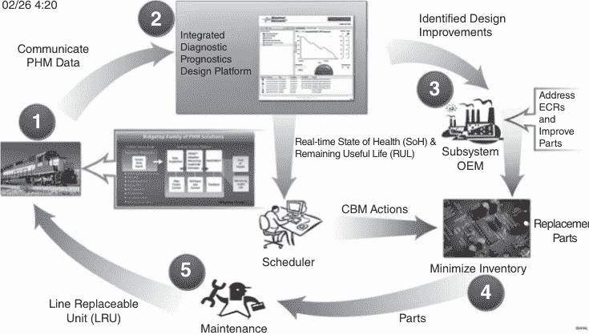

**图 7.1** 生态系统广阔视图的示例。

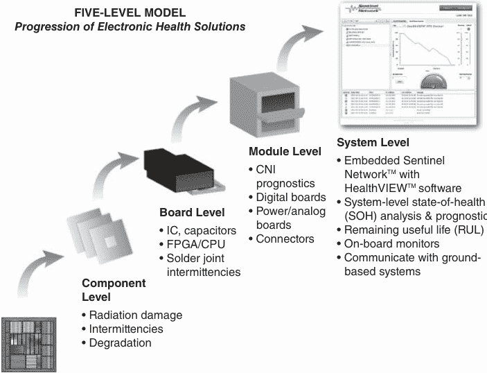

**图 7.2** 健康解决方案五级模型的示例。

### 解决方案层级

复杂的 PHM 系统包含设备、组件、板、子装配等。传感器可附加到系统内的任何节点，因此处理传感器数据的健康解决方案可以根据传感器所附着的节点进行分类，如图 7.2 所示的健康解决方案五级模型为例（Ridgetop 2018）。

## 7.1.3 关键系统和提前预警

关键系统被认为对日常生活持续运行至关重要，关键性是在评估和选择预测启用节点（预测目标）时需要考虑的关键因素。例如，飞机中的电力系统，或风力涡轮机中的齿轮箱，被认为至关重要，因为其运行对于满足整体系统的设计目标至关重要。关键性的另一个例子是生命和健康的安全：防止和避免生命损失和伤害是系统的首要目标。故障严重性和故障传播也在系统整体关键性的定义中发挥作用。

对任何任务关键或安全关键预测目标即将发生的故障的提前预警，例如警报，是至关重要的：设计良好的 PHM 系统将提供影响系统在规格范围内运行能力的异常检测并发出适当的警报。例如，第 6 章包含了由示例原型 PHM 系统发出的消息和警报的示例。PHM 系统将发出警报（健康监测）和/或启动适当的操作（健康管理），例如软关机、负载 shedding 和安排维护。也可能存在各种警报级别，其中阈值水平和故障模型可用于确定向飞机操作员、远洋船只或制造车间机床操作员提供哪些信息。这带来了故障严重性、信息访问以及对导致警报的问题采取的缓解措施的概念。

## 7.1.4 维护减少

为了节省资金和资源，维护间隔可以根据退化的实际证据进行优化。例如，一个系统可能具有在运行 250 小时后失效的组件，一些在约 600 小时后失效，而其他一些在约 500 小时后失效。基于使用量的 PHM 系统可能设计为执行以下任一操作：

1. 安排所有单元在运行 200 小时或之前进行维修和/或更换维护——相对于失效有 20% 的安全裕度。
2. 安排所有单元在运行 400 小时或之前进行维修和/或更换维护。

在 PHM 系统的首次设计中，一个目标可能是避免所有意外故障，但维护成本增加：例如，每个避免实例平均损失 300 小时的使用，以及由于维护操作增加（更频繁的更换）而导致成本增加。第二个设计可能侧重于通过增加维护间隔来降低保障成本——但意外故障会增加。通常，即使不考虑任务和安全问题，意外故障的成本也高于提前的维修更换操作。

因此，我们不提倡基于使用量的 PHM 系统，而是提倡使用 CBD 的 PHM 系统进行 CBM；使用基于特征的检测和预测方法；并采用快速、高度准确的数据处理、预测和计算例程。提倡使用 CBD 特征的方法是处理由运行环境引入的可变性的有效方法：在亚利桑那州沙漠中运行与在华盛顿州普吉特湾潮湿寒冷的环境中运行设备是截然不同的。

## 7.1.5 健康管理、维护和后勤

本书侧重于预测启用以监测节点系统的健康状况：选择的预测目标是因为这些节点具有信号，其会响应设备、组件等退化而变化，当它们失效时，会对系统的运行产生关键影响。它们可能导致任务关键功能停止或超出规格运行，或可能对系统或生命的安全构成危险威胁。

但监测本身并不会避免意外停机，不会修复任何东西，也不会防止生命损失。回顾图 7.1：PHM 系统需要提供健康管理、维护和后勤支持服务，以安排维护、定位和交付零件和设备，并派遣维护团队。

### 管理

鉴于第 6 章中 PHM 系统产生的预测信息的准确性，将维护推迟到检测到的健康状态（SoH）值达到或低于指定水平，例如 25%，是合理的。PHM 管理支持可能设计为对警报采取行动，例如图 7.3 所示的警报，其中包括

```
. . .
W19: SOH for NODE: 61 IS 24.9286 PERCENT
I44: RUL IS 392.3 [hr] AT DATA TIME: 2352 [hr]
. . .
W19: SOH for NODE: 51 IS 24.5532 PERCENT
I44: RUL IS 658.2 [hr] AT DATA TIME: 2520 [hr]
. . .
W19: SOH for NODE: 62 IS 24.7536 PERCENT
I44: RUL IS 825.9 [hr] AT DATA TIME: 3528 [hr]
. . .
W19: SOH for NODE: 50 IS 24.8263 PERCENT
I44: RUL IS 402.2 [hr] AT DATA TIME: 3696 [hr]
. . .
```

**图 7.3** SoH 达到或低于 25% 时的警报示例。


W19：节点 51 在数据时间 504 [hr] 检测到损坏
...
W19：节点 62 在数据时间 960 [hr] 检测到损坏
...
W19：节点 61 在数据时间 1104 [hr] 检测到损坏
...
W19：节点 50 在数据时间 1368 [hr] 检测到损坏
...

图 7.4 损伤检测方法警报示例。

摘自第 6 章。相比之下，PHM 管理支持可能设计为对损伤检测警报采取行动，例如图 7.4 所示的警报。

## 示例 7.1

对于图 7.3 所示的来自 PHM 系统的预测警报示例，该系统对 SoH 估计的预测精度在 10% 以内，或在 25% 及以下，且在警报后 72 小时安排维护，一套具有成本效益的维护措施可能如下：

- 在 3324 小时时修复节点 61 处的 EMA：在故障前至少 280 小时。
- 在 2592 小时时修复节点 51 处的 EMA：在故障前至少 510 小时。
- 在 3692 小时时修复节点 62 处的 EMA：在故障前至少 675 小时。
- 在 3762 小时时修复节点 50 处的开关电源（SMPS）：在故障前至少 500 小时。

## 示例 7.2

对于图 7.4 所示的来自 PHM 系统的示例检测警报，该系统采用保守方法以最大化系统健康并最小化非计划停机，维护可能安排在检测警报后 72 小时进行：

- 在 576 小时时修复节点 51 处的 EMA：在故障前超过 3324 小时。
- 在 1032 小时时修复节点 62 处的 EMA：在故障前超过 2592 小时。
- 在 1176 小时时修复节点 61 处的 EMA：在故障前超过 2692 小时。
- 在 1440 小时时修复节点 50 处的 SMPS：在故障前超过 3762 小时。

## 维护

PHM 系统需要在维护所需时根据退化物理证据而非任意经过小时数向用户发出警报，而非基于任意经过小时数。除警报外，PHM 还需要提供并支持维护相关服务，以避免不必要的更换，增加系统使用率，降低停机时间并减少保障成本。用于维护的方法和技术是应用特定的，需要与健康管理和物流服务集成，且超出本书范围。

## 物流

PHM 系统的一个关键功能是物流支持。零件和设备必须定位并送达服务和维修现场，且服务和维护团队需要在所需零件到达时或之后但不得早于其到达时抵达

由于保障成本和非计划停机减少带来的节约等等。但你也需要在成本中考虑与任务关键性/安全性相关的难以量化的成本（参见第 1.8 节）。

## 7.2.1 评估、选择和筛选的标准

由于你正在设计一个 PHM 系统以实现运行系统的预测功能，你的团队不会执行任何传统的失效模式和影响分析（FMEA）或失效模式影响临界度分析（FMECA）（DAU 2018）。相反，你的团队将审查现有的 FMEA 和 FMECA 数据；历史失效、服务和维修数据；以及与失效相关的任何其他数据。重点是识别、选择和筛选预测目标。为了选择和筛选预测候选列表，包括 FMEA/FMECA 识别为候选的那些，你需要知道以下内容：

- *TTF 或 TTFF.* 失效时间（或功能失效时间）的估计。这是本章的主要关注点。
- *PD（估计）。* 从退化开始到功能失效之间时间距离的初始估计，预测算法从中向上或向下收敛到真实的 PH。
- *待检测的失效模式。* 导致一个或多个传感器捕获的特征签名形状的失效机制。
- *严重性分类。* 功能失效后果的定性评估。
- *失效成本。* 非计划失效成本与故障前服务和维修成本的估计。
- *预测使能成本。* 例如传感器、PHM 支持、设计、开发、测试、鉴定和部署成本的估计。
- *成本效益分析。* 例如由于预测使能带来的保障成本变化加上使用时间、实现的有效节约，以及由于预测使能带来的服务行动变化的估计。

## 7.2.2 MTBF 和 MTTF 的含义

PHM 系统通常参考 MTBF 或 MTTF，因此你应该知道并理解它们之间的区别（Speaks 2005）：

- *MTBF.* 可修复系统（或之前 – 取决于上下文）平均故障间隔时间。
- *MTTF.* 不可修复系统的预期 TTF。

正如你所见，这些术语的含义（因此使用）取决于失效的定义和可修复性的定义。为了理解这些术语，请回忆第 2 章引入了时间失效（FIT）Eq. (2.15)：

```
Failure rate = λ = (number of failures) / [(number of tested parts)(hours of test) AF] 10^9 FIT
```

其中 AF 是指定测试的加速因子值。请参考表 2.3 和 2.4 的示例。

## 示例 7.3

假设某个特定系统有一个单元（器件、组件、组件等），根据要求的测试制度为供应商测试，要求 40 个单元测试 2500 小时。要求的测试的 AF 值为 10 000 小时/高加速寿命试验（HALT）周期，且 HALT 周期持续时间为 1 小时。当运行 HALT 时，40 个中有 1 个失效。失效率将计算为

Failure rate = λ = (1) / [(40)(2,500 cycles)(10,000 hours/cycle)] 10⁹ = 1 FIT

但你没有给出失效率：相反，你被告知 FIT 数值为 50。现在你需要知道以下内容以将该 FIT 数值与失效率联系起来（Ellerman 2012；NIST 2018）：

FIT = 1/λ (7.1)

其中 1 FIT = 1/10⁹ 小时。

## 示例 7.4

给定 FIT 数值为 50，你计算失效率：

λ = 1/(50 FIT) = 10⁹/50 = 20,000,000 = 2000 万小时！

即使你的研究证实计算是正确的，由于计算出的失效率如此之大，你决定使用 Eq. (7.1) 计算 MTBF（平均故障前时间）值（Abernethy 2006；RAC 2005；Speaks 2005；Weibull 2008）：

MTBF = (total time)/(number of failures) (7.2)

但这没有帮助，因为你不知道总时间，你知道它使用 Eq. (7.3) 计算：

Total time = (# of tested units) * (test time) (7.3)

你也不知道测试单元数或测试时间。因此，你找到了 MTBF 的另一个表达式

MTBF = 10⁹ / FIT (7.4)

对于 FIT = 50，其等于示例 7.4 计算的 λ 值：20 000 000 小时。文献研究揭示了以下内容：

- 在 1993 年，MTTF 被定义为“平均首次”失效时间（Seymour 1993），计算该值的表达式为
  MTTF = (total time)/(number of failures)

- 因此，MTTF（1993 年左右）与 2018 年 MTBF 的计算方式相同，当 B 表示 before 时。

- 你发现 MTBF 也被定义为可修复产品的“平均故障间隔时间”。

- MTTF 被定义为不可修复产品的“平均失效时间”（不提及首次）。

- MTBF 与 MTTF 的关系定义如下（Ellerman 2012）：
  MTBF = MTTF + MTTR (7.5)
  其中 MTTR 被定义为“平均修复时间”。

- 因此，你有多个定义和缩写，存在歧义，导致使用和含义不确定。

无论含义和/或定义如何，MTTF 也不适用于预测使能。MTTF 和 MTBF 应仅限于可靠性经典定义（第 1.6 节）：在无干预的情况下，系统在 MTTF 或 MTBF 值之前失效的概率为 63%。

## 7.2.3 MTTF 和 MTBF 不确定性

图 7.5 说明了失效分布（失效密度/时间）、MTBF（故障*间隔*失效率）、MTBF（平均*首次*故障前时间）和 MTTF 之间的关系。MTTF 和 MTBF 最初是为具有恒定低失效率的指数分布定义的：例如固态（集成电路）器件。这些器件接受一个或多个加速测试，例如 HALT，测试结果使用 AF 外推到正常寿命（Ellerman 2012；O’Connor and Kleyner 2012；NIST 2018；RAC 2005；Speaks 2005；Wilkins 2002）。

固态器件的典型商业 FIT 值在 50–1000 范围内，空间应用的 FIT 值在 1–10 范围内（Johnston 2010）。有一些模拟器使用模拟失效时间计算称为 MTTF 和 MTBF 的值（Weibull 2008），这增加了对特定 MTTF 和/或 MTBF 值含义和/或计算的不确定性。

更糟糕的是，不同的失效分布、不同的 CBD 签名等可能导致相同的（或几乎相同）可靠性指标，例如 MTTF：比较图 7.5 和 7.6。最后，本书断言，尝试将数十万（或更大）小时的 TTF 值用于基于 CBD 的预测是不合理的：MTTF 值为 100 000 小时相当于超过 11 年。

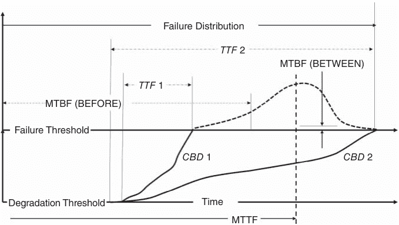

**图 7.5** MTTF、TTF 和 PITTFF0：CBD 签名和失效分布。


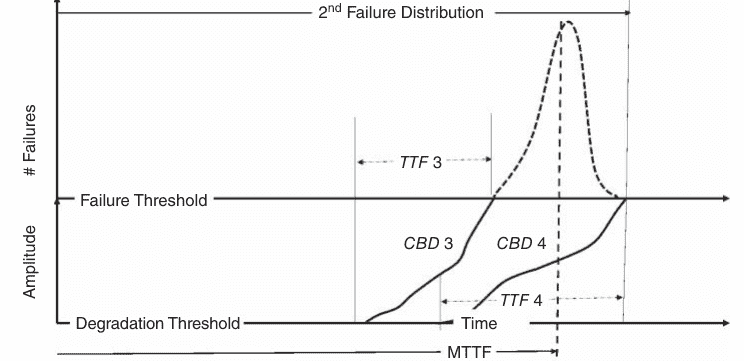

Figure 7.6 Same MTTF for different failure distributions and signatures.

# 7.2.4 TTF and PITTFF

我们需要知道如何确定、计算和/或估算一个 TTF 值，该值从退化开始时开始，到功能失效发生时结束（参见图 7.5 中的 TTF 1 和 TTF 2）。但在退化首次被检测到时，对未来失效时间没有任何先验知识；然而我们的预测程序需要从该时间的初始估计值收敛到失效时间的非常精确的估计值。对诸如 MTTF、MTBF 和 FIT 等可靠性指标的研究表明，它们在数值上与我们对 TTF 的需求并不真正接近。

我们正在使用的预测程序 ARULEAV 提供了一个名为 PITTFF0 的参数（在第 6 章中引入），作为指定 TTF 初始值的一种手段。TTF 并不是制造商和/或产品供应商会查看或指定的值；现场的失效通常是由于诸如雷击之类的异常事件或退化造成的。退化通常并不是由部件进入所谓的浴盆曲线磨损区域所引起；相反，退化通常是由于在运行期间由循环应力应变（例如热和机械）引起的疲劳损伤累积造成的（Hofmeister et al. 2006）。

我们可以使用多种方法来估算 TTF 的初始值：使用服务寿命确定、使用端用途测试方法或使用基于 MTTF 的方法。但请注意，预测程序的供应商建议，一般而言，当初始估计值高于真实的功能失效时间时，而不是低于时，该程序会更快地收敛到 25% 的精度。

## TTF: Service Life Determination

与其使用极低失效率的 MTTF 或 MTBF 值，您可以使用基于供应商服务寿命值的端用途值。例如：

- 一条轮胎的保修期为 5 年或 40 000 英里，在或大约使用该量后，轮胎被认为“磨损”并被更换：轮胎不可修复。
新轮胎（相同品牌和类型）也保修 40 000 英里。可以说该轮胎的 TTF 为 40 000 英里。

- 一台燃油泵的保修期为 5 年或 40 000 英里，以先到者为准。当燃油泵失效时，它会被更换为翻新泵，该泵的保修期为 2 年或 25 000 英里，以先到者为准：燃油泵被认为可修复。由于修复后的泵预期寿命更短，因此可以说燃油泵的失效前时间（TBF）为 2 年或 25 000 英里：小于原始预期寿命。在这种情况下，选择较大值。

将 PITTFF0 参数设置为您所拥有的基于服务寿命确定的 TTF 值的两倍，原因有三：

- 供应商建议预测程序通常从较高的初始误差收敛到解。
- 可靠性理论指出，平均寿命 TTF 意味着 63% 的失效可能在该平均值之前发生。
- 人为因素：较低的初始误差意味着预测程序可能会对健康状态 SoH 的递减值产生递增的剩余使用寿命 RUL 值。例如，图 7.9 绘制了使用较高 PITTFF0 值（左图）和较低 PITTFF0 值（右图）的相同数据的预测结果：最好的情况是结果令人困惑；最坏的情况是，它们可能导致对 PHM 系统可靠性信任度下降和信心丧失。

## TTF: End-Use Test Method

您可以使用以下方法以与计算 MTBF 和 MTTF 值相同的方式计算 TBF 和 TTF 值（Weibull 2008）：

$$TTF = \frac{\text{total operating hours}}{\#\text{ failures}}$$ as for MTBF  (7.6)

$$TTF = \frac{\text{total failure hours}}{\text{units tested}}$$ as for MTTF  (7.7)

**Example 7.5** 在第 6 章中，使用了一个由六个 LRU 组成的示例系统：两个电源和四个 EMA，其中六个 LRU 中有四个失效。利用该数据计算 TBF 和 TTF 的值，并制表（见表 7.2）。例如，在测试六个 LRU 并发生四次失效的 5000 小时结束时：

- TBF = (6*5000)/4 = 7500 小时
- TTF = (2745 + 3164 + 4176 + 4434)/4 = 3630 小时

TTF 和 TBF 值之间存在显著差异，如表 7.2 所示。差异的原因是 TTF 值是使用独立失效时间计算的，而 TBF 值是使用依赖失效时间计算的，因为人们对“之间”一词有共同的理解。由于使用 TTF 而不是 TBF 似乎是合理的，并且 TTF 更一致，因此您决定使用 TTF：是否在计算 TBF 时包含第一次失效的时间的问题变得无关紧要。

同样，将 PITTFF0 设置为您计算值的两倍。

**Table 7.2** Summarized list of TBF and TTF calculations for various periods of operation.

**TBF and TTF for various periods of operation**

| Operating time (h) | Total LRUs | Failed LRUs | TBF (h) | TTF (h) |
|---:|---:|---:|---:|---:|
| 3 000 | 6 | 1 | 18 000 / 1 = 18 000 | 2 745 / 1 = 2 745 |
| 3 500 | 6 | 2 | 21 000 / 2 = 10 500 | 5 909 / 2 = 2 955 |
| 4 000 | 6 | 2 | 24 000 / 2 = 12 000 | 5 909 / 2 = 2 955 |
| 4 500 | 6 | 4 | 27 000 / 4 = 6 750 | 14 519 / 4 = 3 630 |
| 5 000 | 6 | 4 | 30 000 / 4 = 7 500 | 14 519 / 4 = 3 630 |

## TTF: MTTF-Based Method

参考图 7.5，一个简化的基于 MTTF 的方法是将 TTF 设置为等于 MTTF，但在大多数失效分布范围相比 MTTF 值较宽的情况下，该方法效果良好。在这种情况下，只需将 PITTFF0 设置为 MTTF 值的两倍即可。但如果您相当确信情况更像图 7.6 所示，您需要指定较低的 PITTFF0 值。然而，可能出现这种情况：您的 PHM 系统支持两种不同的运行环境中的同类型 LRU：一种会引发早于预期的失效（类似于图 7.5 所示的情况），第二种变化性较小，导致失效更集中（类似于图 7.6 所示的情况）。此外，为了避免误解和/或出于程序原因，假设您必须始终将 PITTFF0 设置为制造商、供应商或政府机构指定的值（例如 MTTF）。在这种情况下，您需要一种方法来使预测程序调整指定的 PITTFF0 值。您的预测程序供应商同意，并进行了更改以提供节点定义参数 PITTFFADJ，以便您可以调整 PITTFF0 值的处理方式：

- 当未指定 PITTFFADJ 或小于 1 时，PITTFF0 的值用作计算下一个 RUL 和 PH 值的初始值。
- 当 PITTADJ ≥ 1 时，初始值计算为 [1 − exp(-PITTADJ)] (PITTFF0)。

**Example 7.6** 从表 7.1，TTF 计算为 3630 小时；并且根据公式（7.7），PD(EST) = 2722 小时。因此，您决定设置 PITTFF0 = 2722 并执行以下操作（图 7.7）：

- 将此计算结果与使用 PITTFF0 = 4800 的原始结果进行比较（见表 7.3）。
- 创建最大 PD 与使用计算的 PITTFF0 值估计的 PD 的比较图（见图 7.8 和 7.9）。
- 创建使用原始值和计算的 PITTFF0 值的 RUL 和 PH 的比较图（见图 7.10）。
- 计算并制表使用新的计算 PITTFF0 值估计的初始 PD 与原始 4800 小时值之间的百分比差异。

结果表明差异有所减少，图表证实预测程序可以从高或低的初始估计值收敛。

# EXAMPLE: FAILURE DISTRIBUTION & TTF

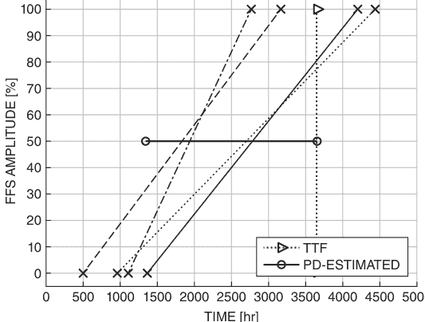

Figure 7.7 Failure plots with average values for TTF and PD = PITTTF0.

# Table 7.3 Tabulated calculations for PD(EST).

| PD(EST) calculations and comparison to measured values |
| LRU type | BD detected | Failure detected | PITTFF calculated | PD(EST) measured | PITTFF-PD(EST) | % Difference Calculated Table 7.1 |
| EMA | 504 | 3168 | 2732 | 2664 | −370 | −14% | 61% |
| EMA | 960 | 4440 | 2732 | 3480 | −1186 | −34% | 10% |
| EMA | 1104 | 2760 | 2732 | 1656 | 638 | 39% | 123% |
| SMPS | 1368 | 4200 | 2732 | 2832 | −538 | −19% | 21% |

Example 7.7 作为另一项测试，您将新参数设置为 2.0（PITTFADJ = 2.0），重新计算值并运行测试以创建新图。测试前后的结果在表 7.4 中汇总，并在图 7.11–7.14 中绘制。现在既有正差异也有负差异，这正是使用估计初始值时所期望的；并且除图 7.11 外，收敛到 25% 的情况有所改善或大致相同。

# 7.3 Example: Cost-Benefit of Prognostic Approaches

我们将使用第 6 章中的 SMPS-EMA 示例作为基础平台来构建一个示例情况，以说明各种方法的成本效益。您和您的客户同意，成本效益分析不包括不可避免的灾难性失效（例如，被另一辆车撞击），并且由于关键性


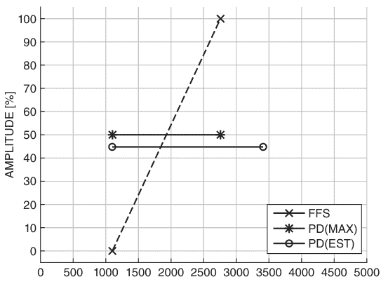

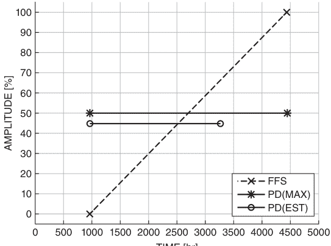

**图 7.9** 估计的 PD 和实际 PD：EMA 绕组（上）和 EMA 晶体管（下）。

未能满足意外故障将少于 5% 的要求，它建立了成本的基线估计。

贵客户安排了 6 台电源和 12 台 EMA 的特殊交付。这 18 台设备接受了类似于 HALT 的使用测试（请回顾第 2.2 节）。贵团队协助了实验设计和测试台的搭建；所测试的设备（电源和 EMA）需要具备预测功能，如第 6 章所述。出于分析目的，测试故障应被评估为好像所有被测试设备同时安装，并在测试中指示的顺序和时间发生故障。

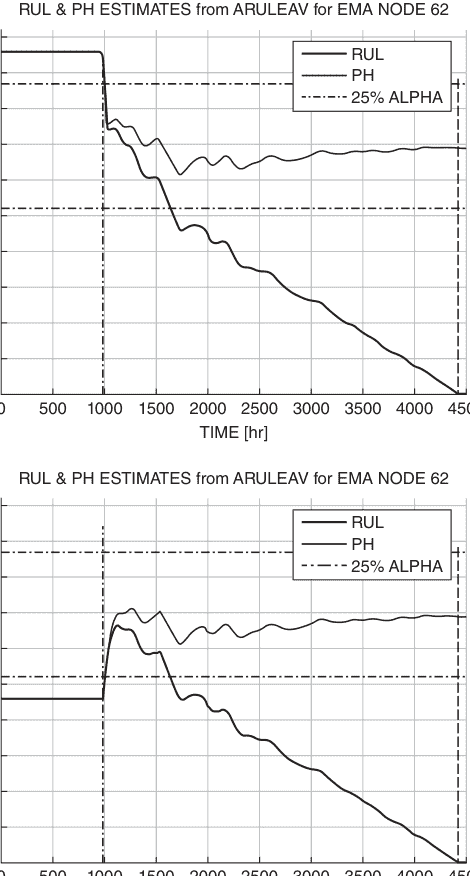

**图 7.10** PITTF0 = 4800 和 PITTF0 = 2290 时的 RUL 和 PH 曲线。

用于成本效益分析的数字由客户提供，并列于表 7.1 和 7.5。经过检查测试结果（见图 7.15 和表 7.6），贵客户得出结论，电源场景的成本效益分析足以评估五种方法。

**表 7.4** 使用增强程序并采用 PITTF0 = 4800 进行的汇总计算。

增强 ARULEAV 后 PD(EST) 的比较。

PITTF0 = 4800（h）：初始 PD（PD0）= PITTF0 * PITTFADJ。

| LRU 类型 | BD 检测 | 故障检测 | 测得的 PD | PD0 - PD 之前 | PD0 - PD 之后 | % 差异 之前 | % 差异 之后 |
|---|---|---|---|---|---|---|---|
| EMA | 504 | 3168 | 2664 | 4296 | 3646 | 61% | 37% |
| EMA | 960 | 4440 | 3480 | 3840 | 3190 | 10% | -8% |
| EMA | 1104 | 2760 | 1656 | 3696 | 3046 | 123% | 84% |
| SMPS | 1368 | 4200 | 2832 | 3432 | 2782 | 21% | -2% |

### 7.3.2 成本分析

**无 PHM 方法**

在此场景中，系统运行直到单元故障——“故障发生前不采取行动”的方法。故障发生时，故障单元被移除并更换。系统重新启动并运行直到下一个单元故障，以此类推，直到 14 400 小时（600 天运行）的可持续期结束：

- 平均而言，#1 电源将故障并被更换：14 400/4200 = 3.4 次：
    - 成本 = 3.4\*10000 + 0\*2000 + 3.4\*4000 = 47 600

对其余五个电源重复此操作，由于退化故障导致的意外停机，共产生 24 次移除和更换，基线成本为 $336 000。

**基于使用量的 MTTF 方法**

在此场景中，所有电源在用量等于 3592 小时（MTTF）时被更换。检查表 7.6 中的数据可知，电源 #3、#4 和 #6 会在被更换前发生功能性故障。在可持续期内，总共将有 27 台电源被移除和更换，总成本为 $354 000——在可持续期内系统成本增加 $18 000，以将意外停机次数从 24 次减少到 14 次。然而，52% 的所有维修和移除操作可归因于退化故障。此方法未能满足要求。

**基于使用量的 2/3 MTTF 方法**

在此场景中，所有电源在用量等于 2395 小时时被更换。将不会有意外停机，但将有 36 台电源被更换，成本为 $432 000——成本增加 $96 000，意外故障减少为零。对于 1000 个系统的群体，这 $96 000 将变为 $96.0 百万。

**损伤检测方法**

在此场景中，只要在电源中检测到损伤，就在 720 小时内将其移除并更换，这对于这些电源而言，也将导致零意外停机。此方法看似是好的方法，因为将会有

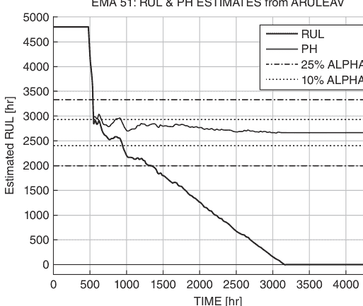

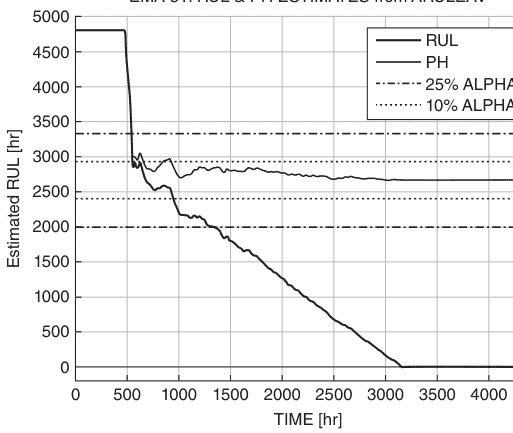

**图 7.12** EMA 51 的 RUL 和 PH 曲线：PITTFADJ = 2.0 之前和之后。

**SoH 在 75% 或更低的方法**

在此场景中，只要电源的预测 SoH 估计值在 75% 或更低，就在 120 小时内将其移除并更换：对于此方法，也将不会有意外停机。此方法将在可持续期内导致 28 台电源被移除和更换，估计成本为每系统 $336 000——与“故障发生前不采取行动”方法的基线成本相比，既没有节省也没有成本增加。

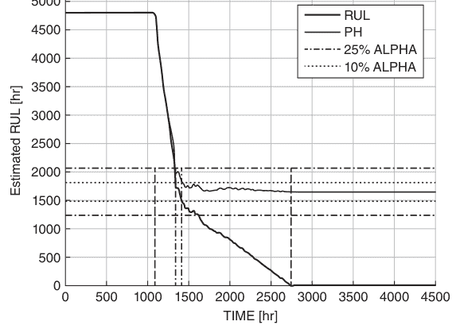

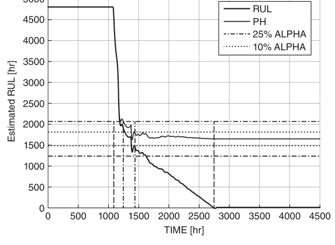

**图 7.13** EMA 61 的 RUL 和 PH 曲线：PITTFADJ = 2.0 之前和之后。

是的，传感器和 PHM 系统的成本存在，但 SoH 方法具有以下优点：

- 它将由于退化故障导致的意外停机减少为零。
- 它比下一个最昂贵的方法（基于使用量的 2/3 MTTF）更便宜。
- 与基于使用量的 2/3 MTTF 方法（36 次）或损伤检测方法（43 次）相比，其维修和更换活动最少（28 次）。

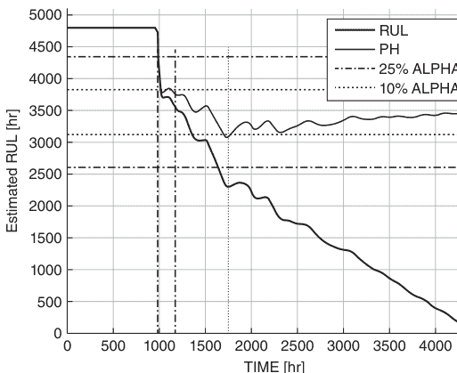

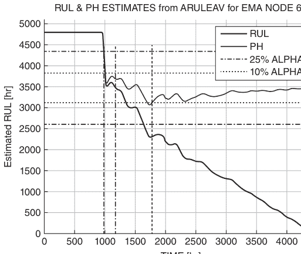

**图 7.14** EMA 62 的 RUL 和 PH 曲线：PITTFADJ = 2.0 之前和之后。

- 它需要最少的维修工时，从而提高任务可用时间。
- 它没有基于使用量的 2/3 MTTF 方法的缺点，即退化过早开始和/或从开始到故障的时间快于预期。
- 与损伤检测方法相比，在 14 400 小时的可持续期内，1000 个系统网络可节省 $180 百万。

**表 7.5** 预测使能效益评估的成本估算。

*估计成本：用于效益分析；可持续性（使用）*

| LRU 名称 | 采购 | 计划 R&R | 非计划故障 | 预期寿命（h）/LRU | 周期（h）/LRU |
|---|---|---|---|---|---|
| 电源 | $10 000 | $2 000 | $4 000 | 3 500 | 14 400 |
| EMA | $25 000 | $3 000 | $6 000 | 3 500 | 14 400 |

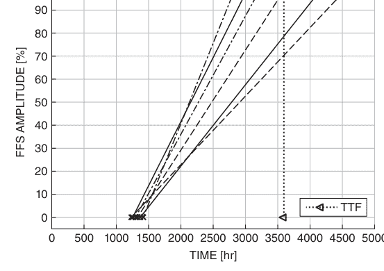

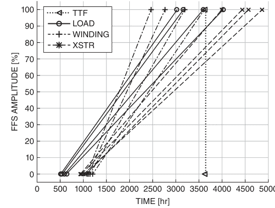

**图 7.15** 曲线图：六台电源（上）和 12 台 EMA（下）的测试结果。

磨损；相反，故障最常是由于循环应力和应变导致疲劳损伤累积而引起的（Hofmeister et al. 2006）。随着疲劳损伤的累积，一个或多个可测量的信号发生变化，可作为特征数据捕获。

因此，浴盆曲线中几乎没有任何内容可用于使能或支持基于 CBD 的预测。

### 7.4.1 浴盆曲线：MTBF 和 MTTF

正如您在图 7.16 中所见，MTBF（两次故障之间）不是时间轴值：它是一个故障率值。MTTF 也不在典型的浴盆曲线视图中出现，也许是因为图 7.17（Seastrunk 2016）所暗示的关系。

### 7.4.2 触发点和预测距离

图 7.16 中还显示了一个概念图，旨在传达这样的概念：可以采用预测触发器在时间 PD 内提供对可能故障的提前警告，同时传达有用寿命不会延伸到磨损区域的概念。图 7.18 传达了更实际的预测触发点视图：

- 设想多个传感器附着在复杂的产品上，例如 EMA，其内置电源，如本书所述。

和 MTBF；相反，提出了使用从退化开始到此类退化导致功能性故障的时间的理由：TTF。确定或计算 TTF 值的方法包括使用寿命、实际使用测试和基于 MTTF 的方法。关于预测方法成本效益分析的部分包含了以下方法的示例方法：（i）无 PHM；（ii）基于使用量的 MTTF；（iii）基于使用量的 2/3 MTTF；（iv）损伤检测；以及（v）SoH 在 75% 或更低。之后的部分重点关注浴盆曲线以及它与故障分布、MTBF、MTTF、触发点和 CBD 特征的关系。

本书绝不涵盖与 PHM 和 CBD——用于 CBM 的调理、建模和处理——相关的全部信息。另一方面，本书包含大量关于基本方法的信息，重要的是 CBD 特征以及如何处理和线性化这些特征，这减轻了预测程序的负担并提高了预测信息的准确性。第 6 章介绍了假设原型 PHM 系统的设计，以说明设计人员可能面临的挑战并展示本书中讨论的方法的应用。

## 参考文献

- Abernethy, R.B. (2006). *The New Weibull Handbook*, 5e, 2006. Berringer and Associates.
- Astfalck, L., Hodkiewicz, M., Medjaher et al. (2016). A modelling ecosystem for prognostics. Annual Conference of the Prognostics and Health Management Society.
- DAU (2018). Failure modes & effects analysis (FMEA) and failure modes, effects & criticality analysis (FMECA). Acquipedia, Defense Acquisition University, 9820 Belvoir Road, Fort Belvoir, VA 22060. https://www.dau.mil/acquipedia.
- Ellerman, P. (2012). *Calculating Reliability Using FIT & MTTF: Arrhenius HTOL Model*, MicroNote™ 1002, Rev 0. MicroSemi Corp. https://www.microsemi.com/document-portal/doc_view/124041-calculating-reliability-using-fit-mttf-arrhenius-htol-model (accessed 2018).
- Hofmeister, J.P., Lall, P., and Graves, R. (2006). In-situ, real-time detector for faults in solder joint networks belonging to operational, fully programmed field programmable gate arrays (FPGAs). In: *Proceedings of the IEEE AUTOTESTCON, Anaheim, CA, 18–21 Sept. 2006*, 237–243. IEEE.
- Johnston, A. (2010). *Reliability and Radiation Effects in Compound Semiconductors*, 117–132. Singapore: World Scientific Publishing Co. Pte. Ltd.
- O’Connor, P. and Kleyner, A. (2012). *Practical Reliability Engineering*. Chichester, UK: Wiley.
- RAC (2005). *Reliability Toolkit: Commercial Practices Editions*. Reliability Analysis Center, Rome Laboratory. https://www.dsiac.org/sites/default/files/journals/2Q2005.pdf (accessed 2018).
- Ridgetop Group. (2018). Sentinel Network, view of the graphical user interface (GUI) for an electronic power supply (EPS). Courtesy and permission of Ridgetop Group, Inc., 3580 West Ina Road, Tucson, AZ, 85741.
- Seastrunk, B. (2016). Reliability, warranty, and why nothing lasts as long as it used to. http://opinionbyopen.com/reliability-warranty-and-why-nothing-lasts-as-long-as-it-used-to (accessed 2018).


Seymour, B. (1993). MTTF、故障率、可靠性和寿命测试。应用公告，AB-059，Burr-Brown Corporation。图森，亚利桑那州。
Speaks, S. (2005). 可靠性和 MTBF 概述。Vicor 可靠性工程。http://www.vicorpower.com/documents/quality/Rel_MTBF.pdf（2015 年 8 月访问）。
Tobias, P. (2003). 评估产品可靠性。载于：*工程统计手册*。国家标准与技术研究院。https://www.itl.nist.gov/div898/handbook/apr/apr.htm。
Weibull. (2008). MTTF、MTBF、更换间隔时间和带计划更换的 MTBF。HotWire 94。https://www.weibull.com/hotwire/issue94。
Wilkins, D.J. (2002). 浴盆曲线和产品失效行为，第二部分 – 正常寿命和磨损。HotWire 22。https://www.weibull.com/hotwire/issue22/hottopics22.htm（2018 年访问）。

## 进一步阅读

Filliben, J. 和 Heckert, A. (2003). 概率分布。载于：*工程统计手册*。国家标准与技术研究院。http://www.itl.nist.gov/div898/handbook/eda/section3/eda36.htm。
Tobias, P. (2003a). 极值分布。载于：*工程统计手册*。国家标准与技术研究院。https://www.itl.nist.gov/div898/handbook/apr/section1/apr163.htm。
Tobias, P. (2003b). 如何在实际使用条件下预测可靠性？载于：*工程统计手册*。国家标准与技术研究院。https://www.itl.nist.gov/div898/handbook/apr/section4/apr43.htm。

## 索引

**a**

加速试验，*参见* 试验，加速寿命

加速 63–65，74–77，79，326

准确，准确性 1，32–35，42–46，63–64，74，94，97，99–100，103，108，113–114，117，124，144，150–152，185，189–190，193–194，196，200–203，207–208，210–211，213，216，227–228，233–234，242–246，250，252，277–278，284，288–293，297，299，307，313，316，319–324，329，345

Alpha（α）33，43–45，99，113，200，234，284，288，290，299，313，320

警报 245，254，275–278，281–282，309，311，313–314，322–324，344

ALT，*参见* 试验，加速

改善 186，189，193–194，201–204，241，*另见* 缓解

方法，方法 1–6，8，10–11，14–23，26，31–42，44，46–47，50，52–54，56–103，107–109，111–137，140，142，144–186，189–190，192–203，208，210–212，214–216，218，223–229，231–317，319–330，332–333，336，339–345

优点与缺点 10，31，35，65，76，79，90–91，107，120，130–131，137，140，183，236，253，263，319，339

分析，分析性（演绎，归纳）2，10，18，59–60，63–71，85–86，89，92–93，95，98，100，102，107，117，123，147–149，183，195，234，236，238，249–257，262，278，299，301，321

基于条件的数据（CBD）或维护（CBM）3，35，64–65，79，107–109，117，121–137，157–160，164–173，193–201，215，231–232，304，308，310，323，325

数据驱动 35，63–65，80–91，96–97，103，108，120，148，234，236，248

设计 1，18，34，37，39，41，46，63–64，67–68，72–73，79，90–91，99–100，109，112–116，127，144，190，195–196，203，208，210–212，218，224，233–316，319–326，333，345

启发式 3，93，95，97，108，145，147–186，192–201，223–228，236，238–239，241，315

混合 35，63–65，80–91，103，107–108，120，148，235–236，248

机器学习，*参见* 机器学习

模型、建模、基于模型的 1–6，8，10–11，14–23，31，34–35，44，47，50，52–54，56–103，107–108，111–131，137，140，144–186，189–190，193–197，202，214，216，223–224，227–228，233–234，236–239，243，245，248–249，253，255，274，277，283，293–295，302，315–316，317，320–322，325–330，332，341，344–345

失效物理（PoF）63–65，68，72–74，79–80，90–92，94–96，98，100，102，107，108，124，145，147–150，183，236–237，248，257，261–262，301

方法，方法（续）207–208，247，252，289，293，313，323–326，332–342，345
  概率的、概率、可能的 22，31，34，59–60，63，65，68–70，74，80–81，85，88
  预测性维护，PHM 31–41，60，63–103，234，236，248，332
  可靠性、可靠、可靠地 1–4，6，10–11，16–18，21–22，26，31–32，34–35，37，39，42，44，50，60，63–65，72–77，79–80，92，94–96，99，107–108，116，124，142，144，148，203，233–237，248，316，328–330，342–344
  统计、统计方法，*参见* 方法，概率的
  基于使用的 63，65，71，75，93，95，107，238，316，322–325，333，336，339–340，345
评估 1–2，94，123，131–132，134，137，149，177，234，237，326

## b

浴盆曲线 316，325，329，342–345

## c

状态指标，*参见* 失效，先导指标
条件 10，59，68，85，88
条件 31–32，35，46，60，92–95，99，109，111–112，116，124，132，139，144，184，189–191，193–195，216–219，225–229，233，237–239，241–245，255–256，276–278，292，300，304，315，319，323，345
恒定速率
  退化 126，129，140–144，155
  失效 11–12，34，72，328，342–343
收敛，*参见* 预测性，收敛
转换器 46，132，185，194，204–207，209，211，213，218，252，289
  模数 132，185，194，204–207，209，211，213，252
  数据 46，132，185，204–207，218，289
  数模 185，213
成本 1，3，31，35，47，50–60，67，73，91–92，96，98–99，152，195，204，207–208，247，252，289，293，313，323–326，332–342，345
协方差，*参见* 方差
累积分布函数，*参见* 分布，累积
曲线，*参见* 签名

## d

数据 1–3，31–32，35，37–40，63–67，80，90–97，103，107–109，112，114，116–118，120，122，125，129–131，134，137，139，142，144，147–151，153–154，167–186，189–190，192–204，207–208，212，219–222，226–228，233–234，236–239，241–243，248–249，254–259，263，265–266，273–274，276–278，283–284，288，301–304，306，315，319，320，341
获取、采集 1–2，66–67，80，185，189–190，192–193，196，202–204，208，212，219，228，233–234，243，249，254–258，263，320，341
方法，*参见* 方法（CBD，CBM），和方法，数据驱动
  驱动（DD）预测 35，63–65，80，90–91，96–97，103，107–108，120，148，234，236，248
DPS，*参见* 签名，退化进展特征（FD），*参见* 签名，特征
FFP，*参见* 签名，故障到失效进展
FFS，*参见* 签名，功能失效签名
操作（DM）1，189–190，192–193，196，202–204，208，212，243，320
变换 3，31–32，35，37–40，92–95，97，103，107–109，112，114，116–118，120，122，125，129–131，134，137，139，142，144，147–151，153–154，167–186，189–190，192–204，207–208，212，220–222，226–228，233，237–239，241–243，248，255，257，259，265–266，273–274，
276–278，283–284，288，301–304，
306，315，319
实验设计，*参见* 实验
密度函数，*参见* 分布函数
退化 1，3，10–11，34–39，41–42，
44–46，54，68，71，90，94，99，
102–103，107–109，112，117–127，
129，131–133，137–144，155，
157–160，165–168，170，172–175，
184，189–190，193–196，198–204，
208，214，216–218，220，223–225，
226–228，233，237，239–241，
246–248，252–255，259–262，266，
272，275，281，283–284，288–293，
296–303，305–307，309，311，
319–320，322–326，328–329，336，
340，342，345
开始、检测到、起始（BD）
34，39，42，44–46，107，124，132，
199–200，202，216，223–225，227，
281，283–284，288–293，297–301，
303，306，309，311，320，325–326，
328–329，336，340，345
速率、速率 39，41，126，129，138，
140–144，155
签名，*参见* 签名，退化进展
退化进展签名，*参见* 签名，退化进展
数字信号处理（DSP）126，191，196，204
距离 83–84，96–97，208，216，
218–220，241，244–245，*另见* 预测性，距离
分布、分布函数、密度函数 3–29，31–32，34，50–52，
55，59–60，69，71–73，75–76，78，
81–85，89，97，101，124，140，145，
150，154–176，180–182，184–186，
196，215，220，294，327–328
累积（cdf，CDF）4–6，8，10–11，
16，22，28–29，34，50，52，55，59–60，
78，85，294
指数 3–11，14，17–22，24，28–29，
31，34，51，69，72，82，101，124，140，
145，150，154–155，165–168，173，
175–176，180–182，328

Gamma 4，7–8，10，12–13，17，28，34，72
Gumbel 5，7，10，15，17
对数 Gamma 5，7，10，15，17
对数 Gumbel 5，7，10，14
逻辑 4，7，10，14–15，17
对数逻辑 5，7，10，14，16，17
对数正态 4，7，10，14，17，29，72
正态 4，7，10，12–13，17，23–25，29，
34，60，75，83，97
幂、幂函数 20–21，71，76，
124，140，145，150，154–165，
167–174，177–181，184–186，196，
215，220
概率（pdf，PDF）3，6，8–29，32，50，
55，73，78，81–85，89，294
失效时间，*参见* 失效，时间到（TTF）
Weibull 6–12，15，17–22，28，31，34，50，
72–73，81，327–328
DOE，*参见* 实验
dP，*参见* 参数
DPS，*参见* 签名，退化进展
DSP，*参见* 数字签名处理

e
机电作动器（EMA），*参见* 电机
EOL，EOL₀，*参见* 寿命，结束
误差 32，42–46，70–71，80，82，85，100，
116，132，134，152，186，189，191，
193–194，196，199–208，212–213，
216，218，220–225，227–228，235，
241，252，262，266，268，288–292，
295，299，303，320
数字化，*参见* 误差，量化
估计 42–46，100，235
初始 32，42–46，100，235，297，303，
320，330
积分非线性，*参见* 误差，非线性
线性、线性、非线性、FFS 非线性（FNL）132，134，189，
194，196，199，201，205，213，
223–225
测量、测量不确定度 132，194，202–208，212，218，228，262


## E

- Error (contd.)
  - offset  46, 116, 152, 186, 189, 194, 200, 202–203, 205–206, 218, 220–221, 225–227, 241, 266, 268, 288–292, 295, 297, 299
  - step, quantization  46, 202, 204–207, 213, 252, 289, 292
- Experiment, design of experiment (DOE), experimental, experimentation  63, 91, 96–97, 100–102, 112–113, 117, 121, 123–124, 126–131, 139, 148, 190, 195–197, 199, 208, 210–213, 216–217, 233, 236, 244, 248, 251, 254–257, 259–262, 265–266, 272, 288, 334
- Exponential function, see Distributions, exponential
- Extreme stress levels  3, 18–23, 60, 72, 74–76, 233

## F

- Failure  1, 3–6, 10–16, 18–23, 26–31, 33–39, 41–47, 49–52, 55–60, 63, 65–75, 77–80, 82, 90–100, 102, 107–145, 147–151, 153–154, 158, 160, 165–167, 177–186, 189–229, 233–234, 236–238, 245–294, 301, 303–306, 315–316, 319–320, 322–323, 325–345
  - distributions  3–6, 18–23, 65–69, 71–72, 78–79, 233, 293–295, 315–316, 328–329, 332, 341, 344–345
  - effects, see Failure, modes
  - expected number  3, 26–31, 34, 51–52, 58–60, 79, 297, 326–327, 336
  - functional, functional signature, see Signature
  - leading indicator, leading indicator of, leading to  1, 33, 68, 73, 92, 95, 98–99, 107, 109, 112, 143, 147, 153, 193, 195, 234, 236, 249, 337
  - level (FL)  37–38, 41, 46, 112–120, 122–123, 130–131, 137–138, 147–151, 153–154, 177–186, 192–193, 196, 198, 221–222, 237, 243, 289–290, 296, 298, 305
  - mean-time before (MTBF), between (MTBF), to (MTTF)  34–35, 73, 75, 78–80, 95, 316, 325–331, 333, 336, 339–340, 343–345
  - modes, effects analysis (FMEA), criticality analysis (FMECA)  67–71, 73, 79, 95, 97–98, 100, 102, 107, 112, 124, 147, 149–150, 186, 194–195, 202, 215–216, 228, 236–238, 245–249, 253, 255, 257, 261, 265, 301, 316, 319, 326
  - number of, see Failure, expected number
  - physics of (PoF)  63–65, 68, 72–73, 79–80, 90–92, 94–96, 98, 100, 102, 107–108, 124, 145, 147–150, 183, 234, 236–237, 248, 257, 261–262, 301
  - rate  3, 10–16, 27, 34, 50–51, 55–57, 65, 69, 72, 75, 77, 79, 82, 93, 95, 195, 325–328, 342–344
  - threshold, see Failure, level
  - time (FIT, FT), times, time(s) of, time-to (TTF, PITTFF)  3–4, 6, 11, 21–22, 27, 29, 33–34, 39, 41–46, 50, 52, 55, 59–60, 65, 69, 71–75, 78–79, 94–96, 99, 120, 132, 140, 151, 199–200, 203, 216, 222–224, 237–238, 250, 255, 283, 288, 290–291, 293–297, 303–304, 316, 320, 325–341, 345
- Fault management, FM, see Manage
- FD, see Data, feature
- FFP, see Signature, fault-to-failure progression
- FFS, see Signature, functional-failure
- Filter, filtering  32, 35–37, 41, 44–46, 86, 89, 93–96, 100–102, 111–114, 147, 151–152, 191, 194, 196, 208, 212, 214–215, 235, 237, 247, 250, 253, 255–257, 260, 277–278, 289, 293, 302
- FIT, see Failure, in time
- FL, see Failure, level
- FT, see Failure, time
- FM, see Fault management
- FMEA, see Failure, modes, and effects analysis
- FMECA, see Failure, modes, effects, and criticality analysis
- FNL, see Error, FFS non-linearity (FNL)
- Framework  1–3, 32–35, 46, 66–67, 92, 99, 132, 142–144, 190, 196, 201, 214, 229, 233–234, 241, 243, 245, 249, 274–275, 278–279, 282–284, 315–316
- Function, see Distribution

## H

- Health, see Assessment, and State of Health
- Heuristic  3, 95, 97, 108, 145, 147–186, 192–201, 223–227, 236, 239, 241
  - approach  3, 95, 108, 145, 192–201, 236, 239, 241
  - method, model, modeling  97, 147–186, 194, 223–227

## I

- Interface, end-user (EUI), graphical-user (GUI)  66, 275–277, 284, 307, 312–313, 315

## L

- Leading indicator of failure, see Failure, leading indicator
- Life, lifetime  1–4, 18, 20–21, 32–34, 39–45, 47–49, 52, 58, 60, 63, 65, 67–68, 71–73, 75, 79, 91–94, 99–100, 102, 113, 118–119, 132, 142, 149, 151, 189, 203, 210, 223–235, 237–238, 246, 249, 254, 283–284, 288–292, 296–304, 306–307, 309, 311, 313, 320–323, 327–331, 335, 337–342, 344–345
  - end of (EOL)  2, 33, 67, 71, 99, 189, 203, 234, 288–292, 297–304, 306, 309, 311, 320, 342–343
  - remaining useful (RUL)  1–3, 32–34, 39–45, 67, 71, 79, 91–94, 99–100, 102, 113, 118–119, 132, 142, 149, 151, 189, 210, 233–235, 237–238, 246, 249, 254, 290–291, 296–304, 306–307, 309, 311, 313, 321, 330–331, 335, 337, 340, 342
- Linear, linearly, linearity, curvilinear  12, 20, 22, 35–36, 42, 49–51, 53, 63, 70, 76, 82, 86–87, 89, 101, 107–108, 120–121, 123, 125, 127, 129–134, 137, 140–145, 149, 160–162, 189–190, 192–194, 196, 198–199, 201–202, 205–208, 214, 216, 223, 225–228, 237, 241–242, 265, 284, 296–301, 303–304, 345, see also Signature, nonlinear
- Logistic  1, 4–5, 7, 10, 14–17, 32–33, 66, 92–93, 143–144, 234, 276, 312, 323–325

## M

- Machine learning  63, 65, 80, 85–90, 108, 148, 234, 248, 315
- Maintenance reduction, see Costs
- Manage, management  1–3, 32–35, 66–67, 91, 93–95, 142–144, 193, 211, 223–234, 237–238, 242, 246, 253, 276–277, 290, 311, 320, 322–325, 342, 344
- Measurement error, see Error, measurement
- Measurement uncertainty, see Error, measurement
- Mitigate  41, 109, 113–114, 152, 189, 193–194, 199, 201–203, 214–217, 228, 241, 250, 252, 255, 299, 322, see also Ameliorate
- ML, see Machine learning
- Model, modeling  2–4, 10, 18–22, 31, 35, 44, 47, 50, 52–54, 56, 58–60, 63–66, 68, 71–73, 75–80, 86, 88, 90–97, 100–103, 107–108, 111–114, 116–120, 122, 124–135, 137, 140, 144–145, 147, 189–190, 193, 195–197, 216, 223–224, 227–228, 233–234, 236–239, 243, 245, 248–249, 253, 255, 274, 277, 283, 293, 302, 315, 320–322, 345, see also Approach and Signature modeling
- Monitor  32, 50, 63, 66, 91, 93–95, 107, 109, 116, 124, 132, 137, 142, 144, 149, 193, 201–203, 237–238, 242–244, 253–254, 275–279, 281, 311, 313, 319–323, 325
- Motor, brushless, electro-mechanical actuator (EMA)  246–248, 253, 255–260, 262–263, 313, 316, 319–321, 324, 330, 332–336, 338–344
- MTBF, see Failure, mean-time-between and mean-time-before
- MTTF, see Failure, mean-time-to

## N

- NM, see Noise, margin
- Noise  35–39, 41–42, 46, 93–94, 97–101, 109–117, 126–128, 130, 134, 142, 144, 147–149, 151–153, 158–160, 184–186, 189–191, 194, 196–197, 199–204, 206–208, 212, 214–216, 218–221, 223, 226–229, 241, 252, 255, 257, 260, 266, 273–274, 283–284, 288–290, 292–293, 295–303, 315–316, 320
- Noise margin (NM)  37, 46, 110, 113–114, 117, 126–128, 130, 134, 142, 144, 149, 151–153, 194, 196–197, 199–203, 218, 220–221, 226–229, 257, 266, 273, 283–284, 288–290, 292, 295–296, 299, 302–303, 307, 315, 320
- Non-ideality, non-linearity, nonlinear, nonlinearity, see Signature

## O

- OFFSET, see Error, offset

## P

- P, P0, see Parameter
- Parameter  3–6, 9–10, 13, 17–20, 22–25, 28, 31, 34, 45, 54, 57, 60, 64, 66, 69, 76–77, 79, 81–85, 91, 94, 96–97, 102–103, 114, 120–124, 127–128, 130–131, 137, 140–144, 148–186, 191–192, 196, 207, 212, 233, 237, 239–240, 242, 283, 329–332
- PD, PDα, see Prognostic, distance
- PD FOM, see Prognostic, distance, figure of merit
- PDF, see Probability density function
- PDMAX, PD MAX, see Prognostic distance, maximum
- Performance, performance measurements, performance metrics  1–2, 32–34, 60, 66–67, 73, 90–91, 106, 142–144, 234, 245–246, 278, 284–286, 288, 290–291, 297, 299, 301, 303–304, 306–307, 309, 320
- PH, PHα, see Prognostic, horizon
- PHM, see Prognostic, health management/monitoring
- PIF, see Framework
- PITTFF, see Failure, time-to
- Physics of failure (PoF), see Failure, physics of
- Power functions, see Distributions, exponential
- Power supply  32, 35, 71, 93–100, 103, 109–115, 119–120, 127, 134–135, 147, 190–191, 196, 214, 246–251, 253, 255–258, 260, 263, 274–276, 287, 289, 292, 297–303, 316, 319–320, 324, 332–333, 335–338, 341–343
- Prediction, see Prognostic
- Prediction information, see Prognostic information
- Prediction program(s) (ARULEAV, advanced prediction), (DXARULE, basic prediction)  246, 277–278, 284, 292, 296–304, 306–307, 309, 311, 316, 329–331, 335–340, 342, 345
- Probability  3–4, 6, 8, 10–11, 17, 22, 31, 34, 59–60, 63, 65, 68–70, 80–81, 85, 88, 294, 328
- Probability density function (pdf, PDF), probability distribution  3, 7–9, 11–16, 18–29, 34, 50, 55, 73, 78, 81–84, 89, 294
- Prognosis, see Prognostic
- Prognostic(s)
  - application, see Prognostic, target
  - component, see Prognostic, target
  - convergence, convergence figure of merit, (α, λ)  3, 44–46, 60, 124, 134, 246, 288, 290, 296–297, 299, 303, 320, 332
  - distance (PD, PDα), distance figure of merit (PD_FOM, PD_MAX, PDMAX)  33, 35, 99–100, 113, 124, 199–201, 203, 234, 246, 280, 287–288, 290–299, 301–303, 306, 312–313, 320, 325–326, 331–334, 336, 343
  - enable, enabled, enabling  92–94, 98–99, 111–112, 120, 124, 127, 150, 193, 195–196, 204, 210–211, 228, 243, 245–248, 250, 253, 275, 316, 319–323, 325–344
  - health management/monitoring (PHM)  1–3, 31–35, 37, 39, 60, 63–103, 107–108, 112–113, 116, 120, 124, 132, 142–145, 147, 149, 151–154, 192–193, 196, 203, 228–229, 233–316, 319–326, 330–331, 336, 339, 342, 345
  - horizon (PH, PHα)  2–3, 33, 41–45, 67, 92–93, 99–100, 113, 132, 149, 189, 234–235, 238, 246, 288, 290–293, 297–307, 309, 311, 320, 326, 331, 335, 337–340, 342
  - information  1, 3, 32–35, 37, 39–47, 60, 66–68, 71, 80, 90–92, 94–95, 100, 102–103, 107–109, 113–114, 124, 132, 143–144, 147, 150, 152, 183–184, 189–190, 192–194, 200, 203, 229, 233–234, 236–238, 242, 246, 248, 250, 277–278, 286, 299–301, 307, 315, 319, 323, 325, 342, 345
  - system, see Prognostic, health management/monitoring
  - target(s)  34–35, 37, 39, 41–42, 44–45, 47, 66, 78–80, 90–92, 107, 117, 132, 140, 144, 147, 150, 152, 196, 202, 215, 236, 247, 254, 290–294, 303, 313, 316, 319–320, 322–323, 325–326, 343

## R

- Relation, relationships  3, 10–11, 18–21, 34, 41, 63–64, 76, 85, 87, 96, 100, 107, 149, 208, 213, 288–289, 316, 325, 327–328, 343–344
- Reliable, reliability  1–4, 6, 10–11, 16–18, 21–22, 26–42, 44, 50, 55, 60, 63–65, 72–80, 92, 94–96, 99, 107–108, 116, 124, 142, 144, 148, 203, 233–234, 236–237, 248, 316, 319, 325, 328–330, 342, 344
- Remaining useful life (RUL), see Life, remaining useful
- Repair, see Replace
- Replace, replacement  1, 3–4, 26–31, 34–35, 47, 49–60, 69–70, 94, 204, 246–247, 279, 290, 313, 320–327, 329–330, 333, 336–339
- Root-mean square (rms, RMS)  246, 260–275, 294, 308, 310
- RUL, see Life, remaining useful

## S

- Sample, sampling  18, 20, 22–24, 32, 36–42, 44–46, 81–85, 88–89, 97, 99–100, 102, 112, 116, 132, 134, 140, 152–153, 155, 157, 159–160, 185, 191, 194, 202–220, 233, 235, 243–245, 249–274, 277–279, 281–283, 288–296, 304, 308, 311, 313, 315–316
- Sense, sensing, sensor  1–2, 32–33, 35, 46, 54, 66–67, 91–92, 99–100, 107–109, 111–112, 116, 124, 132, 134, 137, 142–145, 149, 151, 153, 184–185, 189–191, 193–194, 196, 201, 203–214, 216, 218, 233–234, 236, 243–258, 263, 274–275, 277–278, 282, 289, 292–293, 319, 322, 326, 328, 343–345, see also Framework
- Signal(s)  31–33, 35, 37, 41, 68, 93–95, 97, 99–101, 108–112, 116, 132, 134, 137, 139, 143–144, 147, 149–151, 158–160, 167–186, 190–194, 202–204, 208, 211–213, 218, 234, 237–239, 241, 243–244, 252, 278–279, 290, 292, 319, 323, 343
- Signature  1–3, 32, 60, 67–68, 92–95, 98, 103, 107–134, 142, 147–186, 189–197, 203, 212, 214–217


Signature (contd.)
219–220, 236–237, 241–242, 246, 249, 255, 259, 265–268, 277–278, 288, 297, 302, 315, 323, 326, 329, 342, 345

condition-based data (CBD) 3, 31–32, 35, 37–38, 46, 64–65, 79, 92–98, 102–103, 107–109, 113–118, 120, 124, 131, 134, 136–137, 139, 144–185, 189–199, 217, 236–245, 248–249, 257, 283–287, 294–295, 304–308, 310, 315–316, 319, 323, 325, 328–329, 333, 342–345

degradation-progression (DPS) 32, 35–41, 46, 60, 92, 107–108, 120–123, 128–134, 137–144, 147–149, 151, 153–154, 168–186, 189, 191–193, 195–198, 201, 220–222, 227–228, 237–243, 265, 274, 283–284, 296, 301–304, 306, 309, 311

fault-to-failure progression (FFP) 31–32, 35–36, 38, 92, 95, 107–108, 114–124, 127–144, 147–149, 151, 153–154, 167–186, 189–193, 195–198, 216, 218–223, 225–228, 237–243, 256, 260, 264–274, 283, 290, 296, 300–308, 310, 315, 332

feature, feature data (FD) 1, 31–33, 98–100, 102–103, 108–110, 112–117, 120–122, 124–128, 130, 137, 139–144, 147–149, 151–153, 157, 189, 191, 193, 196–198, 203, 208–209, 215, 218, 221, 226, 234, 239, 241, 243, 245, 249, 257–259, 274, 283, 285, 296, 302, 304, 307

functional-failure (FFS) 32–33, 37–42, 44, 46–47, 60, 92, 94–95, 107–108, 118–120, 122–124, 129–134, 137–145, 147–154, 177–186, 189–190, 192–196, 198–202, 218, 222–229, 234, 237–243, 248, 265–269, 274, 283–284, 288–289, 291–292, 295–298, 301–311, 315, 319–320, 332–334, 341

State of health (SoH) 1–3, 32–33, 39, 41–44, 67, 71, 79, 91–94, 97, 99, 118–119, 132, 142, 144, 149, 189, 233–234, 237–238, 246, 252–253, 274–275, 281–282, 291, 299–302, 304, 306–307, 309, 311, 321, 323–324, 330, 333, 338–339, 342, 345

Statistic, statistical 2, 17, 34, 60, 63, 65, 71, 73, 80–90, 92, 94–96, 108, 148, 234, 236–237, 248, 313, 315, 319, 342

Switch-mode power supply (SMPS), see Power supply

t

Test
accelerated, accelerated life (ALT, HALT), accelerated stress (HAST) 34, 63, 65, 73, 75–77, 79, 91, 94, 148, 246–248, 253–255, 275, 279, 289, 299–300, 304, 307, 309, 334–335, 341–342, 345
bed 100, 103, 112–113, 127, 208, 233, 246, 255–261, 334
TTF, see Failure, time-to

u

Uncertainty, see Error

v

Variance 3, 16–17, 22–25, 29, 34, 152, see also Covariance

Verify, verification, verified 66, 73, 91–92, 96, 100, 103, 108, 112, 124–130, 134, 140, 144, 148, 150–151, 153, 168–182, 196, 246–247, 253, 255, 275, 277, 288, 293, 300, 303–304, 307, 311, 325

w

Warnings, see Alerts
