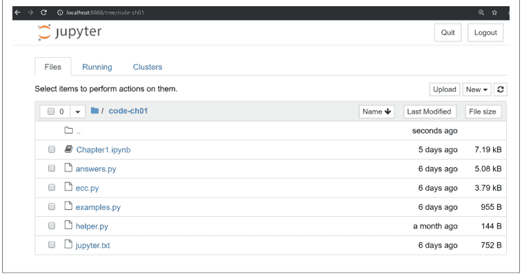
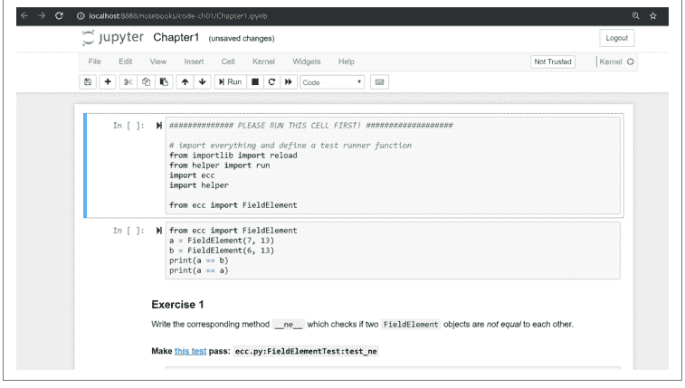
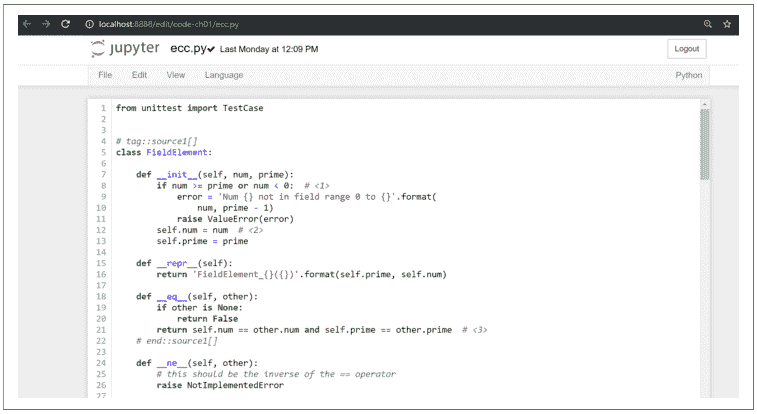

# Preface

This book will teach you the technology of Bitcoin at a fundamental level. It doesn’t cover the monetary, economic, or social dynamics of Bitcoin, but knowing how Bitcoin works under the hood should give you greater insight into what’s possible. There’s a tendency to hype Bitcoin and blockchain without really understanding what’s going on; this book is meant to be an antidote to that tendency.

After all, there are lots of books about Bitcoin, covering the history and the economic aspects and giving technical descriptions. The aim of this book is to get you to understand Bitcoin by coding all of the components necessary for a Bitcoin library. The library is not meant to be exhaustive or efficient. The aim of the library is to help you learn.

# Who Is This Book For?

This book is for programmers who want to learn how Bitcoin works by coding it themselves. You will learn Bitcoin by coding the “bare metal” stuff in a Bitcoin library you will create from scratch. This is not a reference book where you can look up the specification for a particular feature.

The material from this book has been largely taken from my two-day seminar where I teach developers all about Bitcoin. The material has been refined extensively, as I’ve taught this course more than 20 times, to over 400 people as of this writing.

By the time you’re done with the book, you’ll not only be able to create transactions, but also get all the data you need from peers and send the transactions over the network. It covers everything needed to accomplish this, including the math, parsing, network connectivity, and block validation.

# What Do I Need to Know?

A prerequisite for this book is that you know programming—Python, in particular. The library itself is written in Python 3, and a lot of the exercises can be done in a controlled environment like a Jupyter notebook. An intermediate knowledge of Python is preferable, but even a beginning knowledge is probably sufficient to get a lot of the concepts.

Some knowledge of math is required, especially for Chapters 1 and 2. These chapters introduce mathematical concepts probably not familiar to those who didn’t major in mathematics. Math knowledge around algebra level should suffice to understand the new concepts and to code the exercises covered in those chapters.

General computer science knowledge, for example, of hash functions, will come in handy but is not strictly necessary to complete the exercises in this book.

# How Is the Book Arranged?

This book is split into 14 chapters. Each is meant to build on the previous one as the Bitcoin library gets built from scratch all the way to the end.

Roughly speaking, Chapters 1–4 establish the mathematical tools that we need; Chapters 5–8 cover transactions, which are the fundamental unit of Bitcoin; and Chapters 9–12 cover blocks and networking. The last two chapters cover some advanced topics but don’t actually require you to write code.

Chapters 1 and 2 cover some math that we need. Finite fields and elliptic curves are needed to understand elliptic curve cryptography in Chapter 3. After we’ve established the public key cryptography at the end of Chapter 3, Chapter 4 adds parsing and serialization, which are how cryptographic primitives are stored and transmitted.

Chapter 5 covers the transaction structure. Chapter 6 goes into the smart contract language behind Bitcoin, called Script. Chapter 7 builds on all the previous chapters, showing how to validate and create transactions based on the elliptic curve cryptography from the first four chapters. Chapter 8 establishes how pay-to-script-hash (p2sh) works, which is a way to make more powerful smart contracts.

Chapter 9 covers blocks, which are groups of ordered transactions. Chapter 10 covers network communication in Bitcoin. Chapters 11 and 12 go into how a light client, or software without access to the entire blockchain, might request and broadcast data to and from nodes that store the entire blockchain.

Chapter 13 covers Segwit, a backward-compatible upgrade introduced in 2017, and Chapter 14 provides suggestions for further study. These chapters are not strictly necessary, but are included as a way to give you a taste of what more there is to learn.

从这里，你可以导航到章节目录。要做第一章的练习，你需要导航到 `code-ch01`（图 P-2）。

图 P-2. Jupyter 目录视图

从这里你可以打开 `Chapter1.ipynb`（图 P-3）。

图 P-3. Jupyter 笔记本

如果你之前没见过这个界面，你可能想熟悉一下，但 Jupyter 的精髓在于它可以从浏览器运行 Python 代码，从而使实验变得容易。你可以运行每个“单元”并像在交互式 Python shell 中一样看到结果。

大部分练习将是书中介绍的编码概念。单元测试已经为你编写好了，但你需要编写 Python 代码来使测试通过。你可以直接在 Jupyter 中检查你的代码是否正确。你需要通过点击类似图 P-3 中“this test”链接的链接来编辑相应的文件。这会带你到像图 P-4 所示的浏览器标签页。

图 P-4. `ecc.py`

要使测试通过，请在此编辑文件并保存。

## 答案

本书中各种练习的所有答案都在附录 A 中。它们也可在 `code-ch<xx>/answers.py` 文件中找到，其中 `<xx>` 是你所在的章节。

## 本书使用的约定

本书中使用了以下排版约定：

- *Italic* — 表示新术语、URL、电子邮件地址、文件名和文件扩展名。

## 致谢

带我走到这里的人数不胜数。作者汲取的经验和知识往往来源众多，很难给所有人应有的认可。这是我在说，我可能会忘记相当多的人，对此我深表歉意。

首先，我要感谢我的主耶稣基督让我踏上这段旅程。如果没有我的信仰，我就不会有伦理上的信念去写博客谈论健全货币的重要性，尤其是比特币，这最终导致了这本书的写作。

我的父母 Kathy 和 Kyung-Sup 在我八岁时有勇气移民到美国，这最终带来了我所拥有的机会。我的父亲给我买了第一台电脑（一台 Commodore 16、一台通用的 Hyundai 8086，以及一台我记不起制造商的 486 33-Mhz），而我的母亲在我上六年级和七年级时给我请了私人编程辅导，辅导老师的名字我也记不起来了。她在我表现出对编程的倾向时是如何找到她的，我不知道。那位我记不起名字的老师点燃了这种天生的倾向，我希望这份致谢能找到她。

说到这个，我一路上有过很多老师，有些当时我很讨厌。Mr. Marain、Mrs. Edelman 和 Mrs. Nelson 在高中教我数学和计算机科学。我不一定是当前教育系统的粉丝，但我在那些课程中学到的东西对我热爱数学和编程至关重要。

我的高中同学 Eric Silberstein 在我大学毕业后给了我第一份在 Idiom Technologies 的程序员工作。我本打算走咨询路线，但在 1998 年的一次命运电话后，我转而走上了程序员/创业者路线。从某种意义上说，我从未离开过。

在那第一份工作中，我遇到了 Ken Liu，我惊讶于我们职业生涯走到今天都在写书。他不仅给了我关于图书出版的宝贵建议，还写了精彩的前言。他也是一个很好的倾听对象和了不起的朋友，我很荣幸认识他。

关于比特币，匿名开发者 Satoshi Nakamoto 发明了我认为之前是不可能的：去中心化的数字稀缺。比特币是一种深刻的发明，世界尚未完全理解。Slashdot 网站在 2011 年向我介绍了比特币，而 Alex Mizrahi 在 2013 年给了我第一份比特币开发工作。我当时不知道自己在做什么，但在他的指导下，我学到了很多关于比特币的知识。

2013 年的 Austin Bitcoin Meetup 是我认识很多比特币爱好者的地方，而在 2014 年随后的 Texas Bitcoin Conference 我认识了许多至今仍保持联系的人。虽然我现在不再参加这个聚会和会议，但我对在那里认识的人表示感激——其中包括 Michael Goldstein、Daniel Krawisz 和 Napoleon Cole。

Alan Reiner 在 2014 年招募我加入 Armory，我很感激有机会为这样一个重要的项目做出贡献。

Paxos/itBit 是我接下来工作的地方。Chad Cascarilla 和 Raj Nair 是我当时所在的 CEO 和工程副总裁，他们让我在那里得到了锻炼。尤其是 Raj，让我为 Paxos 写了一些博客文章，我惊讶地发现我很喜欢写。这导致我在自己的网站上写博客，最终导致我的讲座，最后导致了这本书。

我在 Paxos 认识的三个同事尤其重要。Richard Kiss，pycoin 的创建者，是我写这本书的契机，因为他提议我们一起写一本。后来不知怎么的变成了我一个人写书，但我很感谢他给了我这个想法。Aaron Caswell 是一位很棒的开发者，他帮助过我的讲座并审阅了这本书。他是一位很棒的程序员和数学家，据说也是一位相当不错的空手道选手。Michael Flaxman 审阅了我写的所有几乎所有与比特币相关的内容，包括我的博客、许多 GitHub 库和这本书。他也帮助过我的讲座，而且只是个很棒的人。他是那种能让别人变得更敏锐的人，我很感激他的深厚友谊。

Vortex、Thomas Hunt 和 Tone Vays 在 2017 年把我带入了 World Crypto Network，这开启了我的 YouTube 生涯。Tone 尤其在努力工作和致力于手艺方面给了我启发。

John Newbery 在我第一次为 Bitcoin Core 做贡献时对我非常有帮助，他本身就是个非常好的人。他在相对较短的时间内成为如此重要的贡献者，这证明了他的才华和奉献精神。我也要感谢其他 Core 开发者，比如 Marco Falke、Wladimir van der Laan、Alex Morcos、Pieter Wuille、Matt Corallo、Suhas Daftuar 和 Greg Maxwell，他们审阅过我的一些代码和博客文章。

David Harding 对本书的技术审阅非常出色。他三次审阅了文本，并提出了很多很好的评论。他最好写一本关于比特币的书，因为他对比特币历史上几乎发生的一切都有百科全书般的知识。

Jim Calvin 帮我联系了 O’Reilly 的人，Mike Loukides 是批准该项目的 intake 编辑。Andreas Antonopolous 给了我一些很好的建议并向 O’Reilly 的人推荐了我。Michele Cronin 在我一年多的写作冲刺期间让我保持正轨。Kristen Brown 是负责生产编辑的人，她做了很多工作让这本书按时出版。James Fraleigh 做了校对。我是
