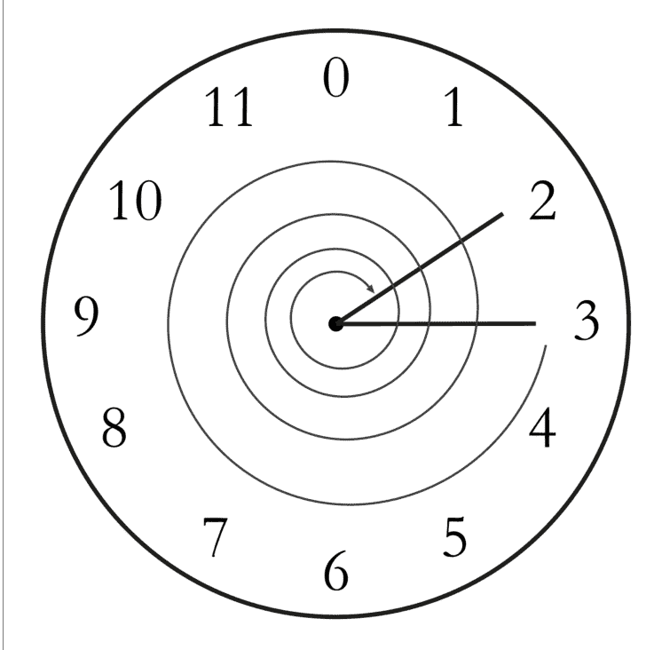

# 定义有限集合

#5 意味着乘法具有相同的性质。如果 $a$ 在集合中，$a^{-1}$ 在集合中。那就是 $a \cdot a^{-1} = 1$。使用乘法逆元，我们可以定义除法。这将在有限域中最难定义。

如果集合的阶（或大小）为 $p$，我们可以称集合的元素为 $0, 1, 2, \dots, p - 1$。这些数字是我们所说的集合的 *元素*，不一定是传统的数字 $0, 1, 2, 3$ 等。它们在许多方面都像传统数字一样表现，但我们在加、减、乘等方面的方式有些不同。

在数学符号中，有限域集合看起来像这样：

```text
$F_p = \{0, 1, 2, \dots, p-1\}$
```

有限域集合中包含的是元素。$F_p$ 是一个特定的有限域，称为“$p$ 的域”或“29 的域”或其大小的域（再次说明，大小是数学家所称的 *阶*）。{} 之间的数字表示域中有哪些元素。我们将元素命名为 $0, 1, 2$ 等，因为这些名称对我们的目的很方便。

阶为 11 的有限域看起来像这样：

```text
$F_{11} = \{0, 1, 2, 3, 4, 5, 6, 7, 8, 9, 10\}$
```

阶为 17 的有限域看起来像这样：

```text
$F_{17} = \{0, 1, 2, 3, 4, 5, 6, 7, 8, 9, 10, 11, 12, 13, 14, 15, 16\}$
```

阶为 983 的有限域看起来像这样：

```text
$F_{983} = \{0, 1, 2, \dots, 982\}$
```

注意域的阶总是比最大元素大 1。你可能已经注意到每次域的阶都是质数。出于各种原因，后面会变得清楚，有限域 *必须* 具有质数的幂的阶，而阶为质数的有限域是我们感兴趣的那些。

## 在 Python 中构造有限域

我们希望表示每个有限域元素，所以在 Python 中，我们将创建一个代表单个有限域元素的类。自然地，我们将该类命名为 `FieldElement`。

该类表示域 $F_{\text{prime}}$ 中的一个元素。类的基本骨架如下所示：


```
class FieldElement:
    def __init__(self, num, prime):
        if num >= prime or num < 0:
            error = 'Num {} not in field range 0 to {}'.format(
                num, prime - 1)
            raise ValueError(error)
        self.num = num
        self.prime = prime

    def __repr__(self):
        return 'FieldElement_{}({})'.format(self.prime, self.num)

    def __eq__(self, other):
        if other is None:
            return False
        return self.num == other.num and self.prime == other.prime
```

- 1. 我们首先检查 `num` 是否在 0 到 `prime-1`（包括两端）之间。如果不是，我们就得到了一个无效的 FieldElement，并抛出 ValueError；当我们得到不适当的值时，就应该抛出这种错误。

- 2. `__init__` 方法的其余部分会将初始化值赋给对象。

- 3. `__eq__` 方法检查两个 FieldElement 类的对象是否相等。只有当它们的 `num` 和 `prime` 属性都相等时，两个对象才相等。

我们已经定义的内容允许我们这样做：

```
>>> from ecc import FieldElement
>>> a = FieldElement(7, 13)
>>> b = FieldElement(6, 13)
>>> print(a == b)
False
>>> print(a == a)
True
```

Python 允许我们通过 `__eq__` 方法重载 FieldElement 上的 `==` 运算符，这是我们接下来将要利用的功能。

你可以在本书附带的代码中看到它的实际运行效果。设置好 Jupyter Notebook 后（参见第 xv 页的“设置”），你可以进入 `code-ch01/Chapter1.ipynb` 并运行代码来查看结果。对于下一个练习，你需要点击“练习 1”框中的链接，打开 `ecc.py`。如果你遇到困难，请记住，每个练习的答案都在附录 A 中。

如果有帮助的话，你可以把模运算想象成“循环”或“时钟”运算。想象这样一个问题：

现在是 3 点。47 小时后会是几点？

答案是 2 点，因为 (3 + 47) % 12 = 2（见图 1-3）。



图 1-3。时钟向前走 47 小时

我们也可以把它理解为“循环”，因为每前进 12 个小时，我们都会经过 0 点。

我们也可以对负数进行模运算。例如，你可以问：

现在是 3 点。16 小时前是几点？

答案是 11 点：

(3 − 16) % 12 = 11

分针同样体现了模运算。例如，你可以问：

现在是整点过 12 分。843 分钟后会是几分？

将是整点过 15 分：

(12 + 843) % 60 = 15

同样地，我们可以问：

现在是整点过 23 分。97 分钟后会是几分？

在这种情况下，答案是 0：

(23 + 97) % 60 = 0

0 也可以表示没有余数。

分钟进行模（%）运算的结果总是在 0 到 59（包括两端）之间。这是一个非常有用的性质，因为通过模运算，即使是非常大的数字，也可以被缩减到一个相对较小的范围：

14738495684013 % 60 = 33

在定义域运算时，我们会使用模运算。有限域中的大多数运算都会以某种方式使用模运算符。

## Python 中的模运算

Python 使用 % 运算符进行模运算。下面是模运算符的使用方式：

```
>>> print(7 % 3)
1
```

我们也可以对负数使用模运算符，例如：

```
>>> print(-27 % 13)
12
```

## 有限域中的加法和减法

请记住，我们需要定义有限域加法，以确保结果仍然属于这个集合。也就是说，我们要确保有限域中的加法是封闭的。

我们可以使用刚刚学到的模运算来使加法保持封闭。假设我们有一个 19 阶的有限域：

F₁₉ = {0, 1, 2, ... 18}

其中 a, b ∈ F₁₉。注意，符号 ∈ 的意思是“是……的元素”。在这里，a 和 b 是 F₁₉ 的元素。

加法封闭意味着：

a +_f b ∈ F₁₉

我们使用 +_f 表示有限域加法，以免与普通整数加法 + 混淆。

如果使用模运算，我们就可以保证这一点。我们可以这样定义 a +_f b：

a +_f b = (a + b) % 19

例如：

7 +_f 8 = (7+8)%19 = 15
11 +_f 17 = (11+17)%19 = 9

等等。

我们从集合中任取两个数，将它们相加，并在超过末尾时“循环回去”，从而得到和。这里我们正在创建自己的加法运算符，而结果有些反直觉。毕竟，11 +_f 17 = 9 看起来就是不对，因为我们并不习惯有限域加法。

更一般地，我们这样定义域加法：

a +_f b = (a + b) % p

其中 a, b ∈ F_p。

我们也可以这样定义加法逆元。a ∈ F_p 意味着 -_f a ∈ F_p：

-_f a = (-a) % p

同样地，为了清晰起见，我们使用 −_f 来区分域减法和域取负与整数减法和整数取负。

在 F₁₉ 中：

−_f 9 = (−9) % 19 = 10

这意味着：

9 +_f 10 = 0

事实也确实如此。

同样地，我们可以进行域减法：

a −_f b = (a − b) % p

其中 a, b ∈ F_p。

在 F₁₉ 中：

11 −_f 9 = (11 − 9) % 19 = 2
6 −_f 13 = (6 − 13) % 19 = 12

等等。

### 练习 2

在 F₅₇ 中解答以下问题（假设这里所有的 + 都是 +_f，所有的 − 都是 −_f）：

- 44 + 33
- 9 − 29
- 17 + 42 + 49
- 52 − 30 − 38

### 在 Python 中编写加法和减法

现在，我们可以在 FieldElement 类中定义 `__add__` 和 `__sub__` 方法。这些方法的目标是让下面这样的代码能够运行：

```
>>> from ecc import FieldElement
>>> a = FieldElement(7, 13)
>>> b = FieldElement(12, 13)
>>> c = FieldElement(6, 13)
>>> print(a+b==c)
True
```

```
class FieldElement:
    ...
    def __pow__(self, exponent):
        num = (self.num ** exponent) % self.prime ①
        return self.__class__(num, self.prime) ②
```

① 这种写法完全可行，但 `pow(self.num, exponent, self.prime)` 的效率更高。

② 和之前一样，我们必须返回该类的一个实例。

为什么不强制要求指数是一个 FieldElement 对象呢？事实证明，为了让数学运算成立，指数不必是有限域的成员。实际上，如果指数属于有限域，那么它就不会表现出我们所期望的直观性质，例如使用相同底数相乘时能够将指数相加。

我们现在所做的一些运算对于较大的数字来说可能比较慢，但我们会使用一些巧妙的技巧来改进这些算法的性能。

### 练习 7

对于 p = 7、11、17、31，F_p 中的这个集合是什么？

{1^(p-1), 2^(p-1), 3^(p-1), 4^(p-1), ... (p - 1)^(p - 1)}

## 有限域除法

加法、减法、乘法，甚至可能包括乘方，都有助于我们建立直觉；但遗憾的是，这种直觉对除法的帮助并没有那么大。由于除法是最难理解的运算，我们先从一个应该容易理解的内容开始。

在普通数学中，除法是乘法的逆运算：

- 7 • 8 = 56 意味着 56/8 = 7
- 12 • 2 = 24 意味着 24/12 = 2

以此类推。我们可以使用这个关系来定义除法。注意，与普通数学一样，不能除以 0。

在 F₁₉ 中，我们知道：

3 ⋅_f 7 = 21 % 19 = 2 意味着 2 /_f 7 = 3
9 ⋅_f 5 = 45 % 19 = 7 意味着 7 /_f 5 = 9

这非常反直觉，因为我们通常会把 2/7 或 7/5 看作分数，而不是整齐的有限域元素。然而，这正是有限域的奇妙之处之一：有限域对除法是封闭的。也就是说，只要分母不为 0，将任意两个数相除都会得到另一个有限域元素。

你可能会问，既然事先不知道 3·7 = 2，那么我该如何计算 2/7？这确实是一个很好的问题；要回答它，我们必须使用练习 7 的结果。

如果你没有得到答案，答案是：对于每一个素数 p 和每一个 n > 0，n^(p-1) 总是等于 1。这是数论中的一个优美结果，称为费马小定理。实质上，该定理表示：

n^(p-1) % p = 1

其中 p 是素数。

由于我们是在素数域中进行运算，这个结论总是成立。

### 费马小定理

这个定理有许多证明方法，但最简单的证明或许是使用我们在练习 5 中看到的内容——也就是说，以下两个集合相等：

{1, 2, 3, ... p-2, p-1} = {n%p, 2n%p, 3n%p, (p-2)n%p, (p-1)n%p}

所得的数字可能顺序不同，但两个集合中包含的是相同的数字。接着，我们可以将两个集合中的每个元素分别相乘，得到以下等式：

1 · 2 · 3 · ... · (p-2) · (p-1) % p = n · 2n · 3n · ... · (p-2)n · (p-1)n % p

左边等同于 (p-1)! % p，其中 ! 表示阶乘（例如，5! = 5 · 4 · 3 · 2 · 1）。在右边，我们可以把所有的 n 提取出来，得到：

(p-1)! · n^(p-1) % p

因此：

(p-1)! % p = (p-1)! · n^(p-1) % p

两边的 (p-1)! 可以约去，得到：

1 = n^(p-1) % p

这就证明了费马小定理。


因为除法是乘法的逆运算，我们知道：

a/b = a·(1/b) = a·b⁻¹

只要我们能算出 b⁻¹，就能把除法问题转化为乘法问题。这就是费马小定理发挥作用的地方。我们知道：

b^(p-1) = 1

因为 p 是素数。因此：

b⁻¹ = b⁻¹·1 = b⁻¹·b^(p-1) = b^(p-2)

或：

b⁻¹ = b^(p-2)

在 F₁₉ 中，这实际上意味着 b¹⁸ = 1，也就是说对于所有 b > 0，b⁻¹ = b¹⁷。

换句话说，我们可以用幂运算符来计算逆元。在 F₁₉ 中：

2/7 = 2·7^(19-2) = 2·7¹⁷ = 465261027974414%19 = 3
7/5 = 7·5^(19-2) = 7·5¹⁷ = 5340576171875%19 = 9

这是一个相对昂贵的计算，因为幂增长非常快。因此，除法是最昂贵的运算。为了减少开销，我们可以使用 Python 中的 pow 函数来进行幂运算。在 Python 中，pow(7,17) 与 7**17 相同。但是，pow 函数有一个可选的第三个参数，可以使我们的计算更高效。具体来说，pow 会将结果对第三个参数取模。因此，pow(7,17,19) 将给出与 7**17%19 相同的结果，但速度更快，因为在每轮乘法之后都会进行取模运算。

## 练习 8

在 F₃₁ 中解下列方程：

- 3 / 24
- 17⁻³
- 4⁻⁴ · 11

## 练习 9

编写相应的 `__truediv__` 方法，定义两个域元素的除法。

注意，在 Python 3 中，除法分为 `__truediv__` 和 `__floordiv__`。前者执行普通除法，后者执行整数除法。

## 重新定义幂运算

在离开本章之前，我们需要处理的最后一件事是 `__pow__` 方法，它需要处理负指数。例如，$a^{-3}$ 需要是一个有限域元素，但当前代码没有处理这种情况。我们希望例如这样的代码能够工作：

```
>>> from ecc import FieldElement
>>> a = FieldElement(7, 13)
>>> b = FieldElement(8, 13)
>>> print(a**-3==b)
True
```

不幸的是，我们定义的 `__pow__` 方法根本无法处理负指数，因为 Python 内置函数 `pow` 的第二个参数要求为正数。

幸运的是，我们可以利用已知的数学知识来解决这个问题。从费马小定理我们知道：

$$a^{p-1}=1$$

这一事实意味着我们可以随意乘以 $a^{p-1}$。所以，对于 $a^{-3}$，我们可以这样做：

$$a^{-3}=a^{-3}\cdot a^{p-1}=a^{p-4}$$

这是我们处理负指数的一种方法。一个朴素的实现可能如下：

```
class FieldElement:
    ...
    def __pow__(self, exponent):
        n = exponent
        while n < 0:
            n += self.prime - 1
        num = pow(self.num, n, self.prime)
        return self.__class__(num, self.prime)
```

① 我们一直加，直到得到正指数。
