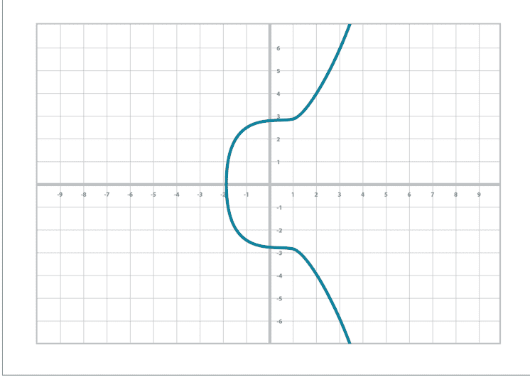
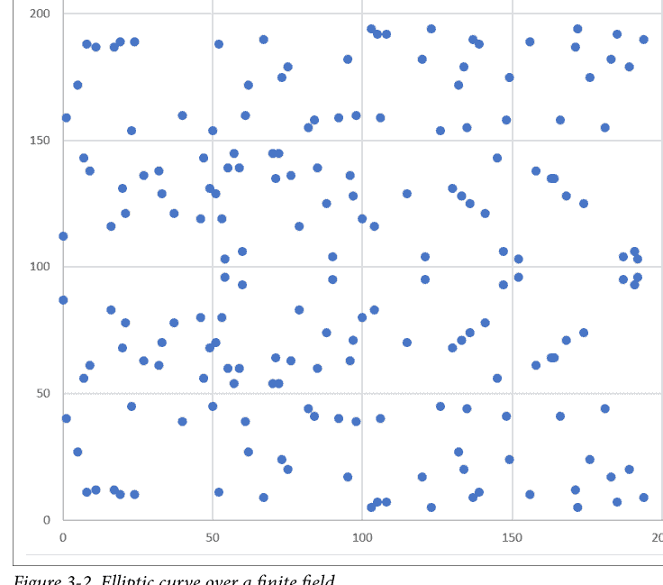
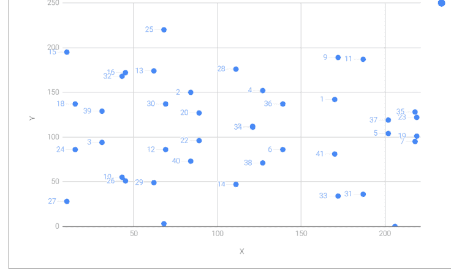
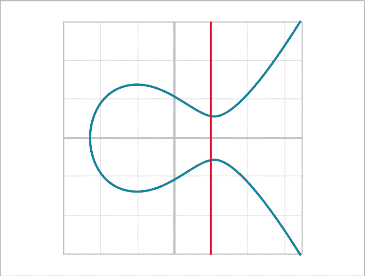
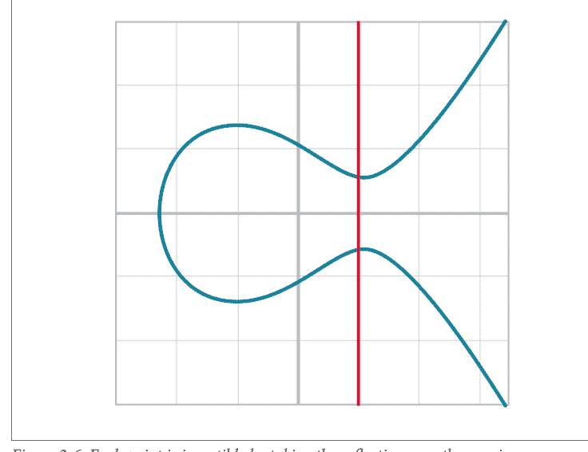
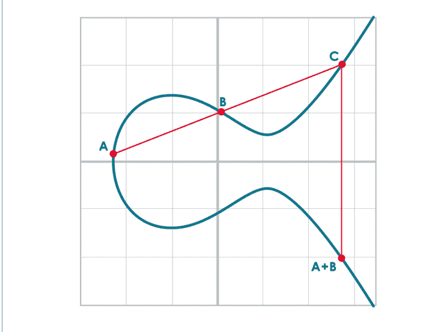
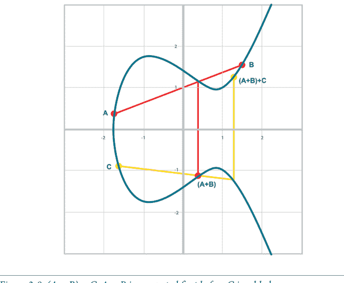
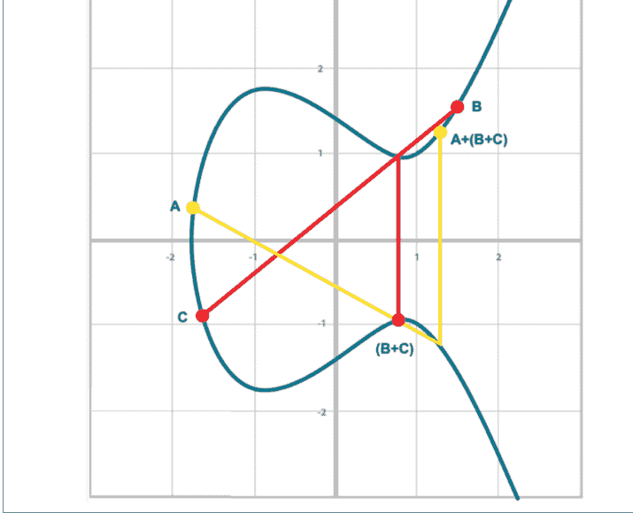
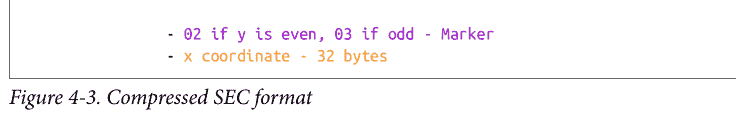

## 椭圆曲线密码学

前两章涵盖了一些基础数学。我们学习了有限域的工作原理以及椭圆曲线是什么。在本章中，我们将结合这两个概念来学习椭圆曲线密码学。具体来说，我们将构建签署和验证消息所需的基础组件，这是比特币的核心。

### 椭圆曲线在实数上

我们在第 2 章讨论了椭圆曲线在视觉上的样子，因为我们在实数上绘制曲线。具体来说，它不仅仅是整数甚至有理数，而是所有实数。π、sqrt(2)、e、19 的 7 次方根等都是实数。

这之所以可行，是因为实数也是一个域。与有限域不同，实数有无限多个，但其他性质相同：

- 1. 如果 a 和 b 在集合中，a + b 和 a • b 在集合中。
- 2. 存在 0 且有性质 a + 0 = a。
- 3. 存在 1 且有性质 a • 1 = a。
- 4. 如果 a 在集合中，−a 在集合中，定义为使 a + (−a) = 0 的值。
- 5. 如果 a 在集合中且不为 0，a⁻¹ 在集合中，定义为使 a • a⁻¹ = 1 的值。

显然，所有这些都是正确的：第一部分适用正常的加法和乘法，存在加法和乘法单位元 0 和 1，−x 是加法逆元，1/x 是乘法逆元。


实数很容易在图上绘制。例如，$y^2 = x^3 + 7$ 可以像图 3-1 那样绘制。



图 3-1. secp256k1 在实数上

事实证明，我们可以在任何域上使用点加法方程，包括我们在第 1 章中学到的有限域。唯一的区别是我们必须使用第 1 章中定义的加法/减法/乘法/除法，而不是实数使用的“正常”版本。

## 有限域上的椭圆曲线

那么有限域上的椭圆曲线看起来是什么样子的？让我们看一下 $y^2 = x^3 + 7$ 在 $F_{103}$ 上的情况。我们可以通过计算等式两边来验证点 $(17,64)$ 在曲线上：

```
y² = 64² % 103 = 79
x³ + 7 = (17³ + 7) % 103 = 79
```

我们已经使用有限域数学验证了该点在曲线上。

因为我们在有限域上求值等式，所以该等式的绘图看起来截然不同（图 3-2）。



图 3-2. 有限域上的椭圆曲线

正如你所见，它非常分散，没有平滑的曲线。这并不令人惊讶，因为点是离散的。唯一的规律大概就是曲线在中间左右对称，这是因为 $y^2$ 项。图形在 x 轴上并不对称，如实数上的曲线那样，而是在 y 轴大约一半的位置对称，这是由于有限域中没有负数。

令人惊讶的是，我们可以使用相同的点加法方程，并使用我们为有限域定义的加法、减法、乘法、除法和指数运算，一切仍然有效。这可能看起来令人惊讶，但抽象数学具有这种规律性，尽管它与你可能熟悉的传统计算模式不同。

## 练习 1

判断这些点是否在 $y^2 = x^3 + 7$ 在 $F_{223}$ 上的曲线上：

$(192,105), (17,56), (200,119), (1,193), (42,99)$

## 编码有限域上的椭圆曲线

因为我们定义了椭圆曲线点并为有限域定义了 +, -, * 和 / 运算符，所以我们可以将两个类结合起来创建有限域上的椭圆曲线点：

```
>>> from ecc import FieldElement, Point
>>> a = FieldElement(num=0, prime=223)
>>> b = FieldElement(num=7, prime=223)
>>> x = FieldElement(num=192, prime=223)
>>> y = FieldElement(num=105, prime=223)
>>> p1 = Point(x, y, a, b)
>>> print(p1)
Point(192,105)_0_7 FieldElement(223)
```

初始化 Point 时，我们会执行以下代码部分：

```
class Point:

    def __init__(self, x, y, a, b):
        self.a = a
        self.b = b
        self.x = x
        self.y = y
        if self.x is None and self.y is None:
            return
        if self.y**2 != self.x**3 + a * x + b:
            raise ValueError('({}, {}) is not on the curve'.format(x, y))
```

这里的加法 (+)、乘法 (*)、指数运算 (**) 和不等于 (!=) 运算符使用的是 `FieldElement` 的 `__add__`、`__mul__`、`__pow__` 和 `__ne__` 方法，而不是整数等价物。能够使用不同的基本算术运算符定义执行相同的方程，这就是我们构建椭圆曲线密码库的方式。

我们已经编写了实现有限域上椭圆曲线点所需的两个类。然而，为了检查我们的工作，创建一个测试套件会很有用。我们将使用练习 2 的结果来做到这一点：

```
class ECCTest(TestCase):

    def test_on_curve(self):
        prime = 223
        a = FieldElement(0, prime)
```

```
b = FieldElement(7, prime)
valid_points = ((192, 105), (17, 56), (1, 193))
invalid_points = ((200, 119), (42, 99))
for x_raw, y_raw in valid_points:
    x = FieldElement(x_raw, prime)
    y = FieldElement(y_raw, prime)
    Point(x, y, a, b) ①
for x_raw, y_raw in invalid_points:
    x = FieldElement(x_raw, prime)
    y = FieldElement(y_raw, prime)
    with self.assertRaises(ValueError):
        Point(x, y, a, b) ①
```

① 我们将 `FieldElement` 对象传递给 `Point` 类进行初始化。这反过来会使用 `FieldElement` 中的所有重载数学运算。

我们现在可以像这样运行此测试：

```
>>> import ecc
>>> from helper import run ①
>>> run(ecc.ECCTest('test_on_curve'))
.
----------------------------------------------------------------------
Ran 1 test in 0.001s

OK
```

① `helper` 是一个包含一些非常有用的实用函数的模块，包括单独运行单元测试的能力。

## 有限域上的点加法

我们可以在有限域上使用所有相同的方程，包括线性方程：

y = mx + b

事实证明，有限域中的“直线”并不完全是你所期望的那样（图 3-3）。

## 编码有限域上的点加法

因为我们以定义 `__add__`、`__sub__`、`__mul__`、`__truediv__`、`__pow__`、`__eq__` 和 `__ne__` 的方式编写了 `FieldElement`，所以我们可以简单地用 `FieldElement` 对象初始化 `Point`，点加法就会起作用：

```python
>>> from ecc import FieldElement, Point
>>> prime = 223
>>> a = FieldElement(num=0, prime=prime)
>>> b = FieldElement(num=7, prime=prime)
>>> x1 = FieldElement(num=192, prime=prime)
>>> y1 = FieldElement(num=105, prime=prime)
>>> x2 = FieldElement(num=17, prime=prime)
>>> y2 = FieldElement(num=56, prime=prime)
>>> p1 = Point(x1, y1, a, b)
>>> p2 = Point(x2, y2, a, b)
>>> print(p1+p2)
Point(170,142)_0_7 FieldElement(223)
```

## 练习 2

对于 $y^2 = x^3 + 7$ 在 $F_{223}$ 上的曲线，求：

- $(170,142) + (60,139)$
- $(47,71) + (17,56)$
- $(143,98) + (76,66)$

## 练习 3

扩展 `ECCTest` 以测试上一练习中的加法。将其命名为 `test_add`。

## 椭圆曲线的标量乘法

因为我们可以将一个点加到自身，所以我们可以引入一些新记号：

$(170,142) + (170,142) = 2 \cdot (170,142)$

同样，因为我们具有结合性，所以我们可以再次加该点：

$2 \cdot (170,142) + (170,142) = 3 \cdot (170, 142)$

我们可以这样做任意多次。这就是我们所说的 *标量乘法*。也就是说，我们在点前面有一个 *标量* 数。我们可以这样做是因为我们定义了点加法并且点加法是结合的。

标量乘法的一个特性是，如果不计算就很难预测（见图 3-4）。



图 3-4. $y^2 = x^3 + 7$ 在 $F_{223}$ 上点 $(170,142)$ 的标量乘法结果

每个点都标明了我们加了多少次该点。你可以看到这完全是分散的。这是因为点加法是非线性的且不易计算。执行标量乘法很直接，但做相反的操作，点除法则不行。

这被称为离散对数问题，是椭圆曲线密码学的基石。

标量乘法的另一个特性是，在某个倍数时，我们会得到无穷远点（记住，无穷远点是加法单位元或 0）。如果我们想象一个点 G 并不断标量乘法直到得到无穷远点，我们会得到一个集合：

{ G, 2G, 3G, 4G, ... nG } 其中 nG = 0

事实证明，这个集合被称为群，并且因为 n 是有限的，我们有一个有限群（更具体地说，是一个有限循环群）。群在数学上很有趣，因为它们对加法表现良好：

G + 4G = 5G 或 aG + bG = (a + b)G

## 标量乘法的再述

标量乘法是将同一个点加到自身若干次。使标量乘法成为公钥密码学的关键在于利用椭圆曲线上标量乘法很难逆向的事实。请注意之前的练习。很可能，你计算了 $F_{223}$ 中 $s \cdot (47,71)$ 对于 s 从 1 到 21 的点。以下是结果：

```
>>> from ecc import FieldElement, Point
>>> prime = 223
>>> a = FieldElement(0, prime)
>>> b = FieldElement(7, prime)
>>> x = FieldElement(47, prime)
>>> y = FieldElement(71, prime)
>>> p = Point(x, y, a, b)
>>> for s in range(1,21):
...     result = s*p
...     print('{}*(47,71)=({},{}).format(s,result.x.num,result.y.num)')
1*(47,71)=(47,71)
2*(47,71)=(36,111)
3*(47,71)=(15,137)
4*(47,71)=(194,51)
5*(47,71)=(126,96)
6*(47,71)=(139,137)
7*(47,71)=(92,47)
8*(47,71)=(116,55)
9*(47,71)=(69,86)
10*(47,71)=(154,150)
11*(47,71)=(154,73)
12*(47,71)=(69,137)
13*(47,71)=(116,168)
14*(47,71)=(92,176)
15*(47,71)=(139,86)
16*(47,71)=(126,127)
17*(47,71)=(194,172)
18*(47,71)=(15,86)
19*(47,71)=(36,112)
20*(47,71)=(47,152)
```

如果你仔细观察数字，标量乘法并没有明显的规律。x 坐标并不总是增加或减少，y 坐标也是如此。唯一的规律大概是 10 和 11 之间的 x 坐标相等（10 和 11 有相同的 x，正如 9 和 12、8 和 13 等）。这是由于 $21 \cdot (47,71) = 0$ 的事实。




*Figure 3-5. Vertical line “intersects” a third time at the point at infinity*

## Closure

This is perhaps the easiest property to prove since we generated the group in the first place by adding $G$ over and over. Thus, if we have two different elements that look like this:

$$aG+bG$$

We know that the result is going to be:

$$(a+b)G$$

How do we know if this element is in the group? If $a+b<n$ (where $n$ is the order of the group), then we know it’s in the group by definition. If $a+b\ge n$, then we know $a<n$ and $b<n$, so $a+b<2n$, so $a+b-n<n$:

$$(a+b-n)G=aG+bG-nG=aG+bG-0=aG+bG$$

More generally, $(a+b)G=((a+b)\%n)G$, where $n$ is the order of the group.

So we know that this element is in the group, proving closure.

## Invertibility

Invertibility is easy to depict (Figure 3-6).



Figure 3-6. Each point is invertible by taking the reflection over the x-axis

Mathematically, we know that if aG is in the group, (n - a)G is also in the group. You can add them together to get aG + (n - a)G = (a + n - a)G = nG = 0.

## Commutativity

We know from point addition that A + B = B + A (Figure 3-7).



Figure 3-7. The line through the points doesn't change

This means that aG + bG = bG + aG, which proves commutativity.

## Associativity

We know from point addition that A + (B + C) = (A + B) + C (see Figures 3-8 and 3-9).



Figure 3-8. (A + B) + C: A + B is computed first before C is added



Figure 3-9. A + (B + C): B + C is added first before adding A (note that this results in the same point as in Figure 3-8)

Thus, aG + (bG + cG) = (aG + bG) + cG, proving associativity.

## Exercise 5

For the curve y² = x³ + 7 over F₂₂₃, find the order of the group generated by (15,86).

## Coding Scalar Multiplication

What we're trying to do with Exercise 5 is this:

```
>>> from ecc import FieldElement, Point
>>> prime = 223
>>> a = FieldElement(0, prime)
>>> b = FieldElement(7, prime)
>>> x = FieldElement(15, prime)
>>> y = FieldElement(86, prime)
>>> p = Point(x, y, a, b)
>>> print(7*p)
Point(infinity)
```

We want to be able to scalar-multiply the point with some number. Thankfully, there's a method in Python called __rmul__ that can be used to override the front multiplication. A naive implementation looks something like this:

```
class Point:
    ...
    def __rmul__(self, coefficient):
        product = self.__class__(None, None, self.a, self.b) ①
        for _ in range(coefficient): ②
            product += self
        return product
```

① We start the product at 0, which in the case of point addition is the point at infinity.

② We loop coefficient times and add the point each time.

This is fine for small coefficients, but what if we have a very large coefficient—that is, a number that's so large that we won't be able to get out of this loop in a reasonable amount of time? For example, a coefficient of 1 trillion is going to take a really long time.

There's a cool technique called binary expansion that allows us to perform multiplication in log₂(n) loops, which dramatically reduces the calculation time for large numbers. For example, 1 trillion is 40 bits in binary, so we only have to loop 40 times for a number that's generally considered very large:

```
class Point:
    ...
    def __rmul__(self, coefficient):
        coef = coefficient
        current = self ①
        result = self.__class__(None, None, self.a, self.b) ②
        while coef:
            if coef & 1: ③
```

## Working with secp256k1

Since we know all of the parameters for secp256k1, we can verify in Python whether the generator point, G, is on the curve y² = x³ + 7:

```
>>> gx = 0x79be667ef9dcbbac55a06295ce870b07029bfcdb2dce28d959f2815b16f81798
>>> gy = 0x483ada7726a3c4655da4fbfc0e1108a8fd17b448a68554199c47d08ffb10d4b8
>>> p = 2**256 - 2**32 - 977
>>> print(gy**2 % p == (gx**3 + 7) % p)
True
```

Furthermore, we can verify in Python whether the generator point, G, has the order n:

```
>>> from ecc import FieldElement, Point
>>> gx = 0x79be667ef9dcbbac55a06295ce870b07029bfcdb2dce28d959f2815b16f81798
>>> gy = 0x483ada7726a3c4655da4fbfc0e1108a8fd17b448a68554199c47d08ffb10d4b8
>>> p = 2**256 - 2**32 - 977
>>> n = 0xfffffffffffffffffffffffffffffffebaaedce6af48a03bbfd25e8cd0364141
>>> x = FieldElement(gx, p)
>>> y = FieldElement(gy, p)
>>> seven = FieldElement(7, p)
>>> zero = FieldElement(0, p)
>>> G = Point(x, y, zero, seven)
>>> print(n*G)
Point(infinity)
```

Since we know the curve we will work in, this is a good time to create a subclass in Python to work exclusively with the parameters for secp256k1. We’ll define the equivalent FieldElement and Point objects, but specific to the secp256k1 curve. Let’s start by defining the field we’ll be working in:

```
P = 2**256 - 2**32 - 977
...
class S256Field(FieldElement):
    def __init__(self, num, prime=None):
        super().__init__(num=num, prime=P)
    def __repr__(self):
        return '{:x}'.format(self.num).zfill(64)
```

We’re subclassing the FieldElement class so we don’t have to pass in P all the time. We also want to display a 256-bit number consistently by filling 64 characters so we can see any leading zeros.

Similarly, we can define a point on the secp256k1 curve and call it S256Point:

```
A = 0
B = 7
...
class S256Point(Point):
```

Generally, we call *e* the *private key* and *P* the *public key*. Note here that the private key is a single 256-bit number and the public key is a coordinate (*x,y*), where *x* and *y* are each 256-bit numbers.

## Signing and Verification

To set up the motivation for why signing and verification exists, imagine this scenario. You want to prove that you are a really good archer, like at the level where you can hit any target you want within 500 yards as opposed to being able to hit any particular target.

Now, if someone could observe you and interact with you, proving this would be easy. Perhaps they would position your son 400 yards away with an apple on his head and challenge you to hit that apple with an arrow. You, being a very good archer, could do this and prove your expertise. The target, if specified by the challenger, makes your archery skill easy to verify.

Unfortunately, this doesn’t scale very well. If, for example, you wanted to prove this to 10 people, you would have to shoot 10 different arrows at 10 different targets from 10 different challenges. You could try to do something like have 10 people watch you shoot a single arrow, but since they can’t all choose the target, they can never be sure that you’re not just good at hitting one particular target instead of an arbitrary target. What we want is something that you can do once, that requires no interaction back and forth with the verifiers, but that still proves that you are indeed, a good archer that can hit *any* target.

If, for example, you simply shot an arrow into a target of your choosing, the people observing afterward wouldn’t necessarily be convinced. After all, you might have painted the target around wherever your arrow happened to land. So what can you do?

Here’s a very clever thing you can do. Inscribe the tip of the arrow with the position of the target that you’re hitting (“apple on top of my son’s head”) and then hit that target with your arrow. Now anyone seeing the target can take an X-ray machine and look at the tip of the embedded arrow and see that the tip indeed says exactly where it was going to hit. The tip clearly had to be inscribed before the arrow was shot, so this can prove you are actually a good archer (provided the actual target isn’t just one that you’ve practiced hitting over and over).

This is the same technique we’re using with signing and verification, except what we’re proving isn’t that we’re good archers, but that we know a secret number. We want to prove possession of the secret without revealing the secret itself. We do this by putting the target into our calculation and hitting that target.


This means to provide a correct u and v, we either have to break the discrete log problem or know the secret e. Since we assume discrete log is hard, we can say e is assumed to be known by the one who came up with u and v.

One subtle thing that we haven’t talked about is that we have to incorporate the purpose of our shooting. This is a contract that gets fulfilled as a result of shooting at the target. William Tell, for example, was shooting so that he could save his son (shoot the target and you get to save your son). You can imagine there would be other reasons to hit the target and other “rewards” that the person hitting the target would receive. This has to be incorporated into our equations.

In signature/verification parlance, this is called the signature hash. A hash is a deterministic function that takes arbitrary data into data of fixed size. This is a fingerprint of the message containing the intent of the shooter, which anyone verifying the message already knows. We denote this with the letter z. This is incorporated into our uG + vP calculation this way:

```
u = z/s, v = r/s
```

Since r is used in the calculation of v, we now have the tip of the arrow inscribed. We also have the intent of the shooter incorporated into u, so both the reason for shooting and the target that is being aimed at are now part of the equation.

To make the equation work, we can calculate s:

```
uG + vP = R = kG
uG + veG = kG
u + ve = k
z/s + re/s = k
(z + re)/s = k
s = (z + re)/k
```

This is the basis of the signature algorithm, and the two numbers in a signature are r and s.

Verification is straightforward:

```
uG + vP where u,v ≠ 0
uG + vP = (z/s)G + (re/s)G = ((z + re)/s)G = ((z + re)/((z + re)/k))G = kG = (r,y)
```

uG + vP = (z/s)G + (r/s)P = (z/s)G + (re/s)G = ((z + re)/s)G

We know s = (z + re)/k, so:

uG + vP = ((z + re) / ((z + re)/k))G = kG = R

We've successfully chosen u and v in such a way as to generate R as we intended. Furthermore, we used r in the calculation of v, proving we knew what R would be. The only way we can know the details of R beforehand is if we know e.

To wit, here are the steps:

+   1. We are given (r,s) as the signature, z as the hash of the thing being signed, and P as the public key (or public point) of the signer.
+   2. We calculate u = z/s, v = r/s.
+   3. We calculate uG + vP = R.
+   4. If R's x coordinate equals r, the signature is valid.


## Why Two Rounds of sha256?

The calculation of z requires two rounds of sha256, or hash256. You may be wondering why there are two rounds when only one is necessary to get a 256-bit number. The reason is for security.

There is a well-known hash collision attack on SHA-1 called a birthday attack that makes finding collisions much easier. Google found a SHA-1 collision using some modifications of a birthday attack and a lot of other things in 2017. Using SHA-1 twice, or double SHA-1, is the way to defeat or slow down some forms of this attack.

Two rounds of sha256 don't necessarily prevent all possible attacks, but doing two rounds is a defense against some potential weaknesses.

## Verifying a Signature

We can now verify a signature using some of the primitives that we have:

```
>>> from ecc import S256Point, G, N
>>> z = 0xbc62d4b80d9e36da29c16c5d4d9f11731f36052c72401a76c23c0fb5a9b74423
>>> r = 0x37206a0610995c58074999cb9767b87af4c4978db68c06e8e6e81d282047a7c6
>>> s = 0x8ca63759c1157ebeaec0d03cecca119fc9a75bf8e6d0fa65c841c8e2738cdaec
>>> px = 0x04519fac3d910ca7e7138f7013706f619fa8f033e6ec6e09370ea38cee6a7574
>>> py = 0x82b51eab8c27c6e2c658a079bcd f4f1ada34cec420cafc7eac1a42216fb6c4
>>> point = S256Point(px, py)
>>> s_inv = pow(s, N-2, N)
```

```
>>> u = z * s_inv % N
>>> v = r * s_inv % N
>>> print((u*G + v*point).x.num == r)
True
```

+   1. Note that we use Fermat's little theorem for 1/s, since n is prime.
+   2. u = z/s.
+   3. v = r/s.
+   4. uG + vP = (r,y). We need to check that the x coordinate is r.

## Exercise 6

Verify whether these signatures are valid:

```
P = (0x887387e452b8eacc4acfde10d9aaf7f6d9a0f975aabb10d006e4da568744d06c,
    0x61de6d95231cd89026e286df3b6ae4a894a3378e393e93a0f45b666329a0ae34)
```

```
# signature 1
z = 0xec208baa0fc1c19f708a9ca96fdeff3ac3f230bb4a7ba4aede4942ad003c0f60
r = 0xac8d1c87e51d0d441be8b3dd5b05c8795b48875dffe00b7ffcfac23010d3a395
s = 0x68342ceff8935eded102dd876ffd6ba72d6a427a3edb13d26eb0781cb423c4
```

```
# signature 2
z = 0x7c076ff316692a3d7eb3c3bb0f8b1488cf72e1afcd929e29307032997a838a3d
r = 0xefff69ef2b1bd93a66ed5219add4fb51e11a840f404876325a1e8ffe0529a2c
s = 0xc7207fee197d27c618aea621406f6bf5ef6fca38681d82b2f06fddbdce6feab6
```

## Programming Signature Verification

We already have a class S256Point, which is the public point for the private key. We create a Signature class that houses the r and s values:

```
class Signature:
    def __init__(self, r, s):
        self.r = r
        self.s = s
    def __repr__(self):
        return 'Signature({:x},{:x})'.format(self.r, self.s)
```

We will be doing more with this class in Chapter 4.

We can now write the verify method on S256Point based on this:

```
class S256Point(Point):
    ...
    def verify(self, z, sig):
```

```
s_inv = pow(sig.s, N - 2, N) ①
u = z * s_inv % N ②
v = sig.r * s_inv % N ③
total = u * G + v * self ④
return total.x.num == sig.r ⑤
```

+   ① `s_inv (1/s)` is calculated using Fermat’s little theorem on the order of the group, `n`, which is prime.
+   
+   ② `u = z/s`. Note that we can mod by `n` as that’s the order of the group.
+   
+   ③ `v = r/s`. Note that we can mod by `n` as that’s the order of the group.
+   
+   ④ `uG + vP` should be `R`.
+   
+   ⑤ We check that the `x` coordinate is `r`.

So, given a public key that is a point on the secp256k1 curve and a signature hash, `z`, we can verify whether a signature is valid or not.

## Signing in Depth

Given that we know how verification should work, signing is straightforward. The only missing step is figuring out what `k`, and thus `R = kG`, to use. We do this by choosing a random `k`.

The signing procedure is as follows:

+   1. We are given `z` and know `e` such that `eG = P`.
+   2. Choose a random `k`.
+   3. Calculate `R = kG` and `r = x` coordinate of `R`.
+   4. Calculate `s = (z + re)/k`.
+   5. Signature is `(r, s)`.

Note that the public key (pubkey) `P` has to be transmitted to whoever wants to verify it, and `z` must be known by the verifier. We’ll see later that `z` is computed and `P` is sent along with the signature.

## Creating a Signature

We can now create a signature.

## Programming Message Signing

To program message signing, we now create a PrivateKey class, which will house our secret:

```
class PrivateKey:
    def __init__(self, secret):
        self.secret = secret
        self.point = secret * G
    def hex(self):
        return '{:x}'.format(self.secret).zfill(64)
```

① We keep around the public key, self.point, for convenience.

We then create the sign method:

```
from random import randint
...
class PrivateKey:
...
    def sign(self, z):
        k = randint(0, N) ①
        r = (k*G).x.num ②
        k_inv = pow(k, N-2, N) ③
        s = (z + r*self.secret) * k_inv % N ④
        if s > N/2: ⑤
            s = N - s
        return Signature(r, s) ⑥
```

① randint chooses a random integer from [0, n). Please don’t use this function in production, because the random number from this library is not nearly random enough.

② r is the x coordinate of kG.

③ We use Fermat’s little theorem again, and n, which is prime.

④ s = (z + re)/k.

⑤ It turns out that using the low-s value will get nodes to relay our transactions. This is for malleability reasons.

⑥ We return a Signature object from the class defined earlier.

## Importance of a Unique k

There’s an important rule in signatures that utilize a random component like we have here: the k needs to be unique per signature. That is, it cannot get reused. In fact, a k that’s reused will result in you revealing your secret! Why?

If our secret is e and we are reusing k to sign z₁ and z₂:

```
kG = (r,y)
s₁ = (z₁ + re) / k, s₂ = (z₂ + re) / k
s₁/s₂ = (z₁ + re) / (z₂ + re)
s₁(z₂ + re) = s₂(z₁ + re)
s₁z₂ + s₁re = s₂z₁ + s₂re
s₁re - s₂re = s₂z₁ - s₁z₂
e = (s₂z₁ - s₁z₂) / (r s₁ - r s₂)
```

If anyone sees both signatures, they can use this formula and find our secret! The PlayStation 3 hack back in 2010 was due to the reuse of the k value in multiple signatures.

To combat this, there is a deterministic k generation standard that uses the secret and z to create a unique, deterministic k every time. The specification is in RFC 6979 and the code changes to look like this:

```
class PrivateKey:
    ...
    def sign(self, z):
        k = self.deterministic_k(z) ①
        r = (k * G).x.num
        k_inv = pow(k, N - 2, N)
        s = (z + r * self.secret) * k_inv % N
        if s > N / 2:
            s = N - s
        return Signature(r, s)

    def deterministic_k(self, z):
        k = b'\x00' * 32
        v = b'\x01' * 32
        if z > N:
            z -= N
        z_bytes = z.to_bytes(32, 'big')
        secret_bytes = self.secret.to_bytes(32, 'big')
        s256 = hashlib.sha256
        k = hmac.new(k, v + b'\x00' + secret_bytes + z_bytes, s256).digest()
        v = hmac.new(k, v, s256).digest()
        k = hmac.new(k, v + b'\x01' + secret_bytes + z_bytes, s256).digest()
        v = hmac.new(k, v, s256).digest()
        while True:
            v = hmac.new(k, v, s256).digest()
```


```
candidate = int.from_bytes(v, 'big')
if candidate >= 1 and candidate < N:
    return candidate
k = hmac.new(k, v + b'\x00', s256).digest()
v = hmac.new(k, v, s256).digest()
```

① 我们使用的是确定性的 k 而不是随机的 k。签名其余部分保持不变。

② 该算法返回一个合适的候选值。

确定性的 k 具有极高的概率是唯一的。这是因为 sha256 是抗碰撞的，且迄今为止尚未发现碰撞。

从测试的角度来看，另一个好处是，对于给定的 z 和相同的私钥，签名每次都相同。这使得调试变得容易得多，并且单元测试也更容易编写。此外，使用确定性 k 的交易每次都会创建相同的交易，因为签名不会改变。这使得交易不易被篡改（将在第 13 章详细介绍）。

## 结论

我们已经介绍了椭圆曲线密码学，并且现在可以证明我们知道一个秘密，通过对某物进行签名。我们也可以验证拥有该秘密的人确实签署了一条消息。即使你不再阅读本书的下一页，你也已经学会了实现曾经被认为“军用级武器”的东西。这是你旅程中的一个重要步骤，并且对于本书的其余部分至关重要！

我们现在转向序列化这些结构，以便我们可以将它们存储在磁盘上并通过网络发送。

```
047211a824f55b505228e4c3d5194c1fcfaa15a456abdf37f9b9d97a4040afc073dee6c8906498
4f03385237d92167c13e236446b417ab79a0fcae412ae3316b77
- 04 - Marker
- x coordinate - 32 bytes
- y coordinate - 32 bytes
```

Figure 4-1. Uncompressed SEC format


## Big- and Little-Endian

大端和小端编码的动机是为了在磁盘上存储一个数字。小于 256 的数字很容易编码，因为单个字节（2⁸）足以容纳它。当它大于 256 时，我们如何将数字序列化为字节？

阿拉伯数字从左到右阅读。像 123 这样的数字是 100 + 20 + 3 而不是 1 + 20 + 300。我们称之为大端，因为“大端”先开始。

计算机有时使用相反的顺序会更有效，即小端——也就是说，先从小端开始。

由于计算机以字节为单位工作，每个字节有 8 位，我们必须以 256 为基数思考。这意味着像 500 这样的数字在大端中看起来像 01f4——也就是说，500 = 1 × 256 + 244（十六进制中的 f4）。同一个数字在小端中看起来像 f401。

不幸的是，比特币中的某些序列化（如 SEC 格式的 x 和 y 坐标）是大端的，而其他（如第 5 章中的交易版本号）是小端的。本书会告诉你哪些是大端、哪些是小端。

创建未压缩的 SEC 格式序列化相当直接。最棘手的部分是将 256 位数字转换为 32 个字节，大端。以下是代码中的实现方式：

```
class S256Point(Point):
    ...
    def sec(self):
        '''returns the binary version of the SEC format'''
        return b'\x04' + self.x.num.to_bytes(32, 'big') \
            + self.y.num.to_bytes(32, 'big')
```

1 在 Python 3 中，你可以使用 to_bytes 方法将数字转换为字节。第一个参数是它应占用的字节数，第二个参数是端序（参见前面的说明）。

事实证明，即使在有限域上，我们也有相同的对称性。

这是因为对于任何满足 y² = x³ + ax + b 的 (x,y)，(x,−y) 也满足该方程。此外，在有限域中，−y % p = (p − y) % p。或者更准确地说，如果 (x,y) 满足椭圆曲线方程，则 (x,p − y) 也满足该方程。对于给定的 x，这就是唯一的两个解，如图所示，因此如果我们知道 x，我们就知道 y 坐标必须是 y 或 p − y。

由于 p 是一个大于 2 的素数，我们知道 p 是奇数。因此，如果 y 是偶数，p − y（奇数减偶数）将是奇数。如果 y 是奇数，p − y 将是偶数。换句话说，在 y 和 p − y 之间，一个是偶数，一个是奇数。我们可以利用这一点来缩短未压缩的 SEC 格式：我们可以提供 x 坐标和 y 坐标的奇偶性。我们称之为压缩 SEC 格式，因为 y 坐标被压缩成一个字节（即它是偶数还是奇数）。

以下是给定点 P = (x,y) 的压缩 SEC 格式的序列化：

+   1. 从前缀字节开始。如果 y 是偶数，则为 0x02；否则为 0x03。
+   2. 接下来，附加 32 字节的 x 坐标作为大端整数。

压缩 SEC 格式如图 4-3 所示。



Figure 4-3. Compressed SEC format

同样，过程相当直接。我们可以更新 sec 方法以处理压缩 SEC 密钥：

```
class S256Point(Point):
    ...
    def sec(self, compressed=True):
        '''returns the binary version of the SEC format'''
        if compressed:
            if self.y.num % 2 == 0:
                return b'\x02' + self.x.num.to_bytes(32, 'big')
            else:
                return b'\x03' + self.x.num.to_bytes(32, 'big')
        else:
            return b'\x04' + self.x.num.to_bytes(32, 'big') + \
                self.y.num.to_bytes(32, 'big')
```

③ 我们取椭圆曲线方程右边的值的平方根来得到 y。

④ 我们确定奇偶性并返回正确的点。

## Exercise 2

找到公钥的压缩 SEC 格式，其中私钥秘密为：

+   - 5,001
+   - 2,019⁵
+   - 0xdeadbeef54321

## DER Signatures

我们需要学习序列化的另一个类是 Signature。就像 SEC 格式一样，它需要编码两个不同的数字，r 和 s。不幸的是，与 S256Point 不同，Signature 不能被压缩，因为 s 不能仅从 r 推导出来。

用于序列化签名（以及许多其他东西）的标准称为 Distinguished Encoding Rules（DER）格式。DER 格式由中本聪用于序列化签名。这很可能是因为该标准在 2008 年就已定义，在当时比特币使用的 OpenSSL 库中得到支持，并且足够容易采用，而不是创建新标准。

DER 签名格式定义如下：

+   1. 从 0x30 字节开始。
+   2. 编码剩余签名的长度（通常为 0x44 或 0x45）并附加。
+   3. 附加标记字节，0x02。
+   4. 将 r 编码为大端整数，但在 r 的第一个字节 ≥ 0x80 时在其前加上 0x00 字节。将 resulting 长度前置到 r。将其添加到结果中。
+   5. 附加标记字节，0x02。
+   6. 将 s 编码为大端整数，但在 s 的第一个字节 ≥ 0x80 时在其前加上 0x00 字节。将 resulting 长度前置到 s。将其添加到结果中。

#4 和 #6 中关于第一个字节大于或等于 0x80 的规则是因为 DER 是一种通用编码，允许对负数进行编码。第一位为 1 表示该数字为负数。ECDSA 签名中的所有数字都是正数，因此如果第一位为零，我们必须在前面加上 0x00，这等价于第一个字节 ≥ 0x80。

## Exercise 3

找到 r 和 s 值为以下签名的 DER 格式：

```
r = 0x37206a0610995c58074999cb9767b87af4c4978db68c06e8e6e81d282047a7c6
```

```
s = 0x8ca63759c1157ebeaec0d03cecca119fc9a75bf8e6d0fa65c841c8e2738cdaec
```

## Base58

在比特币早期，比特币被分配给以 SEC 格式（未压缩）指定的公钥，然后使用 DER 签名进行赎回。出于我们在第 6 章将要介绍的原因，使用这种特定非常简单的脚本最终对于存储未花费交易输出（UTXO）来说既浪费，又比现在更常用的脚本安全性稍差一些。现在，我们将介绍地址是什么以及它们如何编码。

## Transmitting Your Public Key

为了让 Alice 向 Bob 付款，她必须知道钱要发送到哪里。这不仅在比特币中如此，对于任何支付方式都是如此。由于比特币是一种数字持票人工具，地址可以是公钥密码方案中的公钥。不幸的是，SEC 格式，尤其是未压缩的，相当长（65 或 33 字节）。此外，65 或 33 个字节是二进制格式——不便于阅读，至少是原始形式。

有三个主要考虑因素。第一个是公钥可读（易于手写并且不易混淆，例如通过电话）。第二个是它很短（不会长到难以处理）。第三个是它安全（因此更难犯错）。

那么我们如何获得可读性、压缩和安全性？如果我们将 SEC 格式表示为十六进制（每字符 4 位），长度会翻倍（130 或 66 个字符）。我们能做得更好吗？

我们可以使用类似 Base64 的东西，它可以每字符表示 6 位。这导致未压缩 SEC 为 87 个字符，压缩 SEC 为 44 个字符。不幸的是，Base64 容易出错，因为很多字母和数字看起来相似（0 和 O，l 和 I，- 和 _）。如果我们删除这些字符，我们可以实现一个具有良好可读性和不错压缩（约 5.86 位/字符）的结果。最后，我们可以在末尾添加校验和以确保错误易于检测。

这种构造称为 Base58。不同于十六进制（基数 16）或 Base64，我们以 Base58 编码数字。

进行 Base58 编码的实际机制如下。


除前面提到的 0/O 和 l/I 以外，所有数字、大写字母和小写字母都可以使用。这样我们就剩下 10 + 26 + 26 − 4 = 58 个字符。这些字符中的每一个都代表 Base58 中的一个数字。我们可以用以下函数进行编码：

```
BASE58_ALPHABET = '123456789ABCDEFGHJKLMNPQRSTUVWXYZabcdefghijkmnopqrstuvwxyz'
...
def encode_base58(s):
    count = 0
    for c in s: ①
        if c == 0:
            count += 1
        else:
            break
    num = int.from_bytes(s, 'big')
    prefix = '1' * count
    result = ''
    while num > 0: ②
        num, mod = divmod(num, 58)
        result = BASE58_ALPHABET[mod] + result
    return prefix + result ③
```

① 这个循环的目的是确定开头有多少个字节是 0 字节。我们想在最后把它们加回去。

② 这个循环用于确定要使用哪个 Base58 数字。

③ 最后，我们把前面数出的所有 0 作为前缀添加到开头，否则它们不会以前缀 1 的形式出现。这种恼人的情况在支付到公钥哈希（p2pkh）中会出现；更多内容见第 6 章。

这个函数将接受 Python 3 中的任何字节，并将其转换为 Base58。


## 为什么 Base58 正在被淘汰

Base58 已经使用了很长时间。虽然它确实比像 Base64 这样的编码在交流时稍方便一些，但其实并没有那么方便。大多数人更喜欢复制粘贴地址，而如果你曾经尝试口头传达一个 Base58 地址，你就会知道这可能是一场噩梦。

更好的方案是新的 Bech32 标准，它在 BIP0173 中定义。Bech32 使用一个 32 字符的字母表，只包含数字和小写字母，但 1、b、i 和 o 除外。到目前为止，它仅用于 Segwit（第 13 章）。

```python
def hash160(s):
    '''sha256 followed by ripemd160'''
    return hashlib.new('ripemd160', hashlib.sha256(s).digest()).digest()
```

注意，hashlib.sha256(s).digest() 执行 sha256，外层则执行 ripemd160。

我们还可以为 S256Point 添加 hash160 和 address 方法：

```python
class S256Point:
    ...
    def hash160(self, compressed=True):
        return hash160(self.sec(compressed))
    def address(self, compressed=True, testnet=False):
        '''Returns the address string'''
        h160 = self.hash160(compressed)
        if testnet:
            prefix = b'\x6f'
        else:
            prefix = b'\x00'
        return encode_base58_checksum(prefix + h160)
```

### 练习 5

找出与以下私钥值对应的公钥地址：

-   5002（在测试网上使用未压缩 SEC）
-   2020⁵（在测试网上使用压缩 SEC）
-   0x12345deadbeef（在主网上使用压缩 SEC）

## WIF 格式

在我们的场景中，私钥是一个 256 位的数字。通常，我们不需要经常序列化我们的私钥，因为它不会被广播（那会是个坏主意！）。尽管如此，在某些情况下，你可能希望将私钥从一个钱包转移到另一个钱包——例如，从纸钱包转移到软件钱包。

为此，你可以使用钱包导入格式（WIF）。WIF 是私钥的一种序列化形式，旨在便于人类阅读。WIF 使用与地址相同的 Base58 编码。

WIF 格式的创建方式如下：

1.  对于主网私钥，以前缀 0x80 开头；对于测试网，以前缀 0xef 开头。
2.  以 32 字节大端序对私钥进行编码。
3.  如果用于公钥地址的 SEC 格式是压缩的，则添加后缀 0x01。
4.  将从第 1 步得到的前缀、从第 2 步得到的序列化私钥以及从第 3 步得到的后缀组合起来。
5.  对第 4 步的结果进行 hash256 运算，并取前 4 个字节。
6.  将第 4 步和第 5 步的结果组合起来，用 Base58 编码。

现在我们可以为 PrivateKey 类创建 wif 方法：

```python
class PrivateKey:
    ...
    def wif(self, compressed=True, testnet=False):
        secret_bytes = self.secret.to_bytes(32, 'big')
        if testnet:
            prefix = b'\xef'
        else:
            prefix = b'\x80'
        if compressed:
            suffix = b'\x01'
        else:
            suffix = b''
        return encode_base58_checksum(prefix + secret_bytes + suffix)
```

### 练习 6

找出私钥值为以下内容的 WIF：

-   5003（压缩，测试网）
-   2021⁵（未压缩，测试网）
-   0x54321deadbeef（压缩，主网）

## 再谈大端序与小端序

了解如何在 Python 中处理大端序和小端序将非常有用，因为在接下来的几章中，我们会大量地在数字与大小端序之间进行解析和序列化。特别是，Satoshi 在比特币中大量使用了小端序，但遗憾的是，并没有一条易学的规则来说明哪里使用小端序、哪里使用大端序。回想一下，SEC 格式使用大端序编码，地址和 WIF 也是如此。从第 5 章开始，我们将更多地使用小端序编码。因此，我们来做接下来的两个练习。本节的最后一个练习是为你自己创建一个测试网地址。
