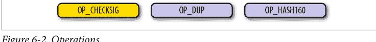
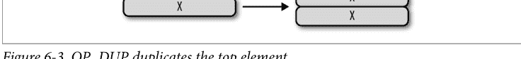
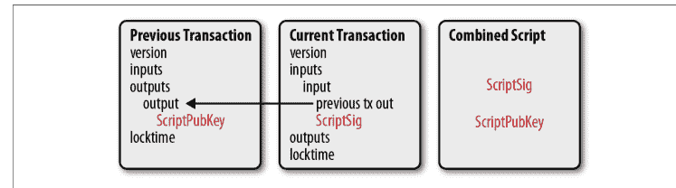
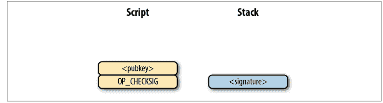
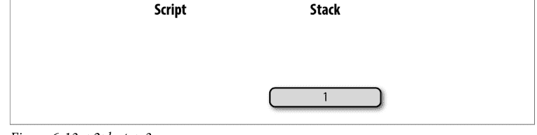

## 交易

交易是比特币的核心。简单来说，交易就是价值从一个实体转移到另一个实体。我们将在第 6 章看到，这里的“实体”实际上是智能合约——不过我们有些超前了。让我们先看看比特币中的交易是什么、它们长什么样，以及如何解析它们。

### 交易组成部分

从高层来看，一笔交易实际上只有四个组成部分。它们是：

1.  版本
2.  输入
3.  输出
4.  锁定时间

对这些字段进行一个总体概述可能会有所帮助。版本表示交易使用了哪些附加功能；输入定义了正在花费哪些比特币；输出定义了比特币的去向；锁定时间定义了该交易从何时开始有效。我们将深入讲解每个组成部分。

图 5-1 显示了一个典型交易的十六进制转储，展示了哪部分对应哪个字段。

```
010000001813f79011acb80925dfe69b3def355fe914bd1d96a3f5f71bf8303c6a989c7d1000000
06b483045022100ed81ff192e75a3fd2304004dcadb746fa5e24c5031ccfcf21320b0277457c98f02
207a986d955c6e0cb35d44a89d3f56100f4d7f67801c31967743a9c8e10615bed01210349fc4e631
e362a545de3f89f5d8684c7b8138bd94bdd53d12e213bf016b278afefffffff02a135ef0100000000
1976a914bc3b654dca7e56b04dca18f2566cdaf02e8d9ada88ac99c39800000000001976a9141c4bc
762dd5423e332166702cb75f40df79fea1288ac19430600
```

*图 5-1：交易组成部分：版本、输入、输出和锁定时间*

不同高亮部分分别代表版本、输入、输出和锁定时间。

基于这一点，我们可以开始构建交易类，我们将其命名为 Tx：

```python
class Tx:

    def __init__(self, version, tx_ins, tx_outs, locktime, testnet=False):
        self.version = version
        self.tx_ins = tx_ins
        self.tx_outs = tx_outs
        self.locktime = locktime
        self.testnet = testnet

    def __repr__(self):
        tx_ins = ''
        for tx_in in self.tx_ins:
            tx_ins += tx_in.__repr__() + '\n'
        tx_outs = ''
        for tx_out in self.tx_outs:
            tx_outs += tx_out.__repr__() + '\n'
        return 'tx: {}\nversion: {}\ntx_ins:{}\ntx_outs:\n{}locktime: {}'.format(
            self.id(),
            self.version,
            tx_ins,
            tx_outs,
            self.locktime,
        )

    def id(self):
        '''Human-readable hexadecimal of the transaction hash'''
        return self.hash().hex()

    def hash(self):
        '''Binary hash of the legacy serialization'''
        return hash256(self.serialize())[::-1]
```

1.  输入和输出是非常通用的术语，因此我们需要指定它们具体是哪类输入。我们稍后会定义具体的对象类型。
2.  我们需要知道这笔交易在哪个网络上，才能完全验证它。
3.  id 是区块浏览器用来查找交易的方式。它是交易的 hash256 的十六进制格式。
4.  hash 是序列化的小端序 hash256。注意我们还没有 serialize 方法；所以在实现之前，这段代码无法运行。

本章其余部分将关注如何解析交易。在这一点上，我们可以编写这样的代码：

```python
class Tx:
    ...
    @classmethod ①
    def parse(cls, serialization):
        version = serialization[0:4] ②
        ...
```

① 这个方法必须是类方法，因为序列化将返回一个新的 Tx 对象实例。

② 这里我们假设变量 serialization 是一个字节数组。

这当然可行，但交易可能非常大。理想情况下，我们希望改为从流中解析。这样我们就不需要在开始解析之前获得完整的序列化交易，从而可以及早失败并提高效率。因此，解析交易的代码将更像是这样：

```python
class Tx:
    ...
    @classmethod
    def parse(cls, stream):
        serialized_version = stream.read(4) ①
        ...
```

① read 方法允许我们即时解析，因为不必等待 I/O。

从工程角度来看，这是有利的，因为流可以是网络上的套接字连接或文件句柄。我们可以立即开始解析流，而不必等待整个内容先被传输或读取完毕。我们的方法将能够处理任何类型的流，并返回我们所需的 Tx 对象。


比特币的输入是之前交易的输出的支出。也就是说，你需要先收到比特币才能花费。这一点很直观。你不能在没有先收到钱的情况下花钱。输入指的是属于你的比特币。每个输入需要两件事：

- 对你之前收到的比特币的引用
- 证明这些是你可花费的

第二部分使用 ECDSA（第 3 章）。你不希望人们能够伪造它，所以大多数输入都包含只有私钥所有者才能产生的签名。

输入字段可以包含多个输入。这类似于用一张 $100 的钞票支付 $70 的餐费，或用一张 $50 和一张 $20。 前者只需要一个输入（“钞票”）；后者需要两个。 有些情况下输入可能更多。 在我们的类比中，我们可以用 14 张 $5 钞票支付 $70 的餐费，甚至 7,000 个便士。 这相当于 14 个输入或 7,000 个输入。

输入的数量是交易的下一部分，如图 5-4 所示。

```
0100000001813f79011acb80925dfe69b3def355fe914bd1d96a3f5f71bf8303c6a989c7d10000000006b483045022100ed81ff192e75a3fd2304004dcadb746fa5e24c5031ccfcf21320b0277457c98f02207a986d955c6e0cb35d446a89d3f56100f4d7f67801c3196774349c8e10615bed01210349fc4e631e362a545de3f89f5d8684c7b8138bd94bdd5312e2e213bf016b278afefffff02a135ef01000000001976a914bc3b654dca7e56b04dca18f2566cda f02e8d9ada88ac99c39800000000001976a9141c4bc762dd5423e332166702cb75f40df79fea1288ac19430600
```

图 5-4. 输入数量

我们可以看到该字节实际上是 01，这意味着该交易有一个输入。 这里很容易认为它总是单个字节，但事实并非如此。 单个字节有 8 位，因此超过 255 个输入将无法用单个字节表示。

这就是 varints 的用武之地。 Varint 是 variable integer 的缩写，它是一种将整数编码为字节的方式，范围从 0 到 2^64 − 1。 当然，我们可以始终为输入数量保留 8 个字节，但如果我们期望输入数量相对较小（比如低于 200），那就会浪费很多空间。 这是正常交易中输入数量的情况，因此使用 varints 有助于节省空间。 你可以在以下侧边栏中了解它们的工作原理。

```
0100000001813f79011acb80925dfe69b3def355fe914bd1d96a3f5f71bf8303c6a989c7d10000000 06b483045022100ed81ff192e75a3fd2304004dcadb746fa5e24c5031ccfcf21320b0277457c98f02 207a986d955c6e0cb35d446a89d3f56100f4d7f67801c31967743a9c8e10615bed01210349fc4e631 e362a545de3f89f5d8684c7b8138bd94bdd531d2e213bf016b278afeffffff02a135ef0100000000 1976a914bc3b654dca7e56b04dca18f2566cda f02e8d9ada88ac99c39800000000001976a9141c4bc 762dd5423e332166702cb75f40df79fea1288ac19430600
```

图 5-5. 输入的字段：前一笔交易 ID、前一索引、ScriptSig 和序列

## 序列和锁定时间

最初，Satoshi 希望序列和锁定时间字段用于所谓的“高频交易”。 Satoshi 设想了一种方式，可以在不产生大量链上交易的情况下与另一方来回进行支付。 例如，如果 Alice 为某物向 Bob 支付 x 个比特币，然后 Bob 为另一件事向 Alice 支付 y 个比特币（假设 x > y），那么 Alice 只需向 Bob 支付 x − y，而不是链上有两笔单独的交易。 如果 Alice 和 Bob 之间有 100 笔交易，我们也可以做同样的事情——即把一堆交易压缩成一笔交易。

这就是 Satoshi 的想法：在交易双方之间有一个不断更新的迷你账本，在链上结算。 Satoshi 的意图是使用序列和锁定时间字段，每当交易双方之间发生新的支付时就更新高频交易交易。 交易交易将有两个输入（一个来自 Alice，一个来自 Bob）和两个输出（一个到 Alice，一个到 Bob）。 交易交易将从序列为 0 开始，并带有遥远的锁定时间（比如从现在起 500 个区块，所以在 500 个区块后有效）。 这是 Alice 和 Bob 以投入的相同金额获得的基线交易。

在第一次交易之后，Alice 向 Bob 支付 x 个比特币，每个输入的序列将为 1。 在第二次交易之后，Bob 向 Alice 支付 y 个比特币，每个输入的序列将为 2。 使用这种方法，只要它们发生在锁定时间生效之前，我们就可以把大量支付压缩成一笔链上交易。

不幸的是，尽管这个想法很巧妙，但矿工很容易作弊。 在我们的例子中，Bob 可能是一个矿工；他可以忽略序列号为 2 的更新交易交易，并挖掘序列号为 1 的交易交易，从而骗取 Alice y 个比特币。

后来创建了一种更好的设计，即“支付通道”，这是闪电网络的基础。

01000000456919960ac691763688d3d3bcea9ad6ecaf875df5339e148a1fc61c6ed7a069e0100 0006a4703440220458bcdef85e6b1c6a5c2669d4830ff86e42dd205c0e089bc2a821657e951 c00201024a10366077f87d6bce1f7100ad8cfa8a064b39d4e8fe4eae13a7b71aa810f02102f0 da57e85eec2934a82a58ea337ce2f4998b50a699d7f9f5880e253dafab7f5eefffbe8f851f4 038dc17e6313cf831d4f02281c2a468bde0fafd37f1bf882729e7fd3000000006a473044022078 99531a52d59a6de200179928ca900254a36b8dff8bb75f5f5d7b1cdc26152022008b422690b84 61cb52c3cc303b23d57431872b3c361e9aae364907c1a16012103d5c9d3a96881f9ba 1f686f15f09ded7c62efe85a87e6a19b43c15a2a937fff5b667b4f4059119d1bb8a3037c35 6efd56170b64cbc160fb028fa10704b45d775000000006a47304402204c7c781842c4c7f7911da 6cddc59655a70af1cb5eaf17c69dadbfc74ffa0b662f02207599e08bc8023693ad4e9527dc42c3 4210f7a7d1ddfc8492b654a41e76f20a0012102158b46fdbff65d0172b798aec8850aa0dae49 abfb84c81ae6e5b251a58ace5cfefff7fd63a5e6c16e620bf6b375925b21cabaaf736c779f88fd 04dacd5d126690f7f3450100000006a473044022000633e0ad3314bea0f95b3cdabadb2e7f8a833 1ffe1e61f762c0f6daea0fabde022029f23b3e9c30f080446150b23852028751635dcee2be669c 2a1686a4b5edf304012103fd6f4a67e94aba53a00882e563ff2722eb4cff0ad6006e86ee20df e7520d5Sfefffff0251430f00000000001976a9144b0c0b2e98b1a6bdbf67d4750b0a56244948 a87988ac005a62020000000001976a9143c82d7df364eb6c75be8c80df2b3eda8db57397088ac46 430600

## 编码交易

我们已经解析了交易；现在我们要做相反的操作，即序列化交易。 让我们从 TxOut 开始：

```
class TxOut:
    ...
    def serialize(self):  ①
        '''Returns the byte serialization of the transaction output'''
        result = int_to_little_endian(self.amount, 8)
        result += self.script_pubkey.serialize()
        return result
```

① 我们将 TxOut 对象序列化为一堆字节。

然后我们可以继续 TxIn：

```
class TxIn:
    ...
    def serialize(self):
        '''Returns the byte serialization of the transaction input'''
        result = self.prev_tx[::-1]
        result += int_to_little_endian(self.prev_index, 4)
        result += self.script_sig.serialize()
        result += int_to_little_endian(self.sequence, 4)
        return result
```

最后，我们可以序列化 Tx：

```
class Tx:
    ...
    def serialize(self):
        '''Returns the byte serialization of the transaction'''
```

```
result = int_to_little_endian(self.version, 4)
result += encode_varint(len(self.tx_ins))
for tx_in in self.tx_ins:
    result += tx_in.serialize()
result += encode_varint(len(self.tx_outs))
for tx_out in self.tx_outs:
    result += tx_out.serialize()
result += int_to_little_endian(self.locktime, 4)
return result
```

我们使用了 TxIn 和 TxOut 的 serialize 方法来序列化 Tx。

请注意，交易费用在任何地方都没有指定！ 这是因为费用是一个隐含的金额，如下一节所述。

## 交易费用

比特币的一项共识规则是，对于任何非 coinbase 交易（有关 coinbase 交易的更多信息见第 9 章），输入的总和必须大于或等于输出的总和。 你可能会想知道为什么输入和输出不能被强制相等。 这是因为如果每笔交易成本为零，矿工就没有动力将交易包含在区块中（见第 9 章）。 费用是激励矿工包含交易的一种方式。 未在区块中的交易（所谓的 mempool 交易）不是区块链的一部分，也不是最终的。

交易费用只是输入的总和减去输出的总和。 这个差额是矿工可以保留的。 由于输入没有金额字段，我们必须查找金额。 这需要访问区块链，特别是 UTXO 集。 如果你没有运行全节点，这可能会很棘手，因为你现在需要信任其他实体为你提供此信息。

我们正在创建一个新类来处理此事，称为 TxFetcher：

```
class TxFetcher:
    cache = {}

    @classmethod
    def get_url(cls, testnet=False):
        if testnet:
            return 'http://testnet.programmingbitcoin.com'
        else:
            return 'http://mainnet.programmingbitcoin.com'

    @classmethod
    def fetch(cls, tx_id, testnet=False, fresh=False):
        if fresh or (tx_id not in cls.cache):
            url = '{}/tx/{}.hex'.format(cls.get_url(testnet), tx_id)
            response = requests.get(url)
        try:
```


```
raw = bytes.fromhex(response.text.strip())
except ValueError:
    raise ValueError('unexpected response: {}'.format(response.text))
if raw[4] == 0:
    raw = raw[:4] + raw[6:]
    tx = Tx.parse(BytesIO(raw), testnet=testnet)
    tx.locktime = little_endian_to_int(raw[-4:])
else:
    tx = Tx.parse(BytesIO(raw), testnet=testnet)
if tx.id() != tx_id:
    raise ValueError('not the same id: {} vs {}'.format(tx.id(), tx_id))

cls.cache[tx_id] = tx
cls.cache[tx_id].testnet = testnet
return cls.cache[tx_id]
```

① 我们检查 ID 是否与预期一致。

你可能会好奇，为什么我们不只获取交易的特定输出，而是获取整笔交易。这是因为我们不想信任第三方！通过获取整笔交易，我们可以验证交易 ID（其内容的 hash256），从而确信我们确实得到了所请求的交易。除非收到整笔交易，否则这是不可能的。


## 为什么我们尽量不信任第三方

正如 Nick Szabo 在其开创性文章《受信任的第三方是安全漏洞》中雄辩地指出的那样，信任第三方提供正确的数据并不是一种良好的安全实践。第三方现在可能行为良好，但你永远不知道它何时会被入侵、有员工叛变，或者开始实施违背你利益的政策。比特币安全性的部分原因在于不信任，而是验证我们获得的数据。

现在我们可以为 `TxIn` 创建适当的方法来获取前序交易，以及获取前序交易输出的金额和 ScriptPubKey（后者将在第 6 章中使用）的方法：

```
class TxIn:
    ...
    def fetch_tx(self, testnet=False):
        return TxFetcher.fetch(self.prev_tx.hex(), testnet=testnet)

    def value(self, testnet=False):
        """通过查找交易哈希获取输出值。
        返回以聪为单位的金额。
        """
        tx = self.fetch_tx(testnet=testnet)
        return tx.tx_outs[self.prev_index].amount
```

锁定和解锁币的能力是我们转移比特币的机制。*锁定*是将一些比特币授予某个实体。*解锁*是花费你收到的一些比特币。

在本章中，我们研究这种锁定/解锁机制，它通常被称为*智能合约*。椭圆曲线密码学（第 3 章）被 Script 用来验证交易是否被正确授权（第 5 章）。Script 本质上允许人们证明他们有权花费某些 UTXO。不过，我们有点超前了，让我们从 Script 如何工作开始，然后再深入探讨。

## Script 的机制

如果你对什么是智能合约感到困惑，不用担心。“智能合约”是“可编程”的花哨说法，“智能合约语言”只是一种编程语言。在比特币中，Script 就是智能合约语言，也就是用来表达比特币可花费条件的编程语言。

比特币在 Script 中拥有数字化的合约等价物。Script 是一种基于栈的语言，类似于 Forth。它故意有所限制，避免某些特性。具体来说，Script 避免任何循环机制，因此不是图灵完备的。

## Script 如何工作

Script 是一种编程语言，与大多数编程语言一样，它一次处理一条命令。这些命令操作一个元素栈。命令有两种可能的类型：元素和操作。

元素是数据。从技术上讲，处理一个元素会将该元素压入栈中。元素是长度为 1 到 520 的字节串。一个典型的元素可能是 DER 签名或 SEC 公钥（图 6-1）。


图 6-1. 元素

操作会对数据做一些处理（图 6-2）。它们从处理栈中消耗零个或多个元素，并将零个或多个元素压回栈中。



图 6-2. 操作

一个典型的操作是 OP_DUP（图 6-3），它会复制栈顶元素（消耗 0 个），并将新元素压入栈中（压入 1 个）。



图 6-3. OP_DUP 复制栈顶元素

所有命令求值完毕后，栈顶元素必须非零，脚本才能解析为有效。栈中没有元素或栈顶元素为 0 都会解析为无效。解析为无效意味着包含解锁脚本的交易不会在网络中被接受。

## 操作示例

除了 OP_DUP 之外，还有许多其他操作。OP_HASH160（图 6-4）对栈顶元素执行 sha256，然后执行 ripemd160（即 hash160）（消耗 1 个），并将新元素压入栈中（压入 1 个）。请注意图中 y = hash160(x)。


图 6-4. OP_HASH160 对栈顶元素执行 sha256 后接 ripemd160

另一个非常重要的操作是 OP_CHECKSIG（图 6-5）。OP_CHECKSIG 从栈中消耗两个元素，第一个是公钥，第二个是签名，并检查该签名对于给定公钥是否有效。如果是，OP_CHECKSIG 向栈中压入 1；否则，压入 0。


图 6-5. OP_CHECKSIG 检查公钥的签名是否有效

## 编写操作码

现在我们可以编写 OP_DUP，给定一个栈。OP_DUP 只是复制栈顶元素：

```
def op_dup(stack):
    if len(stack) < 1:  # ①
        return False
    stack.append(stack[-1])  # ②
    return True
...
OP_CODE_FUNCTIONS = {
...
    118: op_dup,  # ③
...
}
```

① 我们必须至少有一个元素才能复制；否则无法执行此操作码。

② 这就是我们复制栈顶元素的方式。

③ 118 = 0x76，是 OP_DUP 的代码。

请注意，我们使用此操作码返回一个布尔值，作为操作是否成功的指示。失败的操作会自动使脚本求值失败。

这是另一个 OP_HASH256 的示例。此操作码会消耗栈顶元素，对其执行 hash256 操作，并将结果压入栈中：

```
def op_hash256(stack):
    if len(stack) < 1:
        return False
    element = stack.pop()
    stack.append(hash256(element))
    return True

OP_CODE_FUNCTIONS = {
    ...
    170: op_hash256,
    ...
}
```

### 练习 1

编写 op_hash160 函数。

## 解析脚本字段

ScriptPubKey 和 ScriptSig 都以相同的方式解析。如果字节在 0x01 到 0x4b 之间（我们称其值为 n），则读取接下来的 n 个字节作为一个元素。否则，该字节代表一个操作，我们需要查找它。以下是一些操作及其字节码：

| 字节码 | 操作 |
|-----------|-----------|
| `0x00` | `OP_0` |
| `0x51` | `OP_1` |
| `0x60` | `OP_16` |
| `0x76` | `OP_DUP` |
| `0x93` | `OP_ADD` |
| `0xa9` | `OP_HASH160` |
| `0xac` | `OP_CHECKSIG` |

## 超过 75 字节的元素


你可能会想知道，如果元素长度大于 0x4b（十进制 75）会发生什么。有三个专门的操作码用于处理此类元素：OP_PUSHDATA1、OP_PUSHDATA2 和 OP_PUSHDATA4。OP_PUSHDATA1 表示下一个字节包含我们需要为元素读取的字节数。OP_PUSHDATA2 表示接下来的 2 个字节包含我们需要为元素读取的字节数。OP_PUSHDATA4 表示接下来的 4 个字节包含我们需要为元素读取的字节数。

实际上，这意味着如果我们有一个长度在 76 到 255 字节（含）之间的元素，我们使用 `OP_PUSHDATA1 <元素长度的1字节> <元素>`。对于任何长度在 256 字节到 520 字节（含）之间的内容，我们使用 `OP_PUSHDATA2 <元素长度的2字节（小端序）> <元素>`。任何大于 520 字节的内容在网络中都不被允许，因此 OP_PUSHDATA4 是不必要的，尽管 `OP_PUSHDATA4 <元素长度的4字节（小端序，但值小于或等于 520）> <元素>` 仍然是合法的。

可以使用 OP_PUSHDATA1 编码小于 76 的数字，或使用 OP_PUSHDATA2 编码小于 256 的数字，甚至可以使用 OP_PUSHDATA4 编码小于 521 的任何数字。然而，这些被视为非标准交易，这意味着大多数比特币节点（尤其是运行 Bitcoin Core 软件的节点）不会转发它们。

还有更多的操作码，它们编码在 op.py 中，完整列表可以在 https://en.bitcoin.it/wiki/Script 找到。

## 编写脚本解析器和序列化器

现在我们知道 Script 是如何工作的，可以编写一个脚本解析器了：

```
class Script:

    def __init__(self, cmds=None):
        if cmds is None:
            self.cmds = []
        else:
            self.cmds = cmds  # ①

    ...
    @classmethod
    def parse(cls, s):
        length = read_varint(s)  # ②
        cmds = []
        count = 0
        while count < length:  # ③
```


我们可以类似地编写一个脚本序列化器：

```
class Script:
    ...
    def raw_serialize(self):
        result = b''
        for cmd in self.cmds:
            if type(cmd) == int:
                result += int_to_little_endian(cmd, 1)
            else:
                length = len(cmd)
                if length < 75:
                    result += int_to_little_endian(length, 1)
                elif length > 75 and length < 0x100:
                    result += int_to_little_endian(76, 1)
                    result += int_to_little_endian(length, 1)
                elif length >= 0x100 and length <= 520:
                    result += int_to_little_endian(77, 1)
                    result += int_to_little_endian(length, 2)
                else:
                    raise ValueError('too long an cmd')
                result += cmd
        return result

    def serialize(self):
        result = self.raw_serialize()
        total = len(result)
        return encode_varint(total) + result
```

1. 如果命令是整数，我们就知道那是一个操作码。
2. 如果长度在1到75之间（含），我们将长度编码为单个字节。
3. 对于长度在76到255之间的任何元素，我们先放入OP_PUSHDATA1，然后将长度编码为单个字节，后跟该元素。
4. 对于长度在256到520之间的元素，我们先放入OP_PUSHDATA2，然后以小端格式将长度编码为两个字节，后跟该元素。
5. 任何超过520字节的元素都无法序列化。
6. 脚本序列化以整个脚本的长度开头。

请注意，解析器和序列化器在第5章中都有使用，用于解析/序列化ScriptSig和ScriptPubKey字段。

## 组合脚本字段

Script对象表示需要求值的命令集。为了求值脚本，我们需要组合ScriptPubKey和ScriptSig字段。锁定箱（ScriptPubKey）和解锁机制（ScriptSig）位于不同交易中。具体来说，锁定箱是比特币被接收的地方，而解锁脚本是比特币被花费的地方。花费交易中的输入指向接收交易。本质上，我们面临的情况如图6-6所示。



图6-6. 组合ScriptPubKey和ScriptSig

由于ScriptSig是用来解锁ScriptPubKey的，我们需要一种机制让这两个脚本组合起来。为了将两者一起求值，我们取出ScriptSig和ScriptPubKey中的命令，并按图6-6所示方式组合它们。ScriptSig中的命令被放置在ScriptPubKey所有命令之上。指令逐条处理，直到没有剩余命令需要处理（或脚本失败）。

## 编写组合指令集

脚本的求值要求我们取出ScriptSig和ScriptPubKey，将它们组合成单个命令集，并执行这些命令。为此，我们需要一种组合脚本的方法：

```
class Script:
    ...
    def __add__(self, other):
        return Script(self.cmds + other.cmds)
```

① 我们正在组合命令集以创建一个新的、组合后的Script对象。
本章稍后我们将利用这种组合脚本的能力来进行求值。

## 标准脚本

比特币中有多种标准脚本类型，包括以下几种：



图6-11. p2pk 步骤 1

第二个命令是公钥，它也是一个元素。同样，这是被推入栈中的数据（图6-12）。


图6-12. p2pk 步骤 2

OP_CHECKSIG消耗两个栈命令（公钥和签名），并确定它们对此交易是否有效。如果签名有效，OP_CHECKSIG会向栈中压入1，否则压入0。假设签名对该公钥有效，我们就得到图6-13所示的情况。



图6-13. p2pk 步骤 3

我们已完成处理所有Script命令，最终栈上留下一个元素。由于栈顶元素非零（1肯定不是0），该脚本有效。

如果此交易的签名无效，OP_CHECKSIG的结果将是0，从而结束我们的脚本处理（如图6-14所示）。

下面是我们将用于组合命令集（前一交易的ScriptPubKey与当前交易的ScriptSig的组合）的方法：

```
from op import OP_CODE_FUNCTIONS, OP_CODE_NAMES
...
class Script:
...    def evaluate(self, z):
        cmds = self.cmds[:]
        stack = []
        altstack = []
        while len(cmds) > 0:
            cmd = cmds.pop(0)
            if type(cmd) == int:
                operation = OP_CODE_FUNCTIONS[cmd]
                if cmd in (99, 100):
                    if not operation(stack, cmds):
                        LOGGER.info('bad op: {}'.format(OP_CODE_NAMES[cmd]))
                        return False
                elif cmd in (107, 108):
                    if not operation(stack, altstack):
                        LOGGER.info('bad op: {}'.format(OP_CODE_NAMES[cmd]))
                        return False
                elif cmd in (172, 173, 174, 175):
                    if not operation(stack, z):
                        LOGGER.info('bad op: {}'.format(OP_CODE_NAMES[cmd]))
                        return False
                else:
                    if not operation(stack):
                        LOGGER.info('bad op: {}'.format(OP_CODE_NAMES[cmd]))
                        return False
            else:
                stack.append(cmd)
        if len(stack) == 0:
            return False
        if stack.pop() == b'':
            return False
        return True
```

1. 因为命令列表会变化，我们制作一个副本。
2. 我们一直执行到命令列表为空。
3. 执行操作码的函数位于OP_CODE_FUNCTIONS数组中（例如，OP_DUP、OP_CHECKSIG等）。
4. 99和100分别是OP_IF和OP_NOTIF。它们需要根据栈顶元素操作cmds数组。

- ⑤ 107和108分别是OP_TOALTSTACK和OP_FROMALTSTACK。它们在“备用”栈（我们称之为altstack）之间移动栈元素。
- ⑥ 172、173、174和175分别是OP_CHECKSIG、OP_CHECKSIGVERIFY、OP_CHECKMULTISIG和OP_CHECKMULTISIGVERIFY，它们都需要第3章中的签名哈希z来验证签名。
- ⑦ 如果命令不是操作码，那就是一个元素，因此我们将该元素压入栈。
- ⑧ 如果处理完所有命令后栈为空，我们返回False使脚本失败。
- ⑨ 如果栈顶元素是空字节串（即栈存储0的方式），我们也返回False使脚本失败。
- ⑩ 任何其他结果都意味着脚本验证通过。


## 使脚本求值安全

这里展示的代码有点取巧，因为组合脚本并不是完全按这种方式执行的。ScriptSig被单独于ScriptPubKey求值，以防ScriptSig中的操作影响ScriptPubKey命令。

具体来说，在执行完所有ScriptSig命令后，会保存栈，然后使用第一次执行留下的栈独立求值ScriptPubKey命令。

## 栈元素底层原理

栈元素有时是像0或1这样的数字，有时是像DER签名或SEC公钥这样的字节串，这可能让人困惑。底层来看，它们都是字节，但某些会被某些操作码解释为数字。例如，1在栈上存储为01字节，2存储为02字节，999存储为e703字节，依此类推。任何字节串在进行算术操作码运算时都会被解释为小端数字。整数0不是存储为00字节，而是存储为空字节串。

*op.py*中的代码可以说明这一点：

```
def encode_num(num):
    if num == 0:
        return b''
    abs_num = abs(num)
    negative = num < 0
    result = bytearray()
```


```python
while abs_num:
    result.append(abs_num & 0xff)
    abs_num >>= 8
if result[-1] & 0x80:
    if negative:
        result.append(0x80)
    else:
        result.append(0)
elif negative:
    result[-1] |= 0x80
return bytes(result)

def decode_num(element):
    if element == b'':
        return 0
    big_endian = element[::-1]
    if big_endian[0] & 0x80:
        negative = True
        result = big_endian[0] & 0x7f
    else:
        negative = False
        result = big_endian[0]
    for c in big_endian[1:]:
        result <<= 8
        result += c
    if negative:
        return -result
    else:
        return result

def op_0(stack):
    stack.append(encode_num(0))
    return True
```

将数字压入栈时会被编码为字节，并在需要数值时从字节解码。

## 练习 2

在 op.py 中编写 op_checksig 函数。

## p2pk 的问题

从直观上看，支付到公钥是合理的，因为有一个任何人都可以向其发送比特币的公钥，以及只有私钥所有者才能产生的签名。这运作良好，但存在一些问题。

首先，公钥很长。我们从第 4 章知道 secp256k1 公共点在压缩 SEC 中为 33 字节，在未压缩 SEC 格式中为 65 字节。不幸的是，人类无法轻松解读 33 或 65 个原始字节。大多数字符编码不会渲染某些字节范围，因为它们是控制字符、换行符或类似内容。SEC 格式通常改用十六进制编码，这使长度翻倍（十六进制每字符编码 4 位而不是 8 位）。这使得压缩和未压缩 SEC 格式分别为 66 和 130 个字符，比大多数标识符都要大（例如你在网站上的用户名通常少于 20 个字符）。更糟糕的是，早期的比特币交易并未使用压缩版本，因此十六进制地址每个长达 130 个字符！这对人们来说既不有趣也不容易转录，更不用说通过语音传达了。

话虽如此，p2pk 的原始用例是用于 IP 到 IP 支付和挖矿输出。对于 IP 到 IP 支付，IP 地址会被查询其公钥；公钥的通信是机器对机器进行的，这意味着人类通信不一定是个问题。用于挖矿输出也不需要人类通信。顺便说一下，这个 IP 到 IP 支付系统已被淘汰，因为它不安全且容易受到中间人攻击。

### 为什么 Satoshi 使用未压缩的 SEC 格式？

鉴于区块空间是稀缺资源，未压缩的 SEC 格式似乎对比特币没有意义。那么 Satoshi 为什么使用它呢？Satoshi 使用 OpenSSL 库来进行 SEC 格式转换，而 Satoshi 编写比特币时（约 2008 年）的 OpenSSL 库对压缩格式的文档记录很差。推测这就是 Satoshi 使用未压缩 SEC 格式的原因。

当 Pieter Wuille 发现 OpenSSL 中存在压缩 SEC 格式后，更多人开始在比特币中使用压缩 SEC 格式。

其次，公钥的长度导致了一个更微妙的问题：因为它们必须被保留并被索引以查看输出是否可花费，UTXO 集合变得更大。这需要全节点付出更多资源。

第三，由于我们将公钥存储在 ScriptPubKey 字段中，它们对所有人都是已知的。这意味着如果有一天 ECDSA 被破解，这些输出可能会被窃取。例如，量子计算有可能显著减少 RSA 和 ECDSA 的计算时间，因此除了这些之外再有其他保护这些输出的措施会更安全。然而，这并不是一个很大的威胁，因为 ECDSA 在比特币之外还有很多应用，破解它也会影响所有这些东西。


> *图 6-30. 示例步骤 2*

`OP_ADD` 将消耗栈顶的两个元素，将它们相加，并将和压入栈（图 6-31）。


> *图 6-31. 示例步骤 3*

`OP_9` 将把 9 压入栈（图 6-32）。


> *图 6-32. 示例步骤 4*

`OP_EQUAL` 将消耗两个元素，如果它们相等则压入 1，否则压入 0（图 6-33）。


> *图 6-33. 示例结束*

- 69 = OP_VERIFY
- 6e = OP_2DUP
- 7c = OP_SWAP
- 87 = OP_EQUAL
- 91 = OP_NOT
- a7 = OP_SHA1

使用 Script.parse 方法并在 https://en.bitcoin.it/wiki/Script 上查找各种操作码的作用。

### SHA-1 Piñata

2013 年，Peter Todd 创建了一个与练习 4 中的脚本非常相似的脚本，并放入了一些比特币以创造人们寻找哈希碰撞的经济激励。捐款达到 2.49153717 BTC，而当 Google 于 2017 年 2 月实际找到 SHA-1 的哈希碰撞时，该脚本立即被兑换。交易输出为 2.48 BTC，当时价值 2,848.88 美元。

Peter 为 sha256、hash256 和 hash160 创建了更多 piñata，它们为寻找这些哈希函数的碰撞提供了经济激励。

### 结论

我们已经介绍了 Script 及其工作原理。现在我们可以继续进行交易的创建和验证。
