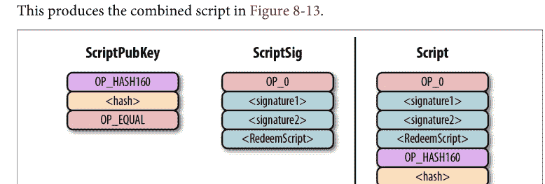
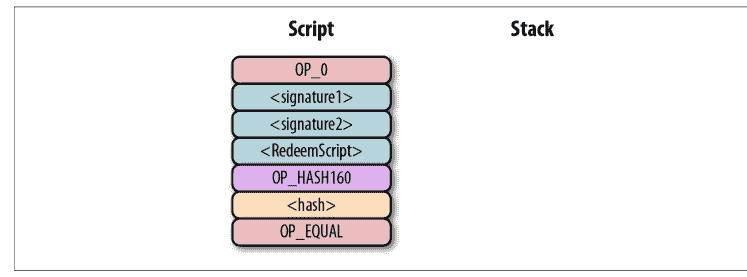
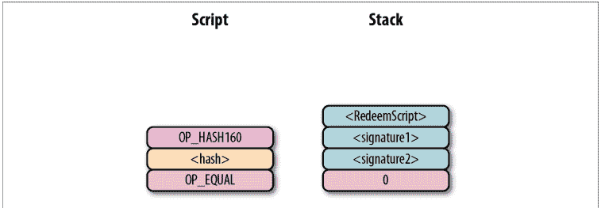
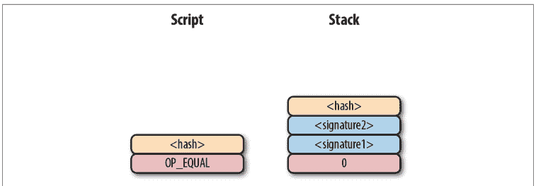
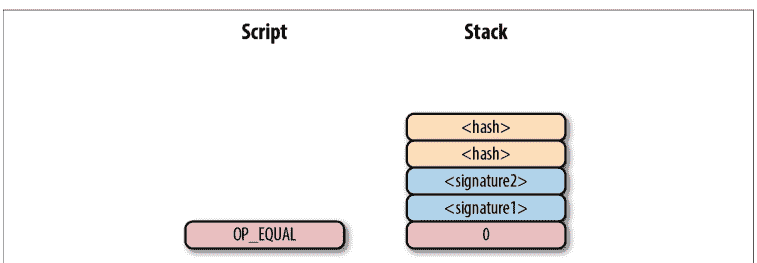

## Pay-to-Script Hash

到目前为止，在本书中，我们一直在使用单密钥交易，或每个输入只有一个私钥的交易。如果我们想要更复杂一点怎么办？一家拥有 1 亿美元比特币的公司可能不希望资金锁定在单个私钥上：如果该单个密钥丢失或被盗，所有资金都将丢失。我们能做些什么来降低这种单点故障的风险？

解决方案是 *multisig*，或多重签名。这从一开始就内置于比特币中，但起初很笨拙，因此没有被使用。正如我们稍后在本章中会发现的，中本聪可能没有测试 multisig，因为它有一个差一错误（参见 OP_CHECKMULTISIG Off-by-One Bug）。该错误必须保留在协议中，因为修复它需要一次硬分叉。


### 多个私钥到单个聚合公钥

可以“拆分”单个私钥为多个私钥，并使用交互式方法在不重建私钥的情况下聚合签名，但这不是常见做法。Schnorr 签名将使聚合签名变得更容易，也许未来会更常见。

### 裸 Multisig

裸 multisig 是创建需要多个方签名交易输出的首次尝试。想法是从单点故障转变为对黑客攻击更具韧性的东西。要理解裸 multisig，首先必须理解 OP_CHECKMULTISIG 操作码。正如第 6 章中所讨论的，Script 有很多不同的操作码。OP_CHECKMULTISIG 就是其中之一，值为 0xae。操作码

Figure 8-7. Bare multisig step 3

此时，OP_CHECKMULTISIG 将消耗 m + n + 3 个元素（参见 OP_CHECKMULTISIG Off-by-One Bug），如果 m 个签名对 m 个不同的公钥中的 m 个有效，则将 1 压入栈；否则压入 0。假设签名有效，栈上只有一个 1，这将验证组合脚本（Figure 8-8）。

Figure 8-8. Bare multisig end

### OP_CHECKMULTISIG Off-by-One Bug

OP_CHECKMULTISIG 消耗的栈元素本应为 m、m 个不同签名、n 和 n 个不同公钥。消耗的元素数量应为 2（m 和 n 本身）+ m（签名）+ n（公钥）。不幸的是，操作码消耗的元素比它应消耗的 m + n + 2 个元素多一个。OP_CHECKMULTISIG 消耗 m + n + 3 个元素，因此添加了一个额外的元素（我们示例中的 OP_0）以免导致失败。

该操作码对该额外元素不做任何处理，且该额外元素可以是任何内容。然而，为了对抗可塑性，大多数比特币网络上的节点不会中继交易，除非额外元素是 OP_0。注意，如果我们只有 m + n + 2 个元素，OP_CHECKMULTISIG 将失败，因为没有足够的元素被消耗，组合脚本将失败，导致交易无效。

必须由 p2sh 地址的创建者存储。如果 RedeemScript 丢失且无法重建，资金将丢失，因此跟踪它非常重要！

### 保留 RedeemScript 的重要性

如果你接收到 p2sh 地址，请务必存储并备份 RedeemScript！最好让它易于重建！

2-of-2 multisig 的 ScriptSig 如 Figure 8-12 所示。

```
00483045202100dc92655fe37036f47756db8102e0d7d5e28b3beb83a8fef4f5dc0559bddfb94e02205a36d4e4e6c7fcd16658c50783e00c341609977aed3ad00937bf4ee942a8993701483045202100da6bee3c93766232079a01639d07fa869598749729ae323eab8eef53577d611b02207bef15429dcadce2121ea07f233115c6f09034c0be68db99980b9a6c5e75402201475221022626e955ea6ea6d98850c994f9107b036b1334f18ca8830bfff1295d21cfdb702103b287eaf122eea6903a0ae9feed096bed8045c8b98bec453e1ffac7fbbdd4bb7152ae
```

- 00 - OP_0
- 48 - <signature1> 的长度
- 3045...3701 - <signature1>
- 48 - <signature2> 的长度
- 3045...2201 - <signature2>
- 47 - <RedeemScript> 的长度
- 5221...ae - <RedeemScript>

Figure 8-12. Pay-to-script-hash (p2sh) ScriptSig

这会产生 Figure 8-13 中的组合脚本。



Figure 8-13. p2sh combined script

与之前一样，OP_0 是因为 OP_CHECKMULTISIG 的 bug。理解 p2sh 的关键是 Figure 8-14 中所示的精确执行序列。


Figure 8-14. p2sh pattern that executes the special rule

执行此序列后，如果栈中剩下 1，则 RedeemScript 会被插入到 Script 命令集中。换句话说，如果我们公开一个其 hash160 与 ScriptPubKey 中的 hash160 相同的 RedeemScript，该 RedeemScript 就像 ScriptPubKey 一样起作用。我们对锁定资金的脚本进行哈希处理并将其放入区块链中，而不是脚本本身。这就是我们称之为 ScriptPubKey pay-to-script-hash 的原因。

让我们逐步了解其工作原理。我们从 Script 命令开始（Figure 8-15）。



Figure 8-15. p2sh start

OP_0 会将 0 压入栈中，两个签名和 RedeemScript 会直接压入栈中，导致 Figure 8-16 的情况。



Figure 8-16. p2sh step 1

OP_HASH160 会对 RedeemScript 进行哈希处理，这将使栈看起来像 Figure 8-17。



Figure 8-17. p2sh step 2

20 字节的哈希会被压入栈中（Figure 8-18）。



Figure 8-18. p2sh step 3

Figure 8-21. p2sh step 4

OP_2 将 2 压入栈中，公钥也被压入，并且最后的 OP_2 再将另一个 2 压入栈中（Figure 8-22）。

Figure 8-22. p2sh step 5

OP_CHECKMULTISIG 消耗 m + n + 3 个元素，即整个栈，我们以与裸 multisig 相同的方式结束（Figure 8-23）。

Figure 8-23. p2sh end for post-BIP0016 software

RedeemScript 替换有点 hacky，比特币软件中存在特殊情况的代码来处理这种情况。为什么没有选择更少 hacky、更直观的东西？BIP0012 当时是一个竞争提案，使用 OP_EVAL 被认为更优雅。像 Figure 8-24 这样的 ScriptPubKey 将与 BIP0012 一起工作。

```
redeem_script = encode_varint(len(cmd)) + cmd
stream = BytesIO(redeem_script)
cmds.extend(Script.parse(stream).cmds)
```

- 1. 0xa9 是 OP_HASH160，0x87 是 OP_EQUAL。我们正在检查接下来的三个命令是否符合 BIP0016 特殊模式。
- 2. 我们知道这是 OP_HASH160，所以我们直接将其弹出。同样，我们知道下一个命令是 20 字节的哈希值，第三个命令是 OP_EQUAL，这就是我们在其上方的 if 语句中测试的内容。
- 3. 我们像往常一样运行 OP_HASH160、20 字节哈希压栈和 OP_EQUAL。
- 4. 应该剩下 1，这就是 op_verify 检查的内容（OP_VERIFY 消耗一个元素并且不放回任何东西）。
- 5. 因为我们想要解析 RedeemScript，所以我们需要加上长度前缀。
- 6. 我们用从 RedeemScript 解析的命令扩展命令集。

## More Complicated Scripts

p2sh 的好处在于 RedeemScript 可以长达来自 OP_PUSHDATA2 的最大单个元素，即 520 字节。Multisig 只是一种可能性。你可以拥有定义更复杂逻辑的脚本，例如“这些密钥中的 2 个或这些其他密钥中的 5 个中的 7 个”。p2sh 的主要特点是它灵活，同时通过将存储部分脚本的负担推回给用户来减少 UTXO 集大小。

在第 13 章中，p2sh 也被用来使 Segwit 向后兼容。

## Addresses

计算 p2sh 地址的过程与计算 p2pkh 地址类似。hash160 前缀为前缀字节并附加校验和。

主网 p2sh 使用 0x05 字节，这会导致地址在 Base58 中以 3 开头，而测试网 p2sh 使用 0xc4 字节以使地址以 2 开头。我们可以使用 helper.py 中的 encode_base58_checksum 函数计算地址：

```
>>> from helper import encode_base58_checksum
>>> h160 = bytes.fromhex('74d691da1574e6b3c192ecfb52cc8984ee7b6c56')
>>> print(encode_base58_checksum(b'\x05' + h160))
3CLoMMyuoDQ TPRD3XYZtCvgvkadrAdvdXh
```

Figure 8-26. Empty each input's ScriptSig

## Step 2: Replace the ScriptSig of the p2sh input being signed with the RedeemScript

每个 p2sh 输入都有一个 RedeemScript。我们取 RedeemScript 并将其放在空的 ScriptSig 位置（Figure 8-27）。这与 p2pkh 不同，因为它不是 ScriptPubKey。

```
010000001868278ed6ddfb6c1ed3ad5f8181eb0c7a385aa0836f01d5e4789e6bd304d87221a00000 0475221022626e955e6a6d98850c994f9107b036b1334f18ca8830bfff1295d21cfdb702103b287 eaf122ee6a9030a8e9feed096bed8045c8b98bec453e1ffac7fbbdb4bb7152aeffffffff04d3b1140 000000001976a914904a49878c0adfc3aa05de7afad2cc15f483a56a88ac7f400900000000001976 a914418327e3f3dda4cf5b9089325a4b95abdfa0334088ac722c0c00000000001976a914ba35042cf e9fc66fd35ac2224eebdadf1028ad2788acdc4ace020000000017a91474d691da1574e6b3c192ecfb 52cc8984ee7b6c568700000000
```

Figure 8-27. Replace the ScriptSig of the input we're checking with the RedeemScript

## Step 3: Append the hash type

最后，我们在末尾添加一个 4 字节的哈希类型。这与 p2pkh 相同。对应 SIGHASH_ALL 的整数为 1，并且必须以小端格式编码为 4 字节，这使得交易看起来像 Figure 8-28。

```
010000001868278ed6ddfb6c1ed3ad5f8181eb0c7a385aa0836f01d5e4789e6bd304d87221a00000 0475221022626e955e6a6d98850c994f9107b036b1334f18ca8830bfff1295d21cfdb702103b287 eaf122ee6a9030a8e9feed096bed8045c8b98bec453e1ffac7fbbdb4bb7152aeffffffff04d3b1140 000000001976a914904a49878c0adfc3aa05de7afad2cc15f483a56a88ac7f400900000000001976 a914418327e3f3dda4cf5b9089325a4b95abdfa0334088ac722c0c00000000001976a914ba35042cf e9fc66fd35ac2224eebdadf1028ad2788acdc4ace020000000017a91474d691da1574e6b3c192ecfb 52cc8984ee7b6c56870000000001000000
```

Figure 8-28. Append the hash type (SIGHASH_ALL), 01000000

将其解释为大端整数的 hash256 是我们的 z。获取签名哈希的代码如下：

```
>>> from helper import hash256
>>> modified_tx = bytes.fromhex('010000001868278ed6ddfb6c1ed3ad5f8181eb0c7a38\
5aa0836f01d5e4789e6bd304d87221a000000475221022626e955e6a6d98850c994f9107b036\
b1334f18ca8830bfff1295d21cfdb702103b287eaf122ee6a9030a8e9feed096bed8045c8b98be\
c453e1ffac7fbbdb4bb7152aeffffffff04d3b114000000000001976a914904a49878c0adfc3aa0\
5de7afad2cc15f483a56a88ac7f400900000000001976a91441327e3f3dda4cf5b9089325a4b9\
5abdfa0334088ac722c0c00000000001976a914ba35042cfe9fc66fd35ac2224eebdadf1028ad2')
```

我们已经验证了解锁此 p2sh multisig 所需的两个签名之一。

## Exercise 4

验证前一笔交易中的第二个签名。

## Exercise 5

修改 sig_hash 和 verify_input 方法以能够验证 p2sh 交易。

## Conclusion

在本章中，我们学习了如何创建 p2sh ScriptPubKeys 以及如何兑换它们。我们已经涵盖了过去四章的交易；现在我们转向它们如何在区块中分组。
