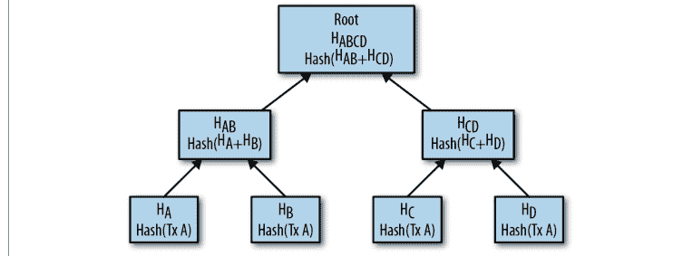
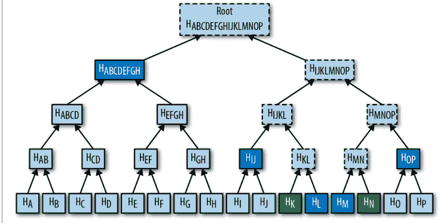
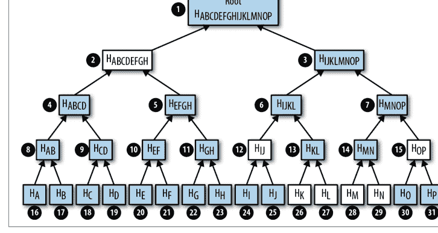
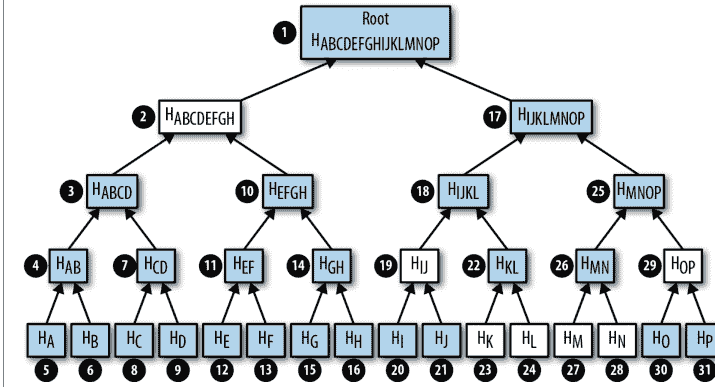
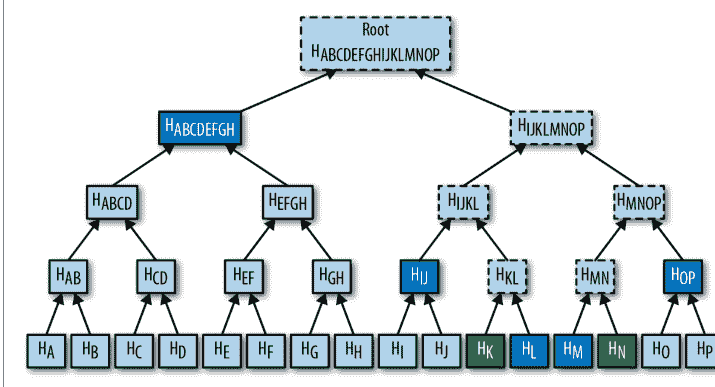
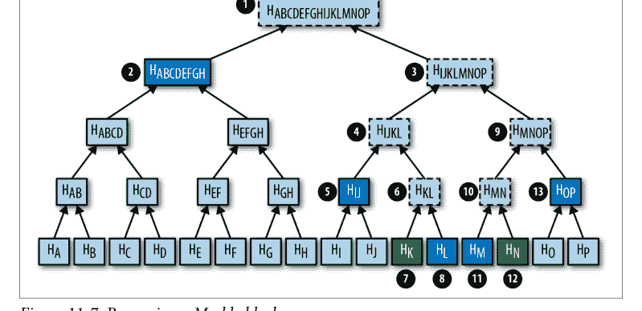

# 简化支付验证

第 9 章中我们没有深入探讨的一个区块头字段是默克尔根。要理解默克尔根有什么用，我们必须先了解默克尔树及其性质。在本章中，我们将确切地学习什么是默克尔根。这将由一种称为*包含证明*的东西引出。

## 动机

对于磁盘空间、带宽或计算能力有限的设备来说，存储、接收和验证整个区块链的成本很高。在撰写本文时，整个比特币区块链约为 200 GB，超过了许多手机的存储容量；高效下载非常困难，而且肯定会让 CPU 不堪重负。如果无法将整个区块链放到手机上，我们还能做什么？有没有可能在没有所有这些数据的情况下，在手机上创建比特币钱包？

对于任何钱包，我们关心两种场景：

+   1. 向某人付款
+   2. 从某人处收款

如果你使用比特币钱包向某人付款，那么接收你比特币的人需要验证他们确实已收到付款。一旦对方验证交易已被包含在足够深的区块中，交易的另一方（商品或服务）才会交付给你。一旦你把交易发送给对方，除了等待收到你比特币所交换的东西之外，你实际上没有什么可做的。



图 11-1. 默克尔树

## 小心默克尔树！

在比特币 0.4–0.6 版本中，存在一个与默克尔根相关的漏洞，详见 CVE-2012-2459。该漏洞是一个拒绝服务攻击向量，源于默克尔树中最后一项的重复，导致某些节点即使面对有效区块也会将其判定为无效。

## 默克尔父节点

给定两个哈希，我们生成另一个哈希来表示它们两者。由于它们是有序的，我们将这两个哈希称为左哈希和右哈希。左右哈希的哈希结果称为父哈希。为了明确，下面是父哈希的公式：

+   - H = 哈希函数
+   - P = 父哈希
+   - L = 左哈希
+   - R = 右哈希

P=H(L||R)

注意，|| 符号表示拼接。

```
>>> from helper import hash256
>>> hash0 = bytes.fromhex('c117ea8ec828342f4dfb0ad6bd140e03a50720ece40169ee38\ndc15d9eb64cf5')
>>> hash1 = bytes.fromhex('c131474164b412e3406696da1ee20ab0fc9bf41c8f05fa8ceea\
```
```
7a08d672d7cc5')
>>> parent = hash256(hash0 + hash1)
>>> print(parent.hex())
8b30c5ba100f6f2e5ad1e2a742e5020491240f8eb514fe97c713c31718ad7ecd
```

我们对拼接结果进行哈希以得到父节点的原因是，这样我们可以提供包含证明。具体来说，我们可以通过揭示 R 来证明 L 包含在父节点 P 中。也就是说，如果我们想要证明 L 包含在 P 中，P 的生成者可以向我们展示 R，并让我们知道 L 是 P 的左子节点。然后我们可以组合 L 和 R 生成 P，从而证明 L 被用来生成 P。如果 L 不在 P 中，那么提供 R 就相当于提供哈希原像，而我们知道这是非常困难的。这就是我们所说的包含证明。

## 练习 1

编写 merkle_parent 函数。

## 默克尔父层

给定一个包含两个以上哈希的有序列表，我们可以计算每一对的父节点，也就是我们所说的默克尔父层。如果哈希数量是偶数，这很直接，只需按顺序配对即可。如果哈希数量是奇数，那么我们就需要做些处理，因为最后会有一个单独的哈希。我们可以通过复制最后一项来解决这个问题。

也就是说，对于像 [A, B, C] 这样的列表，我们可以再添加一个 C，得到 [A, B, C, C]。现在我们可以计算 A 和 B 的默克尔父节点，以及 C 和 C 的默克尔父节点，得到：

[H(A||B), H(C||C)]

由于默克尔父节点总是由两个哈希组成，因此默克尔父层的哈希数量恰好是原来的一半（向上取整）。下面是我们计算默克尔父层的方法：

```
>>> from helper import merkle_parent
>>> hex_hashes = [
...     'c117ea8ec828342f4dfb0ad6bd140e03a50720ece40169ee38bdc15d9eb64cf5',
...     'c131474164b412e3406696da1ee20ab0fc9bf41c8f05fa8ceea7a08d672d7cc5',
...     'f391da6ecfeed1814efa e39e7f c b3838ae0b02c02ae7d0a5848a66947c0727b0',
...     '3d238a92a94532b946c90e19c49351c763696cff3db400485b813aecb8a13181',
...     '10092f2633be5f3ce349bf9ddbde36caa3dd10dfa0ec8106bce23acbff637dae',
... ]
>>> hashes = [bytes.fromhex(x) for x in hex_hashes]
>>> if len(hashes) % 2 == 1:
...     hashes.append(hashes[-1]) ①
>>> parent_level = []
>>> for i in range(0, len(hashes), 2): ②
```


```python
...     parent = merkle_parent(hashes[i], hashes[i+1])
...     parent_level.append(parent)
>>> for item in parent_level:
...     print(item.hex())
8b30c5ba100f6f2e5ad1e2a742e5020491240f8eb514fe97c713c31718ad7ecd
7f4e6f9e224e20fda0ae4c44114237f97cd35aca38d83081c9bfd41feb907800
3ecf6115380c77e8aae56660f5634982ee897351ba906a6837d15ebc3a225df0
```

① 我们将列表中的最后一个哈希 `hashes[-1]` 追加到 `hashes` 的末尾，使 `hashes` 的长度变为偶数。

② 这就是我们在 Python 中每次跳过两个元素的方式。第一次循环时 `i` 为 0，第二次为 2，第三次为 4，以此类推。

这段代码会生成一个新的哈希列表，对应于 Merkle 父层级（Merkle parent level）。

## 练习 2

编写 `merkle_parent_level` 函数。

## Merkle 根

为了得到 Merkle 根，我们不断计算 Merkle 父层级，直到只剩下一个哈希。例如，如果我们有 A 到 G 共 7 个条目，我们先按如下方式计算 Merkle 父层级：

[H(A||B), H(C||D), H(E||F), H(G||G)]

然后我们再次计算 Merkle 父层级：

[H(H(A||B)||H(C||D)), H(H(E||F)||H(G||G))]

此时只剩下两个条目，所以我们再计算一次 Merkle 父层级：

H(H(H(A||B)||H(C||D))||H(H(E||F)||H(G||G)))

由于我们恰好剩下一个哈希，计算完成。每一层都会将哈希数量减半，因此反复执行此过程最终会得到一个单独的条目，称为 Merkle 根：

```python
>>> from helper import merkle_parent_level
>>> hex_hashes = [
...     'c117ea8ec828342f4dfb0ad6bd140e03a50720ece40169ee38bdc15d9eb64cf5',
...     'c131474164b412e3406696da1ee20ab0fc9bf41c8f05fa8ceea7a08d672d7cc5',
...     'f391da6ecfeed1814efae39e7fcb3838ae0b02c02ae7d0a5848a66947c0727b0',
...     '3d238a92a94532b946c90e19c49351c763696cff3db400485b813aecb8a13181',
...     '10092f2633be5f3ce349bf9ddbde36caa3dd10dfa0ec8106bce23acbff637dae',
...     '7d37b3d54fa6a64869084bfd2e831309118b9e833610e6228adacdbd1b4ba161',
...     '8118a77e542892fe15ae3fc771a4abfd2f5d5d5997544c3487ac36b5c85170fc',
...     'dff6879848c2c9b62fe65270bd8df527093acfaa5a43cdb369fe2466a3877',
...     'b825c0745f46ac58f7d3759e6c535a1fec780377f24d4c2cad55c0cb59',
...     '95513952a04bd8992721e9b7e2937f1c04ba31e0469fbe615a78197f68f52b7c',
...     '2e6d722e5e4dbdf2447decc9f7dabb8e299bae921c99ad5b0184cd9eb8e5908',
...     'b13a750047bc0bdceb2473e5fe488c2596d7a712b4e716fdd29b046ef99bbf0',
... ]
>>> hashes = [bytes.fromhex(x) for x in hex_hashes]
>>> current_hashes = hashes
>>> while len(current_hashes) > 1:
...     current_hashes = merkle_parent_level(current_hashes)
>>> print(current_hashes[0].hex())
acbcab8bcc1af95d8d563b77d24c3d19b18f1486383d75a5085c4e86c86beed6
```

1. 我们循环直到只剩下一个哈希。
2. 我们已退出循环，所以应该只剩一个条目。

## 练习 3

编写 `merkle_root` 函数。

## 区块中的 Merkle 根

计算区块中的 Merkle 根应该相当直接，但由于字节序（endianness）问题，实际处理起来有些棘手。具体来说，我们对 Merkle 树的叶子使用小端序（little-endian）排列。在计算得到 Merkle 根后，我们再次使用小端序。

在实践中的含义是：在开始前先反转叶子，在结束时再反转根：

```python
>>> from helper import merkle_root
>>> tx_hex_hashes = [
...     '42f6f52f17620653dcc909e58bb352e0bd4bd1381e2955d19c00959a22122b2e',
...     '94c3af34b9667bf787e1c6a0a009201589755d01d02fe2877cc69b929d2418d4',
...     '959428d7c48113cb9149d0566bde3d46e98cf02805c3522b8fa7f835241a953',
...     'a9f27b99d5d108dede757510d4a1ffa2c74af70b4ca71726fa57d68454e609a2',
...     '62af110031e29de1efcad103b3ad4bec7bdcfc6bc9c9f4afd586981795516577',
...     '766900590ece194667e9da2984018057512887110bf54fe0aa800157aec796ba',
...     'e8270fb475763bc8d855cfe45ed98060988c1bdcad2ffc8364f783c98999a208',
... ]
>>> tx_hashes = [bytes.fromhex(x) for x in tx_hex_hashes]
>>> hashes = [h[::-1] for h in tx_hashes]
>>> print(merkle_root(hashes)[::-1].hex())
654d6181e18e4ac4368383fdc5eead11bf138f9b7ac1e15334e4411b3c4797d9
```

1. 我们在开始之前使用 Python 列表推导式反转每个哈希。
2. 我们在结束时反转根。

我们想为一个区块计算 Merkle 根，因此添加一个 `tx_hashes` 参数：

```python
class Block:
    def __init__(self, version, prev_block, merkle_root,
                timestamp, bits, nonce, tx_hashes=None):
        self.version = version
        self.prev_block = prev_block
        self.merkle_root = merkle_root
        self.timestamp = timestamp
        self.bits = bits
        self.nonce = nonce
        self.tx_hashes = tx_hashes
```

1. 我们现在允许在区块初始化时设置交易哈希。交易哈希必须是有序的。

作为一个全节点，如果我们获得了所有的交易，我们就可以计算 Merkle 根，并检查 Merkle 根是否符合预期。

## 练习 4

为 `Block` 编写 `validate_merkle_root` 方法。

## 使用 Merkle 树

现在我们知道 Merkle 树是如何构造的了，我们可以创建并验证包含证明（proof of inclusion）。轻节点可以在不必知道区块全部交易的情况下，验证自己感兴趣的交易是否包含在某个区块中（图 11-2）。

假设一个轻客户端有两个感兴趣的交易，即图 11-2 中绿色方框所表示的哈希 H_K 和 H_N。全节点可以通过发送所有用蓝色方框标记的哈希来构造一个包含证明：H_ABCDEFGH、H_IJ、H_L、H_M 和 H_OP。然后轻客户端会执行以下计算：

- H_KL = merkle_parent(H_K, H_L)
- H_MN = merkle_parent(H_M, H_N)
- H_IJKL = merkle_parent(H_IJ, H_KL)
- H_MNOP = merkle_parent(H_MN, H_OP)
- H_IJKLMNOP = merkle_parent(H_IJKL, H_MNOP)
- H_ABCDEFGHIJKLMNOP = merkle_parent(H_ABCDEFGH, H_IJKLMNOP)



图 11-2. Merkle 证明

你可以看到，在图 11-2 中，虚线方框对应的是轻客户端计算的哈希。特别地，Merkle 根是 H_ABCDEFGHIJKLMNOP，然后可以将它与已经验证过工作量证明（proof-of-work）的区块头进行比对。

## SPV 证明有多安全？

全节点可以发送关于区块的有限信息，轻客户端可以重新计算 Merkle 根，然后与区块头中的 Merkle 根进行验证。这并不保证交易在最长的区块链中，但它确实向轻客户端保证，全节点必须花费大量的算力或能源来创建有效的工作量证明。只要创建这样一个工作量证明的奖励大于交易中的金额，轻客户端至少可以知道全节点没有明显的经济动机去撒谎。

由于区块头可以向多个节点请求，轻客户端有一种方法来验证某个节点是否试图向他们展示并非最长的区块头。由于工作量证明是客观的，只需要一个诚实的节点就能使一百个不诚实的节点失效。因此，要这样欺骗，必须隔离轻客户端（即控制轻客户端连接的对象）。SPV 的安全性要求网络上有大量诚实的节点。

换句话说，轻客户端的安全性基于一个健壮的节点网络，以及产生工作量证明的经济成本。对于相对于区块补贴（目前为 12.5 BTC）而言较小的交易，可能没什么好担心的。对于较大的交易（比如 100 BTC），全节点可能有欺骗你的经济动机。如此大的交易通常应该使用全节点进行验证。

## Merkle 区块

当全节点发送包含证明时，需要包含两条信息。首先，轻客户端需要 Merkle 树结构；其次，轻客户端需要知道哪个哈希在 Merkle 树的哪个位置。一旦给予这两条信息，轻客户端就可以重建部分 Merkle 树，从而重建 Merkle 根并验证包含证明。全节点通过 Merkle 区块（Merkle block）将这两条信息传达给轻客户端。

要理解 Merkle 区块中的内容，我们需要稍微了解 Merkle 树，或者说更一般地，二叉树是如何遍历的。在二叉树中，节点可以按广度优先或深度优先遍历。广度优先遍历如图 11-3 所示，逐层进行。



图 11-3. 广度优先顺序

广度优先顺序从根开始，从根到叶子逐层、从左到右进行。

深度优先顺序有些不同，如图 11-4 所示。




图 11-4：深度优先顺序

深度优先顺序从根开始，在每一个节点先遍历左侧，再遍历右侧。

在包含证明中（见图 11-5），全节点发送绿色方框 H_K 和 H_N，以及蓝色方框 H_ABCDEFGH、H_IJ、H_L、H_M 和 H_OP。每个哈希的位置通过一些标志（flags）使用深度优先顺序重建。重建树的过程，即图 11-5 中虚线边缘的方框，将在接下来描述。



图 11-5：Merkle 证明

## Merkle 树结构

轻客户端做的第一件事是创建 Merkle 树的一般结构。由于 Merkle 树是从叶子向上构建的，轻客户端只需要知道现有叶子的数量即可了解结构。图 11-5 中的树有 16 个叶子。轻客户端可以像这样创建空的 Merkle 树：

```
>>> import math
>>> total = 16
>>> max_depth = math.ceil(math.log(total, 2)) ①
>>> merkle_tree = [] ②
>>> for depth in range(max_depth + 1): ③
...     num_items = math.ceil(total / 2**(max_depth - depth)) ④
...     level_hashes = [None] * num_items ⑤
...     merkle_tree.append(level_hashes) ⑥
>>> for level in merkle_tree:
...     print(level)
[None]
[None, None]
[None, None, None, None]
[None, None, None, None, None, None, None, None]
[None, None, None, None, None, None, None, None, None, None, None, None, None, None, None]
```

- ① 因为每一层我们都减半，所以叶子数量的 log₂ 就是 Merkle 树的层数。请注意，我们使用 math.ceil 向上取整，因为在每一层减半时也要向上取整。也可以更巧妙地使用 len(bin(total))-2。
- ② Merkle 树将根层放在索引 0，下面一层放在索引 1，依此类推。换句话说，索引是从顶部算起的“深度”。
- ③ 在这棵 Merkle 树中，层数从 0 到 max_depth。
- ④ 在任何一个特定层，节点的数量等于叶子总数除以 2 的结果（每往上一层就除以 2）。
- ⑤ 我们还不知道任何哈希是什么，所以将它们设置为 None。
- ⑥ 注意 merkle_tree 是一个哈希列表的列表，或者称为二维数组。

### 练习 5

创建一个包含 27 个项目的空 Merkle 树，并打印每一层。

### 编写 Merkle 树代码

现在我们可以创建一个 MerkleTree 类：

```
class MerkleTree:
    def __init__(self, total):
        self.total = total
        self.max_depth = math.ceil(math.log(self.total, 2))
        self.nodes = []
        for depth in range(self.max_depth + 1):
            num_items = math.ceil(self.total / 2**(self.max_depth - depth))
            level_hashes = [None] * num_items
            self.nodes.append(level_hashes)
        self.current_depth = 0
        self.current_index = 0

    def __repr__(self):
        result = []
        for depth, level in enumerate(self.nodes):
            items = []
            for index, h in enumerate(level):
                if h is None:
                    short = 'None'
                else:
                    short = '{0}...'.format(h.hex()[:8])
                if depth == self.current_depth and index == self.current_index:
                    items.append('**{}**'.format(short[: -2]))
                else:
                    items.append('{}'.format(short))
            result.append(', '.join(items))
        return '\n'.join(result)
```

- 我们维护一个指向树中某个特定节点的指针，稍后会用到。
- 我们打印树的一种表示形式。

现在我们已经有了一个空树，可以开始填充它来计算 Merkle 根。如果我们拥有每一个叶子的哈希，获得 Merkle 根的过程如下所示：

```
>>> from merkleblock import MerkleTree
>>> from helper import merkle_parent_level
>>> hex_hashes = [
...     "9745f7173ef14ee4155722d1cbf13304339fd00d900b759c6f9d58579b5765fb",
...     "5573c8ede34936c29cdfdfe7437f7f5fdfbd4f54ba0705259e62f39917065cb9b",
...     "82a02ecbb6623b4274dfcab82b336dc017a27136e08521091e443e625828e8f05",
...     "507ccae5ed9b340363a0e6d765af148be9c81c8766ccc922f83e4e681658308",
...     "a7a4aec28e7162e1e9ef33dfa0f0bc0526e6c4b1a11a576f6c5de5939830",
...     "bb6267664bd833fd9fc82582853ab144fece26b7a8a5bf328f8a059445b59add",
...     "ea6d7ac1ee77fbacee58fc717b990c4fcccf1b19af43103c090f601677fd8836",
...     "457743861de496c429912558a106b810b0509795a49773228aa788df40730d41",
...     "7688029288efc9e9a0011c960a6ed9e5466581afb3e3a6c26ee317461add619a",
...     "b1ae7f15836bc228cdd4e2c37bf9bb7d0a2846d06867a429654b2e7f38c39",
...     "9b74f89fa3f93e7f1f2c241f32945d877281a6a50a6bf94adac002980aafe5ab",
...     "b3a92b5b255019bdaf754875633c2de9fec2ab03e6b8ce669d07cb5b18804638",
...     "b5c0b915312b9bdaedd2b86aa2d0f8feffc73a2d37668fd9010179261e25e263",
...     "c9d52c5cb1e557b92c84c52e7c4bfbce859408bedffc8a5560fd6e35e10b8800",
...     "c555bc5fc3bc096df0a0c9532f07640bfb76bfe4fc1ace214b8b228a1297a4c2",
...     "f9dbfafc3af3400954975da24eb325e326960a25b87fffe23eef3e7ed2fb610e",
]
>>> tree = MerkleTree(len(hex_hashes))
>>> tree.nodes[4] = [bytes.fromhex(h) for h in hex_hashes]
>>> tree.nodes[3] = merkle_parent_level(tree.nodes[4])
>>> tree.nodes[2] = merkle_parent_level(tree.nodes[3])
>>> tree.nodes[1] = merkle_parent_level(tree.nodes[2])
>>> tree.nodes[0] = merkle_parent_level(tree.nodes[1])
>>> print(tree)
*597c4baf.*
6382df3f..., 87cf8fa3...
3ba6c080..., 8e894862..., 7ab01bb6..., 3df760ac...
272945ec..., 9a38d037..., 4a64abd9..., ec7c95e1..., 3b67006c..., 850683df..., \
d40d268b..., 8636b7a3...
9745f717..., 5573c8ed..., 82a02ecb..., 507ccae5..., a7a4aec2..., bb626766..., \
ea6d7ac1..., 45774386..., 76880292..., b1ae7f15..., 9b74f89f..., b3a92b5b..., \
b5c0b915..., c9d52c5c..., c555bc5f..., f9dbfafc...
```

这样填充了树，并得到了 Merkle 根。然而，来自网络的消息可能不会提供所有叶子。消息也可能包含一些内部节点。我们需要一种更巧妙的方法来填充树。

树遍历就是我们解决这个问题的方法。我们可以进行深度优先遍历，并且只填充那些我们可以计算的节点。要遍历，我们需要跟踪当前在树中的确切位置。属性 self.current_depth 和 self.current_index 就是用来做这件事的。

我们需要能够遍历 Merkle 树的方法。我们还会包含其他有用的方法：

```
class MerkleTree:
    ...
    def up(self):
        self.current_depth -= 1
        self.current_index //= 2

    def left(self):
        self.current_depth += 1
        self.current_index *= 2

    def right(self):
        self.current_depth += 1
        self.current_index = self.current_index * 2 + 1

    def root(self):
        return self.nodes[0][0]

    def set_current_node(self, value):
        self.nodes[self.current_depth][self.current_index] = value

    def get_current_node(self):
        return self.nodes[self.current_depth][self.current_index]

    def get_left_node(self):
        return self.nodes[self.current_depth + 1][self.current_index * 2]

    def get_right_node(self):
        return self.nodes[self.current_depth + 1][self.current_index * 2 + 1]

    def is_leaf(self):
        return self.current_depth == self.max_depth

    def right_exists(self):
        return len(self.nodes[self.current_depth + 1]) > \
            self.current_index * 2 + 1
```

- 我们需要能够将树中的当前节点设置为某个值。
- 我们需要知道自己是否处于叶子节点。
- 在某些情况下，我们不会有右子节点，因为可能处于某一层的最右侧节点，而该层的下一层节点数量为奇数。

我们已经有 Merkle 树的遍历方法 left、right 和 up。现在用这些方法通过深度优先遍历来填充树：

```
>>> from merkleblock import MerkleTree
>>> from helper import merkle_parent
>>> hex_hashes = [
...     "9745f7173ef14ee41557222d1cbf13304339fd00d900b759c6f9d58579b5765fb",
...     "5573c8ede34936c29cdfdfe7437f7f5fdfbd4f54ba0705259e62f39917065cb9b",
...     "82a02ecbb6623b4274dfcab82b336dc017a27136e08521091e443e625828ef05",
...     "507ccae5ed9b340363a0e6d765af148be9c81c8766ccc922f83e4e681658308",
...     "a7a4aec28e7162e1e9ef33dfa0f0c0526e6cf4b11a576f6c5de5859389830",
...     "bb6267664bd833fd9fc82582853ab144fece26b7a8a5bf328f8a059445b59add",
...     "ea6d7ac1ee77fbacee58fc717b990c4fcccf1b19af43103c090f601677fd8836",
...     "457743861de496c429912558a106b810b0507975a49773228aa788df40730d41",
...     "7688029288efc9e9a0011c960a6ed9e5466581abf3e3a6c26ee317461add619a",
...     "b1ae7f15836bc228cdd4e2c37bf9bb7d0a2846d0867a429f654b2e7f383c9",
...     "9b74f89fa3f93e7f1ff2c241f32945d877281a6a50a6bf94adac002980aafe5ab",
...     "b3a92b5b255019bdaff754875633c2de9fec2ab03e6b8ce669d07cb5b18804638",
...     "b5c0b915312b9bdaedd2b86aa2d0f8effc73a2d37668fd9011972612e5e263",
...     "c9d52c5cb1e557b92c84c52e7c4bfbce859408bedffc8a5560fd6e35e10b8800",
...     "c555bc5fc3bc096df0a0c9532f07640bfb76bfe4fc1ace214b8b228a1297a4c2",
...     "f9dbfafc3af3400954975da24eb325e326960a25b7fffe23eef3e7ed2fb610e",
]
>>> tree = MerkleTree(len(hex_hashes))
>>> tree.nodes[4] = [bytes.fromhex(h) for h in hex_hashes]
>>> while tree.root() is None:
...     if tree.is_leaf():
...         tree.up()
...     else:
```


    left_hash = tree.get_left_node()
    right_hash = tree.get_right_node()
    if left_hash is None:  3
        tree.left()
    elif right_hash is None:  4
        tree.right()
    else:  5
        tree.set_current_node(merkle_parent(left_hash, right_hash))
        tree.up()
>>> print(tree)

597c4baf...
6382df3f..., 87cf8fa3...
3ba6c080..., 8e894862..., 7ab01bb6..., 3df760ac...
272945ec..., 9a38d037..., 4a64abd9..., ec7c95e1..., 3b67006c..., 850683df..., \
d40d268b..., 8636b7a3...
9745f717..., 5573c8ed..., 82a02ecb..., 507cca e5..., a7a4aec2..., bb626766..., \
ea6d7ac1..., 45774386..., 76880292..., b1ae7f15..., 9b74f89f..., b3a92b5b..., \
b5c0b915..., c9d52c5c..., c555bc5f..., f9dbfafc...

- 1. 我们遍历直到计算出 Merkle 根。每次循环，我们都处于某个特定节点。
- 2. 如果我们处于叶子节点，我们已经有该哈希，因此无需做任何事，只需向上返回。
- 3. 如果我们没有左哈希，则在计算当前节点的哈希之前先计算其值。
- 4. 如果我们没有右哈希，则在计算当前节点的哈希之前先计算其值。请注意，由于深度优先遍历，我们已经有了左值。
- 5. 我们同时拥有左哈希和右哈希，因此计算 Merkle 父值并将其设为当前节点。设置后，我们可以向上返回。

此代码仅在叶子数量为 2 的幂时才有效，因为未处理某一层节点数为奇数的边界情况。

我们处理父节点为某一层最右节点父节点且该层节点数为奇数的情况：

```
>>> from merkleblock import MerkleTree
>>> from helper import merkle_parent
>>> hex_hashes = [
    "9745f7173ef14ee4155722d1cbf13304339fd00d900b759c6f9d58579b5765fb",
    "5573c8ede34936c29cdfdfe743f7f5fdfbd4f54ba0705259e62f39917065cb9b",
    "82a02ecbb6623b4274dfcab82b336dc017a27136e08521091e443e62582e8f05",
    "507cca e5ed9b340363a06d65f65af148be9c b1c8766ccc922f83e4ae681658308",
    "a7a4aec28e7162e1e9ef33dfa0f0b c0526e6cf4b11a576f6c5de58593898330",
    "bb6267664bd833fd9fc82582853ab144fece26b7a8a5bf328f8a059445b59add",
...
"ea6d7ac1ee77fbacee58fc717b990c4fccc f1b19af43103c090f601677fd8836",
...
"457743861de496c429912558a106b810b0507975a49773228aa788df40730d41",
...
"7688029288efc9e9a0011c960a6ed9e5466581abf3e3a6c26ee317461add619a",
...
"b1ae7f15836cb2286cdd42e3c7bf9bb7d0a0284d6d0867a429f654b2e7f383c9",
...
"9b74f89fa3f93e7iff2c241f32945d877281a6a50a6bf94adac002980aafe5ab",
...
"b3a92b5b255019bdaff754875633c2de9fec2ab03e6b8ce669d07cb5b18804638",
...
"b5c0b915312b9bdaedd2b86aa2d0f8effc73a2d37668fd90119726e12e5e263",
...
"c9d52c5cb1e557b92c84c5e7c4bfbce859408bedffc8a5560fde6e31e0b8800",
...
"c555bc5fc3bc096df0a0c953f2f07640bfb76bfe4fc1ace214b8b228a1297a4c2",
...
"f9dbfafc3af3400954975da24eb325e326960a2b5b7fffe2e3eef3e7ed2fb610e",
...
"38faf8c811988dff0a7e6080b1771c97bcc0801c64d9068cff b85e6e7aacaf51",
... ]
>>> tree = MerkleTree(len(hex_hashes))
>>> tree.nodes[5] = [bytes.fromhex(h) for h in hex_hashes]
>>> while tree.root() is None:
...     if tree.is_leaf():
...         tree.up()
...     else:
...         left_hash = tree.get_left_node()
...         if left_hash is None: ①
...             tree.left()
...         elif tree.right_exists(): ②
...             right_hash = tree.get_right_node()
...             if right_hash is None: ③
...                 tree.right()
...             else: ④
...                 tree.set_current_node(merkle_parent(left_hash, right_hash))
...                 tree.up()
...         else: ⑤
...             tree.set_current_node(merkle_parent(left_hash, left_hash))
...             tree.up()
>>> print(tree)
0a313864...
597c4baf..., 6f8a8190...
6382df3f..., 87cf8fa3..., 5647f416...
3ba6c080..., 8e894862..., 7ab01bb6..., 3df760ac..., 28e93b98...
272945ec..., 9a38d037..., 4a64abd9..., ec7c95e1..., 3b67006c..., 850683df..., \
d40d268b..., 8636b7a3..., ce26d40b...
9745f17..., 5573c8ed..., 82a02ecb..., 507cca e5..., a7a4aec2..., bb626766..., \
ea6d7ac1..., 45774386..., 76880292..., b1ae7f15..., 9b74f89f..., b3a92b5b..., \
b5c0b915..., c9d52c5c..., c555bc5f..., f9dbfafc..., 38faf8c8...

① 如果我们没有左节点的值，我们遍历到左节点，因为所有内部节点都保证有左子节点。
② 我们首先检查此节点是否有右子节点。这为真，除非此节点恰好是该层最右节点且子层节点数为奇数。
③ 如果我们没有右节点的值，我们遍历到该节点。

- 4 如果我们同时拥有左节点和右节点的值，我们使用 merkle_parent 计算当前节点的值。
- 5 我们拥有左节点的值，但右子节点不存在。这是该层最右节点，因此我们将左值组合两次。

我们现在可以遍历叶子数量不是 2 的幂的树。

# The merkleblock Command

全节点在通信 Merkle 块时发送验证感兴趣的交易是否在 Merkle 树中的所有必要信息。merkleblock 网络命令用于通信此信息；它看起来像图 11-6。

```
0000020df3b053dc46f162a9b00c7f0d5124e2676d47bbe7c5d0793a500000000000000ef445fef2ed495c275892206ca533e741190791013ab83e3b47bdd0692d14d4dc7c835b67d8001ac157e670bf0d00000aba412a0d1480e370173072c9562becffe87a661c1e4a6dbc305d38ec5dc088a7cf92e6458aca7b32edae818f9c2c98c37e06bf72ae0c9e80649a38655ee1e27d3d9421d940b16732f24b94023e9d572a7f9ab8033434a4feb532d2adf8c2c2158785d1bd04eb9fd2e86c54bc13e139862897127400efd5d72c280222c4caee7261831e1550db8fa828853be9fe506fc5fda7f3b919d8fe74b6282f92763cef8e625f977af7c8619c32a369b832bc2d051ecd9c73c51e76370ceaad4bF25097c256597fa898d404ed53425de608ac6bfe426f6e2bb457f1c554866eb69dcb8db6f6f880e9a59b3cd053e6c7060eea caacf4dac6697dac20e4bd3f38a2ea2543d1ab7953e3430790a9f81e1c67f5b58c825acf46bd02848384eebe9af917274cdfbb1a28a5d58a23a17977def0de10d644258d9c54f886d47d293a411cb6226103b55635
- 0000020 - version, 4 bytes, LE
- df3b...00 - previous block, 32 bytes, LE
- ef44...d4 - Merkle root, 32 bytes, LE
- dc7c835b - timestamp, 4 bytes, LE
- 67d8001a - bits, 4 bytes
- c157e670 - nonce, 4 bytes
- bf0d0000 - number of total transactions, 4 bytes, LE
- 0a - number of hashes, varint
- ba41...61 - hashes, 32 bytes * number of hashes
- 03b55635 - flag bits
```

Figure 11-6. Parsed merkleblock

前六个字段与第 9 章的区块头完全相同。最后四个字段是包含证明。

交易数量字段指示此特定 Merkle 树将拥有的叶子数量。这允许轻客户端构建空的 Merkle 树。hashes 字段保存图 11-5 中的蓝色和绿色方块。由于 hashes 字段中的哈希数量不是固定的，因此前面加上了数量。最后，flags 字段提供有关哈希在 Merkle 树中位置的信息。标志使用 bytes_to_bits_field 解析，将其转换为位列表（1 和 0）：

```
def bytes_to_bit_field(some_bytes):
    flag_bits = []
    for byte in some_bytes:
        for _ in range(8):
            flag_bits.append(byte & 1)
            byte >>= 1
    return flag_bits
```

字节的顺序有点奇怪，但它是为了便于转换为重建 Merkle 根所需的标志位。

# Exercise 6

编写 MerkleBlock 的 parse 方法。

# Using Flag Bits and Hashes

标志位使用深度优先顺序告知哈希的位置。

标志位的规则为：

- 1. 如果节点的值在 hashes 字段中给出（图 11-7 中的蓝色方块），则标志位为 0。
- 2. 如果节点是内部节点且值由轻客户端计算（图 11-7 中的虚线轮廓），则标志位为 1。
- 3. 如果节点是叶子节点且是感兴趣的交易（图 11-7 中的绿色方块），则标志为 1 且节点的值也在 hashes 字段中给出。这些是证明其包含在 Merkle 树中的项目。




图 11-7. 处理 Merkle 区块

给定图 11-7 中的树：

- 根节点（1）的标志位为 1，因为该哈希由轻客户端计算。
- 左子节点 H_ABCDEFGH（2）包含在 hashes 字段中，因此标志为 0。
- 从这里开始，我们遍历到 H_IJKLMNOP（3）而不是 H_ABCD 或 H_EFGH，因为 H_ABCDEFGH 代表这两个节点，我们不需要它们。
- 右子节点 H_IJKLMNOP 也被计算，因此其标志位为 1。
- 要计算 H_IJKLMNOP，我们需要 H_IJKL 和 H_MNOP（9）的值。深度优先顺序中的下一个节点是左子节点 H_IJKL（4），我们下一步遍历到该节点。
- H_IJKL 是一个被计算的内部节点，因此标志位为 1。
- 从这里，我们遍历到其左子节点 H_IJ（5）。当我们返回到该节点时，将遍历到 H_KL（6）。
- H_IJ 是深度优先顺序中的下一个节点；其哈希包含在 hashes 列表中，标志为 0。
- H_KL 是一个内部计算节点，因此标志为 1。
- H_K（7）是一个叶子节点，其存在正在被证明，因此标志为 1。
- H_L（8）是一个其值包含在 hashes 字段中的节点，因此标志为 0。
- 我们遍历回 H_KL，其值现在可以计算，因为 H_K 和 H_L 已知。

我们现在可以根据适当的标志位和哈希填充 Merkle 树并计算根：

```
class MerkleTree:
    ...
    def populate_tree(self, flag_bits, hashes):
        while self.root() is None:
            if self.is_leaf():
                flag_bits.pop(0)
                self.set_current_node(hashes.pop(0))
                self.up()
            else:
                left_hash = self.get_left_node()
                if left_hash is None:
                    if flag_bits.pop(0) == 0:
                        self.set_current_node(hashes.pop(0))
                        self.up()
                    else:
                        self.left()
                elif self.right_exists():
                    right_hash = self.get_right_node()
                    if right_hash is None:
                        self.right()
                    else:
                        self.set_current_node(merkle_parent(left_hash, right_hash))
                        self.up()
                else:
                    self.set_current_node(merkle_parent(left_hash, left_hash))
                    self.up()
        if len(hashes) != 0:
            raise RuntimeError('hashes not all consumed {}'.format(len(hashes)))
        for flag_bit in flag_bits:
            if flag_bit != 0:
                raise RuntimeError('flag bits not all consumed')
```

1 填充此 Merkle 树的目的是计算根。每次循环迭代处理一个节点，直到计算出根。

2 对于叶子节点，我们总是给出哈希。

3 flag_bits.pop(0) 是在 Python 中出队下一个标志位的一种方式。我们可能想通过查看标志位来跟踪我们感兴趣的哈希，但现在我们不这样做。

4 hashes.pop(0) 是我们从 hashes 字段获取下一个哈希的方式。我们需要将当前节点设置为该哈希。

5 如果我们没有左子节点值，有两种可能性。此节点的值可能在 hashes 字段中，或者可能需要计算。

6 下一个标志位告诉我们是否需要计算此节点。如果标志位为 0，则 hashes 字段中的下一个哈希是此节点的值。如果标志位为 1，我们需要计算左（以及可能右）节点的值。

7 我们保证存在左子节点，因此我们遍历到该节点并获取其值。

8 我们检查右节点是否存在。

9 我们有左哈希，但没有右哈希。我们遍历到右节点以获取其值。

10 我们有左右节点的值，因此我们计算它们的 Merkle 父节点以获取当前节点的值。

11 我们有左节点的值，但右节点不存在。在这种情况下，根据 Merkle 树规则，我们将左节点两次计算 Merkle 父节点。

12 所有哈希必须被消费，否则数据有误。

13 所有标志位必须被消费，否则数据有误。

## 练习 7

为 MerkleBlock 编写 is_valid 方法。

## 结论

简化支付验证很有用，但并非没有一些重大的缺点。完整的细节超出了本书的范围，但尽管编程相当直接，大多数轻钱包并不使用 SPV，而是信任来自钱包厂商服务器的数据。SPV 的主要缺点是，你连接的节点知道你感兴趣的交易。也就是说，使用 SPV 会失去一些隐私。这将在第 12 章中更详细地介绍，我们将制作 Bloom 过滤器来告诉节点我们感兴趣的交易。
