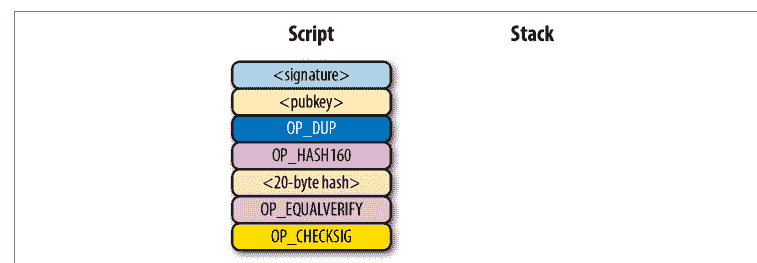
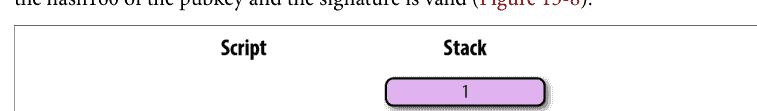
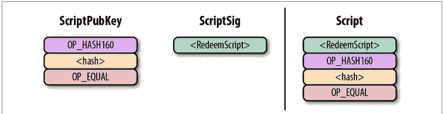
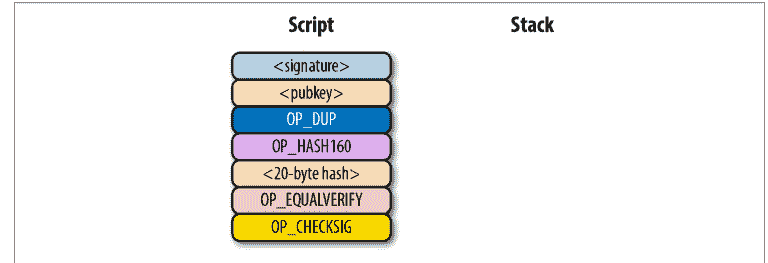
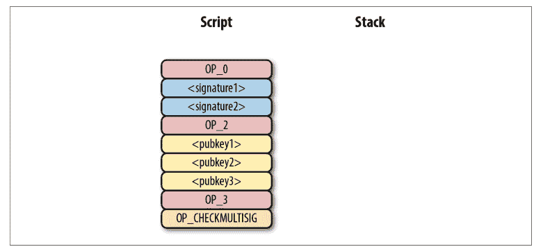
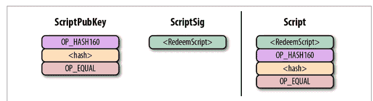

## Segwit

Segwit 代表“隔离见证”，是 2017 年 8 月在比特币网络上激活的向后兼容的升级或“软分叉”。虽然激活存在争议，但该技术的特性需要一些解释。在本章中，我们将探讨 Segwit 的工作原理、为什么它是向后兼容的，以及 Segwit 实现了什么。

简要概述，Segwit 包含了多项更改：

+   - 区块大小增加
+   - 交易可塑性修复
+   - Segwit 版本控制以实现清晰的升级路径
+   - 二次哈希修复
+   - 离线钱包费用计算安全性

如果不查看其实现方式，Segwit 的确切含义并不完全明显。我们将从检查 Segwit 定义的最基本交易类型开始，即支付到见证公钥哈希。

## 支付到见证公钥哈希（p2wpkh）

支付到见证公钥哈希（p2wpkh）是 Segwit 在 BIP0141 和 BIP0143 中定义的四种脚本类型之一。这是一个智能合约，其作用与支付到公钥哈希非常相似，因此得名。主要变化是 ScriptSig 的数据现在位于见证字段中。重新排列是为了修复交易可塑性。


图 13-6. p2wpkh 步骤 2

此时，旧节点将停止，因为没有更多 Script 命令需要处理。由于栈顶元素非零，这将被计为一个有效的脚本。这与 p2sh（第 8 章）非常相似，因为旧节点无法进行进一步验证。然而，新节点有一个特殊的 Segwit 规则，就像 p2sh 的特殊规则一样（参见第 8 章）。请回忆，与 p2sh 情况一样，精确的脚本序列 <RedeemScript> OP_HASH160 <hash> OP_EQUAL 会触发一个特殊规则。

对于 p2wpkh 来说，脚本序列是 OP_0 <20 字节哈希>。当遇到该脚本序列时，来自见证字段的公钥和签名以及 20 字节哈希会以与 p2pkh 完全相同的顺序添加到命令集中，即 <signature> <pubkey> OP_DUP OP_HASH160 <20-byte hash> OP_EQUALVERIFY OP_CHECKSIG。图 13-7 显示了接下来遇到的状态。



图 13-7. p2wpkh 步骤 3

p2wpkh 的其余处理与第 6 章中 p2pkh 的处理相同。结束状态是栈上只有一个 1，当且仅当 20 字节哈希是公钥的 hash160 且签名有效时（图 13-8）。



图 13-8. p2wpkh 步骤 4

对于旧节点，处理在 <20-byte hash> 0 处停止，因为旧节点不知道特殊的 Segwit 规则。只有升级后的节点才会进行其余的验证，就像 p2sh 一样。注意，发送给旧节点的数据更少。此外，如果节点不愿意，节点可以选择不下载（因此不验证）x 个区块旧的交易。在某种意义上，签名已被一群人见证，节点可以选择信任其有效性而不是直接验证。

还要注意，这是一个针对 Segwit 版本 0 的特殊规则。Segwit 版本 1 可以有完全不同的处理路径。<20-byte hash> 1 可能是触发不同规则的特殊脚本序列。Segwit 的升级可以引入 Schnorr 签名、Graftroot，甚至完全不同的脚本系统，如 Simplicity。Segwit 为我们提供了一个清晰的升级路径。能够验证 Segwit 版本 X 的软件将验证此类交易，但不了解 Segwit 版本 X 的软件仅处理到特殊规则为止。

## p2sh-p2wpkh

p2wpkh 很棒，但不幸的是，这是一种新型脚本，旧钱包无法向 p2wpkh ScriptPubKeys 发送比特币。p2wpkh 使用一种新的地址格式 Bech32，由 BIP0173 定义，其 ScriptPubKeys 旧钱包不知道如何创建。

Segwit 作者通过将 p2wpkh “包装”在 p2sh 内部，使 Segwit 向后兼容，这是一种巧妙的方法。这称为“嵌套”Segwit，因为 Segwit 脚本嵌套在 p2sh RedeemScript 中。

p2sh-p2wpkh 地址是一个普通的 p2sh 地址，但 RedeemScript 是 OP_0 <20-byte hash>，即 p2wpkh 的 ScriptPubKey。与 p2wpkh 一样，发送给旧节点（图 13-9）和新节点（图 13-10）的交易不同。

```
010000001712e5b4e97ab549d50ca60a4f5968b2225215e9fab82dae4720078711406972f000000
017160014848202fc47fb475289652fbd1912cc853ecb0096feffffff023236000000000001976a9
14121ae7a2d55d2f0102ccc117cbcb70041b0e037f88ac10270000000000001976a914ec0be509516
51261765cfa71d7bd41c7b9245bb388ac075a0700

- 01000000 - version
- 01 - # of inputs
- 712e...2f - previous tx hash
- 00000000 - previous tx index
- 1716...96 - ScriptSig
- feffffff - sequence
- 02 - # of outputs
- 3236...00 - output amounts
- 1976...ac - ScriptPubKey
- 075a0700 - locktime
```

图 13-9. Pay-to-script-hash-pay-to-witness-pubkey-hash（p2sh-p2wpkh）发送给 pre-BIP0141 软件

```
01000000000101712e5b4e97ab549d50ca60a4f5968b2225215e9fab82dae4720078711406972f000
0000017160014848202fc47fb475289652fbd1912cc853ecb0096feffffff0232360000000000019
76a914121ae7a2d55d2f0102ccc117cbcb70041b0e037f88ac10270000000000001976a914ec0be50
951651261765cfa71d7bd41c7b9245bb388ac024830450221009263c7de80c297d5b21aba846cf6f0
a970e1d339568167d1e4c1355c7711bc1602202c9312b8d32fd9c7acc54c46cab50eb7255ce3c0122
14c41fe1ad91bcb16a13012102ebdf6fc448431a2bd6380f912a0fa6ca291ca3340e79b6f0c1fdaf
f73cf54061075a0700

- 01000000 - version
- 00 - Segwit marker
- 01 - Segwit flag
- 01 - # of inputs
- 712e...2f - previous tx hash
- 00000000 - previous tx index
- 1716...96 - ScriptSig
- feffffff - sequence
- 02 - # of outputs
- 3236...00 - output amounts
- 1976...ac - ScriptPubKey
- 0248...61 - witness
- 075a0700 - locktime
```

图 13-10. 发送给 post-BIP0141 软件的 p2sh-p2wpkh

与 p2wpkh 的不同之处在于 ScriptSig 不再为空。ScriptSig 包含一个 RedeemScript，其等于 p2wpkh 中的 ScriptPubkey。由于这是一个 p2sh 脚本，ScriptPubKey 与任何其他 p2sh 脚本中的相同。组合后的脚本看起来像图 13-11。



图 13-11. p2sh-p2wpkh ScriptPubKey 与普通 p2sh ScriptPubKey 相同

我们像图 13-12 一样开始脚本评估。


图 13-12. p2sh-p2wpkh 开始

注意，要处理的命令正是触发 p2sh 特殊规则的命令。RedeemScript 进入栈（图 13-13）。


图 13-13. p2sh-p2wpkh 步骤 1

OP_HASH160 将返回 RedeemScript 的哈希（图 13-14）。


图 13-14. p2sh-p2wpkh 步骤 2

哈希进入栈，然后我们到达 OP_EQUAL（图 13-15）。



图 13-18. p2sh-p2wpkh 步骤 6

其余的处理与 p2pkh 相同（第 6 章）。假设签名和公钥有效，我们剩下图 13-19。


图 13-19. p2sh-p2wpkh 结束

正如你所见，p2sh-p2wpkh 交易完全向后兼容到 BIP0016 之前。pre-BIP0016 节点会在 RedeemScripts 相等时认为脚本有效，而 post-BIP0016、pre-Segwit 节点会在 20 字节哈希处认为脚本有效。两者都不会进行完整验证并接受交易。post-Segwit 节点会进行完整验证，包括检查签名和公钥。


## 任何人都可以花费 Segwit 输出吗？

Segwit 的反对者称 Segwit 输出为“任何人可花费”。如果比特币社区拒绝了 Segwit，这将是真的。换句话说，如果比特币社区中经济上重要的一部分拒绝进行 Segwit 验证并通过接受非 Segwit 有效的交易而积极分裂网络，输出将是任何人可花费的。然而，由于各种经济激励，Segwit 已在网络上激活，没有发生网络分裂，现在大量比特币被锁定在 Segwit 输出中，并且 Segwit 交易已按照软分叉规则由绝大多数经济节点验证。我们现在可以自信地说，反对者是错的。

## 编码 p2wpkh 和 p2sh-p2wpkh

我们要做的第一个更改是 Tx 类，我们需要标记交易是否为 Segwit：

```
class Tx:
    command = b'tx'

    def __init__(self, version, tx_ins, tx_outs,
        locktime, testnet=False, segwit=False):
        self.version = version
        self.tx_ins = tx_ins
        self.tx_outs = tx_outs
        self.locktime = locktime
        self.testnet = testnet
        self.segwit = segwit
        self._hash_prevouts = None
        self._hash_sequence = None
        self._hash_outputs = None
```

接下来，我们根据收到的序列化更改 parse 方法：

```
class Tx:
    ...
    @classmethod
    def parse(cls, s, testnet=False):
        s.read(4) ①
        if s.read(1) == b'\x00': ②
            parse_method = cls.parse_segwit
        else:
            parse_method = cls.parse_legacy
        s.seek(-5, 1) ③
        return parse_method(s, testnet=testnet)

    @classmethod
    def parse_legacy(cls, s, testnet=False):
        version = little_endian_to_int(s.read(4)) ④
        num_inputs = read_varint(s)
        inputs = []
        for _ in range(num_inputs):
            inputs.append(TxIn.parse(s))
        num_outputs = read_varint(s)
        outputs = []
        for _ in range(num_outputs):
            outputs.append(TxOut.parse(s))
        locktime = little_endian_to_int(s.read(4))
        return cls(version, inputs, outputs, locktime,
            testnet=testnet, segwit=False)
```

① 为确定我们是否有 Segwit 交易，我们查看第五个字节。前四个是版本，第五个是 Segwit 标记。


2 第五个字节为 0 是我们判断该交易为 Segwit 的方式（这并不 foolproof，但我们将使用它）。我们根据是否为 Segwit 使用不同的解析器。

3 我们将流重置到检查前 5 个字节之前的位置。

4 我们已将旧的解析方法移至 parse_legacy。

以下是 Segwit 序列化的解析器：

```
class Tx:
    ...
        @classmethod
        def parse_segwit(cls, s, testnet=False):
            version = little_endian_to_int(s.read(4))
            marker = s.read(2)
            if marker != b'\x00\x01':
                raise RuntimeError('Not a segwit transaction {}'.format(marker))
            num_inputs = read_varint(s)
            inputs = []
            for _ in range(num_inputs):
                inputs.append(TxIn.parse(s))
            num_outputs = read_varint(s)
            outputs = []
            for _ in range(num_outputs):
                outputs.append(TxOut.parse(s))
            for tx_in in inputs:
                num_items = read_varint(s)
                items = []
                for _ in range(num_items):
                    item_len = read_varint(s)
                    if item_len == 0:
                        items.append(0)
                    else:
                        items.append(s.read(item_len))
                tx_in.witness = items
            locktime = little_endian_to_int(s.read(4))
            return cls(version, inputs, outputs, locktime,
                       testnet=testnet, segwit=True)
```

1 有两个新的字段；其中一个是 Segwit 标记。

2 第二个新字段是 witness，它包含每个输入的项目。

我们现在对序列化方法进行相应的更改：

```
class Tx:
    ...
        def serialize(self):
            if self.segwit:
                return self.serialize_segwit()
```

```
else:
    return self.serialize_legacy()

def serialize_legacy(self):
    result = int_to_little_endian(self.version, 4)
    result += encode_varint(len(self.tx_ins))
    for tx_in in self.tx_ins:
        result += tx_in.serialize()
    result += encode_varint(len(self.tx_outs))
    for tx_out in self.tx_outs:
        result += tx_out.serialize()
    result += int_to_little_endian(self.locktime, 4)
    return result

def serializewit(self):
    result = int_to_little_endian(self.version, 4)
    result += b'\x00\x01'
    result += encode_varint(len(self.tx_ins))
    for tx_in in self.tx_ins:
        result += tx_in.serialize()
    result += encode_varint(len(self.tx_outs))
    for tx_out in self.tx_outs:
        result += tx_out.serialize()
    for tx_in in self.tx_ins:
        result += int_to_little_endian(len(tx_in.witness), 1)
        for item in tx_in.witness:
            if type(item) == int:
                result += int_to_little_endian(item, 1)
            else:
                result += encode_varint(len(item)) + item
    result += int_to_little_endian(self.locktime, 4)
    return result
```

1 以前称为 serialize 的现在是 serialize_legacy。

2 Segwit 序列化添加了标记。

3 witness 在最后序列化。

我们还必须更改 hash 方法以使用旧序列化，即使对于 Segwit 交易也是如此，这样可以保持交易 ID 稳定：

```
class Tx:
    ...
    def hash(self):
        '''Binary hash of the legacy serialization'''
        return hash256(self.serialize_legacy())[::-1]
```

verify_input 方法对于 Segwit 交易需要不同的 z。Segwit 交易签名哈希计算在 BIP0143 中指定。此外，witness 字段会传递给脚本评估引擎：

```
class Tx:
    ...
    def verify_input(self, input_index):
        tx_in = self.tx_ins[input_index]
        script_pubkey = tx_in.script_pubkey(testnet=self.testnet)
        if script_pubkey.is_p2sh_script_pubkey():
            command = tx_in.script_sig.commands[-1]
            raw_redeem = int_to_little_endian(len(command), 1) + command
            redeem_script = Script.parse(BytesIO(raw_redeem))
            if redeem_script.is_p2wpkh_script_pubkey():
                z = self.sig_hash_bip143(input_index, redeem_script)
                witness = tx_in.witness
            else:
                z = self.sig_hash(input_index, redeem_script)
                witness = None
        else:
            if script_pubkey.is_p2wpkh_script_pubkey():
                z = self.sig_hash_bip143(input_index)
                witness = tx_in.witness
            else:
                z = self.sig_hash(input_index)
                witness = None
        combined_script = tx_in.script_sig + tx_in.script_pubkey(self.testnet)
        return combined_script.evaluate(z, witness)
```

+   1. 这处理了 p2sh-p2wpkh 情况。
+   2. BIP0143 签名哈希生成代码在本章代码的 tx.py 中。
+   3. 这处理了 p2wpkh 情况。
+   4. witness 传递给评估引擎，以便 p2wpkh 可以构造正确的命令。

我们还在 script.py 中定义了 p2wpkh 脚本的样子：

```
def p2wpkh_script(h160):
    '''Takes a hash160 and returns the p2wpkh ScriptPubKey'''
    return Script([0x00, h160])
...
def is_p2wpkh_script_pubkey(self):
    return len(self.cmds) == 2 and self.cmds[0] == 0x00 \
        and type(self.cmds[1]) == bytes and len(self.cmds[1]) == 20
```

+   1. 这是 OP_0 <20-byte-hash>。
+   2. 这检查当前脚本是否为 p2wpkh ScriptPubKey。

最后，我们需要在 evaluate 方法中实现特殊规则。

```
5221026ccfb8061f235cc110697c0bfb3afb99d82c886672f6b9b5393b25a434c0cbf32103befa190
c0c22e2f53720b1be9476dcf11917da4665c44c9c71c3a2d28a933c352102be46dc245f58085743b1
cc37c82f0d63a960efa43b5336534275fc469b49f4ac53ae
```

+   - 52 - OP_2
+   - 21 - Length of <pubkeyx>
+   - 0...01 - <pubkeyx>
+   - 53 - OP_3
+   - ae - OP_CHECKMULTISIG

Figure 13-27. p2wsh WitnessScript

其余的 witness 字段被放在顶部以产生图 13-28 中的命令集。



Figure 13-28. p2wsh step 3

正如你所见，这是一个 2-of-3 多签，与第 8 章中探讨的类似（图 13-29）。

与 p2sh-p2wpkh 一样，ScriptPubKey 与任何其他 p2sh 地址无法区分，ScriptSig 仅为 RedeemScript（图 13-33）。



Figure 13-33. p2sh-p2wsh ScriptPubKey

我们以与 p2sh-p2wpkh 脚本评估开始完全相同的方式开始 p2sh-p2wsh 脚本评估（图 13-34）。


Figure 13-34. p2sh-p2wsh start

RedeemScript 被推送到栈上（图 13-35）。


Figure 13-35. p2sh-p2wsh step 1

OP_HASH160 将返回 RedeemScript 的哈希（图 13-36）。


Figure 13-36. p2sh-p2wsh step 2

哈希被推送到栈上，然后我们到达 OP_EQUAL（图 13-37）。


Figure 13-37. p2sh-p2wsh step 3

与 p2sh-p2wpkh 一样，如果哈希相等，pre-BIP0016 节点会将输入标记为有效，因为它们不知道 p2sh 验证规则。然而，post-BIP0016 节点会识别 p2sh 的特殊脚本序列，因此 RedeemScript 将被解释为新的脚本命令。RedeemScript 是 OP_0 32 字节哈希，这与 p2wsh 的 ScriptPubKey 相同（图 13-38）。

```
220020615ae01ed1bc1ffaad54da31d7805d0bb55b52dfd3941114330368c1bbf69b4c
- 22 - Length of <RedeemScript>
- 0020...4c - <RedeemScript>
```

Figure 13-38. p2sh-p2wsh RedeemScript

这使得脚本状态看起来像图 13-39。


Figure 13-39. p2sh-p2wsh step 4

当然，这与 p2wsh 的起始状态完全相同（图 13-40）。


Figure 13-40. p2sh-p2wsh step 5

32 字节哈希是一个元素，因此它被推送到栈上（图 13-41）。


*图 13-41. p2sh-p2wsh 步骤 6*

此时，预 Segwit 节点会将此输入标记为有效，因为它们不知道 Segwit 验证规则。然而， post-Segwit 节点会识别出 p2wsh 的特殊脚本序列。见证字段（图 13-42）包含 WitnessScript（图 13-43）。WitnessScript 的 sha256 会与 32 字节哈希进行校验，如果相等，则 WitnessScript 会被解释为脚本命令并放入命令集（图 13-44）。

```
04004730440220010d2854b86b90b7c33661ca25f9d9f15c24b88c5c4992630f77ff004
b998fb802204106fc3ec8481fa98e07b7e78809ac91b6ccaf60bf4d3f729c5a75899bb6
64a501473044022046d66321c6766abcb1366a793f9bfd0e11e0b080354f18188588961
ea76c5ad00922762381a0661d66f5c39825202524c45f29d500c6476176cd910b16911
76858701695221026ccfb8061f235cc110697c0bfb3afb99d82c886672f6b9b5393b25a434c0cbf32103befa190
c0c22e2f53720b1be9476dcf11917da4665c44c9c71c3a2d28a
933c352102be46dc245f58085743b1cc37c82f0d63a960efa43b5336534275fc469b49f
4ac53ae
```

*图 13-42. p2sh-p2wsh 见证*

- 04 - 见证元素数量
- 00 - OP_0
- 47 - <signaturex> 的长度
- 3044...01 - <signaturex>
- 69 - WitnessScript 的长度
- 5221...ae - <WitnessScript>

```
5221026ccfb8061f235cc110697c0bfb3afb99d82c886672f6b9b5393b25a434c0cbf32103befa190
c0c22e2f53720b1be9476dcf11917da4665c44c9c71c3a2d28a933c352102be46dcf245f58085743b1
cc37c82f0d63a960efa43b5336534275fc469b49f4ac53ae
```

*图 13-43. p2sh-p2wsh WitnessScript*

- 52 - OP_2
- 21 - <pubkeyx> 的长度
- 0...01 - <pubkeyx>
- 53 - OP_3
- ae - OP_CHECKMULTISIG

```
command = tx_in.witness[-1]
raw_witness = encode_varint(len(command)) + command
witness_script = Script.parse(BytesIO(raw_witness))
z = self.sig_hash_bip143(input_index,
                        witness_script=witness_script)
witness = tx_in.witness
else:
    z = self.sig_hash(input_index, redeem_script)
    witness = None
else:
    if script_pubkey.is_p2wpkh_script_pubkey():
        z = self.sig_hash_bip143(input_index)
        witness = tx_in.witness
    elif script_pubkey.is_p2wsh_script_pubkey():
        command = tx_in.witness[-1]
        raw_witness = encode_varint(len(command)) + command
        witness_script = Script.parse(BytesIO(raw_witness))
        z = self.sig_hash_bip143(input_index,
                                witness_script=witness_script)
        witness = tx_in.witness
    else:
        z = self.sig_hash(input_index)
        witness = None
combined_script = tx_in.script_sig + tx_in.script_pubkey(self.testnet)
return combined_script.evaluate(z, witness)
```

- ① 这处理了 p2sh-p2wsh。
- ② 这处理了 p2wsh。

接下来，我们在 script.py 中编写一种识别 p2wsh 的方法：

```
def p2wsh_script(h256):
    '''Takes a hash160 and returns the p2wsh ScriptPubKey'''
    return Script([0x00, h256])
...
class Script:
...
    def is_p2wsh_script_pubkey(self):
        return len(self.cmds) == 2 and self.cmds[0] == 0x00 \
            and type(self.cmds[1]) == bytes and len(self.cmds[1]) == 32
```

- ① OP_0 <32 字节脚本> 是我们期望的。

最后，我们处理 p2wsh 的特殊规则：

```
class Script:
...
    def evaluate(self, z, witness):
...
        while len(commands) > 0:
...
else:
    stack.append(command)
    ...
    if len(stack) == 2 and stack[0] == b'' and len(stack[1]) == 32:
        s256 = stack.pop() ①
        stack.pop() ②
        cmds.extend(witness[:-1]) ③
        witness_script = witness[-1] ④
        if s256 != sha256(witness_script): ⑤
            print('bad sha256 {} vs {}'.format
                  (s256.hex(), sha256(witness_script).hex()))
            return False
        stream = BytesIO(encode_varint(len(witness_script))
                         + witness_script)
        witness_script_cmds = Script.parse(stream).cmds ⑥
        cmds.extend(witness_script_cmds)
```

- ① 栈顶元素是 WitnessScript 的 sha256 哈希。
- ② 第二个元素是见证版本，0。
- ③ 除 WitnessScript 之外的所有内容都会被添加到命令集中。
- ④ WitnessScript 是见证字段的最后一项。
- ⑤ WitnessScript 的哈希必须等于栈中的 sha256。
- ⑥ 我们解析 WitnessScript 并将其添加到命令集中。

### 其他改进

Segwit 还通过签名哈希的不同计算方式修复了二次哈希问题。签名哈希 z 的许多计算可以被重用，而无需为每个输入都要求一个新的 hash256 哈希。签名哈希的计算详细说明在 BIP0143 中，可以在 code-ch13/tx.py 中看到。

另一个改进是，按策略，不再允许使用未压缩的 SEC 公钥；Segwit 仅使用压缩的 SEC 公钥，从而节省空间。

### 结论

本章介绍了 Segwit 的细节，作为现在可能实现内容的品尝。第 14 章讨论了你在比特币开发者之旅中可以采取的下一步。
