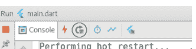

# Flutter 编程：轻松构建原生跨平台应用

# Early Praise for
*Programming Flutter*

I’m excited to read this book: ten years ago, I learned Android development reading a PragProg book, and this has changed my life forever. Now this book could change it again.

→ Giordano Scalzo
 iOS Senior Software Engineer, NatWest Markets

Carmine’s book is a comprehensive journey into Flutter. He leads you through the basics like widgets, standard library, packages, and plugins, and helps you to understand the more advanced topics like network, I/O, navigation, testing, debugging, and firebase. His book is a reference for practical suggestions, useful tips, and solid advice, without sacrificing the details. What I liked the most is that each chapter starts with a premise, and ends with a conclusion and “where we’re going next,” building up a natural, logical, and consequential narrative.

→ Alessio Salvadorini
 Creative Technologist, Nokia

Great book for anyone who wants to start grasping Flutter.

→ Erdem Orman
 Software Development Engineer, Amazon

If you want or need to do cross-platform mobile app development, you should have this book at hand.
*Programming Flutter*, by Carmine Zaccagnino, walks you systematically through this important Google


platform for building full apps that work with Android, iOS, and Google Fuchsia.

→ John Barry
Independent Editorial Consultant, various

Carmine’s hands-on tutorial will help you understand Flutter and why it is the best solution to target iPhones and Androids with a single codebase. Great book for a great framework!

→ Paul Freiberger
Coauthor, Fire in the Valley: The Birth and Death of the Personal Computer

## Acknowledgments

This book exists because Flutter was released and such a revolutionary technology needed a way for people to know about it and learn it however they prefer. So, before even talking about the book, it’s necessary to remember how good it is for the developer community that Google has released Flutter and they’re continuing to invest in it to make it even more revolutionary and important every day that passes.

Talking about the book, it has to be said that working with the Pragmatic Bookshelf has been great. First of all, I want to thank Andy Hunt, who, as a publisher, has built a wonderful team: starting from my very first interactions with Brian MacDonald over my proposal to write this book, everyone has been thorough, welcoming, and helpful.

In particular, I want to thank Michael Swaine, who, as the editor of this book, has been encouraging, helpful, and understanding throughout the process, never making me feel pressured and always helping and encouraging me when any issues arose or when I had questions about anything related to the book.

When bigger and more technical issues arose, production manager Janet Furlow has fixed them, allowing me to keep working on the content of the book instead. The cover Gilson Graphics made for the book is very nice as a visual metaphor of Flutter’s multi-platform nature. In addition to those I have mentioned, I want to thank everyone else at the Pragmatic Bookshelf who has been involved in making the book as good as it is.

I want to thank everybody who has looked at the book and given me feedback, which I have taken on and tried to use to the best of my ability to make the book better for everyone. In particular, the technical reviewers who have been thorough and thoughtful in their feedback and the beta book readers who have taken their time to submit errata: it’s been very important and seeing how thorough they have been has encouraged me to do as much as I could for the book. Thank you Giordano Scalzo, Alessio Salvadorini, Erdem Orman, Paul Freiberger, and John Barry.

I want to thank everyone I know informally: my friends and family have all been very encouraging and supportive and have made this journey more pleasant than it could have ever been without their support. Knowing the people close to me were happy with the fact that I was doing this was invaluable. I would also like to mention the people who were less close to me, who knew me barely or not at all previously and who have reached out to ask about the book because they made the results of my work feel like something closer to me.

## Preface

This book is about Flutter, Google’s open source software development kit (SDK) that can be used to develop applications across a wide range of platforms. We’ll begin by taking a brief look at its history, followed by an overview of its features and what we will see during the course of this book.

At the end of this Preface, you’ll find information about the installation and usage of the Flutter SDK and integrated development environment (IDE) plugins.

## A Brief History of Flutter

In 2015 Google unveiled Flutter, a new SDK based on the Dart language, as the next platform for Android development, and in 2017 an alpha version of it (0.0.6) was released to the public for the first time.

At I/O 2017 Google showed off using Flutter and its multi-platform capabilities, and continued promoting it at I/O 2018. Since then, Google has been investing in Flutter and recommending it as the way everyone should be developing mobile apps.

In December 2018 Flutter 1.0 was released and made available so that developers could begin using the SDK to make app creation easier.

At Google I/O 2019, Flutter support for desktop and web platforms was publicly announced. Tools for developing Flutter apps for Windows, macOS, Linux, and the web were released.

In addition to being unstable and untested, desktop development is being held back further by the lack of plugin support, which is very limited mostly because, at the time of writing, plugin tooling is still in the process of being developed, meaning that binaries for the platform-specific code for each platform have to be manually built and linked by editing the Google-provided Makefiles that can be found in Google’s dedicated flutter-desktop-embedding GitHub repository.[1]

On the other hand, web support is progressing quickly and shouldn’t take much more than a rebuild of a working Flutter mobile project that doesn’t have any native plugins or platform-specific code.

## Why Flutter Matters and What We’ll See in This Book

Flutter’s entry into the mobile app development framework space is recent and, because of that, Flutter needs to carry significant improvements over existing frameworks and SDKs to actually be useful—and it does.

For one thing, with Flutter you’ll be able to develop apps that work with Android, iOS, and Google Fuchsia[2] (which might replace Android and/or Chrome OS at some point in the future). Flutter is developed by Google, but it fully supports iOS, and this means you can now also run an iOS emulator and build for iOS in Android Studio. However, you won’t be able to build iOS apps on Linux or Windows because iOS emulation and compilation is still done through Xcode.

Flutter makes developing apps incredibly easy by allowing you to define the app’s UI declaratively but in the same place and language you define the app logic (no XML UI files required). You can instantly preview the changes you make to your app using stateful hot reload.

Additionally, its cross-platform nature doesn’t skimp on having a native look and feel, as the framework supports all of the typical native features of each of the operating systems (different app bar, different list drag to update, Material Design and Apple icons, etc.). The advantages compared to other cross-platform frameworks don’t end there: you’ll be able to run any native Kotlin/Java and Swift/Objective-C method using platform channels, as we’ll see in *Integrating Native Code: Making Plugin Packages.*

Even though it’s really new, Flutter is already used by some big and established companies (as well as many smaller ones) to build cross-platform mobile apps, as you can see in Google’s Flutter Showcase Page.[3]

We’ll be using Flutter packages and plugins (many of them developed by Google) to build ever more useful apps, also introducing more advanced standard Flutter features such as navigation and animations.

## Don't Know Dart? Don't Worry About It

You might want to read Appendix 1, *Introduction to Dart*, if you don’t have much programming experience or find even the first chapter difficult to follow because of Dart’s syntax; many Dart-specific constructs will be explained during the course of the book, but you might want to consider going through that appendix first if you find yourself struggling to understand the code.

## Installing the SDK and the IDE Plugins

To use Flutter, you need to install its SDK, and to be able to get on with your programming in a quick and uncomplicated manner, you’ll probably want to install the IDE tools too.

If you prefer to use the command line (maybe because you want to use other, perhaps lighter, IDEs or text editors), there will be guidance on the usage of the flutter command throughout the book.

### Installing Flutter

The installation process for the Flutter SDK differs slightly for each operating system, so I’ll separate the instructions into three sections. Skip ahead to the instructions specific to your platform and, if you want to install them, the part that covers IDE plugin installation.

At the time of writing, the latest stable version is 1.9.1 and requires a 495MB download on Linux (tar.xz archive), a 655MB download on Windows (zip archive), or a 786MB download on macOS (zip archive).

### Installing on Linux

On a Linux machine only Android development is supported, so we will install just the Android SDK and the Flutter SDK itself. You’ll receive guidance for both CLI and graphical installation methods.

### Installing the Android SDK on Linux

If you have never developed Android apps, you need to install the Android SDK, which includes the tools needed to build and debug Android apps.

In order to use Flutter, you need to install Android Studio and the Android SDK tools. Flutter requires Android Studio to be installed, but you don’t have to use it for development.


### 官方 Zip 文件的替代方案

在 Gentoo 和 Arch Linux 上，你可以使用包来安装 Android SDK 和/或 Android Studio：

- 在 Gentoo 上，你可以通过运行 `emerge --ask dev-util/android-studio` 来安装 Android Studio 包 [4]；
- 对于 Arch Linux，AUR 上有一个维护活跃且流行的包叫做 *android-studio* [5]。

首先前往 Android Developers 页面上的下载页面。[6] 在那里你会找到 Android Studio 的 .zip 下载链接（大小约为 1GB）。

无论你选择哪种方式，在 64 位操作系统上让 SDK 正常工作，你可能需要安装一些 32 位库：

- 在 Debian/Ubuntu 上，运行 `sudo apt install libc6:i386 libncurses5:i386 libstdc++6:i386 lib32z1 libbz2-1.0:i386`
- 在 Fedora 上，运行 `sudo dnf install zlib.i686 ncurses-libs.i686 bzip2-libs.i686`。

之后，我们就可以实际安装 Android SDK 了。

要使用完整的 Android Studio 安装程序进行安装，在从 Google 网站下载的 zip 文件解压后，运行 `bin` 子目录中的 `studio.sh` 脚本。这将启动一个设置向导。完成 SDK 的设置后，你可以通过运行同一个 `studio.sh` 脚本来启动 Android Studio。

### 在 Linux 上安装 Flutter SDK

本部分将为初学者提供面向 Linux 的安装指导；如果你熟悉命令行，CLI 步骤会更可预测。对于完全的 Linux 新手来说，遵循 GUI 导向的指导可能更容易，因为那通常更熟悉。

#### Tarball 的替代方案

安装官方 tarball 有替代方案：

- Arch Linux 在 AUR 中有一个维护活跃的包用于安装 Flutter。[7]

Linux 下载是一个源 tarball，其中还包含运行 flutter 命令所需的脚本，这意味着你只需解压它并将解压后 tarball 的 bin 子目录添加到 PATH 环境变量中即可。

在我们这样做之前，需要浏览到 Flutter 官方网站上的 SDK 归档[8] 页面并下载最新稳定版。

或者，在仅 CLI 环境中，你可以使用 curl https://storage.googleapis.com/flutter_infra/releases/stable/linux/flutter_linux_v1.2.1-stable.tar.xz -o flutter_linux_v1.2.1-stable.tar.xz 下载 1.2.1 tarball。

使用你喜欢的任何 GUI 工具解压你刚刚下载的 tarball，或运行以下命令：

```
$ tar -xf flutter_linux_v1.2.1-stable.tar.xz
```

现在我们需要将可执行脚本添加到 PATH 环境变量中。

在此之前，你需要记下你解压 tarball 的目录。它包含一个 flutter 目录，其中有一个 bin 目录；我们需要知道到达该 bin 目录的路径。

如果你使用 GUI，在大多数发行版中它可以通过浏览目录的属性获得。如果按照我们之前描述的步骤中每个软件的默认设置进行操作，它将类似于 /home/username/Downloads/flutter_linux_v1.9.1-stable/flutter/bin。我建议将其移动到更永久的路径；最好是你会记得你安装了 Flutter 的位置。

如果你使用 CLI 并按照上面概述的命令操作，浏览到你的 Flutter 安装目录，然后通过运行以下命令将工作目录更改为 flutter/bin 子目录：

```
$ cd flutter/bin
```

并通过运行以下命令获取工作目录：

```
$ pwd
```

这将返回类似 /home/username/flutter/bin 的内容（这里你会看到你安装 Flutter 的路径，所以你的情况可能差异很大）。

### 了解你的 Shell

#### 了解你的 Shell

本节假设你的 shell 是 Bash。[9]
对于大多数 Linux 发行版（以及通常的类 Unix 操作系统——一些例外是 BSD，它们使用 tcsh,[10] ksh,[11] 或 ash,[12] 以及 Arch Linux 的安装程序，它运行在 Zsh[13] 上但默认安装 Bash）来说都是如此，而且由于你需要手动安装和配置不同的 shell，所以你可能知道如何向其 PATH 中添加目录。

要将此添加到 PATH 环境变量，我们需要编辑 ~/.bash_profile。

要使用 GUI 执行此操作，你首先需要让文件管理器显示隐藏文件。如果你找不到主目录中名为 .bash_profile 的文件，你需要切换使文件管理器显示隐藏文件的选项，这取决于你使用的文件管理器：

- 在 Nautilus（又名 GNOME Files，默认用于使用 GNOME 桌面的大多数发行版，如 Ubuntu、RHEL、Fedora，以及默认的 SLED 和 Debian）中，你需要按 Ctrl + H。此快捷键在 PCManFM（LXDE 的一部分，如 Lubuntu 中）、Caja（Mate 的一部分）和 Thunar（XFCE 桌面的部分，如 Xubuntu 中）中也适用。
- 如果你使用的是 KDE 桌面（例如运行 Kubuntu 或在安装 openSUSE 或 Debian 等发行版时选择它）及其默认的 Dolphin 文件管理器，请使用 Alt + 。

一旦你找到名为 .bash_profile 的文件，使用任何文本编辑器打开它，并在末尾新增一行添加以下内容：

```
export PATH=$PATH:/home/username/etc
```

其中你将 /home/username/etc 替换为你之前记下的字符串。

如果你更喜欢使用命令行或只是想从本安装指南中复制粘贴体验，你可以改为打开一个终端窗口或 TTY 并运行以下命令：

```
$ echo "export PATH=$PATH:/home/username/etc/> " >>~/.bash_profile
```

将 /home/username/etc/ 替换为你之前为解压的 tarball 的 flutter/bin 目录找到的路径。

为了能够实际运行 flutter 命令，你需要通过运行以下命令刷新终端的配置：

```
$ source ~/.bash_profile
```

### 在 Windows 上安装

就像在 Linux 上一样，Windows 仅限的 Android 开发也是受支持的，因此我们将安装仅 Android SDK、Android Studio 和 Flutter SDK 本身。

#### 在 Windows 上安装 Android SDK

要在 Windows 上安装 Android SDK，你需要做的就是下载并运行官方下载页面上提供的 Android Studio 安装文件。[14] 这也会安装功能丰富的 Android Studio IDE。安装 Android Studio 后，你将被引导完成 Android SDK 的安装。

#### 在 Windows 上安装 Flutter SDK

要在 Windows 上安装 Flutter SDK，你首先需要先安装 Git for Windows。你可以在其官方下载页面上找到它的安装文件。[15] 在安装过程中，你需要选择 Use Git from the Windows Command Prompt 选项。

安装 Git 后，从其官方安装页面下载 Flutter 的最新版本。[16] 这与 Windows 上大多数软件不同，将下载一个 zip 归档（又名压缩文件夹），其中包含一个 flutter 文件夹：将它解压到你想要的任何位置（这将是任何 IDE 插件会要求你输入的 SDK 文件夹）。

如果你想在 Flutter 控制台上运行命令，运行 `bin` 子文件夹中包含的 `flutter.bat` 脚本。

### 在 macOS 上安装

macOS 的优势在于它也支持 iOS 构建和调试。为了利用这一点，我们还需要安装 Xcode 和 iOS SDK。

#### 安装 Xcode 和 iOS SDK

要能够运行 Flutter 并将其用于 iOS 开发，你需要从 Apple 官方网站下载 Xcode [19] 和 iOS SDK [18]。

#### 在 macOS 上安装 Android SDK

在 macOS 上安装 Android SDK 非常简单：前往 Android Studio 下载页面 [19] 下载 .dmg 文件，该文件还包含功能丰富但资源密集的 Android Studio IDE。

#### 在 macOS 上安装 Flutter SDK

在 macOS 上安装 Flutter 与在 Linux 上安装 Flutter 非常相似。主要区别在于 macOS 使用 zip 归档格式而不是更高效的 tar.xz 格式，并且没有发行版之间需要处理的 OS 或 GUI 差异。

首先从 Flutter 官方网站下载最新的稳定版 .zip。[20]

将其解压到任何目录，然后打开你刚刚解压的 `flutter` 目录。按 ⌘ + ↖ 并记下 *Where:* 右侧出现的路径。

现在，打开一个终端窗口并运行命令：

```bash
$ nano ~/.bash_profile
```

执行之后，将以下内容粘贴到终端窗口中：

```bash
export PATH=$PATH/example/path/to/flutter/bin
```


将 `/example/path/to/flutter/bin` 替换为你之前记下的路径。

剩下的就是使用 Ctrl - X 关闭文件，并通过按 Y 确认要保存文件。

要真正能够运行 flutter 命令，你需要通过运行以下命令刷新终端的配置：

```
$ source ~/.bash_profile
```

### 安装 IDE 插件

Flutter IDE 插件在 VSCode 和 Android Studio 中的安装方式使用的是各自 IDE 的标准安装工具和技术。它们也需要分别安装对应的 Dart 插件。

如果你不熟悉该流程，我们现在将讨论如何在每个 IDE 上安装 Flutter 插件。

#### VSCode

要为 Visual Studio Code 安装 Flutter 插件，你需要打开 Visual Studio Code 本身，然后使用键盘快捷键 Ctrl - Shift - P 打开命令面板，然后输入“Install extensions”并按 Enter。

在左侧弹出的面板中，输入 Flutter 并按 Enter。

在列表中点击 Flutter 条目中的 Install 按钮，这将同时安装 Flutter 和 Dart 插件。

与 Android Studio 的 Flutter 插件不同，Visual Studio Code 的 Flutter 插件会自动检测 Flutter SDK 的安装位置。

#### Android Studio

要为 Android Studio 安装 Flutter 插件，你需要导航到 File > Settings > Plugins，点击 Browse repositories...，输入 Flutter 并点击 Install。

要在 Android Studio 中创建 Flutter 项目，如果你自安装 Flutter 插件后尚未重启 Android Studio，则需要重启 Android Studio，导航到 File > New Flutter Project，选择 *Flutter Application* 并为应用命名并指定路径，设置包名即可完成。

### 使用 CLI 和插件

有两种方式与 Flutter SDK 交互：直接使用 `flutter` CLI 命令或通过 IDE 插件。Android Studio 和 VSCode 的插件使用方式差异很大，因为它们会适应各自 IDE 的常规约定。

### 创建 Flutter 应用项目

要创建 Flutter 应用项目，运行 `flutter create appname` 命令，或按照你想要用于开发应用的 IDE 对应的流程操作：

- 在 Android Studio 中，点击 *File > New > New Flutter Project...* 并按照屏幕上出现的说明操作；
- 在 Visual Studio Code 中，按 `Ctrl + Shift + P` 打开命令菜单并输入 New Project，菜单中会出现 *Flutter: New Project* 选项，点击它然后为你的应用项目输入一个名称。

### 构建和运行

当工作目录为项目的根目录（即 `pubspec.yaml` 所在位置）时，你可以使用 `flutter build` 命令构建 Flutter 应用：

- 要为你的应用构建 APK（标准 Android 安装文件），使用 `flutter build apk`。
- 要构建 iOS 应用包，使用 `flutter build ios`。
- 要构建 Android App Bundle（新一代 Android 安装文件，可减小文件大小），使用 `flutter build appbundle`。

如果你想直接在打开的模拟器或通过 USB 连接的设备上运行应用（设备设置中已打开 USB 调试），使用 `flutter run`。

如果你使用的是 IDE，可以使用 Flutter 插件直接从 IDE 运行应用。

要在打开的模拟器或已连接的 USB 设备上运行应用：

- 使用 VSCode，按 `F5` 或点击 *Debug > Start Debug*。
- 使用 Android Studio，按 Shift F10 并点击以下图片中高亮显示的按钮：


### 热重载

Flutter 带有你可能从其他框架中了解到的一个功能：热重载。如果你不熟悉它，热重载功能允许你在不重建整个应用的情况下，根据对代码所做的更改更新应用的当前视图，而重建整个应用，如任何尝试过的人都知道的那样，在你进行许多小的更改并尝试查看它们如何影响应用时是非常痛苦的。

该功能在 Android Studio 和 Visual Studio Code 中都可以使用，实际上在命令行中使用 flutter run 运行应用时也可以使用：当该命令运行时，在终端中按 R 即可重新加载应用。

在 Android Studio 中，你需要在底部 Run 菜单中找到类似这样的图标：



在 Visual Studio Code 中，你需要在开始调试时出现在屏幕顶部的菜单中找到类似这样的图标：


应用会立即重新加载，立即在已连接的模拟器或设备上显示你对应用代码所做的任何更改。

如果你使用的是较新的 Android Studio 和/或 Visual Studio Code 版本，你将拥有对两种不同但相似的功能的 IDE 访问权限：有状态热重载和热重启。两者的区别在于，有状态热重载（顾名思义）会保留每个 State 对象并且速度更快，但它无法处理需要重新加载这些对象的大型更改，而热重启则用于此目的。

使用 CLI 通过 flutter run 运行应用时，有状态热重载与小写字母 r 字符相关联，而热重启则通过大写字母 R 字符实现。

在两个 IDE 中，你会在上面显示的按钮旁边找到一个类似以下 VSCode 屏幕截图中的闪电图标：


闪电图标执行有状态热重载，而典型的重启图标执行热重启。

### 更新和维护你的 Flutter 安装

当你需要更新 Flutter SDK 安装时你会知道，因为在你构建或运行应用时你会收到通知。

要更新你的 Flutter 安装，你需要运行 flutter upgrade 命令，它将使用 Git 检查并下载所需内容，因此你需要安装 Git。

Flutter 包含一个名为 Flutter Doctor 的工具，可通过 flutter doctor 命令使用，它将列出已安装的 Flutter 版本、Android/iOS SDK、IDE 插件和已连接设备的相关信息。

### VSCode 插件中的其他 Flutter 相关命令

一旦安装了 VSCode Flutter 插件，打开命令面板并输入 flutter 将显示所有可用命令。

其中你需要熟悉的有：

Flutter: Run Flutter Doctor
检查是否有需要安装的依赖项。

Flutter: New Project
创建一个新的 Flutter 项目。

Flutter: Select Device

选择你想要调试应用的设备。

> *Flutter: Get Packages and Flutter: Upgrade Packages*

用于与 Flutter Packages 交互的命令（我们将在第 4 章讨论包）。

### 我们接下来要去哪里：开始构建应用

现在你已准备好构建 Flutter 应用所需的一切，我们可以开始构建应用了。

你可以先创建一个新的 Flutter 项目并熟悉 SDK 生成的文件以及 IDE 管理 Flutter 项目的 UI。一旦你对使用它感到舒适，你就可以进入第一章，在那里我们将学习 Flutter 应用的结构以及如何实现它。

### 脚注

[1] https://github.com/google/flutter-desktop-embedding
[2] https://en.wikipedia.org/wiki/Google_Fuchsia
[3] https://flutter.dev/showcase
[4] https://packages.gentoo.org/packages/dev-util/android-studio
[5] https://aur.archlinux.org/packages/android-studio/
[6] https://developer.android.com/studio#downloads
[7] https://aur.archlinux.org/packages/flutter/
[8] https://flutter.dev/docs/development/tools/sdk/archive?tab=linux
[9] https://en.wikipedia.org/wiki/Bash_(Unix_shell)
[10] https://en.wikipedia.org/wiki/Tcsh
[11] https://en.wikipedia.org/wiki/KornShell
[12] https://en.wikipedia.org/wiki/Almquist_shell
[13] https://en.wikipedia.org/wiki/Z_shell
[14] https://developer.android.com/studio#downloads
[15] https://git-scm.com/download/win
[16] https://flutter.dev/docs/development/tools/sdk/archive
[17] https://developer.apple.com/xcode/
[18] https://developer.apple.com/ios/
[19] https://developer.android.com/studio#downloads
[20] https://flutter.dev/docs/development/tools/sdk/archive?tab=macos


