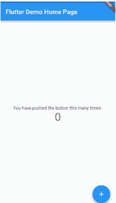
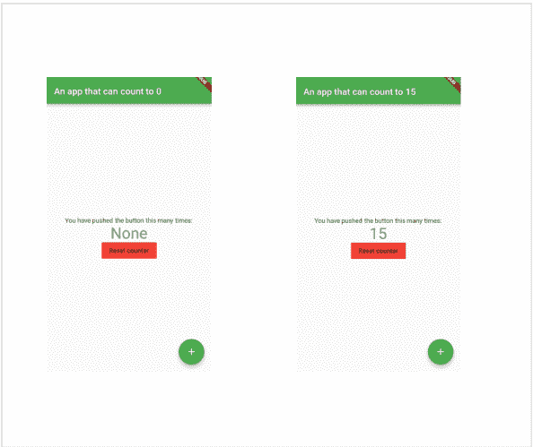
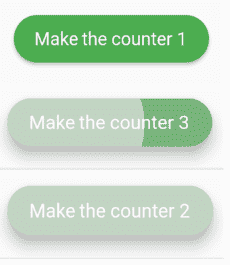

## 第 1 章：创建你的第一个 Flutter 应用

让我们开始实际编写一些代码并创建应用，以了解你能用 Flutter 做些什么。

### 熟悉 Dart 语法和 Flutter 类

在本章的第一部分，我们将查看 Flutter CLI 的示例代码，回顾如何使用 Dart 代码，并学习 Flutter 应用架构和实现的基础知识。

要创建一个新的 Flutter 应用，请创建一个目录来存放应用的源代码，并在其中再创建一个名为 lib 的目录。lib 目录是我们添加 Dart 文件的地方，这些文件定义了应用的外观和行为。

目前我们还不会在 CLI 中工作，但当我们准备好构建应用时，我们将使用 flutter create 来生成应用构建所需的文件（你将在关于应用配置的附录中了解并编辑这些文件）。除了与 Flutter 和应用直接相关的文件和目录外，Flutter 应用的根目录还必须包含 android 和 ios 目录，其中包含每个平台构建系统的配置。

在 lib 目录内，创建一个名为 main.dart 的文件。

在 lib 之外，创建一个名为 pubspec.yaml 的文件，并将以下内容粘贴到其中：

```
firstapp/pubspec.yaml

name: flutter_example_name
description: Example description of a flutter app that makes great things happen.

dependencies:
  flutter:
    sdk: flutter

dev_dependencies:
  flutter_test:
    sdk: flutter

flutter:
  uses-material-design: true
```

pubspec.yaml 文件包含有关你的项目及其依赖项的信息，Flutter 在构建应用时需要这些信息。实际上，任何 Dart 包都需要这个文件，但我们需要再过一段时间和几章才会开始讨论不是 Flutter 应用的 Dart 包。

在 main.dart 中编写以下代码：

```
firstapp_starting/lib/main.dart

import 'package:flutter/material.dart';

void main() => runApp(MyApp());

class MyApp extends StatelessWidget {
  @override
  Widget build(BuildContext context) {
    return MaterialApp(
      title: 'Flutter Demo',
      theme: ThemeData(
        primarySwatch: Colors.blue,
      ),
      home: MyHomePage(title: 'Flutter Demo Home Page'),
    );
  }
}
class MyHomePage extends StatefulWidget {
  MyHomePage({Key key, this.title}) : super(key: key);
  final String title;

  @override
  _MyHomePageState createState() => _MyHomePageState();
}
class _MyHomePageState extends State<MyHomePage> {
  int _counter = 0;

  void _incrementCounter() {
    setState(() {
      _counter++;
    });
  }

  @override
  Widget build(BuildContext context) {
    return Scaffold(
      appBar: AppBar(
        title: Text(widget.title),
      ),
      body: Center(
        child: Column(
          mainAxisAlignment: MainAxisAlignment.center,
          children: <Widget>[
            Text(
              'You have pushed the button this many times:',
            ),
            Text(
              '$_counter',
              style: Theme.of(context).textTheme.display1,
            ),
          ],
        ),
      ),
      floatingActionButton: FloatingActionButton(
        onPressed: _incrementCounter,
        tooltip: 'Increment',
        child: Icon(Icons.add),
      ),
    );
  }
}
```

你将看到一个带有计数器和浮动操作按钮的简单视图，点击按钮后，视图中心显示的计数器会递增，如下面的截图所示：



如果应用无法运行，请尝试运行：

```
$ flutter create .
```

正如前言中提到的，flutter create 是用于创建 Flutter 应用项目的命令，在包含 Flutter 代码的目录中执行该命令，将创建应用为 Android 和 iOS 编译所需的文件和目录（并且，随着它们变得更加稳定，还将包含桌面开发所需的文件）。

请记住，你可以通过运行以下命令修复大多数并非由代码错误引起的构建问题，尤其是在多次构建之后：

```
$ flutter clean
```

该命令将删除之前构建留下的构建文件。

### 分析示例代码

让我们分解这段代码，以便你理解这个示例。

#### pubspec.yaml 文件

在继续阅读包含主要应用代码的 main.dart 之前，我们应该先简要看一下 pubspec.yaml 文件。我们将在第 4 章“超越标准库：插件与包”中更详细地讨论该文件，并在附录 2“苹果风格外观与附加应用配置”中进行更深入的讨论。

理解这一点很重要：pubspec.yaml 文件并非 Flutter 应用所独有，它是 Dart 包的一个特性，因此也包含了使其成为 Flutter 应用所需的全部信息。

在第一部分中，我们将指定一些关于 Flutter 应用的元数据。在本节中，需要设置两个属性：

- **名称**：即 Dart 包名称，也是显示在主屏幕或应用抽屉中的默认应用名称。名称的一个缺点是必须全部小写，并且必须是有效的 Dart 标识符：不能以数字开头，除字母和下划线外不能包含任何字符（不允许空格），并且不能是 Dart 关键字（如 class、if、try 等）。因此，如果你想要一个不受这些限制的应用名称，或者想要更改启动器图标，建议按照“平台特定设置”中的说明，编辑 android 和 ios 目录中的应用文件。
- **描述**：应该是对 Flutter 应用的一两句简要说明。

为了避免构建问题并遵循良好实践，包含项目根目录（lib 目录和 pubspec.yaml 文件）的目录名称应与 Dart 包名称相同。

```
firstapp/pubspec.yaml

name: flutter_example_name
description: Example description of a flutter app that makes great things happen.
```

文件的其余部分指定依赖项。

```
firstapp/pubspec.yaml

dependencies:
  flutter:
    sdk: flutter

dev_dependencies:
  flutter_test:
    sdk: flutter

flutter:
  uses-material-design: true
```

由于我们没有使用任何第三方包，我们只需将 Flutter SDK 本身指定为依赖项，并且通过以下几行：

```
flutter:
  uses-material-design: true
```

我们确保包含 Material Design（Google/Android 风格）的资源，如图标等。

#### 应用组件

```
import 'package:flutter/material.dart';
```

这引入了我们需要使用的 Flutter 类。在本章中，你将学习最简单的类以及如何使用它们（我们还会在第 2 章“布局更多组件”中继续查看许多其他类）。

```
void main() => runApp(new MyApp());
```

这行代码意味着，当我们的代码被执行时，我们将启动一个应用，并且这个应用的行为和外观在名为 MyApp 的类中定义，如下所示：

```
firstapp_starting/lib/main.dart

class MyApp extends StatelessWidget {
  @override
  Widget build(BuildContext context) {
    return MaterialApp(
      title: 'Flutter Demo',
      theme: ThemeData(
        primarySwatch: Colors.blue,
      ),
      home: MyHomePage(title: 'Flutter Demo Home Page'),
    );
  }
}
```


### 在 Flutter 中定义组件

```
class MyApp extends StatelessWidget
```

在 Flutter 中，每个 UI 元素或 UI 元素集合都是一个组件（widget），它是一个不可变对象。这意味着我们不能更改组件的成员变量：如果有任何成员变量，它们必须声明为 final 或 constant。关于 Dart 变量的更多信息，请参阅《变量与条件》。

组件有两种类型：

- 无状态组件（StatelessWidget 的子类），在应用启动时以及父组件被重新渲染时渲染，例如 MyApp。
- 有状态组件（StatefulWidget 的子类），你可以随时通过调用 setState() 函数来重新渲染它，例如本应用中的 MyHomePage，这将在《主页组件》中介绍。

应用组件是所有其他组件的集合，因此它也是一个组件。在这里，它是一个 StatelessWidget。

### 使用无状态组件

firstapp_starting/lib/main.dart

```
@override
Widget build(BuildContext context) {
  return MaterialApp(
    title: 'Flutter Demo',
    theme: ThemeData(
      primarySwatch: Colors.blue,
    ),
    home: MyHomePage(title: 'Flutter Demo Home Page'),
  );
}
```

这是 build 方法，在组件需要被渲染时调用，并返回一个 Widget 对象，它是所有组件的超类。

在本例中，它只被调用一次：当应用启动时，因为 MyApp 没有父组件（它是所有其他组件的父组件）。

在 MyApp 的 build 方法中，指定了 MyApp 组件（应用本身）是一个 MaterialApp，这意味着我们的应用将使用标准库中提供的 Material Design 功能。

代码通过 MaterialApp 构造函数设置了应用标题、带有主色板（一组相近的颜色，如 Google 的 Material Design 指南中所规定）的主题，以及一个主页，该主页的类型为 MyHomePage，标题为“Flutter Demo Home Page”。

### 主页组件

这里定义了前面提到的 MyHomePage 类，它是一个 StatefulWidget（有状态的组件，不同于 MyApp），带有一个 title 成员和一个状态，即 _MyHomePageState：

firstapp_starting/lib/main.dart

```
class MyHomePage extends StatefulWidget {
  MyHomePage({Key key, this.title}) : super(key: key);
  final String title;

  @override
  _MyHomePageState createState() => _MyHomePageState();
}
```

在 Dart 中，_MyHomePageState 中的下划线（_）具有类似 Java 等语言中 private 的效果，这一点在《下划线》中有解释。

### 有状态组件的优势

有状态组件具备以编程方式重新渲染的能力，使开发者能够构建对正在显示或表示的数据变化做出反应的应用。

因此，它们比无状态组件更复杂：有状态组件有一个状态，由一个 State 对象来表示，该对象包含组件的逻辑和可变数据。正如我在上一节提到的，组件本身是不可变的，因此它们需要另一个对象（State）来持有可变数据。

当你调用 setState() 函数时，它们会被重新渲染，该函数会通知框架组件的状态已更改，需要通过再次调用其 build 方法重新渲染，以向用户显示更改。

### MyHomePage 组件

这一行：

```
MyHomePage({Key key, this.title}) : super(key: key);
```

定义了 MyHomePage 的参数（如《构造函数》中所述）。由于它们被包裹在大括号中，因此它们是命名参数，这就是为什么在调用 MyHomePage 的构造函数时语法是这样的：

```
MyHomePage(title: 'Flutter Demo Home Page')
```

未使用的 key 参数被框架用来识别哪些组件需要重新渲染。你可以提供它，它可能很有用，但它是可选的，对于本应用我们不需要它。

我们将在下一章的《Key》中讨论 key。

关于 Dart 类和构造函数定义的更多信息，请参阅《类》。

_MyHomePageState 内部定义了应用的逻辑：

firstapp_starting/lib/main.dart

```
class _MyHomePageState extends State<MyHomePage> {
  int _counter = 0;

  void _incrementCounter() {
    setState(() {
      _counter++;
    });
  }

  @override
  Widget build(BuildContext context) {
    return Scaffold(
      appBar: AppBar(
        title: Text(widget.title),
      ),
      body: Center(
        child: Column(
          mainAxisAlignment: MainAxisAlignment.center,
          children: <Widget>[
            Text(
              'You have pushed the button this many times:',
            ),
          ],
        ),
      ),
      floatingActionButton: FloatingActionButton(
        onPressed: _incrementCounter,
        tooltip: 'Increment',
        child: Icon(Icons.add),
      ),
    );
  }
}
```

### 使用组件提供基本应用结构：Scaffold

这次我们返回的组件是一个 Scaffold，即基本的 Material Design 可视化布局结构；换句话说，它是我们所有应用内容的通用容器。

一个 Scaffold 有一个 AppBar，它（使用 Text 组件）显示之前在 MyHomePage 构造函数中设置的标题。

### 构建应用主体

我们的 Scaffold 的主体被包裹在一个 Center 组件中，它将我们的内容居中于页面中间。

Center 的子组件（它居中的内容）是一个 Column，它以垂直堆叠的方式显示其子组件。

第一个 Text 组件只是显示了一个字符串，而第二个 Text 组件显示计数器，并使用了一个名为 display1 的内置主题。

### 添加浮动操作按钮

不在居中位置（但在 Scaffold 内部，位于主体之外，在其自己的 floatingActionButton 属性中）的是 FloatingActionButton，按下时会调用我们之前看到的 _incrementCounter 函数。

很容易理解的是 tooltip 代码和其中的 Icon 组件（再次强调，这里一切都是组件），它是一个简单的加号（或称为“add”）图标。

每次我们点击 FAB 时，计数器都会递增，状态发生改变，setState() 调用会再次触发 build 方法，UI 会使用更新后的计数器重新加载。

### 我们已看到的以及接下来要去向哪里

这是一个非常简单的应用：它只是一个 MaterialApp，其中包含一个 Scaffold，右下角有一个简单的 FAB，中间是一个 Column，包含两个 Text 组件，显示 FAB 被点击的次数。

这非常简单，但真正理解某件事如何实现的唯一方法就是亲自去做，因此下一节将专注于为现有代码添加新功能。

### 为应用添加个性化设置

现在，让我们修改一下我们已看到的内容。我们将把应用的颜色改为绿色，添加一个红色重置按钮将计数器重置为 0，让应用在计数器为 0 时显示字符串“None”而不是计数器数值，并更改 appBar 的标题文本。这样，我们就能体会到如何进行简单的更改，同时也能初步了解更复杂的 Flutter 语法。

结果将如下所示：



### 更改应用的主色

我们开始编辑应用，先做最简单的更改：将颜色改为绿色。只需更改 MyApp build 方法中的以下几行：

firstapp_starting/lib/main.dart

```
theme: ThemeData(
  primarySwatch: Colors.blue,
),
```

继续操作，将 Colors.blue 改为 Colors.green，使这几行变成如下所示：

firstapp/lib/main.dart

```
theme: ThemeData(
  primarySwatch: Colors.green,
),
```

### 将计数器显示为“None”而不是 0

现在，让我们更改中间的计数器文本，使其显示“None”而不是 0。

为此，我们将在 _MyHomePageState 中添加一个 _displayedString 变量，位置在计数器声明下方。

找到下面这一行：

```
int _counter = 0;
```

然后在它下面添加：

```
String _displayedString;
```

完成之后，我们需要在计数器为 0 时将变量设为“None”，否则设为计数器的字符串表示形式。这需要使用条件判断。

### 在 Flutter 中使用条件判断

为了在每次计数器增加时都这样做（我们通过调用 setState 来触发重新渲染，从而调用 build 方法），这需要成为 _MyHomePageState 的 build 方法的一部分。因此，在下面这行代码的上方：

```
return new Scaffold(
```

添加：

firstapp/lib/main.dart

```
if (_counter == 0) {
  _displayedString = "None";
} else {
  _displayedString = _counter.toString();
}
```


这是一个简单的 if-else 结构，和许多其他语言一样，它也可以写成不带花括号的形式：

```
if(_counter == 0) _displayedString = "None";
else        _displayedString = _counter.toString();
```

或者使用条件表达式：

```
_displayedString = _counter == 0 ? "None" : '$_counter';
```

你可以在“条件结构与表达式”一章中找到更多关于条件结构和条件表达式的信息。

### 设置计数器文本

现在我们需要用刚刚生成的字符串来替换计数器。

#### 在 Dart 中使用字符串字面量

目前，我们用来为计数器生成 `Text` 控件的代码如下：

`firstapp_starting/lib/main.dart`

```
Text(
  '$_counter',
  style: Theme.of(context).textTheme.display1,
),
```

你可能已经注意到了当前用于向用户显示计数器的语法：

```
'$_counter'
```

单引号（与 C、C++ 和 Java 不同，在 Dart 中单引号和双引号作用相同）括起来的是一个字符串字面量，在这个字符串字面量内部，有一个变量名（`_counter`），前面带有一个美元符号。

#### 使用字符串插值

在本例中，这是之前用于将整数转换为字符串（`_counter.toString()`）的语法的替代方案。

这就是 Dart 中字符串字面量的工作方式：它们用单引号或双引号括起来。我们可以通过在变量名前加美元符号来在字符串字面量中包含变量。

如果我们需要在字符串插值中使用表达式或点号表示法（例如，使用对象的成员变量或显示表达式的结果），我们需要将变量名用花括号括起来。我们很快就会在应用标题中用到这一点。

你可以在*字符与字符串*一章中找到更多关于字符串字面量和字符串插值的信息。

回到我们的例子。既然我们现在要显示一个字符串，我们可以将：

```
'$_counter'
```

替换为：

```
_displayedString
```

因为我们不需要使用字符串字面量。

### 修改应用标题

要将 appBar 的标题改为“一个可以数到 [0, 1, 2, 3…] 的应用”，我们需要使用字符串插值。

我们将使用应用构造函数中定义的固定字符串，以及在 build 方法内部创建的变量部分。

固定部分是我们在 `MyHomePage` 构造函数中给定的标题（随后成为 `widget.title`），它将变为“一个可以数到”：

```
home: MyHomePage(title: 'Flutter Demo Home Page'),
```

需要改为：

```
home: MyHomePage(title: 'An app that can count to'),
```

现在我们需要再次编辑 `_MyHomePageState` 的 build 方法，因为每次应用状态改变时都会调用它，而字符串的变量部分也需要在这里生成。

为了完成上述操作，请找到以下代码行：

`firstapp_starting/lib/main.dart`

```
appBar: AppBar(
  title: Text(widget.title),
),
```

并将：

```
widget.title
```

改为：

```
'${widget.title} $_counter'
```

这样这些代码行现在应如下所示：

`firstapp/lib/main.dart`

```
appBar: AppBar(
  title: Text('${widget.title} $_counter'),
),
```

### 添加重置按钮

要得到前面截图中的应用效果，我们需要做的最后一件事是添加重置按钮。

在添加按钮之前，让我们先定义一个简单的方法来改变状态并将计数器重置为 0。

#### 使用 setState() 重置计数器

在 `_MyHomePageState` 的定义中，`_incrementCounter()` 定义的下方，添加以下代码：

`firstapp/lib/main.dart`

```
void _resetCounter() {
  setState(() {
    _counter = 0;
  });
}
```

这与 `_incrementCounter()` 非常相似，但不是递增计数器，而是将其设置为 0。

#### 制作重置按钮

既然我们已经定义了一个重置计数器并触发重新渲染的方法，那么我们需要创建一个按钮来调用该函数。在动手之前，我们需要了解如何使用 Flutter 实现这一点。

#### Flutter 中的按钮：FlatButton 和 IconButton

如果我们想快速在 Flutter 中创建一个按钮，可以选择 `FlatButton` 或 `IconButton`。

`FlatButton` 非常适合需要显示文本的按钮：它有一个 `child` 属性，通常是一个 `Text` 控件，但你可以将其设置为任何内容。

`FlatButton` 主要用于文本按钮的原因在于，`IconButton` 是专门为创建基于图标的按钮而存在的，它允许开发者指定一个 `Icon` 对象作为其 `icon` 属性，按钮仅由图标和少量内边距组成。

体现两者关注点差异的属性之一是：`FlatButton` 的 `color` 属性控制按钮本身的颜色（其内容的背景色），而 `IconButton` 的 `color` 属性控制图标的颜色。

还存在一个 `RaisedButton`，但它只是外观略有不同的 `FlatButton`。

#### 实现重置按钮

在这个示例中，我们将制作一个 `FlatButton`。

要添加按钮，请在 `_MyHomePageState` 的 build 方法中找到以下代码行：

`firstapp_starting/lib/main.dart`

```
children: <Widget>[
  Text(
    'You have pushed the button this many times:',
  ),
  Text(
    '$_counter',
    style: Theme.of(context).textTheme.display1,
  ),
],
```

然后在方括号内，向控件列表添加以下内容：

`firstapp/lib/main.dart`

```
FlatButton(
  onPressed: _resetCounter,
  color: Colors.red,
  child: Text(
    "Reset counter",
    style: Theme.of(context).textTheme.button,
  ),
),
```

首先，我们要执行的操作是触发 `_resetCounter` 函数，因此我们将其设置为 `onPressed` 属性。

`FlatButton` 的 `color` 属性不应与同名的 CSS 属性混淆：正如我之前所述，它改变的是按钮的背景颜色，而不是文本颜色，文本颜色我们保持黑色。

`child` 属性只是一个带有内置按钮文本主题的文本字符串。

最终代码如下：

`firstapp_oldfab/lib/main.dart`

```
import 'package:flutter/material.dart';

void main() => runApp(MyApp());

class MyApp extends StatelessWidget {
  @override
  Widget build(BuildContext context) {
    return MaterialApp(
      title: 'Flutter Demo',
      theme: ThemeData(
        primarySwatch: Colors.green,
      ),
      home: MyHomePage(title: 'An app that can count to'),
    );
  }
}

class MyHomePage extends StatefulWidget {
  MyHomePage({Key key, this.title}) : super(key: key);
  final String title;

  @override
  _MyHomePageState createState() => _MyHomePageState();
}

class _MyHomePageState extends State<MyHomePage> {
  int _counter = 0;
  String _displayedString;

  void _incrementCounter() {
    setState(() {
      _counter++;
    });
  }

  void _resetCounter() {
    setState(() {
      _counter = 0;
    });
  }

  @override
  Widget build(BuildContext context) {
    if(_counter == 0) {
      _displayedString = 'None';
    } else {
      _displayedString = _counter.toString();
    }
    return Scaffold(
      appBar: AppBar(
        title: Text('${widget.title} $_counter'),
      ),
      body: Center(
        child: Column(
          mainAxisAlignment: MainAxisAlignment.center,
          children: <Widget>[
            Text(
              'You have pushed the button this many times:',
            ),
            Text(
              _displayedString,
              style: Theme.of(context).textTheme.display1,
            ),
            FlatButton(
              onPressed: _resetCounter,
              color: Colors.red,
              child: Text(
                "Reset counter",
                style: Theme.of(context).textTheme.button,
              ),
            ),
          ],
        ),
      ),
      floatingActionButton: FloatingActionButton(
        onPressed: _incrementCounter,
        tooltip: 'Increment',
        child: Icon(Icons.add),
      ),
    );
  }
}
```

现在，构建并运行或重新加载应用，结果将与我们之前看到的截图相同。

### 制作自定义组件：我们自己的按钮

`FloatingActionButton` 是一个默认按钮类，它的外观也是默认的：它与其他各种应用中使用的按钮相同，你可能已经见过很多次了。

如果我们不想使用这种默认外观的按钮，而是想使用一个自定义按钮，使其完全符合我们的要求，该怎么办？

#### 我们将创建的按钮

假设我们想制作一个带圆角的文本按钮，点击时带有漂亮的墨水飞溅效果，就像下面这些图片中的一样：



#### 将 Dart 代码拆分到不同文件

首先，让我们在 `lib` 目录下创建一个名为 `OurButton.dart` 的新 Dart 文件，并定义我们自己的 `StatelessWidget`，命名为 `OurButton`，它将是一个自定义的 `RawMaterialButton`。在新文件中，我们将导入所需的基本 Flutter API 并定义我们的类：

```
import 'package:flutter/material.dart';

class OurButton extends StatelessWidget {
}
```


### 定义自定义 Widget

现在，在 OurButton 的大括号内，我们将定义构造函数参数，并将它们设为“必需”，因为我们需要所有这些参数，并且将在代码中设置所有这些参数：

`firstapp/lib/OurButton.dart`

```dart
OurButton({
  Key key,
  @required this.text,
  @required this.textColor,
  @required this.backgroundColor,
  @required this.splashColor,
  @required this.onPressed
}) : super(key: key);
```

对于这些参数中的每一个，我们都需要一个变量来存储它们，就像我们在以下行中所做的那样：

`firstapp/lib/OurButton.dart`

```dart
final String text;
final Color textColor, backgroundColor, splashColor;
final VoidCallback onPressed;
```

现在，像所有 widget 一样，我们需要一个 build 方法，在这种情况下，它将是：

`firstapp/lib/OurButton.dart`

```dart
@override
Widget build(BuildContext context) {
  return RawMaterialButton(
    onPressed: onPressed,
    fillColor: backgroundColor,
    splashColor: splashColor,
    padding: ButtonTheme.of(context).padding,
    child: Text(
      text,
      style: TextStyle(color: textColor),
    ),
    shape: StadiumBorder(),
  );
}
```

我们制作的按钮是一个 `RawMaterialButton`，它是一个最基本的按钮类，允许我们自定义其外观远比更简单的 `FlatButton` 更多。

更具体地说，我们传递给其构造函数的参数是：

- `onPressed`，它与我们之前见过的其他 `onPressed` 属性相同，我们将其分配给 `OurButton` 的 `onPressed` 属性。
- `fillColor`，它与本章前面用于 `FlatButton` 的 `color` 属性相同：它是按钮的背景颜色，将设置为 `OurButton` 的 `backgroundColor` 属性，以展示我们的自定义按钮的属性名称可以与我们基于其构建的 widget 不同。
- `splashColor` 是用于墨水水波纹效果的颜色。
- `padding` 用于为我们的按钮提供正常（默认）的内边距。
- `child` 只是 `Text`，使用 `OurButton` 参数中指定的颜色作为文本颜色。
- `shape` 是按钮的形状，我们使用 `StadiumBorder()` 来为我们的按钮提供想要的圆角。

整个 `OurButton.dart` 源代码是：

`firstapp/lib/OurButton.dart`

```dart
import 'package:flutter/material.dart';

class OurButton extends StatelessWidget {
  OurButton({
    Key key,
    @required this.text,
    @required this.textColor,
    @required this.backgroundColor,
    @required this.splashColor,
    @required this.onPressed
  }) : super(key: key);

  final String text;
  final Color textColor, backgroundColor, splashColor;
  final VoidCallback onPressed;

  @override
  Widget build(BuildContext context) {
    return RawMaterialButton(
      onPressed: onPressed,
      fillColor: backgroundColor,
      splashColor: splashColor,
      padding: ButtonTheme.of(context).padding,
      child: Text(
        text,
        style: TextStyle(color: textColor),
      ),
      shape: StadiumBorder(),
    );
  }
}
```

### 在我们的应用中使用自定义按钮

要在 `main.dart` 文件中使用我们的自定义按钮，我们需要通过在文件顶部插入以下内容来导入我们刚刚创建的文件：

```dart
import 'OurButton.dart';
```

并且，在 `_MyHomePageState` 的 build 方法中，将：

`firstapp_starting/lib/main.dart`

```dart
floatingActionButton: FloatingActionButton(
  onPressed: _incrementCounter,
  tooltip: 'Increment',
  child: Icon(Icons.add),
),
```

替换为：

`firstapp/lib/main.dart`

```dart
floatingActionButton: OurButton(
  text: 'Make the counter ${_counter+1}',
  textColor: Colors.white,
  backgroundColor: Theme.of(context).primaryColor,
  splashColor: Theme.of(context).primaryColorLight,
  onPressed: _incrementCounter,
),
```

我们传递的参数中有一个包含表达式 `_counter+1` 的字符串，这需要用大括号将其括起来。

之后，我们就完成了！

完整的 `main.dart` 源代码是：

`firstapp/lib/main.dart`

```dart
import 'package:flutter/material.dart';
import 'OurButton.dart';

void main() => runApp(MyApp());

class MyApp extends StatelessWidget {
  @override
  Widget build(BuildContext context) {
    return MaterialApp(
      title: 'Flutter Demo',
      theme: ThemeData(
        primarySwatch: Colors.green,
      ),
      home: MyHomePage(title: 'An app that can count to'),
    );
  }
}

class MyHomePage extends StatefulWidget {
  MyHomePage({Key key, this.title}) : super(key: key);
  final String title;

  @override
  _MyHomePageState createState() => _MyHomePageState();
}

class _MyHomePageState extends State<MyHomePage> {
  int _counter = 0;
  String _displayedString;

  void _incrementCounter() {
    setState(() {
      _counter++;
    });
  }

  void _resetCounter() {
    setState(() {
      _counter = 0;
    });
  }

  @override
  Widget build(BuildContext context) {
    if (_counter == 0) {
      _displayedString = "None";
    } else {
      _displayedString = _counter.toString();
    }
    return Scaffold(
      appBar: AppBar(
        title: Text('${widget.title} $_counter'),
      ),
      body: Center(
        child: Column(
          mainAxisAlignment: MainAxisAlignment.center,
          children: <Widget>[
            Text(
              'You have pushed the button this many times:',
            ),
            Text(
              _displayedString,
              style: Theme.of(context).textTheme.display1,
            ),
            FlatButton(
              onPressed: _resetCounter,
              color: Colors.red,
              child: Text(
                "Reset counter",
                style: Theme.of(context).textTheme.button,
              ),
            ),
          ],
        ),
      ),
      floatingActionButton: OurButton(
        text: 'Make the counter ${_counter+1}',
        textColor: Colors.white,
        backgroundColor: Theme.of(context).primaryColor,
        splashColor: Theme.of(context).primaryColorLight,
        onPressed: _incrementCounter,
      ),
    );
  }
}
```

### 我们接下来要做什么

现在我们知道了如何制作一个简单的 Flutter 应用，如何定义 widget，以及一些基本的 Dart 语法，我们可以尝试组合 widget 来形成更复杂的 UI 组合，这正是我们在下一章要学习的内容。
