## 第 2 章：布局更多 Widget

我们从示例开始构建了一个简单的 Flutter 应用。现在是时候从头开始编写应用了，这样你就能构建客户或雇主可能要求的任何类型的应用。在本章中，你将学习不同的 Flutter 布局和内容 widget，以及如何将自己的自定义资源添加到 Flutter 应用中。

完成本章后，你应该能够创建任何 Flutter 布局，并能够将其他功能性章节中解释的原理应用到你想要构建的应用中。

我们将通过小型示例介绍不同的 widget 布局方式，以在现实场景中展示它们的效果。

作为本章将展示的不同布局 widget 的示例，这里是我们将在下一章用来构建计算器的 widget：

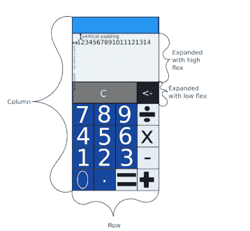

### 介绍布局 Widget

有多个 widget 可用于布局目的，其中一些看起来可能非常相似。

从上面示例中所需且在下一章中解释的 widget 开始，我们显然会提到简单的垂直和水平视觉布局结构：

- Column，详细描述于 The Column，允许你像我们在第 1 章中所做的那样垂直堆叠 widget。它不应与 Stack 混淆，后者实际上用于在其他 widget 之上显示 widget。
- ListView，详细描述于 The ListView，允许你创建（潜在无限的）可滚动的 widget 列表。
- Row，详细描述于 Horizontal Layout: The Row，允许你并排显示 widget。
- GridView，详细描述于 The GridView，用于创建可滚动网格，就像 ListView 用于创建可滚动的一维列表一样。

此外，本章还将介绍 Expanded widget（在 Fill the Space Available in the View Using Expanded 中），它用于创建不同大小的 Column 或 Row 子项。

我们还将讨论 Slivers（在 Slivers, Custom Scrollables, and Collapsible App Bars 中），它用于高级滚动，以及 Key（在 The Key 中），我在上一章中告诉你忽略它。

在下一章中，我们将结合本章介绍的许多 widget（更多内容请参见第 3 章 Building a Calculator App）。

那么让我们开始吧。

我们将从简单且无处不在的 Padding 和 Container 开始，因为你在构建应用时将与许多其他 widget 一起使用它们，然后我们将讨论如何将自己的资源添加到应用中。


### 使用不可见布局控件为控件添加容器和内边距

有些控件并不是为了向你的应用添加可见内容，而是简单地用于移动其他控件在可用空间中的位置，或改变一个控件的形状和大小，以便让应用看起来完全是你想要的样子。

它们都作用于一个子控件，你可以使用它们来改变该控件的形状和大小，或将该控件与其它控件分隔开。

#### 为控件添加内边距

在某些情况下，你应用中的一个控件必须（或应该）与所有或部分其它控件保持一定的距离——例如，如果该控件需要在列表或网格中与其它控件分隔开，或者如果有多个用于交互的小控件彼此靠近，或者也许只是因为留出一些空白看起来更好。

留空的空间称为内边距，通常以每个方向留空的像素数来定义。

你可以通过将其包裹在 Padding 控件内部来为控件外部添加内边距。

Padding 接受一个子控件和 padding 选项作为命名参数，因此你可以按以下方式创建带有 20px 内边距的 Text：

```dart
Padding(
  padding: EdgeInsets.all(20.0),
  child: Text("Example text"),
)
```

padding 选项接受一个 EdgeInsetsGeometry 类型的对象，我们将在下一节中学习它。

#### EdgeInsetsGeometry 和 EdgeInsets：定义内边距的数量和位置

你可以使用 EdgeInsets 类的以下构造函数生成 EdgeInsetsGeometry 类型的对象：

- `EdgeInsets.all(paddingAmount)`，其中 paddingAmount 是一个 double 值，指定内边距的数量，会在内容周围各处添加内边距。
- `EdgeInsets.symmetric(vertical: paddingAmountVertical, horizontal: paddingAmountHorizontal)`，其中两个参数都是可选的，指定相应轴上每个边的内边距数量。
- `EdgeInsets.only(top: paddingAmountTop, bottom: paddingAmountBottom, left: paddingAmountLeft, right: paddingAmountRight)`，其中四个参数都是可选的，指定内容相应边的内边距数量。

EdgeInsets 还有其它构造函数（如 EdgeInsets.fromWindowPadding 和 EdgeInsets.fromLTRB），但它们与 Padding 配合使用时并不太有用。

还存在 EdgeInsetsDirectional.only 和 EdgeInsetsDirectional.fromSTEB，它们与 EdgeInsets.only 和 EdgeInsets.fromLTRB 类似，但它们使用相对于文本书写方向的 start、top、bottom 和 end，在内边距需要根据文本是从左到右（如书写拉丁字母时）还是从右到左（如书写阿拉伯文或希伯来文时）而改变时很有用。

#### 容器和 BoxDecoration

Container 是一个通用的容器控件，根据我们设定的选项有多种用途：

- 我们可以选择将子控件限制为设定的宽度和高度。
- 我们可以选择为一个控件或一组控件添加背景色。
- 我们可以为控件添加内边距。
- 我们可以使用 BoxDecoration 使 Container 的形状不同于正方形或矩形。
- 我们可以同时执行上述全部或部分操作。

例如，我们可以用以下代码创建带有蓝色背景的白色文本，并在边缘与文本之间有 20 像素的内边距，全部限制在 200x50 的矩形内：

```dart
Container(
  color: Colors.blue,
  padding: EdgeInsets.all(20.0),
  width: 200.0,
  height: 50.0,
  child: Text("Prova", style: TextStyle(color: Colors.white)),
)
```

##### BoxDecoration

BoxDecoration 则用于确定 Container 的特性。

你可以将其分配给 Container 的 decoration 选项，可能对以下选项感兴趣：

- padding，它接受 EdgeInsetsGeometry，与 Padding.padding 相同。
- shape，可以是 BoxShape.circle 或 BoxShape.rectangle。
- color、image 或 gradient，用于指定背景，因为 BoxDecoration 并非仅用于形状，如果你决定使用 Container.decoration，就需要将诸如 color 之类的参数移动到 BoxDecoration 的构造函数中。
- borderRadius，当为矩形框设置时，会创建具有设定 BorderRadius 的圆角边框，可以使用 BorderRadius.circular(radius) 将其设为所有边相同（其中 radius 是一个 double 数）。

使用以下 Container 和 BoxDecoration：

```dart
Container(
  width: 300.0,
  height: 300.0,
  decoration: BoxDecoration(
    shape: BoxShape.circle,
    color: Colors.black,
  ),
  child: Center(
    child: Text(
      "Test Text",
      style: TextStyle(
        color: Colors.yellowAccent,
        fontSize: 30
      )
    ),
  ),
)
```

你可以像这样制作一个带有黄色文字的圆圈：

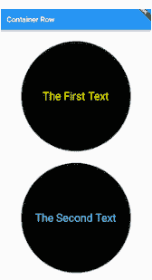

有关 Container 和 BoxDecoration 用法的更详细示例可以在 *Make Round Widgets* 中找到。

### 向应用添加自己的资源

Flutter 允许开发者随应用一起分发文件，例如使用自定义图标代替 Flutter 提供的图标。你可以用此功能处理任何类型的文件。

#### 文件放置位置

在应用源树的根目录（即 pubspec.yaml 所在位置）中，你将创建一个或多个目录，并在这些目录中放置想要随应用一起分发的文件。

#### 编辑 PUBSPEC.YAML

在 pubspec.yaml 中，找到以 flutter 开头的行（如果还没有，就在文件末尾添加），然后在其下方缩进添加一个名为 assets 的条目，方式如下：

```yaml
...
flutter:
  assets:
...
```

在其内部，添加你想要加载资源的目录，并在前面加上 - 。

例如，如果你想添加一个名为 icons 的目录，就会像这样：

```yaml
flutter:
  assets:
    - icons/
```

对于多个目录，例如 dir0、dir1 和 dir2，你可以这样写：

```yaml
flutter:
  assets:
    - dir0/
    - dir1/
    - dir2/
```

#### 使用资源

资源的使用方式取决于你想要从中加载什么数据。

##### 从资源加载各种数据

要从基于文本的资源加载数据，它需要是 `AssetBundle` 的一部分，这样你就可以使用以下方法访问数据：

- `AssetBundle.loadString`，用于从文本资源加载字符串。
- `AssetBundle.load`，用于从文件加载字节。
- `AssetBundle.loadStructuredData`，用于从文件加载任何 Dart 类型的数据。

所有这些都返回 `Futures`，因此你需要使用 Asynchronous Code in Dart: *The dart:async Library* 中描述的设施来获取字符串的值。

##### 你可以在哪里获取 AssetBundle

所有 Flutter 应用都拥有的基本 `AssetBundle` 是 `rootBundle`，它包含我们添加到 pubspec.yaml 中的所有资源。

这意味着你可以直接以以下方式从 `rootBundle` 加载文本文件：

```dart
rootBundle.loadString("path/to/file.txt")
```

或者，你可以使用 `DefaultAssetBundle`，它实际上是从父 `MaterialApp` 继承而来，并且可以在运行时更改，因为它不像 `rootBundle` 那样是 `final` 变量。`DefaultAssetBundle` 使用以下方式访问：

```dart
DefaultAssetBundle.of(context)
```

我们在上一章中用于 `Theme` 的语法。当我们发现 *InheritedWidgets* 中 `InheritedWidget` 的全部威力时，这种语法将被澄清。

我们可以通过通常的以下方式从中加载数据：

```dart
DefaultAssetBundle.of(context).loadString("path/to/file.txt")
```

语法，但这种 AssetBundle 的特征在于它不一定是 rootBundle（默认情况下 DefaultAssetBundle 只是 rootBundle）：你可以创建自己的类扩展 CachingAssetBundle 接口，例如，并缓存一些你在应用执行期间可能多次获取的字符串，或将其替换为在网络上加载资源的 NetworkAssetBundle。

不过，如果你不知道如何先使用 InheritedWidget，就无法利用这两个类，所以我建议你坚持直接使用 rootBundle 或 DefaultAssetBundle，只有在你确定替换资源包是实现目标的最佳方式时再考虑替换资源包。如果你真的现在就需要知道如何做到这一点，InheritedWidgets 是对 InheritedWidgets 部分的另一个引用。

### 图像

要使用资源中的图像，你可以简单地使用 Image.asset，如 Displaying Images from the Assets 中所述。


#### 显示图像

图像可以有不同的用途，也可能来自不同的地方，因此在 Flutter 中显示图像的方式取决于你想从哪里加载图像以及你需要将它们用于什么目的。

有两个类用于此目的。一个是 Image，它是一个组件，就像 Text、Icon 或你目前见过的任何其他组件一样。另一个是 ImageProvider，当你需要指定一个图像并对外部操纵其大小或形状时，需要用到它。

Image 组件是图像的表示形式，你可以将其添加到应用布局中的任意位置；而 ImageProvider 类是图像的来源，它用来与该图像一起构成组件。

#### 从网络显示图像

如果你有一个包含图像的 URL，形式为 `http://example.com/image.png`，你可以通过使用 Image.network 构造器来获取对应的 Image 组件，如下所示：

```
Image.network("http://example.com/image.png")
```

你可以像使用任何其他组件（如 Text 或 Icon）一样在任意位置使用它。

#### 更改图像的属性

你可以更改以下选项：

- scale，是一个 double 值，你可以用它来设置图像显示时的缩放比例。
- 最大宽度和高度（以像素为单位）。
- repeat，控制图像是否会在宽度和高度范围内重复，类型为 ImageRepeat。默认情况下，ImageRepeat 设置为 ImageRepeat.noRepeat，这会使剩余的宽度和高度保持为空或透明。其他选项包括 ImageRepeat.repeatX 和 ImageRepeat.repeatY（它们控制图像是只能沿一个轴重复还是沿另一个轴重复）以及 ImageRepeat.repeat（它使图像能够在所有方向上重复以适配宽度和高度）。
- 组件的背景颜色，在存在透明区域的地方显示。如果宽度和高度与图像的不兼容且不允许重复，它也会显示在图像周围。
- headers 使用 Map<String, String> 设置 HTTP 请求的请求头。
- 用于屏幕阅读辅助功能服务的 semanticLabel 字符串，以及当明确不需要时使用的 excludeFromSemantics 布尔值。

#### 使用宽度、高度和重复属性按你需要的方式显示图像

为了进一步说明 width、height 和 repeat 的用法，我们将看一些屏幕截图，它们展示了大小和重复设置的不同组合。

如果你完全不设置任何内容，只给定一个 URL，像这样：

```
Image.network(
  url
)
```

图像将适配视图，如你在第一张屏幕截图中所见。

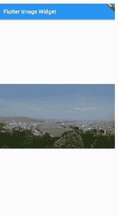

如果你设置的宽度小于视图的宽度，像这样：

```
Image.network(
  url,
  width: 200.0
)
```

图像将按比例缩小以适应该宽度（见第二张屏幕截图）。

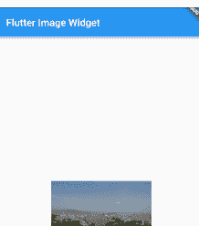

设置大于视图宽度的宽度将不会产生任何效果：结果将与第一张屏幕截图相同。设置高于或低于图像在正常情况下最终显示的高度（考虑到在这种情况下图像宽度受限），其效果与之前看到的将宽度设置为大于或小于视图宽度时的效果相同。

当我们将 *repeat* 设置为除默认值 `ImageRepeat.noRepeat` 之外的任何值时，情况就会发生变化；允许重复可以填充与我们要显示的图像宽高比不同的宽度/高度比例。

如果我们同时设置了宽度和高度，图像将在超出原始图像宽高比的那一侧重复——例如，如果你将高度设置为较高的值、宽度设置为较低的值，并将重复设置为 `ImageRepeat.repeatX` 或 `ImageRepeat.repeatY`，以下代码：

```
Image.network(
    url,
    width: 412.0,
    height: 450.0,
    repeat: ImageRepeat.repeatY // or ImageRepeat.repeat
)
```

将产生第一张屏幕截图所示的结果，图像在垂直方向上重复以适配更高的高度。

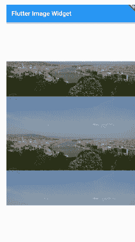

相反，如果你设置的高度和宽度使图像在水平方向上有多余的空间（通过进一步限制高度实现），像这个示例一样：

```
Image.network(
url,
width: 380.0,
height: 180.0,
repeat: ImageRepeat.repeatX // or ImageRepeat.repeat
)
```

你将得到第二张屏幕截图所示的结果。

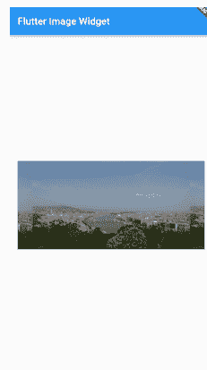

如果我们只是限制高度，结果会非常相似，但图像会填满整个可用的水平空间，在重复的部分中显示图像更大的部分。

**用于网络图像的 ImageProvider**

当我们希望将来自网络的图像用于 **ImageProvider** 时（例如，在 _制作圆形组件_ 中讨论如何制作圆形组件时就会用到），我们需要使用 **NetworkImage** 类。通过将图像的 URL 传递给其构造器来创建 **NetworkImage**：

```
var imageProv = NetworkImage("http://example.com/image.png")
```

**NetworkImage** 构造器还允许设置图像的缩放比例以及图像 GET 请求的 HTTP 请求头。

#### 从资源显示图像

我们在 _向应用添加你自己的资源_ 中学习了如何向 Flutter 应用添加资源，但现在你将看到那些用于获取所添加图像并显示它们的类。

给定资源的名称，你可以通过以下方式显示该图像资源：

```
Image.asset(
  "imagename.png",
)
```

**用于资源图像的 ImageProvider**

你可以使用 **AssetImage** 类将图像用作 **ImageProvider**：

```
AssetImage(
  "imagename.png",
)
```

#### 从内存显示图像

当图像使用 **Image.toByteData()** 以字节形式存储在内存中时，会使用这种方式，它会将它们存储为 **Uint8List**（我们将在 _字节列表及其他：dart:typed_data 库_ 中进一步讨论）。例如，要将名为 **image** 的图像存储到名为 **bytes** 的变量中，你可以使用以下代码：

```
var bytes = image.toByteData();
```

完成之后，你可以将其写入文件，或者直接将其保留在内存中。

如果你想再次将这些字节作为图像显示，可以编写以下代码：

```
Image.memory(
  bytes
)
```

##### 用于内存图像的 ImageProvider

你可以使用 **MemoryImage** 类将存储在内存中的图像用作 ImageProvider，正如你可能已经预料到的，它的用法如下：

```
MemoryImage(
  bytes
)
```

##### 在 Image 组件中使用 ImageProvider

作为示例，我们将使用 ImageProvider 创建 Image 组件，即将 ImageProvider 作为命名参数 image 传入。在这种情况下，这增加了不必要的复杂性，但理解如何创建 ImageProvider 对于理解本书中的其他示例非常重要：

```
Image(
  image: NetworkImage(
    "http://example.com/image.png"
  ),
)
```

以及任何缩放、宽度、高度、重复设置或其他对图像的修改。

对于 AssetImage 和 MemoryImage 也是如此，这可能有助于解释 ImageProvider 与 Image 组件相比所包含数据的不同。

### 垂直布局

当开发者需要垂直排列项目时，根据需求有两种选择：Column 和 ListView。

#### COLUMN（列）

Column 用于创建组件的垂直堆叠，并且不可滚动。它用于在垂直方向上一个接一个地显示项目，而不是创建项目列表。

**如何使用它**

你可以通过以下方式创建一个简单的 Column：

```
Column(
  children: <Widget> [
    // Widgets separated by commas
  ],
)
```

**布局组件选项**

你只需要将组件放在 Widget 集合字面量的方括号内（更多关于集合字面量和列表的内容，请参见 _列表和集合字面量_），组件就会以垂直堆叠的方式显示，但构造器参数中有很多选项可以自定义，比如 mainAxisAlignment，它设置子组件在主轴上如何对齐（对于 Column 来说主轴是垂直轴），它可以是以下值之一：

- *MainAxisAlignment.start*、*MainAxisAlignment.center* 或 *MainAxisAlignment.end*，分别将组件尽可能靠近主轴的开头、中间或结尾放置。
- *MainAxisAlignment.spaceAround*，使用可用空间的一半来分隔子组件彼此，剩下的另一半用于将第一个和最后一个子组件与 Column 的开头和结尾分隔开。
- *MainAxisAlignment.spaceBetween*，使用空间使子组件彼此尽可能远离。
- *MainAxisAlignment.spaceEvenly*，使每个子组件与下一个子组件之间的间距，与 Column 开头到第一个子组件以及最后一个子组件到 Column 末尾的间距相同。


Closely related is the mainAxisSize, which can be either MainAxisSize.max or MainAxisSize.min.

There is also crossAxisAlignment, which sets how the children widgets should be aligned along the cross axis (in the case of a Column it is the horizontal axis) and can be one of the following:

- The default CrossAxisAlignment.center, which aligns the widgets so that their center is aligned.
- CrossAxisAlignment.start and CrossAxisAlignment.end which, respectively, align the widgets to the start or the end of the cross axis.
- CrossAxisAlignment.stretch, which makes the widgets occupy as much space as possible in the cross axis.
- CrossAxisAlignment.baseline, especially useful with Rows, which aligns the children’s baseline.

##### What You Use It For

You can use a Column simply, like in the previous chapter, to show two widgets one on top of the other, like this:

```dart
Scaffold(
  appBar: AppBar(...),
  body: Column(
    crossAxisAlignment: CrossAxisAlignment.start,
    mainAxisAlignment: MainAxisAlignment.spaceBetween,
    children: <Widget>[
      Icon(Icons.arrow_upward),
      Text("This will be in the middle"),
      Text("This will be at the bottom")
    ],
  )
)
```

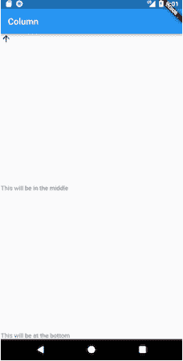

but you will probably want to use it more often to group together widgets, perhaps forming a new and more complex widget:

```dart
class TwoTexts extends StatelessWidget {
  TwoTexts({this.firstText, this.secondText});

  String firstText, secondText;

  @override
  Widget build(BuildContext context) {
    return Column(
      children: <Widget>[
        Text(firstText),
        Text(secondText)
      ],
    );
  }
}
```

This will be especially useful inside ListViews, which we’ll see in action now.

### THE LISTVIEW

The ListView is used to create a scrollable list of widgets.

It is used when there is a need to create long lists of similar (or the same) items, and it can dynamically load other elements when they are many (or unlimited).

The list can be expressed in multiple ways, as we will now see.

#### How You Use It

There are multiple constructors that you can use to create a ListView.

The default constructor works just like the Column’s constructor: you just need to provide a List of Widgets as the children:

```dart
ListView(
  children: <Widget>[
    Text("1"),
    Text("2"),
    Text("3"),
    ...
  ],
)
```

This example shows the advantage of using another constructor, the ListView.builder constructor, which is used the following way:

```dart
ListView.builder(
  itemCount: 499,
  itemBuilder: (BuildContext context, int i) =>
    Text("${i+1}"),
)
```

This does the same and creates a list of 499 Text widgets with the numbers from 1 to 500.

But this constructor can also be useful when each element has something different—for example, if each Text needs a different, unrelated string.

After defining something like:

```dart
const strings = [
  "The First Widget",
  "The Second Widget",
  "The Third Widget",
  "The Last Widget"
]
```

or generating a List using what is described in Generating Lists.

You can create a ListView like this:

```dart
ListView.builder(
  itemCount: strings.length,
  itemBuilder: (BuildContext context, int i) =>
    Text(strings[i]),
)
```

There is also ListView.separated, which allows you to add a separator widget, in this case yet another Text for simplicity:

```dart
ListView.separated(
  itemCount: 500,
  itemBuilder: (context, i) =>
    Text("$i", style: Theme.of(context).textTheme.display1),
  separatorBuilder: (context, i) =>
    i%3 == 0 ? Divider() : Padding(padding: EdgeInsets.all(0.5),),
)
```

This adds a divider widget[21] once every three numbers, starting from the space between the first and second widget, like in the following screenshot:

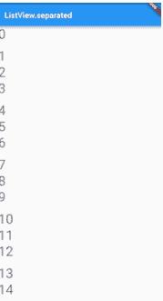

This is especially useful when you want to display lists of items separated into categories.

Other uses for ListView in general are explained in the Row’s usage section in Where You’ll Use the Row Together with Other Widgets.

shrinkWrap, when set to false (default), will make the list take up as much space as is available on the main axis. If, instead, you set it to true the grid’s size will adapt to the size that is needed to display its children.

#### Customizing the Divider

The Divider can be customized to fit your app’s overall look, feel and needs:

- You can set the color option to another color.
- You can set its height option by providing a double number to make the space bigger or smaller.
- You can set its indent option by providing a double number to make the line start at a different position along the horizontal axis.

#### Horizontal Lists

You can use scrollDirection to make a horizontally scrolling list, which is very useful if you want to have a horizontal list inside a vertical list. This can be seen in several apps and you’ll see exactly why it is useful.

In the following example, I’ll explain how to show many products, grouped in categories, using a combination of ListView.builder to display the categories and horizontal ListView.builder to show the products. We’ll use example data, defined in the following way:

```dart
const categories = [
  "Automotive",
  "Books",
  "Electronics",
  "Food"
];

const products = [
  [
    "Car", "Tyre", "Fuel", "Oil"
  ],
  [
    "Programming Book", "Novel", "Politics Book", "Business Book"
  ],
  [
    "Desktop Computer", "Laptop", "Computer keyboard"
  ],
  [
    "Pasta", "Pizza", "Bread", "Cheese", "Ham", "Sausage", "Beef"
  ]
];
```

and then render the product list using something like:

```dart
return Scaffold(
  backgroundColor: Colors.greenAccent,
  appBar: AppBar(title: Text("List inside List example")),
  body: ListView.builder(
    itemCount: categories.length,
    itemBuilder: (context, i) =>
      Column(
        children: <Widget>[
          Text(categories[i]),
          Container(
            height: 150.0,
            child: ListView.builder(
              padding: EdgeInsets.all(10.0),
              scrollDirection: Axis.horizontal,
              itemCount: products[i].length,
              itemBuilder: (context, j) =>
                Padding(
                  padding: EdgeInsets.all(20.0),
                  child: Card(
                    child: Padding(
                      padding: EdgeInsets.all(10.0),
                      child: Text(
                        products[i][j],
                        style: Theme.of(context).textTheme.display1,
                      ),
                    ),
                  ),
                ),
            ),
          ),
        ],
      ),
  ),
);
```

which produces the result as seen in the screenshot.

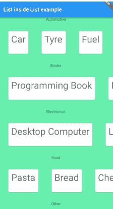

The Container is needed to constrain the internal ListView since it is inside another scrollable widget and the app wouldn’t work without it.

More on the Card in The Card.

#### The ListTile

The ListTile is the typical widget that is used with ListViews and is very common in chat apps: the typical row made of a (usually round) preview picture, on the left, and on the right side a title and an optional subtitle.

##### Implement a ListTile

ListTile is very common and useful and very easy to implement in Flutter:

```dart
ListTile(
  leading: Image(leftImage), // OPTIONAL
  title: Text(title),
  subtitle: Text(subtitle), // OPTIONAL
  onTap: () => openTile(), // OPTIONAL
)
```

leading is the little preview widget shown before the title, and it is usually an image, title is the big text description of the element, the subtitle is smaller and shown below, and onTap is the function that will be fired when the user taps on the tile.

There is also a (less common) trailing argument available to add a widget placed after the title.

For example, the following code, using the list icon as the leading icon:

```dart
ListView.builder(
  itemBuilder: (context, i) =>
    ListTile(
      leading: Icon(Icons.list),
      title: Text("title number ${i+1}"),
      subtitle: Text("subtitle"),
    ),
)
```

will produce:

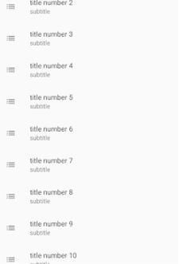

##### Make Round Widgets

You previously learned that the leading widget of a ListTile is usually round, but how can you make a round widget?

You build round widgets in two ways: using a CircleAvatar or using a BoxDecoration for a Container.

##### Use a Container to Make Widgets of Any Shape and Size

The most versatile and generic way is to contain the widget within a circular shape using a circle-shaped Container.

As an example of the usage of the container, the following code produces a normal square box with an icon and some text:

```dart
Container(
  height: 50.0,
  width: 50.0,
  color: Colors.blueAccent,
  child: Column(
    children: <Widget>[
      Icon(Icons.apps),
      Text(
        "Test",
        style: TextStyle(color: Colors.white),
      ),
    ],
  ),
)
```

just like in the following screenshot:


例如，你可以用更简单的方式完全复现之前的 Container 示例，如下所示：

```
CircleAvatar(
  radius: 25.0,
  backgroundColor: Colors.blue,
  child: Center(
    child: Column(
      children: <Widget>[
        Icon(Icons.apps),
        Text("Test", style: TextStyle(color: Colors.white)),
      ],
    ),
  ),
)
```

其中，radius 是圆的半径，backgroundColor 是圆的背景色，child 是实际显示在圆内部的内容。

使用 CircleAvatar 的真正优势在于，它让你能够非常轻松地将图片裁剪成圆形，只需将 ImageProvider 作为 backgroundImage 参数传入即可。以 pragprog.com 网站的 PNG 图标[22] 为例，你可以在应用内使用 Image 小部件的 Image.network 构造函数并传递 URL 作为位置参数来显示它（我们将在第 5 章“网络与存储 I/O 和导航”中这样做），如下所示：

```
Image.network("https://pragprog.com/favicon.png")
```

但这不能用于 CircleAvatar 的 backgroundImage，因为它需要的是 ImageProvider，而不是 Image。

因此你需要使用 NetworkImage 类，并将其作为 CircleAvatar 的参数传入，如下例所示：

```
CircleAvatar(
  backgroundImage: NetworkImage("https://pragprog.com/favicon.png"),
)
```

这将生成如下圆形图片：

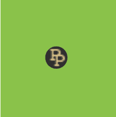

显然，你可以通过 `radius` 参数随意更改半径。

#### 在 ListTile 中使用 CircleAvatar

将 CircleAvatar 集成到 `ListTile` 中很简单，只需将其用作 `leading` 小部件，如下例所示：

```
```dart
ListTile(
  leading: CircleAvatar(
    backgroundImage: NetworkImage("https://pragprog.com/favicon.png"),
  ),
  title: Text("Example"),
),
```
```

其效果如下：


#### 使用可展开的 ListTile：ExpansionTile

`ExpansionTile` 是一个可展开的 ListTile：首次渲染时它就像一个 `ListTile`，但你无需离开当前视图，即可让 `ExpansionTile` 变得更高，并显示更多小部件，例如更多文本或额外的按钮和功能。

你可以这样使用 `ExpansionTile`：

```
```dart
ExpansionTile(
  leading: Image(leftImage), // OPTIONAL
  title: Text(title),

  // ExpansionTile-specific arguments
  initiallyExpanded: true, // OPTIONAL default: false
  children: <Widget>[
    Row(
      children: [
        Text("Left on first row"),
        Text("Right on first row"),
```
```

```
```dart
],
),
Text("Second row"),
],
backgroundColor: Colors.green[100], // OPTIONAL
// OPTIONAL, argument is a boolean, true if expanding, false if collapsing
onExpansionChanged: (expanding) {return;},
)
```
```

##### 更改 ExpansionTile 的属性

大多数属性与 `ListTile` 相同（除了 `onTap`，`ExpansionTiles` 没有这个属性），但 `trailing` 这次不同：如果未指定，它将是一个箭头，点击时会旋转以显示小部件是否展开。

有四个主要的 `ExpansionTile` 专属参数：

-   `initiallyExpanded`，如果你希望小部件的初始状态为展开状态，可以将其设置为 true。
-   `children`，这是展开时显示在 tile 下方的小部件列表。
-   `backgroundColor`，这是子小部件列表的背景颜色。
-   `onExpansionChanged`，通过它你可以设置一个在 tile 展开时调用的函数。

例如，以下代码：

```
```dart
ExpansionTile(
  leading: Icon(Icons.list),
  title: Text("title"),
  children: <Widget>[
    Row(
      mainAxisAlignment: MainAxisAlignment.spaceEvenly,
      children: [
        Text("Left on first row"),
        Text("Right on first row"),
      ],
    ),
    Text("Second row"),
  ],
)
```
```

生成：

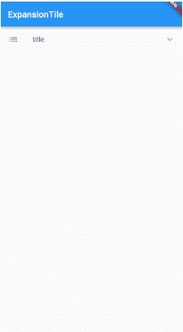

可以展开为：

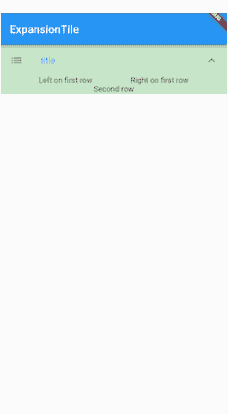

#### 可关闭的 ListTile（Dismissible ListTiles）

ListTile 的一个非常常见的用途是作为可关闭的小部件，这意味着它们可以通过滑动手势删除。小部件通过被包裹在 Dismissible 小部件中来获得此能力。

Dismissible 要求提供一个 Key。使用 Dismissible 并不一定要理解 Key，但将在“Key”中提供更深入的说明。

Dismissible 小部件的使用方式如下：

```
Dismissible(
  background: Container(color: Colors.green),
  key: Key(string),
```

```
child: ListTile(
  title: Text(string),
),
)
```

其中，background 是用户滑动 tile 时显示在 tile 后面的内容。将其设置为 Container 后，就可以选择背景颜色。

Dismissible 在 ListView 中的完整实现如下：

```
ListView.builder(
  itemCount: 20,
  itemBuilder: (context, i) => Dismissible(
    background: Container(
      color: Colors.red,
      child: Row(
        mainAxisAlignment: MainAxisAlignment.spaceBetween,
        children: [
          Icon(Icons.clear, color: Colors.white),
          Icon(Icons.clear, color: Colors.white),
        ],
      ),
    ),
    key: UniqueKey(),
    child: ListTile(
      leading: CircleAvatar(
        backgroundImage: NetworkImage("https://pragprog.com/favicon.png"
),
      ),
      title: Text("Example $i+1"),
    ),
  ),
)
```

UniqueKey 是最基本、最简单的 Key，除非你需要比 Flutter 默认提供的更强大的小部件状态控制，否则它应该足够了。带有两个间隔开的 Icons.clear 图标的 Row 会在 tile 被滑动时在两侧显示图标。该代码生成以下列表：

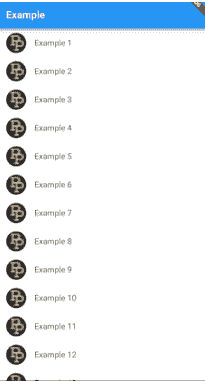

部分滑动一个 tile 会显示红色背景和一个图标：


完全滑动则会以漂亮的动画将该 tile 从列表中移除，最终列表看起来像这样：

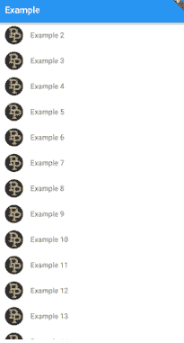

#### 显示 SnackBar

在大多数应用中，当一个 ListTile 被关闭时，屏幕底部会显示一个 SnackBar[23]。

使用 Flutter 显示 SnackBar 非常简单：

```
Scaffold.of(context).showSnackBar(
  SnackBar(
    content: Text(
      "Tile ${i+1} was dismissed"
    ),
  ),
```

并且，可以通过将代码更改为以下形式，在 tile 被关闭时自动显示 SnackBar：

```
ListView.builder(
  itemCount: 20,
  itemBuilder: (context, i) => Dismissible(
    background: Container(
      color: Colors.red,
      child: Row(
        mainAxisAlignment: MainAxisAlignment.spaceBetween,
        children: [
          Icon(Icons.clear, color: Colors.white),
          Icon(Icons.clear, color: Colors.white),
        ],
      ),
    ),
    key: UniqueKey(),
    child: ListTile(
      leading: CircleAvatar(
        backgroundImage: NetworkImage("https://pragprog.com/favicon.png"
),
      ),
      title: Text("Example ${i+1}"),
    ),
    onDismissed: (direction) {
      Scaffold.of(context).showSnackBar(
        SnackBar(
          content: Text(
            "Tile #${i+1} was dismissed"
          ),
        ),
      };
    },
  ),
```

SnackBar 的构造函数除了支持 content 之外，还支持一个 action 属性，其形式为 SnackBarAction，它允许开发者显示一个按钮，让用户能够针对 SnackBar 的消息采取行动：

```
SnackBar(
  content: Text("Something happened"),
  action: SnackBarAction(
    label: "DO SOMETHING ABOUT IT",
    onPressed: () {
      // do something about it
    },
  ),
),
```

使用该代码构建的 SnackBar 如下所示：


### 水平布局：Row

Row 将小部件并排布局，与 Column 非常相似，不同之处在于主轴和交叉轴互换了。

#### 使用方法与用途

你可以简单地以如下方式使用 Row：

```
Column(
children: <Widget> [
Text("This will be the left side"),
Text("This will be the right side")
],
)
```

其选项与 Column 相同（交叉轴变为垂直方向，主轴变为水平方向），你可以在 *布局小部件选项* 中找到它们。

#### 在何处将 Row 与其他小部件结合使用

Row 和 Column 是很好的组合小部件：借助它们，你可以用简单的元素构建复杂的小部件。

例如，一个简单的社交媒体帖子可以用一个包含三个元素的 Column 来表达：一个显示个人资料图片和个人资料名称的 Row，中间的大段文字，以及底部显示命令的一行：

```
Column(
children: <Widget> [
Row(
children: <Widget> [
ProfilePicture(profileID),
Text(profileName),
],
),
Text(postText),
Row(
children: <Widget> [
LikeButton(),
CommentButton(),
ShareButton()
],
),
],
)
```


```dart
] )
```

这一组件组合——虽然它只是一行（Row）组件——也能轻松插入到 ListView 或 GridView 中。沿用社交网络的例子，它可以作为社交网络的信息流。

这并不难做到——我们首先要让它符合组成它的各个元素所需的空间和尺寸：

```dart
Column(
  children: <Widget> [
    Row(
      children: <Widget> [
        CircleAvatar(
          backgroundImage: ProfilePicture(profileID),
        ),

        Padding(
          padding: EdgeInsets.all(20),
          child: Text(profileName),
        ),
      ],
    ),
    Align(
      alignment: FractionalOffset.centerLeft,
      child: Padding(
        padding: EdgeInsets.all(5),
        child: Text(postText),
      ),
    ),
    Divider(),
    Row(
      children: <Widget> [
        LikeButton(),
        CommentButton(),
        ShareButton()
      ],
    ),
  ],
)
```

剩下要做的就是将占位组件替换为真正的组件。

对于头像，我们将使用之前用过的同一个 `NetworkImage("https://pragprog.com/favicon.png")`，而点赞、评论和分享按钮则使用简单的 IconButton：

```dart
Column(
  children: <Widget> [
    Row(
      children: <Widget> [
        CircleAvatar(
          backgroundImage: NetworkImage(
            "https://pragprog.com/favicon.png",
          ),
        ),
        Padding(
          padding: EdgeInsets.all(20),
          child: Text("Short poster"),
        ),
      ],
    ),
    Align(
      alignment: FractionalOffset.centerLeft,
      child: Padding(
        padding: EdgeInsets.all(5),
        child: Text("This is a short post, but that doesn’t really matter"),
      ),
    ),
    Divider(),
    Row(
      children: <Widget> [
        IconButton(
          icon: Icon(Icons.thumb_up, color: Colors.redAccent),
          onPressed: () {},
        ),
        IconButton(
          icon: Icon(Icons.comment, color: Colors.greenAccent),
          onPressed: () {},
        ),
        IconButton(
          icon: Icon(Icons.share, color: Colors.blueAccent),
          onPressed: () {},
        ),
      ],
    ),
  ],
),
```

要创建包含帖子的完整 ListView 视图，我们还应该将帖子数据单独存储在一个 List 中，因为在真实应用中，你绝不会硬编码这类数据。

为此，我们首先创建一个类来保存帖子数据：

```dart
class Post {

  Post({this.profileName, this.profilePicture, this.postText});

  ImageProvider profilePicture;
  String profileName;
  String postText;
}
```

然后创建一个该类的 List，并填入一些数据：

```dart
List<Post> posts = [
  Post(
    postText: "This is a short post, but that doesn’t really matter",
    profileName: "Short poster",
    profilePicture: NetworkImage("https://pragprog.com/favicon.png"),
  ),
  Post(
    postText: "This is a longer post, which really shows how the " +
        "widgets will naturally expand when there is more content to display.\n" +
        "At this point, this line of text is just here because we need to " +
        "make this post so much bigger than the other one.",
    profileName: "Long poster",
    profilePicture: NetworkImage("https://pragprog.com/favicon.png"),
  ),
];
```

此时，生成的 ListView 就非常直观了：

```dart
ListView.builder(
  itemCount: 2,
  itemBuilder: (context, i) => Card(
    child: Column(
      children: <Widget> [
        Row(
          children: <Widget> [
            CircleAvatar(
              backgroundImage: posts[i].profilePicture,
            ),
            Padding(
              padding: EdgeInsets.all(20),
              child: Text(
                posts[i].profileName,
                style: Theme.of(context).textTheme.subhead,
              ),
            ),
          ],
        ),
        Align(
          alignment: FractionalOffset.centerLeft,
          child: Padding(
            padding: EdgeInsets.all(5),
            child: Text(
              posts[i].postText,
              style: Theme.of(context).textTheme.body1,
            ),
          ),
        ),
        Divider(),
        Row(
          children: <Widget> [
            IconButton(
              icon: Icon(Icons.thumb_up, color: Colors.redAccent),
              onPressed: () {},
            ),
            IconButton(
              icon: Icon(Icons.comment, color: Colors.greenAccent),
              onPressed: () {},
            ),
            IconButton(
              icon: Icon(Icons.share, color: Colors.blueAccent),
              onPressed: () {},
            ),
          ],
        ),
      ],
    ),
  ),
);
```

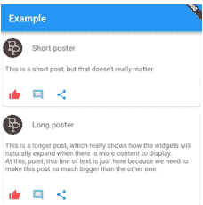

嵌套的 Row 和 Column 也可以用来创建网格，如*嵌套的 Row 和 Column*中所述。

### 创建网格

根据你的应用需要实现的效果，可以通过两种不同的方式创建网格：使用 GridView，或使用嵌套的 Row 和 Column。

#### GridView

GridView 之于网格，就像 ListView 之于垂直布局一样。它适用于类似照片应用中那种网格：由数量可变的固定大小元素组成的长型可滚动网格。GridView 与 ListView 非常相似，也可以使用多种构造函数来创建。默认构造函数将在*Slivers、自定义可滚动组件和可折叠应用栏*一节中讨论。

##### 固定交叉轴数量的网格

GridView.count 构造函数以 children Widgets 的 List 和 crossAxisCount 作为构建网格的基本参数，如下例所示：

```dart
GridView.count(
  crossAxisCount: 3,
  crossAxisSpacing: 50.0,
  mainAxisSpacing: 100.0,
  padding: EdgeInsets.all(20.0),
  children: [1,2,3,4,5,6,7,8,9,10,11,12,13,14,15]
      .map(
        (n) =>
          Text(
            "$n",
            style: Theme.of(context).textTheme.display1,
          ),
      ).toList(),
)
```

生成的效果如下：

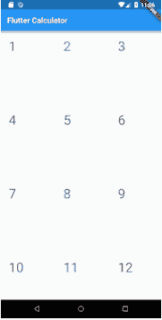

##### 每组件交叉轴最大范围的网格

GridView.extent 构造函数使用 children Widgets 的 List 和 maxCrossAxisExtent 作为参数。maxCrossAxisExtent 是每个子组件在交叉轴上可以占用的最大像素数。maxCrossAxisExtent 越大，每个网格单元就越大。

例如，下面的代码：

```dart
GridView.extent(
  maxCrossAxisExtent: 50.0,
  crossAxisSpacing: 50.0,
  mainAxisSpacing: 100.0,
  padding: EdgeInsets.all(20.0),
  children: [1,2,3,4,5,6,7,8,9,10,11,12,13,14,15]
    .map(
      (n) =>
        Text(
          "$n",
          style: Theme.of(context).textTheme.display1,
        ),
    ).toList(),
)
```

在 2880x1440、560dpi、使用 Android 默认缩放的屏幕上，会生成下面这样的网格：

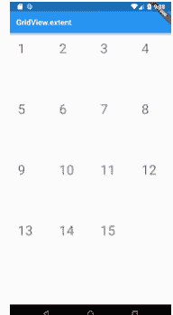

##### 使用 Builder 函数构建网格

GridView.builder 构造函数使用 itemBuilder 来构建子组件，并使用 gridDelegate 来控制组件的大小和位置。下面的示例生成的网格与前面的 GridView.count 示例（此处）相同：

```dart
GridView.builder(
  padding: EdgeInsets.all(20.0),
  itemCount: 15,
  gridDelegate: SliverGridDelegateWithFixedCrossAxisCount(
    crossAxisCount: 3,
    crossAxisSpacing: 50.0,
    mainAxisSpacing: 100.0,
  ),
  itemBuilder: (context, i) => Text("${i+1}"),
)
```

网格委托（grid delegate）有着（异常长的）名称，例如 SliverGridDelegateWithFixedCrossAxisCount 和 SliverGridDelegateWithMaxCrossAxisExtent，它们分别对应 GridView.count 和 GridView.extent 的属性。它们以命名参数的形式接收与网格布局相关的属性。

如果你想精确复现这里展示的 GridView.extent 的行为，可以编写如下代码：

```dart
GridView.builder(
  padding: EdgeInsets.all(20.0),
  itemCount: 15,
  gridDelegate: SliverGridDelegateWithMaxCrossAxisExtent(
    maxCrossAxisExtent: 50.0,
    crossAxisSpacing: 50.0,
    mainAxisSpacing: 100.0,
  ),
  itemBuilder: (context, i) => Text("${i+1}"),
)
```

##### GridView 的属性

其他网格属性包括：

- childAspectRatio，指网格中每个子组件在交叉轴与主轴方向上的尺寸之比。
- shrinkWrap，与 ListView 的 shrinkWrap 相同（见*如何使用*）。
- scrollDirection，设置网格滚动的方向（同时也是网格的主轴方向）。

#### 嵌套的 Row 和 Column

如果你需要创建一个（可能较小的）不可滚动的、包含固定数量组件的网格，那么可以使用由 Row 组成的 Column。

一个简单的 2x2 网格可以这样实现：

```dart
Column(
  children: <Widget> [
    Row(
      children: <Widget> [
        Text(topLeftString),
        Text(topRightString),
      ],
    ),
    Row(
      children: <Widget> [
        Text(bottomLeftString),
        Text(bottomRightString),
      ],
    ),
  ],
)
```


### 卡片

卡片是一种 Material Design 组件[^24]，用于在视觉上组合（或分隔）小部件。

你可以将它用于应用的整体布局中，也可以用在列表或网格中。

例如，以下代码：

```
GridView.builder(
  padding: EdgeInsets.all(20.0),

  itemCount: 15,

  gridDelegate: SliverGridDelegateWithFixedCrossAxisCount(
    crossAxisCount: 3,
    crossAxisSpacing: 50.0,
    mainAxisSpacing: 100.0,
  ),
  itemBuilder: (context, i) => Card(
    child: Center(
      child: Text("${i+1}"),
    ),
  ),
)
```

这很好地显示了在这些设置下每个 GridView 瓦片可用的空间：

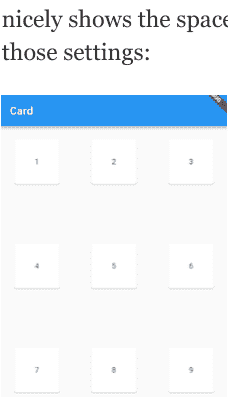

但 Card 在 ListView 中经常使用。

```
child: Row(
  children: <Widget>[
    FlatButton(
      child: Text("Follow"),
      onPressed: () => Scaffold.of(context).showSnackBar(
        SnackBar(
          content: Text(
            "Now you follow @iamarealhuman\n"
          ),
        ),
      ),
    ),
    FlatButton(
      child: Text("Send Message"),
      onPressed: () => Scaffold.of(context).showSnackBar(
        SnackBar(
          content: Text(
            "You can't send messages to @iamarealhuman\n"
          ),
        ),
      ),
    ),
  ],
),
```

这将生成以下列表：

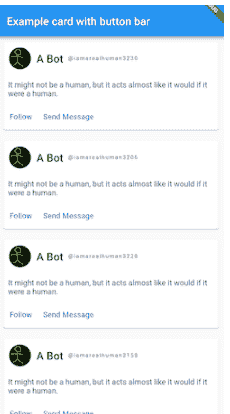

### 另一个 Material Design 元素：Chip

既然我们讨论的是 Material Design 组件，另一个集成到 Flutter 中且与 Card 用途相似的组件是 Chip。[^25]

它们经常用于在短信或电子邮件应用中显示联系人姓名，也用于过滤、做出选择和执行操作。

它们非常小，通常由一个圆形图像或图标（称为头像）和一些文本（称为标签）组成。它还可以有一个 deleteIcon，用于调用设置为 onDelete 选项的 VoidCallback。

可以使用以下代码构建一个带有简单圆形 CircleAvatar 和标签的 Chip：

```
Chip(
  avatar: CircleAvatar(
    backgroundImage: NetworkImage(
      "http://www.carminezacc.com/manstick.png"),
    ),
  label: Text("A Bot"),
),
```

使用 Center 居中后，会产生以下效果：

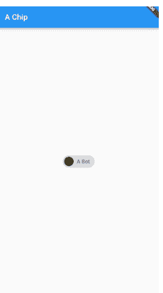

### 使用 Expanded 填充视图中的可用空间

使用 Row 和 Column 时，你只会使用所需的空间，而且两个相同的 widget 总是占据相同的空间。

如果你想使用视图中的所有空间，并以特定方式在小部件之间分配空间，你需要使用 Expanded 小部件。

#### 使用方法

Expanded 小部件只能在 Row 或 Column 内使用，它接受一个 child 参数作为要扩展的小部件，并接受一个可选的整数作为 flex 参数。

子小部件将被扩展以填充尽可能多的空间，如果在同一个 Row 或 Column 中有多个 Expanded，它们所占用的空间与其 flex 值成正比。

例如，以下代码：

```
Column(
  children: <Widget> [
    Expanded(
      flex: 5,
      child: (
        ...
      ),
    ),
    Expanded(
      flex: 2,
      child: (
        ...
      ),
    ],
  )
```

将按如下方式分配小部件的空间：

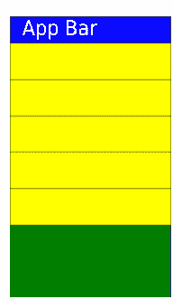

除去应用栏，每个绿色或黄色矩形代表视图的 1/7，黄色部分（视图的 5/7）将由第一个 Expanded 的子级占据，而绿色部分（剩余的 2/7）将是第二个 Expanded 的子级所在位置。

在下一章构建计算器应用时，我们将大量使用 Expanded。

### Slivers、自定义可滚动组件和可折叠应用栏

我们已经介绍了关于可滚动组件（如 `ListView` 和 `GridView`）的大部分知识，但本节将更深入地探讨 `Scrollable`、`ScrollView`、`SliverList` 以及其他更低级、更可定制的组件。你还将学习如何让应用栏在用户向下滚动时可折叠。

#### Flutter 如何确定滚动距离

Flutter 实际上使用 `Simulation` 组件来模拟滚动，该组件模拟一维空间中某个受到外力作用的点的运动，模拟状态用于确定滚动位置。这些力会根据所需的滚动行为而变化。这是通过 `ScrollPhysics` 类设置的，你可以将其用于 `physics` 选项。

**`ScrollView` 中的 `primary`**

`primary` 是一个布尔选项，可以为 `ScrollView` 设置。如果将其设置为 `false`，则只有当子项足够多需要滚动时，视图才会滚动。

#### 制作可折叠的应用栏

在可滚动应用中，一个常见的景象是可折叠应用栏：它在网络浏览器中尤其常见，在聊天应用的某些个人资料页面中也有另一种变体。

通常，它表现为当用户向下滚动时应用栏消失，向上滚动时重新出现，即使没有滚动到可滚动视图的顶部也是如此。

可以使用包含 `SliverAppBar` 和 `SliverList`（或者 `SliverGrid`）的 `CustomScrollView` 来实现。

`SliverList` 实际上只是一个使用 `SliverChildDelegate` 生成子项的 `ListView`，用法类似于 `ListView.builder`，但有一个重要区别：它旨在用作 `CustomScrollView` 的一部分。`CustomScrollView` 是一种特殊的小部件，用于通过类似 `SliverList` 和 `SliverAppBar` 的 sliver 创建自定义可滚动组件。

要构建具有可折叠应用栏的应用，你需要一个带有 Scaffold 的普通 MaterialApp。

区别在于，你不需要向 Scaffold 添加 AppBar，而只需使用其 body 选项并将其分配给 CustomScrollView：

```
@override
Widget build(BuildContext context) {
  return Scaffold(
    body: CustomScrollView(
      slivers: <Widget>[
        SliverAppBar(
          title: Text("A collapsable AppBar"),
        ),
        SliverList(
          delegate: SliverChildBuilderDelegate(
            (context, i) => ListTile(title: Text("Si")),
          ),
        ),
      ],
    ),
  );
}
```

不过，这实际上并不符合我们的要求：应用栏只在用户滚动到列表顶部时重新出现，但这并不是我们想要的行为，因此我们需要将 SliverAppBar 的 floating 选项设置为 true，这样当用户从列表中的任何位置向上滚动时它都会重新出现：

```
SliverAppBar(
  title: Text("A collapsable AppBar"),
  floating: true,
),
```

但这还不是完全符合要求的行为：我们希望即使向上滚动一部分，SliverAppBar 也能出现，因此我们还需要将 snap 设置为 true（只有当 floating 也为 true 时这才会有影响）：

```
SliverAppBar(
  title: Text("A collapsable AppBar"),
  floating: true,
  snap: true,
```

### Key

Key 用于唯一标识一个小部件，框架通过它来更新实际需要更新的元素。

通常你不会使用 Key，因为框架会自行处理，但你可以使用它们来更好地控制小部件的状态和更新。

此外，有些小部件会明确要求提供 key，比如我们在 *可取消的 ListTile* 中遇到的 `Dismissible`。

#### 多个 Key 对应同一个“锁孔”

Key 有很多种，其中一些比普通的 `Key` 构造函数更有用。普通的 `Key` 构造函数将一个 `String` 作为命名参数，该字符串在父级内必须唯一。

```
ExampleWidget(
  key: Key("example")
)
```

`GlobalKey` 也存在，由于其全局作用域，它们必须是绝对唯一的。

`GlobalKey` 允许小部件在保持其状态的同时，移动为完全不同的父级的子级。

还有 `LocalKey`，它们的作用域与普通 `Key` 相同，但有一些不同的构造函数：

- `ValueKey`，它接受任意类型的值，而不仅仅是 `String`。
- `UniqueKey`，它不接受任何值，并且始终是唯一的（我们在 *可取消的 ListTile* 中使用过）。

#### 使用 Key

大多数时候，你不需要使用 `Key`；只有当小部件要求你设置 `Key` 时才需要使用，就像我们在 *可取消的 ListTile* 中讨论 `Dismissible` 时那样。


### 接下来做什么

在下一章中，我们将结合使用本章中看到的一些布局组件来构建一个计算器应用。

### 脚注

+   1. [21] https://material.io/design/components/dividers.html
+   2. [22] https://pragprog.com/favicon.png
+   3. [23] https://material.io/design/components/snackbars.html#anatomy
+   4. [24] https://material.io/design/components/cards.html
+   5. [25] https://material.io/design/components/chips.html
