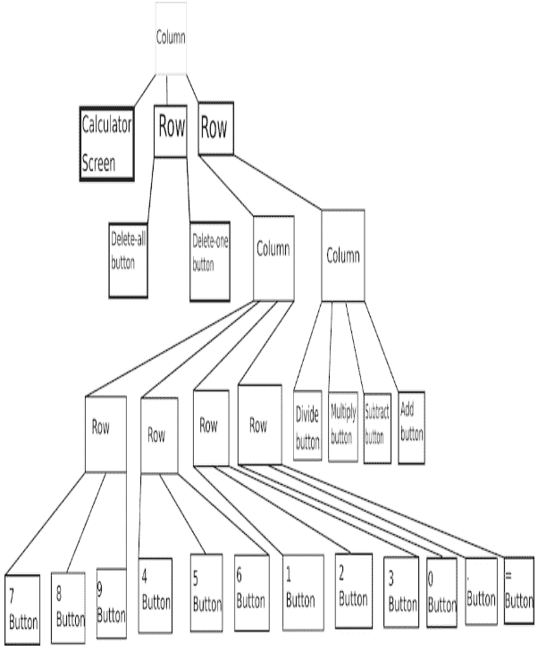
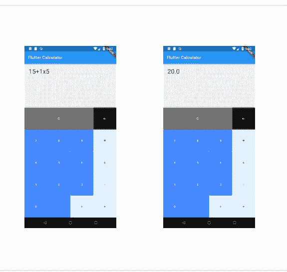

## 第 3 章：构建计算器应用

## 

呼！你已经学到了很多 Flutter 中可用的工具。我们要把它们用起来吗？正如所承诺的，本章将专注于构建一个计算器应用，使用我们在上一章中看到的一些结构和元素。

我们将从展示如何从一个空文件到构建出一个可运行的 Flutter 应用开始。

这一次，使用 `flutter create appname` 命令或你选择的 IDE 创建一个 Flutter 项目，但这一次要删除生成的 `main.dart` 中的所有内容。

## 导入基本依赖

你应该始终做的第一件事就是导入依赖。

在这种情况下，我们只需要上一章中使用的同一个 Flutter Material 库：

layout/calculator/lib/main.dart

```
import "package:flutter/material.dart";
```

## 编写 main

让我们从应用中最简单、最不具体的部分开始：main 函数。

#### 使用包装类

在上一章中，我们定义了一个 MyApp 类，并使用 main 简单地运行它，如下所示：

```
void main() =>
  runApp(MyApp());

class MyApp extends StatelessWidget {
  @override
  Widget build(BuildContext context) {
    return MaterialApp(
      // Actual app content and data
    );
  }
}
```

#### 跳过包装类

只需编写以下代码，就可以达到相同的效果：

```
void main() {
  runApp(MaterialApp(
    // other app content and data
  ));
}
```

这看起来简短很多，但在一个更大的应用中，相比之下其实并没有节省多少。

如果你的应用完全包含在一个视图中，这不会损害应用功能；但如果你需要更多视图并需要共享数据，就应该考虑为应用编写一个包装类，以保持内容组织有序、清晰明了。

而且，无论如何，只有在确实需要保持代码紧凑，或者为了节省时间快速编写一个小应用时，才应该使用第二种形式。

因此，我们将编写以下代码：

layout/calculator/lib/main.dart

```
void main() => runApp(MyApp());

class MyApp extends StatelessWidget {
  @override
  Widget build(BuildContext context) {
    return MaterialApp(
      title: "Flutter Calculator",
      theme: ThemeData(
        primarySwatch: Colors.blue,
        backgroundColor: Colors.black26
      ),
      home: CalculatorHomePage(title: "Flutter Calculator"),
    );
  }
}
```

## 计算器的主页

主页将是有状态的（stateful），因为它需要反映用户的交互和输入，所以我们将定义一个简单的 `StatefulWidget`：

```
layout/calculator/lib/main.dart

class CalculatorHomePage extends StatefulWidget {
  CalculatorHomePage({Key key, this.title}) : super(key: key);
  final String title;

  @override
  _CalculatorHomePageState createState() => _CalculatorHomePageState();
}
```

以及它的状态：

```
layout/calculator/lib/main.dart

class _CalculatorHomePageState extends State<CalculatorHomePage> {
}
```



将 Flutter 应用表示为树是可视化 Flutter 应用布局的一种非常有效的方式。

在本例中，应用的主要结构将是一个包含三个子项的 `Column`：

+   - 计算器的屏幕，它将是一个带有一些 `Text` 的 `Card`。
+   - 一个 `Row`，包含删除整个表达式的按钮和一次删除一个字符的按钮，也就是几个 `FlatButtons`。
+   - 一个 `Row`，用于放置计算器的其余按钮，其中包含两个 `Column` 组件：一个用于数字所在的三个列（由四行组成，每行四个按钮），另一个用于运算符按钮所在的列。

为了让布局看起来更好、运行得更好，我们将大量使用 `Expanded`（无意双关），但这将在后面的 _使用 Expanded 让应用外观和功能都正确_ 中谈到。

### 实现基本布局

在 `_CalculatorHomePageState` 的花括号内，我们将定义一个带有常用 Scaffold 和 AppBar 的 build 方法：

```
layout/calculator_part1/lib/main.dart
```

```
@override
Widget build(BuildContext context) {
```

```
return Scaffold(
  appBar: AppBar(
    title: Text(widget.title),
  ),
```

```
);
}
```

Scaffold 的 body 将如下所示：

```
body: Column(
  crossAxisAlignment: CrossAxisAlignment.stretch,
  children: <Widget>[
    calculatorScreen,
    Row(
      crossAxisAlignment: CrossAxisAlignment.stretch,
      children: <Widget>[
      ],
    ),
    Row(
      crossAxisAlignment: CrossAxisAlignment.stretch,
      children: <Widget>[
        Column(
          crossAxisAlignment: CrossAxisAlignment.stretch,
          children: <Widget>[
            Row(
              crossAxisAlignment: CrossAxisAlignment.stretch,
              children: <Widget>[
              ],
            ),
            Row(
              crossAxisAlignment: CrossAxisAlignment.stretch,
              children:<Widget>[
              ],
            ),
          ],
        ),
        Row(
          crossAxisAlignment: CrossAxisAlignment.stretch,
          children: <Widget>[
          ],
        ),
      ],
      Row(
```

```
crossAxisAlignment: CrossAxisAlignment.stretch,
children: <Widget>[
    ],
),
],
),
```

```
Column(
  crossAxisAlignment: CrossAxisAlignment.stretch,
  children: <Widget>[
    ],
  ),
],
),
],
),
```

CrossAxisAlignment 的这些选项旨在尽可能将组件拉伸开。

仅靠这一点无法实现的效果，将由 `Expanded` 完成（我们会在定义完布局元素之后再讨论 `Expanded`）。

### 添加删除行

第一个 `Row` 组件将包含用于删除单个字符的按钮和用于删除整个表达式的按钮。

应用中的所有按钮都将调用 `_CalculatorHomePageState` 的方法，所以我们需要定义这些方法。因此，直接在代码下方添加以下空方法定义，我们会在“在应用内部使用计算”中定义了处理计算的类之后，再来填充它们：

```
layout/calculator_part1/lib/main.dart

void add(String a) {
}

void deleteAll() {
}

void deleteOne() {
}

void getResult() {
}
```

回到应用布局定义，这些按钮将是 `FlatButton` 按钮。你需要通过在该 `Row` 的 `children` 属性的方括号内插入以下代码，将它们添加到你在代码中看到的第一个 `Row` 组件中：

```
layout/calculator_part1/lib/main.dart

FlatButton(
  child: Text(
    'C',
    style: TextStyle(color: Colors.white),
  ),
  onPressed: (){deleteAll();},
  color: Colors.black54,
),
FlatButton(
  child: Text(
    '<-',
    style: TextStyle(color: Colors.white)
  ),
  onPressed: (){deleteOne();},
  color: Colors.black87,
),
```

使用这段代码后，左侧按钮（全部删除）将变为灰色，右侧按钮（删除一个字符）将变为黑色。

这是因为颜色名称后面的数字（这种用法只适用于黑色和白色）指定了它们的透明度；数字越低表示越透明、几乎不可见，而数字越高则用于使对象非常不透明。

### 第三行

我们还有一行。这听起来可能有点奇怪，直到你回头看看此处图中应用的结构。这一行将有两个子项：

+   - 左侧是数字、小数点以及等号按钮。
+   - 右侧是运算符按钮。

#### 添加数字按钮

数字按钮将分布在四行中：

+   - 第一行将包含数字 7、8 和 9。
+   - 第二行将包含数字 4、5 和 6。
+   - 第三行将包含数字 1、2 和 3。
+   - 第四行将包含数字 0、小数点以及用于计算结果的按钮。

这意味着，在这个 `Row` 内部，我们需要另一个 `Column`，并将四个 `Row` 作为其子项，仅用于显示数字按钮。这些按钮将采用深蓝色背景上的白色文本，但 `=` 按钮除外，它将在非常浅的蓝色背景上使用黑色文本。因此，作为我们应用第三行的第一个子项，我们将编写以下代码：

```
layout/calculator_part1/lib/main.dart

Column(
  crossAxisAlignment: CrossAxisAlignment.stretch,
  children: <Widget>[
    Row(
      crossAxisAlignment: CrossAxisAlignment.stretch,
      children: <Widget>[
        FlatButton(
          child: Text(
            '7',
            style: TextStyle(color: Colors.white),
          ),
          onPressed: () {add('7');},
          color: Colors.blueAccent,
        ),
        FlatButton(
          child: Text(
            '8',
            style: TextStyle(color: Colors.white),
          ),
          onPressed: () {add('8');},
```


color: Colors.blueAccent,
),
FlatButton(
  child: Text(
    '9',
    style: TextStyle(color: Colors.white),
  ),
  onPressed: () {add('9');},
  color: Colors.blueAccent,
),
],
),
Row(
  crossAxisAlignment: CrossAxisAlignment.stretch,
  children:<Widget>[
  FlatButton(
    child: Text(
      '4',
      style: TextStyle(color: Colors.white),
    ),
    onPressed: () {add('4');},
    color: Colors.blueAccent,
  ),
  FlatButton(
    child: Text(
      '5',
      style: TextStyle(color: Colors.white),
    ),
    onPressed: () {add('5');},
    color: Colors.blueAccent,
  ),
  FlatButton(
    child: Text(
      '6',
      style: TextStyle(color: Colors.white),
    ),
    onPressed: () {add('6');},
    color: Colors.blueAccent,
  ),
  ],
),
Row(
  crossAxisAlignment: CrossAxisAlignment.stretch,
  children: <Widget>[
  FlatButton(
    child: Text(
      '1',
      style: TextStyle(color: Colors.white),
    ),
    onPressed: () {add('1');},
    color: Colors.blueAccent,
  ),
  FlatButton(
    child: Text(
      '2',
      style: TextStyle(color: Colors.white),
    ),
    onPressed: () {add('2');},
    color: Colors.blueAccent,
  ),
  FlatButton(
    child: Text(
      '3',
      style: TextStyle(color: Colors.white)
    ),
    onPressed: () {add('3');},
color: Colors.blueAccent,
),
],
),
Row(
  crossAxisAlignment: CrossAxisAlignment.stretch,
  children: <Widget>[
    FlatButton(
      child: Text(
        '0',
        style: TextStyle(color: Colors.white),
      ),
      onPressed: () {add('0');},
      color: Colors.blueAccent,
    ),
    FlatButton(
      child: Text(
        '.',
        style: TextStyle(color: Colors.white),
      ),
      onPressed: () {add('.');},
      color: Colors.blueAccent,
    ),
    FlatButton(
      child: Text('='),
      onPressed: () {
        getResult();
      },
      color: Colors.blue[50],
    ),
  ],
],
),
```

正如你所见，= 调用 getResult，而数字调用 add(number) 方法。

### 添加运算符

在数字右侧，我们将添加运算符按钮。

作为示例，我们将除法按钮实现为带有资源图片的 FlatButton。

首先，在项目的根目录创建名为 icons 的目录。

在其中，创建或复制一个名为 divide.png 的文件，它将用作除法按钮的图标。你可以在本书的源代码或我的网站上找到适合此用途的 divide.png 图标。[26]

完成后，编辑 pubspec.yaml 并在底部添加以下内容：

```
```yaml
#### layout/calculator/pubspec.yaml
flutter:
  assets:
    - icons/
```
```

现在我们可以在代码中使用该图片。

要使用它，我们需要使用 `Image.asset`，如 [Displaying Images from the Assets](#) 中所述。

更具体地说，对于本示例，除法按钮将实现如下：

```
```dart
// layout/calculator_part1/lib/main.dart
FlatButton(
  child: Image.asset(
    "icons/divide.png",
    width: 10.0,
    height: 10.0,
  ),
  onPressed: () {add('÷');},
  color: Colors.blue[50],
),
```
```

因此，运算符按钮的整个 Column（其中其他按钮为普通的基于 Text 的按钮）将为：

```
```dart
// layout/calculator_part1/lib/main.dart
Column(
  crossAxisAlignment: CrossAxisAlignment.stretch,
  children: <Widget>[
    FlatButton(
      child: Image.asset(
        "icons/divide.png",
        width: 10.0,
        height: 10.0,
      ),
      onPressed: () {add('÷');},
      color: Colors.blue[50],
    ),
    FlatButton(
      child: Text('x'),
      onPressed: () {add('x');},
      color: Colors.blue[50],
    ),
    FlatButton(
      child: Text('-'),
      onPressed: () {add('-');},
      color: Colors.blue[50],
    ),
    FlatButton(
      child: Text('+'),
      onPressed: () {add('+');},
      color: Colors.blue[50],
```
```

按钮的颜色与 = 按钮相同（非常浅的蓝色）。

### 为什么 GridView 不适用

GridViews 用于完全不同的用途：构建可滚动的、可能可变的网格，通常包含的 widget 比在不可滚动网格中舒适显示的要多。

我们在这里做的只是简单地在垂直和水平轴上显示少量固定的 I/O widget，你应该使用嵌套的 Rows 和 Columns 来实现。

### 使用 Expanded 使应用外观和功能正确

目前，如果你在设备上运行该应用，外观将不正确。

为了使按钮具有正确的形状和大小，我们需要将 RowS、ColumnS 以及按钮本身都用 Expanded 包裹。

#### 扩展元素以划分主 Column 内的空间

我们将扩展一些元素，使它们变得尽可能大。

在本例中，主 Column 将按以下方式划分：

+   - 空间的 2/7 将被计算器屏幕占用。
+   - 空间的 1/7 将被删除行占用。
+   - 剩余的 4/7 空间（是删除行四倍）将由数字和运算符占用，以便每个按钮（包括删除按钮）具有相同的高度。

正如在 *Fill the Space Available in the View Using Expanded* 中所解释的，Expanded widget 使此操作变得非常简单，只需将代码中显示的计算器屏幕替换为以下内容：

```
layout/calculator_part2/lib/main.dart

Expanded(
  flex: 2,
  child: Card(
    color: Colors.lightGreen[50],
    child: Padding(
      padding: EdgeInsets.all(15.0),
      child: Text(
        _str,
        textScaleFactor: 2.0,
      ),
    ),
  ),
)
```

同样，第一个 Row widget（包含删除按钮的代码中所示）必须替换为：

```
Expanded(
  flex: 1,
  child: Row(
    ...
  )
)
```

而包含数字按钮的那个（代码中所示）也必须类似地替换为：

```
Expanded(
  flex: 4,
  child: Row(
    ...
  )
)
```

#### 扩展元素以划分删除行内的空间

四分之三的空间将被 *全部删除* 按钮占用，四分之一由 *删除一个* 按钮占用。

这意味着这两个 FlatButtons 必须用 flex 值分别为 3 和 1 的两个 Expanded widgets 包裹替换：

```
Expanded(
  flex: 3,
  child: FlatButton(
    child: Text(
      'C',
      style: TextStyle(color: Colors.white),
    ),
    onPressed: (){deleteAll();},
    color: Colors.black54,
  ),
),
Expanded(
  flex: 1,
  child: FlatButton(
    child: Text(
      '<-',
      style: TextStyle(color: Colors.white)
    ),
    onPressed: (){deleteOne();},
    color: Colors.black87,
  ),
```

#### 扩展元素以划分数字和运算符网格内的空间

同样，你需要用 flex 为 3 扩展数字的 Column，并用 flex 为 1 扩展运算符的 Column，以使所有按钮大小相同。

#### 为其余按钮创建 ExpandedRow 和 ExpandedButton

数字和运算符按钮都应具有相同的大小，因此它们都应用具有相同 flex 的 Expanded widgets 包裹，为简单起见，我们将其设为值 1。

数字按钮的 Rows 也是如此：它们都需要用相同的 flex 扩展。

为了避免重复并加快许多 widget 的替换速度，我们将构建扩展的 FlatButton 和 Row 类，分别称为 ExpandedButton 和 ExpandedRow。

它们需要接受我们当前使用的所有参数和选项，并构建相应的 widget 包裹在 Expanded 中。

它们在 main 之上以非常简单的方式定义，如下所示：

```
layout/calculator_part2/lib/main.dart
```

```
class ExpandedButton extends StatelessWidget {

  ExpandedButton({this.onPressed, this.child, this.color});

  final Widget child;
  final VoidCallback onPressed;
  final Color color;

  @override
  Widget build(BuildContext context) =>
    Expanded(
      flex:1,
      child: FlatButton(
        onPressed: onPressed,
        child: child,
        color: color,
```


```dart
);
}

class ExpandedRow extends StatelessWidget {

  ExpandedRow({this.children, this.crossAxisAlignment});

  final List<Widget> children;
  final CrossAxisAlignment crossAxisAlignment;

  @override
  Widget build(BuildContext context) =>
      Expanded(
        flex:1,
        child: Row(
          children: children,
          crossAxisAlignment: crossAxisAlignment,
        ),
      );
}
```

定义它们之后，只需将所有运算符按钮的`Row`组件替换为`ExpandedRow`组件，并将所有运算符和数字的`FlatButton`s 也进行相应替换，计算器的布局就应该完成了。

### 最终布局

如果你一切操作正确，那么在 `main.dart` 中你可能会得到以下代码：

```
layout/calculator_part2/lib/main.dart

import "package:flutter/material.dart";

class ExpandedButton extends StatelessWidget {

ExpandedButton({this.onPressed, this.child, this.color});

final Widget child;
final VoidCallback onPressed;
final Color color;

@override
Widget build(BuildContext context) =>
Expanded(
flex:1,
child: FlatButton(
onPressed: onPressed,
child: child,
color: color,
),
);
}

class ExpandedRow extends StatelessWidget {

ExpandedRow({this.children, this.crossAxisAlignment});

final List<Widget> children;
final CrossAxisAlignment crossAxisAlignment;

@override
Widget build(BuildContext context) =>
Expanded(
flex:1,
child: Row(
children: children,
crossAxisAlignment: crossAxisAlignment,
),
);
}

void main() => runApp(new MyApp());

class MyApp extends StatelessWidget {
@override
Widget build(BuildContext context) {
return MaterialApp(
title: "Flutter Calculator",
theme: ThemeData(
primarySwatch: Colors.blue,
backgroundColor: Colors.black26
),
```

```
home: CalculatorHomePage(title: "Flutter Calculator"),
);
}
}

class CalculatorHomePage extends StatefulWidget {
  CalculatorHomePage({Key key, this.title}) : super(key: key);
  final String title;

  @override
  _CalculatorHomePageState createState() => _CalculatorHomePageState();
}

class _CalculatorHomePageState extends State<CalculatorHomePage> {
  String _str = "0";

  void add(String a) {
  }

  void deleteAll() {
  }

  void deleteOne() {
  }

  void getResult() {
  }

  @override
  Widget build(BuildContext context) {
    return Center(child: Scaffold(
      appBar: AppBar(
        title: Text(widget.title),
      ),
      body: Column(
        crossAxisAlignment: CrossAxisAlignment.stretch,
        // mainAxisAlignment: MainAxisAlignment.spaceAround,
        // mainAxisSize: MainAxisSize.max,
        children: <Widget>[
          Expanded(
            flex: 2,
            child: Card(
              color: Colors.lightGreen[50],
              child: Padding(
                padding: EdgeInsets.all(15.0),
                child: Text(
                  _str,
                  textScaleFactor: 2.0,
                ),
              ),
            ),
          ),
          Expanded(
            flex: 1,
            child: Row(
              crossAxisAlignment: CrossAxisAlignment.stretch,
              children: <Widget>[
                Expanded(
                  flex: 3,
                  child: FlatButton(
                    child: Text(
                      'C',
                      style: TextStyle(color: Colors.white),
                    ),
```

```
onPressed: (){deleteAll();},
color: Colors.black54,
),
),
Expanded(
flex: 1,
child: FlatButton(
child: Text(
' <-',
style: TextStyle(color: Colors.white)
),
onPressed: (){deleteOne();},
color: Colors.black87,
),
),
],
),
Expanded(
flex: 4,
child: Row(
crossAxisAlignment: CrossAxisAlignment.stretch,
children: <Widget>[
Expanded(
flex: 3,
child: Column(
crossAxisAlignment: CrossAxisAlignment.stretch,
children: <Widget>[
ExpandedRow(
crossAxisAlignment: CrossAxisAlignment.stretch,
children: <Widget>[
ExpandedButton(
child: Text(
'7',
style: TextStyle(color: Colors.white),
),
onPressed: () {add('7');},
color: Colors.blueAccent,
),
ExpandedButton(
child: Text(
'8',
style: TextStyle(color: Colors.white),
),
onPressed: () {add('8');},
color: Colors.blueAccent,
),
ExpandedButton(
child: Text(
'9',
style: TextStyle(color: Colors.white),
),
onPressed: () {add('9');},
color: Colors.blueAccent,
),
],
),
ExpandedRow(
crossAxisAlignment: CrossAxisAlignment.stretch,
children:<Widget>[
ExpandedButton(
child: Text(
'4',
style: TextStyle(color: Colors.white),
),
onPressed: () {add('4');},
```

```
color: Colors.blueAccent,
),
ExpandedButton(
  child: Text(
    '5',
    style: TextStyle(color: Colors.white),
  ),
  onPressed: () {add('5');},
  color: Colors.blueAccent,
),
ExpandedButton(
  child: Text(
    '6',
    style: TextStyle(color: Colors.white),
  ),
  onPressed: () {add('6');},
  color: Colors.blueAccent,
),
],
),
ExpandedRow(
  crossAxisAlignment: CrossAxisAlignment.stretch,
  children: <Widget>[
    ExpandedButton(
      child: Text(
        '1',
        style: TextStyle(color: Colors.white),
      ),
      onPressed: () {add('1');},
      color: Colors.blueAccent,
    ),
    ExpandedButton(
      child: Text(
        '2',
        style: TextStyle(color: Colors.white),
      ),
      onPressed: () {add('2');},
      color: Colors.blueAccent,
    ),
    ExpandedButton(
      child: Text(
        '3',
        style: TextStyle(color: Colors.white)
      ),
      onPressed: () {add('3');},
      color: Colors.blueAccent,
    ),
  ],
),
ExpandedRow(
  crossAxisAlignment: CrossAxisAlignment.stretch,
  children: <Widget>[
    ExpandedButton(
      child: Text(
        '0',
        style: TextStyle(color: Colors.white),
      ),
      onPressed: () {add('0');},
      color: Colors.blueAccent,
    ),
    ExpandedButton(
      child: Text(
        ',',
        style: TextStyle(color: Colors.white),
      ),
      onPressed: () {add(',');},
```

```
color: Colors.blueAccent,
),
ExpandedButton(child: Text('='), onPressed: () {
getResult();
},
color: Colors.blue[50]),
],
),
],
),
Expanded(
flex: 1,
child: Column(
crossAxisAlignment: CrossAxisAlignment.stretch,
children: <Widget>[
ExpandedButton(
child: Image.asset(
"icons/divide.png",
width: 10.0,
height: 10.0,
),
onPressed: () {add('÷');},
color: Colors.blue[50],
),
ExpandedButton(
child: Text('x'),
onPressed: () {add('x');},
color: Colors.blue[50],
),
ExpandedButton(
child: Text('-'),
onPressed: () {add('-');},
color: Colors.blue[50],
),
ExpandedButton(
child: Text('+'),
onPressed: () {add('+');},
color: Colors.blue[50],
),
],
),
],
),
],
);
}
}
```

运行该应用将产生如下视觉效果：

### 实现计算功能

现在该让这个外观精美的计算器真正运行起来了。我们的计算器逻辑所采用的方式与通常的表达式解析方式不同，但这种方式将向你展示如何在 Dart 中解析和处理字符串，以及如何使用正则表达式来完成这些操作。这并非最简单的解决方案，也肯定不是计算复杂度最低的方案，但它是一个很好的示例，旨在让你在编写处理字符串的 Dart 代码时更加自信。

[计算](Calculation)类需要处理几个基本操作：

+   1. 添加一个数字或运算符。
+   2. 显示当前包含所有已添加数字和运算符的字符串。
+   3. 计算当前表达式的结果。
+   4. 删除一个数字或运算符。
+   5. 删除整个表达式。

能够显示当前字符串也可用于调试插入和删除操作，因为它会显示计算的当前状态。

[计算](Calculation)类需要能够一次接收一个字符的输入，并在考虑数学运算符优先级规则的情况下计算表达式的结果。

为此，我们将按以下方式实现这个类：我们将有一个由若干[字符串](String)组成的[列表](List)，其中每个元素要么是一个运算符，要么是一个数字，以便更简单地进行解析和计算结果。

我们首先在 `lib` 目录中创建一个名为 `calculator.dart` 的文件，然后开始实现它。

此时，我们可以开始在 `calculator.dart` 中定义我们的[计算](Calculation)类及其所需的数据：

```
layout/calculator/lib/calculator.dart
```


```dart
class Calculation {
  List<String> a = [];
}
```

我们要定义的第一个行为是向当前计算中添加一个字符。

我们将实现一个名为 add 的方法，该方法接受一个 String 作为参数，将其添加到计算中，在此之前会检查是否需要向 List 添加一个新元素。

如果我们想添加的 String 是一个数字，并且 List 中的前一个 String 是一个数字（不包含运算符），我们就会将其追加到 List 中的最后一个 String；否则，它必须作为 List 中的新元素添加。

此外，如果 List 仍然为空，我们必须创建一个新的元素，除非我们试图添加的字符是一个运算符，在这种情况下我们什么也不做，因为如果运算符是第一个元素，表达式将没有意义。

为了检查字符串是否包含运算符，我们将使用正则表达式来简化复杂条件的创建并避免重复它们。

### 如何在 Dart 中使用正则表达式

Dart 中的正则表达式是通过使用 RegExp 类来实现的。

其构造函数使用方式如下：

```
RegExp regExp = RegExp("REGULAREXPRESSION");
```

在我们的情况下，用于检查字符串是否包含运算符的正则表达式是：

layout/calculator/lib/calculator.dart

```
final RegExp regExp = RegExp("/+|-\x-?/");
```

我们可以通过使用以下方法来检查一个字符串（称为 `string`）是否匹配该正则表达式：

```
bool matches = regExp.hasMatch(string)
```

对于我们之前看到的正则表达式，如果字符串包含运算符字符，则结果为 true；如果不包含，则为 false。

### 实现 ADD()

我们首先要检查 List 是否为空，如果不是运算符，则只添加该字符：

```
void add(String added) {
```

```
if(a.isEmpty) {
  if(!regExp.hasMatch(added)) {
    a.add(added);
  }
}
```

```
}
```

如果 List 不为空，我们需要检查前一个元素是否是运算符。

在这种情况下，我们需要对第一个元素执行相同的操作——我们不能添加另一个运算符或小数点，但可以添加数字，并且它必须放入单独的 List 元素中：

```
else if(regExp.hasMatch(a.last)) {
  if(!RegExp(r"[+\-*/]").hasMatch(added)) {
    a.add(added);
  }
}
```

如果前面的条件未满足（这意味着前一个元素是一个数字），我们可以添加任何内容，但我们需要区分运算符和数字：

- 运算符必须放入其自己的单独 List 元素中；
- 数字必须追加到当前的最后一个 List 元素中。

这可以非常简单地进行实现：

layout/calculator/lib/calculator.dart

```
else {
  if(regExp.hasMatch(added)) {
    if(!RegExp(r"\.").hasMatch(a.last)) a.last+=".0";
    a.add(added);
  } else {
    a.last+=added;
  }
}
```

因此，结合所有可能的条件，完整的 add 方法如下：

layout/calculator/lib/calculator.dart

```
void add(String added) {
  if(a.isEmpty) {
    if(!regExp.hasMatch(added)) {
      a.add(added);
    }
  } else if(regExp.hasMatch(a.last)) {
    if(!RegExp("[+|-x÷/]").hasMatch(added)) {
      a.add(added);
    }
  } else {
    if(regExp.hasMatch(added)) {
      if(!RegExp(r"\.").hasMatch(a.last)) a.last+=".0";
      a.add(added);
    } else {
      a.last+=added;
    }
  }
}
```

### 实现 GETSTRING()

这将是最简单的方法——它只是显示 List 中字符串的拼接结果：

layout/calculator/lib/calculator.dart

```
String getString() {
  String str = "";
  a.forEach((String el) {str+=el;});
  return str;
}
```

### 实现删除

要删除所有内容，我们只需将 List 重置为其初始状态：

layout/calculator/lib/calculator.dart

```
void deleteAll() => a = [];
```

但每次只删除一个字符会更复杂，因为我们需要检查多种情况：

- 1. 检查 List 是否为空，如果是，则不执行任何操作。
- 2. 检查 List 的最后一个元素是否长于一个字符，如果是，则删除该字符串的最后一个字符。
- 3. 如果最后一个元素只是一个字符，则将其完全删除。

第 2 点有点复杂：要删除最后一个字符，我们实际上需要将最后一个元素赋值为其自身的一个子字符串，且该子字符串去除了最后一个字符。

为了创建子字符串，我们将使用 String.substring() 方法，其使用方式如下：

```
var substr = string.substring(startIndex, length);
```

其中 startIndex 是一个整数，表示子字符串开始的索引（相对于从中创建子字符串的原字符串），而 length 是子字符串的长度。

在这种情况下，我们需要它从 0 开始，并且长度等于原字符串长度减 1。

结合所有这些内容，deleteOne 方法的代码如下：

layout/calculator/lib/calculator.dart

```
void deleteOne() {
  if(a.length > 0) {
    if(a.last.length > 1) {
      a.last = a.last.substring(0, a.last.length-1);
    } else {
      a.removeLast();
    }
  }
}
```

### 实现结果计算

此时，剩下要做的事情就是计算表达式的结果。

在计算结果之前，我们需要考虑用户意外以运算符结束表达式的案例（`add()` 会防止以运算符开始表达式）。

我们还需要检查字符串是否以 `.` 结尾，这需要检查是否遗留了一个小数点，其条件如下：

```
a.last.lastIndexOf(".") == a.last.length-1
```

如果该条件为真，我们需要获取去除了最后一个字符的子字符串。

由于表达式可能同时以运算符和小数点结尾，我们需要分别检查两次：

layout/calculator/lib/calculator.dart

```
if( regExp.hasMatch(a.last) )
    a.removeLast();
if(a.last.lastIndexOf(".") == a.last.length-1)
    a.last = a.last.substring(0, a.last.length-1);
```

现在我们需要解析计算并得出其结果。

我们在其他方法中进行的除法非常有用：我们只需要检查 `String` 中的每个元素，如果它是运算符，我们将用该操作的结果替换由它和相邻元素组成的块。

我们将使用基于简单计数器的 for 循环来实现这一点，因为我们需要完全控制解析哪些元素。

因此，在计算每个子计算的结果后，我们将计数器减小 1，以便 for 循环的下一次迭代实际上将是新计算结果之后的运算符，如下面的插图所示：

50+35-75

计算前：

| 50 | + | 35 | - | 75 |
| 0 | 1 | 2 | 3 | 4 |

计算 50+35 后

| 85 | - | 75 |
| 0 | 1 | 2 |

如这个例子所示，新计算的数字占据了运算符左侧数字所占的位置，而下一个运算符占据了我们刚刚考虑的运算符的位置。

由于计数器当前位于运算符的索引处，我们必须递减循环的计数器，这样当下一次迭代再次递增时，它将等于上一次迭代的值。

由于数学运算符优先级的规则，我们将首先检查 List 中是否包含乘法或除法：

layout/calculator/lib/calculator.dart

```
for(int i = 0; i < a.length; i++) {
  if(a[i] == "*") {
    a[i-1] = "${double.parse(a[i-1]) * double.parse(a[i+1])}";
    a.removeAt(i);
    a.removeAt(i);
    i--;
  } else if(a[i] == "/") {
    a[i-1] = "${double.parse(a[i-1]) / double.parse(a[i+1])}";
    a.removeAt(i);
    a.removeAt(i);
    i--;
  }
}
```

然后检查加法或减法：

layout/calculator/lib/calculator.dart

```
for(int i = 0; i < a.length; i++) {
  if(a[i] == "+") {
    a[i-1] = "${double.parse(a[i-1]) + double.parse(a[i+1])}";
    a.removeAt(i);
    a.removeAt(i);
    i--;
  } else if(a[i] == "-") {
    a[i-1] = "${double.parse(a[i-1]) - double.parse(a[i+1])}";
```


```dart
a.removeAt(i);
a.removeAt(i);
i--;
}
}
```

最后，该列表应该只包含一个字符串，其中包含整个表达式的结果。

我们将使用以下代码返回该结果：

layout/calculator/lib/calculator.dart

```dart
return double.parse(a[0]);
```

结合上述所有部分，`getResult` 方法如下：

layout/calculator/lib/calculator.dart

```dart
double getResult() {
  if( regExp.hasMatch(a.last) )
    a.removeLast();
  if(a.last.lastIndexOf(".") == a.last.length-1)
    a.last = a.last.substring(0, a.last.length-1);

  for(int i = 0; i < a.length; i++) {
    if(a[i] == "x") {
      a[i-1] = "${double.parse(a[i-1]) * double.parse(a[i+1])}";
      a.removeAt(i);
      a.removeAt(i);
      i--;
    } else if(a[i] == "÷") {
      a[i-1] = "${double.parse(a[i-1]) / double.parse(a[i+1])}";
      a.removeAt(i);
      a.removeAt(i);
      i--;
    }
  }

  for(int i = 0; i < a.length; i++) {
    if(a[i] == "+") {
      a[i-1] = "${double.parse(a[i-1]) + double.parse(a[i+1])}";
      a.removeAt(i);
      a.removeAt(i);
      i--;
    } else if(a[i] == "-") {
      a[i-1] = "${double.parse(a[i-1]) - double.parse(a[i+1])}";
      a.removeAt(i);
      a.removeAt(i);
      i--;
    }
  }

  if(a.length != 1) throw Error();

  return double.parse(a[0]);
}
```

### 完成计算逻辑

此时，整个 `calculator.dart` 应该如下所示：

layout/calculator/lib/calculator.dart

```dart
class Calculation {
  List<String> a = [];
  final RegExp regExp = RegExp("[+\\-x÷]");

  void add(String added) {
    if(a.isEmpty) {
      if(!regExp.hasMatch(added)) {
        a.add(added);
      }
    }
    else if(regExp.hasMatch(a.last)) {
      if(!RegExp("[+\\-x÷]").hasMatch(added)) {
        a.add(added);
      }
    }
    else {
      if(regExp.hasMatch(added)) {
        if(!RegExp("\\.").hasMatch(a.last)) a.last += ".0";
        a.add(added);
      } else {
        a.last += added;
      }
    }
  }

  String getString() {
    String str = "";
    a.forEach((String el) {str+=el;});
    return str;
  }

  double getResult() {
    if( regExp.hasMatch(a.last) )
      a.removeLast();
    if(a.last.lastIndexOf(".") == a.last.length-1)
      a.last = a.last.substring(0, a.last.length-1);

    for(int i = 0; i < a.length; i++) {
      if(a[i] == "x") {
        a[i-1] = "${double.parse(a[i-1]) * double.parse(a[i+1])}";
        a.removeAt(i);
        a.removeAt(i);
        i--;
      } else if(a[i] == "÷") {
        a[i-1] = "${double.parse(a[i-1]) / double.parse(a[i+1])}";
        a.removeAt(i);
        a.removeAt(i);
        i--;
      }
    }

    for(int i = 0; i < a.length; i++) {
      if(a[i] == "+") {
        a[i-1] = "${double.parse(a[i-1]) + double.parse(a[i+1])}";
        a.removeAt(i);
        a.removeAt(i);
        i--;
      } else if(a[i] == "-") {
        a[i-1] = "${double.parse(a[i-1]) - double.parse(a[i+1])}";
        a.removeAt(i);
        a.removeAt(i);
        i--;
      }
    }

    if(a.length != 1) throw Error();

    return double.parse(a[0]);
  }

  void deleteOne() {
    if(a.length > 0) {
      if(a.last.length > 1) {
        a.last = a.last.substring(0, a.last.length-1);
      } else {
        a.removeLast();
      }
    }
  }

  void deleteAll() => a = [];
}
```

### 进行自定义修改

到目前为止，我们已经看到了相当多的 Dart 代码，但你自己也在写吗？如果没有，这是一个绝佳的机会，让你对计算器应用进行非常简单的微调。

`Calculation` 类正确处理了运算符优先级，但它不支持括号。在这一点上，你应该能够使用额外的正则表达式来查找左括号和右括号，然后优先计算括号内的表达式，从而自行添加对括号的支持。

### 在应用程序中使用 Calculation

通过在 `main.dart` 的顶部添加以下代码，将 `Calculation` 导入到主源代码中：

```dart
import "calculator.dart";
```

你需要为 `_CalculatorHomePageState` 定义一个 `Calculation` 对象，因此在以下代码下方：

layout/calculator/lib/main.dart

```dart
String _str = "0";
```

你需要添加：

layout/calculator/lib/main.dart

```dart
var _calculation = Calculation();
```

你还需要正确实现 `_CalculatorHomePageState` 的 `add`、`deleteOne` 和 `deleteAll` 方法，这些方法必须调用 `setState` 以及 `Calculation` 的方法，如下所示：

layout/calculator/lib/main.dart

```dart
void add(String a) {
  setState(() {
    _calculation.add(a);
    _str = _calculation.getString();
  });
}

void deleteAll() {
  setState(() {
    _calculation.deleteAll();
    _str = _calculation.getString();
  });
}

void deleteOne() {
  setState(() {
    _calculation.deleteOne();
    _str = _calculation.getString();
  });
}

void getResult() {
  setState(() {
    _str = _calculation.getResult().toString();
  });
  _calculation = new Calculation();
}
```

### 完成计算器

如果你按照所有步骤正确组装了与计算器相关的所有代码片段，那么 `main.dart` 应该是以下形式：

layout/calculator/lib/main.dart

```dart
import "package:flutter/material.dart";
import "calculator.dart";

class ExpandedButton extends StatelessWidget {

  ExpandedButton({this.onPressed, this.child, this.color, Key key}) :
      super(key: key);

  final Widget child;
  final VoidCallback onPressed;
  final Color color;

  @override
  Widget build(BuildContext context) =>
      Expanded(
        flex:1,
        child: FlatButton(
          onPressed: onPressed,
          child: child,
          color: color,
        ),
      );
}

class ExpandedRow extends StatelessWidget {

  ExpandedRow({this.children, this.crossAxisAlignment});

  final List<Widget> children;
  final CrossAxisAlignment crossAxisAlignment;

  @override
  Widget build(BuildContext context) =>
      Expanded(
        flex: 1,
        child: Row(
          children: children,
          crossAxisAlignment: crossAxisAlignment,
        ),
      );
}

void main() => runApp(MyApp());

class MyApp extends StatelessWidget {
  @override
  Widget build(BuildContext context) {
    return MaterialApp(
      title: "Flutter Calculator",
      theme: ThemeData(
        primarySwatch: Colors.blue,
        backgroundColor: Colors.black26,
      ),
      home: CalculatorHomePage(title: "Flutter Calculator",),
    );
  }
}

class CalculatorHomePage extends StatefulWidget {
  CalculatorHomePage({Key key, this.title}) : super(key: key);
  final String title;

  @override
  _CalculatorHomePageState createState() => _CalculatorHomePageState();
}

class _CalculatorHomePageState extends State<CalculatorHomePage> {

  String _str = "0";
  var _calculation = Calculation();

  void add(String a) {
    setState(() {
      _calculation.add(a);
      _str = _calculation.getString();
    });
  }

  void deleteAll() {
    setState(() {
      _calculation.deleteAll();
      _str = _calculation.getString();
    });
  }

  void deleteOne() {
    setState(() {
      _calculation.deleteOne();
      _str = _calculation.getString();
    });
  }

  void getResult() {
    setState(() {
      _str = _calculation.getResult().toString();
    });
    _calculation = new Calculation();
  }

  @override
  Widget build(BuildContext context) {
    return Center(child: Scaffold(
      appBar: AppBar(
        title: Text(widget.title),
      ),
      body: Column(
        crossAxisAlignment: CrossAxisAlignment.stretch,
        // mainAxisAlignment: MainAxisAlignment.spaceAround,
        // mainAxisSize: MainAxisSize.max,
        children: <Widget>[
          Expanded(
            flex: 2,
            child: Card(
              color: Colors.lightGreen[50],
              child: Padding(
                padding: EdgeInsets.all(15.0),
                child: Text(
                  _str,
                  textScaleFactor: 2.0,
                ),
              ),
            ),
          ),
          Expanded(
            flex: 1,
            child: Row(
              crossAxisAlignment: CrossAxisAlignment.stretch,
              children: <Widget>[
                Expanded(
                  flex: 3,
                  child: FlatButton(
                    child: Text(
                      'C',
                      style: TextStyle(color: Colors.white),
                    ),
                    onPressed: (){deleteAll();},
                    color: Colors.black54,
                  ),
                ),
                Expanded(
                  flex: 1,
                  child: FlatButton(
                    child: Text(
                      '<-',
                      style: TextStyle(color: Colors.white)
                    ),
                    onPressed: (){deleteOne();},
                    color: Colors.black87,
                  ),
                ),
              ],
            ),
          ),
          Expanded(
            flex: 4,
            child: Row(
              crossAxisAlignment: CrossAxisAlignment.stretch,
              children: <Widget>[
                Expanded(
                  flex: 3,
                  child: Column(
                    crossAxisAlignment: CrossAxisAlignment.stretch,
                    children: <Widget>[
                      ExpandedRow(
                        crossAxisAlignment: CrossAxisAlignment.stretch,
                        children: <Widget>[
                          ExpandedButton(
                            child: Text(
                              '7',
                              style: TextStyle(color: Colors.white),
                            ),
                            onPressed: () {add('7');},
                            color: Colors.blueAccent,
                          ),
                          ExpandedButton(
                            child: Text(
                              '8',
                              style: TextStyle(color: Colors.white),
                            ),
                            onPressed: () {add('8');},
                            color: Colors.blueAccent,
```


```
```dart
onPressed: () {add('3');},
color: Colors.blueAccent,
),
],
),
ExpandedRow(
  crossAxisAlignment: CrossAxisAlignment.stretch,
  children: <Widget>[
    ExpandedButton(
      child: Text(
        '0',
        style: TextStyle(color: Colors.white),
      ),
      onPressed: () {add('0');},
      color: Colors.blueAccent,
    ),
    ExpandedButton(
      child: Text(
        '.',
        style: TextStyle(color: Colors.white),
      ),
      onPressed: () {add('.');},
      color: Colors.blueAccent,
    ),
    ExpandedButton(child: Text('='), onPressed: () {
      getResult();
    },
```
```
```dart
color: Colors.blue[50],
],
),
],
),
),
Expanded(
  flex: 1,
  child: Column(
    crossAxisAlignment: CrossAxisAlignment.stretch,
    children: <Widget>[
      ExpandedButton(
        child: Image.asset(
          "icons/divide.png",
          width: 10.0,
          height: 10.0,
        ),
        onPressed: () {add('÷');},
        color: Colors.blue[50],
        key: Key("divide button")
      ),
      ExpandedButton(
        child: Text('x'),
        onPressed: () {add('x');},
        color: Colors.blue[50],
      ),
      ExpandedButton(
        child: Text('-'),
        onPressed: () {add('-');},
        color: Colors.blue[50],
      ),
      ExpandedButton(
        child: Text('+'),
        onPressed: () {add('+');},
        color: Colors.blue[50],
      ),
    ],
```
```
),
),
),
],
),
));
}
}
```

and produce this working calculator as shown in the screenshots.



### What If We Try to Divide by 0?

We worried about the expression being malformed (syntax errors), but we didn’t worry about mathematical errors.

When writing a calculator in most programming languages (especially if using integer arithmetic, which isn’t our case), making an app like ours (that doesn’t compute square root or trigonometric functions) leaves us exposed to one thing that could make it crash: dividing by 0.

Dart, when using floating-point arithmetic like in our case, is smart enough to display the word Infinity instead of a result; this is nice because it doesn’t cause the app to crash, but some could argue that it isn’t really the correct answer in most cases: as the divisor approaches 0 the quotient approaches infinity, but division by zero in itself is impossible, so you might choose to display an error if you were making a calculator and were so inclined.

If that is the case, you would need to add a condition to each calculation in Calculation.getResult to check whether there is an attempt at division by 0, throw an exception and catch it in the calling method.

> Throwing and Catching Exceptions
> 
> This section can be considered an anticipation of Throwing and Catching Exceptions, we are not going to cover the topic in detail and if you are not used to this kind of programming language feature, you should consider reading that first, and then reading this section.

#### DEFINE THE EXCEPTION

An exception in Dart is defined as a subclass of Exception, in the following way:

```
layout/calculator_error_if_divideby0/lib/calculator.dart
```

```
class DivideByZeroException implements Exception {
}
```

#### THROW THE EXCEPTION

That exception can be thrown by using:

```
throw DivideByZeroException();
```

In this specific case, inside the definition of Calculation.getResult in calculator.dart, at the point where we handle divisions (where you find else if(a[i] == "÷") ), we’ll add:

layout/calculator_error_if_divideby0/lib/calculator.dart

```
if(double.parse(a[i+1]) == 0)
  throw DivideByZeroException();
```

so the part of getResult that handles divisions and multiplications becomes:

layout/calculator_error_if_divideby0/lib/calculator.dart

```
for(int i = 0; i < a.length; i++) {
  if(a[i] == "x") {
    a[i-1] = "${double.parse(a[i-1]) * double.parse(a[i+1])}";
    a.removeAt(i);
    a.removeAt(i);
    i--;
  } else if(a[i] == "÷") {
    if(double.parse(a[i+1]) == 0)
      throw DivideByZeroException();
    a[i-1] = "${double.parse(a[i-1]) / double.parse(a[i+1])}";
    a.removeAt(i);
    a.removeAt(i);
    i--;
  }
}
```

#### CATCH THE EXCEPTION

Exceptions in Dart are caught using:

```
try {
  code_that_might_generate_exceptions();
} catch(exception) {
  print("$exception");
}
```

This code catches any kind of exception; if you wanted to catch only certain types of exceptions you would use:

```
try {
  code_that_might_generate_exceptions();
```

```
} on ExceptionClass catch(exception) {
  print("$exception");
}
```

And if you don’t need to use the value of the exception you would leave out the catch(exception) part:

```
try {
  code_that_might_generate_exceptions();
} on ExceptionClass {
  print("you did something bad");
}
```

In the specific case, the code that might generate exceptions is the _str = _calculation.getResult().toString() function call and assignment and we want to set _str to something like You mustn’t divide by 0.

The getResult method will therefore become:

layout/calculator_error_if_divideby0/lib/main.dart

```
void getResult() {
  setState(() {
    try {
      _str = _calculation.getResult().toString();
    }
    on DivideByZeroException {
      _str = "You mustn't divide by 0";
    }
    finally {
      _calculation = new Calculation();
    }
  });
}
```

Adding a finally clause to reset the calculation regardless of whether or not the exception was thrown.

### ##Where We’re Going Next

In the next chapter we’ll learn how to do things that go beyond the Flutter standard library using packages and plugins and how to make your own library and publish it on Dart Pub.

**Footnotes**

[26] http://www.carminezacc.com/divide.png
