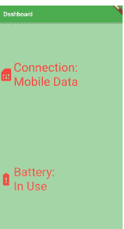
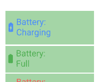
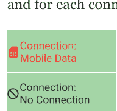

## 第 4 章：超越标准

## ##
Library:
### Plugins and Packages

Up until now we've seen how to build apps using just Flutter's standard library, but now we'll discover that we can go beyond it, and do things that we would have had a hard time doing before, or that we couldn't even do at all: let's talk about Flutter packages.

### An Introduction to Packages

Like many languages, Dart allows developers to share modular code, which can be used by other developers to easily get commonly needed functionality that would otherwise require a complicated solution.

There are many generic Dart packages we can use to achieve functionality that is useful to both web applications and Flutter mobile apps, but there are also Flutter-specific packages, which use Flutter-specific features and only work with Flutter apps.

Generally, packages are written in Dart and are very similar to other languages’ packages and libraries, but can communicate with device-specific Android/iOS code, which would make them *plugin packages*.

### FINDING PACKAGES: USING DART PUB

You can find packages by going to the *Dart Pub* homepage[^27] and searching in the “Flutter” and “All” categories.

In the home page you will find the most commonly used packages, many of which are made by Google developers. Clicking on a package allows you to find usage information, how to install the package and a changelog.

### INSTALLING PACKAGES

Once you’ve found a package you think you might want, you need to install it.

Dart packages get installed when they are specified as a dependency of an app, and you can do this by editing the `pubspec.yaml` file.

#### The Simple Way

Installing a package is very easy: you just need to edit the *dependencies* section of the `pubspec.yaml` file and add the string from the *Installing* section of the package in Pub. The strings you find there look like this:

```
packagename: ^version
```

And need to be added in `pubspec.yaml`, indented on the same level as the `flutter` line, after the lines that look like the following:

```
dependencies:
  flutter:
    sdk: flutter
```

The IDE plugins download the packages automatically when you edit the file, but you can make Flutter download or update the dependencies by running the following command:

```
$ flutter packages get
```

All that’s left to do is to import the package in your Dart file by adding, at the top of the file, the following line:

```
import 'package:packagename/filename.dart';
```

The file name is the same as the package name in most cases, but it’s better to check on Pub, since it’s usually specified in the *README.md*, *Example*, or *Installing* sections. If you’re using the official IDE plugins the correct file name will also be suggested by the IDE.

`import` also has more features, which are explained in *Mastering import*.

That’s all you need to know if the package developers are using semantic versioning correctly and you just want to get all of the updates for the package that won’t break your code, but there are cases in which simply copying and pasting from Pub to the dependencies isn’t ideal or doesn’t work at all.

#### Specifying the Package Version Manually

Understanding how to specify dependencies manually could be useful, for example, when you want to update to the next version, even if you need to change your code.

It could also be useful when you want a specific package version or always the latest package version, like would


发生这种情况时，你就是包的开发者。

##### Caret 语法

我们之前看到的那一行声明项目依赖于 Pub 上声明与指定版本兼容的最新包版本。例如，^0.1.0 表示 0.1 分组中的任何版本，而 ^1.2.3 表示大于或等于 1.2.3 且小于 2.0.0 的任何版本。这是指定包版本最常见的方式，称为 caret 语法。

##### 指定包版本的其他方式

包版本也可以使用数学比较运算符指定（例如，>=0.5.9 将使用从 0.5.9 开始的任何版本）。

这些运算符也可以组合使用（例如，你可以使用类似 >=0.5.9 <2.5.3 的写法）。

你也可以只使用：

```
packagename:
```

或：

```
packagename: any
```

如果你希望 Flutter 下载它能找到的最新版本，且没有任何限制。

#### 从 Pub 以外的来源获取包

版本并不是你在 dependencies 列表中可以指定的唯一内容：如果不想从 Pub 获取包，你也可以指定想要从何处获取包，这在测试尚未发布的新版本或使用根本不在 Pub 上的包时可能会很有用。

##### 从 Git 获取

例如，你可以从 Git 仓库获取包：

```
packagename:
  git:
    url: git://github.com/username/packagename.git
```

如果包不在 Git 仓库的根目录中，你可以指定仓库中包所在路径：

```
packagename:
  git:
    url: git://github.com/username/packagename.git
    path: path/to/pkg
```

##### 从本地路径获取

你也可以从本地开发环境中的路径获取包：

```
packagename:
  path: ../packagename/
```

#### 包使用示例

现在你知道了如何安装包，你将看到包的实际使用情况。

##### 开始使用

我们将构建一个简单的应用，使用来自 Pub 的 battery[28] 和 connectivity[29] 包来显示手机的电池和连接状态：



要使用这些包，我们将通过在 pubspec.yaml 的 dependencies 中添加以下内容来将包添加到应用的依赖项中：

```
packages/battery_connectivity/pubspec.yaml

connectivity: ^0.3.1
battery: ^0.2.2
```

并通过在 main Dart 文件顶部添加以下内容来在代码中导入这些包：

```
packages/battery_connectivity/lib/main.dart

import 'dart:async';

import 'package:flutter/material.dart';
import 'package:battery/battery.dart';
import 'package:connectivity/connectivity.dart';
```

除了我们从 Pub 下载的包之外，我们还需要 Flutter 的标准 Material Design API 和 Dart 的 async 库，这是为了正确处理我们使用的包的异步特性所必需的。

在本例中，我们希望通过更改描述连接和电池状态的字符串和图标来更改 widget 的状态。

我们可以使用以下代码来实现：

```dart
// packages/battery_connectivity/lib/main.dart

StreamSubscription<ConnectivityResult> _connSub;
StreamSubscription<BatteryState> _battSub;

@override
void initState() {
  super.initState();

  _connSub = Connectivity()
      .onConnectivityChanged
      .listen((ConnectivityResult res) async {
    setState(() {
      switch(res) {
        case ConnectivityResult.mobile:
          _connectionStatus = 'Mobile Data';
          _connectionIcon = Icons.sim_card;
          _connectionColor = Colors.red;
          break;
        case ConnectivityResult.wifi:
          _connectionStatus = 'Wi-Fi';
          _connectionIcon = Icons.wifi;
          _connectionColor = Colors.blue;
          break;
        case ConnectivityResult.none:
          _connectionStatus = "No Connection";
          _connectionIcon = Icons.not_interested;
          _connectionColor = Colors.black;
      }
    });
  });

  _battSub = Battery()
      .onBatteryStateChanged
      .listen((BatteryState res) async {
    setState(() {
      switch(res) {
        case BatteryState.charging:
          _batteryStatus = 'Charging';
          _batteryIcon = Icons.battery_charging_full;
          _batteryColor = Colors.blueAccent;
          break;
        case BatteryState.full:
          _batteryStatus = 'Full';
          _batteryIcon = Icons.battery_full;
          _batteryColor = Colors.green;
          break;
        case BatteryState.discharging:
          _batteryStatus = 'In Use';
          _batteryIcon = Icons.battery_alert;
          _batteryColor = Colors.redAccent;
      }
    });
  });
}
```

- ① 这两行用于定义我们在应用中使用的 `StreamSubscriptions`。`subscriptions` 用于在 `Stream` 返回的数据发生变化时运行一些代码。
- ② 我们正在调用 `Connectivity` 构造函数来获取一个对象并监听其成员 `onConnectivityChanged` `Stream`，与所有 `Streams` 一样，它有一个 listen 成员函数，该函数将回调函数作为位置参数，当连接发生变化时会被调用，这通常是 `setState` 的调用，因为在大多数应用中，`Stream` 的变化意味着应用的 UI 需要更新。
- ③ 如果你不熟悉它，switch 语句的用法在 _Switch_ 中有解释。在此实例中，我们使用它为每个连接和电池状态设置不同的字符串、图标和颜色。
- ④ 这与我们对连接状态所见的相同，但针对的是电池状态。

由于这段代码做了很多不同的事情，我们将分解并解释每个部分。

##### 释放 StreamSubscriptions

对于每个订阅，都需要在 `dispose` 方法中添加一个入口，以便在不再需要时释放订阅。`StreamSubscriptions` 有一个 `cancel` 方法，正好可以做到这一点。由于 `State` 类需要重写其超类的 `dispose` 方法（该方法在该 `State` 不再需要时运行，即 `StatefulWidget` 不再被渲染时），它们需要调用 `super.dispose`：

```dart
@override
dispose() {
  super.dispose();
  _connSub.cancel();
  _battSub.cancel();
}
```

你可以在 Streams and StreamSubscriptions 中了解更多关于 Streams 的信息。

##### 定义应用的 UI

build 方法将如下所示：

packages/battery_connectivity/lib/main.dart

```
@override
Widget build(BuildContext context) {
  return Scaffold(
    backgroundColor: Theme.of(context).backgroundColor,
    appBar: AppBar(
      title: Text(widget.title),
    ),
    body: Column(
      mainAxisAlignment: MainAxisAlignment.spaceAround,
      children: <Widget>[
        Row(
          children: <Widget>[
            Icon(_connectionIcon, color: _connectionColor, size: 50.0),
            Text(
              "Connection:\n$_connectionStatus",
              style: TextStyle(
                color: _connectionColor,
                fontSize: 40.0,
              ),
            ),
          ],
        ),
        Row(
          children: <Widget>[
            Icon(_batteryIcon, color: _batteryColor, size: 50.0),
            Text(
              "Battery:\n$_batteryStatus",
              style: TextStyle(
                color: _batteryColor,
                fontSize: 40.0,
              ),
            ),
          ],
        ),
      ],
    ),
  );
}
```

应用的 body 是一个 Column，主轴对齐方式设置为 MainAxisAlignment.spaceAround，以便小部件占据整个 body，而不是紧密堆叠在一起：

packages/battery_connectivity/lib/main.dart

```
body: Column(
  mainAxisAlignment: MainAxisAlignment.spaceAround,
```

```
children: <Widget>[
  Row(
    children: <Widget>[
      Icon(_connectionIcon, color: _connectionColor, size: 50.0),
      Text(
        "Connection:\n$_connectionStatus",
        style: TextStyle(
          color: _connectionColor,
          fontSize: 40.0,
        ),
      ),
    ],
  ),
  Row(
    children: <Widget>[
      Icon(_batteryIcon, color: _batteryColor, size: 50.0),
      Text(
        "Battery:\n$_batteryStatus",
        style: TextStyle(
          color: _batteryColor,
          fontSize: 40.0,
        ),
      ),
    ],
  ),
```

##### 显示状态

连接状态将使用 Row 显示，以便同时显示我们设置状态时所设定的字符串和图标的颜色：

packages/battery_connectivity/lib/main.dart

```
Row(
  children: <Widget>[
    Icon(_connectionIcon, color: _connectionColor, size: 50.0),
    Text(
      "Connection:\n$_connectionStatus",
      style: TextStyle(
        color: _connectionColor,
        fontSize: 40.0,
      ),
    ),
  ],
),
```

packages/battery_connectivity/lib/main.dart

```
Row(
  children: <Widget>[
    Icon(_batteryIcon, color: _batteryColor, size: 50.0),
    Text(
      "Battery:\n$_batteryStatus",
      style: TextStyle(
        color: _batteryColor,
        fontSize: 40.0,
      ),
    ),
  ],
),
```


```
color: _batteryColor,
fontSize: 40.0,
),
),
```

结果是每种电池状态都由不同的图标和不同颜色的字符串表示：



以及每种连接状态：



### 制作你自己的包

既然你已经知道如何使用包，你可能想知道如何制作自己的包，以及如何编写可在 Flutter 应用内使用的平台特定代码。

#### 创建包

制作一个包与制作一个应用非常相似。

如果你使用的是 Android Studio，只需使用“文件 -> 新建 -> 新建 Flutter 项目”。

如果你的包只需要使用多平台 Dart 代码，请选择 Flutter Package 选项；如果你还需要添加 iOS（Objective-C/Swift）或 Android（Java/Kotlin）代码，请选择 Flutter Plugin。

Dart 代码与平台特定代码之间的交互在*集成原生代码：制作插件包*中有描述。

如果你使用命令行，请运行以下命令：

```
flutter create --template=package packagename
```

如果你想创建一个插件，请将*包*一词替换为*插件*。

#### 包开发

创建一个普通的纯 Dart 包非常简单，只需在 lib 文件夹中编辑和创建 Dart 文件，定义你希望包提供的函数和类，然后发布它，如*将包发布到 Pub*中所解释的那样。

#### 集成原生代码：制作插件包

当你希望你的包与平台特定代码通信时，情况会变得更加复杂，因为你需要将三个用不同语言编写的不同代码库连接在一起。

许多 Android/iOS 原生功能都可以通过使用 Pub 上的包来实现，但你可能需要一个 Flutter 中不可用、也没有任何包提供的功能，因此你需要编写自己的平台特定代码来访问该功能。

虽然本章是关于包的，但如果你只想将 Android 和 iOS 代码连接到一个应用而不创建包，那么*使用平台通道将 Flutter 和平台特定代码连接在一起*中的信息也很有用。

#### 创建插件包

你可以使用以下命令创建插件包：

```
flutter create --template=plugin packagename
```

这将允许你使用 Java 编写 Android 特定代码，使用 Objective-C 编写 iOS 代码，但特别是在 iOS 领域，这些语言正逐渐被 Kotlin（用于 Android）和 Swift（用于 iOS）取代。Flutter 实际上也为 Kotlin 和 Swift 提供了模板，如果你希望同时使用 Swift 和 Kotlin，需要改为运行以下命令：

```
flutter create --template=plugin -a kotlin -i swift packagename
```

正如我们刚才看到的，你可以使用 Flutter 的 -a 选项来指定用于 Android 代码的语言，使用 -i 选项来指定用于 iOS 代码的语言。

#### 使用平台通道将 Flutter 和平台特定代码连接在一起

我们将用 Dart 为包编写接口，但需要将它连接到平台特定代码，你可以使用平台通道来实现。

平台通道并非包独有：我们也可以在应用中使用它们。

Flutter 代码通过平台通道调用平台特定代码要执行的方法，平台特定代码在该通道上监听，接收方法调用，执行所需操作，并返回响应。

#### 平台通道的工作原理

为了连接到我们的平台特定代码，我们将使用 MethodChannel 类，它是 Flutter 与平台特定代码之间接口中 Flutter 的一侧。

我们向其构造函数传递通道名称，这是该通道在整个应用中的唯一字符串标识符。

由于它必须在整个应用中唯一，通道名称通常以域名作为前缀。

该通道的工作方式如下：Dart 代码在通道上调用方法，平台特定代码在通道上监听，等待方法调用，方法调用由方法调用处理程序处理，处理程序将结果发送回 Dart 代码。

Dart 代码以 Future 的形式接收响应。

#### 在 Dart 中实现 Flutter 接口

以下是一个可以与平台特定代码交互的基本 Flutter 接口示例：

`packages/making_plugins/lib/plugin_example.dart`

```dart
import 'dart:async';
import 'package:flutter/services.dart';

class PluginExample {
  static const _platformChannel =
    MethodChannel('example.com/plugin_example');
  static Future<type> exampleMethod() async {
    return await _platformChannel.invokeMethod('runExampleMethod');
  }
}
```

我们可以使用 services 库访问平台通道，还需要使用 async 库来处理 Future，因此需要将以下行放在 Dart 文件顶部：

`packages/making_plugins/lib/plugin_example.dart`

```dart
import 'dart:async';
import 'package:flutter/services.dart';
```

然后我们定义包含代码的类，并首先定义我们将要使用的通道，即 example.com/plugin_example：

`packages/making_plugins/lib/plugin_example.dart`

```dart
static const _platformChannel = MethodChannel('example.com/plugin_example');
```

这个字符串可以是任何内容：你可以使用真实域名、虚构域名作为前缀，或者完全不使用域名，但你应该尽可能使用真实域名作为前缀，以确保它不会与其他任何插件的通道名称冲突。在这方面，它与 Java 包名非常相似，只不过在这种情况下域名前缀是可选的。

选择好通道名称后，实现包的实际接口：

`packages/making_plugins/lib/plugin_example.dart`

```dart
static Future<type> exampleMethod() async {
  return await _platformChannel.invokeMethod('runExampleMethod');
}
```

在 `Future<type>` 中，你需要用希望函数返回的类型替换 `type`。

有关 Java 和 Swift 中的哪些数据类型与 Dart 数据类型相对应的更多信息，请参见*原生 Java/Apple 与 Dart 数据类型之间的转换*表。

这就是你的包的用户实际会调用的方法，唯一需要记住的是，你调用平台特定代码的方式是通过 `platformChannel.invokeMethod(METHOD_NAME)` 来调用方法。

显然，对于这样一个简单的包，你可以跳过定义 platformChannel 变量，直接使用 `MethodChannel(CHANNEL_NAME).invokeMethod(METHOD_NAME)`，但这不会使代码简短多少，而且从长远来看这可能是一种非常糟糕的做法，所以请像我们在示例中展示的那样，事先声明通道。

#### 在 Java 中实现 Android 接口

在 `android` 目录中，会有一个看起来与应用源码树完全相同的源码树，唯一的区别是文件的实际内容。

一个针对 Android 的 Java 插件实现如下：

`packages/making_plugins/android/src/main/java/com/example/pluginexample/PluginExamplePlugin.java`

```java
package com.example.pluginexample;

import io.flutter.plugin.common.MethodChannel;
import io.flutter.plugin.common.MethodChannel.MethodCallHandler;
import io.flutter.plugin.common.MethodChannel.Result;
import io.flutter.plugin.common.MethodCall;
import io.flutter.plugin.common.PluginRegistry.Registrar;

public class PluginExample implements MethodCallHandler {
  public static void registerWith(Registrar registrar) {
    final MethodChannel channel =
        new MethodChannel(registrar.messenger(),
        "example.com/plugin_example");
    channel.setMethodCallHandler(new PluginExample());
  }

  @Override
  public void onMethodCall(MethodCall call, Result result) {
    if (call.method.equals("runExampleMethod")) {
      result.success(DATA_TO_RESPOND_WITH);
    } else {
      result.notImplemented();
    }
  }
}
```

具体来说，Java 文件将是一个实现了 `MethodCallHandler` 接口的类，我们需要为它定义两个方法：一个 `registerWith` 方法，用于定义要监听的通道；一个 `onMethodCall` 方法，在通道上调用方法时被调用。


```
final MethodChannel channel =
    new MethodChannel(registrar.messenger(),
"example.com/plugin_example");
channel.setMethodCallHandler(new PluginExample());
}

@Override
public void onMethodCall(MethodCall call, Result result) {
if (call.method.equals("runExampleMethod")) {
result.success(DATA_TO_RESPOND_WITH);
} else {
result.notImplemented();
}
}
```

让我们通过查看 registerWith 来拆解代码：

packages/making_plugins/android/src/main/java/com/example/plugin example/PluginExamplePlugin.java

```
public static void registerWith(Registrar registrar) {
    final MethodChannel channel =
        new MethodChannel(registrar.messenger(),
        "example.com/plugin_example");
    channel.setMethodCallHandler(new PluginExample());
}
```

此方法可与 Flutter widget 中的 initState 相比较：在这里，你会添加任何需要在执行一次且对包功能至关重要的操作，包括将该类设置为插件所操作的 channel 的方法调用处理器。

更具体地说，当调用方法时，onMethodCall 会被调用，并带有两个参数：一个描述调用，另一个提供返回结果的接口。

onMethodCall 可以按如下方式定义：

packages/making_plugins/android/src/main/java/com/example/plugin example/PluginExamplePlugin.java

```
@Override
public void onMethodCall(MethodCall call, Result result) {
    if (call.method.equals("runExampleMethod")) {
        result.success(DATA_TO_RESPOND_WITH);
    } else {
        result.notImplemented();
    }
}
```

由于插件可能在同一 channel 上调用不同的方法，call 参数提供了有关以下信息：

- call.method，即被调用方法的名称，在本例中为 "runExampleMethod"。
- call.arguments，其中包含调用方代码提供的参数（如果有），该主题在 *Adding arguments to Method Calls* 中有更详细的解释。

结果通过 result 参数返回：运行 result.success(DATA) 将把 DATA 返回给调用代码，而运行 result.notImplemented 将告诉调用代码所调用的方法在平台特定代码中未实现。

#### Implementing the iOS Interface in Swift

当你创建 Swift 插件项目时，在 ios/Classes 文件夹中，你会找到一个 Swift 文件，在其中编写 iOS 特定代码：

packages/making_plugins/ios/Classes/SwiftPluginExamplePlugin.swift

```
import Flutter
import UIKit

public class PluginExample: NSObject, FlutterPlugin {
  public static func register(with registrar: FlutterPluginRegistrar) {
    let channel =
      FlutterMethodChannel(
        name: "example.com/plugin_swift",
        binaryMessenger: registrar.messenger()
      )
    let handler = PluginExample()
    registrar.addMethodCallDelegate(handler, channel: channel)
  }
}
```

```
public func handle(call: FlutterMethodCall, result: @escaping FlutterResult) {
  if(call.method == "runExampleMethod") {
    result(DATA)
  }
}
```

与其使用 MethodChannel 和 MethodCall，你将使用 FlutterMethodChannel 和 FlutterMethodCall，但大部分原则相同。

注册方式略有不同：

packages/making_plugins/ios/Classes/SwiftPluginExamplePlugin.swift

```
```swift
public static func register(with registrar: FlutterPluginRegistrar) {
  let channel =
      FlutterMethodChannel(
          name: "example.com/plugin_swift",
          binaryMessenger: registrar.messenger()
      )
  let handler = PluginExample()
  registrar.addMethodCallDelegate(handler, channel: channel)
}
```
```

`FlutterMethodChannel` 构造函数的参数是命名参数而非位置参数，并且你可以通过使用 `FlutterPluginRegistrar` 的 `addMethodCallDelegate` 方法来设置方法处理器，将处理器类作为位置参数传递，将 channel 作为命名参数传递：

```
```swift
registrar.addMethodCallDelegate(handler, channel: channel)
```
```

`onMethodCall` 变为 `handle`，并且与其使用 `result.success` 返回数据，它只是 `result`，其余差异仅源于 Java 和 Swift 语法之间的差异：

```
```swift
public func handle(call: FlutterMethodCall, result: @escaping FlutterResult) {
  if(call.method == "runExampleMethod") {
    result(DATA)
  }
}
```
```

#### Adding arguments to Method Calls

从平台特定 API 获取值很有用，但有时你需要向被调用代码传递参数，你可以通过向 `invokeMethod` 传递另一个参数来实现。

参数随后将在 Android 的 `MethodCall` 和 iOS 的 `FlutterMethodCall` 的 `call.arguments` 中可用。

其类型在 Dart 中为 `dynamic`，在 Java 中为 `Object`，在 Objective-C 中为 `id`，意味着它可以是任何东西。

例如，让我们传递一个整数并将其乘以 10 来看看如何操作。

Dart 接口相当简单：

```
static Future<int> multiplyBy10(int n) async {
  return await platformChannel.invokeMethod('multiplyBy10', n);
}
```

在 Android 代码中，将参数类型强制转换为 int 后，返回乘以 10 的数字就很简单了：

```
if(call.method.equals("multiplyBy10")) {
  result.success(((int) call.arguments)*10);
}
```

对于 iOS 代码，在 call.arguments 中你会得到一个 NSNumber NumberWithInt，因此实现这一点需要多几个步骤：

```
if(call.method == "multiplyBy10") {
  let arg = call.arguments as! NSNumber NumberWithInt
  result(NSNumber(value: arg.integerValue * 10))
}
```

由于 NSNumber 包含在 integerValue 成员中的实际数字，因此我们需要将其乘以 10。完成之后，我们将其转换回 NSNumber 并发送回调用代码。有关 Dart 与平台特定代码之间类型转换的更多信息，*Conversion Between Native Java/Apple and Dart Data Types* 部分列出了最重要的转换。

#### USING THE PACKAGE IN AN APP WITHOUT PUBLISHING TO PUB

假设你有如下目录结构：

```
flutter_stuff
├─ app
│  ├─ lib
│  │  ├─ main.dart
│  │  └─ pubspec.yaml
│  └─ packagename
│     ├─ lib
│     │  └─ packagename.dart
│     └─ pubspec.yaml
```

并且你希望 app 目录中的 app 使用 packagename 目录中的包。

正如我们在 *Fetching Packages from Locations Other Than Pub* 中解释的那样，你只需在 `pubspec.yaml` 的 dependencies 中添加：

```
packagename:
  path: ../packagename/
```

并在 `app/lib/main.dart` 中添加：

```
import 'package:packagename/packagename.dart';
```

你就可以像使用 Pub 一样访问该包。

#### Publishing a Package to Pub

在发布包之前，你需要确保已在 `pubspec.yaml` 中填写了包名、版本、描述以及你想要指定的任何其他信息，可参考附录 2，*Apple-Like Look and Additional App Configuration*。

还需要一个 LICENSE 文件。

如果你不知道使用什么许可证，Dart 开发者推荐使用双条款 BSD 许可证，[30] 但网上有许多资源可以比较许可证，例如 GitHub 的 choosealicense.com[31]。

你还应该创建一个 README.md 文件，因为它将被用作你在 Pub 中包的首页。

此时，只需在命令行中运行：

```
pub publish
```

如果一切正确，你的包将可在 Pub 上公开访问。

#### Packages for Windows, macOS, and Linux

Flutter 在实验阶段支持桌面平台。这意味着你也可以为桌面平台开发 Flutter 插件。

有关此功能最新状态的最新信息，你应查阅 Google 专门的 *flutter-desktop-embedding* GitHub 仓库。[32]

#### Where We're Going Next

现在我们知道了包的工作原理，我们将能够使用包提供的最重要的功能之一：HTTP 网络，如我们在下一章中将看到的那样。

- Footnotes
- [27] https://pub.dartlang.org/flutter
- [28] https://pub.dartlang.org/packages/battery
- [29] https://pub.dartlang.org/packages/connectivity
- [30] https://en.wikipedia.org/wiki/BSD_licenses
- [31] https://choosealicense.com/licenses/
- [32] https://github.com/google/flutter-desktop-embedding


