## 第 5 章：网络和存储 I/O 与导航
## 

编写仅限于用户自己手机的应用对于某些应用来说是可以的，但绝大多数应用都需要与 Web API 或后端交互，这就是本章要做的事情。

Flutter 的标准库不包含标准网络组件：即使你实际上可以使用网络来获取图像，但仅使用 Flutter/Dart 标准库就无法进行标准的 HTTP 请求。

这就是我们现在要谈论它的原因：Flutter 在 Pub 上有一个由 Google 开发的包叫做 *http*，它允许我们进行 HTTP 请求并将我们的应用连接到 Web API。

### The JSON Data

如果你从未使用过 JSON，它只是一种用字符串描述任何面向对象编程语言中的对象（或更接近地，C 风格的结构）的方式：它是一个包含多个字段的单一实体，每个字段都描述了该实体不同的方面。

在本例中，它是 XKCD 最新发布的漫画以及关于它的以下信息：

- 发布月份（1 代表一月）。
- 漫画的数字 ID（递增，从 1 开始，即第一部 XKCD 漫画）。
- 点击网站上的漫画图像时指向的链接 [33]（通常为空）。
- 漫画发布的年份。
- 通常为空的 *news* 字段。
- 漫画的纯文本标题（正常的 *title* 可能包含 HTML 标签）。
- 文本形式的转录（描述）漫画图像中发生的事情，自第 1674 号漫画以来就未再添加。
- *alt* 是对笑话的解释或在观看漫画图像后才应查看的附加文本。它已在官方网站上以两种方式包含：桌面版在鼠标悬停在图像上时显示它，移动版在点击图像下方的按钮时显示它。
- 漫画图像本身。
- 可能包含 HTML 标签的漫画标题。
- 漫画发布的月份中的日期。

在 Dart 代码中，我们可以使用 dart:convert 内置 Dart 库解析和解码 JSON 数据并将其存储在 Dart Map 中，该库提供了必要的 json.decode(JSON) 方法将 JSON 字符串转换为 Dart 对象，以及一个 json.decode(var) 方法（我们不会使用），它将兼容的 Dart 对象转换为 JSON 格式的字符串。

#### How the Convert Library Works

dart:convert 库提供了 json 常量，[34] 其类型为 JsonCodec，[35] 它有两个方法：json.decode，它接受一个 String 作为参数，可以返回任何 Dart 对象，因为其返回类型为 dynamic，意味着它可以是任何东西。

> 另一个方法是 json.encode，它做完全相反的事情：它接受任何 Dart 对象（同样，它可以是任何东西）并返回一个 String，可以用作——例如，如果我们需要的话，作为 POST 请求的一部分，而我们在本书后面也会这样做。

### Getting Previous Comics

你可以通过向 https://xkcd.com/num/info.0.json 发送 get 请求来获取当前（最新）漫画之前的漫画，其中 num 是按时间顺序的漫画编号（从 1 开始）；例如，你可以通过向 https://xkcd.com/1/info.0.json 发送 GET 请求来获取第一部漫画。

API 没有办法获取漫画列表，但我们可以通过简单地获取最新漫画，然后使用其 ID 号（我们称之为 latestNum）来获取编号从 latestNum-1 到 1 的漫画，从而按逆时间顺序（从最新到最早）制作漫画列表。

### The http Package

要进行 GET 请求，我们需要使用 *http* 包。
你可以在 Dart Pub 上找到 http 包。[^36]

让我们开始通过使用以下命令创建一个新的 Flutter 应用项目：

```
```bash
$ flutter create xkcd_app
```
```

并通过在 `pubspec.yaml` 中添加以下内容来安装 HTTP 包：

```
```yaml
#### networking/xkcd_app/pubspec.yaml
dependencies:
  http: "^0.12.0+1"
```
```

如果未使用 IDE 插件（在你对 `pubspec.yaml` 进行更改后它们会自动为你执行此操作），请运行 flutter packages get 以下载并安装该包。

#### USING THE HTTP PACKAGE

HTTP 包可用于进行各种 HTTP 请求。[^37]

它们都是异步的，这意味着默认情况下，它们在单独的线程中运行，而不会影响应用其余部分的执行。你可以选择让它们的行为与同步函数完全一样，如果它们的返回值对应用执行的进行至关重要。

##### Asynchronous Code in Dart

在 Dart 中运行异步代码有许多方法，概述在 *Asynchronous Code in Dart: The dart:async Library* 中，但基本概念已在上一章中解释过：调用返回 `Future`（或 `Stream`，本章我们不会使用）的函数并在单独线程中运行的调用称为异步。

我们可以通过使用 await 表达式获取异步函数返回的数据：

```
var returnedData = await asyncFunction();
```

这只能在 async 函数中完成，而 async 函数必须返回 Futures，因此异步性往往会传播到所有调用方法。

### Making GET Requests

HTTP 请求使用 http.get 进行，它是一个 async 方法，返回一个包含在 Future 中的 Response。

我们可以使用 await 解包内部的 Response：

```
var latestComicResponse = await http.get("https://xkcd.com/info.0.json");
```

我们可以通过查询其 body 属性来获取响应的主体作为 String，就像我们在构建 XKCD 应用时需要做的那样：

```
var latestComicString = latestComicResponse.body;
```

我们也可以在一行中完成所有操作，将 await 表达式括在括号中：

```
var latestComicString = (await http.get("https://xkcd.com/info.0.json")).body;
```

HTTP 头可以通过将 headers 命名参数设置为 Map<String, String> 来设置，如以下示例所示：

```
http.get(
  "http://example.com/exampleGet?testAttr=$val1&testAttr2=$val2",
  headers: {
    "Accept": "application/json",
    "Accept-Charset": "utf-8"
  }
)
```

Wikipedia 有一份标准 HTTP 头的全面列表。[38]

`http` 包还提供了 `http.read()` 和 `http.readBytes()`，它们分别就像 `http.get()` 的 `body` 和 `bodyBytes` 属性。

例如，你可以从调用：

```
String res = (await http.get("http://example.com")).body;
```

改为：

```
String res = await http.read("http://example.com");
```

或从：

```
String res = (await http.get("http://example.com")).bodyBytes;
```

改为：

```
String res = await http.readBytes("http://example.com");
```

不过要小心，因为你会丢失 `Response` 对象的其他属性（`http.get` 返回的类型），例如：

- `headers`，当你需要读取响应头时需要它；
- `contentLength`，它是响应的大小（以字节为单位）。

### Making Other Requests

也支持其他种类的 HTTP 请求，它们都支持我们刚才看到的设置头的方式，并且它们都返回 `Future<Response>` 对象：

- POST 请求使用 `http.post` 进行，请求 URL 作为位置参数提供，你可以通过将 `body` 命名参数设置为你想要的任何内容来设置请求体。
- PUT 请求使用 `http.put` 进行，请求 URL 作为位置参数提供，你可以通过将 `body` 命名参数设置为你想要的任何内容来设置请求体。
- DELETE 请求使用 `http.delete` 进行，请求 URL 作为位置参数提供。
- PATCH 请求使用 `http.patch` 进行，请求 URL 作为位置参数提供，你可以通过将 `body` 命名参数设置为你想要的任何内容来设置请求体。
- HEAD 请求使用 `http.head` 进行，请求 URL 作为位置参数提供。


每当可以添加 body 属性时，也可以添加 encoding 属性，其类型为 Encoding，用于定义 body 的编码。一些 Encoding 子类是 AsciiCodec 和 Utf8Codec。

### 解析 JSON 响应体

HTTP 响应体只是一个字符串，因此如果不进行解析就毫无用处。

手动解析它将非常耗时且毫无意义，因为 dart:convert 内置库已经提供了一个名为 json 的常量，其类型为 JsonCodec，这意味着它公开了两种方法：

- * json.encode(obj)，将 obj 对象转换为 JSON 字符串。
- * json.decode(str)，将 str JSON 字符串转换为 Dart 对象。

在我们的特定情况下，我们希望将 JSON 字符串转换为 Map<String, dynamic>，这使我们能够按名称访问漫画的每个属性，如下一节所述。

使用 dart:convert，如果我们之前已将对 XKCD API 的调用的响应体存储到名为 latestComicString 的变量中，我们就可以通过使用以下方法将其转换为 Map：

```
Map<String, dynamic> latestComic = json.decode(latestComicString);
```

因此，如果我们需要在 Map 变量中存储最新漫画，添加到应用中的代码将是：

```
Map<String, dynamic> latestComic = json.decode(
  await http.read("https://xkcd.com/info/0.1.json")
);
```

### 编写获取漫画的方法

在继续实现之前需要考虑一件事：存储漫画的最佳数据类型是 Map<String, dynamic>，它能完美处理 JSON 对象。

既然我们知道如何获取漫画，让我们开始编写一些代码，利用这项知识编写可在应用中使用的获取漫画的方法！

#### 获取最新漫画

将我们之前讨论的代码封装成箭头函数一点也不难：

```
Future<Map<String, dynamic>> fetchLatestComic() async =>
json.decode(
  await http.read("https://xkcd.com/info/0.1.json")
);
```

我们可以通过使用 varName["attrName"] 来访问 Map 的字段，就像访问 List 元素一样，其中 varName 是 Map 变量的名称，attrName 是属性的名称。这与在 Python 中访问字典元素的语法完全相同。这就是访问每个属性的方式：

```
var comic = fetchLatestComic();
int num = comic["num"];
String link = comic["link"];
String news = comic["news"];
String safe_title = comic["safe_title"];
String transcript = comic["transcript"];
String alt = comic["alt"];
ImageProvider img = NetworkImage(comic["img"]);
String title = comic["title"];
String MDYDate = "${comic["month"]}/${comic["day"]}/${comic["year"]}";
String DMYDate = "${comic["day"]}/${comic["month"]}/${comic["year"]}";
```

#### 获取之前的漫画

通过漫画编号获取很容易，因为 API 就是为此设计的：

```
Future<Map<String, dynamic>> fetchComic(int n) async =>
```

```
json.decode(
  await http.read("https://xkcd.com/info/0.1.json")
);
```

但按逆时间顺序排序要困难得多，因为我们需要知道最新的漫画编号才能获取之前的漫画，以此类推：

```
Future<Map<String, dynamic>> fetchComic(int n) async {
  int latestComicNum = ...;
  return json.decode(
    await http.read("https://xkcd.com/info/0.1.json")
  );
}
```

显而易见的方法是直接调用 fetchLatestComic 并获取 num 属性，像这样：

```
int latestComicNum = fetchLatestComic()["num"];
```

但这样做需要两次不同的 GET 请求来获取每部漫画，其中许多请求都是冗余且无用的。

#### 只获取一次最新漫画编号

由于我们将在应用中使用这些方法，而应用至少在主屏幕周围有一个包装类，我们可以在运行应用时将其传递给该类，然后该类中的 fetchComic 方法就可以直接访问它。

#### 新的 fetchComic

以这种方式获取漫画非常简单，因为我们无需担心最新的漫画编号，它将由我们定义该方法的类提供：

```
Future<Map<String, dynamic>> fetchComic(int n) async =>
  json.decode(
    await http.read(
      "https://xkcd.com/${latestComicNum-n}/info/0.1.json"
    )
  );
```

#### 获取最新漫画编号的函数

不过，我们需要在运行应用时获取最新的漫画编号，为此我们需要定义一个函数

### 构建 UI 所需的内容：
导航和 InheritedWidget

在实际为此应用构建 UI 之前，我们将讨论两件重要的事情：如何在 Flutter 中在多个视图之间导航以及如何使用 InheritedWidget。这是对 Flutter 为导航提供的选项的一般介绍；我们只会在应用中使用其中一些。如果您更喜欢跳到更高级的导航，请查看构建应用的基础 UI，然后在您想了解如何在 Flutter 应用中实现导航时再回来。

#### FLUTTER 中的导航

Flutter 提供多种在视图之间导航的选项：

- - push/pop 导航，当有一个主页和许多可从中访问的页面时很有用，可能使用 Drawer 菜单。
- - 使用 PageView 和 PageController 的逐页导航，当有有限数量的页面可以被视为同一级别时很有用。

#### 使用 Navigator 进行 PUSH/POP 导航

制作一个利用 Navigator 进行 push/pop 导航的应用非常简单。

#### 定义页面

第一件事是定义页面，这将非常简单：

```
class NewPage extends StatelessWidget {
  @override
  Widget build(BuildContext context) {
    return Scaffold(
      appBar: AppBar(title: Text("New Page")),
      body: Center(
        child: FlatButton(
          color: Colors.black12,
          onPressed: () {},
          child: Text("Go back to the home page"),
        )
      ),
    );
  }
}
```

```
}

class HomePage extends StatelessWidget {

  @override
  Widget build(BuildContext context) {
    return Scaffold(
      appBar: AppBar(title: Text("Home Page")),
      body: Center(
        child: Container(
          height: 100,
          child: Card(
            child: Column(
              children: <Widget>[
                Padding(
                  padding: EdgeInsets.all(10.0),
                  child: Text(
                    "Click the button to go to a new page",
                    style: Theme.of(context).textTheme.title,
                  ),
                ),
                ButtonTheme.bar(
                  child: FlatButton(
                    child: Text("Go to new page"),
                    onPressed: () {}
                  ),
                ),
              ],
            ),
          ),
        ),
      );
    }
  }
}
```

这会在初始状态下生成如下所示的应用，如屏幕截图中所示。


我把主页做得比必要时更复杂一些，以便在视觉上区分这两个页面。

现在是重要部分：两个页面的 onPressed 选项，我们将在其中添加导航代码。

我把这种导航称为“push”/“pop”，因为它使用了两个名为 Navigator.push 和 Navigator.pop 的方法。

#### Push

您可以使用以下方式使用 Navigator.push 导航到新页面（包含在名为 NewPage 的 Widget 中）：

```
Navigator.push(
  context,
  MaterialPageRoute(
    builder: (context) => NewPage(),
  ),
);
```

Navigator.push 接受两个参数：BuildContext 和指向新页面的 Route。

您可以使用 MaterialPageRoute 构造函数创建路由，它使用一个 builder 回调函数（可以是小部件构造函数的调用，如示例中所示）来构建新视图。

您可以将该代码放在 MyHomePage 中 FlatButton 的 onPressed 选项的花括号内，当用户点击按钮时将显示以下视图：

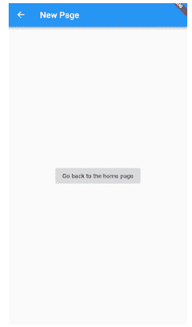


或者使用 ListView（如果你担心列表项没有足够的垂直空间）。

在本例中，我们使用 ListView。

通常，列表中的第一个元素是 DrawerHeader，它很像一个 Container，通常包含账户信息和切换账户的功能（如果有的话）、应用名称和/或关于其创建者的信息，或者关于菜单用途的简短描述。

在它下面，使用多个 ListTile 来显示导航选项。

如果你决定使用 ListView，应该将其 padding 选项设置为 EdgeInsets.zero，以避免屏幕顶部和底部出现空隙。

既然我们一直在讨论导航，那么一个用于公共交通或旅行应用的 Drawer 可能是这样的：

```
Drawer(
  child: ListView(
    padding: EdgeInsets.zero,
    children: [
      DrawerHeader(
        decoration: BoxDecoration(
          color: Colors.red,
        ),
        child: Column(
          crossAxisAlignment: CrossAxisAlignment.start,
          mainAxisAlignment: MainAxisAlignment.end,
          children: [
            Text(
              "Profile Name",
              style: TextStyle(
                color: Colors.white,
                fontSize: 18,
              ),
            ),
            Text(
              "email@example.com",
              style: TextStyle(
                color: Colors.white,
                fontSize: 11,
                fontWeight: FontWeight.w300
              ),
            ),
          ]
        ),
      ),
    ],
  ),
```

```
ListTile(
  leading: Icon(Icons.train),
  title: Text(
    "Tickets",
    style: Theme.of(context).textTheme.title,
  ),
),
ListTile(title: Text("Buy Tickets"), onTap: () {}),
ListTile(title: Text("My Tickets"), onTap: () {}),
Divider(),
ListTile(
  leading: Icon(Icons.person),
  title: Text(
    "Profile",
    style: Theme.of(context).textTheme.title,
  ),
),
ListTile(title: Text("Profile information"), onTap: () {}),
ListTile(title: Text("Past trips"), onTap: () {}),
ListTile(title: Text("Loyalty program points"), onTap: () {}),
],
),
```

首先，需要澄清一点：只需向 Scaffold 添加一个 drawer，框架就会自动在应用栏中添加一个按钮来展开它，如截图所示，即使 Scaffold 的 body 是空的也是如此。

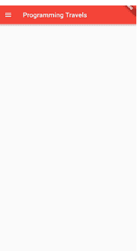

Drawer 本身看起来像这样：


此时，你可能不确定如何实际使用 drawer 进行导航，这是因为导航不是通过 `Navigator.push` 完成的，而是通过改变首页的状态以及一些能被 `build` 用来构建页面的数据，完成之后再调用 `Navigator.pop` 返回首页。

这意味着首页必须是一个有状态组件（别忘了这一点，尤其是当你遇到 `setState isn't defined for HomePage` 错误时），这也是引入 Dart `enum` 的好机会。

### 枚举类型

你可以通过如下代码创建枚举类型数据：

```
```dart
enum PageType {
  buyTickets,
  myTickets,
  profileInfo,
  pastTrips,
  myPoints,
}
```
```

这会创建一个名为 `PageType` 的新类型，它只能是 `PageType.buyTickets`、`PageType.myTickets`、`PageType.profileInfo`、`PageType.pastTrips` 或 `PageType.myPoints` 之一。

即使你不习惯这种数据类型，随着旅行应用示例的继续，你也一定能够理解它。

### 完成我们的旅行应用导航

为了完成旅行应用的导航，请将代码添加到应用中任何类定义之外，下面是一个完整且可运行的 State 示例，实现了我所描述的功能：

```
class HomePageState extends State<HomePage> {

  PageType _pageType = PageType.buyTickets;
  String _str;
  String _sub;

  @override
  Widget build(BuildContext context) {
    switch(_pageType) {
      case PageType.buyTickets:
        _str = "Buy Tickets";
        _sub = "You can buy your tickets here";
        break;
      case PageType.myPoints:
        _str = "My Points";
        _sub = "You can buy check your loyalty program points here";
        break;
      case PageType.myTickets:
        _str = "My Tickets";
        _sub = "You can see the tickets you've bought here";
        break;
      case PageType.pastTrips:
        _str = "My Past Trips";
        _sub = "You can check the trips you have made previously here";
        break;
      case PageType.profileInfo:
        _str = "My Profile Information";
        _sub = "You can see your profile information here";
    }
    return Scaffold(
      appBar: AppBar(
        title: Text("Programming Travels"),
        backgroundColor: Colors.red,
      ),
      drawer: Drawer(
        child: ListView(
          padding: EdgeInsets.zero,
          children: [
            DrawerHeader(
              decoration: BoxDecoration(
                color: Colors.red,
              ),
              child: Column(
                crossAxisAlignment: CrossAxisAlignment.start,
                mainAxisAlignment: MainAxisAlignment.end,
                children: [
                  Text(
                    "Profile Name",
                    style: TextStyle(
                      color: Colors.white,
                      fontSize: 18,
                    ),
                  ),
                  Text(
                    "email@example.com",
                    style: TextStyle(
                      color: Colors.white,
                      fontSize: 11,
                    ),
```

```
fontWeight: FontWeight.w300
),
),
]
),
),
ListTile(
  leading: Icon(Icons.train),
```

```
title: Text(
  "Tickets",
  style: Theme.of(context).textTheme.title,
),
),
ListTile(
  title: Text("Buy Tickets"),
  onTap: () {
    setState(
      () => _pageType = PageType.buyTickets,
    );
    Navigator.pop(context);
  }
),
ListTile(
  title: Text("My Tickets"),
  onTap: () {
    setState(
      () => _pageType = PageType.myTickets,
    );
    Navigator.pop(context);
  }
),
Divider(),
ListTile(
  leading: Icon(Icons.person),
  title: Text(
    "Profile",
    style: Theme.of(context).textTheme.title,
  ),
),
ListTile(
  title: Text("Profile Information"),
  onTap: () {
    setState(
      () => _pageType = PageType.profileInfo,
    );
    Navigator.pop(context);
  }
),
ListTile(
  title: Text("Past Trips"),
  onTap: () {
    setState(
      () => _pageType = PageType.pastTrips,
    );
    Navigator.pop(context);
  }
),
```

```
ListTile(
  title: Text("Loyalty Program Points"),
  onTap: () {
    setState(
```

```
```dart
() => _pageType = PageType.myPoints,
);
Navigator.pop(context);
}
},
],
),
),
),
Center(
  child: Padding(
    padding: EdgeInsets.all(10.0),
    child: Column(
      children: [
        Text(_str, style: Theme.of(context).textTheme.title),
        Text(_sub, style: Theme.of(context).textTheme.subtitle)
      ],
    ),
  ),
),
);
}
}
```
```

如你所见，**Drawer** 中的每个 **ListTile** 都会设置 `_pageType` 变量（默认情况下是 `PageType.buyTickets`），使用 `setState` 重新加载首页，然后调用 `Navigator.pop` 关闭抽屉。

`build` 会检查当前 `_pageType` 是哪一个，并相应地设置两个字符串（一个标题和一个副标题）。然后，这两个字符串会显示在一个居中且带有内边距的 `Column` 中，如截图所示。

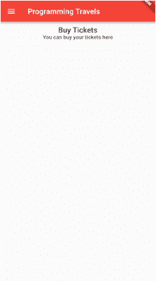

这就是使用 `Drawer` 菜单实现的可工作导航。

### 页面级导航

可滑动的页面级导航可以通过两种视图实现：PageView 和 TabBarView。区别在于前者只允许通过滑动进行导航，而后者则与 AppBar 下方的 TabBar 一起使用。

如果你想要的是类似 YouTube 应用的效果：通过屏幕底部的菜单在页面之间切换，那么使用 BottomNavigationBar 就是解决方法。

### BOTTOMNAVIGATIONBAR

BottomNavigationBar 的工作方式与 Drawer 非常相似，但它始终显示在底部，因此你不需要使用 Navigator.pop。

更具体地说，你将它添加到 Scaffold 的 bottomNavigationBar 选项中，使用方法如下：

```
return Scaffold(
  // app body, appbar, etc.
  bottomNavigationBar: BottomNavigationBar(
    currentIndex: index,
    items: [
      BottomNavigationBarItem(
        icon: Icon( ... ),
        title: Text( ... ),
      ),
      BottomNavigationBarItem(
        icon: Icon( ... ),
        title: Text( ... ),
      ),
      // potentially more navigation items...
    ],
    onTap: (page) {
      setState() {
        switch(page) {
          case 0:
            // Things to do if the user selects the first item
            index = 0;
            break;
          case 1:
            // Things to do if the user selects the second item
            index = 1;
            // Potentially other cases for more navigation items
        }
      };
    },
  ),
)
```

它有三个主要选项：

- items，即提供给用户的导航选项。


- `currentIndex`，你分配给它的值在用户点击导航项时需要手动更改。
- `onTap` 回调，它接收一个整数，表示用户点击了哪个选项。

一个完整的 App 首页类的实用示例可能如下：

```dart
String _str;
int index = 0;

@override
Widget build(BuildContext context) {
  switch(index) {
    case 0:
      _str = "Home";
      break;
    case 1:
      _str = "Page 2";
      break;
    case 2:
      _str = "Page 3";
  }
  return Scaffold(
    appBar: AppBar(
      title: Text("Bottom Navigation Bar Example"),
      backgroundColor: Colors.red,
    ),
    body: Center(
      child: Text(
        "$_str",
        style: Theme.of(context).textTheme.display1
      ),
    ),
    bottomNavigationBar: BottomNavigationBar(
      currentIndex: index,
      items: [
        BottomNavigationBarItem(
          icon: Icon(Icons.home),
          title: Text("Home"),
        ),
        BottomNavigationBarItem(
          icon: Icon(Icons.looks_two),
          title: Text("Page 2"),
        ),
        BottomNavigationBarItem(
          icon: Icon(Icons.format_list_numbered_rtl),
          title: Text("Page 3"),
        ),
      ],
      onTap: (page) {
        setState() {
          switch(page) {
            case 0:
              index = 0;
              break;
            case 1:
              index = 1;
              break;
            case 2:
              index = 2;
          }
        }
      },
    ),
  );
}
```

它看起来像 **screenshot**，并且在用户点击导航选项时产生期望的行为。

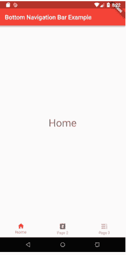

### PageView

PageView 可与水平 ListView 相比，但它一次只滚动一页。

你可以用它作为整体布局的一部分，也可以用作 App Scaffold 的整个 body，如以下示例所示：

```dart
Scaffold(
  appBar: AppBar(
    title: Text("PageView Example"),
    backgroundColor: Colors.teal,
  ),
  body: PageView(
    children: <Widget>[
      Center(
        child: Text(
          "Swipe left",
          style: Theme.of(context).textTheme.display1
        ),
      ),
      Center(
        child: Padding(
          padding: EdgeInsets.all(10.0),
          child: Text(
            "Swipe left again, or swipe right",
            style: Theme.of(context).textTheme.display1
          ),
        ),
      ),
      Center(
        child: Text(
          "Swipe right",
          style: Theme.of(context).textTheme.display1
        ),
      ),
    ],
  ),
)
```

它产生一个简单的视图，其中包含一个 AppBar 和屏幕中间的 Text 控件。

屏幕上没有其他指示视图有其他页面，但向左滑动会将视图移动到下一页，向右滑动会将视图移动到上一页。

除了 children 之外，PageView 还有一个 controller 属性，可以设置为 PageController。

PageController 有一个有用的选项：`initialPage`，它是一个整数，指定 App 加载时视图开始的页面（从 0 开始）。

### TOP NAVIGATION WITH A TABBAR AND TABBARVIEW

显著更有用且更常见的是 TabBarView，它与 AppBar 下方的 TabBar 配对，提供与 PageView 相同的滑动体验，同时在顶部提供一个漂亮的菜单来选择要切换到的页面并突出显示用户当前所在的页面。

TabBarView 和 TabBar 通过 TabController 链接。

创建它的优雅方式是使用 DefaultTabController 包裹整个视图，并将整个 Scaffold 设置为其子级，将标签数量设置为其 length，并（可选）设置 initialIndex（从 0 开始，默认为 0）。

TabBar 可以设置为 AppBar 的 bottom 选项，它有一个 tab 选项，你可以在其中添加 Tab 控件，由文本和可选图标组成，它们将构成 TabBar 的菜单项。

TabBarView 则会设置为 Scaffold 的 body，你将要显示的页面添加到其 children 选项中。

例如，这段代码：

```dart
DefaultTabController(
  length: 3,
  // OPTIONAL initialIndex: 0,
  child: Scaffold(
    appBar: AppBar(
      title: Text("TabBarView Example"),
      bottom: TabBar(
        tabs: <Widget>[
          Tab(
            icon: Icon(Icons.looks_one),
            text: "First Page",
          ),
          Tab(
            icon: Icon(Icons.looks_two),
            text: "Second Page",
          ),
          Tab(
            icon: Icon(Icons.looks_3),
            text: "Third Page",
          ),
        ],
      ),
    ),
    body: TabBarView(
      children: <Widget>[
        Center(
          child: Text("This is the first page")
        ),
        Center(
          child: Text("This is the second page")
        ),
        Center(
          child: Text("This is the third page")
        ),
      ],
    )
  )
)
```

它产生的效果如截图所示。

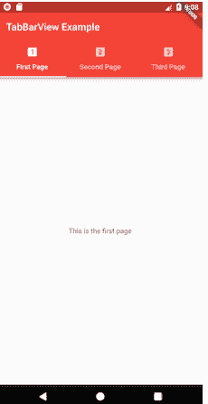

### InheritedWidgets

DefaultTabController 是一种特殊的控件：InheritedWidget，用于在 Flutter 控件之间共享状态信息，通过将其存储在位于控件树顶部的控件中，并允许其子控件直接访问其字段和方法，这样它们就不必通过构造函数参数沿树传递。

它们通常使用 Widget.of(context).fieldName 语法访问，我们之前使用过该语法来从 Theme 获取主题数据以及在 Scaffold 中显示 snackbars。这是因为 Theme 和 Scaffold 实际上都是 InheritedWidgets。

InheritedWidget 的定义方式如下：

```dart
class Example extends InheritedWidget {
  Example({child, this.field}) : super(child: child);
  final String field;

  @override
  bool updateShouldNotify(Example old) => true;
}
```

updateShouldNotify 用于确定当框架重建 InheritedWidget 时子控件是否需要重建。

这通常为 true，但你也可以将其设置为一组条件来确定例如控件字段是否发生变化，并且仅在这种情况下重建子控件。

在当前状态下，Example.of(context).fieldName 从 Example 的子控件中将无法工作，因为实际上并没有 of 方法。

尽管非常常见，但它并不是内置于框架中的：默认情况下，你使用 context.inheritFromWidgetOfExactType(Example) 访问父 InheritedWidget。

事实上，InheritedWidget 内部定义的一个非常常见的静态方法（在 Static Members 中解释）是 of 方法，对于名为 Example 的 InheritedWidget，可以按如下方式定义：

```dart
static Example of(BuildContext context) =>
  context.inheritFromWidgetOfExactType(Example);
```

因此，我们整个 Example 类的定义变为：

```dart
class Example extends InheritedWidget {
  Example({child, this.field}) : super(child: child);
  final String field;

  @override
  bool updateShouldNotify(Example old) => old.field != field;

  static Example of(BuildContext context) =>
    context.inheritFromWidgetOfExactType(Example);
}
```

你可以在 App 中这样使用它：

```dart
Example(
  field: "An example of a string",
  child: MyCustomExternalWidget(),
)
```

并且，在 MyCustomExternalWidget 的定义中的任何位置，该控件不接受参数，你可以使用以下方式访问之前设置的字段：

```dart
Example.of(context).field
```

它返回之前设置的确切 String。

### Build the App’s Basic UI

我们将构建一个 App，它将显示一个 ListView 的 ListTiles。每个漫画都会有一个 tile，点击 tile 应该显示该漫画的详细信息。

首页将看起来像截图。

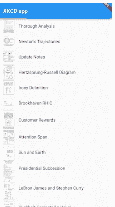

让我们开始定义此 App 所需的类：

- 首页屏幕的类。
- 自定义 ComicTile 类，以便更轻松地为漫画创建 ListTiles。
- 漫画页面的类。

这次，我们不会使用 app 类；main 方法将直接将所需数据传递给我们将创建的 HomeScreen 类：

```dart
networking_starting/xkcd_app/lib/main.dart

void main() async =>
  runApp(
    new MaterialApp(
      home: HomeScreen(
        title: 'XKCD app',
        latestComic: await getLatestComicNumber(),
      )
    );
```


`getLatestComicNumber` 方法是我们之前在《A Function to Get the Latest Comic Number》中创建的，我们需要在文件开头定义它，位于库导入之后并且在任何类定义之外：

```
networking_starting/xkcd_app/lib/main.dart

Future<int> getLatestComicNumber() async =>
  json.decode(
    await http.read('https://xkcd.com/info.0.json')
  )
  ['num'];
```

#### DEFINE THE HOME SCREEN

此时我们需要定义 HomeScreen 小部件。这次应用树非常简单，我们不需要图示来了解整体情况：HomeScreen 将是一个普通的 Scaffold，始终带有 AppBar，而其 body 将是一个由 ListTile 组成的 ListView。

由于每个漫画都需要一个 ListTile，我们将使用 ListView.builder 构造函数，如《The ListView》中所述，它使用 itemBuilder 函数来生成每个小部件。在本例中，itemBuilder 将调用一个 FutureBuilder，它是一种根据 Future 的内容构建小部件的 item builder，而这正是我们需要的，因为 http.get 是一个返回 Future 的异步函数。

让我们开始编写类定义的基础部分：它将是一个 StatelessWidget，并且需要两个参数——应在 AppBar 中显示的标题和最新的漫画编号：

```
networking_starting/xkcd_app/lib/main.dart

class HomeScreen extends StatelessWidget {
  HomeScreen({this.title, this.latestComic});
  final int latestComic;
  final String title;
}
```

此时我们将通过定义一个 `_fetchComic` 方法来完成对该类的准备工作，就像我们在《The New fetchComic》中讨论的那样：

```
networking_starting/xkcd_app/lib/main.dart
```

```
Future<Map<String, dynamic>> _fetchComic(int n) async =>
  json.decode(
    await http.read(
      "https://xkcd.com/${latestComic-n}/info.0.json"
    )
  );
```

现在剩下的就是有趣的部分：在 build 方法中定义我们想要的应用 UI。我们将从定义 Scaffold 和 AppBar 开始，就像我们一直做的那样：

```
networking_starting/xkcd_app/lib/main.dart
```

```
@override
Widget build(BuildContext context) {
  return Scaffold(
    appBar: AppBar(
      title: Text(title),
    ),
  );
}
```

Scaffold 的 body 将是，如我们所说，一个由 ListView.builder 构建的 ListView，我们需要为它提供两个参数：

- itemCount，即将要构建的最大项目数；在本例中，它将是 latestComic 编号，因为这也是迄今为止发布的漫画数量。
- itemBuilder，即一个函数，它接收 BuildContext 和一个从顶部开始的 int，值为 0（我们称之为 i）。

在本例中，itemBuilder 将是，如我们之前所说，一个 FutureBuilder。

FutureBuilder 本身需要两个参数：future，即将为每个 tile 检索数据的 Future，以及 builder 函数，它根据 BuildContext 和 Future 的结果构建 tile。

future 将是对 fetchComic(i) 的调用，其中 i 是上述递增的整数变量，而 itemBuilder 将返回一个 ComicTile，它将漫画数据作为参数。我们稍后再担心 ComicTile 的实现。

#### On the Correct Use of the FutureBuilder

FutureBuilder 的 future 不应是函数调用：它应该是之前获取的 Future，因为将其设置为函数调用会导致在父小部件每次重建时 future 都会被调用，但这在我们的案例中不适用：父小部件是一个 StatelessWidget，且上方没有 StatefulWidgets。不过你在构建自己的 Flutter 应用时需要记住这一点：忘记这一点可能会使应用交互变得不必要地缓慢和笨拙。

通常这些 Future 应该在 StatefulWidgets 的 initState 方法中获取。

以下是 HomeScreen 的 Scaffold 的完整 body：

#### networking_starting/xkcd_app/lib/main.dart

```
body: ListView.builder(
  itemCount: latestComic,
  itemBuilder:(context, i) => FutureBuilder(
    future: _fetchComic(i),
    builder: (context, comicResult) =>
      comicResult.hasData ?
      ComicTile(comic: comicResult.data) :
      Divider();
  ),
),
```

我们之前看到的代码片段组合起来的完整 HomeScreen 类定义是：

#### networking_starting/xkcd_app/lib/main.dart

```
class HomeScreen extends StatelessWidget {
  HomeScreen({this.title, this.latestComic});
  final int latestComic;
  final String title;

  Future<Map<String, dynamic>> _fetchComic(int n) async =>
  json.decode(
    await http.read(
      "https://xkcd.com/$latestComic-n/info.0.json"
    )
  );

  @override
  Widget build(BuildContext context) {
    return Scaffold(
      appBar: AppBar(
        title: Text(title),
```

```
),
body: ListView.builder(
  itemCount: latestComic,
  itemBuilder:(context, i) => FutureBuilder(
    future: _fetchComic(i),
    builder: (context, comicResult) =>
      comicResult.hasData ?
      ComicTile(comic: comicResult.data) :
      Divider();
  ),
);
}
}
```

#### DEFINE THE COMICTILE

现在我们需要定义 ComicTile 类，它将是另一个 StatelessWidget，并且它将把需要显示的漫画数据作为其唯一参数接收：

networking_starting/xkcd_app/lib/main.dart

```
class ComicTile extends StatelessWidget {
  ComicTile({this.comic});

  final Map<String, dynamic> comic;
```

ComicTile 将是一个 ListTile，其 leading 为漫画图片，title 为漫画标题的 Text，并且在被点击时显示一个仅用于该漫画的新屏幕，以更大格式显示漫画以及其 alt 文本。

我们稍后再担心构建漫画页面的问题：现在我们需要弄清楚如何显示该屏幕。我们之前在《Push/Pop Navigation Using the Navigator》中讨论过 push/pop 导航，这就是我们将要使用的：

```
@override
Widget build(BuildContext context) {
  return ListTile(
    leading: Image.network(
      comic["img"],
      height: 30,
      width: 30
    ),
    title: Text(comic["title"]),
    onTap: () {
      Navigator.push(
        context,
        MaterialPageRoute(
          builder: (BuildContext context) => ComicPage(comic)
        ),
      );
    }
```

```
},
});
}
```

- 在本节中我们定义了 ListTile 的 leading 小部件：一个从网络 URL 获取的 Image，即漫画的 ‘img’ 属性。
- 我们将图片预览的最大宽度和高度设置为 30 像素，以避免预览在列表中占用过多的垂直或水平空间。
- 这是每个 tile 将显示的文本。在本例中我们使用漫画的标题，即来自漫画 title 属性。
- 在这里我们设置了用户点击 tile 时会发生什么。在本例中，它使用我们在《Push/Pop Navigation Using the Navigator》中讨论的 push 操作打开一个 ComicPage（我们稍后会定义）。

完整的 ComicTile 类定义是：

```
networking_starting/xkcd_app/lib/main.dart

class ComicTile extends StatelessWidget {
ComicTile(this.comic);

final Map<String, dynamic> comic;

@override
Widget build(BuildContext context) {
return ListTile(
leading: Image.network(
comic["img"],
height: 30,
width: 30
),
```

```
title: Text(comic["title"]),
onTap: () {
Navigator.push(
context,
MaterialPageRoute(
builder: (BuildContext context) =>
ComicPage(comic)
),
);
},
```

```
});
}
}
```

#### Building the Comic Page

ComicPage 将是我们到目前为止讨论过的最简单的 widget：我们将为它提供一个显示漫画编号的 AppBar，而 body 只是简单地是一个可滚动的 ListView，显示漫画的标题、图片和 alt 文本：

```
class ComicPage extends StatelessWidget {
  ComicPage(this.comic);

  final Map<String, dynamic> comic;

  @override
  Widget build(BuildContext context) {
    return Scaffold(
      appBar: AppBar(title: Text("#${comic["num"]}")),
      body: ListView(children: <Widget>[
        Center(
          child: Text(
            comic["title"],
            style: Theme.of(context).textTheme.display3,
          ),
        ),
        Image.network(comic["img"]),
        Padding(
          padding: EdgeInsets.all(8.0),
          child: Text(comic["alt"])
        ),
      ]),
    );
  }
}
```

所有这些加起来就是以下 `main.dart`：

```
import 'package:flutter/material.dart';
import 'package:http/http.dart' as http;

import 'dart:async';
import 'dart:convert';

Future<int> getLatestComicNumber() async =>
  json.decode(
    await http.read('https://xkcd.com/info.0.json')
  )
  ["num"];
```


```dart
void main() async =>
  runApp(
    new MaterialApp(
      home: HomeScreen(
        title: 'XKCD app',
        latestComic: await getLatestComicNumber(),
      )
    )
  );

class ComicPage extends StatelessWidget {
  ComicPage(this.comic);

  final Map<String, dynamic> comic;

  @override
  Widget build(BuildContext context) {
    return Scaffold(
      appBar: AppBar(title: Text("#${comic["num"]}")),
      body: ListView(children: <Widget>[
        Center(
          child: Text(
            comic["title"],
            style: Theme.of(context).textTheme.display3,
          ),
        ),
        Image.network(comic["img"]),
        Padding(
          padding: EdgeInsets.all(8.0),
          child: Text(comic["alt"])
        ),
      ]),
    );
  }
}
```

```dart
class ComicTile extends StatelessWidget {
  ComicTile({this.comic});

  final Map<String, dynamic> comic;

  @override
  Widget build(BuildContext context) {
    return ListTile(
      leading: Image.network(
        comic["img"],
        height: 30,
        width: 30
      ),
      title: Text(comic["title"]),
      onTap: () {
        Navigator.push(
          context,
          MaterialPageRoute(
            builder: (BuildContext context) =>
              ComicPage(comic)
          ),
        );
      },
    );
  }
}
```

```dart
class HomeScreen extends StatelessWidget {
  HomeScreen({this.title, this.latestComic});
  final int latestComic;
  final String title;

  Future<Map<String, dynamic>> _fetchComic(int n) async =>
    json.decode(
      await http.read(
        "https://xkcd.com/${latestComic-n}/info.0.json"
      )
    );

  @override
  Widget build(BuildContext context) {
    return Scaffold(
      appBar: AppBar(
        title: Text(title),
      ),
      body: ListView.builder(
        itemCount: latestComic,
        itemBuilder: (context, i) => FutureBuilder(
          future: _fetchComic(i),
          builder: (context, comicResult) =>
            comicResult.hasData ?
            ComicTile(comic: comicResult.data) :
            Divider();
        ),
      ),
    );
  }
}
```

此时我们准备好运行应用了，它看起来会是这样：

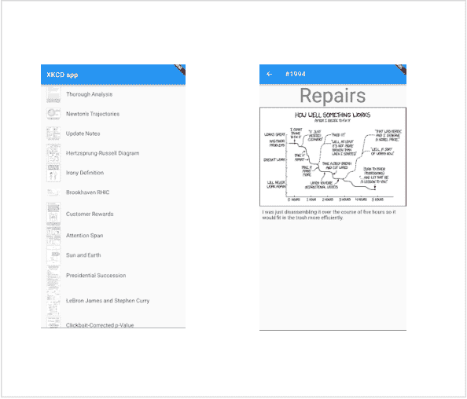

#### 使用 CircularProgressIndicator

在那些截图中你看到的是应用在所有内容加载完成后的样子，但我们也需要考虑它在加载过程中的样子：我们目前在每个卡片加载时显示一个 Divider，但如果用户网络很慢，这就不太美观了，因为他们会看到几秒钟内堆叠在一起的多个分隔线。

有一个类专门用于这种占位任务：CircularProgressIndicator。[40] 它并不是唯一的进度指示器：还有 LinearProgressIndicator，但它使用较少且灵活性较差。

你可以在任何想要显示它的地方放置其构造函数（CircularProgressIndicator）（例如，代替 ComicTile 的 Divider 占位符），但这样它会拉伸以填满分配给它的空间。解决方法是将其限制在一个宽度有限的 Container 中。

HomeScreen 中 ListView.builder 内部的 FutureBuilder 的 builder 变为如下：

```dart
// networking/xkcd_app/lib/main.dart

builder: (context, snapshot) {
  return snapshot.hasData ?
    ComicTile(comic: snapshot.data) :
    Container(
      width: 30,
      child: CircularProgressIndicator()
    );
},
```

### 通过缓存到本地存储来提高速度

我们的应用可以工作，但速度非常慢，因为它每次都重新下载所有内容，这浪费了用户的时间和数据。

为了提高应用效率，我们需要将漫画保存到本地缓存，并在尝试从互联网获取之前先从那里检索。如果需要的漫画尚未保存，我们就从互联网下载并保存它。

#### 对 PATH_PROVIDER 包的介绍

移动应用可以在两个目录中存储数据：临时缓存目录（我们将在本示例中使用它）或永久的 Data/Documents 目录（用于永久存储用户数据）。这两个目录的区别在于，缓存目录可能随时被操作系统或用户清除；而清除数据目录则只有在警告用户可能丢失重要数据后才应进行。

path_provider 包允许你获取 Flutter 支持的所有操作系统上这些文件夹所在的路径，而 I/O 操作本身则由内置的 dart:io 插件处理。

让我们先在 `networking/xkcd_app/pubspec.yaml` 的 dependencies 中添加以下内容：

```yaml
path_provider:
```

并在 Dart 代码中使用以下语句在 `networking/xkcd_app/lib/main.dart` 的顶部导入它：

```dart
import 'package:path_provider/path_provider.dart';
```

由于它们执行 I/O 操作（完成需要相当长的时间），path_provider 和 dart:io 函数都返回 Futures。

#### 动手实现：实现缓存

由于我们还需要使用 Dart 内置的 dart:io 插件来实际执行 I/O 操作，我们需要在 `networking/xkcd_app/lib/main.dart` 的顶部添加以下内容：

```dart
import 'dart:io';
```

我们需要修改的代码是获取漫画的代码：我们需要让漫画获取函数检查漫画是否已保存，如果已保存则从本地存储获取，如果未保存则下载并保存。

我们将创建一个文件来存储最新漫画的编号（该编号将在应用在有网络连接的情况下启动时更新），每个漫画将保存在单独的文件中。

让我们从最显著的更改开始：对 fetchComic 方法的更改。

具体来说，HomeScreen 的 fetchComic 方法，目前看起来像这样（`networking_starting/xkcd_app/lib/main.dart`）：

```dart
Future<Map<String, dynamic>> _fetchComic(int n) async =>
  json.decode(
    await http.read(
      "https://xkcd.com/${latestComic-n}/info.0.json"
    )
  );
```

胖箭头语法不再适用于我们现在的需求：在返回一个值之前，我们需要获取临时目录路径，检查漫画是否已下载，如果没有则获取它。

我们将通过恢复到常规语法，使用大括号和 return 来开始编辑它：

```dart
Future<Map<String, dynamic>> _fetchComic(int n) async {
  return json.decode(
    await http.read(
      "https://xkcd.com/${latestComic-n}/info.0.json"
    )
  );
}
```

在函数开始处，我们将声明三个变量：包含文件的目录、漫画编号（由于我们会多次使用它，计算一次后每次使用会更方便）以及 File 对象本身。

返回目录的函数是 getTemporaryDirectory，它是异步的并返回一个 Directory 对象，路径字符串本身是 Directory.path 成员。

文件通过 File 类进行管理，该类允许我们创建文件并对其执行读写操作。

File 构造函数非常简单：它接受一个位置参数，即文件的路径。

我们可以使用每种操作对应的两种方法对文件执行操作：我们可以选择同步方法（如 File.readAsStringSync），它直接返回请求的内容（不涉及 Future），也可以选择异步方法（如 File.readAsString），它是异步的，返回 Future，需要 await 或 Future.then 来获取请求的数据。同步方法的优点是我们不需要将所有内容转换为异步方法，也不需要一直使用 await，而异步方法的优点是我们只需运行它，让主线程不受影响地继续运行，如果我们不需要结果的话，就像创建文件时那样。

#### 第一步：保存 JSON 响应

这三件事可以用以下三行代码完成：

```dart
final dir = await getTemporaryDirectory();
int comicNumber = latestComic-n;
var comicFile = File("${dir.path}/$comicNumber.json");
```


现在我们需要检查文件是否存在且不为空，并返回其解码后的内容：

```dart
if(await comicFile.exists() && comicFile.readAsStringSync() != "")
  return json.decode(comicFile.readAsStringSync());
```

如果不存在，我们需要创建文件并将 JSON 字符串写入其中：

```dart
else {
  final comic =
    await http.read('https://xkcd.com/${latestComic - n}/info.0.json');
```

将整个函数放在一起后，最终结果为：

```dart
Future<Map<String, dynamic>> _fetchComic(int n) async {
  final dir = await getTemporaryDirectory();
  int comicNumber = latestComic-n;
  var comicFile = File("${dir.path}/$comicNumber.json");
  if(await comicFile.exists() && comicFile.readAsStringSync() != "")
    return json.decode(comicFile.readAsStringSync());
  else {
    final comic =
      await http.read('https://xkcd.com/${latestComic - n}/info.0.json');
    /* no need to use sync methods as we
       don’t have to wait for it to finish caching */
    comicFile.writeAsString(comic);
    return json.decode(comic);
  }
}
```

由于 SelectionPage 也应该利用缓存的漫画，我们只需稍微修改此函数，使其将漫画编号作为字符串参数接收：

```dart
Future<Map<String, dynamic>> _fetchComic(int n) async {
  final dir = await getTemporaryDirectory();
  var comicFile = File("${dir.path}/$n.json");

  if(await comicFile.exists() && comicFile.readAsStringSync() != "")
    return json.decode(comicFile.readAsStringSync());
  else {
    final comic =
      await http.read('https://xkcd.com/$n/info.0.json');
    comicFile.writeAsString(comic);
    return json.decode(comic);
  }
}
```

### 保存最新的漫画编号

在当前状态下，我们的应用程序仍然依赖于启动时获取最新的漫画编号才能工作，但我们可以将该编号在获取时保存到文件中，如果在某些情况下启动时无法获取，我们将尝试从文件中获取。

我们显然希望在可能的情况下始终获取远程编号，因为我们希望该编号在出现新漫画时发生变化，这与我们在 `fetchComic` 中所做的不同，在那里我们尽可能从文件中获取，仅在不可能时才求助于从互联网获取。

要在我们的应用程序中实现这一点，我们需要更改 `getLatestComicNumber` 顶层函数，并且为实现我们想要的功能，有一个大多数程序员熟悉的功能：使用 try 和 catch 捕获异常。

如果应用程序尝试网络连接并失败（当设备因任何原因无法访问站点时就会发生这种情况），它会抛出异常。

我们可以捕获该异常并从本地存储中获取漫画编号。

我们将从声明目录和文件变量开始，同时声明一个将返回的最新漫画编号的变量：

```dart
final dir = await getTemporaryDirectory();
var file = File('${dir.path}/latestComicNumber.txt');
int n = 1;
```

### 捕获异常

本节是对 *抛出和捕获异常* 的预演，因为我们将处理 `try-catch` 块来捕获异常。

无论在任何编程语言中，只要某段代码未能执行所要求的操作，编程语言就会允许它 *抛出* 一个 *异常*。这会导致相关软件崩溃，但任何异常都可以通过 *捕获* 它并对异常做出响应来处理。

例如，如果我们尝试获取漫画编号并抛出异常（意味着最新漫画编号无法获取，很可能是因为没有网络连接），我们可以捕获该异常并检查我们是否在之前的某个时间获取过它，以便从那里检索它。

为此，我们将把可能失败的内容包装在 try 块中，如下所示：

```dart
try {
  // CODE THAT COULD FAIL
} catch(exceptionDetails) {
  print("Something failed");
  print(exceptionDetails);
}
```

那么让我们在 try 块中获取最新的漫画编号：

networking/xkcd_app/lib/main.dart

```dart
try {
  n = json.decode(
    await http.read('https://xkcd.com/info.0.json')
  )["num"];
}
```

由于将编号保存到文件不会影响函数其余部分的执行，我们可以检查文件是否存在，如果不存在则创建它并将编号写入文件，而无需让函数等待这些操作完成（所有这些都将在 try 块内，并且只有在前一条指令未失败时才会执行）：

networking/xkcd_app/lib/main.dart

```dart
file.exists().then(
  (exists) {
    if(!exists) file.createSync();
    file.writeAsString('$n');
  }
);
```

.then 方法创建一个新线程，等待函数返回一个值。

当 file.exists 返回一个值时，它会传递给一个匿名函数，该函数执行我们需要完成的所有操作，而不会影响函数的其余部分。

如果这失败并且存在可以获取编号的文件，我们将使用 catch 关键字从该文件获取编号：

networking/xkcd_app/lib/main.dart

```dart
catch(e) {
  if(
    file.existsSync() &&
    file.readAsStringSync() != ""
  )
    n = int.parse(file.readAsStringSync());
}
```

并且，无论我们如何到达这里，我们都返回编号：

networking/xkcd_app/lib/main.dart

```dart
return n;
```

### 保存图片

现在，如果你尝试在没有网络连接的情况下打开应用程序，你会注意到一切都正常工作，但没有图片。

这并不令人惊讶：我们只保存了它们的 URL，而显然在没有网络连接的情况下无法访问图片。

这意味着我们需要下载图片以使我们的应用程序 100% 离线可用，并且为了能够做到这一点，我们将再次不得不更改 fetchComic。

当文件已存在时运行的代码不需要更改：它只是读取文件并保存它，我们只需要确保在运行应用程序之前清除缓存，因为我们将更改漫画 JSON 字符串的保存方式，并且我们将更改使用缓存漫画中值 的函数。

在 HomeScreen 的 fetchComic 方法的 else 语句的花括号中，我们需要创建文件，获取漫画的 JSON 正文，将图片保存到本地存储，并用保存的图片路径替换 img 参数中的 URL。

这些都是本书已经描述过的操作，当放在一起时，产生以下 _fetchComic：

networking/xkcd_app/lib/main.dart

```dart
Future<Map<String, dynamic>> _fetchComic(int n) async {
  final dir = await getTemporaryDirectory();
  int comicNumber = latestComic-n;
  var comicFile = File('${dir.path}/$comicNumber.json');
  if(
    await comicFile.exists() &&
    comicFile.readAsStringSync() != ""
  )
    return json.decode(comicFile.readAsStringSync());
  else {
    comicFile.createSync();
    final comic = json.decode(
      await http.read(
        'https://xkcd.com/$comicNumber/info.0.json'
      )
    );

    File('${dir.path}/$comicNumber.png')
      .writeAsBytesSync(await http.readBytes(comic["img"]));
    comic["img"] = '${dir.path}/$comicNumber.png';
    comicFile.writeAsString(json.encode(comic));

    return comic;
  }
}
```

我们只是使用一个没有 await 表达式的异步函数来写入漫画文件，因为它在应用程序重启之前不会被使用，所以我们不需要像例如对图像文件那样暂停执行来写入它，图像文件将在方法返回后不久被 ComicTile 使用。

SelectionPage 的 _fetchComic 方法也适用完全相同的更改，因为此部分函数在这两者之间没有变化：

networking/xkcd_app/lib/main.dart

```dart
Future<Map<String, dynamic>> fetchComic(String n) async {
final dir = await getTemporaryDirectory();
var comicFile = File("${dir.path}/$n.json");

if(
await comicFile.exists() &&
comicFile.readAsStringSync() != ""
)
return json.decode(comicFile.readAsStringSync());
else {
comicFile.createSync();
final comic = json.decode(
await http.read("https://xkcd.com/$n/info.0.json")
);

File("${dir.path}/$n.png")
.writeAsBytesSync(await http.readBytes(comic["img"]));
comic["img"] = "${dir.path}/$n.png";
comicFile.writeAsString(json.encode(comic));

return comic;
}
}
```

由于 `comic["img"]` 的值现在是包含漫画图片的文件的路径，我们需要在 `ComicPage` 和 `ComicTile` 的 build 方法中将以下行更改为：

```dart
Image.network(comic["img"])
```

改为：

```dart
Image.file(File(comic["img"]))
```

此时，使用活动互联网连接打开应用程序，关闭它然后在没有互联网连接的情况下再次打开它，将显示应用程序现在完全能够浏览已在获取时浏览过的漫画，而无法向 XKCD 网站发出请求。


### 允许用户点击图片并访问网站：
#### url_launcher 包

如果用户想在 XKCD 网站上查看漫画呢？目前，他们唯一能做到的方法就是利用漫画编号和标题自行在 XKCD 网站上搜索。

在应用中通过一次点击为用户提供此功能并不困难，所以让我们来实现它！

要从 Flutter 应用启动 URL，我们将使用 Pub 上名为 *url_launcher* 的便捷包。

#### 使用 URL_LAUNCHER 包

让我们在 pubspec.yaml 的 dependencies 中添加 url_launcher 包：

```
networking/xkcd_app/pubspec.yaml
```

```yaml
url_launcher: ^5.0.2
```

并在 main.dart 中的代码中导入它：

```
networking/xkcd_app/lib/main.dart
```

```dart
import 'package:url_launcher/url_launcher.dart';
```

*url_launcher* 包提供了两个函数：`canLaunch(url)` 和 `launch(url)`。第一个返回一个被 Future 包装的 bool，如果有应用可以处理该 URL 则为 true，否则为 false。第二个实际启动 URL 并返回与另一个函数相同的值：如果启动成功，则返回 true；如果未成功，则返回 false。

所以我们知道如何启动 URL，但我们在获取漫画的 JSON 时实际上并没有得到漫画 URL。这并不是真正的问题，因为每部漫画的 URL 只是 *https://xkcd.com/comic_number/*：

到达漫画 #2019 的 URL 是
https://xkcd.com/2019/.

这意味着一个用于启动漫画的方法，可以在 ComicPage 类内部定义，可以写成如下方式：

networking/xkcd_app/lib/main.dart

```
void _launchComic(int comicNumber) {
  launch("https://xkcd.com/$comicNumber/");
}
```

#### 添加 ONTAP 事件

我们知道如何启动 URL，但 Image 的构造函数不提供 onTap 参数，所以我们需要将其包装在 InkWell 中，这有点像将 img HTML 图像标签包装在 a 链接标签中：InkWell 需要两个参数：一个 child，在本例中将是 Image，以及我们想要的 onTap 参数，还有一堆用于自定义 inksplash 效果的选项，可以在官方 Flutter 文档中查看。[41]

剩下的就是找到在 ComicPage 中显示漫画图片的位置并将其包装在 InkWell 中：

networking/xkcd_app/lib/main.dart

```
InkWell(
  onTap: () {_launchComic(widget.comic["num"]);},
  child: Image.file(File(widget.comic["img"])),
)
```

#### 在 InkWell 上显示 Inksplash

InkWell 的一个功能是当用户点击其所在区域时可以显示 inksplash 效果，但由于 Flutter 小部件上视觉效果如 inksplash 的应用方式，这在我们的应用中将无法工作。

Flutter 布局由小部件组成，但 inksplash 并不是应用到小部件上：它应用到 Material 上，而 Material 这个类也负责裁剪和 elevation 效果。Image 是绘制在 Material 之上的，所以 inksplash 将应用到图像下方的 Material 上，这会使其不可见。

要显示 inksplash 效果，你需要将 Image 与一个透明的 Material 小部件重叠。Ink 小部件[42]使这变得更简单：它提供了一个 Ink.image 方法，允许你将 InkWell 设置为子项，使图像和其上方的 Material 成为 InkWell 的祖先。

Ink 的缺点是它需要设置最大宽度和高度。对于一段正确显示图像上方的 inksplash 并且在替换我们上面使用的代码时有效的代码示例，请查看以下内容：

networking/xkcd_app/lib/inkSplashComicLaunch.dart

```
Material(
  child: Ink.image(
    image: FileImage(File(widget.comic["img"])),
    height: 300,
    width: 200,
    child: InkWell(
      onTap: () { _launchComic(widget.comic["num"]); },
    ),
  ),
)
```

如果你根本不关心 inksplash 效果，可以改用 GestureDetector 代替 InkWell。它的工作方式与 InkWell 相同，具有相同的参数，但不会在任何小部件上应用 inksplash 效果。

#### 按编号添加漫画选择

按编号获取漫画非常容易，所以很明显我们应该能够让用户使用漫画编号来选择漫画，尤其是因为用户经常想要返回他们在网页上看到的漫画。

为此，我们将首先创建一个用于选择漫画的页面，它看起来像这样：

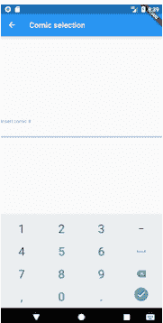

由于它不需要任何参数来工作，我们不需要指定构造函数，但我们需要有一个 fetchComic 方法，该方法按漫画编号获取，与我们在 HomePage 中使用的不同：

```
class SelectionPage extends StatelessWidget {
  Future<Map<String, dynamic>> _fetchComic(String n) async =>
    json.decode(
      await http.read('https://xkcd.com/$n/info.0.json')
    );
}
```

build 方法会更复杂，使用本书中从未见过的一些 Flutter 功能：

```
@override
Widget build(BuildContext context) {
  return Scaffold(
    appBar: AppBar(
      title: Text("Comic selection"),
    ),
    body: Center(
      child: TextField(
```

```
decoration: InputDecoration(
  labelText: "Insert comic #",
),
keyboardType: TextInputType.number,
autofocus: true,
onSubmitted: (String a) => Navigator.push(
  context,
  MaterialPageRoute(
    builder: (context) => FutureBuilder(
      future: _fetchComic(a),
      builder: (context, snapshot) {
        if(snapshot.hasData) return ComicPage(snapshot.data);
        return CircularProgressIndicator();
      }
    ),
  ),
),
```

① 这是一个 TextField，它是一个允许用户输入文本的小部件。

② keyboardType 用于设置用户 supposed 输入的信息类型（框架会优化显示和/或根据此设置显示给用户的键盘类型）。它是 TextInputType 类型，可以是以下之一：

- TextInputType.text（默认）用于常规单行文本。
- TextInputType.multiline 用于多行文本。
- TextInputType.number，我们将使用它，用于数字。
- TextInputType.datetime 用于日期和时间。
- TextInputType.emailAddress 用于电子邮件地址。
- TextInputType.phone 用于电话号码。

③ 此参数使视图自动聚焦到 TextField。这意味着键盘将自动打开，并且在上面输入的任何数字都将被发送到 TextField，而无需用户先点击它。

④ 我们还没有获取漫画，这意味着我们需要调用 FutureBuilder 来获取漫画并将漫画用作 ComicPage 的参数。

现在我们需要能够从主页到达该页面。我们将通过使用 AppBar actions 来实现，这是在应用栏右侧显示的小部件。在本例中，我们将使用一个 IconButton：

```
appBar: AppBar(
  title: Text(title),
  actions: <Widget>[
    IconButton(
      icon: Icon(Icons.looks_one),
      tooltip: "Select Comics by Number",
      onPressed: () =>
        Navigator.push(
          context,
          MaterialPageRoute(
            builder: (BuildContext context) => SelectionPage()
          ),
        ),
      ),
    ],
  ),
```

① 这是我们将添加一个小部件列表以在 AppBar 上显示的位置。在本例中它将只有一个 IconButton。

② IconButton 还需要一个 tooltip 来帮助用户理解按钮的作用。书中后面有一个截图显示了它的样子。

③ 这与 ComicTile 的 onPressed 完全一样。

更新后的主页，显示应用整体的新外观，看起来像：

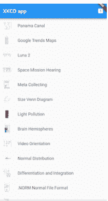

当用户长按按钮时，工具提示将如下所示：

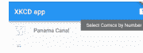

#### 如果该漫画不存在怎么办？

用户可以在 SelectionPage 中输入他们脑海中出现的任何数字。虽然我并不积极提倡以这种方式滥用无辜的应用功能，但用户可以选择输入一个大于最新漫画编号的数字，我们不能让应用崩溃或让 CircularProgressIndicator 因为用户不应该这样做而无限循环。

我们需要处理这种情况，为此我们将使用 AsyncSnapshot 的 hasError 属性：如果为 true，则意味着在处理 future 期间发生了错误。如果为 true，我们将向用户显示一个 ErrorPage，我们稍后会构建它。

同时，这里是我们 FutureBuilder 的新 builder：

networking/xkcd_app/lib/main.dart

```
builder: (context, snapshot) {
  if(snapshot.hasError) return ErrorPage();
  if(snapshot.hasData) return ComicPage(snapshot.data);
  return CircularProgressIndicator();
}
```

我说了我们将在某个时候构建一个 ComicPage。时刻到了，让我们来做吧！ComicPage 只需要是一个简单的 StatelessWidget 和通常的 Scaffold 和 AppBar。body 将是一个包含图标和文本的 Column，告知用户他们做错了什么：

networking/xkcd_app/lib/main.dart

```
class ErrorPage extends StatelessWidget {
  @override
  Widget build(BuildContext context) {
    return Scaffold(
      appBar: AppBar(
        title: Text("Error Page"),
      );
      body: Column(
        children: [
          Icon(Icons.not_interested),
          Text(
            "The comics you have selected doesn’t exist"+
```


"or isn't available"
)
],
}
);
}
}

#### 自行修改

我们已经看到了相当多的 Dart 代码，但你是否也在编写自己的代码？如果没有，这里是另一个机会（在《Wrapping Up the Calculation》之后）让你对我们的 XKCD 应用做出一个非常简单且细微的改进。

我们刚刚编写的 ErrorPage 只是笼统地告知用户我们无法获取该漫画。这也可以在任何我们无法获取漫画时使用（例如，如果没有网络且缓存被清空）。

你可以通过在每个 FutureBuilder 中添加一个 snapshot.hasError 条件来非常轻松地自行实现这一点。你可以更进一步，将传递给 SelectionPage 的漫画编号与最新的漫画编号进行比较，如果用户不小心输入了一个大于最新漫画编号的编号，则显示不同的错误。

### Flutter 中的永久数据 I/O：
添加“已收藏”漫画

到目前为止，我们只使用了临时缓存目录，但如果我们想添加一个功能，允许用户将一些漫画永久保存到本地存储，以便始终可以访问他们最喜欢的漫画。我们需要访问永久的本地存储设施。

我们可以通过应用程序文档目录来获得它，这是应用程序应该保存用户有意识删除之前需要保留的数据的位置。

我们可以使用 getApplicationDocumentsDirectory 获取应用程序文档目录的路径，并且可以像使用通过 getTemporaryDirectory 获取的缓存目录一样使用它：我们使用 getApplicationDocumentsDirectory().path 作为传递给 File 构造函数的路径的一部分。

让我们开始实现此功能，首先在主页的 app bar 中添加一个星形按钮以访问之前保存的漫画，并在漫画页面中添加一个按钮以保存漫画。

但在做任何这些之前，如果我们希望视图能够反映用户操作触发的漫画状态变化，我们需要将 ComicPage 转换为 StatefulWidget。这意味着我们需要做两件事：将 ComicPage 的定义更改为 StatefulWidget 的子类，并将到目前为止的 ComicPage 转换为 State<ComicPage> 定义，其中相同的 build 方法将驻留在其中：

```
networking/xkcd_app/lib/main.dart

class ComicPage extends StatefulWidget {
  ComicPage(this.comic);

  final Map<String, dynamic> comic;

  @override
```

```
_ComicPageState createState() => _ComicPageState();
}

class _ComicPageState extends State<ComicPage> {
```

```
@Override
Widget build(BuildContext context) {
  // return Scaffold(...)
}
}
```

下一步是决定我们应该使用什么类型的文件来存储已收藏的漫画。到目前为止，我们使用了两种不同类型的文件：

- 用于存储漫画数据的 JSON 编码文本文件和用于存储最新漫画编号的简单文本文件。
- 用于保存图像数据的二进制文件。

选择是由我们需要保存的数据的性质决定的：图像是二进制数据，而我们以文本 JSON 格式获取漫画，这意味着它们可以轻松以该格式保存到本地存储。一个数字可以作为二进制数据或基于文本的数据存储，而不会有太多差异。

已收藏的漫画将是一个数字列表，每种方法都有其优缺点：

- 以二进制格式保存（使用 `writeAsBytes`）实现更简单，需要的计算开销更少，但会生成用户无法读取的文件，但存储效率更高。
- 以 JSON 列表保存使用户可以直接读取和编辑文件成为可能，但会导致计算能力和存储空间利用效率降低。

我们将使用二进制格式，因为这似乎是此问题的最佳解决方案。我们将从在 `ComicPageState` 中实现 `_addToStarred` 开始，将漫画添加到已收藏漫画列表：

```
networking/xkcd_app/lib/main.dart

void _addToStarred(int num) {
  var file = File("$docsDir/starred");
  List<int> savedComics = json.decode(
    file.readAsStringSync()
  ).cast<int>();
  if(isStarred) {
```

```
savedComics.remove(num);
}
else {
  savedComics.add(num);
}
file.writeAsStringSync(json.encode(savedComics));
}
```

这依赖于作为 ComicPage 成员变量存在的 isStarred：

networking/xkcd_app/lib/main.dart

```
bool isStarred;
```

我们需要在首次加载 ComicPage 时确定漫画是否已收藏，因为我们将在用户点击星形按钮时更改该变量的值。由于 initState 不能是异步的，我们将使用 .then：

networking/xkcd_app/lib/main.dart

```
void initState() {
  super.initState();
  getApplicationDocumentsDirectory().then(
    (dir) {
      docsDir = dir.path;
      var file = File("$docsDir/starred");
      if(!file.existsSync()) {
        file.createSync();
        file.writeAsStringSync("[]");
        isStarred = false;
      }
      else {
        setState((){isStarred = _isStarred(widget.comic["num"]);});
      }
    }
  );
}
```

这依赖于一个 onStarred 方法，通过打开包含已收藏漫画编号的文件来判断漫画是否已被收藏，将其从 List of dynamic（可以包含任何内容的数据类型）转换为 List of integers 并检查漫画编号是否包含在列表中：

networking/xkcd_app/lib/main.dart

```
bool _isStarred(int num) {
  var file = File("$docsDir/starred");
  List<int> savedComics = json.decode(
```

```
file.readAsStringSync()
).cast<int>();
if(savedComics.indexOf(num) != -1)
  return true;
else
  return false;
}
```

### 为 COMIC PATH 添加 APPBAR 操作

现在我们需要实现一种方法来将每个漫画添加到已收藏中。我们在这种情况下的做法是在 app bar 中显示一个星形图标，当点击时，它会调用当前漫画的 _addToStarred 方法，将其添加到已收藏漫画列表。为此，我们将在 ComicPage 的 build 方法中再添加一个 AppBar 操作：

networking/xkcd_app/lib/main.dart

```
actions: <Widget>[
  IconButton(
    icon: isStarred == true ?
      Icon(Icons.star) :
      Icon(Icons.star_border),
    tooltip: "Star Comic",
    onPressed: () {
      _addToStarred(widget.comic["num"]);
      setState() {
        isStarred = !isStarred;
      };
    }
  ),
],
```

这就是我们新的 ComicPage 的外观：

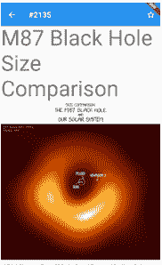

如果当前漫画已被收藏，其 app bar 的外观如下：


```
file.writeAsStringSync("[]");
} else {
  json.decode(file.readAsStringSync()).forEach(
    (n) async =>
      comics.add(await _fetchComic(n.toString()))
  );
}
return comics;
}
```

- ① 在这里我们定义了所需的变量并获取应用程序文档目录，并用它来定义我们将要操作的文件。
- ② 我们需要检查已收藏漫画文件是否存在；如果不存在，我们只需创建文件并返回一个空列表（我们将在构建已收藏漫画页面的 UI 时处理这个问题）。
- ③ 如果文件存在，我们获取文件中列出的所有漫画并返回它们。

现在我们将构建 *StarredPage* 的 UI：

```
networking/xkcd_app/lib/starredPageUI.dart
```

```
@override
Widget build(BuildContext context) {
  ① var comics = _retrieveSavedComics();

  return Scaffold(
    appBar: AppBar(
      title: Text("Browse your Favorite Comics")
    ),
    body: FutureBuilder(
      future: comics,
      builder: (context, snapshot) =>
        ② snapshot.hasData && snapshot.data.isNotEmpty ?
          ListView.builder(
            itemCount: snapshot.data.length,
            itemBuilder: (context, i) =>
              ComicTile(comic: snapshot.data[i]),
          )
        ③ :
```

```
Column(
  children: [
    Icon(Icons.not_interested),
    Text("""
      You haven't starred any comics yet.
      Check back after you have found something worthy of being here.
    """),
  ]
)
```


- ① **build** 方法只会被调用一次，因此无论将此调用放在何处都不会改变任何东西，但这就是你应该这样做的方式：将返回 **Future** 的调用放在只会被调用一次的地方，然后使用该调用返回的值作为 **FutureBuilder** 构造函数的 **future** 参数。

- ② 我们需要检查是否有任何收藏的漫画。如果有，我们将显示一个 **ListView** 的 **ComicTitles**，就像我们在主页中所做的那样。

- ③ 如果没有收藏的漫画，我们就只向用户显示一个通知。我们正在使用多行字符串，如本书记载的 Dart 附录中解释的那样（*Characters and Strings*）。

我们所看到的整个 **StarredPage** 代码被合并到以下类定义中：

```dart
// networking/xkcd_app/lib/main.dart

class StarredPage extends StatelessWidget {

  StarredPage();

  Future<Map<String, dynamic>> fetchComic(String n) async {
    final dir = await getTemporaryDirectory();
    var comicFile = File("${dir.path}/$n.json");

    if(
      await comicFile.exists() &&
      comicFile.readAsStringSync() != ""
    )
      return json.decode(comicFile.readAsStringSync());
    else {
      comicFile.createSync();
      final comic = json.decode(
        await http.read('https://xkcd.com/$n/info.0.json')
      );

      File('${dir.path}/$n.png')
        .writeAsBytesSync(await http.readBytes(comic["img"]));
      comic["img"] = '${dir.path}/$n.png';
      comicFile.writeAsString(json.encode(comic));

      return comic;
    }
  }
}
```

```dart
Future<List<Map<String, dynamic>>> _retrieveSavedComics() async {
  Directory docsDir = await getApplicationDocumentsDirectory();
  File file = File("${docsDir.path}/starred");
  List<Map<String, dynamic>> comics = [];

  if (!file.existsSync()) {
    file.createSync();
    file.writeAsStringSync('[]');
  } else {
    json.decode(file.readAsStringSync()).forEach(
      (n) async =>
        comics.add(await _fetchComic(n.toString()))
    );
  }
  return comics;
}

@override
Widget build(BuildContext context) {
  var comics = _retrieveSavedComics();

  return Scaffold(
    appBar: AppBar(
      title: Text("Browse your Favorite Comics")
    ),
    body:
    FutureBuilder(
      future: comics,
      builder: (context, snapshot) =>
        snapshot.hasData && snapshot.data.isNotEmpty ?
        ListView.builder(
          itemCount: snapshot.data.length,
          itemBuilder: (context, i) =>
            ComicTile(comic: snapshot.data[i]),
        )
        :
        Column(
          children: [
            Icon(Icons.not_interested),
            Text("""
              You haven't starred any comics yet.
              Check back after you have found something worthy of being here.
            """),
          ]
        )
      );
    }
  }
}
```

这就是我们的收藏漫画列表的显示效果：

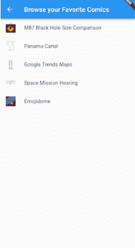

### 为 HomeScreen 的 App Bar 添加链接

现在我们需要让用户能够从应用的其他部分访问此页面。我们将通过向 HomeScreen 添加一个 AppBar 操作来实现这一点。这将与我们之前添加的 app bar 操作非常相似：当用户点击图标时，我们会在当前视图之上显示 StarredPage：

```dart
// networking/xkcd_app/lib/main.dart

IconButton(
  icon: Icon(Icons.star),
  tooltip: "Browse Starred Comics",
  onPressed: () {
    Navigator.push(
      context,
      MaterialPageRoute(
        builder: (BuildContext context) =>
          StarredPage()
      ),
    );
  },
),
```

这就是 HomeScreen 的 app bar 的显示效果：


### 我们接下来要去哪里

在本章中，我们通过构建一个 XKCD 漫画浏览器应用了解了如何与网络和本地存储进行交互。在下一章中，我们将探讨如何测试 Flutter 应用。

### 脚注

- [33] https://xkcd.com/2050/
- [34] https://api.dartlang.org/stable/2.1.0/dart-convert/json-constant.html
- [35] https://api.dartlang.org/stable/2.1.0/dart-convert/JsonCodec-class.html
- [36] https://pub.dartlang.org/packages/http
- [37] https://pub.dartlang.org/documentation/http/latest/http/http-library.html
- [38] https://en.wikipedia.org/wiki/List_of_HTTP_header_fields
- [39] https://material.io/design/components/navigation-drawer.html
- [40] https://material.io/design/components/progress-indicators.html#circular-progress-indicators
- [41] https://docs.flutter.io/flutter/material/InkWell-class.html
- [42] https://docs.flutter.io/flutter/material/Ink-class.html
