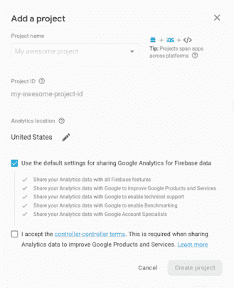
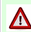
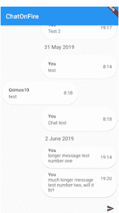
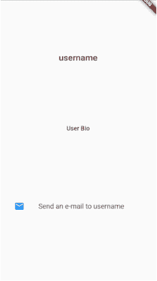

## 第 7 章：使用 Firebase 构建聊天应用

Google Firebase 是一组旨在简化某些类型应用程序开发工具。在本章中，我们将使用它来构建一个聊天应用。

### 什么是 Firebase？

构建 Web 和移动应用程序的传统方式是拥有前端和后端。前端是使用如 Flutter、特定平台原生 SDK、React 或 HTML 等工具构建的，并运行在用户的客户端设备上，而后端运行在服务器上，并使用如 PHP、Spring 或 Node.js 等工具构建。

Firebase 旨在用他们自己的服务取代大多数在服务器端软件上运行的功能，这些服务直接使用 Google 的 API 与应用程序连接，而不是使用标准的 HTTP 请求。使用 Firebase 构建的应用程序通常设置更简单，维护也更复杂。有一个免费计划（称为 Spark），它允许有限的连接数量，只提供有限的存储和计算，但完成本章描述的任务不需要更多。

#### 入门

让我们从导航到 Firebase 控制台 [46] 开始，登录 Google 并创建一个新的项目：


之后，你会得到以下弹出窗口：




选择一个项目名称（在本示例中，我们将从现在开始一直使用 *ChatOnFire* 作为所有项目/应用名称）以及离你所在位置最近的服务器。现在你需要将应用连接到 Firebase，并且这必须分别针对应用的 Android 和 iOS 配置进行，通过按照屏幕上提供的说明操作，同时记住你可以在应用树中的 android 和 ios 目录中找到应用运行的每个平台的特定平台配置。

完成特定平台的配置后，我们需要开始将 Firebase 连接到 Flutter，并且在 Dart Pub 上有一堆由 Google 开发的 Flutter 包可以帮助我们使用 Flutter 和 Firebase 构建应用。

### Firebase for Flutter

在安装了 `firebase_core` 包[^47] 之后（你知道流程的，不需要进一步解释，编辑 `pubspec.yaml` 后记得运行 `flutter packages get`）我们需要考虑我们应用所需的特定功能。GitHub 上官方 Flutter 账号上有完整的 Flutter Firebase 包列表。[^48]

让我们从最常用的 Firebase 工具开始：Cloud Firestore 数据库。

### The Firebase Cloud Firestore

Firebase Cloud Firestore 对于频繁添加且需要实时访问的数据来说是理想的。这意味着它非常适合聊天应用的创建。

对于本示例，导航到 Firebase 控制台中的 Database -> Rules 并将规则更改为以下内容，这样我们就不需要进行身份验证（我们将在 *Authentication* 部分处理这个问题）：

```
service cloud.firestore {
  match /databases/{database}/documents {
    match /{document=**} {
      allow read, write;
    }
  }
}
```

当从应用发送消息时，因为在那种情况下我们必须将本地时间转换为 UTC。

#### Interacting with Cloud Firestore in Flutter Apps

要在我们的 Flutter 应用中使用 Firestore，我们将利用 `cloud_firestore` 包。

让我们开始将 `cloud_firestore` 包添加到 `pubspec.yaml` 中的依赖项中：

`firebase/chatonfire/pubspec.yaml`

```yaml
dependencies:
  flutter:
    sdk: flutter
  firebase_core:
  cloud_firestore:
```

并将其导入到 `main.dart` 中：

`firebase/chatonfire/lib/main.dart`

```dart
import 'package:cloud_firestore/cloud_firestore.dart';
```

我们使用通过 `Firestore.instance` 创建的 `Firestore` 类的实例与 Cloud Firestore 交互。我们可以使用 `Firestore.instance.collection("collectionName")` 访问一个集合，其中 `collectionName` 是我们想要访问的集合的名称。该返回的数据类型为 `CollectionReference`，我们将在本节中探讨如何使用它。

#### Reading from the Cloud Firestore

如果我们想直接访问某个文档，我们使用 `CollectionReference.document(path)` 简单查询方法，其中 `path` 实际上是文档的 ID，对应于在集合内通向该文档的路径。这会返回一个 `DocumentReference`，并且实际上不会获取文档。要获取它，我们需要调用 `DocumentReference.get`，它会返回一个 `Future<DocumentSnapshot>`。在等待或以其他方式获取 `DocumentSnapshot` 本身之后，我们可以访问数据。

```dart
Firestore.instance.collection("Messages").add(
  {
    "from": "Anonymous",
    "when": DateTime.now().toUtc(),
    "msg": "Hi There From The App",
  }
);
```

在真实的应用中我们需要对用户进行身份验证，因此我们将从了解如何使用 Firebase Authentication 对我们的 Flutter 应用进行用户身份验证开始。

#### Deleting or Changing Data from the Cloud Firestore

给定一个 `DocumentReference`（我们从 `Firestore.instance.collection(collection).document(document)` 获得的对象），除了我们之前说过的使用 `DocumentReference.get` 获取数据外，我们还可以对文档执行一些操作：

- 使用 `DocumentReference.delete` 删除它。
- 通过将 Map 传递给 `DocumentReference.updateData` 来更改某些字段。
- 通过将 Map 传递给 `DocumentReference.setData` 来设置文档的内容，如果文档不存在则创建它。

所有这些方法都是异步运行的，但不返回任何内容。

### Authentication

身份验证需要自己的 `firebase_auth` 包[^49]，并且可以在 Firebase 控制台中通过前往 Develop -> Authentication -> Sign-in method 进行配置。在我们的示例中，我们将使用用户的电子邮件地址和密码进行身份验证，这由 Firebase 变得非常简单，并且代表了大多数应用的情况。选择它后，你会被警告需要更多特定平台的设置：具体来说，我们需要在 Android 的应用级 `build.gradle` 依赖项中添加：

```
implementation 'com.google.firebase:firebase-auth:16.2.1'
```

以及在 iOS `Podfile` 中添加：

```
pod 'Firebase/Auth'
```

你应该拥有该 Podfile 来进行 CocoaPods 配置，以便将 iOS 应用连接到 Firebase。

#### Using the `firebase_auth` Package

让我们导入 `firebase_auth` 包，它为 Firebase Authentication 工具提供了直观的 Flutter 接口：

`firebase/chatonfire/pubspec.yaml`

```
firebase_auth: ^0.6.2
```

与往常一样，我们需要在 `main.dart` 中导入 `firebase_auth` 包：

`firebase/chatonfire/lib/main.dart`

```dart
import 'package:firebase_auth/firebase_auth.dart';
```

#### The `FirebaseAuth`

Firebase 身份验证是通过使用 `FirebaseAuth` 类的实例来实现的，使用以下方式获取：

```dart
var auth = FirebaseAuth.instance;
```

在此之后，我们可以使用 `auth` 对象处理大多数与身份验证相关的操作。

其中包括：

`createUserWithEmailAndPassword(email, password)`

它使用给定的电子邮件和密码创建用户，以及：

`signInWithEmailAndPassword(email, password)`

它使用给定的电子邮件和密码登录用户。

> **The Many Authentication Methods Available in Flutter**
> 
> 有许多身份验证方法可与 Firebase 一起使用。以下是其中最常见的列表：
> 
> - Phone Authentication，它依赖于两个阶段：运行 `FirebaseAuth.instance.verifyPhoneNumber`，它接受在代码发送时、自动检索时或验证过程中出现问题时要运行的方法。如果自动检索，我们应将用户视为已通过身份验证并继续。如果没有，我们需要为用户提供一种插入他们通过 SMS 接收的代码的方式，并使用 `AuthCredential` 登录，如本侧边栏之后所述的 Package and Library Versions 旁注中所述。
> - Google Sign-In Authentication，使用 `FirebaseAuth.instance.signInWithGoogle`。

#### Package and Library Versions



FlutterFire 包（正如 Google 喜欢称呼 Firebase 相关 Flutter 包的那样），就像测试接口一样，有时与某些版本的 Flutter 或特定平台 API（我们在 Gradle/CocoaPods 配置中导入的那个）不兼容，或者根本无法工作。此外，它们往往在版本之间存在破坏性更改，这意味着同一代码在一次或两次主要发布后有很大几率无法工作。

对于我们的示例，我使用了 `firebase_auth` 版本 0.6.X，因为这是唯一一个与当前 Flutter 版本（1.5）和原生 API 版本一致工作的版本。如果将来你需要使用更新的版本，因为旧版本存在安全问题或其他任何原因，需要记住的一件事是该包正在慢慢切换到使用通用的 `auth.signInWithCredential` 方法，该方法以位置参数的形式接受一个 `AuthCredential` 对象。

`AuthCredential` 对象可以通过调用每个 `AuthProvider` 的 `getCredential` 方法生成，并为每个提供其执行身份验证所需的参数。

你可以在官方 `firebase_auth` API 参考[^159] 上查看所有可用的 `AuthProvider` 以及可用于获取 `AuthCredential` 的方法。如果升级包版本并出现问题，也应在此处查看。


### The FirebaseUser

身份验证过程的最终结果是生成一个 `FirebaseUser` 变量，该变量也会被存储。它代表用户账户并以属性的形式存储以下信息：

- 它的 `uid`，一个字符串，等价于典型的数字用户 ID。
- 它的 `phoneNumber` 和/或电子邮件地址。
- 一个 `isEmailVerified` 用于确定用户的电子邮件地址是否已验证，在进行电子邮件和密码身份验证时很有用。
- 我们可以通过直接更改这些属性来设置的 `displayName` 和 `photoUrl`。

要更改这些属性（例如设置显示名称），我们需要创建一个 `UserUpdateInfo` 对象，其中将包含所有这些属性。更改你想要更改的任何属性，然后运行 `user.updateProfile(userUpdateInfo)`，其中 `userUpdateInfo` 是包含已更改属性的 `UserUpdateInfo` 对象。

要更改用户的电子邮件地址，可以使用 `user.updateEmail(newEmail)`，而要更改用户的密码可以使用 `user.updatePassword(newPassword)`。你可以使用 `user.reload` 重新加载本地配置文件以匹配远程配置文件。请记住，这只有在你将 `user` 变量重新赋值为 `auth.currentUser` 时才会生效。

Firebase 的身份验证工具可以做很多事情：除了创建和删除账户、重置密码和更改电子邮件地址之外，它还允许你验证电子邮件地址。验证通过调用 `user.sendEmailVerification` 完成，该调用会向用户发送一封包含验证链接的电子邮件。当用户点击链接时，电子邮件将被视为已验证。

这对 Firebase 本身来说唯一的差别是，已验证电子邮件地址的用户，其 `user.isEmailVerified` 布尔属性将被设置为 `true` 而不是 `false`。你可以自行决定如何处理未验证的用户：是提供所有功能、部分功能，还是完全不提供功能。

发生了。

### Log-In Persistency in Local Cache

Firebase 会在本地存储中保留登录信息，这意味着我们不必担心本地用户设备上用户数据的持久性，因为 Firebase 也会为我们处理这个问题。

### Sign Out

鉴于用户数据会被 Firebase 无限期保存，要注销用户，你需要运行：

```dart
auth.signOut();
```

这是一个异步方法，不返回任何内容。

### COMBINING AUTHENTICATION AND DATABASE ACCESS

Firebase 很棒：你只需要对用户进行身份验证，然后对 Firebase 数据库执行的任何操作都将代表该用户执行。你甚至不需要考虑它：Firebase 会自行处理，Flutter 也完美支持它。这正是我们在 *Building the Chat App* 中构建聊天应用时要利用的。

### Animations and Transitions

#### ANIMATING WITHIN A SCREEN: THE ANIMATEDCONTAINER AND SIMILAR WIDGETS

AnimatedContainer 是开始为你的 Flutter 应用添加动画的最简单小部件之一：它是一个普通的 Container，但当属性更改时它会进行动画，给出到不同状态的更流畅过渡。例如，更改其高度或宽度会使小部件逐渐缩小或扩展，通过更改小部件的边框或颜色属性也可以实现类似效果。动画的持续时间可以使用 duration 参数可选地更改，其曲线（动画随时间推移是否以及如何减速或加速）可以使用 curve 参数更改。

duration 的类型为 Duration，因此你会使用我们在身份验证期间之前使用的 Duration，而 curve 的类型为 Curve。最常见的曲线集合可以在 Curves 类中找到。这是一个很大的集合，因此如果你觉得以下基本曲线不够用，或者想了解产生每条曲线的数学函数，可以考虑在官方 Flutter 参考手册[51] 的 Constants 部分阅读完整列表：

- Curves.easeIn，先慢后快。
- Curves.easeOut，先快后慢。

如果你只想为某些内边距做动画，可以用 AnimatedPadding 替换 Padding 小部件，如果你想为 TextStyle 的更改做动画，可以使用 DefaultTextStyle 的动画版本（这是一个将 style TextStyle 参数应用于其子元素所有后代的类），称为 AnimatedDefaultTextStyle（它对 `style` 的更改进行动画），通过为这些动画小部件提供可选的 `curve` 和 `duration`。

这些都很有趣，但最有用的一定是 `AnimatedList`，它会对列表的添加或元素的删除进行动画。

#### AnimatedList

`AnimatedList` 起初是一个普通的 `ListView`，但其状态对象可以通过 `GlobalKey` 使用来插入或删除项目，并在执行这些操作时显示过渡。

我们可以像构造 `ListView.builder` 构造的 `ListView` 一样构造一个 `AnimatedList`，但我们必须设置一个稍后用来与之交互的 `key`，它必须是一个 `GlobalKey<AnimatedListState>`，而 `itemCount` 将改为 `initialItemCount`。

`itemBuilder` 会多一个 `animation` 参数，它提供了动画的当前状态，可以由 `itemBuilder` 内部的 `SizeTransition` 小部件使用，以通过增加小部件的大小（在开始时裁剪它并逐渐全部显示）来实际在视觉上创建插入项目时的过渡。

所有这些加起来如下：

```
AnimatedList(
  key: key,
  initialItemCount: n,
  itemBuilder(context, i, animation) =>
    SizeTransition(
      sizeFactor: animation,
      child: WidgetToShow()
    )
)
```

`SizeTransition` 并不是唯一可以执行类似过渡的小部件（例如类似的 `ScaleTransition` 会缩放小部件而不是裁剪它），但它是为列表做动画目的最有效的。

在某处保存相同的 `key` 允许我们通过编写以下代码来获取相对于该 `AnimatedList` 的 `AnimatedListState` 对象：

```
var listState = key.currentState as AnimatedListState;
```

这使我们能够通过将以下内容包装在 setState 调用中来添加列表项：

```
listState.insertItem(position);
```

请记住，AnimatedList 必须能够在该位置构建新元素：如果它从 List 中取元素，请确保实际上有新数据可以构建新项目。

一个充分利用 AnimatedList 在按下浮动操作按钮时动态向列表添加项目的部件（或更准确地说，是有状态部件的状态）的完整示例如下：

```
GlobalKey _key = GlobalKey<AnimatedListState>();
int _nextWidget = 3;
var _strings = [
  "First",
  "Second",
  "Third"
];

@override
Widget build(BuildContext context) {
  return Scaffold(
    appBar: AppBar(title: Text("Animated List")),
    body: AnimatedList(
      key: _key,
      initialItemCount: _nextWidget,
      itemBuilder: (context, i, animation) =>
        SizeTransition(
          sizeFactor: animation,
          child: ListTile(title: Text(_strings[i])),
        ),
    ),
    floatingActionButton: FloatingActionButton(
      child: Icon(Icons.add),
      onPressed: () {
        setState(() {
          (_key.currentState as AnimatedListState).insertItem(
            _nextWidget++
          );
          _strings.add(
            "${_nextWidget}th"
          );
        });
      },
    ),
  );
}
```

这些小部件提供了 Flutter 中最简单的动画类型：最有趣的动画由 Hero 小部件提供，它允许你在不同屏幕之间动画化小部件的移动。

#### HERO ANIMATION

Hero 动画由 Flutter 框架在 Hero 小部件上执行。Hero 小部件需要一个标识它的 tag 和一个 child（即要动画的小部件）。在两个不同屏幕上的两个 Hero 小部件上添加相同的 tag，其中一个是从另一个推送的，将使小部件动画化以移动到屏幕上的新位置。

一个演示 Hero 小部件用法的简单示例如下：有两个页面，它们有一个共同的小部件（我以 FlutterLogo 作为示例），该小部件被包装在具有相同 tag 的 Hero 小部件中。通过点击浮动操作按钮在视图之间切换，将导致小部件在第一页的居中位置和第二页的左上角位置之间以及反之亦然进行动画：

```
class FirstPage extends StatelessWidget {
  @override
  Widget build(BuildContext context) =>
    Scaffold(
      body:Center(
        child:Hero(
          tag: "Flutter Logo Hero",
          child: FlutterLogo(),
```


### 使用 Painters 在 Flutter 应用中自定义形状和绘制

通过 Canvas 和 Paint 我们可以改变某个 widget 的外观。这是通过 CustomPainter 实现的，它是一个允许我们在虚拟 Canvas 上绘制线条和形状的类。

### CUSTOMPAINT

CustomPaint 是允许我们将使用 CustomPainter 创建的自定义形状插入 widget 树中的 widget。它接受两个参数：作为命名参数 painter 的 CustomPainter，以及一个子 widget，该 widget 将是效果应用到的 widget。例如，如果我们想用我们创建的名为 LogoPainter 的自定义画笔来绘制 FlutterLogo widget，我们会将以下内容插入 widget 树中：

```
CustomPaint(
  painter: LogoPainter(),
  child: FlutterLogo(),
),
```

### 创建一个 CUSTOMPAINTER

画笔需要是 CustomPainter widget 的子类，我们必须通过重写 paint 和 shouldRepaint 方法来自定义它。

#### paint 方法

paint 方法接受两个参数：Canvas 和 Size。

Canvas 是我们执行绘制操作的对象，例如：
- 绘制线条，使用 canvas.drawLine(point1, point2, paint)，其中点由 Offset 表示（我们稍后会讨论），paint 为 Paint 类型，决定线条的颜色和外观，稍后会讨论。
- 使用 canvas.drawCircle(center, radius, paint) 绘制圆，其中 center 是一个 Offset，radius 是一个 double，paint 是一个 Paint 对象。
- 使用 canvas.drawImage(image, point, paint) 插入图像，其中 image 是 dart:ui 库的 Image 类，关于它本节末尾会有侧边栏。
- 使用 `canvas.drawRect(rect, paint)` 绘制矩形，其中 rect 为 Rect 类，我们将在本节后面讨论；
- 使用 `canvas.drawOval(rect, paint)` 绘制椭圆，其中参数与矩形相同，但会绘制椭圆而不是矩形。

Offset 类用于通过两个 double 数字表示应用屏幕绝对虚拟平面中的一个点（例如 Offset(0.0, 0.0) 是虚拟平面的原点）。你可以使用与 Canvas 一起传递给 paint 方法的属性和方法，使用 Size widget 的属性来选择相对于 Paint widget 的各种属性的偏移，如官方 API 参考中所述。 [52] 大多数情况下，你会像使用向量一样使用 Offset，根据 Size 相对于其他点定义形状，我们稍后会看到。

Paint 类用于定义在画布上绘制的线条和形状的样式功能（例如颜色或宽度）。主要的有 color 和 painting style：paint.color 可以设置为任何颜色（例如 Colors.green），paint.style 可以设置为 PaintingStyle.fill 或 PaintingStyle.stroke，前者用画笔填充形状，而后者仅绘制边缘。如果你选择后者，你可以设置 paint.strokeWidth 为任何 double 值。

Rect 类用于描述平面中的矩形。它可以由两个点创建（使用 Rect.fromPoints(point1, point2) 构造函数），它会生成包含这两个点的最小矩形，从左、右 X 坐标和顶部、底部 Y 坐标（使用 Rect.fromLTRB(left, top, right, bottom)，其中参数都是 double 值），或从几个边、宽度和高度创建（使用 Rect.fromLTWH(left, top, width, height)，参数与前一个构造函数一样都是 double 值）。Rect.fromCircle(center, radius)，参数与 Canvas.drawCircle 相同，用于从圆获取正方形。

Size 用于根据 CustomPaint 的子项的大小和定位生成 Offset。这可以通过诸如 Size.center(offset) 等方法完成，该方法将返回一个 Offset

它是通过将我们正在绘制的 widget 的中心视为平面的原点而获得的。另一种看待方式是它是 widget 中心通过向量 offset 平移后得到的点。其他方法，例如 Size.bottomRight(offset)，如果需要相对于 widget 的其他点绘制点，则可以使用。

> 使用 ui.Image
> 
> 传递给 drawImage 的图像不是常规的 Flutter Image widget：它是 dart:ui 库中发现的 Image 类。 [3]
> 
> ui.Image（通常在文档中以“ui.”前缀引用，因为“dart:ui”通常导入为“ui”，以区别于 Flutter Image widget）是作为 ui.FrameInfo 对象的“image”属性获得的。
> 
> FrameInfo 可以通过运行（并等待）ui.Codec 的 getNextFrame 方法获得。最后，可以使用“dart:ui”的 instantiateImageCodec 函数获得 ui.Codec。此数据可以通过使用 dart:io 的常规 File.readBytes 方法从图像文件获得。

#### shouldRepaint 方法

必须实现 shouldRepaint 方法，它是谈论复杂且资源密集的 CustomPainters 时的一个重要优化因素。

它返回一个布尔值，告诉框架 widget 是否需要重绘。它在 CustomPaint 对象尝试使用 CustomPainter 类的新实例进行绘制时被调用。此方法将旧的自定义画笔实例作为参数传递，因此您可以将其与新实例进行比较，以决定是否有任何值得重新渲染的更改。

在我们的例子中，我们将只返回 false，因为同一个对象永远不会使用不同的 CustomPainters 调用。出于性能原因，你应该从这一点开始，如果有问题，尝试让 shouldRepaint 返回 true 的情况越来越多，直到所有问题都得到修复，widget 按照你想要的方式绘制。

#### CustomPainter 的示例

CustomPainters 允许高度定制，因此最好通过示例来描述它们，以便向您展示如何


### 将 HERO ANIMATIONS 与 CUSTOMPAINT 结合

将这些画布绘画能力与 hero 动画结合起来，可以为 Flutter 应用带来有趣的用户交互动画：让我们想象一下有两个与上一节中看到的类似的 widget，但颜色不同，并且作为不同视图或同一视图不同版本的链接。

让我们开始定义画笔：一个红、绿、白的，就像之前的那个：

```
class GreenWhiteRedPainter extends CustomPainter {
  @override
  void paint(Canvas canvas, Size size) {
    var greenPaint = Paint();
    greenPaint.style = PaintingStyle.fill;
    greenPaint.color = Colors.green;
    var redPaint = Paint();
    redPaint.style = PaintingStyle.fill;
    redPaint.color = Colors.red;
    var whitePaint = Paint();
    whitePaint.style = PaintingStyle.fill;
    whitePaint.color = Colors.white;
    canvas.drawColor(Colors.blue, BlendMode.color);
    canvas.drawOval(
      Rect.fromPoints(
        size.topLeft(Offset(-40, -100)),
        size.bottomRight(Offset(15, 10))
      ),
      greenPaint
    );
    canvas.drawOval(
      Rect.fromPoints(
        size.topLeft(Offset(-15, -10)),
        size.bottomRight(Offset(40, 100))
      ),
      redPaint
    );
```

```
```dart
canvas.drawCircle(size.center(Offset(0, 0)), 40.0, whitePaint);

}

@override
bool shouldRepaint(CustomPainter old) {
  return false;
}
}
```
```

以及一个蓝白的：

```
```dart
class BlueWhiteBluePainter extends CustomPainter {
  @override
  void paint(Canvas canvas, Size size) {
    var bluePaint = Paint();
    bluePaint.style = PaintingStyle.fill;
    bluePaint.color = Colors.blue;
    var whitePaint = Paint();
    whitePaint.style = PaintingStyle.fill;
    whitePaint.color = Colors.white;
    canvas.drawColor(Colors.blue, BlendMode.color);
    canvas.drawOval(
      Rect.fromPoints(
        size.topLeft(Offset(-40, -100)),
        size.bottomRight(Offset(15, 10))
      ),
      bluePaint
    );
    canvas.drawOval(
      Rect.fromPoints(
        size.topLeft(Offset(-15, -10)),
        size.bottomRight(Offset(40, 100))
      ),
      bluePaint
    );
    canvas.drawCircle(size.center(Offset(0, 0)), 40.0, whitePaint);
  }

  @override
  bool shouldRepaint(CustomPainter old) {
    return false;
  }
}
```
```

我们将在一个 Row 中的两个不同 widget 的应用中使用它们，每个 widget 都会将自身传递给第二个视图：

```
```dart
class FirstPage extends StatelessWidget {

  final widgets = [
    Hero(
      tag: "Blue White Red",
      child: CustomPaint(
        painter: BlueWhiteBluePainter(),
        child: Text("1"),
      ),
    ),
    Hero(
      tag: "Green White Red",
```


### StreamBuilder

StreamBuilder 的工作原理与 FutureBuilder 相似，但它会实时更新其内容以匹配给定数据流的内容，而不是像 FutureBuilder 那样只显示给定 Future 的结果：

```dart
StreamBuilder(
  stream: myStream(),
  builder: (context, snapshot) {
    if(!snapshot.hasData) return CircularProgressIndicator();
    return MyWidget(
      data: snapshot.data
    );
  }
)
```

### 构建聊天应用

既然我们已经了解了如何将 Firebase 用于所需功能（身份验证和数据库），并且掌握了一些更高级的 UI 概念，我们就可以开始构建我承诺过的聊天应用了。

#### 规划应用界面

聊天应用需要用户在首次启动应用时执行多项操作：

-   我们需要用户输入电子邮件地址和密码，然后登录现有账户；如果还没有账户，则创建一个新账户。此时，用户还应收到一封要求其验证账户的电子邮件，但我们不会在已验证和未验证用户之间做出区分。
-   我们需要用户选择一个*显示名称*，以便在应用中向其他用户标识自己。
-   如果用户完成了以上所有步骤，他们就应该进入显示其他用户发送的所有消息的页面。

#### 构建界面

我们将按照用户与界面交互的顺序逐个构建每个部分。让我们从注册/登录页面开始！

##### 登录/注册页面

和上一章一样，我们将使用 `TextEditingController`，以便在其自身的 `onSubmitted` 之外访问输入到 `TextField` 中的文本。

界面将如下所示（我们将在后面的“身份验证”部分实现 `logIn` 和 `signUp` 方法）：

```dart
// firebase/chatonfire/lib/main.dart

@override
Widget build(BuildContext context) {
  if(!_verificationComplete) {
    Navigator.pushReplacement(
      context,
      MaterialPageRoute(
        builder: (context) => ConfigPage()
      )
    );
  }
  return Scaffold(
    appBar: AppBar(
      title: Text("ChatOnFire Login"),
    ),
    body: ListView(
      children: <Widget>[
        Padding(
          padding: EdgeInsets.all(15.0),
          child: Text(
            "Log In Using Your Phone Number",
            style: Theme.of(context).textTheme.display1,
          ),
        ),
        Padding(
          padding: EdgeInsets.all(10.0),
          child: TextField(
            keyboardType: TextInputType.emailAddress,
            controller: _emailController,
            decoration: InputDecoration(
              labelText: "Email Address",
            ),
            autofocus: true,
          )
        ),
        Padding(
          padding: EdgeInsets.all(10.0),
          child: TextField(
            keyboardType: TextInputType.text,
            obscureText: true,
            controller: _passwordController,
            decoration: InputDecoration(
              labelText: "Password",
            ),
          ),
        ),
        Padding(
          padding: EdgeInsets.all(10.0),
          child: FlatButton(
            color: Theme.of(context).accentColor,
            textColor: Colors.white,
            child: Text("Log In".toUpperCase()),
            onPressed: () {
              logIn(
                _emailController.text,
                _passwordController.text
              ).then(
                (user) {
                  _user = user;
                  if (!_user.isEmailVerified) {
                    _user.sendEmailVerification();
                  }
                  _verificationComplete = true;
                  Navigator.pushReplacement(
                    context, MaterialPageRoute(
                      builder: (context) => ConfigPage()
                    )
                  );
                }
              ).catchError(
                (e) {
                  Scaffold.of(context).showSnackBar(
                    SnackBar(
                      content: Text(
                        "You don't have an account. Please sign up."
                      )
                    )
                  )
                }
              )
            }
          )
        )
      ]
    )
  );
}
```

登录后，用户必须输入显示名称，因此我们需要一个专门用于实现该目的的名为 `ConfigPage` 的屏幕，因为这一步需要先完成身份验证，并且是使用聊天页面的前提条件：

```dart
// firebase/chatonfire/lib/main.dart

@override
Widget build(BuildContext context) {
  return Scaffold(
    appBar: AppBar(title: Text("Configure you account's basic information")),
    body: ListView(
      children: <Widget>[
        TextField(decoration: InputDecoration(
          labelText: "Display Name"
        ),
        onSubmitted: (displayName) =>
          setNameAndGoToChatPage(displayName, context),
        controller: _controller,
        ),
        FlatButton(
          child: Text("Submit"),
          onPressed: () =>
            setNameAndGoToChatPage(_controller.text, context),
        )
      ],
    );
  }
}
```

同样，我们稍后会实现 `setNameAndGoToChatPage`。我们只需要知道它一定会推入一个新屏幕，加载一个名为 `ChatPage` 的组件，我们现在就来实现它。

#### 聊天页面

以下是我们将在本节中构建的内容：



`ChatPage` 将由一个 `Column` 组成，该 `Column` 显示一个用 `Expanded` 包裹的 `ListView`（使用传递给 `StreamBuilder` 的消息构建），以及一个 `Row`（显示在屏幕底部，因为 `ListView` 会被 `Expanded` 组件扩展），其中包含一个 `TextField` 和一个用于发送消息的 `IconButton`，并一如既往地使用 `TextEditingController`：

```dart
// firebase/chatonfire/lib/main.dart

@override
Widget build(BuildContext context) {
  return Scaffold(
    appBar: AppBar(
      title: Text("ChatOnFire"),
    ),
    body: Column(
      children: <Widget>[
        Expanded(
          child: StreamBuilder(
            stream: getMessages(),
            builder: (context, snapshot) =>
              snapshot.hasData ?
                MessagesList(snapshot.data as QuerySnapshot)
                :
                Center(child: CircularProgressIndicator())
          ),
        ),
        Row(
          children: <Widget>[
            Expanded(
              child: Padding(
                padding: const EdgeInsets.all(8.0),
                child: TextField(
                  controller: _messageController,
                  keyboardType: TextInputType.text,
                  onSubmitted: (txt) {
                    sendText(txt);
                    _messageController.clear();
                  }
                ),
              ),
            ),
            IconButton(
              icon: Icon(Icons.send),
              onPressed: () {
                sendText(_messageController.text);
                _messageController.clear();
              }
            )
          ],
        )
      ],
    ),
  );
}
```

和往常一样，`getMessages` 和 `MessagesList` 将一如既往地在后面实现与 Cloud Firestore 的接口时定义，见 *数据库* 部分。


### 消息列表

在 MessagesList 小部件中，我们将获取消息列表并使用 ListView.builder 构造函数创建一个 ListView，将显示消息所需的数据（发送者、文本和时间戳）传递给稍后我们将构建的 Message 小部件。

ListView 的 reverse 参数使列表 *从底部开始*，意味着第一个元素将显示在底部，这将是滚动视图的默认位置，并且在添加新消息时会被保留。这是聊天应用的典型行为，我们希望复制它，因此我们将其设置为 `true`：

```
```dart
class MessagesList extends StatelessWidget {
  MessagesList(this.data);

  final QuerySnapshot data;

  bool areSameDay(Timestamp a, Timestamp b) {
    var date1 = a.toDate().toLocal();
    var date2 = b.toDate().toLocal();
    return
      (date1.year == date2.year)
      &&
      (date1.month == date2.month)
      &&
      (date1.day == date2.day);
  }

  @override
  Widget build(BuildContext context) =>
      ListView.builder(
        reverse: true,
        itemCount: data.documents.length,
        itemBuilder: (context, i) {
          var months = [
            "January",
            "February",
            "March",
            "April",
            "May",
            "June",
            "July",
            "August",
            "September",
            "October",
            "November",
            "December"
          ];
          DateTime when = data
              .documents[i]
              .data["when"]
              .toDate()
              .toLocal();
          var widgetsToShow = <Widget>[
```

```
Message(
  from: data.documents[i].data["from"],
  msg: data.documents[i].data["msg"],
  when: when
);
if(i == data.documents.length-1) {
  widgetsToShow.insert(
    0,
    Padding(
      padding: const EdgeInsets.symmetric(vertical: 10.0),
      child: Text(
        "${when.day} ${months[when.month-1]} ${when.year}",
        style: Theme.of(context).textTheme.subhead,
      ),
    );
  } else if(
    !areSameDay(
      data.documents[i+1].data["when"],
      data.documents[i].data["when"]
    )
  ) {
    widgetsToShow.insert(
      0,
      Padding(
        padding: const EdgeInsets.symmetric(vertical: 10.0),
        child: Text(
          "${when.day} ${months[when.month-1]} ${when.year}",
          style: Theme.of(context).textTheme.subhead
        ),
      )
    );
  }
  return Column(
    children: widgetsToShow
  );
}
```

你可能已经注意到，我们使用允许我们显示消息发送日期的 Column 来构建 ListView，如果该日期与前一条消息的日期不同。这是许多聊天应用的首选方法，因为它只在对用户有意义时才显示日期。

一个缺点是这样做有点不直观且冗长：我们必须同时使用 if 和 else if，因为如果在第一个 if 中同时使用两个条件，当我们尝试访问索引 documents.length 的文档时，应用会崩溃，但情况更糟的是，列表是分两步创建的，这使得内容在初次查看时不够清晰。

```
```dart
?
Alignment.centerRight
:
Alignment.centerLeft,
child: Container(
  width: MediaQuery.of(context).size.width/3*2,
  child: Card(
    shape: StadiumBorder(),
    child: ListTile(
      title: user.displayName != null
          ? Padding(
              padding: const EdgeInsets.only(
                top: 8.0,
                left: 5.0
              ),
              child: Text(
                from,
                style: Theme.of(context).textTheme.subtitle
              ),
            )
          : Padding(
              padding: EdgeInsets.only(left: 5.0),
              child: Text(
                "You",
                style: Theme.of(context).textTheme.subtitle
              ),
            ),
      subtitle: Padding(
        padding: const EdgeInsets.only(
          bottom: 10.0,
          left: 5.0
        ),
        child: Text(
          msg,
          style: Theme.of(context).textTheme.body1
        ),
      ),
      trailing: Text("${when.hour}:${when.minute}"),
    ),
  ),
);
} else {
  return CircularProgressIndicator();
}
}
);
}
```

### 使用 Firebase 实现界面

上一节中对电子邮件/密码身份验证的强调 specifically 是为了让你为在我们的聊天应用中实现这种身份验证方法做好准备。

我们也将遵循本节的用户交互流程，并从为身份验证目的实现界面开始。

### 身份验证

在 *Writing Log-In and Sign-Up Methods* 中，我们看到了如何实现登录方法：

```
firebase/chatonfire/lib/main.dart

Future<FirebaseUser> logIn(
  String email, String password
) async =>
  _auth.signInWithEmailAndPassword(
    email: email,
    password: password
  );
```

以及注册方法：

```
firebase/chatonfire/lib/main.dart

Future<FirebaseUser> signUp(
  String email, String password
) async =>
  _auth.createUserWithEmailAndPassword(
    email: email,
    password: password
  );
```

我们缺少的是设置显示名称并重定向到聊天页面的方法，正如 ConfigPage 所需的那样。

这应该不会太难，因为我们已经在介绍 *The FirebaseUser* 时看到了如何更改数据，例如显示名称：

```
firebase/chatonfire/lib/main.dart

void setNameAndGoToChatPage(String name, BuildContext context) {
  FirebaseAuth.instance.currentUser().then(
    (user) {
      var newUserInfo = UserUpdateInfo();
      newUserInfo.displayName = name;
      user.updateProfile(newUserInfo);
    }
  );
  Navigator.pushReplacement(
    context,
    MaterialPageRoute(
      builder: (_) => ChatPage(),
    )
  );
}
```

### 数据库

发送消息是使用我们在 *Adding Data to the Cloud Firestore* 中谈到向 Cloud Firestore 添加文档时提到的 CollectionReference.add 方法完成的：

```
firebase/chatonfire/lib/main.dart
```

```
void sendText(String text) =>
  FirebaseAuth.instance.currentUser().then(
    (user) =>
      Firestore.instance.collection("Messages").add(
        {
          "from": user != null ? user.displayName : "Anonymous",
          "when": Timestamp.fromDate(DateTime.now().toUtc()),
          "msg": text,
        }
      )
  );
```

在章节开头讨论的用于从 Cloud Firestore 读取数据的几种方法中 (*Reading from the Cloud Firestore*)，我们需要获取一个 Stream 以便与 StreamBuilder 一起使用，因此我们使用 CollectionReference.snapshots：

```
firebase/chatonfire/lib/main.dart
```

```
Stream<QuerySnapshot> getMessages() =>
  Firestore
    .instance
    .collection("Messages")
    .orderBy("when", descending: true)
    .snapshots();
```

### 添加个人资料页面：在 Cloud Firestore 中存储用户数据

我们的应用存在一些问题：如果两个用户具有相同的显示名称会造成混淆，因为我们只在数据库中存储用户的显示名称，而没有存储其 ID，因此我们的应用会认为用户是消息的发送者，即使发送消息的用户实际上是另一个恰好具有相同显示名称的完全不同的用户。

此外，应用实际上并没有提供区分这两个用户的方法，这对每个人来说都是一个令人困惑的情况。一个好的开始是为用户提供设置一个短字符串来自定义其个人资料的方式（通常称为状态或简介），以及通过电子邮件联系聊天应用的另一位用户的方式，因为我们已经要求提供该信息。

#### 为用户数据创建集合

让我们再创建一个集合！我们将它命名为 *Users*，其结构如下：

- 用户的 uid 将作为文档的 ID，以便更轻松地访问每个用户对应的文档。
- 用户的 displayName 将作为名为 displayName 的字符串。
- 用户的电子邮件地址将作为名为 email 的另一个字符串。
- 用户的简介将作为名为 bio 的字符串存储。

#### 更改文档和应用

我们需要为我们应用的每个现有用户创建用户数据集合的条目，并更改消息集合中的每个条目，将显示名称替换为用户 ID。然后，我们将担心使应用与数据库中更改后的消息一起工作，使其显示从 Firestore 获取的显示名称，然后我们将着手构建个人资料页面。

#### 更改数据

创建用户集合必须手动完成，通常最好有一个包含用户数据的集合：这在大多数“传统”数据库中就是这样，而且在 Firebase 中复制它是有价值的，除了我们不需要（也不应该，尤其是不以明文形式）将密码存储在我们可以访问的数据库中。

让我们从处理更改数据开始：当消息不多时，更改数据库中每条消息并替换值很容易，因为我们可以在 Firebase 控制台中手动更改它们，但对于更大的数据库，你必须编写一些代码（使用本章中我们学到的接口）来获取消息，找到具有给定显示名称的用户并用用户 ID 替换显示名称。

> **实现平滑过渡**
> 
> 在初始开发期间（在我们的例子中），应用没有用户，因此我们可以对数据库进行更改，这些更改会使应用的先前版本停止


随时工作，但当应用已经发布并且对数据存储方式进行重大更改时，情况就不是这样了。

当然，第一步之一就是通知旧版本的用户他们的应用版本不再可用，而不是直接让应用崩溃，但给用户一个更新的时间窗口也很好，在我们的案例中，这将通过将用户 ID 作为消息的额外属性存储，而不是替换之前使用的属性来实现，然后在给用户足够时间升级后删除（现在无用的）显示名称属性，向使用旧版本的用户显示通知，告知他们不应再使用该版本。

此外，对于在许多用户有机会设置个人简介之前就已更新应用的其他用户，你需要将每个现有用户的个人简介设置为某个默认值（可以是空白的 "" 或像其他聊天应用使用的其他内容）。

#### 更改应用

我们对应用所做的更改需要从用户甚至到达聊天页面之前就开始。在登录或注册后，当我们要求用户输入显示名称时，我们需要提示用户输入个人简介。

我们将把 `setNameAndGoToChatPage(name, context)` 改为通用的 `setDataAndGoToChatPage(name, bio, context)`。这一新增意味着我们需要定义另一个 TextEditingController 并将 UI 改为如下：

```
firebase/chatonfire2/lib/main.dart

TextField(
  decoration: InputDecoration(
    labelText: "Display Name"
  ),
  controller: _nameController,
),
TextField(
  decoration: InputDecoration(
    labelText: "Bio"
  ),
  controller: _bioController,
),
FlatButton(
  child: Text("Submit"),
  onPressed: () =>
    setDataAndGoToChatPage(
      _nameController.text,
      _bioController.text, context
    ),
)
```

该方法本身将做 `setNameAndGoToChatPage` 所做的事情，但它还会向 Users 集合添加一个文档：

#### firebase/chatonfire2/lib/main.dart

```
? Message(
  from: (snapshot.data as DocumentSnapshot).data,
  msg: data.documents[i].data["msg"],
  when: when,
  uid: data.documents[i].data["from"]
)
```

Message 本身不需要改变太多：它只需通过将从 MessagesList 获取的 UID 与当前用户的 ID 进行比较来将小部件左对齐或右对齐，而不是比较显示名称，其他所有内容都将由 from 参数提供。另一个更改是显示名称的 Text 小部件（每个 ListTile 的标题）现在将被包裹在 InkWell 中，以便用户可以点击它并进入个人资料页面：

#### firebase/chatonfire2/lib/main.dart

```
@override
Widget build(BuildContext context) {

  return FutureBuilder(
    future: FirebaseAuth.instance.currentUser(),
    builder: (context, snapshot) {
      if(snapshot.hasData) {
        FirebaseUser user = snapshot.data;
        return Container(
          alignment: user.uid == uid
            ? Alignment.centerRight
            : Alignment.centerLeft,
          child: Container(
            width: MediaQuery.of(context).size.width*2/3,
            child: Card(
              shape: StadiumBorder(),
              child: ListTile(
                title: user.uid != uid
                  ?
                  InkWell(
                    child: Padding(
                      padding: EdgeInsets.only(
                        top: 8.0,
                        left: 5.0
                      ),
                      child: Text(
                        from["displayName"],
                        style: Theme.of(context).textTheme.subtitle
                      ),
                    ),
                    onTap: () =>
                      Navigator.push(
                        context,
                        MaterialPageRoute(
                          builder: (context) => ProfilePage(from)
                        )
                      )
                  ),
                :
```

```
InkWell(
  child: Padding(
    padding: EdgeInsets.only(left: 5.0),
    child: Text(
      "You",
      style: Theme.of(context).textTheme.subtitle
    ),
  ),
  onTap: () =>
    Navigator.push(
      context,
      MaterialPageRoute(
        builder: (context) => ProfilePage(from)
      )
    ),
  ),
  subtitle: Padding(
    padding: const EdgeInsets.only(
      bottom: 10.0,
      left: 5.0
    ),
    child: Text(
      msg,
      style: Theme.of(context).textTheme.body1
    ),
  ),
  trailing: Text("${when.hour}:${when.minute}"),
),
) else {
  return CircularProgressIndicator();
}
);
```

### 创建个人资料页面

个人资料页面，正如我们之前所说，需要显示三件事：用户的显示名称、个人简介以及发送电子邮件的按钮。为了实现后者，我们需要一个新的包：url_launcher 包，它允许我们从应用中启动 URL。

### 使用 url_launcher 启动 URL 并发送电子邮件

由于 URL 也可以通过将要发送邮件的电子邮件地址前缀为 mailto: 来创建电子邮件，我们需要在 pubspec.yaml 的 dependencies 中添加 url_launcher 包并将其导入到 main.dart 中：

firebase/chatonfire2/lib/main.dart

```
import 'package:url_launcher/url_launcher.dart';
```

该包提供了两个函数：
- `canLaunch(url)`，它返回一个 `Future<bool>` 并检查是否有任何应用能够处理我们尝试启动的 URL。
- `launch(url)`，它异步启动 URL，如果没有应用能够处理该 URL，则抛出 `PlatformException`。

个人资料页面 UI 本身会非常简单：一个 `Column`（子项均匀分布）包含两个 `Text` 小部件（一个用于显示名称，一个用于个人简介）以及一个 `FlatButton` 允许用户发送电子邮件。

更具体地说，`FlatButton` 还将具有图标以及如屏幕截图所示的文本。



代码如下：

```
firebase/chatonfire2/lib/main.dart

class ProfilePage extends StatelessWidget {
  ProfilePage(this.user);

  final Map<String, dynamic> user;
}
```

```
@override
Widget build(context) {
  return Scaffold(
    body: Center(
      child: Column(
        crossAxisAlignment: CrossAxisAlignment.center,
        mainAxisAlignment: MainAxisAlignment.spaceEvenly,
        children: <Widget>[
          Text(
            user['displayName'],
            style: Theme.of(context).textTheme.title
          ),
          Text(
            user['bio'],
```

```
style: Theme.of(context).textTheme.subtitle
),
FlatButton.icon(
  icon: Icon(Icons.email),
  label: Text("Send an e-mail to ${user["displayName"]}"),
  onPressed: () async {
    var url =
      "mailto:${user["email"]}?body=${user["displayName"]},\n";
    if(await canLaunch(url)) {
      launch(url);
    } else {
      Scaffold.of(context).showSnackBar(
        SnackBar(
          content: Text("You don't have any e-mail app"),
        )
      );
    }
  }
),
],
),
);
}
}
```

### 允许用户编辑他们的个人简介

用户将来可能想要编辑他们的个人简介。为此，我们将在聊天页面的 AppBar 操作中提供一个新页面 ChangeBioPage：

firebase/chatonfire2/lib/main.dart

```
appBar: AppBar(
  title: Text("ChatOnFire"),
  actions: [
    IconButton(
      tooltip: "Change your bio",
      icon: Icon(Icons.edit),
      onPressed: () =>
        Navigator.push(
          context,
          MaterialPageRoute(
            builder: (context) => ChangeBioPage()
          )
        ),
    ),
  ],
),
```

该页面本身与 ConfigPage 非常相似：

firebase/chatonfire2/lib/main.dart

```
class ChangeBioPage extends StatelessWidget {
  final _controller = TextEditingController();

  void _changeBio(String bio) =>
```

```
FirebaseAuth.instance.currentUser().then(
  (user) {
    Firestore
      .instance
      .collection("Users")
      .document(user.uid)
      .updateData(
```

```
{
      "bio": bio
    }
  );
}
);

@override
Widget build(context) =>
Scaffold(
  appBar: AppBar(
    title: Text("Change your bio"),
  ),
  body: Center(
    child: Column(
      children: <Widget>[
        Padding(
          padding: const EdgeInsets.all(8.0),
          child: TextField(
            controller: _controller,
            decoration: InputDecoration(
              labelText: "New Bio"
            ),
            onSubmitted: (bio) {
              _changeBio(bio);
              Navigator.pop(context);
            }
          ),
        ),
        FlatButton(
          child: Text("Change Bio"),
          onPressed: () {
            _changeBio(_controller.text);
            Navigator.pop(context);
          }
        )
      ],
    )
  );
}
```

### 通过锁定 Firestore 访问使应用更安全

由于我们已经实现了身份验证，我们不应再像现在这样保持 Cloud Firestore 数据库规则开放，因为即使我们允许任何人注册，我们也应该尝试将访问限制在应用运行所需的最小范围内。

### 我们要做什么


### 更具体地说，我们需要做以下操作：

- 仅允许使用给定 uid 进行身份验证的用户向 users 集合中添加或编辑具有该 uid 的用户，允许所有人读取用户数据，但不允许任何人删除用户（目前我们不提供该选项）。
- 仅允许使用给定 uid 进行身份验证的用户添加声明来自该 uid 的消息，允许所有人访问消息，但不允许任何人编辑或删除它们（原因相同：目前我们不向用户提供该选项）。

### 实现限制

所有这些都通过以下 Cloud Firestore 配置实现（需插入到 Firebase 控制台的 Database -> Rules 中）：

```text
service cloud.firestore {
  match /databases/{database}/documents {
    match /Users/{userId} {
      allow create, update: if request.auth.uid == userId;
      allow read: if request.auth != null;
    }

    match /Messages/{messageId} {
      allow create: if request.auth.uid == request.resource.data.from;
      allow read: if request.auth != null;
    }
  }
}
```

#### 匹配文档

`match /databases/{database}/documents` 使其后面的大括号中的根路径为集合级别，这意味着例如 `/Users/ABCD` 是 ID 为 ABCD 的 Users 集合中的文档。

在其内部，我们有另外两个 match 语句：

- `match /Users/{userId}`，我们将在此规范对 Users 集合的访问。
- `match /Messages/{messageId}`，我们将在此处理对 Messages 集合的访问。

#### 允许访问

`allow` 语句的使用方式如下：

```text
allow operation: if condition;
```

操作可以是仅 read 或 write，也可以是 write 的更具体方面，如 create、update 和 delete。它也可以是操作的逗号分隔列表。

条件可以只是 true 或 false（就像我们一开始做的那样），但它应同时考虑用户试图访问的文档以及用户是谁（他们是否已通过身份验证，他们的 UID 是什么等）。

在我们的例子中，对于每个条件，我们可以使用三块数据：任何包含它的 match 语句路径中大括号中的内容（例如，在 Users match 语句的情况下，`{userId}`，即用户文档的路径，换句话说就是其 ID），request 接口和 resource 接口。

让我们从后者开始：`resource` 接口包含我们试图读取、更新或删除的资源的数据。例如，如果我们想访问消息的 `from` 字段，我们将写 `resource.data.from`。

与 resource 非常相似的是 `request.resource`，它是来自请求的数据。例如，如果请求试图添加一个用户，我们将通过 `request.resource.data.bio` 访问该用户的 bio。请求接口的另一个重要属性是 `request.auth`，它告诉我们试图访问 Firestore 的用户是否已通过身份验证，以及他们的凭据是什么。例如，如果用户未通过身份验证，`request.auth` 将等于 null；如果用户已通过身份验证，`request.auth.uid` 将返回试图访问 Firestore 的用户的 UID。

将所有这些方面和我们的需求结合起来，我们得到 Users 的如下配置：

```text
match /Users/{userId} {
  allow create, update: if request.auth.uid == userId;
  allow read: if request.auth != null;
}
```

以及 Messages 的如下配置：

```text
match /Messages/{messageId} {
  allow create: if request.auth.uid == request.resource.data.from;
  allow read: if request.auth != null;
}
```

### 关于使 Firestore 中的数据更安全的一些话

现在数据对匿名用户不可访问，对于公共聊天来说这是可以的。但对于一对一或群聊应用呢？首先，你需要将不同对话的消息分开，这相对简单，但一个非常重要的问题是隐私和保密性：消息将以明文形式存储在数据库中，允许运行该应用的人窥探对话，在发生安全事件时所有内容都会被泄露。这就是为什么大多数一对一聊天应用会实现某种加密，将加密后的消息存储在数据库中，只能使用存储在每个用户设备上的密钥解密。

### 密码重置和验证电子邮件地址

就我们的聊天应用而言，我们并不真正需要区分已验证电子邮件地址的用户和未验证的用户，因为我们甚至不提供通过电子邮件重置密码的功能（这是通过运行 `_auth.sendPasswordResetEmail` 实现的）。你可以选择让尚未验证电子邮件的用户在消息列表中以不同方式显示（例如将他们的显示名称文本更改为不同颜色，或在已验证电子邮件地址的用户旁边显示批准图标），但这并不是真正需要的。

对于其他应用来说，能够在无需依赖 Firebase 以外的任何东西并且如此简单的方式实现所有这些功能，绝对是一个很好的理由，让你对 Firebase 作为帮助创建应用的工具感兴趣，而这些应用否则将不得不依赖服务器和单独的后端代码才能工作。

### 你接下来要去哪里

你完成了，恭喜！现在剩下的就是将你所获得的知识应用到现实世界中。网上有一个庞大的 Flutter 相关内容社区，从我在这本书中多次提到的优秀且全面的官方 API 参考开始。要浏览它需要对 Flutter 应用的整体结构和内部工作原理有所了解，我希望你能通过阅读这本书获得这些知识。

如果你不觉得自己能写 Flutter 应用，因为你觉得需要了解更多关于 Dart 的知识，附录 1 *Dart 入门* 可能正是你需要的。

也许之后你会发现更有趣的东西：本书的正文主要集中在构建 Material Design UI、与包和插件交互以及编写 Dart 代码。在附录 2 *Apple 风格的外观和附加应用配置* 中，你将了解如何使用 Cupertino 小部件编写看起来像原生 iOS 应用的应用，以及如何使你的应用符合每个操作系统的典型风格；它还包含有关附加应用配置的有用信息，这些配置包含在 `pubspec.yaml` 中以及平台特定的 `android` 和 `ios` 目录中。例如，平台特定配置允许你将启动器图标和应用名称更改为你想要的任何内容（因为默认情况下你只能使用 Flutter 设置小写且无空格的名称，但你可以编辑平台特定配置以将应用名称设置为可以作为常规 Android/iOS 应用名称的任何名称）。

由于所有这些原因，强烈建议你阅读第二附录。

无论如何，这本书不可能包含 Flutter 为你提供的所有不同的小部件、功能和选项：现在就看你需要什么了。在了解了 Flutter 的工作原理和它能做什么之后，你已经具备了很好的条件，可以浏览关于你想接下来探索的 Flutter 任何细分方面的官方和社区创建的庞大内容。

### 脚注

- [46] https://console.firebase.google.com/
- [47] https://pub.dartlang.org/packages/firebase_core
- [48] https://github.com/flutter/plugins/blob/master/FlutterFire.md
- [49] https://pub.dartlang.org/packages/firebase_auth
- [50] https://pub.dev/documentation/firebase_auth/latest/firebase_auth/AuthCredential-class.html
- [51] https://docs.flutter.io/flutter/animation/Curves-class.html
- [52] https://api.flutter.dev/flutter/dart-ui/Size-class.html
- [53] https://api.flutter.dev/flutter/dart-ui/Image-class.html
- [54] https://api.flutter.dev/flutter/dart-ui/Canvas-class.html


