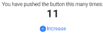
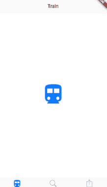
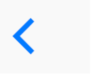
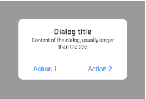

## 类苹果外观与附加应用配置

在标准的 Flutter Dart 代码中，有许多东西是无法设置的，比如包含空格和大写字母的自定义应用名称，以及自定义应用图标。关于 pubspec.yaml 文件的各种特性，也有很多东西需要学习。

但首先，让我们来谈谈如何通过了解 Cupertino 组件，让你的应用在 iPhone 上看起来更自然。

### Cupertino 组件

在我们过多地涉足 Flutter Dart 代码之外之前，你可能已经注意到 `pubspec.yaml` 中的一件事：对 cupertino_icons 的依赖。实际上，我们在本书正文中从未使用过其中包含的内容，因为它并不能真正让你在 Flutter 应用中做到以前做不到的事情：它包含一些图标，供看起来像原生 Apple 组件的组件使用，可以用来替代 Material Design 组件。

这意味着关于应用的外观，你有以下两种选择：

- 通过使用 Material 组件或 Cupertino 组件，让应用在 Android 和 iOS 上看起来相同。
- 通过在 Android 上使用 Material 组件、在 iOS 上使用 Cupertino 组件，让应用看起来像为每个平台构建的其他应用。

显然，你也可以选择向 iOS 用户展示 Material 组件，向 Android 用户展示 Cupertino 组件，但对大多数人来说，这可能不是最明智的选择。

### 使用 Cupertino 组件的计数器递增应用

为了让你了解如何使用 Cupertino 组件，我们将重写 Flutter 自带的基本 Flutter UI 示例中的计数器应用（我们在第一章中见过），这次使用 Cupertino 组件而不是 Material 组件。

#### 我们将要构建的内容

它将看起来像下面的截图，请记住，浮动操作按钮并不是常规 Apple 设计的一部分：




另一种选择是将其添加到导航栏（Apple 应用栏）中标题的右侧，但这样做可以让我们看到更多 Flutter Cupertino 组件。

### 导入 Cupertino 库

让我们从更改导入开始，我们只需要导入 Cupertino Flutter 库，因为我们不会使用任何 Material 组件：

```
cupertino/counter_cupertino/lib/main.dart
```

```
import 'package:flutter/cupertino.dart';
```

### 从 MaterialApp 到 CupertinoApp

接下来需要更改的是 MaterialApp，将其变为 CupertinoApp。需要更改的不仅仅是名称：主题需要是 CupertinoThemeData 类，而不只是 ThemeData。CupertinoThemeData 接受 primaryColor 而不是 primarySwatch，并且它需要是 CupertinoColors 之一，这些颜色不是你在 Material 应用中使用的常规颜色：Colors.blue 将变成 CupertinoColors.activeBlue，这是默认颜色。

### 基于 Material 的 Cupertino 主题数据

鉴于你可能会同时使用 Material 和 Cupertino 组件为 Android 和 iOS 构建应用，你可能希望为 Material Design 应用创建一个 ThemeData，并从该 Material Design 主题中派生 Cupertino 版本的样式。这


可以使用 `MaterialBasedCupertinoThemeData(materialTheme: themeData)` 来完成，它接受一个名为 `materialTheme` 的命名参数，参数值是我们想要从中派生新的 `CupertinoThemeData` 的 `ThemeData`。

### 我们的 CupertinoApp

因此，`theme` 参数完全可以省略，除非你希望应用有一个深色背景，并配合 `activeOrange` 主色。我们将坚持使用带有蓝色主色的常规浅色主题，提供与原始 Material 示例中相同的参数，以使示例尽可能接近原始：

```dart
class MyApp extends StatelessWidget {
  @override
  Widget build(BuildContext context) {
    return CupertinoApp(
      title: 'Flutter Demo',
      theme: CupertinoThemeData(
        primaryColor: CupertinoColors.activeBlue,
      ),
      home: MyHomePage(title: 'Flutter Demo Home Page'),
    );
  }
}
```

### 未更改的组件

`StatefulWidget`、`StatelessWidget` 和 `State` 与 Material 应用中的完全相同，`Row`、`Column`、`Container` 和 `Center` 组件也是如此，以及像 `Icons`（即使它们使用的 `IconData` 应该从 `CupertinoIcons` 中获取，而不是从 `Icons` 中获取）和 `Text` 这样的简单组件。

### Scaffold 和 App Bar

但在讨论它们之前，`Scaffold` 需要换成 `CupertinoPageScaffold`（对于带有底部导航的脚手架，有 `CupertinoTabScaffold`，没有 `CupertinoScaffold`），正如我之前所预料的，它接受 `CupertinoNavigationBar` 作为 `navigationBar` 参数，而不是像我们在 Material 应用中那样接受 `AppBar` 作为 `appBar` 参数。此外，`CupertinoNavigationBar` 接受三个命名特殊的参数：leading、middle 和 trailing，用于放置导航栏中的组件。通常左侧留给返回按钮，右侧留给重要操作，中间则放置页面标题：

```
cupertino/counter_cupertino/lib/main.dart
```

```
return CupertinoPageScaffold(
  navigationBar: CupertinoNavigationBar(
    middle: Text(widget.title),
  ),
```

### CupertinoButton

增加计数器的按钮将是一个——你猜对了——`CupertinoButton`。它接受一个子组件，我们可以使用一个简单的 `Row`：

```
cupertino/counter_cupertino/lib/main.dart
```

```
CupertinoButton(
  onPressed: _incrementCounter,
  child: Row(
    mainAxisAlignment: MainAxisAlignment.center,
    children: [
      Icon(CupertinoIcons.add_circled_solid),
      Text("Increase")
    ]
  )
)
```

`CupertinoIcons.add` 是单独出现时应该使用的 + 图标，`CupertinoIcons.add_circled` 周围有一个圆圈，`CupertinoIcons.circled_solid` 则是你之前截图中的那个。

### 总结

完整代码，包括与我们在第一章看到的应用相同的部分，如下所示：

```
cupertino/counter_cupertino/lib/main.dart
```

```
import 'package:flutter/cupertino.dart';

void main() => runApp(MyApp());
```

```
class MyApp extends StatelessWidget {
  @override
  Widget build(BuildContext context) {
    return CupertinoApp(
      title: 'Flutter Demo',
```

### 其他 Cupertino 组件

这只是对如何构建 iOS 风格 UI 的快速介绍，旨在作为入门平台，而非全面指南，因此我们将只讨论最重要的 Cupertino 组件。你可以在 Flutter 官网的专门章节中找到更多相关细节。[^56]

### Cupertino 导航

在讨论一些需要转换为 Cupertino 组件的 UI 元素之前，我们将了解如何使用 Cupertino 组件实现导航。Material Design 和 iOS 布局之间有一些差异需要澄清：抽屉式侧边导航菜单是典型的 Material Design 元素，因此它没有对应的 Cupertino 实现，导航要么通过底部标签栏处理，要么通过简单的 push/pop 导航处理。

### 使用 CupertinoTabScaffold 实现基于标签页的导航

让我们来谈谈上一节中简要提到的内容：`CupertinoTabScaffold`。实际上，要实现基于标签页的导航，这个组件并不是必需的（因为可以使用 `CupertinoTabBar` 调用 `setState` 并根据所选标签页渲染不同数据），但它让这件事变得非常简单。

它接受两个参数：

- `tabBar`，必须设置为一个 `CupertinoTabBar`，其中包含所需的 `BottomNavigationBarItems` 列表。
- `tabBuilder`，在给定 `context` 和 `int` 索引时，必须返回与该索引对应的标签页内容，通常返回一个 `CupertinoTabView`，它为每个标签页提供自己的导航历史和状态，并包含一个 `CupertinoPageScaffold` 用于标签页内容。

下面是一个示例：

```
class HomePage extends StatelessWidget {

  final data = [
    {
      "Train",
      CupertinoIcons.train_style_one
```

```
},
{
  "Search",
  CupertinoIcons.search
},
{
  "Share",
  CupertinoIcons.share
}
];

@override
Widget build(context) =>
CupertinoTabScaffold(
  tabBar: CupertinoTabBar(
    items: data.map(
      (el) =>
        BottomNavigationBarItem(
          title: Text(el.first),
          icon: Icon(el.last)
        )
    ).toList(),
  ),
  tabBuilder: (context, i) =>
    CupertinoTabView(
      builder: (context) =>
        CupertinoPageScaffold(
          navigationBar: CupertinoNavigationBar(
            middle: Text(data[i].first),
          ),
          child: Center(
            child: Icon(data[i].last, size: 80.0)
          ),
        )
    );
}
```

打开后会产生以下视图：



并且它让我们有机会注意到 iOS 的共享图标，它与 Material 的共享图标非常不同，在点击第三个标签页时可以看到：

### 使用 CupertinoPageRoute 进行 Push/Pop 导航

`Navigator` 本身的工作方式与 Material 应用中完全相同，但我们需要将 `MaterialPageRoute` 替换为 `CupertinoPageRoute`，不过并非必须如此。`MaterialPageRoute` 实际上会适配页面间转换时常用的原生动画（Android 上为垂直，iOS 上为水平），但它包含在 material.dart 中。如果你希望在 Android 上使用 iOS 动画（`CupertinoPageTransition`），或者因为当前文件只导入了 cupertino.dart 而不想使用 material.dart 中的组件，你可以像使用 `MaterialPageRoute` 一样使用 `CupertinoPageRoute`，将它传递给 `Navigator.push` 或类似方法，并向 `CupertinoPageRoute` 构造函数传入通常的 `context` 和一个 builder 回调。

在 push 一个页面后，导航栏的 leading 组件（如果存在）将是一个按钮，允许用户返回到上一个页面。



### 一些 UI 元素的替代

有一些 UI 元素值得讨论，作为我们在本书中见过的 Material 组件的替代品。

### CupertinoTextField

需要更改的组件之一是 `TextField`，与其他一些 Cupertino 组件不同，它不仅仅需要改名：`CupertinoTextField` 的 `decoration` 类型是 `BoxDecoration`（与我们在 `Container` 中使用的一样），而不是 `InputDecoration`。`InputDecoration` 是我们用来提供 `labelText` 的，而现在它变成了 `CupertinoTextField` 自身的一个名为 `placeholder` 的参数：

```
TextField(
  controller: _controller,
  decoration: InputDecoration(
    labelText: "Description"
  ),
  onSubmitted: (val) {
    // do something with value
  }
)
```

将变成：

```
CupertinoTextField(
  controller: _controller,
  placeholder: "Description",
  onSubmitted: (val) {
    // do something with value
  }
)
```

### CupertinoActivityIndicator

`CircularProgressIndicator` 的替代品是 `CupertinoActivityIndicator`，它看起来像这样：


### CupertinoAlertDialog

Cupertino 库提供了 `CupertinoAlertDialog`，通过 `showCupertinoDialog` 启动，以替代使用 `showDialog` 启动的 Material `AlertDialog`。


CupertinoAlertDialog 接受三个参数：标题 widget（通常是一些 Text）、内容 widget 以及一个名为 actions 的 widget 列表（通常是按钮），显示在对话框底部：

```
CupertinoAlertDialog(
  title: Text("Dialog title"),
  content: Text("Content of the dialog, usually longer than the title"),
  actions: <Widget>[
    CupertinoButton(
      child: Text("Action 1"),
      onPressed: () {}
    ),
    CupertinoButton(
      child: Text("Action 2"),
      onPressed: () {}
    )
  ],
)
```

使用以下方式启动时它会看起来像这样

showCupertinoDialog(context: context, builder: (_) => CupertinoAlertDialog(...));



### 在 CUPERTINO 和 MATERIAL 之间自动切换

如果我们希望我们的应用能够根据运行的 OS 改变显示内容，我们需要在 Dart 代码中能够知道运行在什么平台上。这得益于 dart:io 库中的 Platform 类，可以按如下方式使用：

```
if(Platform.isIOS) {
  // render Cupertino widgets
} else {
  // render Material widgets
}
```

它还提供了 Platform.isAndroid、Platform.isFuchsia、Platform.isMacOS、Platform.isWindows 和 Platform.isLinux，但在撰写本文时 Flutter 在桌面端对大多数应用还不适用，因此你可能不需要后三者。

利用它的最简单方法是为不同平台准备不同的 UI 树，但这并不是最优雅的解决方案。这就是为什么许多 Flutter 开发者选择实现通用类，这些类具有工厂方法，可为不同平台渲染不同的 widget。

### Flutter Platform Widgets 包

不过，这种实现的重复性很高，很适合做成一个库，而确实存在这样一个库：`flutter_platform_widgets` 包。该包提供了像 PlatformApp、PlatformScaffold、PlatformAppBar、PlatformButton 和 PlatformPageRoute 这样的类（完整列表和使用方法可在包的 API 参考[^57] 中找到），它们会在每个平台上自动使用 Material 或 Cupertino 的对应实现。

它还提供了一个通用的 PlatformWidget，接受 ios 和 android 参数，你可以用它来实现库中没有专门类提供的 widget，或者当库作者选择的 widget 不符合你的应用需求时使用。

### pubspec.yaml

pubspec.yaml 是定义 Dart 需要构建应用所需所有信息的文件。

#### 基础包数据

pubspec.yaml 中最基本的数据是名称和描述。描述可以包含大小写字母、空格和标点，而名称只能包含小写字母和下划线。

鉴于创建应用项目时设定的名称也是默认的应用名称，用户体验会受到影响，因为你必须选择一个应用名称只包含小写字母和空格，这并不是目前移动行业所偏好的风格（空格很少使用，但名称通常是大写的）。我们将在 Platform-Specific Setup 部分解决这个问题。在该部分我们还将看到如何将应用图标从默认的 Flutter 标志更改。

#### 设置版本

pubspec.yaml 中可以设置的一项内容是版本。如果你正在构建要在 Pub 上发布的包，这显然会被你的用户在安装包时使用。对于应用而言，它会自动添加到每个平台特定的配置中，这样你就不必每次都更改多个文件中的应用版本。

#### 依赖版本、Caret 语法和语义化版本

Dart 依赖的版本可以仅通过提供一个版本号来指定，这将强制安装该包的该版本；也可以使用比较运算符指定范围（例如，>=1.0.0 < 1.7.3）；或通过在版本号前加上 ^ 字符（例如，^1.2.0）来指定，这将允许与该库版本中可用的调用向后兼容的所有版本。这称为 caret 语法。它在 Dart 1.8.3 中引入，这就是为什么 `pubspec.yaml` 中的 environment 部分使用传统语法指定的原因：我们需要在使用它之前确保可以使用它，而我们通过依赖更新版本的 Dart 来确保这一点。更改应用以使用最近才引入 Dart 的功能时应牢记该 environment 部分。

这意味着版本号不能只是你随便编的数字：它应遵循语义化版本，这是一种被大多数包管理器遵循的标准，并在其官方网站上详细说明。[⁵⁸] 如果你不了解，它基于版本应遵循 *MAJOR.MINOR.PATCH* 模板的想法，即第一个数字在进行破坏性更改时更改，第二个数字在添加新功能但不破坏兼容性时更改，第三个数字在修复错误时更改。

Dart 版本由根据语义化版本指定的版本以及可选的加号和称为 *build number* 的数字组成，通常在新版本仅引入文档或配置更改时使用。

### 平台特定设置

在本节中，我们将通过编辑平台特定的配置来了解如何更改 Flutter 应用的应用名称和启动器图标。

#### 设置自定义应用名称

Dart 包名称（也是默认应用名称）必须仅由小写字母和下划线组成，这并不理想。这就是为什么我们要通过深入平台特定配置来设置自己的应用名称。

##### 设置 Android 应用名称

Android 上显示的应用名称可以通过更改 `appdir/android/app/src/main` 中找到的 `AndroidManifest.xml` 文件中 application 标签的 `android:label` 属性来更改。如果我们正在配置上一章中构建的 *Chat on Fire* 应用，它会像这样：

```
```xml
<!-- firebase/chatonfire2/android/app/src/main/AndroidManifest.xml -->
<application
    android:name="io.flutter.app.FlutterApplication"
    android:label="Chat on Fire"
    android:icon="@mipmap/ic_launcher">
```
```

##### 设置 iOS 应用名称

iOS 上显示的应用名称通常通过在 Xcode 中打开 ios 目录中的 `Runner.xcworkspace` Xcode 项目并更改项目级 *Display name* 设置来更改。或者，将名为 *CFBundleDisplayName* 的键及其字符串添加到 `appdir/ios/Runner` 目录中的 Info.plist 文件中，如以下示例所示：

```
```xml
<!-- firebase/chatonfire2/ios/Runner/Info.plist -->
<key>CFBundleDisplayName</key>
<string>Chat on Fire</string>
```
```

#### 设置启动器图标

任何像样的应用都需要自定义图标，Flutter 应用也不例外。Pub 上有一个 CLI 工具叫做 flutter_launcher_icons 可以简化此操作，但你也可以手动完成。本节将涵盖这两种情况。

##### 使用 Flutter Launcher Icons 更改启动器图标

Flutter Launcher Icons 包是应添加到 pubspec.yaml 中 dev_dependencies 部分的典型包示例：

firebase/chatonfire2/pubspec.yaml

```
dev_dependencies:
  flutter_launcher_icons:
  flutter_test:
    sdk: flutter
```

完成此操作并运行后：

```
$ flutter packages get
```

是时候配置该包了。

##### 一个简洁简单的示例

这可以在 pubspec.yaml 中完成，也可以在新文件中添加一个 flutter_icons 部分：

firebase/chatonfire2/pubspec.yaml

```
flutter_icons:
  image_path: "icons/launcher_icon.png"
  android: true
  ios: true
```

这就是你大多数时候会使用的方法：image_path 将是用于覆盖 Android 和 iOS 默认启动器图像的图像路径，当你运行以下命令时：

```
$ flutter packages run flutter_launcher_icons:main
```

##### 为配置文件选择不同的路径

该命令在配置位于 pubspec.yaml 中或你在


flutter_launcher_icons.yaml。如果您想使用名称不同的自定义文件，可以使用 -f 选项，如下所示：

```
$ flutter packages run flutter_launcher_icons:main -f filename.yaml
```

### 为 Android 和 iOS 使用不同的文件

与其为 Android 和 iOS 都提供一个 image_path，您可能选择为 Android 设置 image_path_android，为 iOS 设置 image_path_ios。您可能想要这样做是因为，与 Android 不同，iOS 会用黑色替换任何透明度，这意味着 iOS 应用图标必须填满整个图像且不能有透明边框，而 Android 图标则可以。

### 手动更改启动器图标

与其使用 flutter_launcher_icons 包，您可能想自己更改启动器图标。完全手动操作非常耗时：对于 Android，您可以通过在 appdir/android/app/src/main/res/mipmap-*dpi 中为不同像素密度值的设备提供不同分辨率的启动器图标来更改应用图标（遵循官方 Android 开发者指南[59]）。对于 iOS 图标也需要类似的过程，以替换 appdir/ios/Runner/Assets.xcassets/AppIcon.appiconset 中的图标。

一种绕过部分工作的方法是使用 Android Studio 的 Image Asset 创建工具，它会自动生成图标的不同分辨率，并通过 Xcode 打开 appdir/ios/Runner 中的 Assets.xcassets，然后用它来替换默认图标。

这样一来，无论用户的手机运行什么操作系统，您的应用都应该准备好分发给用户了。

Footnotes

[56] https://flutter.dev/docs/development/ui/widgets/cupertino

[57] https://pub.dev/documentation/flutter_platform_widgets/latest/

[58] https://semver.org/

Thank you!

How did you enjoy this book? Please let us know.
Take a moment and email us at
support@pragprog.com with your feedback. Tell us
your story and you could win free ebooks. Please use
the subject line “Book Feedback.”

Ready for your next great Pragmatic Bookshelf book?
Come on over to https://pragprog.com and use the
coupon code BUYANOTHER2020 to save 30% on
your next ebook.

Void where prohibited, restricted, or otherwise
unwelcome. Do not use ebooks near water. If rash
persists, see a doctor. Doesn’t apply to *The Pragmatic Programmer* ebook because it’s older than the
Pragmatic Bookshelf itself. Side effects may include
increased knowledge and skill, increased
marketability, and deep satisfaction. Increase dosage
regularly.

And thank you for your continued support,

Andy Hunt, Publisher
