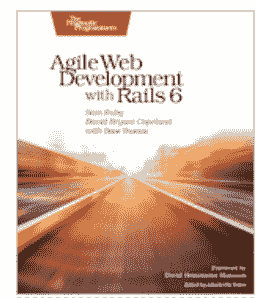

## You May Be Interested In...

Select a cover for more information

### AGILE WEB DEVELOPMENT WITH RAILS 6

Learn Rails the way the Rails core team recommends it, along with the tens of thousands of developers who have used this broad, far-reaching tutorial and reference. If you’re new to Rails, you’ll get step-by-step guidance.

If you’re an experienced developer, get the comprehensive, insider information you need for the latest version of Ruby on Rails. The new edition of this award-winning classic is completely updated for Rails 6 and Ruby 2.6, with information on processing email with Action Mailbox and managing rich text with Action Text.

Sam Ruby and David Bryant Copeland

(494 pages) ISBN: 9781680506709 $57.95

### MODERN SYSTEMS PROGRAMMING WITH SCALA NATIVE

Access the power of bare-metal systems programming with Scala Native, an ahead-of-time Scala compiler. Without the baggage of legacy frameworks and virtual machines, Scala Native lets you re-imagine how your programs interact with your operating system. Compile Scala code down to native machine instructions; seamlessly invoke operating system APIs for low-level networking and IO; control pointers,
