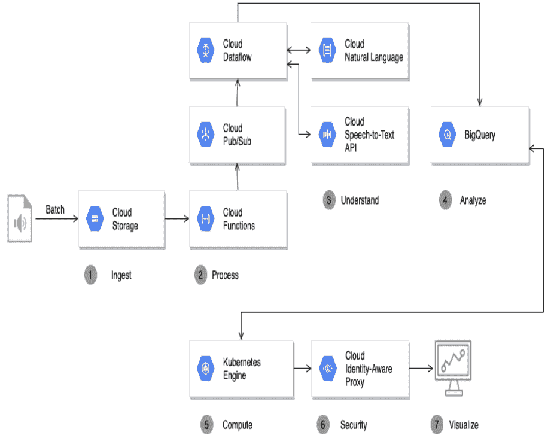
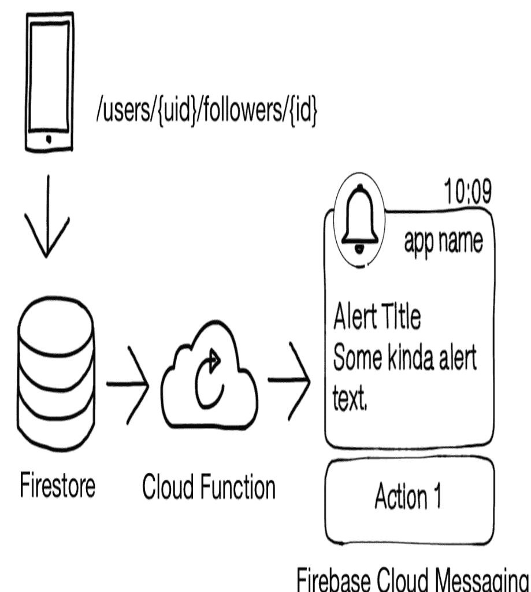
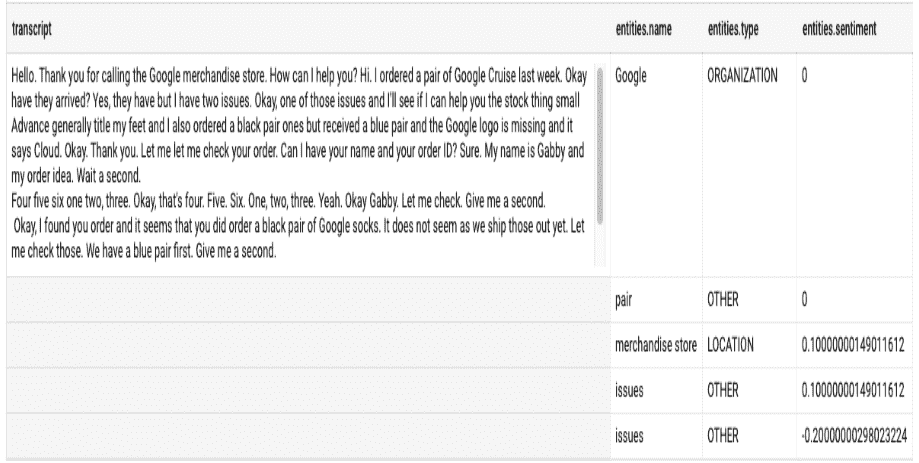

# Chapter 1. Our Use Case and Framework

## A NOTE FOR EARLY RELEASE READERS

With Early Release ebooks, you get books in their earliest form—the author’s raw and unedited content as they write—so you can take advantage of these technologies long before the official release of these titles.

This will be the 1st chapter of the final book. Please note that the GitHub repo will be made active later on.

If you have comments about how we might improve the content and/or examples in this book, or if you notice missing material within this chapter, please reach out to the editor at mcronin@oreilly.com.

This book is a journey; each chapter builds on itself. You can skip to the chapter of most interest, but to fully grasp Cloud Native applications running on Google Cloud it’s best to understand the use case and follow along through each chapter. We have designed the framework for you and now we will learn all the associated Google Cloud services of the framework that will be applied to our use case. We recommend that you revisit this chapter often to re-read the use case as it will allow you to grasp why certain services were chosen.

Let’s begin by describing our fictional use case.

## Fictional Use Case

Pigeon Travel is an online travel agency. Pigeon Travel’s website and mobile application are used to book airline tickets, hotel reservations, and car rentals. They also have a large call center to provide support for their customers. The agents in the call center support their customers via live chat and call-in support.

For measuring customer satisfaction and calculating their Net Promoter Score, they provide the user with a survey at the end of the call or chat. A Net Promoter Score is a measurement used to answer the question: Will the customer recommend our product or service to a friend? Customers who respond 9 to 10 are called promoters, responses from 7 to 8 are called passive and responses from 0 to 6 are called detractors. The small percentage of users that leave feedback, the feedback provides for an overall low customer satisfaction and Net Promoter Score. Issues customers have raised are:

- Call Availability: Long hold times before speaking or chatting with a customer representative
- High Handling Rates

Pigeon Travel also noticed a high abandonment rate which correlates to the call availability issue listed by their customers.

The business has asked you as the lead developer to put a plan together and a prototype on how Pigeon Travel can increase the Net Promoter Score, increase customer satisfaction, and provide the following metrics to the business:

- Customer Sentiment
- Call Topics (Why are users calling?)
- Understanding Trending Topics
- Understanding call quality including Silence Scores, Call Duration and Call Escalation Paths.

## Business Objectives

We can meet some objectives of the business by taking a potentially biased and inefficient manual approach which would require analysts to randomly select calls to collect the key performance indicators. However, the framework which we will cover in a few will allow us to

use Google Cloud services to meet the goals and analyze all recorded calls to get insights in near real-time. These insights can include:

- Overall call sentiment.
- Sentence-by-sentence sentiment.
- Insight into which agent quality metrics to track (such as call silence, call duration, agent speaking time, user speaking time, and sentence heatmaps).
- Insights on how to reduce call center volume by analyzing keywords in transcripts.

Now that we know the business objectives, we need to define the framework. How we can define a framework without knowing the services available from Google Cloud? The rest of the chapters in the book do just that. For now, I have defined a framework for you that will guide you through the book, and Figure 1-1 shows the architecture we will work through.

## The Framework

Figure 1-1. Framework Diagram

The framework presented in this book uses Google Cloud AI services such as Speech-to-Text and Cloud Natural Language API. The framework also employs Pub/Sub, a messaging system, and Dataflow, a data processing framework, used for data streaming and transformation. The resulting framework consists of a cloud-native and server-less job running in Google Cloud. To implement the framework, you don’t need any machine learning experience, and all the data infrastructure needs, such as storage, scaling, and security, are managed by Google Cloud. While we have chosen Google Cloud as the platform, you have many choices such as Amazon Web Services and Azure. They both have similar offerings to Google



Cloud that will allow you to translate the Framework components to their offerings to fully a working framework. However, we wanted a wide partner ecosystem of Business Intelligence Tools, as well as have Google scale querying for the large amounts of data that will be created from our transcription of the audio files thus Google Cloud is the best fit for our requirements.

Throughout the book, cloud-native applications are loosely defined as an approach to building applications that take advantage of cloud computing resources. It is often associated with public clouds, but can also be used with on-prem clouds. Cloud native applications are defined by how they are deployed, rather than where they are deployed. A cloud-native application will leverage the perceived limitless resources available. For Google Cloud, a cloud-native application can scale up and down as needed, the application is built to use and release resources based on the rules defined.

A cloud-native application leverages the framework of the cloud computing platform of choice. The methodology of designing and building the application needs to take into account the services provided by the chosen cloud provider. For our application, we have chosen Google Cloud. We need to take into account the following considerations for our framework:

1. Our application needs to be abstracted from the cloud infrastructure.
2. We need a method of Continuous Integration and Continuous Delivery.
3. Our application has to be able to scale up and scale down as needed.
4. How will our application manage failures?
5. The application needs to be globally accessible as our fictional business Pigeon Travel operates multiple call centers globally.


6. 我们的框架需要基于微服务架构。
7. 我们的应用程序将如何得到保护？

在思考这些问题时，请回顾图 1-1，并尝试将每个考虑因素映射到图表的某个部分。有多个步骤需要涵盖，但让我们从第一步开始：存储音频录音。

### 存储音频录音

第一步是将文件传输到 Google Cloud。对于上传，我们将使用一个名为 gsutil 的工具，它是一个 Python 应用程序，可让你从命令行访问 Google Cloud Storage。基本思路是当音频文件录制完成时，本地运行的作业会将文件上传到 Cloud Storage。当音频文件上传到存储桶时，我们将使用自定义元数据来识别录音，例如来电显示 ID、客户 ID 以及从联系中心收集的其他指标。要向 Cloud Storage 对象添加自定义元数据，请在标头中使用 x-goog-meta 前缀并使用 -h 标志。以下命令显示了一个示例：

请从仅具有 Google Cloud Storage 对象创建者角色的账户执行此操作，这样它就不会意外删除文件。

```
gsutil -h x-goog-meta-agentid:55551234 -h cp [FILENAME].flac gs://[BUCKET]
```

图示展示了使用 gsutil 命令写入的元数据示例。

### demo_recording.flac metadata

对象元数据是告知浏览器和其他系统如何处理对象的信息，例如如何渲染、缓存或解压缩它。编辑下面的标准元数据属性或添加自己的自定义元数据。了解更多

| Key | Value |
|---|---|
| Content-Type | audio/flac |
| Content-Encoding |  |
| Content-Disposition |  |
| Content-Language | en - English |
| Cache-Control |  |
| agentid | 12345 |
| day | 12 |
| month | 06 |
| starttime | 10:21 |
| year | 2020 |

+ Add item

CANCEL   SAVE

你可以以编程方式检索元数据，这使你能够将文件与多个键值对关联起来。作为示例，下面是如何提取 agentid 键的自定义元数据值。

```
let agentId = object.metadata.agentid === undefined ? \
'undefined' : object.metadata.agentid;
```

希望你能看到这有多实用。以编程方式，我们可以列出存储桶中的文件并提取自定义元数据，以了解音频文件与代理或客户相关联。对于我们的框架，我们将包含来电显示 ID、客户 ID 和其他指标，以便让我们在 BigQuery 中执行连接。我们将在后面的章节详细介绍 BigQuery，但目前，BigQuery 是 Google Cloud 提供的一项完全托管的无服务器数据仓库服务。我们的數據具有分析性质，我们需要快速查询大量数据以向用户提供洞察，而 BigQuery 满足了这一需求。连接将允许我们的框架连接两个数据集并使用 customerID 作为键字段。这将使我们能够显示录音通话的指标以及客户信息。

### 处理音频录音

在框架设计中，你配置一个 Cloud Function，以便在将音频文件上传到存储桶时触发。Cloud Functions 是一项服务，用于创建无需管理底层基础设施即可响应事件的单一用途函数。Google Cloud Functions 具有以下事件方法：

*HTTP*

你可以使用 POST、PUT、GET、DELETE 和 OPTIONS HTTP 方法通过 HTTP 请求调用 Cloud Functions。

*Cloud Storage*

Cloud Functions 可以响应来自 Google Cloud Storage 的更改通知。这些事件可以包括对象创建、删除、归档和元数据更新。

### Cloud Pub/Sub

Cloud Functions 可以通过发布到 Pub/Sub 主题的消息触发。

### Cloud Firestore

Cloud Functions 可以处理 Cloud Firestore 中的事件，例如创建、更新、删除和写入。

图 1-2 提供了 Cloud Firestore 事件方法的有用性示例。在图像中，我们有一个对 Firestore 文档的写入事件，触发了一个用户定义的云函数。此用户定义函数利用 Firebase SDK 通过 Firebase Cloud Messaging 将消息推送到设备。此通知可用于通知用户他们有新的关注者。



图 1-2. Firestore Write Trigger Event

在我们的框架中，我们将利用 Cloud Storage 事件方法。在此事件方法中，我们有多个触发器类型值：

- google.storage.object.finalize
- google.storage.object.delete
- google.storage.object.archive
- google.storage.object.metadataUpdate

我们将利用 google.storage.object.finalize 触发器，一旦在指定的 Cloud Storage 存储桶中创建音频文件，函数将被触发。然后函数将音频文件发送到 Google Cloud Speech-To-Text API 进行处理。Speech-To-Text API 响应将是一个作业名称，我们将捕获它并发送到 Cloud Pub/Sub。消息将等待在 Pub/Sub 中，直到“某物”提取消息进行处理。

1

Upload Audio File

Cloud Storage

Trigger Function

2

Cloud Function

Google Cloud Speech-To-Text API

3

Get Job Name

Pub/Sub

4

Store Payload

### Figure 1-3. Framework Workflow

我们的函数做的不仅仅是发送音频文件到 Pub/Sub，你将在示例中看到代码。如果你好奇想了解更多，请查看仓库：
https://github.com/GoogleCloudPlatform/dataflow-contact-center-speech-analysis

在继续之前，了解 Google Cloud Pub/Sub 是什么会很有帮助。Cloud Pub/Sub 是一项完全托管的实时消息传递服务，允许你在独立应用程序之间发送和接收消息。想象一下在两个人之间有一个桶，图 1-3，一个人把纸条放入桶中，另一个人从桶中取出纸条。你现在已在两个人之间传递了消息，而桶是传输机制。

Message

Message

Pub/Sub

### Figure 1-4. Cloud Pub/Sub

### 从音频文件收集数据

此时，我们有一个已上传的音频文件，一个被触发的函数以及 Pub/Sub 中等待的消息。Cloud Pub/Sub 是一种异步消息传递服务，允许应用程序共享数据。此消息包含几个键值对，但其中一个键值是 Speech-To-Text 作业名称。为了转录长音频文件，我们使用了异步语音识别方法，该方法不会返回转录结果，而是返回作业名称，让我们能够检查其完成转录过程的状态。

我们如何从桶中取出纸条并阅读其内容？Cloud Dataflow 将允许我们构建一个管道，该管道将从 Pub/Sub 读取消息并根据开发人员定义丰富或转换数据。Cloud Dataflow 是在 Google Cloud 中执行 Apache Beam 管道的完全托管服务。Apache Beam 是用于执行批处理和流式管道的开源模型。图 1-5 说明了将在我们的框架中使用的管道。

ReadFromPubSub
Running
0 sec

DecodePubSubMessages
Running
0 sec

SpeechToTextOutput
Running
1 hr 24 min 58 sec

ParseSpeechToText
Running
1 sec

NaturalLanguageOutput
Running
6 min 1 sec

bigquerywrite
Running
6 min 38 sec

### Figure 1-5. Cloud Dataflow Pipeline

Cloud Dataflow 是一个强大的工具，用于对数据执行 ETL 操作，Cloud Dataflow 将在第 XYZ 章中详细介绍。Cloud Dataflow 是框架的核心组件，因为它从 Pub/Sub 拉取消息，通过在管道中调用其他 API 来丰富数据，最后将数据写入 BigQuery，让我们能够可视化从音频文件收集的指标。

Cloud Dataflow 管道可以用 Python 或 Java 编写。对于我们的框架，我们选择了 Python，因为即使你没有编程背景，它也更容易阅读和理解。作为示例，请查看下面的代码片段并尝试确定这些代码行在做什么。

```
def stt_output_response(data):
    from oauth2client.client import GoogleCredentials
    from googleapiclient import discovery
    credentials = GoogleCredentials.get_application_default()
    pub_sub_data = json.loads(data)
    speech_service = discovery.build('speech', 'v1p1beta1', credentials=credentials)
    get_operation = speech_service.operations().get(name=pub_sub_data['sttnameid'])
    response = get_operation.execute()
    # handle polling of STT
    if pub_sub_data['duration'] != 'NA':
        sleep_duration = round(int(float(pub_sub_data['duration'])) / 2)
    else:
        sleep_duration = 5
    logging.info('Sleeping for: %s', sleep_duration)
    time.sleep(sleep_duration)
    retry_count = 10
    while retry_count > 0 and not response.get('done', False):
        retry_count -= 1
        time.sleep(120)
        response = get_operation.execute()
```


如果你认为它是在轮询 Speech-To-Text API，你是对的！

Cloud Dataflow 将按以下顺序执行以下任务：

- 1. 从 Pub/Sub 拉取消息
- 2. 轮询 Speech-To-Text 以确定作业是否已完成
- 3. 将完成的转录发送到 Cloud Natural Language
- 4. 接收来自 Cloud Natural Language 的响应
- 5. 使用自定义定义的函数丰富数据
- 6. 将数据值匹配到 BigQuery 模式
- 7. 最后将数据写入 BigQuery

一旦 Cloud Dataflow 成功完成其管道，你的数据将在 BigQuery 中可用。图 1-6 说明了数据在 BigQuery 中将如何表示。



图 1-6. BigQuery 嵌套重复字段预览

在图 1-6 中你会注意到行嵌套在行内；我们将在 BigQuery 章节中详细介绍这一点。

### 丰富数据的可视化

如所述的 Cloud Dataflow 管道的一部分是利用 Speech-To-Text 和 Natural Language API 来丰富数据。丰富数据是指提供我们用例所需要的额外数据点的过程。例如，确定通话沉默时间。我们可以使用 Cloud Dataflow 运行自定义算法来为每个音频文件制定通话沉默时间。

#### 确定说话人、说话时间和沉默时间

以下代码片段是处理长音频文件的一个示例。它采用了说话人分离，是一种检测说话人何时发生变化并为音频中检测到的各个声音添加编号标签的功能。

你可以使用说话人分离和词时间戳功能来确定说话人、说话人说话时间和通话沉默。你还可以创建情感热力图以获取更多详细信息。

```
const audioConfig = {
    encoding:"FLAC",
    sampleRateHertz: 44100,
    languageCode: `en-US`,
    enableSpeakerDiarization: true,
    diarizationSpeakerCount: 2,
    enableAutomaticPunctuation: true,
    enableWordTimeOffsets: false,
    useEnhanced: true,
    model: 'phone_call'
};
const audioPath = {
    uri: `gs://${object.bucket}/${object.name}`
};
const audioRequest = {
    audio: audioPath,
    config: audioConfig,
};
return spclient
    .longRunningRecognize(audioRequest)
    .then(data => {
        const operation = data[0];
```

```
return operation.promise();
})
```

呼叫中心主管可以看到通话的进展，包括通话如何开始和结束。除了视觉进展之外，他们还可以深入每个方块以查看句子情感。

### 情感时间线

句子：I bought her a pair from a different store.

1:29 / 2:12

图 1-7. 我们使用 React.js 构建的前端框架截图

### 从对话中提取情感

我们将使用 Natural Language API 提取整体转录情感、句子情感和实体。有了这些数据用于转录的音频文件，你可以创建热力图和情感时间线。你还可以构建词云。

以下示例显示了捕获句子情感的代码片段：

```
client
    .analyzeSentiment({document: document})
    .then(results => {
        const sentences = results[0].sentences;
        sentences.forEach(sentence => {
            pubSubObj.sentences.push({
                'sentence': sentence.text.content,
                'score': sentence.sentiment.score,
                'magnitude': sentence.sentiment.magnitude
            })
        })
    });
```

图 1-7 是我们将为用例构建的示例，我们为业务用户提供句子热力图的访问权限，让他们可以深入每个音频文件并了解通话的进展。

对于用户可视化和 API，应用程序将部署在 Google Kubernetes Engine 上（我们稍后会详细介绍）。本书的 GitHub 仓库包含一个使用 Express.js 构建的 API，它利用 BigQuery Node.js SDK 运行 SQL 语句以检索数据。SQL 命令是在用户点击可视化时触发的。此 Express.js 应用程序将与用户界面一起部署在 Google Kubernetes Engine 上。

请记住，我们的事实来源将是 BigQuery。我们将通过 Web 浏览器将此数据可视化给用户，并且我们的可视化应用程序将使用 React Framework 和 Node.js 开发。

以下示例查询查找转录中所有的单词，这些单词当前存储为嵌套重复字段。查询语句使用 BigQuery SDK 执行，它获取相关记录中的所有单词。这是我们 Express.js API 的一个示例，此响应由 Web 应用程序接收。

```
const sqlQueryCallLogsWords = `SELECT
  ARRAY(SELECT AS STRUCT word, startSecs, endSecs FROM
UNNEST(words)) words
  FROM \'\' + bigqueryDatasetTable + \'\'
  where fileid = \'\' + queryFileId + \'\'`
```

### 保护应用程序

我们涵盖了大量信息，请再坚持一会儿。

对于框架的最后一个组件，我们需要实现授权以允许我们认为合适的人访问应用程序。牢记授权只是安全的一个组件；我们还必须考虑加密和保护敏感数据等事项。现在，让我们专注于身份验证。Google Cloud 提供了一项名为 Identity-Aware Proxy（IAP）的服务。IAP 通过验证用户的身份和请求的上下文来允许或拒绝对应用程序的访问。我喜欢把它想象成由 Google Cloud 管理的代理，位于我们的应用程序前面，拦截请求并代表我们授权用户。

为什么 IAP 是革命性的？IAP 使开发人员无需构建后端身份验证系统，从而使开发人员能够专注于应用程序的核心功能。基本上 IAP 允许我们更快地进入市场。我们的应用程序将没有任何授权代码，对的，没有用于授权用户的代码。意味着没有来自第三方用于验证令牌的 SDK 或获取和验证 JSON Web Token 的任何其他复杂代码。我们所有的

应用程序将做的只是专注于其核心角色，即为我们转录和丰富过的音频文件向用户提供洞察。

IAP 还支持多种提供商类型：

- Email and password
- OAuth（例如 Google、Facebook、Twitter 等）
- SAML
- OIDC
- Phone number
- Custom
- Anonymous

我们可以在更快进入市场的同时保护应用程序，提供广泛的身份验证提供商，并通过不需要 VPN 客户端来访问应用程序来简化用户访问。

## Cloud Native Checkpoint

现在你对用例和我们将用于满足用例要求的框架有了全面的了解，让我们重新审视我们为云原生架构列出的考虑因素：

- 1. 我们的应用程序需要从云基础设施中抽象出来。
- 2. 我们需要一种持续集成和持续交付的方法。
- 3. 我们的应用程序必须能够根据需要扩展和缩减。
- 4. 我们的应用程序将如何管理故障？
- 5. 应用程序需要全球可访问。
- 6. 我们的框架需要基于微服务架构。
- 7. 我们的应用程序将如何得到保护？

### 从云基础设施中抽象出来

从云基础设施中抽象出来可能是一个具有误导性的术语。当我第一次开始学习云原生框架时，我总是认为这是一种云无关的方法：构建一个应用程序并部署到任何云提供商。然而，从云基础设施中抽象出来是应用程序与底层基础设施的解耦。但如果解耦了，我们是否不能在任何云提供商甚至本地运行它？这就是云原生可以被个人不同解读的地方。我们构建云原生应用程序是为了按需配置资源、自动化应用程序生命周期、以及可扩展和安全。然而，始终存在对云提供商及其构建云原生应用程序的核心要求的依赖。我们在构建云原生应用程序时需要考虑这些，我们将在本书中贯穿始终。但请记住，本书是关于在 Google Cloud 上运行云原生应用程序的，对于这一点，我们将尽可能专注于使用其服务构建可扩展和安全的应用程序。

### 持续集成和持续交付

云原生应用程序的核心组件之一是持续集成（CI）和持续交付（CD）架构。在我们的框架中，我们将使用 GitLab CI/CD 服务来创建我们的部署管道。我们已为此服务跳出了 Google Cloud，但我们仍然在云原生应用程序框架内。我们仍然满足拥有管道来构建、测试和验证新代码的核心要求，然后在将更改合并到你的 GitLab 仓库之前，以及确保我们的


经过验证的代码在 CI 流水线成功通过所有测试后会有一个应用部署流水线。

### CI Pipeline

Code

Commit

Build

Test

### CD Pipeline

Review

Stage

Production

Figure 1-8. CI/CD Pipeline

### Scalability

应用的另一个核心组件是能够扩展和缩减。我们通过微服务来实现这一点，其中应用的状态存储在容器外部。这允许实例根据需要启动和停止。这也允许每个实例独立工作，其中每个实例可以处理请求。

> NOTE
> 如果你想了解更多关于云原生计算或参与社区，请访问 Cloud Native Computing Foundation (CNCF) 网站 https://www.cncf.io/。

这听起来很棒——创建无状态的微服务，可以来去自由并且可以相互独立地处理请求。缺点是这种方法的管理。如何管理这些服务、保护它们、为其状态设置声明性语句，并编排此工作流？Kubernetes（k8s）满足了这一需求。Kubernetes 是一个开源容器编排应用，用于管理部署、扩展、安全以及更多内容。以下是 Kubernetes 的一些关键特性：

- 1. 水平扩展
- 2. 自愈
- 3. 自动化发布和回滚
- 4. 服务发现和负载均衡
- 5. 密钥和配置管理

Kubernetes 是一个开源项目，最初由 Google 开发，并在 2014 年作为开源发布。我要说 Kubernetes 最初很难理解，当我第一次学习它并听到诸如 pod 之类的术语时，我差点要尖叫了。然而，Google Cloud 为我们提供了另一个解决方案：Google Cloud

推出了 Google Kubernetes Engine，它抽象了管理 Kubernetes 集群的大部分复杂性。它提供 Kubernetes 作为托管服务，无需安装集群软件，无需担心确认监控，基本上由创建 Kubernetes 的公司提供完全托管的集群。

我将在未来的章节中更详细地介绍 Google Kubernetes Engine。但现在，值得介绍一些高层概念，因为这将让你理解为什么 Kubernetes Engine 与云原生应用非常契合。

## Application Reliability

即使 Google Cloud 提供了服务等级协议（SLAs）并且有机制来提供可靠性，事情也会失败。我们需要考虑我们的应用在这些情况下如何处理故障。在可扩展性部分，我简要提到了 Kubernetes，它本身就能提供某种形式的容错，因为我们的集群至少会有三个节点。但如果 Google Cloud 区域发生故障，我们的集群也会失败。许多 Google Cloud 服务可应对区域故障，如 BigQuery，其他则不行。我们必须注意每个服务及其各自的容错功能。

我们无法在一节中涵盖所有组件，但每一章都将有一个云原生检查点部分，以确保我们解决云原生框架，其中包括应用可靠性。除了区域或区域级的大规模故障外，我们在构建云原生应用时还必须考虑潜在的故障来源，如代码中的错误、人为错误等。

了解 Google Cloud 区域和区域也很有帮助，以便开始思考如何管理这些故障。

#### Google Cloud Zone

区域之间具有高带宽和低延迟。区域是区域内的一个隔离位置

区域应被视为区域内的单个故障域

#### Google Cloud Region

区域是区域的集合。建议跨区域部署应用以实现高可用性

区域是独立的地理位置

区域内的往返网络延迟通常在 95 百分位下低于 <1ms

#### Zonal Resources

区域资源在单个区域内运行

如果 Google Cloud 区域变得不可用，则该区域内的所有区域资源都不可用

#### Regional Resources

区域资源在区域内的所有区域中冗余部署某些 Google Cloud 服务如 App Engine 属于区域资源

#### Multiregional Resources

Google Cloud 提供的少数托管服务分布在多个区域中。以下服务具有多区域部署选项：

- Datastore
- Cloud Key Management Service
- Cloud Storage
- BigQuery
- Cloud Spanner
- Cloud Bigtable
- Cloud Healthcare API

要构建能够承受区域故障的应用，请使用区域资源，或在区域间构建应用的弹性。要构建能够承受整个区域丢失的应用，请使用多区域资源，或为应用构建弹性。

### Globally Accessible

我们没有在框架中介绍这一点，但我们的应用需要全球可访问，因为我们将有来自不同全球区域的用户使用平台。我们需要用户尽可能靠近其位置进入 Google Cloud 并访问最接近其全球区域的应用。我们很幸运，Google Cloud 为我们提供了一个具有全球 IP 地址的负载均衡托管服务。如 Google 网站所述“*全球自动扩展和负载均衡*”。

Tokyo

New York

London

Google Cloud Load Balancer

Kubernetes Engine

Kubernetes Engine

Kubernetes Engine

Region
asia-east1

Region
us-central1

Region
europe-west1

k8s pod

Figure 1-9. Global Cloud Load Balancing

### Security

我们已在高层介绍了安全 IAP，它允许我们对用户进行身份验证和授权。这是我们在设计云原生应用时需要考虑的一个要素。其他需要考虑的要素有：

- 1. 密钥管理
- 2. 审计日志
- 3. 身份访问管理

我们框架的每个组件都需要考虑这些关键要素，因为每个组件可能提供不同的保护方法。你还应注意，安全问题需要一本专门的书籍。虽然我在本书中尽可能多地涵盖（根据框架提供的服务），但我建议阅读相应服务的文档以获取更多信息。

#### Key Management

Google Cloud 对磁盘上的数据进行加密，并管理密钥，包括轮换。我会说大多数客户利用默认设置，但其他客户想要更多灵活性。Google Cloud 为密钥管理提供以下服务：

- 1. Google 管理的密钥
- 2. 使用 Cloud Key Management Service 的客户管理密钥
- 3. 使用第三方密钥管理系统管理的客户密钥

最简单的方法是让 Google Cloud 管理密钥。但是，如果你选择管理自己的密钥，这里有一个简单的

使用 Cloud Key Management System 创建和分配密钥的过程。

创建一个名为 *pigeonkeyring* 的密钥环，并创建一个名为 *pigeonkey* 的密钥。

```
gcloud kms keyrings create "pigeonkeyring" \
    --location "global"
gcloud kms keys create "pigeonkey" \
    --location "global" \
    --keyring "pigeonkeyring" \
    --purpose "encryption"
```

你可以使用 list 选项查看刚刚创建的密钥的名称和元数据。

```
gcloud kms keys list \
    --location "global" \
    --keyring "pigeonkeyring"
```

让我们将一些要加密的文本存储在名为“pigeonsecret.txt”的文件中。

```
echo -n "My super-secret message is encrypted" > pigeonsecret.txt
```

现在，让我们使用创建的密钥信息加密数据，指定要加密的明文文件的名称，并指定将包含加密内容的文件的名称：

```
gcloud kms encrypt \
    --location "global" \
    --keyring "pigeonkeyring" \
    --key "pigeonkey" \
    --plaintext-file ./pigeonsecret.txt \
    --ciphertext-file ./pigeonsecret.txt.encrypted
```

你现在已使用你的密钥和 Cloud KMS 将消息加密到文件中。那么我如何读取加密文件的内容？要使用 gcloud kms decrypt 解密数据，请提供你的密钥信息，指定要解密的加密文件的名称，并指定将包含解密内容的文件的名称：


```
gcloud kms decrypt \
  --location "global" \
  --keyring "pigeonkeyring" \
  --key "pigeonkey" \
  --ciphertext-file ./pigeonsecret.txt.encrypted \
  --plaintext-file ./pigeonsecret.txt.decrypted
```

你已成功加密并解密了示例文件的内容！

### Audit Logs

框架的一个重要组成部分是日志记录。在安全上下文中，我们需要知道谁做了什么以及何时做。Google Cloud Audit Logs 记录每一次管理活动。日志存储在受保护的存储区域中，从而形成不可变的日志和高度持久的审计跟踪。

Cloud Audit Logs 为每个 Google Cloud 项目、文件夹和组织维护三种审计日志：

#### Admin Activity

Admin Activity 审计日志包含修改云资源配置或元数据的 API 调用或其他管理操作的日志条目。

#### Data Access

Data Access 审计日志包含读取资源配置或元数据的 API 调用，它还捕获用户驱动的 API 调用，这些调用会创建、修改或读取用户提供的资源数据。

#### System Event

System Event 审计日志包含修改资源配置的管理操作的日志条目。

### Identity Access Management

Identity Access Management（IAM）是一个框架，用于实施确保用户和服务对资源具有适当访问权限的策略。Google Cloud 为我们提供了一个服务来管理这些 Identity Access Management，名为 Cloud IAM，名称简单明了。Cloud IAM 有三个主要组件：

#### *Member*

成员可以是 Google 账号用户、服务账号、Google 群组，或可以访问资源的 G Suite 或 Cloud Identity 域。

#### *Role*

角色是一组权限，权限决定了在资源上允许的操作。

#### *Policy*

策略将成员绑定到角色。

让我们谈谈权限，以便你对 IAM 为什么重要有一个初步的了解。（我们将在后续章节详细讨论框架的安全性）。在 Google Cloud IAM 世界中，权限以 **service.resource.verb** 的形式表示。当我们使用最小权限构建应用程序时，这可能会变得非常复杂和令人困惑。为了简化分配权限的过程，我们使用角色的概念，角色是一组权限。Google Cloud 为用户提供了很大的灵活性，你可以使用自定义角色或预定义角色。为了再次简化权限管理流程，我们尽量使用 Google Cloud 为我们提供的预定义角色。例如，预定义角色 Pub/Sub Publisher（roles/pubsub.publisher）仅提供向 Pub/Sub 主题发布消息的访问权限。

除了 IAM，关于用户身份验证的内容将在未来的章节中介绍，在那里我们将利用 IAM、用户身份验证、日志和加密来构建安全的云原生应用程序。

### Summary

到目前为止，你应该对用例、我们的框架以及我们如何利用云原生方法来满足业务需求有了一个良好的理解。我们在本章中涵盖了许多主题，我保证随着每一章的展开会变得更容易，因为每一章都会在前一章的基础上构建。

我还想指出，本书中使用的用例是为了将学习应用到实际应用中。然而，你可以将所学内容应用于任何云原生应用程序，因为所有应用程序都需要本章中讨论的类似方法。随着我们继续推进，每个章节末尾都会放置一个云原生检查点，以验证我们是否满足要求。
