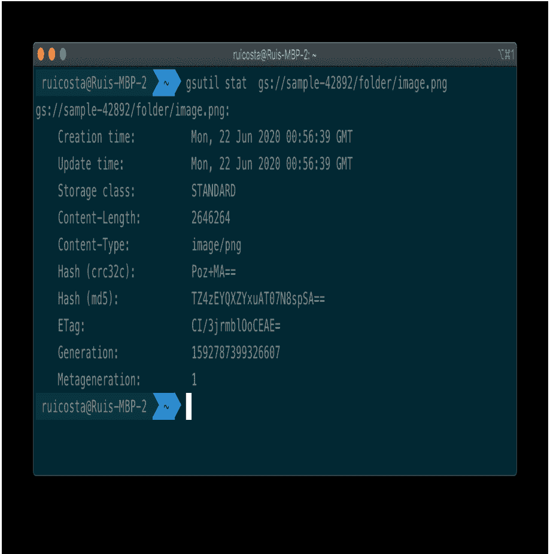
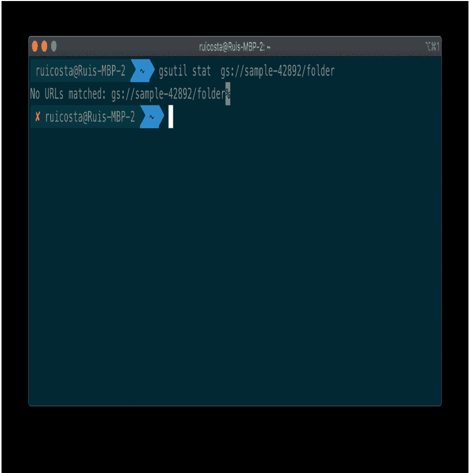
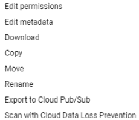
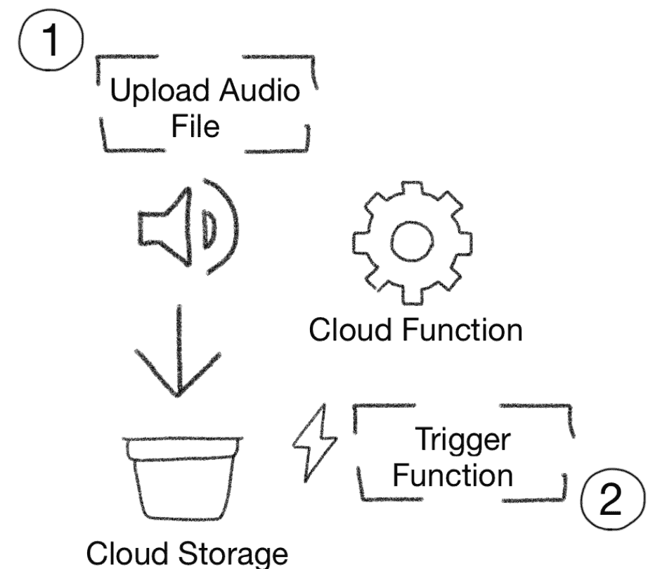
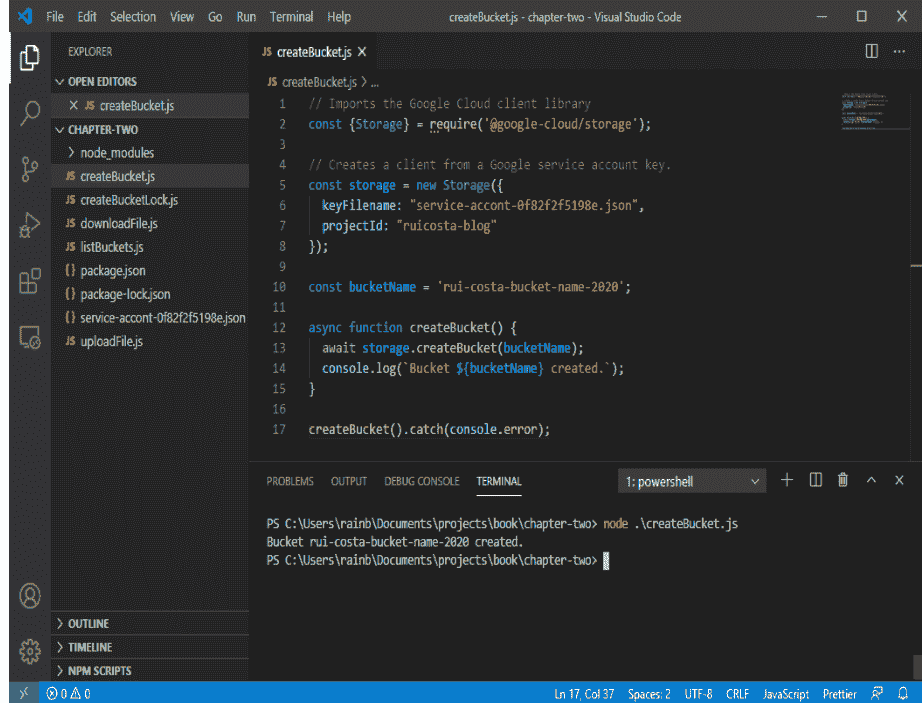
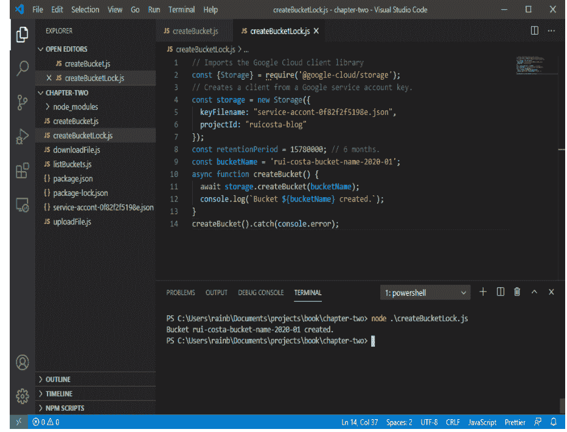
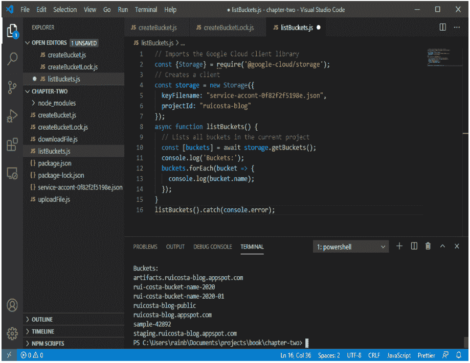
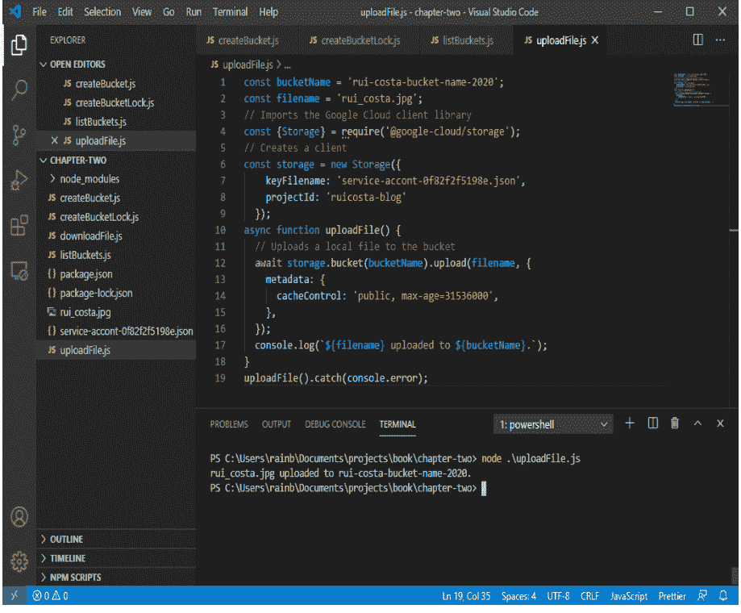
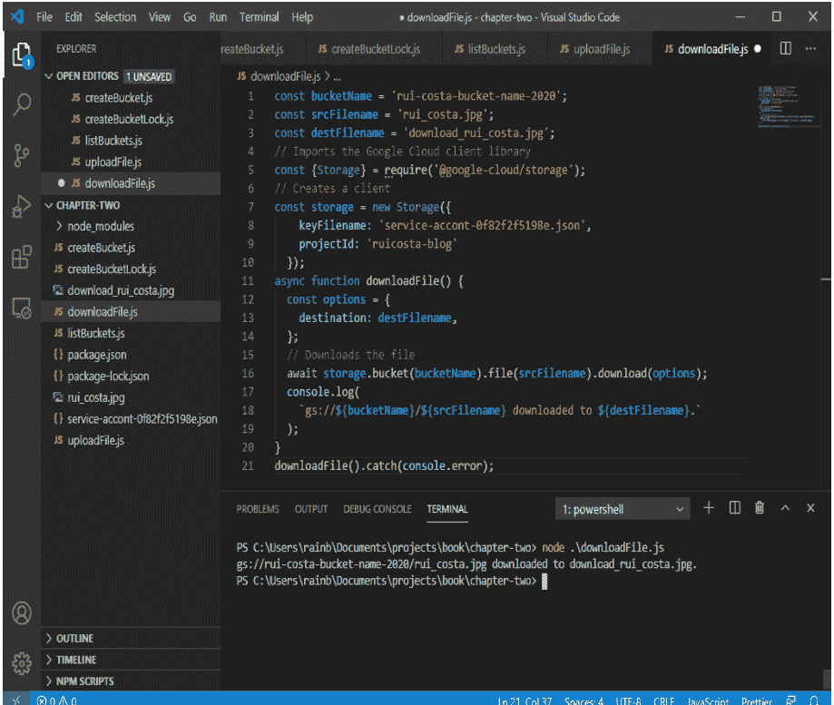

# Chapter 2. Getting Data into Google Cloud

## A NOTE FOR EARLY RELEASE READERS

使用 Early Release 电子书，你可以在这些标题的正式发布之前很久就获得书籍的早期形式——作者在撰写时的原始未编辑内容——从而利用这些技术。

这是最终书籍的第 2 章。请注意，GitHub 仓库将在稍后激活。

如果你对如何改进本书的内容和/或示例有任何意见，或者如果你注意到本章中缺少材料，请联系编辑 mcronin@oreilly.com。

本章旨在关注将数据导入 Google Cloud 以供我们的云原生应用程序使用。然而，在我们应用程序的上下文中介绍如何将数据导入 Google Cloud 将对每个人都有益。我们的數據，如你从用例中回忆的那样，将在 Google Cloud 外部，是我们呼叫中心原始的音频文件。你需要在接近实时地处理这些音频文件，以便我们的用户可以访问从我们的管道收集的指标。Google Cloud 提供了以下存储选项：

- Zonal standard persistent disk and zonal SSD persistent disk
- Regional standard persistent disk and regional SSD persistent disk
- Local SSD for high-performance local block storage
- Cloud Storage buckets: Object storage.
- Filestore: High-performance file storage

存储选择有几种，但你会为存储音频文件选择哪一种？让我们回顾一下需求：

- 我们的呼叫中心每天处理 5,000 个电话
- 每个电话平均长 30 分钟
- 每个文件平均大小为 57 MB
  - 5,000 * 57 = 285 GB

你每月大约需要 8.5 TB 的存储空间，每年大约需要 102 TB。你可以排除持久磁盘，因为它们有会限制可扩展性的限制，参见表 2-1。

| Storage Type | Zonal standard persistent disks | Regional standard persistent disks | Zonal SSD persistent disks | Regional SSD persistent disks | Local SSDs | Cloud Storage buckets |
|---|---|---|---|---|---|---|
| Minimum capacity per disk | 10 GB | 200 GB | 10 GB | 10 GB | 375 GB | n/a |
| Maximum capacity per disk | 64 TB | 64 TB | 64 TB | 64 TB | 375 GB | n/a |
| Capacity increment | 1 GB | 1 GB | 1 GB | 1 GB | 375 GB | n/a |
| Maximum capacity per instance | 257 TB | 257 TB | 257 TB | 257 TB | 3 TB | Almost infinite |

从列表中可以看出，我们对持久磁盘的限制相当大。即使我们选择使用区域标准持久磁盘并创建一个实例来存储音频文件，我们的成本也会相当高。同时我们开始偏离云原生方法，因为现在我们需要管理计算实例、附加的持久磁盘，并且我们需要一种方法来监控存储中的事件，例如文件创建以触发云函数。在撰写本文时，成本分析如下：

- Zonal Standard Persistent Disks
  - Disk One 64 TB: Total Estimated Cost: USD $2,621.44 per 1 month
  - Disk Two 64 TB: Total Estimated Cost: USD $2,621.44 per 1 month
  - Approximate Total per Month for 128 TB, USD $5,242 per 1 month
- Cloud Storage Bucket
  - Approximate Total per Month for 128 TB, USD $2,621.44 per 1 month

此成本分析未考虑云存储每月的存储操作或挂载标准持久磁盘的计算实例成本。这些存储数字设定为一年，但你需要考虑第二年、第三年等会发生什么。我们的持久磁盘解决方案变得复杂且昂贵，因此最明智的做法是选择云存储桶。

你可能会想知道 Cloud Storage 中的存储操作。操作是更改存储桶和对象或检索其信息的动作。Cloud Storage 操作分为三类：Class A、Class B 和免费。表 2-2 引自 Google Cloud Storage 文档 https://cloud.google.com/storage/pricing#price-tables；我建议访问文档以确认自本书出版以来 Class A、B 和免费操作是否发生变化：

| API or Feature | Class A Operations | Class B Operations | Free Operations |
|---|---|---|---|
| JSON API | storage.*.insert storage.*.patch storage.*.update storage.*.setIamPolicy storage.buckets.list storage.buckets.lockRetentionPolicy storage.notifications.delete storage.objects.compose storage.objects.copy storage.objects.list storage.objects.rewrite storage.objects.watchAll storage.projects.hmacKeys.create storage.projects.hmacKeys.list storage.*AccessControls.delete | storage.*.get storage.*.getIamPolicy storage.*.testIamPermissions storage.*AccessControls.list storage.notifications.list Each object notification | storage.channels.stop storage.buckets.delete storage.objects.delete storage.projects.hmacKeys.delete |
| XML API | GET Service GET Bucket PUT POST | GET Bucket GET Object HEAD | DELETE |

让我们退一步，介绍文件存储、块存储和对象存储。

### File Storage

文件存储以分层结构存储数据。数据保存在文件和文件夹中，无论是从提供视图的系统还是从检索数据视图的系统呈现，都是一致的。文件存储传统上通过 Network File System 协议或 Server Message Block 协议访问。

### Block Storage

块存储以存储区域网络或本地附加磁盘的形式呈现。块存储通常安装在操作系统上，就像块设备是本地附加存储一样。一旦本地挂载，用户就可以创建文件系统供操作系统使用：应用程序或数据库。

### Object-Based Storage

对象存储以编程方式访问，而块存储只能通过操作系统访问。对象存储也是平面的；它不具有文件系统的分层结构。Cloud Storage 没有文件夹的概念，文件夹是一个恰好在其名称中包含 "/" 字符的对象。每个对象包含数据以及相关的元数据，这些元数据分布在多个硬件系统上以提供可扩展性和可靠性。

### Options for Getting Data to Cloud Storage

> NOTE
> 你现在或稍后可以使用 Qwiklabs 进行练习。本书的 Qwiklabs Quest 即将推出。


用于管理云存储的 Cloud Console 是一个执行管理任务的绝佳选择。典型的管理任务包括：

- 创建和删除存储桶
- 上传、下载和删除对象
- 管理身份和访问管理策略，例如允许 allUsers 访问提供对象公共访问的存储桶

如前所述，基于对象的存储使用扁平命名空间来存储您的数据。Cloud Console 界面的关键功能是它将此扁平命名空间翻译为复制文件夹层次结构。Cloud Storage 没有文件夹的概念。

### sample-42892

Objects Overview Permissions Bucket Lock

Upload files Upload folder Create folder Manage holds Delete

Filter by prefix...

Buckets / sample-42892 / folder

| Name | Size | Type | Storage class | Last modified | Public access | Encryption | Retention expiration date | Holds |
|---|---|---|---|---|---|---|---|---|
| image.png | 2.52 MB | image/png | Standard | 6/21/20, 8:56:39 PM UTC-4 | Not public | Google-managed key | - | None |

*Figure 2-1. Console Storage Folder Screenshot*

Figure 2-1 是显示名为 sample-42892 的存储桶、名为 folder 的文件夹以及此文件夹内名为 image.png 的文件的屏幕截图。如前所述，文件和文件夹是一个对象，并且包含在扁平命名空间中。Figure 2-2 和 Figure 2-3 显示了 gsutil 命令行复制 Figure 2-1 中的屏幕截图。

```
ruicosta@Ruis-MBP-2 ~
ruicosta@Ruis-MBP-2 ~ gsutil stat gs://sample-42892/folder/
gs://sample-42892/folder/:
Creation time:      Mon, 22 Jun 2020 00:56:20 GMT
Update time:        Mon, 22 Jun 2020 00:56:20 GMT
Storage class:      STANDARD
Content-Length:     11
Content-Type:       text/plain
Hash (crc32c):      XkI+Dw==
Hash (md5):         apnFdauH+MfR7R5S5+NJzg==
ETag:               COPgrrCbI0oCEAE=
Generation:         1592787380973667
Metageneration:     1
ruicosta@Ruis-MBP-2 ~
```

Figure 2-2. Command Line Usage of gsutil



Figure 2-3. Command Line Usage of gsutil

Review Figure 2-2 and 2-3. What is different between the two? Not much except their content-type. gsutil displays a hierarchical file structure but the underlying Cloud Storage is a flat namespace. To the service, the object gs://sample-42892/folder/image.png is just an object that happens to have "/" character in its name. There is no "folder" directory; just a single object with the given name. If we try to run gsutil stat gs://sample-42892/folder, what would happen? It would fail, since we did not include "/" in the name, see Figure 2-4.



Figure 2-4. Command Line Usage of gsutil

### Create a Bucket in the Cloud Console

要创建存储桶：

1. 打开 Google Cloud Console 中的 Cloud Storage 浏览器：
   Storage >
2. 点击 Create bucket：
   CREATE BUCKET
3. 输入您的存储桶信息并点击 Continue：
   a. 输入存储桶的唯一 Name
   b. 为 **Location type** 选择 **Region**
   c. 为 **default storage class** 选择 **Standard**
   d. 为 **Access control** 选择 **Uniform**

4. 点击 Create：


恭喜您创建了第一个存储桶！

### Upload a File in the Cloud Console

1. 在 Cloud Storage 浏览器中，点击您创建的存储桶的名称。
2. 点击标签中的 **Upload files** 按钮：
3. 在文件对话框中，导航到您想要上传的文件并选择它。
4. 上传完成后，您应该会看到文件名和有关文件的信息。


### Download the file in the Cloud Console

要从存储桶下载图像：

1. 点击与文件关联的下拉菜单。下拉菜单显示为最右侧的三个垂直点。
2. 点击 **Download**。



就这样，您已创建了一个存储桶，上传了一个文件并下载了它！

### Using the gsutil Tool

gsutil 是一个 Python 应用程序，可让您从命令行访问 Cloud Storage。您可以使用 gsutil 执行各种管理任务，包括：

- 创建和删除存储桶。
- 上传、下载和删除对象。
- 列出存储桶和对象。
- 移动、复制和重命名对象。
- 编辑对象和存储桶访问控制列表 (ACL)。
- ACL 允许您设置限制，例如读取、写入或删除对象。

如果您选择在桌面上本地运行它，则需要安装 gsutil。您可以访问以下链接了解如何安装 gsutil 应用程序：
https://cloud.google.com/storage/docs/gsutil_install

### Create a Bucket with gsutil

运行以下命令创建存储桶，请注意以下标志：

- -p: 为新存储桶设置项目 ID
- -c: 设置存储桶的默认存储类别
- -l: 设置存储桶的位置。例如，US-EAST1。
- -b: 为存储桶启用统一存储桶级访问。

```
gsutil mb gs://[BUCKET_NAME]/
```

### Upload a File with gsutil

以下命令将文件上传到相应的存储桶位置。

```
gsutil cp [LOCAL_OBJECT_LOCATION] gs://[DESTINATION_BUCKET_NAME]/
```

### Download the File with gsutil

以下命令将从命令行中设置的位置下载对象到指定的本地位置。

```
gsutil cp gs://[BUCKET_NAME]/[OBJECT_NAME] [SAVE_TO_LOCAL_LOCATION]
```

### NOTE

您会注意到我们没有使用 -p 标志，该标志说明要创建存储桶的项目。如果您已使用 gcloud 设置默认项目，则可以避免使用 -p 标志，如下所示：

```
gcloud config set project PROJECT
```

### Using Client Libraries

要在应用程序中集成执行管理任务以及用户任务的能力，您需要使用客户端库。Google Cloud 为 C++、C#、Go、Java、Node.js、PHP、Python 和 Ruby 提供客户端库。我们的框架将利用 Node.js 的客户端库。当音频文件上传到 Cloud Storage 时，它会触发 google.storage.object.finalize 事件，该事件执行我们的云函数（见 Figure 2-5）。



### Upload Audio File

1

Cloud Function

### Trigger Function

2

### Cloud Storage

Figure 2-5. Cloud Storage Object Trigger

Follow along with instructions using client libraries

### NOTE

您现在可以在本地工作站或稍后使用 Qwiklabs 进行练习。本书的 Qwiklabs Quest 即将推出。

要在您自己的 Google Cloud 项目中跟进，请按照以下说明操作。

1. 创建一个 Cloud Platform 项目
2. 为您的项目启用计费
3. 启用 Google Cloud Storage API
4. 使用服务账号设置身份验证，以便您可以从本地工作站访问 API
   a. 在 Cloud Console 中，转到 IAM & Admin > Service Accounts
   b. 从 Service account 列表中，选择 New service account。
   c. 在 Service account name 字段中，输入名称。
   d. 从 Role 列表中，选择 Project > Owner。
   在生产环境中，您希望采用最小权限原则，并且不希望将服务账号分配为项目所有者。
   e. 点击 Create。一个包含密钥的 JSON 文件将下载到您的计算机。
   f. 我们将使用此 JSON 来授权我们的示例代码访问 Cloud Storage API。

### Create a Bucket

下面的代码提供了如何使用 Node.js cloud storage 客户端库创建存储桶的示例。它将在开发者定义的位置创建存储桶。在此代码片段中，存储桶名称定义为 "my-bucket"（第 1 行）。

```
const bucketName = 'my-bucket';
// Imports the Google Cloud client library
const {Storage} = require('@google-cloud/storage');
// Creates the client
const storage = new Storage();
async function createBucket() {
  const [bucket] = await storage.createBucket(bucketName, {
    location: 'US-CENTRAL1',
    regional: true,
  });
  console.log(`Bucket ${bucket.name} created.`);
}
createBucket().catch(console.error);
```

从第 7 行开始，您会注意到第二个参数是一个对象，其中包含我们传递给存储客户端的元数据，告诉存储客户端在相应位置创建我们的存储桶。您也可以按如下方式传递对象：

```
const bucketName = 'my-bucket';
// Imports the Google Cloud client library
const {Storage} = require('@google-cloud/storage');
// Creates the client
const storage = new Storage();
const metadata = {
  location: 'US-CENTRAL1',
  regional: true
};
async function createBucket() {
  const [bucket] = await storage.createBucket(bucketName, metadata);
  console.log(`Bucket ${bucket.name} created.`);
}
createBucket().catch(console.error);
```

在此代码块中，我们在第 6 行创建一个变量来保存要传递给存储客户端的参数。第 11 行现在包含第 6 行创建的 metadata 对象，该对象将被传递到我们的创建存储桶请求。以下是您可以在创建存储桶请求期间使用的元数据选项表：


| Name | Type | Description |
|---|---|---|
| archive | boolean | 存储类别为 Archive |
| coldline | boolean | 存储类别为 Coldline |
| dra | boolean | 存储类别为 Durable Reduced Availability。 |
| multiRegional | boolean | 存储类别为 Multi-Regional。 |
| nearline | boolean | 存储类别为 Nearline。 |
| regional | boolean | 存储类别为 Regional。 |
| standard | boolean | 指定存储类别为 Standard。 |

创建存储桶时，一个重要的选项是选择类别以及是否将为 multiRegional。让我们回顾一下 Google Cloud 可用的存储类别，因为这将是从成本角度来看的一个重要选择，并且也会确保您为数据访问配置文件选择合适的类别。

下表取自 Google Cloud 存储文档。截至撰写本文时为最新，但我们建议您检查 Google Cloud 文档以确认自本书出版日期以来 SLA 是否有任何变化：

| Storage Class | Minimum storage duration | SLA |
|---|---|---|
| Standard Storage | None | >99.99% in multi-regions and dual-regions 99.99% in regions |
| Nearline Storage | 30 days | 99.95% in multi-regions and dual-regions 99.9% in regions |
| Coldline Storage | 90 days | 99.95% in multi-regions and dual-regions 99.9% in regions |
| Archive Storage | 365 days | 99.95% in multi-regions and dual-regions 99.9% in regions |

最小存储时长是在选择类别时需要考虑的关键指标。请注意，所有类别在延迟方面表现相同；您需要考虑的是访问配置文件。在我们的框架中，我们的文件将被相当频繁地访问，因为我们为用户提供播放音频文件的能力。由于其访问配置文件，我们框架的标准类别满足我们的要求并且是最有效的。如果文件在存储达到类别时长之前被删除，Google Cloud 将向您收取提前删除费。

> 例如，假设您在 US multi-region 中存储 1,000 GB 的 Coldline Storage 数据。如果您在第 1 天添加数据，然后在第 60 天将其删除，您将被收取 $14 ($0.007/GB/mo. * 1,000 GB * 2 mo.) 用于第 1 天至 60 天的存储费用，然后收取 $7 ($0.007/GB/mo. * 1,000 GB * 1 mo.) 用于第 61 天至 90 天的 30 天提前删除费用。引自 Google Cloud Storage 文档：https://cloud.google.com/storage/pricing#archival-pricing

让我们继续使用 Node.js 创建我们的第一个存储桶。

- 1. 在您的本地工作站上，git clone 以下仓库：https://gitlab.com/building-cloud-native-applications-google-cloud/chapter-two.git
- 2. 从克隆的仓库，进入 chapter-two 文件夹。
- 3. 在您喜欢的编辑器中打开 createBucket.js 文件。
- 4. 在第 6 行，将 "key.json" 替换为您下载的服务账号密钥。
- 5. 在第 7 行，将 "ruicosta-blog" 替换为您自己的项目 ID。
- 6. 在此文件夹的终端中，运行 npm install
- 7. 在终端中，运行 node createBucket.js
- 8. 执行成功后，它应如下图所示 Figure 2-6



Figure 2-6. Code Screenshot for createBucket.js

您可以前往 Google Cloud Storage 控制台，您新创建的存储桶应列出。恭喜！您以编程方式创建了您的第一个存储桶。

### Create a Bucket with Bucket Locks

存储桶锁定允许您创建保留策略以锁定数据，防止其被删除或覆盖。您也可以锁定保留策略。一旦锁定，您将无法解锁；您只能增加保留期。请参阅 Cloud Console 中 Figure 2-7 的警告。这是在警告您，如果您锁定设置为 5 天的保留策略，您将失去缩短或删除它的能力。如果您想删除对象或存储桶本身，您只能在 5 天到期后执行此操作。

### Lock retention policy for this bucket?

Permanent. By locking this bucket's retention policy, you'll lose the ability to shorten or remove it. You'll incur storage costs for the full retention duration of uploaded objects.

RETENTION POLICY DURATION
5 days

A retention policy protects a bucket's objects from deletion or modification regardless of whether it's locked. Only lock the policy if you want to be sure no one (including you) can remove it or shorten its duration.

Confirm you want to lock this policy by entering the bucket name: sample-42892

sample-42892

CANCEL   LOCK POLICY

Figure 2-7. Locking the Cloud Storage Policy

如果您尝试删除保留期内较新的对象，将导致 PERMISSION_DENIED 错误。

让我们以编程方式为 6 个月创建保留策略。此存储桶中的对象将无法被覆盖或删除。查看第 5 行。这是您可以设置存储桶锁定持续时间的位置。

```
// Imports the Google Cloud client library
const {Storage} = require('@google-cloud/storage');
// Creates a client from a Google service account key.
const storage = new Storage({
  keyFilename: "key.json",
  projectId: "ruicosta-blog"
});
const retentionPeriod = 15780000; // 6 months.
const bucketName = 'rui-costa-bucket-name-2020-01';
async function createBucket() {
  await storage
    .createBucket(bucketName)
    .setRetentionPeriod(retentionPeriod);
  console.log(`Bucket ${bucketName} created.`);
}
createBucket().catch(console.error);
```

要在桌面上本地运行代码片段，请按照以下步骤操作：

- 1. 如果您之前已克隆仓库，可以跳过此步骤：在您的本地工作站 git clone 以下仓库：https://gitlab.com/building-cloud-native-applications-google-cloud/chapter-two.git
- 2. 从克隆的仓库，进入 chapter-two 文件夹。
- 3. 在您喜欢的编辑器中打开 createBucketLock.js 文件。
- 4. 在第 5 行将 "key.json" 替换为您下载的服务账号密钥。
- 5. 在第 6 行将 "ruicosta-blog" 替换为您自己的项目 ID。
- 6. 如果您在此文件夹中之前步骤已运行 npm install，可以跳过此步骤：在此文件夹的终端中运行 npm install
- 7. 在终端中运行 node createBucketLock.js
- 8. 执行成功后，它应如下图所示 Figure 2-8



Figure 2-8. Code Screenshot for createBucketLock.js

您创建了一个具有 6 个月保留锁定期的新存储桶。如果您尝试向存储桶上传新文件并删除上传的文件，您将收到错误消息。

### List Buckets

让我们现在列出我们以编程方式创建的存储桶。这是一个有用的命令，因为它允许您列出项目中的所有存储桶，这可以让您执行诸如数据丢失预防等操作。我们可以遍历所有存储桶和对象，然后使用 Google Cloud Data Loss Prevention API 扫描它们以查找 PII 信息。第 12 行我们使用 forEach()，它对数组中的每个元素调用提供的回调函数。数组中的每个元素都是我们项目中的存储桶列表。

```
// Imports the Google Cloud client library
const {Storage} = require('@google-cloud/storage');
// Creates a client
const storage = new Storage({
keyFilename: "key.json",
projectId: "ruicosta-blog"
});
```

```
async function listBuckets() {
    // Lists all buckets in the current project
    const [buckets] = await storage.getBuckets();
    console.log('Buckets:');
    buckets.forEach(bucket => {
        console.log(bucket.name);
    });
};
listBuckets().catch(console.error);
```

要在桌面上本地运行代码片段，请按照以下步骤操作：

- 1. 如果您之前已克隆仓库，可以跳过此步骤：在您的本地工作站 git clone 以下仓库：https://gitlab.com/building-cloud-native-applications-google-cloud/chapter-two.git
- 2. 从克隆的仓库，进入 chapter-two 文件夹。
- 3. 在您喜欢的编辑器中打开 listBuckets.js 文件。
- 4. 在第 5 行将 “key.json” 替换为您下载的服务账号密钥。
- 5. 在第 6 行将 “ruicosta-blog” 替换为您自己的项目 ID。
- 6. 如果您在此文件夹中之前步骤已运行 npm install，可以跳过此步骤：在此文件夹的终端中运行 npm install
- 7. 在终端中运行 node listBuckets.js
- 8. 执行成功后，它应如下图所示 Figure 2-9




### 上传文件

我们创建了一个存储桶。现在，将对象上传到存储桶就是有趣的部分了。下面代码片段中，我们将把名为 "rui_costa.jpg" 的文件上传到名为 "rui-costa-bucket-name-2020" 的存储桶中的云存储。

```
const bucketName = 'rui-costa-bucket-name-2020';
const filename = 'rui_costa.jpg';
// Imports the Google Cloud client library
const {Storage} = require('@google-cloud/storage');
// Creates a client
const storage = new Storage({
    keyFilename: 'key.json',
    projectId: 'ruicosta-blog' }); async function uploadFile() {
// Uploads a local file to the bucket
await storage.bucket(bucketName).upload(filename, {
    metadata: {
        cacheControl: 'public, max-age=31536000',
    },
});
console.log(` ${filename} uploaded to ${bucketName}.`);
}
uploadFile().catch(console.error);
```

要在桌面本地运行代码片段，请按以下步骤操作：

- 1. 如果你之前已克隆仓库，可以跳过此步骤：在本地工作站上 git clone 以下仓库：https://gitlab.com/building-cloud-native-applications-google-cloud/chapter-two.git
- 2. 从克隆的仓库中，进入 chapter-two 文件夹。
- 3. 在你喜欢的编辑器中打开 uploadFile.js 文件。
- 4. 在第 1 行用你的存储桶名称替换
- 5. 在第 2 行用你想要上传的文件替换
- 6. 在第 7 行将 "key.json" 替换为你下载的服务账号密钥。
- 7. 在第 8 行将 "ruicosta-blog" 替换为你的项目 ID。
- 8. 如果你在本文件夹中之前步骤已运行 npm install，可以跳过此步骤：在本文件夹的终端中运行 npm install
- 9. 在终端中运行 node uploadFile.js
- 10. 执行成功后，应如下图 2-10 所示



图 2-10. uploadFile.js 的代码截图

太简单了！我们现在已通过编程方式将文件上传到我们的存储桶。

### 下载文件

你可能需要的另一个选项是从 Cloud Storage 获取数据。我们创建了存储桶并上传了文件，但现在如何下载此文件呢？下面代码片段将下载你刚刚上传的文件到你定义本地位置。在第 3 行你可以更改将要本地保存的文件名，以避免覆盖我们上传的现有文件：

```
const bucketName = 'rui-costa-bucket-name-2020';
const srcFilename = 'rui_costa.jpg';
const destFilename = 'download_rui_costa.jpg';
// Imports the Google Cloud client library
const {Storage} = require('@google-cloud/storage');
// Creates a client
const storage = new Storage({
    keyFilename: 'key.json',
    projectId: 'ruicosta-blog'
});
async function downloadFile() {
    const options = {
        destination: destFilename,
    };
    // Downloads the file
    await storage.bucket(bucketName).file(srcFilename).download(options);
    console.log(
        `gs://${bucketName}/${srcFilename} downloaded to ${destFilename}.`
    );
}
downloadFile().catch(console.error);
```

要在桌面本地运行代码片段，请按以下步骤操作：

- 1. 如果你之前已克隆仓库，可以跳过此步骤。否则，在本地工作站上 git clone 以下仓库： https://gitlab.com/building-cloud-native-applications-google-cloud/chapter-two.git
- 2. 从克隆的仓库中，进入 Chapter 2 文件夹。
- 3. 在你喜欢的编辑器中打开 downloadFile.js 文件。
- 4. 在第 1 行用你的存储桶名称替换
- 5. 在第 2 行用你想要下载的文件替换
- 6. 在第 3 行用你想要本地保存下载文件的名称替换
- 7. 在第 8 行将 “key.json” 替换为你下载的服务账号密钥。
- 8. 在第 9 行将 “ruicosta-blog” 替换为你的项目 ID。
- 9. 如果你在本文件夹中之前步骤已运行 npm install，可以跳过此步骤：在本文件夹的终端中运行 npm install
- 10. 在终端中运行 node downloadFile.js
- 11. 执行成功后，应如下图 2-11 所示



图 2-11. downloadFile.js 的代码截图

现在我们玩得很开心。我们创建了一个存储桶，上传了一个文件，然后下载了该文件！恭喜。

### 使用 Python 的签名 URL

到目前为止，我们一直专注于 Node.js 客户端库，但我们可以用其他语言执行迄今为止所做的一切操作。假设我想将存在于 Cloud Storage 中的文件发送到端点。我们可以通过对我们可用的签名 URL 方法来实现这一点。示例：我们想将 PDF 文件发送到端点以便端点将 PDF 转换为 PNG 文件。下面是示例代码，展示了如何在 Python 中使用签名 URL。

签名 URL 是一个在有限时间内为用户和应用程序提供访问权限的 URL。签名 URL 允许用户在无需身份验证的情况下访问对象。在我们的框架中，我们通过 Identity Aware Proxy 对用户进行身份验证和授权。此时我们为有限时间生成一个签名 URL，允许用户播放相应的音频文件，该文件是 Cloud Storage 中的对象。

> 注意
> 任何拥有签名 URL 的人将在定义的时间段内能够对对象执行操作，例如读取对象。

```
from google.cloud import storage
storage_client = storage.Client.from_service_account_json(service_acct)
bucket = storage_client.bucket(bucket_name)
for blob in bucket.list_blobs(prefix=str(prefix + "/")):
    if blob.name.endswith(".png"):
        url_lifetime = 3600  # Seconds in an hour
        serving_url = blob.generate_signed_url(expiration=url_lifetime, version='v4')
```

让我们回顾一下代码片段。在第 5 行，我们有一个 for 循环，遍历第 3 行定义的存储桶名称。对于每个以 ".png" 扩展名结尾的对象，我们生成一个签名 URL，其过期时间设置为 3600 秒。签名 URL 可以作为参数传递给端点。由于 URL 具有对象所需的身份验证和授权，因此端点在设定的时间内无需进行身份验证。Google 使我们能够生成签名 URL 变得相当容易，这些 URL 允许用户或应用程序在无需身份验证或授权的情况下访问我们的对象。

### 为我们的框架上传音频文件

现在我们对可用的存储选项有了很好的理解，并且练习了如何将数据传入和传出 Google Cloud，让我们继续了解我们将如何将数据获取到我们的云原生应用程序。对于我们的初始原型，我们将使用 gsutil 命令将音频文件上传到 Cloud Storage，并附带关联的自定义元数据。存储在 Cloud Storage 上的对象具有与相应对象关联的元数据。元数据提供有关对象的相关信息。例如，存储类别是一个键值对，说明对象属于哪个类别。键值对看起来像 storageClass:STANDARD。我们可以与对象关联的元数据有两种类型：

- 固定键元数据：键由你定义，但你可以设置值的元数据。
- 自定义元数据：你通过客户端库或 gsutil 设置的元数据。

在我们的框架中，元数据起着关键作用。以下命令是我们如何在框架中将音频文件上传到 Cloud Storage 的方式。

```
gsutil -h x-goog-meta-callid:1234567 -h x-goog-meta-stereo:true -h x-goog-meta-pubsubtopicname:[TOPIC_NAME] -h x-goog-meta-year:2019 -h x-goog-meta-month:11 -h x-goog-meta-day:06 -h x-goog-meta-starttime:1116 cp [YOUR_FILE_NAME.wav] gs://[YOUR_UPLOADED_AUDIO_FILES_BUCKET_NAME]
```

此命令将使用以下键值对将音频文件上传到定义的存储桶：

- callid:1234567
- stereo:true
- pubsubtopicname:[TOPIC_NAME]
- year:2019
- month:11
- day:06
- starttime:1116

请记住，使用 gsutil 添加自定义元数据时，必须将元数据键以 x-goog-meta- 为前缀。x-goog-meta 不会作为键的一部分存储，只有 x-goog-meta 前缀后的名称。例如，我们的 gsutil 命令具有自定义元数据键 x-goog-meta-stereo，然而 x-goog-meta 不会被存储，只有 stereo 将用作键名。


正如所讨论的，一旦文件写入 Cloud Storage，就会触发一个 Cloud Function。以下是我们将部署的云函数的代码片段。

```
let pubSubObj = {
  'fileid': uniqid.time(),
  'filename': `gs://${file.bucket}/${file.name}`,
  'callid': file.metadata.callid === undefined ? 'undefined' : file.metadata.callid,
  'date': Date(Date.now()),
  'year': file.metadata.year === undefined ? 'undefined' : file.metadata.year,
  'month': file.metadata.month === undefined ? 'undefined' : file.metadata.month,
  'day': file.metadata.day === undefined ? 'undefined' : file.metadata.day,
  'starttime': file.metadata.starttime === undefined ? 'undefined' :
    file.metadata.starttime,
  'duration': duration, //get value from fluent-ffmpeg
  'stereo': file.metadata.stereo === undefined ? 'undefined' : file.metadata.stereo,
};
```

这个 Javascript 对象将保存我们自定义元数据的 key:value 对。请注意，我们在提取值时并未引用 x-goog-meta。同样，我们在代码库内部也忽略了该前缀。

现在我们对 Cloud Storage 以及框架如何与 Cloud Storage 协同工作有了良好的理解，让我们继续学习 Cloud Functions。Cloud Functions 在我们的框架中发挥着重要作用，它将是开始转录音频文件流程的第一步。

### Cloud Functions

Google Cloud Functions 是一种无服务器计算解决方案，允许您运行基于事件的应用程序。Cloud Functions 允许您编写单一用途的函数，这些函数可以附加到服务的事件上。一个例子就是我们的框架将如何利用云函数。我们的函数将由一个事件触发，并且当对象写入函数所附加的 Cloud Storage 存储桶时，该事件会触发 Cloud Function。

Cloud Functions 是 Google Cloud 的一项无服务器服务。它抽象了计算基础设施，让您可以专注于代码。您无需担心修补操作系统或配置资源。Cloud Functions 会自动扩展；它们可以在无需开发人员干预的情况下从一次调用扩展到数百万次调用。对于 Cloud Storage，Cloud Functions 支持以下触发类型：

- google.storage.object.finalize
- google.storage.object.delete
- google.storage.object.archive
- google.storage.object.metadataUpdate

我们的框架将利用 google.storage.object.finalize 触发类型。此事件在存储桶中创建新对象或覆盖现有对象时触发。以下是我们 Cloud Function 的代码片段。

```
exports.safLongRunJobFunc = (event, context, callback) => {
  const file = event;
  const topicName = file.metadata.pubsubtopicname;
  const audioPath = { uri: `gs://${file.bucket}/${file.name}` };
  const readFile = storage.bucket(file.bucket).file(file.name);
```

在第 1 行，第一个参数中的 event 参数是 Cloud Storage 对象格式中传递的存储事件数据。当我们的事件被触发时，Cloud Storage 会公开此对象，其中包含有关我们的对象的信息，包括您在通过 gsutil 命令上传文件时应用的自定义元数据。以下是公开给云函数的对象值：

```
{
  "kind": "storage#object",
  "id": string,
  "selfLink": string,
  "name": string,
  "bucket": string,
  "generation": long,
  "metageneration": long,
  "contentType": string,
  "timeCreated": datetime,
  "updated": datetime,
  "timeDeleted": datetime,
  "temporaryHold": boolean,
  "eventBasedHold": boolean,
  "retentionExpirationTime": datetime,
  "storageClass": string,
  "timeStorageClassUpdated": datetime,
  "size": unsigned long,
  "md5Hash": string,
  "mediaLink": string,
  "contentEncoding": string,
  "contentDisposition": string,
  "contentLanguage": string,
  "cacheControl": string,
  "metadata": {
    (key): string
  },
  "acl": [
    objectAccessControls Resource
  ],
  "owner": {
    "entity": string,
    "entityId": string
  },
  "crc32c": string,
  "componentCount": integer,
  "etag": string,
  "customerEncryption": {
    "encryptionAlgorithm": string,
    "keySha256": string
  },
  "kmsKeyName": string
}
```

从我们的代码片段中，我们提取了以下值：

```
const topicName = file.metadata.pubsubtopicname;
const audioPath = { uri: `gs://${file.bucket}/${file.name}` };
const readFile = storage.bucket(file.bucket).file(file.name);
```

topicName 是我们在上传时应用的自定义元数据，-h x-goog-meta-pubsubtopicname: [TOPIC_NAME]，现在我们可以在代码中访问它。

### Cloud Function Libraries

Cloud Functions 提供了使用外部模块的能力。我们框架的依赖项通过 npm 管理，并在名为 package.json 的文件中定义。这使开发人员能够在函数中发挥创造力。我们的框架利用了以下外部模块：

```
const PubSub = require(`@google-cloud/pubsub`);
const storage = require('@google-cloud/storage')();
const speech = require('@google-cloud/speech').v1p1beta1;
const client = new speech.SpeechClient();
const uniqid = require('uniqid');
const ffmpeg = require('fluent-ffmpeg');
const ffmpegPath = require('@ffmpeg-installer/ffmpeg').path;
```

fluent-ffmpeg 和 ffmpeg-installer/ffmpeg 使我们的函数能够检查音频文件的编解码器和长度。当向 Speech-to-Text 提交作业进行转录时，我们需要配置 sampleRateHertz 参数。使用外部库，我们提取此信息并将其传递给 Speech-to-Text API。我们使用 Speech-to-Text API 提供的长运行作业方法。当我们提交音频文件进行长运行作业转录时，我们需要等待 API 完成，此过程可能需要几分钟到数小时。使用的公式是 n/2 来估算 API 完成所需的时间。为此，我们需要在检查 API 是否完成之前等待一段时间。

如果我们持续轮询 API，我们可能会达到 Google Cloud 的配额限制。为了避免达到配额，我们仅在音频文件时长除以二的时间过去后才检查 API 是否已完成作业。例如：如果音频文件长 1 小时，我们将在 30 分钟过去后才检查 API 是否完成。我们将在 Dataflow 章节中深入介绍这一点，因为在这里我们只是向 Speech-to-Text 提交作业并接收作业名称，然后将其作为 key:value 对发送到 Pub/Sub。

### GitLab CI/CD and Cloud Functions

让我们练习使用 GitLab CI/CD 部署 Cloud Function。

> NOTE
> 您现在可以在本地工作站上练习，或稍后使用 Qwiklabs 进行练习。本书的 Qwiklabs Quest 即将推出。

我们利用云原生应用的核心组件 持续集成（CI）和持续交付（CD）架构来自动化部署任务，并在将代码推送到生产环境之前进行同行评审。对于我们的示例，我们将利用 GitLab 进行源代码管理和 CI/CD。

对于我们与 GitLab https://about.gitlab.com/ 的第一次集成步骤，我们将保持简单，专注于更快地开发和部署代码。您需要一个 GitLab 账户才能跟进。为了授权 GitLab 访问我们的 Google Cloud 项目，我们需要创建一个服务账户并分配所需的角色。始终牢记遵循最小权限方法。

- 1. 在 Google Cloud 控制台中打开 IAM & Admin：


- 2. 在菜单中点击 Service Accounts：


- 3. 点击 CREATE SERVICE ACCOUNT：

- 4. 输入您的服务账户详情：
  a. Service Account Name
  b. Service Account ID
  c. Service Account Description
- 5. 点击 **Create**。
- 6. 为服务账户分配以下角色
  a. Cloud Functions Admin
  b. Service Account User
- 7. 点击 Continue
- 8. 点击 Done
- 9. 找到新创建的服务账户，点击操作图标并选择 create key：
- 10. 选择 JSON 并点击 CREATE。这将把 JSON 文件下载到您的本地工作站。
- 11. 转到您的 GitLab 项目，并在设置下进入 CI/CD
- 12. 点击 Expand Variables
- 13. 创建两个新的变量，标签为：
  a. PROJECT_ID
  b. SERVICE_ACCOUNT
- 14. 输入您的 Google Cloud 项目 ID
- 15. 打开您之前下载的服务账户 JSON 文件，复制并粘贴其内容到 SERVICE_ACCOUNT 键中。它应该看起来像图 2-12：


## Variables

环境变量通过 runner 应用到环境中。它们可以通过仅将其暴露给受保护的分支或标签来受到保护。此外，它们可以被屏蔽以便在作业日志中隐藏，但为此必须符合某些正则表达式要求。您可以使用环境变量来存储密码、密钥或您想要的任何内容。您也可以添加以 KBS_SECRET_ 为前缀的变量，这些变量将提供给正在运行的应用。更多信息

环境变量由您的管理员配置为默认受保护

| Type | Key | Value | Protected | Masked | Environments |
| Variable | PROJECT_ID | **************** | ✓ | X | All (default) |
| Variable | SERVICE_ACCOUNT | **************** | ✓ | X | All (default) |

Figure 2-12. GitLab Variables Screenshot

此时，您已创建了一个服务账号并将服务账号详细信息提供给您的 GitLab 项目，这将允许 GitLab CI/CD 将 Cloud Function 部署到您的 Google Cloud 项目中。为了触发流水线，我们需要创建一个 .gitlab-ci.yml 文件，该文件定义了流水线的执行顺序。下面是我们将用于部署云函数的 .gitlab-ci.yml 文件。

```
image: google/cloud-sdk:latest
deploy_production:
  stage: deploy
  only:
    - master
  script:
    - echo $SERVICE_ACCOUNT > ${HOME}/gcloud-service-key.json
    - gcloud auth activate-service-account --key-file ${HOME}/gcloud-service-key.json
    - gcloud --quiet --project $PROJECT_ID functions deploy safLongRunJobFunc --runtime=nodejs8 --trigger-event=google.storage.object.finalize --trigger-resource=audio-uploads-42892
```

流水线配置从 jobs 开始。Jobs 是配置文件中最基本的元素。在我们的配置文件中，我们的作业名称是 deploy_production。请注意，图 2-13 中显示的作业名称。

passed Pipeline #161153142 triggered 4 hours ago by Rui Costa Delete

## Testing GitLab

2 jobs for master in 2 minutes and 57 seconds (queued for 1 second)

latest

377be346

No related merge requests found.

Pipeline DAG Beta Jobs 2 Tests

Deploy

deploy_production

Figure 2-13. Screenshot of GitLab Pipeline

script 关键字是配置文件的必需组件。它是由 runner 执行的 shell 脚本。在这里，我们使用在 GitLab 中创建并分配给变量的服务账号对 gcloud 进行身份验证。下一步是使用 gcloud 命令部署 Cloud Functions。我们还使用 google/cloud-sdk:latest docker 镜像，因为它包含 gcloud 命令，从而在部署期间允许使用轻量级 docker 镜像。

如果您尚未克隆 GitLab 仓库，请继续将其克隆到您的本地工作站。打开您喜欢的 IDE，对于本练习，我们将使用 Visual Code。下载或克隆以下仓库：https://gitlab.com/building-cloud-native-applications-google-cloud/speech-analysis-framework.git

将 saf-longrun-job-func 文件夹中的文件复制到您的 GitLab 仓库本地文件夹。为此，您需要在 GitLab 中创建了一个仓库并克隆了空仓库。它应如下图 2-14 所示。

Figure 2-14. Screenshot of the sample code for the Cloud Function

16. Create a new branch:

Figure 2-15. Creating a Feature Branch in Visual Studio Code

17. Make a small change to the index.js file, commit the changes, and push the branch to the origin of your repository.

18. Back in GitLab console create a merge request:

Create merge request

您应该能够看到合并请求。此时，CI/CD 流水线不会被执行。我们的流水线只有在合并到 master 分支时才会触发。这允许审阅者审阅更改并接受合并请求。这在我们的 GitLab 配置文件中定义为：

```
only:
  - master
```

19. After reviewing the changes you can Merge the request.

20. Head over to the CI/CD and view the jobs, the job should now be running:


您已成功创建了一个仅在合并到 master 分支时才执行的 GitLab 流水线。开发人员可以基于功能分支工作，只有允许的用户才能将请求合并到 master 分支，这将执行 GitLab CI/CD 流水线，在我们的框架中它将部署源代码到 Google Cloud Function。

## Cloud Native Checkpoint

让我们回顾一下我们为云原生架构列出的考虑因素，以及我们如何通过 Cloud Storage 和 Cloud Functions 来解决每个问题。

+ 1. 我们的应用程序需要从云基础设施中抽象出来。
+ a. 在这里，我们使用 Google Cloud Functions 和 Cloud Storage，这使我们无需管理操作系统、担心可扩展性，并让我们专注于应用程序功能。✓
+ 2. 我们需要一种持续集成和持续交付的方法。
+ a. 在这里，我们使用 GitLab 进行 CI/CD。我们还限制了经批准的用户才能合并到 master 分支，并且只有在合并到 master 分支被接受时才执行 CI/CD 流水线。✓
+ b. 我们缺少什么？我们将在后面的章节中介绍这些主题：
+ Staging
+ Unit Testing
+ Rollbacks
+ 3. 我们的应用程序必须能够根据需要进行扩展和缩减。
+ a. Cloud Functions 拯救了我们。Google Cloud 会自动管理和扩展函数，我们的函数必须是无状态的，这意味着一次函数调用不应依赖于由之前的调用设置的内存状态。✓
+ b. Cloud Storage 会通过将请求负载分布到多个服务器来自动增加存储桶的 IO 容量。✓
  存储桶的初始 IO 容量约为每秒 1000 次对象写入请求和每秒 5000 次对象读取请求。
+ 4. 我们的应用程序将如何管理故障？
+ a. 我们尚未讨论这个问题，但请记住 Cloud Functions 是 Google Cloud 提供的完全托管服务。Google Cloud 将管理托管我们云函数的基础设施，然而，我们仍需要考虑代码中的错误导致的故障。我们将在后面详细介绍，但此功能将由 GitLab 提供回滚功能。

+ 5. 应用程序需要全局可访问。
+ a. 此时，我们仅使用 Cloud Storage 和 Cloud Functions。这不是面向客户端的应用程序部分。然而，我们可以在录音发生的呼叫中心附近的相应区域构建存储桶和 Cloud Functions。我们将在即将到来的章节中深入介绍这一点。

+ 6. 我们的框架需要基于微服务架构。
+ a. 尚不适用，但将来会适用。但您可以将我们的函数视为微服务，因为它执行单一功能。我们的前端以及端点将部署在 Kubernetes 上，这将是我们微服务的编排软件。

+ 7. 我们的应用程序将如何得到保护？
+ a. 始终尝试使用最小权限。在我们的框架中，当我们为 GitLab 创建服务账号时，我们只提供了 GitLab 部署函数所需的角色。

## Closing Remarks

您在本章中涵盖了大量内容，开始构建框架。您学习了如何以编程方式、通过命令行以及使用 Cloud Console 与 Cloud Storage 对象协作。然后，您继续通过 Cloud Console 创建第一个 Cloud Function，并通过使用 GitLab CI/CD 来自动化部署而深入挖掘。除了自动化之外，您还学习了如何在允许功能分支合并到 master 分支之前执行同行评审。这是使用云原生应用程序的良好第一步。我们将在后续章节中深入探讨框架的构建模块。
