# Chapter 3. Creating a Queue

## A NOTE FOR EARLY RELEASE READERS

With Early Release ebooks, you get books in their earliest form—the author’s raw and unedited content as they write—so you can take advantage of these technologies long before the official release of these titles.

This will be the 3rd chapter of the final book. Please note that the GitHub repo will be made active later on.

If you have comments about how we might improve the content and/or examples in this book, or if you notice missing material within this chapter, please reach out to the editor at mcronin@oreilly.com.

在本章中，您将了解 Cloud Pub/Sub，它在框架中用作消息队列。您还将部署云原生应用程序的第一部分。供参考，您目前处于框架的 process 阶段。框架的 process 阶段是 Google Cloud 服务的组合，您将使用它们将音频文件转换为文本、丰富它们，并开始将数据流式传输到 BigQuery 的过程（见图 3-1）。

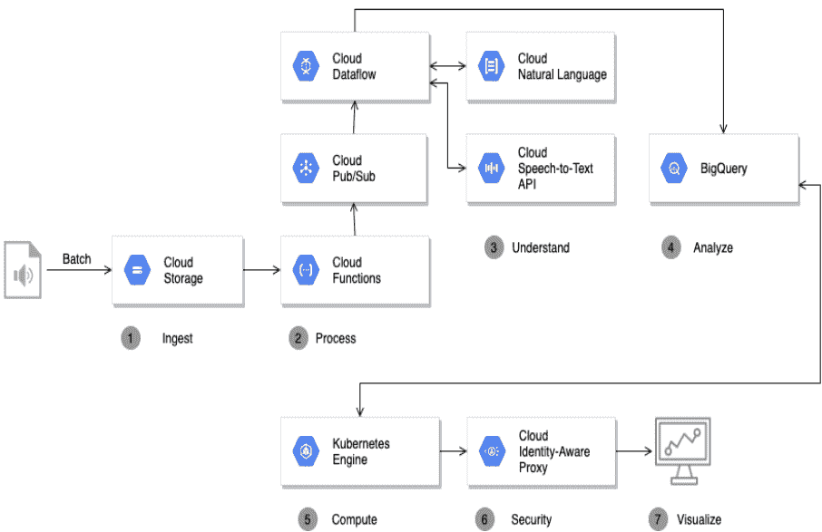

Figure 3-1. Framework Architecture


### 消息队列

在第一章中我们介绍了 Cloud Pub/Sub 的概述，现在让我们深入了解一些。消息队列和发布-订阅消息允许应用程序在彼此之间传输消息。在计算机科学中，这种范式用于进程间通信（IPC），它允许软件组件共享数据。这是微服务架构的重要组成部分，因为微服务应用程序分布在多台机器上，你需要一种方式让它们共享数据。我们有多种共享数据的方式，包括 RESTful API，我们将在后面的章节中介绍。但在我们框架的当前阶段，我们将利用一个队列，它提供了一种使用异步进程的方法，从而提高应用程序的吞吐量，因为不需要应用程序为新消息而阻塞。你可以在图 3-2 中看到消息队列的工作流程。

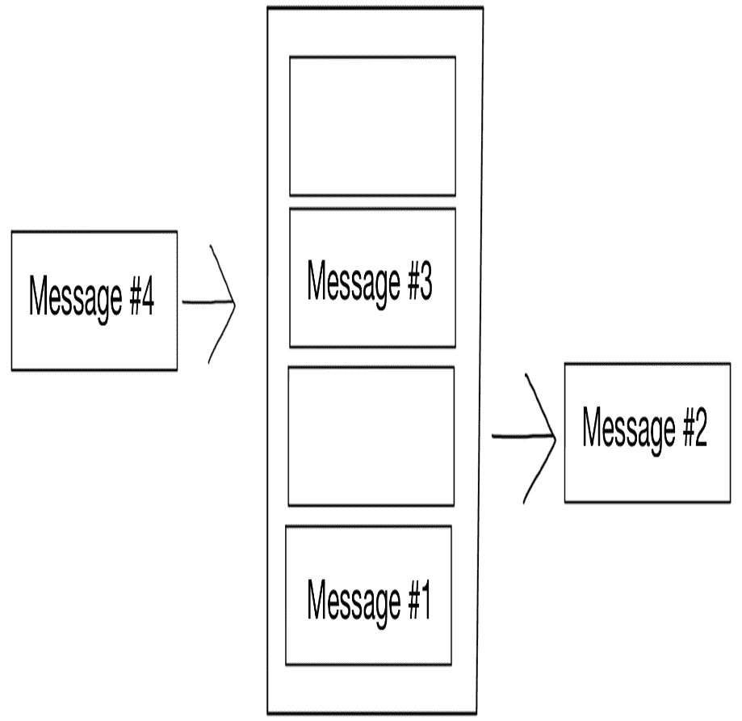

图 3-2. 消息队列工作流程

在我们的框架中，当音频文件上传到 Cloud Storage 时，我们会创建一个触发事件。该事件执行指定的云函数，该函数执行以下操作：

- 1. 检索元数据
- 2. 检查音频文件长度
- 3. 将音频文件发送给 Speech-To-Text 进行处理
- 4. 从 Speech-To-Text 检索作业名称
- 5. 向 Cloud Pub/Sub 发送一条消息，其中包含以下键值对（消息属性）：

```
'fileid': uniqid.time(),
'filename': `gs://${file.bucket}/${file.name}`,
'callid': file.metadata.callid,
'date': Date(Date.now()),
'year': file.metadata.year,
'month': file.metadata.month,
'day': file.metadata.day,
'starttime': file.metadata.starttime,
'duration': duration,
'stereo': file.metadata.stereo,
```

对于我们的框架，你本可以使用 RESTful API 代替 Cloud Pub/Sub。但为了最大限度地减少我们应用程序的管理及其开发，我们利用了一个托管的消息系统，从而消除了这种复杂性。如果我们选择实现 RESTful API，在开发时我们需要考虑以下问题：

- 1. 你会为我的 API 框架使用 Swagger 吗？如果选择否，如果需要，你将如何生成文档和客户端库？你可以不做任何事情，构建一个简单的 Express.js API 并在你的应用程序中只做一个 fetch 请求。但这能扩展吗？
- 2. 端点将如何得到保护？
- 3. 端点将在哪个平台上运行？
- 4. 谁将管理该平台？
- 5. 你将如何监控平台，不仅是故障，还包括延迟等项目？
- 6. 你将如何集成测试和自动化部署？

你可以继续向需要考虑的构建 API 的清单中添加项目。但这就是我们选择 Cloud Pub/Sub 路线的其中一个原因：无需担心上述大多数项目，而且 Cloud Pub/Sub 与 Cloud Dataflow 集成良好，后者将执行我们的提取、转换、加载（ETL）流程。

即使在 API First 设计的当前趋势下，我们也需要深思熟虑何时何地使用 API。例如：当你的 API 有多个消费者时，你需要谨慎对待可能破坏当前版本的更改。你需要有足够的时间宣布弃用功能，以便开发人员根据需要修改他们的代码。或者你需要有一个计划来同时处理多个版本。通过利用发布-订阅消息范式，我们所需要做的就是与我们所选消息平台的 SDK 保持同步。这使得发布-订阅平台消息成为一种极其简单、灵活且强大的进程间通信（IPC）范式。

请记住，我们并不是说要用发布-订阅平台取代 API。如果需要客户端发出请求并等待响应，那么你就需要构建一个 API。我们在运行在 Kubernetes 上的前端中正是这样做的。我们将在后面的章节中构建一个 API，该 API 使用 BigQuery SDK 执行 SQL 语句。

为了保证消息传递，你将收到来自 Cloud Pub/Sub 的响应，确认消息已被接收。在你的 Cloud Function 代码中，你对 Cloud Pub/Sub 使用异步操作。你将使用 Javascript 链式处理，在其中我们按链执行多个异步操作。如果前一个操作未完成，则不会执行操作，从而允许我们使用 .catch() 处理程序添加异常检查。

```
.then(() => {
  const pubSubData = JSON.stringify(pubSubObj);
  const dataBuffer = Buffer.from(pubSubData);
  const pubsub = new PubSub();
  return pubsub
    .topic(topicName)
    .publisher()
    .publish(dataBuffer)
    .then(messageId => {
      console.log(`Message ${messageId} published.`);
      callback(null, 'Success!');
    })
    .catch(err => {
      console.error('ERROR:', err);
    });
}
```

在上面的代码片段中，如果我们没有从 Cloud Pub/Sub 收到 messageId，我们将引发一个异常，该异常将执行我们的 .catch() 处理程序。我们可以在 .catch() 处理程序中添加通知或日志消息，让我们知道发生了某些故障。来自 Cloud Pub/Sub 的此确认保证了其传递。

### 消息队列

消息队列和发布-订阅消息很容易被混淆为同一事物。它们非常相似，但细微的差异使它们足够独特，我们需要分别强调。消息队列是一种异步的服务到服务通信方法，用于传输消息。消息队列在被处理之前存储消息，并且每条消息仅由一个订阅者处理。当消息需要被多个订阅者接收时，这就是你会使用发布-订阅消息范式的时候（图 3-3）。

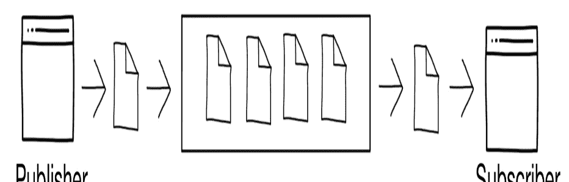

发布者

订阅者

图 3-3. 消息队列

发布-订阅消息与消息队列的不同之处在于它们允许多个订阅者接收消息。发布-订阅消息会立即将消息推送给所有订阅者，这使得 Cloud Pub/Sub 能够为传入消息提供高吞吐率。Cloud Pub/Sub 是一种发布-订阅消息范式，并且为每个订阅至少一次地传递每条已发布的消息。一旦消息已发送给订阅者，订阅者需要确认该消息（图 3-4）。Pub/Sub 将持续尝试传递未被确认的消息。默认情况下，无法在最大保留时间 7 天内传递的消息将被删除且不再可访问。这通常发生在订阅者跟不上消息流时。


发布者

发布者

发布者

订阅者

订阅者

图 3-4. 发布-订阅消息

### Google Cloud Pub/Sub

如前所述，Cloud Pub/Sub 是一种发布-订阅范式，并且是一个异步消息服务。Pub/Sub 由以下核心概念定义：

#### 主题

这是你的应用程序将发送消息到的位置。

#### 订阅

这是你的消息的持有桶。订阅将允许订阅者从订阅中拉取消息，或订阅将消息推送到定义的端点。消息将分发到主题中定义的每个订阅 图 3-5。

#### 消息

消息包含消息本身，外加可选的消息属性。

#### 消息属性

这是一个可以添加到消息中的键:值对列表。

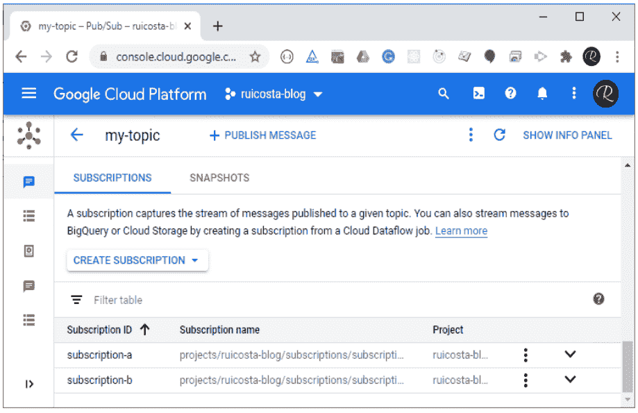

图 3-5. Cloud Pub/Sub 主题的屏幕截图

### 注意

我们首选的方法是使用消息属性，因为这使我能够在不处理整个消息的情况下以编程方式查找所需键的值。示例：在我们的框架中，Cloud Dataflow 将从 Cloud Pub/Sub 拉取消息。以编程方式我们提取键:值对如下：pub_sub_data["fileid"]。这使得将值分配给代码中的变量变得简单，而无需解析消息正文。

图 3-6 概述了 Pub/Sub 拉取订阅中可用的不同架构。


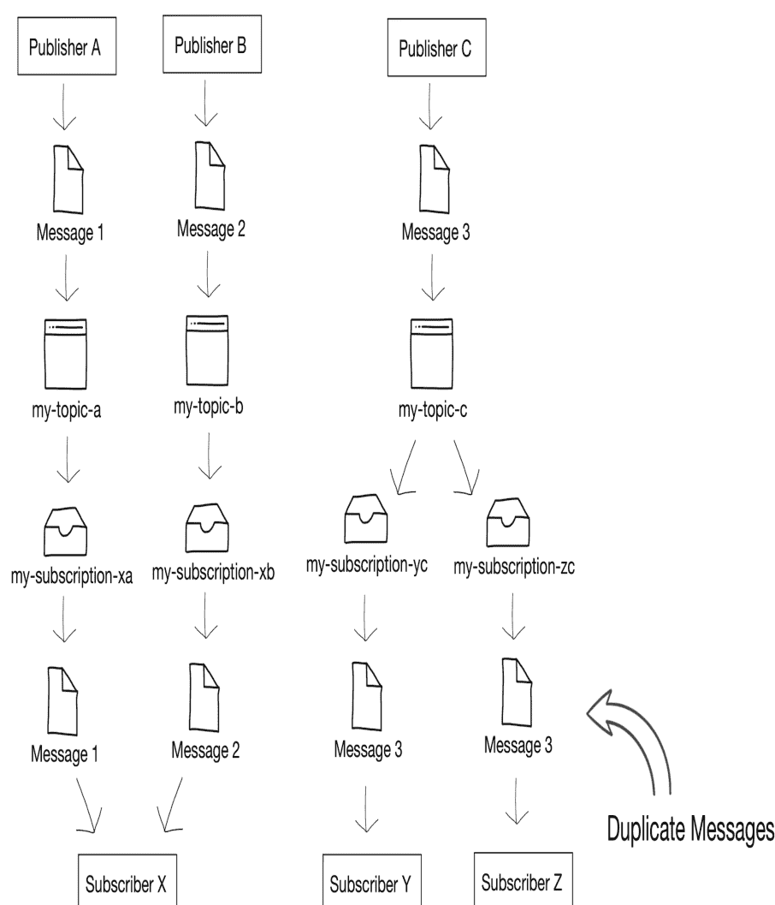

Figure 3-6. Cloud Pub/Sub Architecture

在图中你可能会注意到我们在 C Publisher 中重复了消息。Cloud Pub/Sub 允许一个主题拥有多个订阅者，让每个订阅者都能获取到消息的副本。我喜欢这样定义它：主题并不是消息的存储桶，而是订阅才是存储桶。当你创建一个主题时，可以创建多个订阅，并且当消息发送到主题时，它会被分发到已创建的订阅中。只有当订阅者在相应的订阅中确认消息时，消息才会被传递。让我们在 Figure 3-7 中回顾一条消息的生命周期，并更详细地检查它

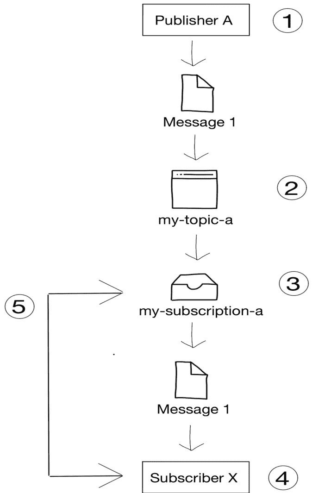

Figure 3-7. Life of a Cloud Pub/Sub Message

使用 Cloud Pub/Sub 的推送订阅范式，Pub/Sub 会将每条消息发送到订阅者应用的指定端点。

+   1. 你或你的应用创建一个 Pub/Sub 主题（Figure 3-8）。

Figure 3-8. Screenshot of creating a Cloud Pub/Sub Topic

+   2. 消息负载被发送到新创建的主题

+   3. Cloud Pub/Sub 将消息转发给订阅，每个订阅都会获得消息的副本。

+   a. 消息将在订阅中保留长达 7 天，然后会被 Cloud Pub/Sub 删除。消息在你的应用确认消息后会从订阅中移除（Figure 3-9）。

### Message retention duration ?

Duration is from 10 minutes to 7 days

Days
7
Hours
0
Minutes
0

Retain acknowledged messages ?
When enabled, acknowledged messages are retained for the message retention duration specified above. This increases message storage fees. Learn more

Figure 3-9. Cloud Pub/Sub Message Retention

4. 订阅者通过 Pub/Sub 将消息推送到订阅者定义的端点，或通过订阅者从 Cloud Pub/Sub 服务拉取消息来接收消息。

5. 在 Figure 3-10 和 Figure 3-11 中，你将看到我们推送到主题的简单消息，它包含消息正文和一个消息属性。订阅 A 和订阅 B 都收到了该消息。我们现在可以从订阅中拉取或推送消息，这将确认并从相应的订阅中移除消息。

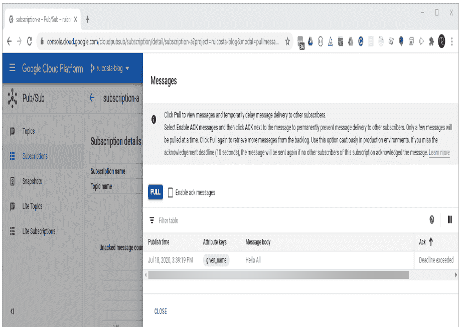

Figure 3-10. Screenshot of Subscription A

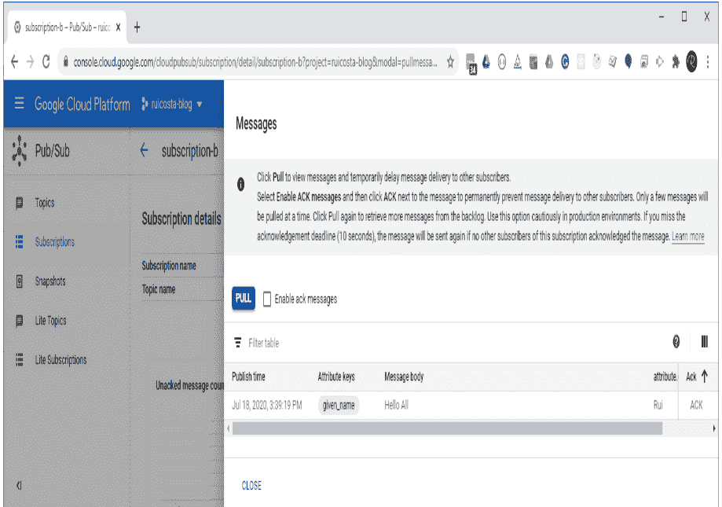

Figure 3-11. Screenshot of Subscription B

## Receiving Messages with the Push Method

在推送交付中，Pub/Sub 服务会将每条消息作为 HTTPS 请求发送到订阅者定义的端点。我们已为你预先配置了一个端点以使用推送方法进行测试；你可以在以下位置 git clone 本章的示例代码。

Figure 3-12 概述了示例中推送流程的工作方式。

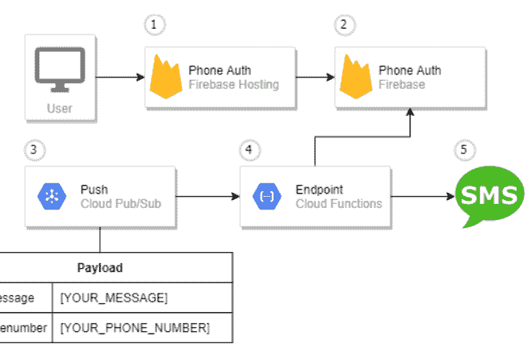

Figure 3-12. Cloud Pub/Sub Push Method

在此示例中，你将向预配置的端点发送一条 Cloud Pub/Sub 消息，其中包含一条消息和你的电话号码作为属性。该端点随后会将消息数据发送到你作为属性输入的电话号码。为了确保安全，你需要使用 Firebase Authentication 注册你的电话号码。我的示例端点会在发送 SMS 消息到你的手机之前验证该号码。

在步骤 1 中，你需要使用电话号码向示例服务 https://sms.ruicosta.blog 进行身份验证。这会将你作为用户添加到 Firebase 中，使用你输入的号码，步骤 2。登录后复制并粘贴电话号码，我们稍后会用到它。你可以在克隆的仓库中找到 Firebase Phone Auth 的源代码。按照以下说明进行步骤 3。

创建推送订阅：

+   1. 在 Google Cloud Console 中打开 Pub/Sub：
+      Pub/Sub >
+   2. 点击 Create Topic 创建主题，并随意命名：
+      CREATE TOPIC
+   3. 点击菜单中的 Subscriptions：
+      Subscriptions
+   4. 点击 Create Subscription：
+      CREATE SUBSCRIPTION

5. 将订阅更改为 Push 并输入以下 URL 作为端点：
https://us-central1-ruicosta-blog.cloudfunctions.net/pubSubPushEndpoint

Delivery type ?
Pull
Push
Endpoint URL *
https://us-central1-ruicosta-blog.cloudfunctions.net/pubSubPushEndpoint
Enable authentication Learn more

6. 为订阅输入一个名称。

7. 保留所有其他选项为默认值并点击创建。

向新创建的订阅发送测试消息：

+   1. 在 Cloud Console 返回 Topics 并点击你在步骤 2 中创建的主题。
+   2. 点击 Publish Message：
+   + PUBLISH MESSAGE
+   3. 对于消息正文，输入你希望包含在 SMS 消息中的任何内容
+   4. 点击 Add An Attribute。对于属性，使用你在身份验证电话号码时复制的电话号码。确保属性名称设置为 phonenumber。
+   5. 点击 Publish

检查你的手机——你应该收到了 SMS 消息。恭喜！你刚刚向 Cloud Pub/Sub 发送了一条消息，它处理了该消息并通过 SMS 将其传递到指定的电话号码。你可以在 GitHub 仓库中获取所有代码，包括验证电话号码并通过 Twilio 发送 SMS 消息的端点。供参考，以下是端点的代码片段：

Pub/Sub >

```
exports.pubSubPushEndpoint = (req, res) => {
  const admin = require('firebase-admin');
  const app = admin.initializeApp();
```

```
const message = req.body ? req.body.message : null;
const phoneNumber = req.body ? req.body.message.attributes.phonenumber : null;
if (message && phoneNumber) {
  const buffer = Buffer.from(message.data, "base64");
  const data = buffer ? buffer.toString() : null;
  const accountSid = '';
  const authToken = '';
  const client = require('twilio')(accountSid, authToken);
  admin
    .auth()
    .getUserByPhoneNumber(phoneNumber)
    .then(function (userRecord) {
      client.messages
        .create({
          body: data,
          from: '',
          to: phoneNumber
        })
        .then(message => res.sendStatus(204))
        .catch(function (error) {
          console.log("Twilio Error: ", error);
          res.sendStatus(400);
        });
    })
    .catch(function (error) {
      console.log("Firebase Auth Error: ", error);
      res.sendStatus(400);
    });
}
return 0;
};
```

## Receiving Messages with the Pull Method

在拉取交付中，你的应用会向 Pub/Sub 发起请求以从订阅中拉取消息。Cloud Pub/Sub 为不同编程语言提供了一系列 SDK。这使你能够将 Pub/Sub SDK 集成到各种应用中，包括 Google Cloud 服务如 Cloud Dataflow。

> NOTE
> 你现在可以在本地工作站或稍后使用 Qwiklabs 进行练习。本书的 Qwiklabs Quest 位于：

如果你在本地跟进，你需要在本地机器上配置 Node.js（https://nodejs.dev/）。你还需要配置 Google Cloud SDK 工具。你可以在 https://cloud.google.com/sdk/docs/authorizing 找到安装和配置 Google Cloud SDK 的说明：

+   1. 在 Google Cloud Console 中打开 Pub/Sub：
+      Pub/Sub
+   2. 点击 Create Topic 创建主题，并随意命名：
+      CREATE TOPIC
+   3. 点击菜单中的 Subscriptions：
+      Subscriptions
+   4. 点击 Create Subscription：
+      CREATE SUBSCRIPTION
+   5. 为你的订阅命名，选择你在步骤 2 中创建的主题，并将其他值保留为默认值，它应如下所示：
+      Subscription ID *
+      pull-subscription
+      Subscription name: projects/ruicosta-blog/subscriptions/pull-subscription
+      Select a Cloud Pub/Sub topic *
+      projects/ruicosta-blog/topics/my-topic
+      Delivery type
+      Pull
+      Push
+   6. 点击 Create
+   7. Git Clone 第 3 章代码，来源：
+   8. 使用你喜欢的 IDE 进入 chapter-three/pub-sub 文件夹
+   9. 在该文件夹中在终端运行 npm install --save @google-cloud/pubsub
+   10. 在你喜欢的 IDE 中编辑 getMessage.js 文件


11. 将 subscriptionName 变量更改为你在步骤 5 中创建的订阅，它应该看起来像这样：

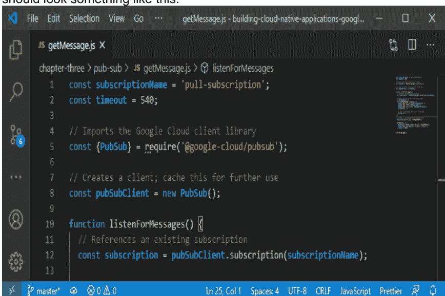

12. 现在在你的终端运行 node getMessage.js

13. 如果你收到错误，请确保你的 Google Cloud SDK 已正确配置，或者尝试运行 gcloud auth application-default login

14. 在 Google Cloud Console 中打开 Pub/Sub

15. 进入你在步骤 2 中创建的主题

16. 点击 Publish Message，在消息正文中输入一些文本并点击发布

17. 你应该会在控制台中看到你的应用程序收到了你发布的消息，它应该看起来像这样：

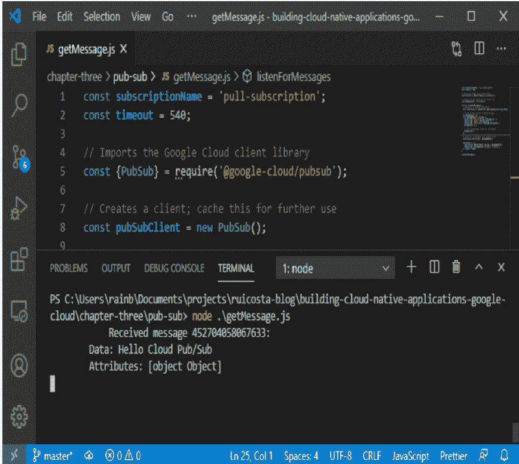

你已成功创建了一个接收并确认消息的应用程序。

## Publishing Messages

通过 Cloud Console 发布消息仅对测试我们的流程有用。在生产环境中以及在我们的框架内，你希望应用程序来执行发布操作。发布消息时，你需要定义消息正文或消息属性。消息可以只有消息正文，或者反过来消息可以只有一条或多条消息属性。你也可以同时拥有两者。你也不需要担心唯一标识符或时间戳，因为 Pub/Sub 会添加这些相应字段。

- 1. 如果你尚未 Git Clone 该仓库，请继续克隆以下仓库：
- 2. 在你喜欢的 IDE 中，进入 chapter-three/pub-sub
- 3. 在此文件夹中在终端运行 npm install --save @google-cloud/pubsub

- 4. 在你喜欢的 IDE 中编辑 sendMessage.js 文件
- 5. 将 topicName 变量更改为你在上面创建的主题，如果你尚未创建主题，请前往 Receiving Messages with the Pull Method 部分的步骤 2 获取说明
- 6. 将 data 变量更改为你选择的任意消息
- 7. 完成后它应该看起来像图 3-13

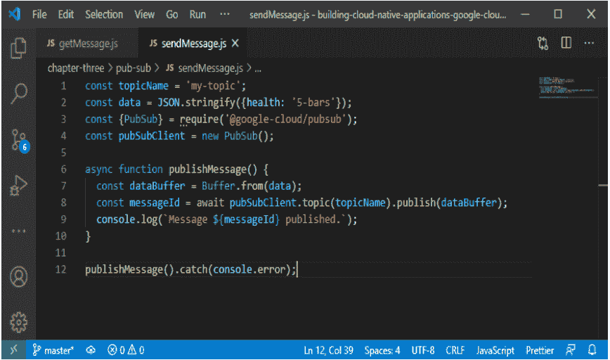

图 3-13. sendMessage.js 代码片段截图

- 8. 按如下方式运行你的应用程序：node sendMessage.js
- 9. 消息交付后，运行 Receiving Messages with the Pull Method 部分中的 getMessage.js 文件
- 10. 你现在应该会在 getMessage.js 应用程序中看到你的消息已接收，如图 3-14 所示

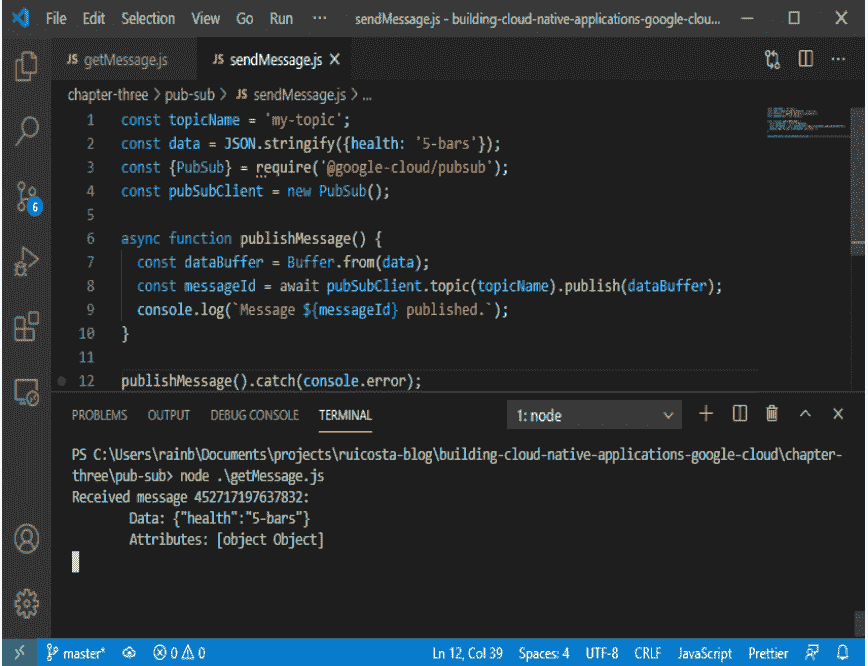

图 3-14. sendMessage.js 终端输出

你已成功以编程方式向 Cloud Pub/Sub 发布消息，并以编程方式接收和确认了该消息。

## Ordering Messages

Cloud Pub/Sub 是一种高度可扩展的消息传递服务，允许“Google 产品包括 Ads、Search 和 Gmail 使用此基础设施每秒发送超过 5 亿条消息，总计超过 1TB/s 的数据” - https://cloud.google.com/pubsub/architecture。由于系统高度可扩展，Pub/Sub 不保证消息传递的顺序。顺序是消息系统在大规模下实现的一种复杂架构。它要求消息服务在发送下一条消息之前交付一条消息，并保证订阅者已接收到该消息。消息排序架构会给传入消息带来压力，降低发布者每秒接受的消息数量。

如果你需要处理消息顺序，可以使用外部服务如 Cloud Firestore 来存储唯一 ID，并让订阅者检查 Cloud Firestore 以确定下一步需要处理哪条消息。如果你选择这种方式，你可能需要考虑不使用 Cloud Pub/Sub，而是利用 Firestore 作为你的消息队列。在消息交付时，你需要执行两个操作：一个是将消息交付给 Pub/Sub，第二个是写入 Firestore。这也适用于订阅者，因为订阅者需要从 Firestore 读取，然后从 Cloud Pub/Sub 拉取消息。这些额外步骤也会给你的应用程序引入延迟。

作为一种替代方法，如果你有一个单一发布者和单一订阅者，你可以使用计数器对消息进行排序。在下面的练习中，我们将配置一个 for 循环向 Pub/Sub 发送 100 条消息，然后你将配置一个使用持久计数器对消息进行排序的单一订阅者。我们需要在发布消息时使用 counterid 变量作为消息属性，并在订阅者中匹配 counterid 变量的起始值。

- 1. 如果你尚未克隆仓库，请继续克隆以下仓库：
- 2. 在你喜欢的 IDE 中，进入 **chapter-three/pub-sub**
- 3. 在此文件夹中在终端运行 npm install --save @google-cloud/pubsub
- 4. 在你喜欢的 IDE 中编辑 sendMessageLoadOrder.js 文件
- 5. 将 **topicName** 变量更改为你在上面创建的主题，如果你尚未创建主题，请先创建 Pub/Sub 主题。
- 6. 将 data 变量更改为你选择的任意消息
- 7. 在你喜欢的 IDE 中编辑 getMessageOrder.js 并将 subscriptionName 更改为你的订阅，如果你尚未创建订阅，请先创建。
- 8. 运行以下命令：node getMessageOrder.js
- 9. 上述命令将等待并监听新消息
- 10. 在新的终端运行以下命令发送 100 条消息 node sendMessageLoadOrder.js
- 11. 返回运行 getMessageOrder.js 的终端，你会注意到消息按顺序被处理。它应该看起来像图 3-15

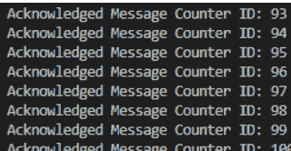

*图 3-15. 消息顺序被处理的终端输出*

由于 Cloud Pub/Sub 不保证消息的顺序，你可以使用本练习中概述的步骤来对消息进行排序，如果你的应用程序需要顺序。

## Replaying and purging messages

一旦消息已被确认，该消息将不再可供给定订阅的订阅者访问。此外，订阅者必须处理订阅中的每条消息——即使只需要其中一部分。

Cloud Pub/Sub Seek 功能扩展了订阅者功能，允许你更改消息的确认状态。你可以重放先前已确认的消息，并且你可以通过使用 Seek 结合 Snapshot 将一个订阅的状态复制到另一个订阅。

使用 Seek 功能允许你从意外的订阅者问题中恢复，对不再相关的消息积压执行确认，并在部署新代码功能时避免意外确认消息。

### Create and Seek to Snapshots

- 1. 创建一个主题和一个订阅，运行以下命令：
```
gcloud pubsub topics create seek-demo-topic
gcloud pubsub subscriptions create seek-demo-sub --topic=seek-demo-topic --ack-deadline=1
```
- 2. 订阅中没有任何已确认的消息。通过创建快照来捕获此状态：
```
gcloud pubsub snapshots create my-snapshot --subscription=seek-demo-sub
gcloud pubsub snapshots list
```
- 3. 现在发布、拉取并确认一条消息：
```
gcloud pubsub topics publish seek-demo-topic --message 'hello, world'
gcloud pubsub subscriptions pull --auto-ack seek-demo-sub
gcloud pubsub subscriptions pull --auto-ack seek-demo-sub
```
- 4. 你可以通过将订阅 seek 到快照来恢复该消息。
```
gcloud pubsub subscriptions seek seek-demo-sub --snapshot=my-snapshot
gcloud pubsub subscriptions pull seek-demo-sub --auto-ack
```
- 5. 你可以将其他订阅 seek 到同一个快照，只要订阅的主题与快照的主题相同
```
gcloud pubsub subscriptions create seek-demo-sub2 --topic=seek-demo-topic --ack-deadline=10
gcloud pubsub subscriptions seek seek-demo-sub2 --snapshot=my-snapshot
```
- 6. 从 seek-demo-sub2 拉取现在将产生在 seek-demo-sub2 创建之前发布的消息：
```
gcloud pubsub subscriptions pull seek-demo-sub2 --auto-ack
```


### 寻求时间戳

另一种重放已确认消息的方式是寻求时间戳。要寻求时间戳，您必须先配置订阅以使用 retain-acked-messages 保留已确认的消息。

+   1. 运行以下命令以寻求时间戳
+   ```
+   gcloud pubsub subscriptions update seek-demo-sub --retain-acked-messages
+   ```
+   2. 现在发布、拉取并确认一条消息：
+   ```
+   gcloud pubsub topics publish seek-demo-topic --message 'hello, world'
+   gcloud pubsub subscriptions pull --auto-ack seek-demo-sub
+   ```
+   3. 下一次拉取应返回无消息：
+   ```
+   gcloud pubsub subscriptions pull seek-demo-sub
+   ```
+   4. 现在将订阅回溯以恢复该消息
+   ```
+   TS_FORMAT=%Y-%m-%dT%H:%M:%SZ
+   gcloud pubsub subscriptions seek seek-demo-sub --time=$(date -u -d '-10 min' +$TS_FORMAT)
+   ```
+   5. 后续的拉取应再次返回该消息：
+   ```
+   gcloud pubsub subscriptions pull --auto-ack seek-demo-sub
+   ```
+   6. 您也可以使用 seek 跳过在某时间点之前发布的所有消息的投递。
+   ```
+   gcloud pubsub topics publish seek-demo-topic --message 'hello, world'
+   gcloud pubsub subscriptions seek seek-demo-sub --time=$(date -u +$TS_FORMAT)
+   ```
+   7. 在大约 60 秒的传播延迟后，该消息将不再被投递。
+   ```
+   gcloud pubsub subscriptions pull seek-demo-sub
+   ```

## 监控

监控 Cloud Pub/Sub 是保持您的应用程序和 Cloud Pub/Sub 健康的绝佳方式。Cloud Pub/Sub 会将指标记录到 Cloud Monitoring。通过 Cloud Monitoring，您可以创建仪表板来跟踪收集的指标，从而在出现问题时创建警报，确保订阅者跟上消息流。

访问 Cloud Monitoring：

+   1. 在 Google Cloud Console 中打开 Monitoring：
+      Monitoring

2. 点击 Metrics Explorer


3. 对于资源类型和指标选择以下内容：

+   a. Cloud Pub/Sub Subscription
+   b. Unacked Messages

4. 要在您喜欢的 IDE 中模拟未确认消息，请前往 chapter-three/pub-sub

+   a. 如果您尚未 Git Clone 仓库，请继续克隆以下仓库：
+   b. 编辑 sendMessageLoad.js 并将 topicName 变量更改为您的主题名称
+   c. 在终端中运行以下命令：`node sendMessageLoad.js`，应用程序将向您的 Pub/Sub 主题发送 100 条新消息并将其分发到关联的订阅

5. 返回 Cloud Monitoring > Metrics Explorer，您应该会看到订阅的折线图跃升至 100，应类似于图 3-16


*Figure 3-16. Cloud Logging Unacked Messages*

6. 消息计数将保持在 100，直到您确认消息或消息保留期到期为止。此图表让您知道有 100 条消息尚未被确认。

7. 您可以运行以下命令来确认消息 `node getMessage.js`，这将使计数恢复为零，其外观应类似于图 3-18

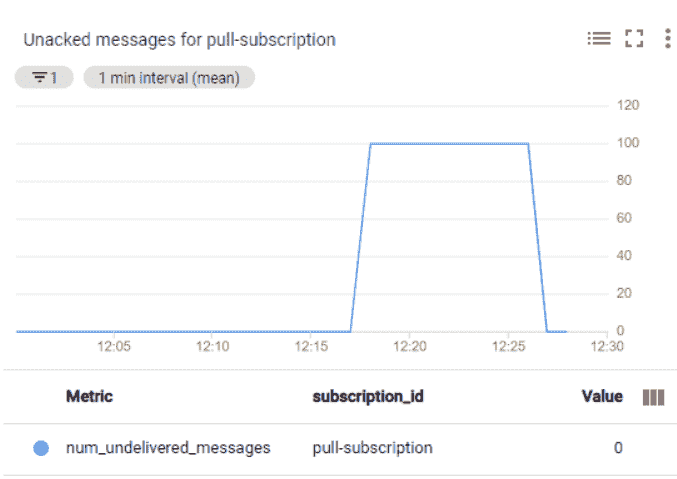

Figure 3-17. Cloud Logging Unacked Messages

Cloud Monitoring 还为 Cloud Pub/Sub 提供其他指标，并且允许您基于配置的确定值发送通知。要启用通知，您必须先创建通知渠道。以下是操作方法。

+   1. 在 Google Cloud Console 中打开 Monitoring：
+      Monitoring
+   2. 点击 Alerting：
+      Alerting
+   3. 在顶部菜单中点击 Edit Notification Channels：
+      EDIT NOTIFICATION CHANNELS
+   4. 配置 SMS 通知渠道
+   5. 返回 Altering Console 点击 Create Policy：
+      CREATE POLICY
+   6. 为您的策略输入名称
+   7. 点击 Add Policy
+   8. 对于资源类型和指标选择以下内容：
+      a. Cloud Pub/Sub Subscription

### b. Unacked Messages

9. 在配置中输入条件为：

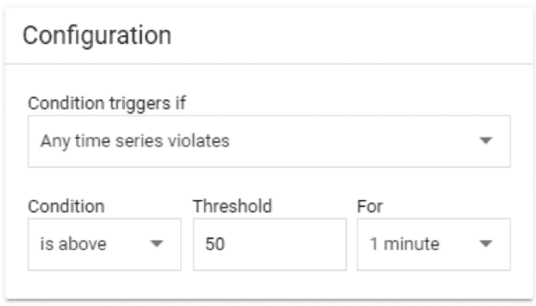

10. 添加您在步骤 4 中配置的 SMS 通知渠道

11. 点击 Save

12. 要进行测试，在终端中运行以下命令：node sendMesageLoad.js，应用程序将向您的 Pub/Sub 主题发送 100 条新消息，这将触发您配置的警报策略

13. 您应该在大约一分钟后收到一条 SMS 消息

启用告警的 Cloud Monitoring 为您提供了一种主动确保使用 Cloud Pub/Sub 的应用程序健康的方法。这也是管理故障的云原生架构的关键组件。

## Pub/Sub 或 Pub/Sub Lite

Google Cloud 提供两个版本的 Cloud Pub/Sub：Cloud Pub/Sub 和 Cloud Pub/Sub Lite。如果您具有可预测的流量模式并且不需要区域性 Pub/Sub，那么 Cloud Pub/Sub Lite 将是更具成本效益的解决方案。以下表格是来自 Google Cloud 文档的 Pub/Sub 和 Pub/Sub Lite 的比较，位于 https://cloud.google.com/pubsub/docs/choosing-pubsub-or-lite

Table 3-1. Cloud Pub/Sub and Pub/Sub Lite Comparison

| Feature | Pub/Sub | Pub/Sub Lite |
|---|---|---|
| Message replication | Multi-zone in single region | Single zone |
| Capacity | Automatically provisioned | Provision before you use |
| Pricing | Pay for the capacity that you use | Pay for the capacity that you provision |
| Storage | Unlimited | 30 GiB-10 TiB per Lite topic |
| Retention period | Up to 7 days | Unlimited |
| Service endpoints | Global and regional | Regional |
| Resource namespace | Global | Zonal |
| Message routing | Global | Zonal |

在选择 Pub/Sub Lite 之前，您需要了解以下几点：

+   1. Pub/Sub Lite 是一个区域性资源
+   2. 您需要在使用服务之前预配容量
+   3. 您为预配的容量付费

因此，在选择 Pub/Sub Lite 之前，您需要充分了解您的流量模式。以下是来自 Google Cloud Pub/Sub 文档的另一张优秀表格，比较了 Pub/Sub 和 Pub/Sub Lite 的成本，您可以在以下位置找到文档：https://cloud.google.com/pubsub/lite/pricing

Table 3-2. Cloud Pub/Sub and Pub/Sub Lite Cost Comparison

| Data published/s | Data published/mo | Data received/mo | Storage/mo | Total Pub/Sub Lite cost/partition | Total Pub/Sub cost |
|---|---|---|---|---|---|
| 1 MiB | 2.5 TiB | 2.5 TiB | 84 GiB | $39 | $200 |
| 1 MiB | 2.5 TiB | 5 TiB | 84 GiB | $39 | $300 |
| 10 MiB | 25 TiB | 25 TiB | 844 GiB | $214 | $2,000 |
| 10 MiB | 25 TiB | 50 TiB | 844 GiB | $214 | $3,000 |
| 100 MiB | 247 TiB | 247 TiB | 8438 GiB | $2,138 | $19,760 |
| 100 MiB | 247 TiB | 494 TiB | 8438 GiB | $2,138 | $29,640 |

只要您很好地了解使用模式，Pub/Sub Lite 就可以成为降低成本的绝佳方式。

## 框架部署第一部分

在本节中，您将部署 Cloud Function 并为云原生应用程序启用关联的服务。这将是我们部署功能齐全的云原生应用程序的第一部分。我们建议您在自己的 Google Cloud 项目中执行此操作，而不是在 Qwiklabs 中。您可以使用 Qwiklabs 作为学习平台来了解所介绍的概念。由于 Qwiklabs 实验室有到期日期，如果您选择使用 Qwiklabs，您的作品将在设定时间后丢失。如果您想让此项目持续进行，我们建议使用您自己的 Google Cloud 项目。您将在第 4 章中部署框架的第二部分。

现在您已经了解了 Cloud Storage、Cloud Functions 和 Cloud Pub/Sub，这是我们云原生应用程序的第一阶段，即使用 Google Cloud 机器学习 API 对音频文件进行丰富。为此，您将创建一个存储桶来上传音频文件，创建一个使用 GitLab CI/CD 部署的 Cloud Function，该函数将在音频文件上传时触发，并将音频文件发送到 Speech-to-Text 进行转录。

开始前您需要以下内容：

+   1. 您需要一个 GitLab 账户
+   2. 您需要创建一个空的 GitLab 仓库并在本地工作站克隆
+   3. 您需要一个 Google Cloud 账户
+   4. 您需要创建一个 Google Cloud 项目

## 配置和部署

为了授权 GitLab 访问我们的 Google Cloud 项目，我们需要创建一个 Google Cloud 服务账户并为该服务账户分配所需的角色。此服务账户将授权 GitLab 将 Cloud Function 部署到定义的项目。请按照以下步骤操作：

+   1. 在 Google Cloud Console 中打开 IAM & Admin：
+      IAM & Admin
+   2. 在菜单中点击 Service Accounts：
+      Service Accounts
+   3. 点击 CREATE SERVICE ACCOUNT：
+      + CREATE SERVICE ACCOUNT
+   4. 输入您的服务账户详细信息：


+   a. 服务账号名称
+   b. 服务账号 ID
+   c. 服务账号描述

## 服务账号详情

服务账号名称
gitlab-cicd
此服务账号的显示名称

服务账号 ID
gitlab-cicd-681 @ruicosta-blog.iam.gserviceaccount.com

服务账号描述
用于 GitLab CI/CD 的服务账号
描述此服务账号将执行的操作

CREATE   CANCEL

5. 点击 Create。

6. 为服务账号分配以下角色

+   a. Cloud Functions Developer
+   b. Service Account User

Role
Cloud Functions Developer

对所有函数相关资源具有读写权限。

Condition
Add condition

Role
Service Account User

以服务账号身份运行操作。

Condition
Add condition

+   7. 点击 Continue
+   8. 点击 Done
+   9. 找到新创建的服务账号，点击操作图标，然后选择 create a key：
+      :
+      :
+   10. 选择 JSON 并点击 CREATE。这将下载 JSON 文件到你的本地工作站。
+   11. 前往你的 GitLab 项目，并在设置中进入 CI/CD
+   12. 点击 Expand Variables
+   13. 创建两个新的变量，标签为：
+       a. PROJECT_ID
+       b. SERVICE_ACCOUNT
+   14. 输入你的 Google Cloud 项目 ID
+   15. 打开之前下载的服务账号 JSON 文件，复制其内容粘贴到 SERVICE_ACCOUNT 键中。它应类似于图 3-18：

Figure 3-18. GitLab Variables

此时你已为 GitLab 配置了授权，以便将其部署到你的 Google Cloud 项目中的 Cloud Functions。下一步是为音频文件上传和 Pub/Sub 主题创建存储桶。

+   1. 要在不进入 Cloud Console 的情况下快速创建存储桶，你可以运行以下命令：`gsutil mb gs://[BUCKET_NAME]` / 请注意，存储桶名称需要在 Google Cloud 客户之间是唯一的，因为它是一个全球可访问的资源。此外，存储桶名称只能包含小写字母、数字、连字符、下划线和点。不允许使用空格。
+   2. 创建一个新的 GitLab 变量，如步骤 13 中所做，名为 TRIGGER_RESOURCE
+   3. 输入新创建的存储桶名称作为 GitLab 变量的值，不要在值中包含 `gs://` （图 3-19）

Figure 3-19. GitLab Variables

+   4. 此存储桶将保存音频文件，并将成为触发你的 Cloud Function 的资源。
+   5. 运行以下命令创建 Pub/Sub 主题：`gcloud pubsub topics create my-topic`

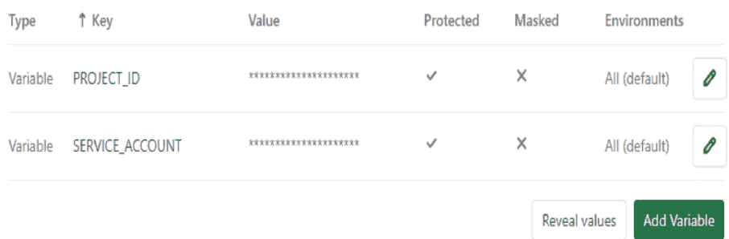

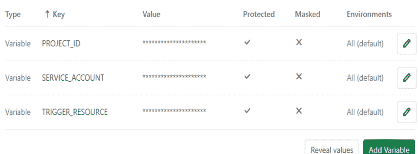

a. 当你向 Pub/Sub 发布消息时，Pub/Sub 会将消息存储在最近的 Google Cloud 区域。Pub/Sub 然后将消息传递给全球各地的订阅者。

```
If you need to restrict the regions you can run the following command which restricts the region to us-central1: gcloud pubsub topics update [YOUR_TOPIC] --message-storage-policy-allowed-regions=us-central1
```

下一步是准备你的应用程序代码以推送到 GitLab 仓库的主分支。

+   1. Git clone 以下仓库：to come
+   2. 将克隆仓库中的 saf-longrun-job-func 文件夹复制到你的 GitLab 仓库
+   3. 提交更改并将代码推送到你的仓库
+   4. 如果你返回到 GitLab CI/CD，你应该会看到你的作业正在运行：
+   5. 管道成功执行后，你应该会看到以下消息：
+   6. 在 Google Cloud Console 中打开 Cloud Function：
+   7. 你应该会看到 Cloud Function 已成功部署。
+   8. 点击你部署的函数名称，然后点击 Trigger 选项卡，这将列出触发器类型的配置详情以及在 GitLab yml 文件中定义的关联资源，如：
+   9. 在上传音频文件之前，你需要启用 Cloud Speech-to-Text API。云函数将把音频文件发送到 Speech-to-Text API 并


```
gcloud --quiet --project $PROJECT_ID functions deploy safLongRunJobFunc --runtime=nodejs8 --trigger-event=google.storage.object.finalize --trigger-resource=$TRIGGER_RESOURCE
```

它将接收一个作业名称，该名称将包含在发送到 Pub/Sub 的消息中。你可以通过运行以下命令启用 API：

```
gcloud services enable speech
```

为了在上下文中展示，你刚刚配置并部署了图 3-20 中圈出的组件

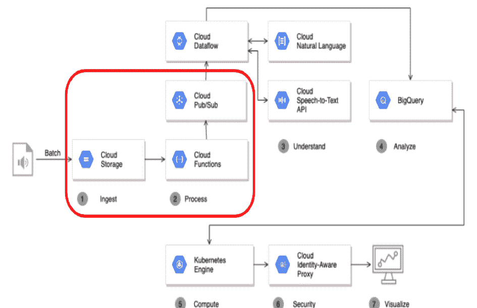

Figure 3-20. Framework Architecture

对于下一部分，你将测试刚刚部署的组件。在你克隆的仓库中，你将有一个名为 sample audio files 的文件夹，你将使用这些音频文件来测试已部署的组件。

+   1. 在终端中运行以下命令处理示例立体声音频文件，用方括号 [] 中的参数替换为你的值。示例音频文件位于克隆仓库的以下文件夹中：/chapter-three/sample-audio

```
gsutil -h x-goog-meta-callid:1234567 -h x-goog-meta-stereo:true -h x-goog-meta-pubsubtopicname:[TOPIC_NAME] -h x-goog-meta-year:[YEAR] -h x-goog-meta-month:[MONTH_AS_04] -h x-goog-meta-day:[DAY_AS_06] -h x-goog-meta-starttime:[START_TIME_AS_0910] cp stereo.wav gs://[YOUR_UPLOADED_AUDIO_FILES_BUCKET_NAME]
```

2. 在终端中运行以下命令处理示例单声道音频文件，用方括号 [] 中的参数替换为你的值。

```
gsutil -h x-goog-meta-callid:1234567 -h x-goog-meta-stereo:false -h x-goog-meta-pubsubtopicname:[TOPIC_NAME] -h x-goog-meta-year:[YEAR] -h x-goog-meta-month:[MONTH_AS_04] -h x-goog-meta-day:[DAY_AS_06] -h x-goog-meta-starttime:[START_TIME_AS_0910] cp mono.flac gs://[YOUR_UPLOADED_AUDIO_FILES_BUCKET_NAME]
```

3. 你不会在 Cloud Pub/Sub 中看到消息，你可以通过查看日志以及检查订阅来查看是否成功，你应该会看到图 3-21 所示的输出：

Message 1396373909145028 published.

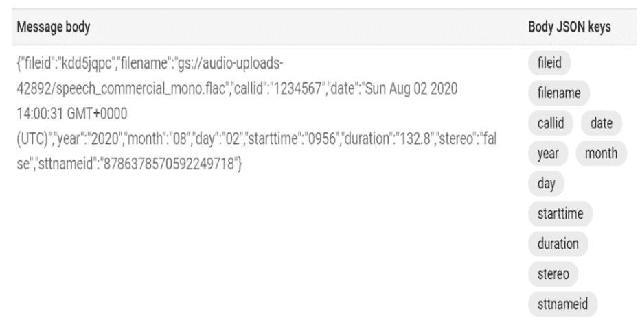

Figure 3-21. Screenshot of Cloud/Pub Message Body and Body Keys

你已成功部署并测试了云原生应用程序的第一部分。

## Cloud Native Checkpoint

让我们再次回顾我们为云原生架构列出的考虑因素，以及我们如何通过 Cloud Pub/Sub 解决每个问题。

+   1. 我们的应用程序需要从云基础设施中抽象出来。在这里你使用 Cloud Pub/Sub，它使你免于管理队列系统，无需担心可扩展性，并让你专注于应用程序功能。✓

+   2. 我们需要一种持续集成和持续交付的方法。这对于 Cloud Pub/Sub 不适用，因为管理消息的代码将由 Cloud Functions 和 Cloud Dataflow 处理。✓
+   3. 我们的应用程序必须能够根据需要扩展和缩减。“Google 产品包括 Ads、Search 和 Gmail 使用此基础设施每秒发送超过 5 亿条消息，总计超过 1TB/s 的数据” - https://cloud.google.com/pubsub/architecture ✓
+   4. 我们的应用程序将如何管理故障？管理故障的关键是主动监控应用程序和 Cloud Pub/Sub。在本书第 X 章的监控部分，你学习了如何为未确认的消息启用警报。这将是提供可靠服务的一个关键组件，因为它能让你知道 Cloud Pub/Sub 何时不健康。✓
+   5. 应用程序需要全局可访问。单条消息存储在单个区域，但主题可以有存储在多个区域的消息。✓
+   6. 我们的框架需要基于微服务架构。尚不适用，但一旦你将应用程序部署到 Kubernetes 后就会适用。
+   7. 我们的应用程序将如何得到保护？在本章中你学习了如何使用个人凭据使用 Cloud Pub/Sub 库，你还使用 GitLab 和受限服务账号将应用程序部署到 Cloud Functions。✓

## Closing Remarks

在本章中你学习了 Cloud Pub/Sub 以及它如何应用于云原生应用程序。Cloud Pub/Sub 是一个强大的服务，允许应用程序在彼此之间传递消息而不会引入延迟。它根据需要进行扩展，并且由于它是托管服务，它让你专注于应用程序代码。你还部署了应用程序的第一部分，并且随着章节的进展你将继续在此基础上构建。在下一章，你将学习 Cloud Dataflow。这将是本章中你创建的 Cloud Pub/Sub 主题的订阅者，以检索由 Cloud Functions 发送的消息。Cloud Pub/Sub 是 Cloud Functions 和 Cloud Dataflow 之间的桥梁，而 Cloud Dataflow 将是我们丰富数据的过程。


