# 第4章 使用 Cloud Dataflow 构建应用数据管道

## 早期发布读者的说明

使用 Early Release 电子书，您可以在这些书籍正式发布之前就获得书籍的最早形式——作者在写作时的原始未编辑内容——从而能够在这些技术正式发布之前就利用它们。

这将是最终书籍的第4章。请注意，GitHub 仓库将在稍后激活。

如果您对如何改进本书的内容和/或示例有任何意见，或者如果您注意到本章中缺少材料，请联系编辑 mcronin@oreilly.com。

在本章中，您将了解 Cloud Dataflow，它在框架内用作完全托管的数据处理管道。在第5章中，您将部署云原生应用的第二部分，即在 Cloud Dataflow 上运行的管道。供参考，您目前处于框架的流程阶段，您将在此阶段将 Google Cloud 服务组合起来将音频文件转换为文本、丰富它们，并开始使用 Cloud Dataflow 将数据流式传输到 BigQuery（见图4-1）。

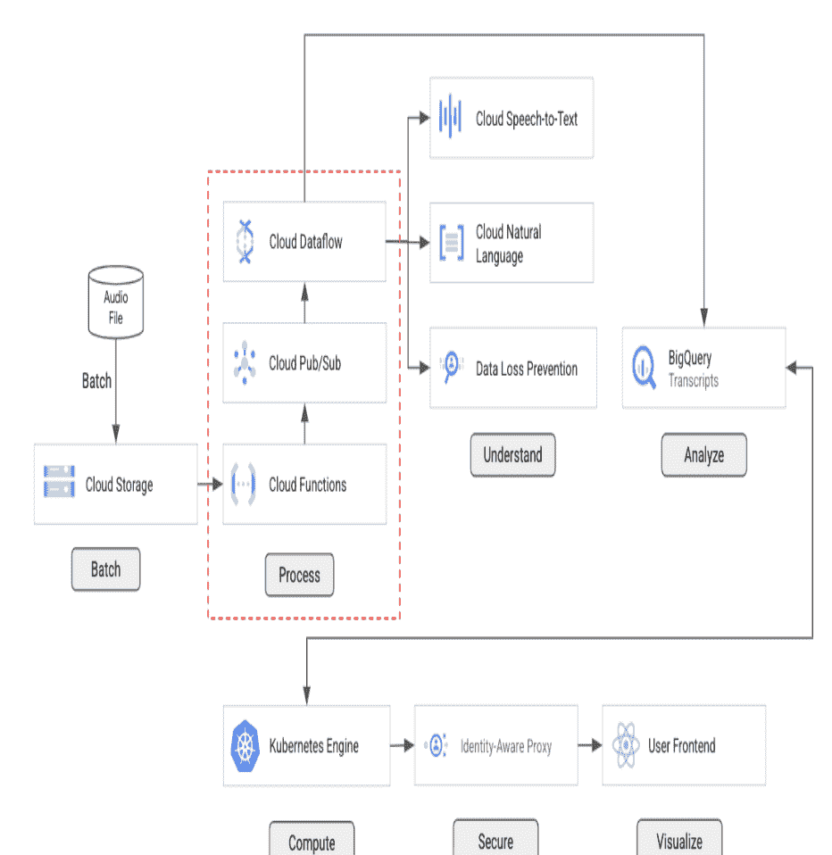

图4-1. 语音分析框架

## Cloud Dataflow 概述

Cloud Dataflow 是用于运行 Apache Beam 管道的完全托管服务，可让您执行各种数据处理任务。Dataflow 可以从不同来源移动数据：它可以转换数据，并且可以实时执行诸如

检测异常之类的数据任务。在框架内，Dataflow 将从 Pub/Sub 读取数据，调用 Speech-to-Text 和 Natural Language API，丰富数据，最后将其写入 BigQuery。Google 于2016年将 Google Cloud Dataflow SDK 捐赠给 Apache 软件基金会，其他组织贡献了运行器和 IO 以将 Beam 运行器与现有数据库集成，这使得该项目在功能和社区支持方面不断发展。

Apache Beam 是一个编程模型，用于定义和执行定义的管道。管道可以是批处理和流式处理，它们对不同的运行器公开如下：

- Google Cloud Dataflow
- Apache Spark
- Apache Flink
- Apache Apex
- DirectRunner（用于测试的本地运行器）

其思想是相同的管道可以在不同的运行器上执行，从而允许对使用哪个运行器进行概率和选择。对于框架，您将使用 Google Cloud Dataflow 运行器。选择 Cloud Dataflow 作为运行器可以让您专注于管道，并允许 Cloud Dataflow 按需管理资源并自动扩展以实现最小延迟和高资源利用率。在 Google Cloud 上运行管道时，运行器会将可执行代码和依赖项上传到 Cloud Storage，然后创建一个执行管道的 Dataflow 作业。您可以通过编程方式设置运行器，或使用命令行指定它。以下示例显示了如何通过以编程方式将运行器设置为 Dataflow 来构建管道。

```
options = PipelineOptions(
    flags=argv,
    runner='DataflowRunner',
    project='my-project-id',
    job_name='unique-job-name',
```

```
temp_location='gs://my-bucket/temp',
region='us-central1')
```

要将管道在 Apache Spark 上执行，您只需将运行器更改为 SparkRunner，以下代码是设置管道运行器为 Apache Spark 的示例。

```
options = PipelineOptions(
    flags=argv,
    runner='SparkRunner',
    project='my-project-id',
    job_name='unique-job-name',
    temp_location='gs://my-bucket/temp',
    region='us-central1')
```

选择 Apache Beam 并以 Cloud Dataflow 作为运行器可以让您专注于管道以及所需的任何转换，而不是支持基础设施和管道。

## Apache Beam 概念

在本节中，您将进一步阅读 Apache Beam 概念，这将使您能够理解设计和构建数据处理管道所需的各个组件。

### 管道

管道定义了运行器将在您的数据上执行的步骤。简单来说，管道是输入数据、数据上的转换以及数据输出的表示。

图4-2 是管道的简单表示。


*图4-2. 简单的管道表示*

图4-3 是您将使用 Dataflow 作为运行器部署的框架管道的示例。

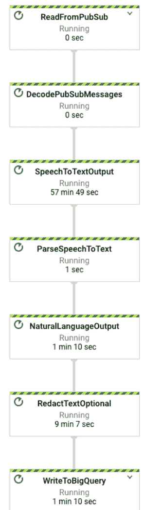

图4-3. 框架管道

以下示例代码显示了管道如何读取和写入用于运行作业的参数中定义的相关文件。

```
with beam.Pipeline(argv=beam_args) as pipeline:
    lines = pipeline | 'Read files' >>
beam.io.ReadFromText(args.input)
    lines | 'Write files' >>
beam.io.WriteToText(args.output)
```

您可以按如下方式为上述管道传递运行作业的参数：

```
python3 dataflow.py --input [FILE_NAME] --output [FILE_NAME] --runner DataFlowRunner --project [PROJECT_ID] --temp_location gs://[BUCKET]/temp --staging_location gs://[BUCKET]/stag --region us-central1 --job_name myjob
```

### PCollection

PCollection 定义了管道将操作的数据。数据可以来自固定源，如文件，也可以来自持续更新的源，如 Cloud Pub/Sub。在框架中，数据将来自 Cloud Pub/Sub 的持续更新源，是无界的。它将通过从 Cloud Pub/Sub 读取数据创建初始 PCollection，并且从那里它将为管道中的每个步骤创建 PCollection 输出以将数据写入 BigQuery。

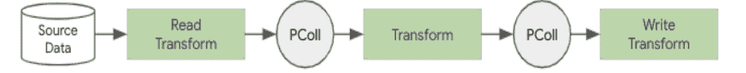

图4-4. Apache Beam 管道

### 转换

转换是您定义并在数据上执行的功能。您定义的功能将在数据的每个元素上执行您定义的操作并产生一个或多个 PCollection 作为输出。您的功能可以对您的数据执行几乎任何操作，包括使用外部库的能力。作为示例：在此框架中，您正在丰富数据以收集用户说话时间的指标，您还使用数据丢失防护库在将元素发送到下一个转换之前从元素中删除 PII 数据。但如果您还想从原始音频文件中删除 PII 语音段，您可以使用转换并使用您定义的功能导入 ffmpeg 包，这将允许您静音找到的 PII 信息。转换的输出元素可以是丰富数据的连续流，并且还可以将删除后的数据写入 Google Cloud Storage。

您正在使用的框架执行以下转换：

1. 从 Cloud Pub/Sub 读取消息

```
decode_messages = messages | 'DecodePubSubMessages'
>> beam.Map(lambda x: x.decode('utf-8'))
```
2. 使用异步语音识别从 Speech-To-Text API 检索长音频文件的数据

```
stt_output = decode_messages | 'SpeechToTextOutput'
>> beam.Map(stt_output_response)
```
3. 解析并丰富 Speech-To-Text API 数据

```
parse_stt_output = stt_output | 'ParseSpeechToText'
>> beam.Map(stt_parse_response)
```
4. 从 Natural Language API 获取 ParseSpeechToText 转换中元素的情感和实体响应

```
stt_nlp_output = parse_stt_output |
'NaturalLanguageOutput' >> beam.Map(get_nlp_output)
```
5. 如果管道参数的执行包含 dlp=true，则处理来自 NaturalLanguageOutput 转换的元素以

### 使用 Google Cloud DLP API 进行删除

```
dlp_output = stt_nlp_output | 'RedactTextOptional'
>> beam.Map(lambda j: redact_text(j, project_id))
```

框架还使用更高级别的 Map 转换，如下面的代码片段所示，图4-5 表示 Dataflow 界面中的可视化转换，图4-6 和 4-7 表示转换的输入和输出元素。

```
### function to redact sensitive data if dlp key value is set to true
def redact_text(data, project):
    info_types = []
    deidentify_config = {
        "info_type_transformations": {
            "transformations": [
                {
                    "primitive_transformation": {
                        "replace_config": {
                            "new_value": {
                                "string_value": '#',
                            }
                        }
                    }
                }
            ]
        }
    }
    if data['dlp'] == 'true' or data['dlp'] == 'True':
        dlp = google.cloud.dlp_v2.DlpServiceClient()
        parent = dlp.project_path(project)
        response = dlp.list_info_types('en-US')
        for info_type in response.info_types:
            info_types.append({'name': info_type.name})
        inspect_config = { "info_types": info_types}
        item = {"value": data['transcript']}
        response = dlp.deidentify_content(
            parent,
            inspect_config=inspect_config,
            deidentify_config=deidentify_config,


```
item=item,
)
data['transcript'] = response.item.value
for words_element in data['words']:
    item = {"value": words_element['word']}
    response = dlp.deidentify_content(
        parent,
        inspect_config=inspect_config,
        deidentify_config=deidentify_config,
        item=item,
    )
    words_element['word'] = response.item.value
for entities_element in data['entities']:
    item = {"value": entities_element['name']}
    response = dlp.deidentify_content(
        parent,
        inspect_config=inspect_config,
        deidentify_config=deidentify_config,
        item=item,
    )
    entities_element['name'] = response.item.value
for sentences_element in data['sentences']:
    item = {"value": sentences_element['sentence']}
    response = dlp.deidentify_content(
        parent,
        inspect_config=inspect_config,
        deidentify_config=deidentify_config,
        item=item,
    )
    sentences_element['sentence'] = response.item.value
    return data
dlp_output = stt_nlp_output | 'RedactTextOptional' >> beam.Map(lambda j: redact_text(j, project_id))
```


Figure 4-5. Cloud Dataflow RedactTextOptional Transform

## Input collections

Throughput (elements/sec)

1.0/s
0.8/s
0.6/s
0.4/s
0.2/s
0

3 PM
4 PM
5 PM
6 PM
7 PM

NaturalLanguageOutput.out0: 0

NaturalLanguageOutput.out0

| Elements added (Approximate) | 26 |
| Estimated size | 3.17 MB |

Figure 4-6. Input Elements of the RedactTextOptional Transform

## Output collections

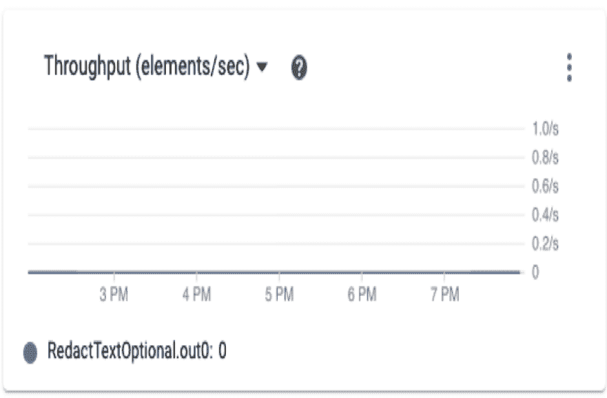

RedactTextOptional.out0

| Elements added (Approximate) | 26 |
| Estimated size | 3.17 MB |

Figure 4-7. Elements of the RedactTextOptional Transform

## ParDo

A ParDo is an Apache Beam transform operation. As outlined in the Transforms section, it performs a user defined operation on a collection of elements. The output of a ParDo can be a single element or many elements, however, it does not output a single output per input element. In the framework you need to produce a single element per input element since you need to collect metrics per element. An element in the framework is the metadata plus the

enriched data of the audio file. If you needed to perform a function on your elements, say split the words in the transcript into a list, a ParDo would be a great option to perform this operation. Since the Framework needs to collect an element per input element a beam.Map transform would work best. Since a beam.Map produces a single output for each element inputted.

## Map

A Map is another transform operation available in Apache Beam. In the Framework you will be using the beam.Map as you will be performing a one-to-one mapping, and for every audio file you will produce enriched elements with the Machine Learning APIs. Below is an example of using the beam.Map within the Framework. In this code snippet the pipeline first runs the `stt_output_response` function which is a user defined function that extracts the data from the Speech-to-Text API and returns the elements to the next step in the pipeline called `ParseSpeechToText`. Figure 4-5 is the visual representation of the code snippet below in the Dataflow console.

```
### function to get STT data from long audio file using asynchronous speech recognitiondef
stt_output_response(data):
    from oauth2client.client import GoogleCredentials
    from googleapiclient import discovery
    credentials =
GoogleCredentials.get_application_default()
    pub_sub_data = json.loads(data)
    speech_service = discovery.build('speech',
'v1p1beta1', credentials=credentials)
    get_operation =
speech_service.operations().get(name=pub_sub_data['sttname id'])
    response = get_operation.execute()
    # handle polling of STT
    if pub_sub_data['duration'] != 'NA':
        sleep_duration =
round(int(float(pub_sub_data['duration'])) / 2)
    else:
```

```
sleep_duration = 5
logging.info('Sleeping for: %s', sleep_duration)
time.sleep(sleep_duration)
retry_count = 10
while retry_count > 0 and not response.get('done', False):
    retry_count -= 1
    time.sleep(120)
    response = get_operation.execute()
### return response to include STT data and agent search word
response_list = [response,
    pub_sub_data['fileid'],
    pub_sub_data['dlp'],
    pub_sub_data['filename'],
    pub_sub_data['callid'],
    pub_sub_data['date'],
    pub_sub_data['year'],
    pub_sub_data['month'],
    pub_sub_data['day'],
    pub_sub_data['starttime'],
    pub_sub_data['duration'],
    pub_sub_data['stereo']
]
return response_list
stt_output = decode_messages | 'SpeechToTextOutput' >> beam.Map(stt_output_response)
parse_stt_output = stt_output | 'ParseSpeechToText' >> beam.Map(stt_parse_response)
```

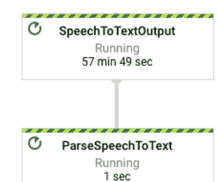

Figure 4-8. Dataflow Pipeline

## Pipeline I/O

Apache Beam I/O connectors let you read/write data into your pipeline and write output data. As an example, the Framework you are working with has a source of Cloud Pub/Sub and a sink of BigQuery. You can also write a custom I/O connector when connectors are not available for your data source or sink.

The code snippet below is an example of using the Cloud Pub/Sub I/O connector as a source that is currently only supported in streaming.

```
beam.io.ReadFromPubSub(subscription=known_args.input_subscription).with_output_types(bytes)
```

The code snippet below is an example of using the BigQuery I/O connector as a sink.

```
dlp_output | 'WriteToBigQuery' >> beam.io.WriteToBigQuery(
known_args.output_bigquery,
schema=bigquery_table_schema,
create_disposition=beam.io.BigQueryDisposition.CREATE_IF_NEEDED,

write_disposition=beam.io.BigQueryDisposition.WRITE_APPEND
)
```

To view the list of available Built-in I/O transforms visit the Apache Beam website at https://beam.apache.org/documentation/io/built-in

## Aggregation

Aggregation is an operation that is performed on many elements to produce some grouped value from those respective elements. As an example: You need a way to count the unique elements of a PCollection. You can use the beam.combiners.Count.PerElement() that will count the unique values of the elements in the PCollection.

In the code snippet below, a pipeline is created with a PCollection. Then, the elements are counter per unique value:

```
import apache_beam as beam
with beam.Pipeline() as pipeline:
    total_unique_elements = (
        pipeline
        | 'Create produce' >> beam.Create(
            ['audio_file_1', 'audio_file_2', 'audio_file_3',
             'audio_file_1', 'audio_file_4', 'audio_file_2',
             'audio_file_2', 'audio_file2', 'audio_file_5',
             'audio_file_3'])
        | 'Count unique elements' >>
beam.combiners.Count.PerElement()
        | beam.Map(print))
```

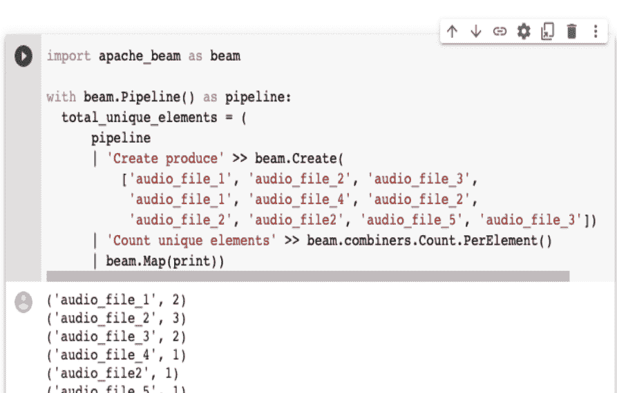

Figure 4-9. Output of running unique count with Apache Beam aggregation

Apache Beam provides the following aggregation methods:

- 1. CoGroupByKey
- 2. CombineGlobally
- 3. CombinePerKey
- 4. CombineValues
- 5. Count
- 6. Distinct
- 7. GroupByKey
- 8. GroupBy
- 9. GroupIntoBatches
- 10. Latest
- 11. Max
- 12. Min
- 13. Mean
- 14. Sample
- 15. Sum
- 16. Top

## Runner

Runners are the software that accepts a pipeline and executes it. Apache runners or execution engines include:

- Google Cloud Dataflow
- Apache Spark
- Apache Flink
- Apache Apex
- A local runner for testing, DirectRunner

## Event Time

The event time is a timestamp specified by the Pub/Sub publisher application as an attribute of a Pub/Sub message, rather than the publish_time field set on a message by the Pub/Sub service itself. If the timestamp attribute is not specified at publish time the default timestamp that is used is the `publishTime` set on the Pub/Sub message by Cloud Pub/Sub.

## Windowing

When working with bounded datasets that have the same key within the data set you can use features such as GroupByKey. However, when working with unbounded data sets it’s impossible to group all the elements since new elements are constantly being added. Windowing enables you to group operations over the unbounded data set by dividing the data set into windows of finite collections according to their timestamps of the individual elements. You set the following windows with the Apache Beam SDK or Dataflow SQL streaming extensions:

- Tumbling windows (called fixed windows in Apache Beam)
- Hopping windows (called sliding windows in Apache Beam)
- Session windows

## Tumbling Windows

A tumbling window represents a fixed interval duration in the data stream which is uniform across all keys. For example, if you set a sixty-second tumbling window, the elements with timestamp values [0:00:10-0:00:00] are in the first window. Elements with timestamp values [0:1:00-0:01:00] are in the second window. Figure 4-10 illustrates how elements are divided by tumbling windows.


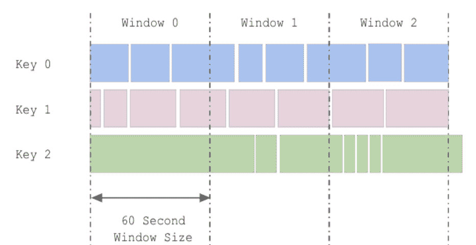

Figure 4-10. Tumbling Windows called fixed windows in Apache Beam

## Hopping Windows

A hopping window has a fixed duration which sets the time interval for when you want to capture data. You define the time interval to capture the data and the period you want to start. As an example, you can have a one-minute window and a thirty-second period. Which means it will capture one minute worth of data every thirty seconds.

Figure 4-11 illustrates how elements are divided by hopping windows.

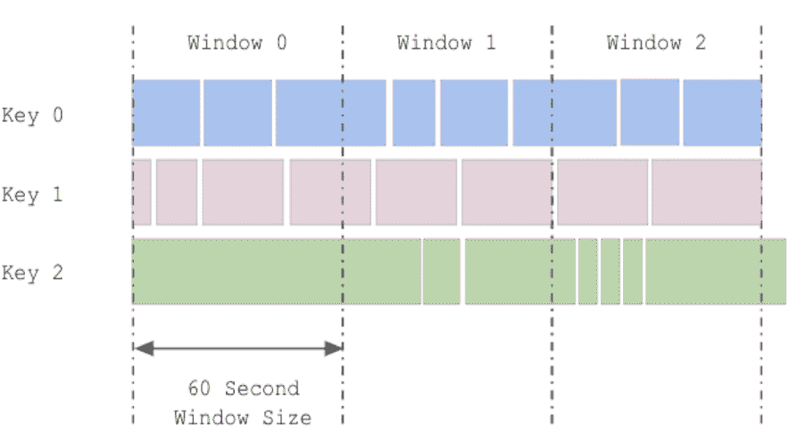

Figure 4-11. Hopping Windows called sliding windows in Apache Beam

## Session Windows

Session windows are data dependent windows, but they are not known ahead of time. Session windows will contain gaps of durations from other elements, for example; You collect metrics for IoT devices. These devices emit data events every second when they are in use. You need to understand and aggregate the utilization of the device’s data based on when they are in use. Since you don’t know ahead of time how long the devices are being used for something hoping for windows where you know the fixed duration would not work. You will still need a way of determining utilization. Session windows allow you to set the gap duration between events that can be aggregated into a session window. As an example in Figure 4-11, you set the minimum gap duration to one minute which is the threshold value of inactivity for a device, if data events arrive after the set gap duration the event data will be assigned to a new session window. If the data arrives within the gap duration then it will be assigned to the same session window. Using session windows with a minimum gap duration allows you to aggregate the utilization metrics of the IoT devices.

Figure 4-12 visualizes how elements are divided into session windows.

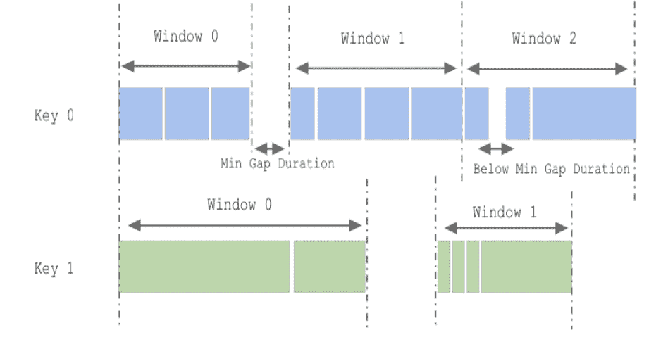

Figure 4-12. Session Windows

## Dataflow Tumbling Window Example

In this example, you will build a Dataflow Tumbling Window pipeline that shows you how to use Dataflow to:

- Read messages published to a Pub/Sub topic
- Window the messages by timestamp
- Write the messages to Cloud Storage

Before you begin, complete the following steps:

- 1. Follow the instructions for installing and initializing the Cloud SDK at https://cloud.google.com/sdk/docs
- 2. From the Google Cloud Console go to APIs & Services > Library
- 3. Enable the following Google Cloud APIs: Compute Engine, Google Cloud’s operations suite, Cloud Storage, Cloud Storage JSON, Pub/Sub, Cloud Scheduler, Resource Manager, and App Engine.
- 4. Create a service account key:
  a. From the Google Cloud Console go to **IAM & Admin** > **Service Accounts**, select **Create Service Account**.
  b. Enter a name in the **Service account name** field and click **Create**:

### Service account details

Service account name

local-workstation

Display name for this service account

Service account ID

local-workstation @ruicosta-blog.iam.gserviceaccount.com

Service account description

Describe what this service account will do

CREATE

CANCEL

c. From the Role list, select Project > Owner:

### Service account permissions (optional)

Grant this service account access to ruicosta-blog so that it has permission to complete specific actions on the resources in your project. Learn more

Role
Owner
Full access to all resources.

Condition
Add condition

+ ADD ANOTHER ROLE

CONTINUE    CANCEL

d. Click Done and then Create.

- 5. On the newly created Service Account click on the 3 Dots and select Create Key
- 6. Choose JSON for the Key Type and click Create, the Service Account Key File will be downloaded to your local workstation
- 7. Set the GOOGLE_APPLICATION_CREDENTIALS environment variable to point to the service account key you downloaded

```
export
GOOGLE_APPLICATION_CREDENTIALS=path/to/my/credentials.json
```

8. Create a Cloud Storage bucket in this project for the file exports from Cloud Dataflow. Cloud Storage bucket names must be globally unique.

```
gsutil mb gs://$BUCKET_NAME
```

9. Create local variables for your bucket and project.

```
BUCKET_NAME=bucket-name
PROJECT_NAME=$(gcloud config get-value project)
```

10. Create a Pub/Sub topic in this project:

```
gcloud pubsub topics create my-topic
```

11. Create a Cloud Scheduler job, the job will publish a message to a Cloud Pub/Sub topic at one-minute intervals.

```
gcloud scheduler jobs create pubsub publisher-job --schedule="* * * * *" \
--topic=my-topic --message-body="Hello Readers!"
```

12. Start the scheduler job.

```
gcloud scheduler jobs run publisher-job
```

13. Use the following command to clone the sample code and install the Pipeline Python packages:

To keep your Python environment isolated from your other applications it’s recommended that you use a Python virtual environment. Below are the steps to use the virtual environment for the Dataflow application.

```
git clone https://...
virtualenv env
source env/bin/activate
pip install -U -r requirements.txt
```

14. Start the pipeline

```
python pub_sub_cloud_storage.py \
  --project=$PROJECT_NAME \
  --input_topic=projects/$PROJECT_NAME/topics/my-topic \
  --output_path=gs://$BUCKET_NAME/samples/output \
  --runner=DataflowRunner \
  --region=us-central1 \
  --window_size=2 \
  --temp_location=gs://$BUCKET_NAME/temp
```

You have successfully deployed a Cloud Scheduler that publishes messages to your defined topic and a Dataflow job to window the Pub/Sub messages. To view the job go to the Google Cloud Console > Big Data > Dataflow. Your job list should look like Figure 4-13.

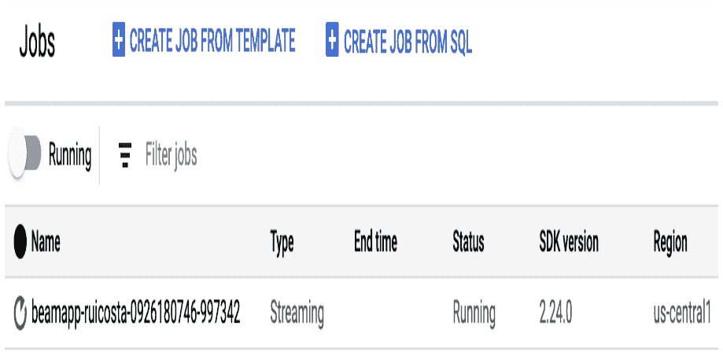

Figure 4-13. Cloud Dataflow Job List

Open the job details. It should look like Figure 4-14:

## Job info

| Job name | beamapp-ruicosta-0926180746-997342 |
| Job ID | 2020-09-26_11_07_56-1322037625958602460 |
| Job type | Streaming |
| Job status | Running |
| SDK version | Apache Beam Python 3.8 SDK 2.24.0 |
| Job region | us-central1 |
| Worker location | us-central1-c |
| Current workers | 1 |
| Latest worker status | Worker pool started. |
| Start time | September 26, 2020 at 2:07:57 PM GMT-4 |
| Elapsed time | 3 min 28 sec |
| Encryption type | Google-managed key |

## Resource metrics

| Current vCPUs | 4 |
| Total vCPU time | 0.178 vCPU hr |

## JOB GRAPH

## Read PubSub Messages
Running
1 stage

## Window into
Running
2 stages

## Write to GCS
Running
1 stage

## Figure 4-14. Cloud Dataflow Job Details

To view the files written to Cloud Storage, go to **Google Cloud Console > Storage > Browser**. Find the bucket you created in step 5 and go to **samples/output** to view the files. You can also run the following command on the terminal to list the files:

```
gsutil ls gs://$BUCKET_NAME/samples
```

Notice the timestamp of each file since you passed the window size of 2 as an argument to Dataflow, the window size was set to two minutes (Figure 4-15).

```
python pub_sub_cloud_storage.py \
  --project=$PROJECT_NAME \
  --input_topic=projects/$PROJECT_NAME/topics/my-topic \
  --output_path=gs://$BUCKET_NAME/samples/output \
  --runner=DataflowRunner \
  --window_size=2 \
  --temp_location=gs://$BUCKET_NAME/temp
```

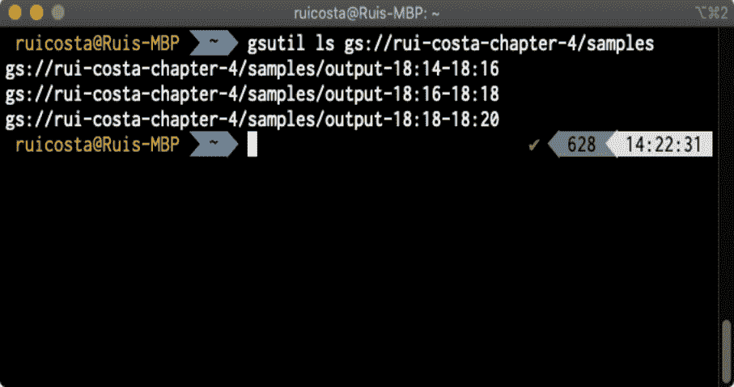

## Figure 4-15. Two Minute Dataflow Windowing Output

For this step, you will update the window size to 5 minutes. Go to **Google Cloud Console > Big Data > Dataflow** and click on the

existing job and click the stop button. STOP . When prompted choose to Drain the job Drain .

- 1. Start the pipeline, this time you are passing 5 as the window size telling the window to be set at 5-minute intervals.

```
python pub_sub_cloud_storage.py \
--project=$PROJECT_NAME \ --
input_topic=projects/$PROJECT_NAME/topics/chapter4-topic \ --output_path=gs://$BUCKET_NAME/samples/output \ --runner=DataflowRunner \
--region=us-central1 \
--window_size=5 \
--temp_location=gs://$BUCKET_NAME/temp
```

- 2. To view the files written to Cloud Storage run the following command on the terminal to list the files:

```
gsutil ls gs://$BUCKET_NAME/samples
```

- 3. Notice the timestamp of each file, they are now set at intervals of 5 minutes (Figure 4-16).

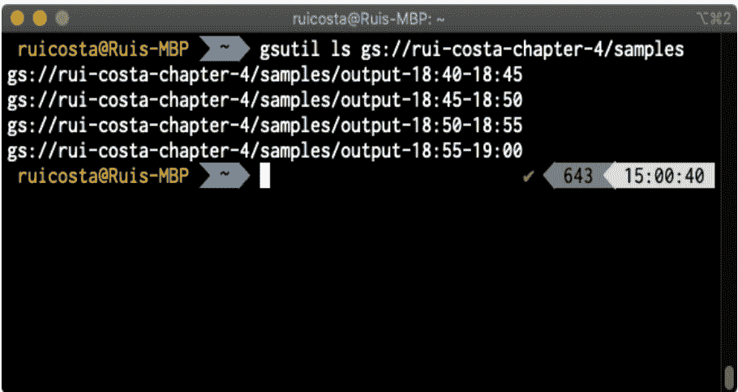

Figure 4-16. Five Minute Dataflow Windowing Output


恭喜！你已创建了两个使用 Tumbling 窗口（在 Apache Beam 中称为 fixed windows）的 Cloud Dataflow 作业，间隔分别为 2 分钟和 5 分钟。这是一种强大的方法，可对流式数据集执行聚合。想象一下构建计分卡，你可以让 Dataflow 执行聚合计算平均值并将其写入数据库，以便向用户展示计分卡。此时，你无需在前端执行聚合，从而提供快速的用户体验。

## Watermark

Watermark 是你定义的一个值，用于让 Dataflow 知道何时预期数据到来。如果你将该值设置为 30 秒，并且一个元素在 30 秒的 watermark 之后到达，即使其时间戳在窗口范围内，也会被视为迟到。

例如，如果你有一个窗口用于存储 30 秒内的事件项，并且你收到了以下 3 个元素 [element 1: 2020-01-09 0:00:01]、[element 2: 2020-01-09 0:00:05] 和 [element 3: 2020-01-09 0:00:15]，但 element 3 的事件时间包含在此间隔内，但它在窗口计算完成后才到达系统，被视为迟到。

## Trigger

触发器决定何时为每个窗口发出聚合结果。

Beam 提供了许多可设置的预构建触发器：

### *Event time triggers*

这些触发器基于由每个元素的时间戳标识的事件时间运行。例如，AfterWatermark() 触发器会在 watermark 通过窗口结束时发出窗口中的元素，该结束时间基于附加到数据元素的时间戳。以下示例同时使用了 early 的 AfterProcessingTime() 和 late 的 late=AfterCount(1)：

```
AfterWatermark(
    early=AfterProcessingTime(delay=1 * 60),
late=AfterCount(1))
```

### Processing time triggers

这些触发器基于处理时间运行，即元素被处理的时间。AfterProcessingTime() 触发器会在数据接收后经过一定处理时间后发出窗口。处理时间由系统时钟决定，而不是数据元素的时间戳。

### Data-driven triggers

这些触发器通过检查每个窗口中到达的数据，并在数据满足特定属性时触发。Apache Beam 提供了一个数据驱动触发器 AfterCount()。需要注意的是，例如，你指定 AfterCount(25) 但只有 10 个元素到达，这 10 个元素将不会被处理，因为未满足 25 的条件。如果你需要这 10 个元素，应考虑使用复合触发器。

### Composite triggers

这些触发器组合多个触发器。Apache Beam 文档指出以下复合触发器：

- 你可以通过 .withEarlyFirings 和 .withLateFirings 向 AfterWatermark.pastEndOfWindow 添加额外的 early 触发或 late 触发。
- Repeatedly.forever 指定一个永远执行的触发器。每当触发器的条件满足时，它会使窗口发出结果，然后重置并重新开始。将 Repeatedly.forever 与 .orFinally 结合使用很有用，以指定使重复触发器停止的条件。
- AfterEach.inOrder 将多个触发器组合起来按特定顺序触发。每当序列中的一个触发器发出窗口时，序列会推进到下一个触发器。
- AfterFirst 接收多个触发器，并在其任一参数触发器满足时发出。这相当于多个触发器的逻辑或操作。
- AfterAll 接收多个触发器，并在其所有参数触发器都满足时发出。这相当于多个触发器的逻辑与操作。
- orFinally 可作为最终条件，使任何触发器最后触发一次且不再触发。

## Composition triggers with AfterWatermark()

有用的复合触发器会在 Beam 估计所有数据都已到达时执行一次。例如，以下示例触发器代码在以下条件下执行：

- watermark 通过窗口结束
- 任何迟到数据到达后，经过十分钟延迟
- 两天后，我们假设不会再有感兴趣的数据到达，触发器停止执行

```
pcollection | WindowInto(
    FixedWindows(1 * 60),
    trigger=AfterWatermark(late=AfterProcessingTime(10 * 60)),
    allowed_lateness=Duration(seconds=2*24*60*60))  # 2 days,
    accumulation_mode=AccumulationMode.DISCARDING)
```

## Closing Remarks

在本章中，你学习了 Cloud Dataflow。Cloud Dataflow 是一个完全托管的数据处理管道，可让你大规模地对数据执行转换。在此框架内，你利用它来丰富语音转文本数据，为用户提供音频录音的分析。在第 5 章中，你将部署应用程序的第二部分，并且随着章节的推进，你将继续在此应用程序的基础上构建。

Citations:
https://beam.apache.org/documentation/programming-guide/#data-driven-triggers

# Chapter 5. Deploying the Application Data Pipeline

## A NOTE FOR EARLY RELEASE READERS

使用 Early Release 电子书，你可以在官方发布这些书名之前很久就利用这些技术——作者在撰写时提供的原始未编辑内容，以便你尽早利用这些技术。

这将是最终书籍的第 5 章。请注意 GitHub 仓库将在稍后激活。

如果你对如何改进本书的内容和/或示例有任何评论，或者如果本章中缺少材料，请联系编辑 mcronin@oreilly.com。

在本章中，你将部署 Cloud Dataflow 并了解 Cloud Dataflow 监控，以便拥有健康的管道。这是你部署完全功能化的云原生应用程序的第二部分。

## Deploying the Cloud Dataflow Pipeline

要部署 Cloud Dataflow 管道，请运行以下命令。管道将利用 Google Cloud Machine Learning API 对原始音频数据进行丰富处理。

- 1. 创建用于 Dataflow 暂存文件的存储桶：
  `gsutil mb gs://[BUCKET_NAME]/`
- 2. 通过 Google Cloud Console 在新创建的存储桶中创建一个名为 tmp 的文件夹，用于 DataFlow 暂存文件

```
gsutil mb gs://[BUCKET_NAME]/
```
- 3. 创建一个 BigQuery 数据集，用于在 Cloud Dataflow 处理后保存结构化数据：

```
bq mk [YOUR_BIG_QUERY_DATABASE_NAME]
```
- 4. 启用 Cloud Dataflow API
- 5. gcloud services enable dataflow
- 6. 启用 Cloud Natural Language API：

```
gcloud services enable language.googleapis.com
```
- 7. 启用 Google Cloud Data Loss Prevention API

```
gcloud services enable dlp.googleapis.com
```
- 8. 部署 Cloud Dataflow Pipeline

Dataflow 应用程序使用不属于标准库的包和模块。为了将你的 Python 环境与其它应用程序隔离，建议你使用 Python 虚拟环境。以下是为 Dataflow 应用程序使用虚拟环境的步骤。

```
virtualenv env
source env/bin/activate
### Deploy the Dataflow Pipeline
python3 saflongrunjobdataflow.py --project=[YOUR_PROJECT_ID] --
input_topic=projects/[YOUR_PROJECT_ID]/topics/[YOUR_TOPIC_NAME] --runner=DataflowRunner --
temp_location=gs://[YOUR_DATAFLOW_STAGING_BUCKET]/tmp --output_bigquery=[DATASET NAME].[TABLE] --
requirements_file="requirements.txt"
```

用你的相应参数替换以下参数：

```
[YOUR_PROJECT_ID] # 你的 Google Cloud 项目 ID
[YOUR_TOPIC_NAME] # 你的 Pub/Sub 主题名称
```

```
[YOUR_DATAFLOW_STAGING_BUCKET] # 第 1 步中创建的暂存桶
[DATASET NAME] # 第 3 步中你创建的 BigQuery 数据集
[TABLE] # 你选择的表名，例如 transcripts。
```

Dataflow 将为你创建表，它已在 Dataflow Pipeline 代码中定义为按如下方式创建表。

```
create_disposition=beam.io.BigQueryDisposition.CREATE_IF_NEEDED
```

9. 一旦管道成功部署，可能需要几分钟，你可以继续以下步骤测试添加到云原生应用程序的新组件。你可以在 Cloud Console 的 Big Data > Dataflow 中确认管道是否成功安装。图 5-1 显示了成功部署的管道。

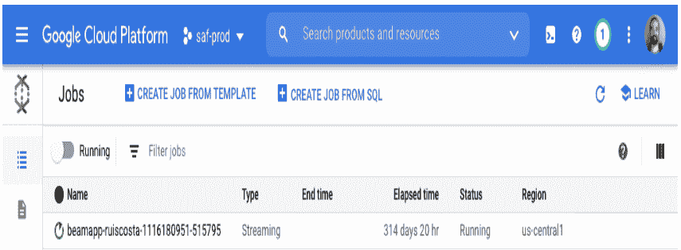

图 5-1. Cloud Dataflow 部署的 Apache Beam Pipeline

对于下一部分，你将测试刚刚部署的组件。在你克隆的仓库中，你将有一个名为 sample audio files 的文件夹，你将使用这些音频文件来测试已部署的组件。

10. 在终端中运行以下命令来处理一个示例立体声音频文件，用方括号 [] 中的参数替换为你的值。示例音频文件位于


in the following folder from the clone repository: /chapter-three/sample-audio

```
gsutil -h x-goog-meta-callid:1234567 -h x-goog-meta-stereo:true -h x-goog-meta-pubsubtopicname:[TOPIC_NAME] -h x-goog-meta-year:[YEAR] -h x-goog-meta-month:[MONTH_AS_04] -h x-goog-meta-day:[DAY_AS_06] -h x-goog-meta-starttime:[START_TIME_AS_0910] cp stereo.wav gs://[YOUR_UPLOADED_AUDIO_FILES_BUCKET_NAME]
```

11. Run the following command in your terminal to process a sample mono audio file, replace the parameters within the brackets [] with your values.

```
gsutil -h x-goog-meta-callid:1234567 -h x-goog-meta-stereo:false -h x-goog-meta-pubsubtopicname:[TOPIC_NAME] -h x-goog-meta-year:[YEAR] -h x-goog-meta-month:[MONTH_AS_04] -h x-goog-meta-day:[DAY_AS_06] -h x-goog-meta-starttime:[START_TIME_AS_0910] cp mono.flac gs://[YOUR_UPLOADED_AUDIO_FILES_BUCKET_NAME]
```

The Dataflow job streams data into BigQuery instead of using a job to load data into BigQuery. This approach enables you to query data without the delay of running a load job. You will learn more about BigQuery in Chapter 10. To view your newly created data, open the Cloud Console and go to Big Data > BigQuery.

- 1. Navigate to your Dataset and Table Name
- 2. In the Query Editor (Figure 5-2) run the following code samples to view your processed data, replace the fields in brackets with your parameters.

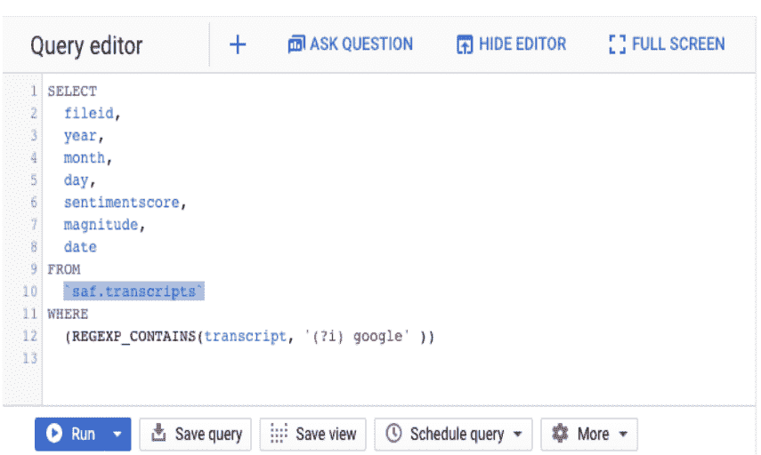

Figure 5-2. BigQuery Query Editor

### 3. Order Natural Language Entities for all records See Figure 5-3

```
SELECT
  *
FROM (
  SELECT
    entities.name,
    entities.type,
    COUNT(entities.name) AS count
  FROM
    `[YOUR_PROJECT_ID].[YOUR_DATASET].[YOUR_TABLE]`,
    UNNEST(entities) entities
  GROUP BY
    entities.name,
    entities.type
  ORDER BY
    count DESC )
```

### Query results

SAVE RESULTS

EXPLORE DATA

Query complete (0.1 sec elapsed, cached)

Job information
Results
JSON
Execution details

| Row | name | type | count |
|---|---|---|---|
| 1 | pair | OTHER | 12 |
| 2 | second | OTHER | 8 |
| 3 | order | OTHER | 6 |
| 4 | issues | OTHER | 4 |
| 5 | name | OTHER | 4 |

Figure 5-3. Query Results

### 4. List word, start time, end time, speaker tag and confidence for all records - See Figure 5-4

```
SELECT
  ARRAY(
  SELECT
    AS STRUCT word,
    startSecs,
    endSecs,
    speakertag
  FROM
    UNNEST(words)) transcript
FROM
  `[YOUR_PROJECT_ID].[YOUR_DATASET].[YOUR_TABLE]`
```

### Query results

SAVE RESULTS

EXPLORE DATA

Query complete (0.3 sec elapsed, 15.9 KB processed)

Job information
Results
JSON
Execution details

200 row per page limit reached due to duplicate values or complex results. Displaying 1 results to reflect this.

| Row | transcript.word | transcript.startSecs | transcript.endSecs | transcript.speakertag |
| --- | --- | --- | --- | --- |
| 1 | Hello. | 0.5 | 0.8 | 1 |
|  | Thank | 0.8 | 0.9 | 1 |
|  | you | 0.9 | 1.1 | 1 |
|  | for | 1.1 | 1.2 | 1 |
|  | calling | 1.2 | 1.4 | 1 |
|  | the | 1.4 | 1.5 | 1 |
|  | Google | 1.5 | 1.8 | 1 |
|  | merchandise | 1.8 | 2.2 | 1 |
|  | store. | 2.2 | 2.5 | 1 |
|  | How | 2.5 | 2.6 | 1 |
|  | can | 2.6 | 2.8 | 1 |
|  | I | 2.8 | 2.8 | 1 |

Figure 5-4. Query Results

### 5. Search Transcript with a regular expression - See Figure 5-5

```
SELECT
  fileid,
  year,
  month,
  day,
  sentimentscore,
  magnitude,
  date
FROM
  `[YOUR_PROJECT_ID].[YOUR_DATASET].[YOUR_TABLE]`
```

```
WHERE
( REGEXP_CONTAINS(transcript, '(?i) [YOUR_WORD]' ) )
```

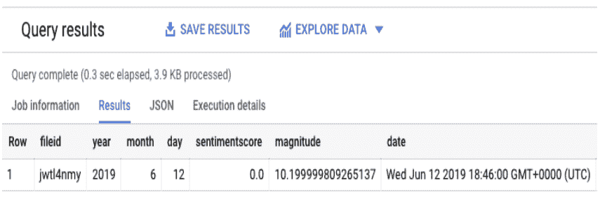

Figure 5-5. Query Results

## Cloud Dataflow Monitoring

Google Cloud provides a powerful monitoring interface that lets you see and monitor your Dataflow jobs. The monitoring interface can show you:

- A list of all currently running Dataflow jobs
- A graphical view of your pipelines
- Details about your job's status
- Any errors or warnings that occured during a job execution

To access the Dataflow monitoring interface, navigate from the Google Cloud to the Big Data section and click Dataflow. A list of the Dataflow jobs appears along with their status as seen in Figure 5-6

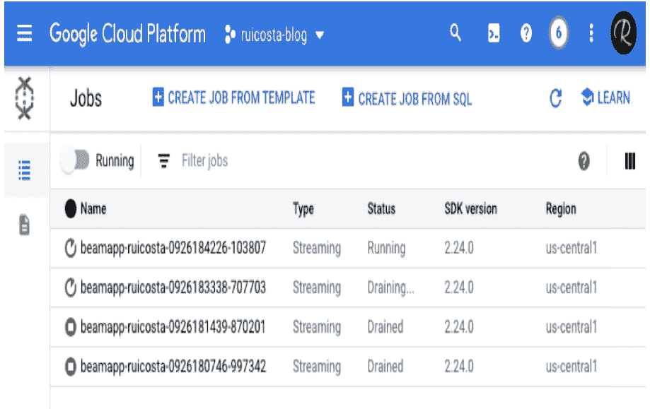

Figure 5-6. Cloud Dataflow Job List

A Cloud Dataflow pipeline job can have the following statuses:

## Running

the job is currently running

## Starting

the job is created, but the job is still being prepared

## Queued

a FlexRS (Flexible Resource Scheduling) job is queued

## Canceling

the job is being canceled

## Canceled

the job that was canceled by the user

## Draining

the job is being drained

## Drained

the user drained the job

## Updating

the job is being updated

## Updated

the user updated the job

## Succeeded

the job has finished successfully

## Failed

the job failed to complete

To access a job’s monitoring charts and metrics, click the job **Name**.
This will navigate you to the **Job details** page as seen in Figure 5-7.

Figure 5-7. Cloud Dataflow Job Details

The Job details page contains the following information:

## Job graph

The visual representation of your pipeline

## Job metrics

Metrics about the execution of your job

## Job info

Descriptive information about your pipeline

## Job logs

## Logs generated by Dataflow

## Worker logs

logs generated by the Dataflow service at at the worker level

## Job error reporting

Charts showing where errors occurred

## Time selector

Tool that lets you adjust the timespan of your metrics

## Job metrics

To view, (Figure 5-8) click on the Job metrics tab.

## Figure 5-8. Cloud Dataflow Job Metrics Page Details

The Job metrics page details provide you with a wealth of information about your pipeline. Below are key metrics you should review when troubleshooting performance issues with your job.

Cloud Dataflow throughput is the volume of data being processed at any point in time (Figure 5-9).

## Throughput (elements/sec)

Create alerting policy

Figure 5-9. Cloud Dataflow Throughput Metrics

CPU utilization is the amount of CPU being used divided by the amount of CPU available for processing (Figure 5-10).

## CPU utilization (All Workers)

Create alerting policy

Figure 5-10. Cloud Dataflow CPU Utilization Metrics

| Name | Value |
| Read PubSub Messages/Read | 0.017/s |
| Window into/Abandon Dummy Key | 0 |
| Window into/Add Dummy Key | 0.017/s |
| Window into/Add timestamps to messages | 0.017/s |

| Name | Value |
| beamapp-ruicosta-09261842-09261142-nl86-harness-jz8c | 3.14% |

Input metrics and output metrics are displayed if your streaming Dataflow job has read or written records using Pub/Sub (Figure 5-11).

## Input Metrics

All Pub/Sub subscriptions

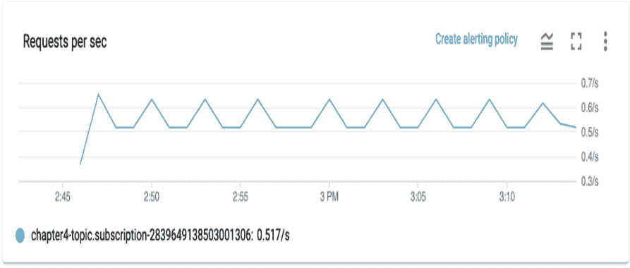

Figure 5-11. Cloud Dataflow Input and Output Metrics for Cloud Pub/Sub

Requests latency is the response time of the elements processes either being an input to a transform or an output to a transform. If you notice high latency it would be recommended to check the transform operation code (Figure 5-12).

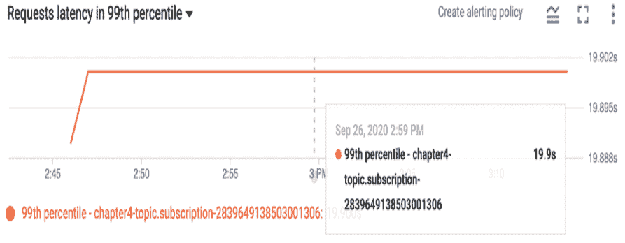

Figure 5-12. Cloud Dataflow Requests Latency Metrics

There are many more metrics to explore that go beyond the scope of this chapter. I recommend you visit the Google Cloud documentation (https://cloud.google.com/dataflow) on Cloud Dataflow Monitoring that provides a wider array of metrics you can explore further to make sure you have a healthy pipeline.

## Using Cloud Monitoring for Cloud Dataflow pipelines

Google Cloud Monitoring provides you with the ability to log and troubleshoot your application including your Dataflow pipelines.

You can explore Cloud Dataflow metrics by accessing the Cloud Monitoring, go to Google Cloud Console and click on Monitoring.

- 1. In the left navigation pane, click Metrics Explorer.
- 2. In the Find resource type and metric enter Dataflow Job.

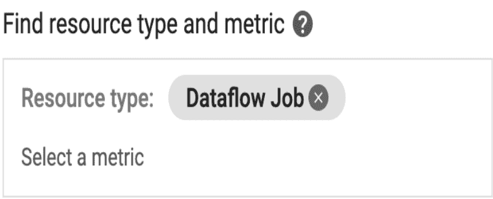

Figure 5-13. Cloud Logging Resource Type Selection

3. From the list that appears, select a metric you’d like to view, example Element Count


### 查找资源类型和指标？

资源类型：Dataflow Job
指标：元素计数

图 5-14. Cloud Logging 指标选择

4. 你应该在右侧窗格看到如图 5-15 所示的图表。

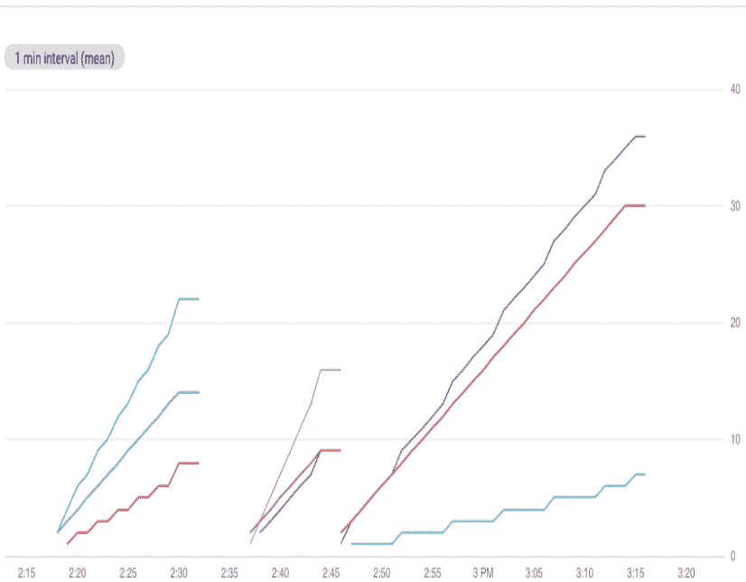

图 5-15. Cloud Logging 元素计数指标图

Cloud Monitoring 还允许你对多个资源进行分组。

+   1. 在 Groups 菜单中，选择 Create Group
+   2. 输入你的组名称，例如 Speech Analytics Dataflow Group
+   3. 添加筛选条件，如图 5-16 所示。

## Criteria

## Add criterion

Type *
Name

Operator *
Starts with

Value *
beam

CANCEL   DONE

图 5-16. Cloud Logging 组条件选择

4. 点击 Create

5. 你现在应该可以看到你的组已创建，所有 Apache Beam 管道都已分组到单个仪表板中，如图 5-17 所示

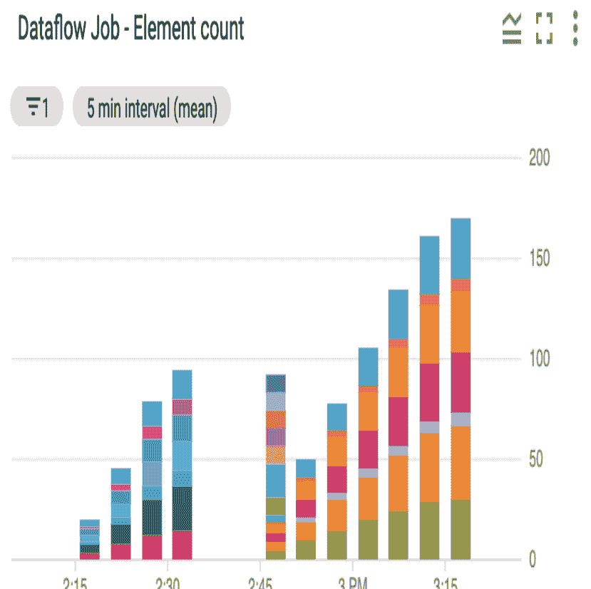

图 5-17. Cloud Logging 分组

6. 在 Alerting 菜单中，点击 Create Policy。

7. 在 Create new alerting policy 页面中，定义告警条件和通知渠道。例如在图 5-18 中，条件已设置为 System Lab for Dataflow：

+   8. 图 5-18 Cloud Logging 告警策略
+   9. 输入所需的值，包括通知渠道。
+   10. 完成后你可以查看你的告警策略示例

图 5-18

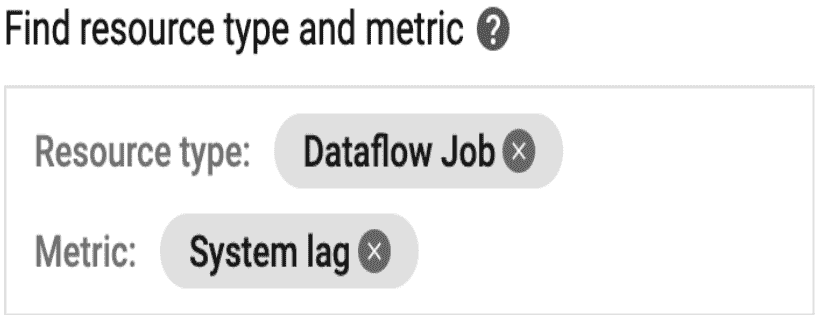

图 5-18. Cloud Logging Dataflow 系统延迟告警策略

Cloud Monitoring 为你提供了一套全面的工具来保持管道处于健康状态，并在指标达到你设定的阈值并需要关注时提醒你。

## Cloud Native Checkpoint

让我们回顾一下我们为云原生架构列出的考虑因素，以及我们如何通过 Cloud Dataflow 来解决每个问题。

+   1. 你的应用程序需要从云基础设施中抽象出来。这里你使用的是 Google Cloud Dataflow Runner。选择 Cloud Dataflow 作为运行器可以让你专注于管道，并允许 Cloud Dataflow 按需管理资源并自动扩缩容以实现最低延迟和高资源利用率。其思想是相同的管道可以在不同的运行器上执行，从而提供使用不同运行器的可能性和选择。✓
2. 你需要一种持续集成和持续交付的方法。你尚未学习如何将 CI/CD 集成到管道部署中。这超出了本章的范围，但推荐的方法是利用多个部署管道。例如：测试、暂存和生产。你可以在部署前对代码执行单元测试，以在部署到生产环境前验证管道的健康状态。在第 8 章中，你将学习如何将 CI/CD 集成到管道部署中。✓
3. 应用程序必须能够根据需要进行扩容和缩容。Cloud Dataflow 按需管理资源并自动扩缩容以实现最低延迟和高资源利用率。✓
4. 应用程序将如何管理故障？管理故障的关键在于你主动监控应用程序和 Cloud Dataflow。在本章中，你学习了如何查看指标并为 Cloud Dataflow 启用日志记录以提供健康的管道。✓
5. 应用程序需要能够全球访问。对于我们的数据处理管道来说，这并不相关。如果你在管道中检测到故障，你可以轻松地将其部署到另一个区域或地区。由于 Cloud Pub/Sub 主题可以让消息存储在多个区域，因此你在队列中提供了弹性。Cloud Dataflow 可以在管道故障时从中断处继续。✓
6. 我们的框架需要基于微服务架构。尚不适用，但在你将应用程序部署到 Kubernetes 后就会适用。
7. 我们的应用程序将如何得到保护？Cloud Dataflow 使用 Google Cloud 服务账号进行保护。✓

## Closing Remarks

在本章中，你使用 Cloud Dataflow 部署了数据管道，并学习了如何通过使用 Cloud Monitoring 来保持 Cloud Dataflow 健康。在下一章中，你将学习如何使用 Google Cloud Machine Learning API 通过 Google Cloud 服务丰富数据。

## About the Authors

**Rui Santos Costa** Rui Costa 在 Google 担任过多个角色，最近担任学习顾问，与战略客户和合作伙伴合作，创建并执行他们的 Google Cloud 学习计划。他曾担任 Google AI Impact Challenge 的 AI 教练，也是 Speech Analysis Framework 的创始人，该框架已成功毕业成为 Google 内部的产品。

**Jasen Baker** 拥有超过 20 年的 IT 经验，从 1993 年从事“在互联网上开展业务的商业公司”的工作开始，到 1997 年创办一家网络托管公司。Jasen 在多个初创公司担任 Unix 工程师 15 年后，在 Nike、HP 最终进入 Google 担任技术职位。他的职业生涯从系统管理开始，发展到售前，再到培训，Jasen 喜欢从事引人入胜的职业，教授新一代技术人员有关云服务和软件开发的转型。除了技术培训外，Jasen 还喜欢复古游戏、股票交易和旅行。

