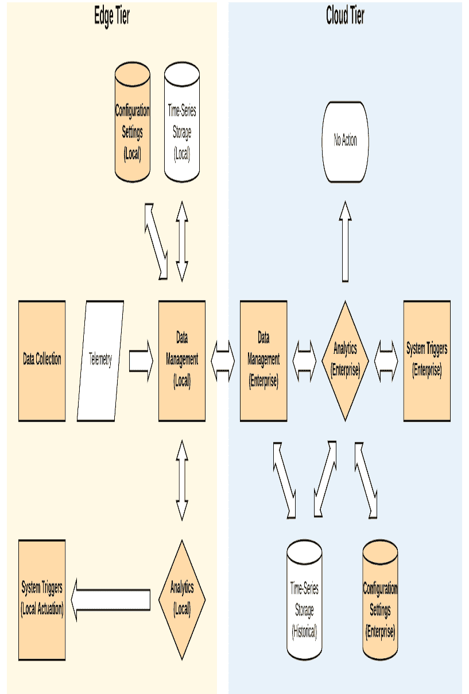
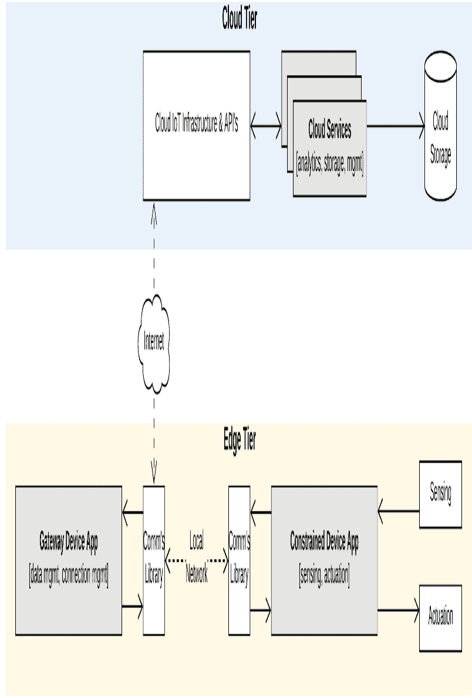
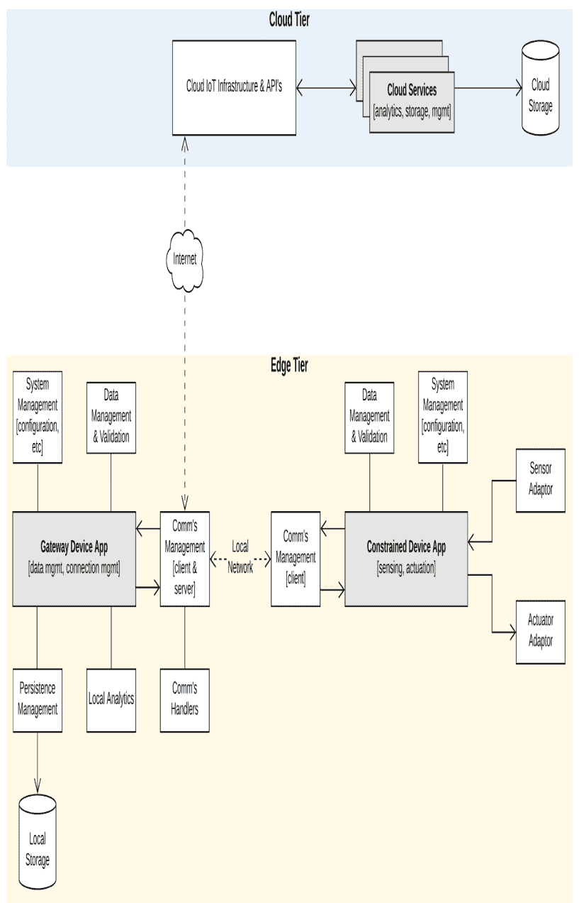
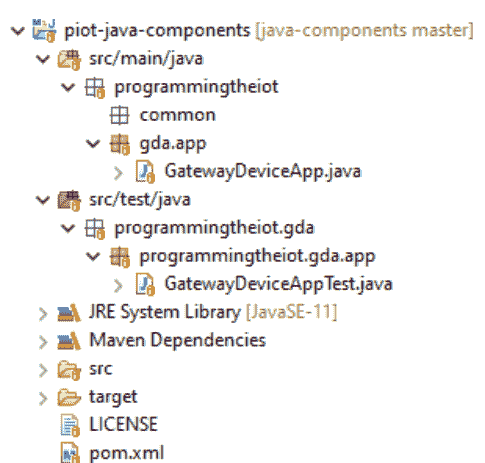
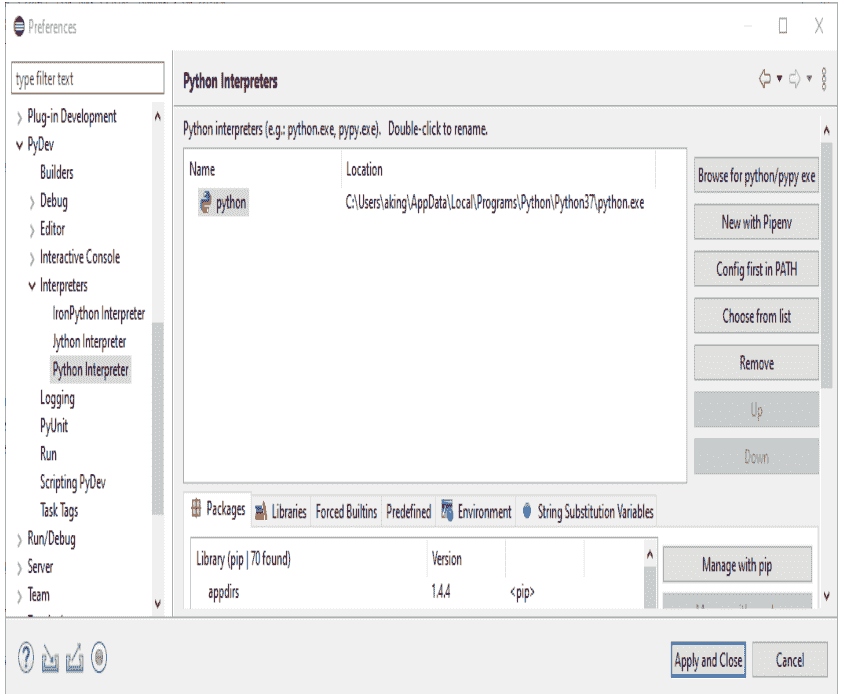
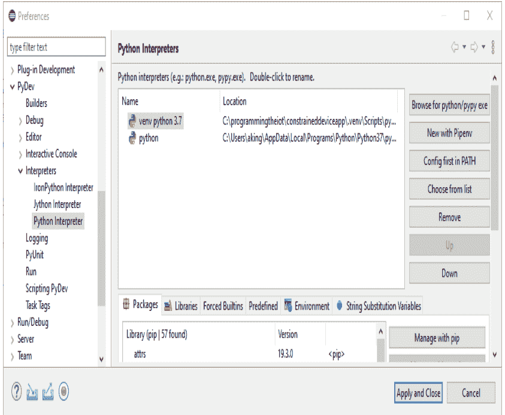
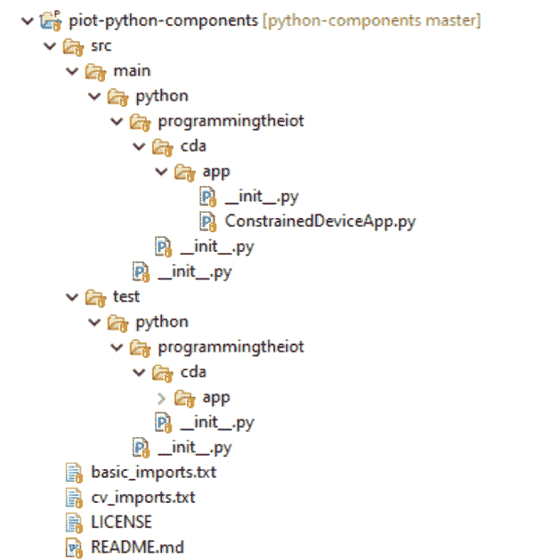

## Chapter 1. Setting Up Your Environment

### A NOTE FOR EARLY RELEASE READERS

使用 Early Release 电子书，您可以在官方发布这些标题之前很长时间就利用这些技术——作者在写作时对其原始未编辑内容进行获取，以便您可以在这些技术正式发布之前利用它们。

这将是最终书籍的第 1 章。请注意，GitHub 仓库将在稍后激活。

如果您对如何改进本书的内容和/或示例有任何评论，或者如果您注意到本章中缺少材料，请联系作者 aking.em@gmail.com。

> *前方有一条路，*
> 
> *荆棘丛生，然后变得清晰。*
> 
> *快到了。耐心。*

**基本概念：** 确定要解决的问题领域并定义架构作为物联网解决方案的基础；设置支持多种部署选项的以物联网为中心的开发环境。

您现在可能已经了解到，物联网可能非常庞大、难以控制且非常难以驯服。为了规划前进方向，我们首先需要确定要解决的问题领域，然后创建用于设计和构建物联网解决方案的架构。

让我们从几个关键问题开始，以建立基线：
您要解决什么问题？它从哪里开始又在哪里结束？为什么需要物联网生态系统？所有这些部分将如何协同工作来解决这个问题？如果一切按设计运行，您可以期待什么结果？我们将详细探讨每一个问题，并在过程中构建一个满足我们需求的端到端集成物联网解决方案。

## 本章您将学到什么

为了帮助您真正理解物联网系统应如何构建，我将深入探讨基于上述问题的一些基本架构概念，并以此作为每个编程活动的依据。从那里开始，您将构建一个逐层解决问题的解决方案，随着您完成后续每一章，添加更多功能。

不用说，当然，合适的开发工具可能会为您节省时间和挫折，而且还有助于测试、验证和部署。有许多优秀的开源和商业开发工具和框架可供您使用。

如果您从事开发工作已有相当一段时间，我预计您有自己的特定开发环境偏好，最适合您的编程风格和方法。我当然也有我的偏好，而我在此章中展示的示例将基于我首选的一组工具，但我的目标不是指定您必须使用的工具，而是帮助您快速上手物联网开发，使您能够迅速开展工作并最终为未来的开发项目选择自己的工具。

我将介绍的概念才是最重要的——编程语言、工具（及其各自的版本）和方法可以更改。这些概念代表了一致软件开发的一些基本要素：系统设计、编码和测试。让我们深入探讨每一个，并朝着构建您的集成物联网系统迈进。

## 设计您的系统

创建问题陈述可能是这个拼图中最重要的部分。让我们尝试通过起草一个相当直接但足以涵盖各种有趣物联网挑战的内容来实现：

我想了解我家中的环境以及它如何随时间变化，并进行调整以提高舒适度同时节省资金。

看起来很简单，但这是一个非常广泛的目标。我们可以通过定义问题陈述中的关键动作和对象来缩小范围。我们的目标是分离“什么”、“为什么”和“如何”。让我们首先查看“什么”和“为什么”，并确定设计应在此过程中考虑的任何操作。

## 拆解问题

本书中的练习将侧重于构建一个物联网解决方案，帮助您了解家庭环境并做出适当响应。假设您希望了解房屋内发生的事情（在合理范围内），并且如果有必要采取某种行动（即，如果温度过高，打开空调）。简单，对吧？

这种设计方法需要三个步骤：

- 1. 收集数据

让我们将其定义为可以感知的东西，例如温度、湿度等。这集中在 *telemetry*（测量数据）的捕获和传输上。操作，或更确切地说，操作类别，将简单地命名为 *data collection*
  - 温度
  - 相对湿度
  - 大气压力
  - 系统性能（CPU、内存、存储的利用率指标）

- 2. 确定相关变化

为了决定哪些数据相关，以及值变化是否重要，我们不仅需要收集数据，还需要存储并对我们可感知的项目（例如温度、湿度，


等等，上面已指出)。让我们将此操作类别称为 *数据管理*。

### 3. 执行操作

我们将建立一些基本规则来判断是否跨越了任何重要阈值，这仅仅意味着如果某个阈值被跨越需要某种类型的操作，我们就会向某物发送信号（例如调高/调低恒温器）。我们将此操作类别称为 *系统触发*。

## 定义相关结果

现在我们知道了需要采取哪些步骤，让我们来探讨问题陈述的“为什么”部分。我们可以用以下两点来总结：

- 增加舒适度
  理想情况下，我们希望在生活环境中保持一致的温度和湿度。当我们考虑房间数量、它们的使用方式等时，事情会变得稍微复杂一些。我们将此操作类别称为 *配置管理*，它与数据管理和系统触发两者紧密相关。

- 节省开支
  这有点棘手。最明显省钱的方法是不花钱！由于我们很可能需要分配财务资源来加热、冷却或加湿某个区域，我们希望进行优化——不要太多（浪费），也不要太少（我们可能会在冬季导致水管冻结）。由于我们可能需要处理一些复杂性——包括公用事业成本、季节变化等，以及与配置管理相关的任何内容——我们可能需要一些更高级的分析来处理这些问题。我们将此操作类别称为 **_analytics_**。

你可能已经注意到，“什么”和“为什么”部分中的每个步骤都有一个操作类别名称，这将在我们进入“如何”时帮助解决方案设计。提醒一下，这些类别是：数据收集、数据管理、系统触发、配置管理和分析。我们将在实施方法中进一步深入探讨其中每一个。

尽管问题陈述在表面上看起来相当简单，但事实证明，你为解决该问题所需做的事情在许多物联网系统中其实相当常见。需要在源头收集数据，存储和分析这些数据，并在某些指标表明有益时采取行动。一旦你定义了物联网架构并开始构建实现它的组件——即使它特定于此问题——你会看到它可以应用于许多其他问题领域。

让我们快速看一下代表此决策过程的简单数据流，如图 1-1 所示。你会注意到每个操作类别都在图 1-1 所示的数据流图中突出显示：

Data Collection

Telemetry

Data Management

Analytics

System Triggers

No Action

Time-Series Storage

Configuration Settings

Figure 1-1. Simple IoT data flow

大多数物联网系统至少需要我提到的五个操作类别中的一些：数据收集、数据管理、分析、配置管理和系统触发。这意味着我们可以将这些映射到系统图中定义一个架构，然后开始创建实现系统一部分的软件组件。

这就是我们工程师开始变得有趣的地方，所以让我们开始定义一个可以支持我们问题陈述的架构定义（事实上，对其他问题也是可重用的）。

## 架构设计解决方案

组织、结构和清晰度是良好架构的标志，但太多会使系统变得僵化，难以很好地扩展以满足未来的需求。而且如果我们试图建立一个能够满足我们所有合理需求的架构，我们永远也完不成（或也许甚至从未开始）！这关乎平衡，所以让我们在定义架构时考虑到未来的灵活性，但同时也保持相对良好的边界。这将使你能够快速实现解决方案，同时仍允许未来进行更新。但首先，有几个关键术语需要定义，以帮助建立构建解决方案的基础架构构造。

正如你可能从前言中的图 0-1 回忆的那样，物联网系统通常至少考虑到两个（有时三个或更多）架构层。这允许在物理和逻辑上分离功能，从而允许灵活的部署方案。所有这些只是说，云层中运行的云服务——从技术上讲——可以在世界任何地方，而边缘层中运行的设备必须与要测量的物理系统位于同一位置。就像图 0-1 所暗示的那样，此分层的示例可能包括具有传感器或执行器的受限设备与网关设备通信，后者反过来与基于云的服务通信，反之亦然。

由于我们需要一个地方来实现这五个类别的功能，确定它们在架构中的位置很重要，这样我们就可以让一些东西运行在行动发生的地方附近，而另一些则运行在云中，你和我可以轻松访问（甚至调整）功能。回顾前言中的边缘层和云层架构，让我们看看如何将“什么”和“为什么”中的每个操作类别映射到其中：

- Edge Tier（受限设备和网关设备）：数据收集、数据管理、设备触发、配置管理和分析。
- Cloud Tier（云服务）：数据管理、配置管理和系统分析。

为什么边缘层和云层包含相似的功能？首先，让我们看看我们的流程图如何融入分层架构中：



## Edge Tier

## Cloud Tier

Figure 1-2. - Notional IoT data flows between the Edge and Cloud Tiers

再次注意，我们有一些共享责任，其中一些操作类别在两个层中都实现。通常，工作重复是不好的——但在这种情况下，它可能是一个优势！简单的分析可以基于一些简单设置触发设备，如果有必要——例如，如果你家中的温度超过 80o F，你很可能希望立即触发 HVAC 并开始将温度降至例如 72o F。没有必要依赖云层中的远程基于云的服务来执行此操作，尽管通知云层正在发生此事并可能存储一些历史数据以供以后分析会很有用。

我们的架构开始成形。现在我们只需要一种方法将其映射到系统图，以便我们可以与物理世界（使用传感器和执行器）交互。最好也在我们的边缘层内结构化事物，以避免不必要地将组件暴露给互联网。这可以通过使用具有专用软件应用程序的受限设备来管理，该应用程序可以直接在设备上运行，或在笔记本电脑或其他通用计算系统上运行，模拟逻辑可以模拟传感器和执行器行为。

由于你最终希望访问互联网，你的设计应包括一个网关来处理此事和其他需求。此功能可以作为在网关设备上运行的软件应用程序的一部分来实现（或再次，在笔记本电脑或其他通用计算系统上）。你的网关设备和受限设备将构成你物联网设计的“边缘”，我将此称为你架构的边缘层。

我们还希望以安全但可从网关设备以及人类访问的方式部署分析服务、存储功能和事件管理器。有很多方法可以做到这一点，但我们将专注于一个（或多个）云服务来实现此功能。

图 1-3 提供了一个新视图，将进一步深入了解你将要构建的内容以及如何开始整合我已经提到的五个操作类别。它代表了云层中的云服务（灰色框），以及边缘层中的两个应用程序——CDA 和 GDA——将实现以包含你的受限设备和网关设备的功能，分别。




Figure 1-3. - Notional IoT simplified logical architecture with Edge and Cloud Tiers

让我们进一步深入探讨每一部分：

- Constrained Device App (CDA)
  你将构建此软件应用程序以在受限设备（仿真或实际）中运行，它将提供数据采集和系统触发功能。它将处理设备传感器（从环境读取数据）与执行器（触发动作，例如打开或关闭恒温器）之间的接口。它还将在需要执行动作时发挥作用。最终，它将连接到通信库以向网关设备应用程序发送消息并从其接收消息。
- Gateway Device App (GDA)
  你将构建此软件应用程序以在网关设备（仿真或实际）中运行，它将提供数据管理、分析和配置管理功能。其主要作用是管理数据以及 CDA 与存在于云层中的云服务之间的连接。它会根据需要本地管理数据，有时通过向受限设备发送命令来触发执行动作。它还将管理部分配置设置，即代表你环境正常值的那些设置，并在接收到新的遥测数据时执行一些简单分析。
- Cloud Services

所有云服务应用程序和功能都执行繁重的数据处理和存储工作，因为它们理论上可以无限扩展。这仅仅意味着，如果设计良好，你可以添加任意数量的设备，存储任意数量的数据，并对这些数据进行深入分析——趋势、最高值、最低值、配置值等，同时将任何相关见解传递给人类终端用户，甚至可能根据任何定义的阈值越限生成边缘层动作。从技术上讲，物联网环境中的云服务可以处理之前提到的所有动作类别，除了数据采集（即，它们不直接执行传感或执行动作）。你将构建一些云服务来处理此功能，但主要利用云服务提供商已提供的通用服务。



Figure 1-4. - Notional IoT detailed logical architecture with Edge and Cloud Tiers

将所有内容整合到详细逻辑架构中，图 1-4 显示了我们在两个架构层中的每个主要逻辑组件如何相互交互。我们将使用这两个图表（图 1-3 和图 1-4）作为本书所有练习的基础架构。

现在我们已经了解了我们面临的情况，让我们设置开发环境，以便开始编写代码。

## Building, Testing and Deploying Software for the IoT

在不同的操作系统、硬件配置和配置系统之间构建和部署代码绝非易事。对于典型的物联网项目，我们不仅要处理不同的硬件组件，还要处理在这些平台上开发和部署的多种方式，更不用说我们在其中工作的各种云服务提供商环境的持续集成/持续部署（CI/CD）特殊性了。

面对所有这些挑战，我们如何开始？首先——我们要解决什么问题？作为一名开发人员，你希望将物联网设计实现为代码，对其进行测试，将其打包成可轻松分发到一个或多个系统的形式，并安全地部署它。我们可以将开发挑战分为两个构建、测试和部署阶段，这恰好映射到我们的架构分层：边缘层环境和云层环境。我们将在第 10 章开始深入研究云层内的功能。目前，我们仅关注边缘层。

尽管我们的边缘层最终将有专门的硬件来处理，但我们可以在本地开发环境中模拟这些硬件组件的某些方面。这将使部署变得容易得多，并且对于本书中的所有练习都完全足够，除了第 4 章，我将在本章后面提到它，并且是可选的。

有许多方法可以开始物联网开发，但我们将重点关注三条具体路径：一条是纯粹仿真的，我之前提到过，除了第 4 章外，其余部分都足够。其他两条需要物联网专用硬件，将在第 4 章中更深入讨论。

## Integrated Simulated Deployment

这种方法不需要任何专用设备，允许你使用开发工作站（笔记本电脑）作为网关设备和受限设备。这意味着你将在本地计算环境中运行 GDA 和 CDA。你将通过构建简单的软件模拟器来模拟传感和执行硬件，以在 CDA 中捕获此功能。除了第 4 章中的练习外，所有练习都可以使用此部署方法工作。

## Separated Physical Deployment

这需要一个硬件设备，例如 Raspberry Pi，满足下面列出的硬件标准，使你能够连接和与真实传感器和执行器交互。尽管许多现成的单板计算机（SBC）设备可用作功能齐全的计算工作站，我将将其称为你的受限设备，并且它将直接在设备上运行你的 CDA。与模拟方法一样，你将在本地计算环境中运行 GDA。

> **NOTE**
> 
> 互联网工程任务组（IETF）的请求评论文档 RFC 7228 定义了各种受限设备（也称为受限节点）类别。这些类别包括 Class 0（非常受限）、Class 1（受限）和 Class 2（ somewhat 受限）。¹ 对于我们的目的，我们假设我们的 CDA 可以在 Class 2 或更强大的设备上运行，这些设备通常支持完整的基于 IP 的网络协议栈，这意味着我们将在本书中处理的协议通常适用于此类设备。尽管从技术上讲可以将 Class 2 设备直接连接到互联网，但我们所有的示例和练习都将通过 GDA 间接与互联网交互。

## Blended Physical Deployment

这种方法几乎与分离部署方法相同，但会将你的 CDA 和 GDA 都运行在 SBC 设备上（例如 Raspberry Pi 或其他类似系统）。这在技术上意味着你可以选择将每个应用程序部署到不同的 SBC，尽管对于列出的任何练习来说都不是必要的。

如果你选择部署路径 B 或 C，有许多种价格低廉的 SBC 可供选择。像选择我们的设备应具有通用目的输入/输出（GPIO）功能，至少一个可用的集成电路间（I2C）总线，通过 Wi-Fi 或以太网支持 TCP/IP 和 UDP/IP 网络，运行基于 Linux 的通用操作系统，例如 Debian（或其衍生版如 Raspbian），并支持 Python 3 和 Java 11（或更高版本）。

尽管你可以选择任何适合你需求的 SBC，但本书中的练习将重点关注集成仿真部署路径，当然除了第 4 章。 第二部分介绍了与物理世界集成的概念，我将专门用第 4 章来讨论使用实际硬件的这种集成。虽然原则适用于许多 SBC，但任何硬件特定的集成都将集中在 Raspberry Pi 平台上——具体来说是 Raspberry Pi 3 Model B+、Model 4 Model B 以及最新版本的 Raspberry Pi Zero W。

无论选择哪种部署路径，所有练习和示例都假设你将在单个工作站上进行开发和部署。这涉及一个三步流程，包括准备开发环境、定义测试策略以及确定构建和部署自动化方法。我将在本章中介绍这些步骤的基础知识，但也会逐步补充


你会在后续的练习中深入研究那些具有额外依赖项、测试和自动化需求的练习。

> **NOTE**
> 
> 如本节前面所述，对“在单一工作站上开发”这一假设的例外是第 4 章中的练习，在那里我将讨论在真实硬件上的实现和部署。再次强调，这仅在你计划遵循部署路径 B 和 C 时才适用，否则，你的所有 Edge Tier 代码都将在你的本地开发工作站上部署和运行。

## Step I: Prepare Your Development Environment

请记住，你的 CDA 将用 Python 编写，而你的 GDA 将用 Java 编写。让我们确保你的工作站已安装好支持这些语言及其相关依赖项所需的内容，按照以下步骤操作。

- 1. 在你的工作站上安装 Python 3.7 或更高版本（截至本文撰写时最新版本为 3.8.2）。你可以使用以下步骤检查是否已安装，或在未安装时进行安装：
  - 打开一个终端或控制台窗口，并输入：
    `$ python3 -version`
  - 它应返回类似以下内容：
    `Python 3.7.6`

```
$ python3 -version
```

```
Python 3.7.6
```

- 如果你收到错误（例如“not found”），你需要安装 Python 3.7 或更高版本。按照 https://www.python.org/downloads/ 上针对你的操作系统（Windows、Mac、Linux）的说明进行操作。

2. 通过下载位于 https://bootstrap.pypa.io/get-pip.py 的脚本来安装 pip。

a. 使用 Python 执行 pip 安装。打开一个终端或控制台窗口，并输入：

```
$ python3 get-pip.py
```

3. 确保你的工作站上已安装 Java 11 或更高版本（截至本文撰写时 OpenJDK 的最新版本为 Java 14）。你可以使用以下步骤检查是否已安装，或在未安装时进行安装：

a. 打开一个终端或控制台窗口，并输入：

```
$ java -version
```

b. 它应返回类似以下内容（确保至少为 Java 8）

```
java 13.0.1 2019-10-15

Java(TM) SE Runtime Environment (build 13.0.1+9)

Java HotSpot(TM) 64-Bit Server VM (build 13.0.1+9, mixed mode, sharing)
```

c. 如果你收到错误（例如“not found”），你需要安装 Java 11 或更高版本。按照 https://openjdk.java.net/install/ 上针对你的平台（Windows、MacOS 或 Linux）的说明进行操作。

4. 安装 Git。前往 https://git-scm.com/book/en/v2/Getting-Started-Installing-Git 并查看针对你特定操作系统的说明。

> NOTE
> 
> 本书中任何练习的前提，以及设置你的开发环境的前提，都是对 Git——一种源代码管理和版本控制工具——的基本理解。许多 IDE（包括 Eclipse）已通过嵌入式 Git 客户端启用了源代码管理。在之前的步骤中，你已通过命令行安装了 Git，以便独立于 IDE 运行 Git 命令。有关从命令行使用 Git 的更多信息，请参阅 https://git-scm.com/docs/gittutorial。

> TIP
> 
> 你可以在本地开发工作站上将 Git 用作独立的源代码管理工具，并使用各种免费和商业服务在云中管理你的源代码。GitHub² 是我使用的服务，我将利用该平台提供的一些功能来支持 CI/CD 管道，或工作流步骤，让你能够自动化构建、测试、打包和部署过程。

5. 创建一个工作开发目录，并下载本书的源代码和单元测试：

- a. 打开一个终端或控制台窗口，创建一个新的工作开发目录，然后切换到该目录。输入以下内容：
  i. Linux/macOS:
    `mkdir $HOME/programmingtheiot`
    `cd $HOME/programmingtheiot`
  ii. Windows:
    `mkdir C:\programmingtheiot`
    `cd C:\programmingtheiot`

- b. 通过输入以下内容克隆本书的以下两个源代码仓库：
  `$ git clone https://github.com/programmingtheiot/python-components.git`
  `$ git clone https://github.com/programmingtheiot/java-components.git`

### 6. Install and configure virtualenv using pip ³

- a. 打开一个终端或控制台窗口。切换到你刚刚从 GitHub 克隆的 constraineddeviceapp 代码的目录，并通过输入以下内容安装 virtualenv：
  i. Linux/macOS:
    `$ pip install virtualenv`
  ii. Windows:

```
C:\programmingtheiot> pip install virtualenv
```

b. 为你的环境配置 virtualenv。切换到你刚刚从 GitHub 克隆的 constraineddeviceapp 代码的目录，并输入以下内容：

- i. Linux/macOS

```
$ cd $HOME/programmingtheiot/python-components

$ virtualenv -p python3 .venv

$ . .venv/bin/activate

(venv) $ pip install -r basic_imports.txt
```

- ii. Windows

```
cd C:\programmingtheiot\python-components

C:\programmingtheiot\python-components> virtualenv -p C:\PathToYourPythonExecutable\python.exe .venv

C:\programmingtheiot\python-components> .venv\Scripts\activate.bat

(.venv) C:\programmingtheiot\python-components> pip install -r basic_imports.txt
```

c. 你的 virtualenv 环境现已设置好，你的终端正在 virtualenv 中运行。你可以轻松地从命令行使用 activate 脚本激活 virtualenv，然后使用 deactivate 命令停用它：

- i. Linux/macOS

```
$ . .venv/bin/activate
(venv) $ deactivate
```

- ii. Windows

```
C:\programmingtheiot\python-components>
.venv\Scripts\activate.bat

(.venv)
C:\programmingtheiot\python-components> deactivate
```

此时，你的开发工作站已基本配置完成，让我们深入到下一节，安装一些额外的工具以使开发过程更加顺畅。

## Configuring an Integrated Development Environment (IDE)

有许多优秀的工具和 IDE 可帮助你这位开发者编写、测试和部署用 Java 和 Python 编写的应用程序。有一些工具我非常熟悉，并且能很好地满足我的开发需求。我猜你也是如此，并且有自己的工具偏好。使用哪种工具集并不重要，只要它们满足一些基本要求即可。对我来说，这些包括代码高亮和补全、代码格式化和重构、调试、编译和打包、单元和其他测试，以及源代码控制。

市场上有很多很棒的 IDE——既有商业的也有开源的，选择权在你。我使用 Eclipse IDE 4 并安装了 PyDev 5 来开发本书中的示例，因为它满足了我指定的要求，并提供了我在开发项目中经常使用的许多其他便捷功能。

如果你已经熟悉使用不同的 IDE 编写、测试和管理软件应用程序，那么本节的大部分内容对你来说可能已是老生常谈。然而，我还是建议你阅读它，因为本节为你的 GDA 和 CDA 的开发奠定了基础。

> NOTE
> 
> 我在我的网站上为我的 Connected Devices 课程的学生维护了有关使用 Programming the IoT 设置 Eclipse with PyDev 的详细说明。你可以在本书网站 https://programmingtheiot.com/programming-the-iot-book.html 上找到更多详细信息。

## Setup Your GDA Project

此过程的第一步是安装最新的 Eclipse IDE for Java development。你可以在 https://www.eclipse.org/downloads/ 找到 Eclipse 的最新下载链接。你会注意到有许多不同的 IDE 版本可供选择。对于我们的目的，你只需选择“Eclipse IDE for Java Developers”。然后，按照说明将 IDE 安装到你的本地系统。

安装完成后，启动 Eclipse，选择“File -> Import”，找到“Git -> Projects from Git”，然后单击“Next”。

选择“Existing local repository”并单击“Next”。如果你在主目录中已有一些 Git 仓库，Eclipse 很可能会在下一个对话框中将它们拾取并作为导入选项呈现（未显示）。要引入新克隆的仓库，只需单击“Add…”，这将带你进入下一个对话框，如图 1-5 所示。从这里，你可以添加你的新 Git 仓库。

在我工作站上，我想要导入的仓库位于 E:\aking\programmingtheiot\java-components。你的很可能有不同的名称，因此请确保正确输入！


## Add Git Repositories

## 在本地文件系统上搜索并选择 Git 仓库

扫描一个文件夹用时 1ms 找到一个仓库

搜索条件

目录：E:\aking\programmingtheiot\java-components

浏览...

搜索

查找嵌套仓库

跳过隐藏目录

搜索结果

类型过滤文本

E:\aking\programmingtheiot\java-components\.git

完成

取消

Figure 1-5. - 从本地 Git 仓库导入 java-components

点击‘Finish’，你会看到你的新仓库已添加到可导入的仓库列表中。选中这个新仓库并点击‘Next…’。Eclipse 随后会弹出另一个对话框，提示你导入项目，可使用如图 1-6 所示的选项之一。

Figure 1-6. - 将 java-components 导入为现有 Eclipse 项目

现在你需要做出选择：你可以使用新项目向导将 java 组件导入为现有 Eclipse 项目，或仅作为通用项目导入。除非你想完全自定义项目环境，我建议使用第一个选项 - 导入现有 Eclipse 项目。此过程会在工作目录中查找 .project 文件（我已在你已克隆的每个仓库中包含该文件），从而创建一个名为‘piot-java-components’的新 Java 项目。

点击‘Finish’，你会看到新项目已添加到 Eclipse Package Explorer 中的项目列表中，默认情况下应位于 IDE 屏幕左侧。

你的 GDA 项目现已在 Eclipse 中设置好，让我们来探索其中的文件。在 Eclipse 中导航到该项目并点击‘>’以进一步展开，如图 1-7 所示。



Figure 1-7. - GDA 项目现已设置完成并可使用

#### NOTE

如果不喜欢项目名称怎么办？很简单。你只需右键点击‘piot-java-components’名称，选择‘Rename…’，输入新名称，然后点击 OK。完成。只需知道我在整本书中仍会继续使用原始名称来指代该项目 :).

你会注意到项目中已有两个文件：一个是 programmingtheiot.gda.app 包中的 GatewayDeviceApp，另一个位于顶层名为 pom.xml。GatewayDeviceApp 是一个占位符，供你开始使用，虽然你可以替换为自己的。我建议你保持命名约定不变，因为 pom.xml 依赖于它来编译、测试和打包代码。如果你已熟悉 Maven 的使用方式，请随意进行你想要的任何更改。

#### NOTE

对于 Maven 新手来说，pom.xml 只是 Maven 的主要配置文件，其中包含加载依赖项及其各自版本、应用程序命名约定、构建说明以及当然打包说明的指令。其中大多数依赖项已包含在内，虽然如果你发现其他依赖项有用，也可以添加自己的。你还会注意到 Maven 有自己的默认目录结构，我已在 Java 仓库中保留了该结构。要了解更多关于这些和其他 Maven 功能的信息，我建议你浏览位于 https://maven.apache.org/guides/getting-started/maven-in-five-minutes.html 的 5 分钟 Maven 教程。

现在，为确保一切就绪并且你可以构建、打包和运行 GDA，请执行以下操作：

- 1. 确保你的工作站已连接到互联网。
- 2. 构建你的项目并创建可执行包。

  - a. 在 Project Workspace 中右键点击项目‘piot-java-components’，向下滚动到‘Run As’，并点击‘Maven install’。
    
    - i. 由于 Maven 需要安装 pom.xml 中指定的任何缺失依赖项，因此运行可能需要一些时间，具体取决于你的互联网连接速度和其他因素。

  - b. 检查 Eclipse IDE 屏幕底部 Console 中的输出。应该没有错误，最后几行应类似于以下内容：

```
[INFO] --- maven-install-plugin:2.4:install (default-install) @ gateway-device-app ---

[INFO] Installing
E:\aking\workspace\gda\programmingtheiot-java\target\gateway-device-app-0.0.1.jar
to
C:\Users\aking\.m2\repository\programmingtheiot\gda\gateway-device-app\0.0.1\gateway-device-app-0.0.1.jar

[INFO] Installing
E:\aking\workspace\gda\programmingtheiot-java\pom.xml to
C:\Users\aking\.m2\repository\programmingtheiot\gda\gateway-device-app\0.0.1\gateway-device-app-0.0.1.pom

[INFO] --------------------------------------------------
--------------------------------------------------

[INFO] BUILD SUCCESS
```

```
[INFO] ----------------------------------------
----------------------------------------
[INFO] Total time: 4.525 s
[INFO] Finished at: 2020-07-04T14:31:45-04:00
[INFO] ----------------------------------------
----------------------------------------
```

### 3. 在 Eclipse 中运行你的 GDA 应用程序。

- a. 再次右键点击项目‘programmingtheiot-java’，向下滚动到‘Run As’，这次点击‘Java application’。

- b. 检查 Eclipse IDE 屏幕底部 Console 中的输出。与 Maven 构建一样，不应有错误，输出应类似于以下内容：

```
Jul 04, 2020 3:10:49 PM
programmingtheiot.gda.app.GatewayDeviceApp
initConfig INFO: Attempting to load
configuration.

Jul 04, 2020 3:10:49 PM
programmingtheiot.gda.app.GatewayDeviceApp
startApp INFO: Starting GDA...

Jul 04, 2020 3:10:49 PM
programmingtheiot.gda.app.GatewayDeviceApp
startApp INFO: GDA ran successfully.
```

至此，你已准备好开始为 GDA 编写自己的代码。现在让我们为 CDA 设置开发工作站。

## Setup Your CDA Project

此过程将模仿 GDA 设置过程，但需要向 Eclipse 添加 PyDev。以下是开始的活动摘要。

如果尚未运行，请启动 Eclipse IDE。在另一个窗口或屏幕中，打开你的网络浏览器并导航到 https://marketplace.eclipse.org/content/pydev-python-ide-eclipse。将 PyDev “Install” 图标从网页拖动并放置在 Eclipse IDE 顶部附近（你会看到一个绿色‘加号’图标出现，这是可以将其拖入 IDE 的指示）。Eclipse 随后会自动为你安装 PyDev 及其依赖项。

一旦 PyDev 安装完成，你可以将 Python 解释器切换为在上一节中创建的 virtualenv 环境。选择‘Preferences -> PyDev -> Interpreters -> Python Interpreter’。Eclipse 会弹出一个类似图 1-8 所示的对话框。

### Figure 1-8. - 添加新的 Python 解释器

然后，只需使用‘Browse for python/pypy.exe’选项添加新的解释器，并在下一个弹出窗口中提供相关信息。完成后，选择 virtualenv 解释器并点击‘Up’，直到它位于列表顶部。此时 virtualenv 将成为你的默认 Python 解释器，如图 1-9 所示。点击‘Apply and Close’。





Figure 1-9. - Virtualenv Python 解释器现已设为默认

完成这些步骤后，选择‘File -> Import’，并导入你已从 GitHub 克隆的 python-components Git 仓库。再次，这几乎与图 1-5、1-6 和 1-7 中显示的先前步骤完全相同，只是你将导入从 GitHub 克隆的 python-components Git 仓库。

在我工作站上，我要导入的仓库位于 E:\aking\programmingtheiot\python-components。与 GDA 一样，你的仓库名称可能不同，因此请确保使用正确的路径。我还在该仓库中包含了 Eclipse .project 文件，因此你可以简单地将其作为 Eclipse 项目导入。此项目将默认使用 Python，因此将使用 PyDev 作为项目模板。再次，你可以按任何方式导入，但我的建议是像对 GDA 一样导入它。

完成导入过程后，你会注意到 Package Explorer 中出现了一个名为‘piot-python-components’的新项目。你现在已在 Eclipse IDE 中设置好 CDA 组件。

要查看其中的文件，请导航到‘piot-python-components’并点击‘>’以进一步展开，如图 1-10 所示。



Figure 1-10. - CDA 项目现已设置完成并可使用


你会注意到项目中已经有六个文件：其中一个是 `programmingtheiot.cda.app` 包中的 ConstrainedDeviceApp，另一个位于顶层名为 pom.xml。还有四个 `__init__.py` 文件，这些是空文件，Python 解释器用它们来确定要搜索 Python 文件的目录（你现在可以忽略这些）。与之前给出的 GDA 示例（用 Java 编写）类似，ConstrainedDeviceApp 只是一个占位符，供你开始使用。

还提供了一个 Maven pom.xml，这对于熟悉 Maven 的人来说可能显得奇怪，因为这是一个 Python 项目，而不是 Java，而 Maven 通常与构建、测试和打包 Java 应用程序相关联。那么，为什么要用 Maven 呢？它相当灵活，并不关心它管理的[content]

你会注意到项目中已经有六个文件：其中一个是 `programmingtheiot.cda.app` 包中的 ConstrainedDeviceApp，另一个位于顶层名为 pom.xml。还有四个 `__init__.py` 文件，这些是空文件，Python 解释器用它们来确定要搜索 Python 文件的目录（你现在可以忽略这些）。与之前给出的 GDA 示例（用 Java 编写）类似，ConstrainedDeviceApp 只是一个占位符，供你开始使用。

还提供了一个 Maven pom.xml，这对于熟悉 Maven 的人来说可能显得奇怪，因为这是一个 Python 项目，而不是 Java，而 Maven 通常与构建、测试和打包 Java 应用程序相关联。那么，为什么要用 Maven 呢？它相当灵活，并不关心它管理的文件类型，因此可用于测试和打包 Python 模块。你在下一章开始做练习之前不需要此功能，因此现在你只需要通过执行以下操作来验证你的 CDA 是否运行：

#### NOTE

如果你曾广泛使用过 Python，你可能熟悉 PYTHONPATH 环境变量。由于我尝试让 GDA 和 CDA 的打包方案保持相似，你可能需要告诉 PyDev（以及你的 virtualenv 环境）如何导航此目录结构以运行你的应用程序。确保在 PYTHONPATH 中为 ‘main’ 和 ‘test’ 都设置 ‘python’，方法是执行以下操作：右键单击 ‘piot-python-components’，选择 ‘PyDev - PYTHONPATH’，然后单击 ‘Add source folder’，如 Figure 1-11 所示。选择 ‘main’ 下的 ‘python’ 文件夹，然后单击 ‘Apply’。对 ‘test’ 下的 ‘python’ 文件夹执行相同操作。单击 ‘Apply and Close’ 完成。

Figure 1-11. - Updating the PYTHONPATH environment variable within PyDev and Eclipse

- 1. Run your CDA application within Eclipse.
- 
- a. Right click on the project ‘piot-python-components’ again, scroll down to ‘Run As’, and this time click Python Run.
- 
- b. Check the output in the Console at the bottom of the Eclipse IDE screen. As with your GDA test run, there should be no errors, with the output similar to the following:

```
2020-07-06 17:15:39,654:INFO:Attempting to load configuration...
2020-07-06 17:15:39,655:INFO:Starting CDA...
2020-07-06 17:15:39,655:INFO:CDA ran successfully.
```

恭喜！你的 GDA 和 CDA 都已在 IDE 中设置并正常工作。此时，你在技术上已准备好开始为两个应用程序编写自己的代码。但在我们进入第 2 章的练习之前，我们需要先弄清楚接下来的两个步骤：测试和自动化。

## Step II: Define Your Testing Strategy

现在你的 GDA 和 CDA 的开发环境已经建立，我们可以讨论你将如何测试即将开发的代码。显然，良好的测试是任何工程工作中的至关重要的一部分，编程也不例外。你构建的每个应用程序都应经过彻底测试，无论它是否完全独立于其他应用程序运行，还是与其它系统紧密集成。此外，你编写的每一单元代码都应经过测试，以确保其按预期行为。究竟什么是单元？就我们的目的而言，单元始终以你想要测试的函数或方法的形式表示。

#### NOTE

函数和方法有什么区别？粗略地过度简化一下，函数是一段执行任务的代码的命名分组（例如将两个数字相加）并返回结果。如果函数接受任何输入，它将作为一个或多个参数传递。方法几乎与函数相同，但附加到对象上。在面向对象的术语中，对象只是已被实例化的类，而类是组件的形式定义——其方法、参数、构造和析构逻辑。 本书中的所有 Java 示例都将以类形式表示，并在每个类中定义方法。Python 可以以脚本形式用函数编写，也可以作为带方法的类编写，但我更喜欢用带方法的 Python 类编写，并且本书记载的每个 Python 示例都将如此，只有少数例外。

## Unit, Integration, and Performance Testing

有许多方法可以测试软件应用程序和系统，并且对此主题有许多优秀的书籍、文章和博客。开发一个可行的物联网解决方案需要仔细关注测试——在应用程序内部以及不同应用程序和系统之间。就你将开发的解决方案而言，我将只关注三种：单元测试、集成测试和性能测试。

单元测试是编写的代码模块，用于测试对测试可访问的最小可能代码单元，例如函数或方法。这些测试编写用于验证给定函数或方法的一组输入是否返回预期结果。边界条件通常也会被测试，以确保函数或方法能够适当处理这些类型的条件。

#### NOTE

代码单元在技术上可以是一个单行、多行代码，甚至整个代码库。就我们的目的而言，单元是指可通过本地系统上可用的单个接口访问的一行或多行代码，或整个代码库——即封装单元功能的函数或方法，可从你的测试应用程序调用。此功能例如可以是排序算法、计算，甚至是进入一个或多个附加函数或方法的入口点。

我使用 JUnit 进行 Java 代码的单元测试（随 Eclipse 提供），并使用 PyUnit 进行 Python 代码的单元测试（Python 解释器的标准部分，并在 PyDev 中可用）。如果你使用 Eclipse 和 PyDev，在 IDE 中编写和执行单元测试无需安装任何额外组件。

#### NOTE

在你的 GDA 项目中，你可能注意到 Maven 为你的源代码创建了两个目录结构：一个用于位于 ./src/main/java 的 Java 源代码，另一个用于位于 ./src/test/java 的 Java 单元测试代码。由于这是 Maven 项目的默认约定，保持原样。

在你的 CDA 项目中，代码路径结构与 GDA 项目略有不同：./src/main/java 和 ./src/test/java 缺失了。这可能看起来很合理，因为这是一个 Python 项目而不是 Java！所有源代码都包含在 ./src/programmingtheiot 中，而所有测试都包含在 ./tests/programmingtheiot 中。

虽然我为你提供了大量单元测试供使用，但我们将在第 2 章深入研究创建你自己的测试。如果你是该开发领域的新手，我在下面提供了 Java 和 Python 中的几个简单代码片段，以帮助你更熟悉代码结构。以下是使用 JUnit ⁶ 的简单 Java 单元测试，验证方法 addTwoIntegers() 是否按预期行为：

```
@Test
public int testAddTwoIntegers(int a, int b)
{
MyClass mc = new MyClass();

// baseline test

assertTrue(mc.addTwoIntegers(0, 0) == 0);

assertTrue(mc.addTwoIntegers(1, 2) == 3);

assertTrue(mc.addTwoIntegers(-1, 1) == 0);

assertTrue(mc.addTwoIntegers(-1, -2) == -3);

assertFalse(mc.addTwoIntegers(1, 2) == 4);

assertFalse(mc.addTwoIntegers(-1, -2) == -4);

}
```

如果你的单个测试类有两个独立的单元测试，但你只想运行其中一个？只需在 @Test 注解前添加 @Ignore，JUnit 将跳过该特定测试。删除该注解即可重新启用测试。

让我们用 Python 3 内置的 PyUnit 框架和 unittest 库⁷ 查看相同的示例：

```
def testAddTwoIntegers(self, a, b):

MyClass mc = MyClass()

## baseline test
```

```
self.assertTrue(mc.addTwoIntegers(0, 0) == 0)
self.assertTrue(mc.addTwoIntegers(1, 2) == 3)
self.assertTrue(mc.addTwoIntegers(-1, 1) == 0)
self.assertTrue(mc.addTwoIntegers(-1, -2) == -3)
self.assertFalse(mc.addTwoIntegers(1, 2) == 4)
self.assertFalse(mc.addTwoIntegers(-1, -2) == -4)
```

PyUnit 与 JUnit 类似，允许你在需要时禁用特定测试。只需在方法声明前添加 @unittest.skip("Put your reason here.")，或仅添加 @unittest.skip 作为注解，框架将跳过该特定测试。

集成测试对于物联网至关重要，因为它们可用于验证系统和应用程序之间的连接和交互是否按预期工作。假设你想使用嵌入在测试类中的基本数据集测试一个简单的排序算法——你通常会编写一个或多个单元测试，执行每个测试并验证一切正常。简单，对吧？

但是，如果排序算法需要从可通过本地网络甚至互联网访问的数据存储库中提取数据呢？那么怎么样，你可能会问？好吧，现在你只是为了运行排序测试而又多了一个依赖。你将需要一个集成


test to verify that data repository connection is both available and working properly before exercising the sorting unit test.

These kinds of dependencies can make integration testing pretty challenging with any environment, and even more so with the IoT, since we sometimes have to set up servers to run specialized protocols to test our stuff. Fortunately, Maven can help with this, too, since it supports plugins which make some of this much easier. For all the code that needs to integrate only within the Edge Tier, we’ll use Maven plus some specialized Unit Tests as part of our integration testing strategy.

Finally, performance tests are useful for testing how quickly, or efficiently, a system handles a variety of conditions. They can be used with both unit and integration tests when, for instance, response time or the number of supported *concurrent*, or simultaneous connections needs to be measured.

Let’s say there are many different systems that need to retrieve a list of data from your data repository, and each one wants that list of data sorted before your application returns it to them. Ignoring system design and database schema optimization for a moment, a series of performance tests can be used to time the responsiveness of each system’s request (from the initial request to the response), as well as the number of concurrent systems that can access your application before it no longer responds adequately.

Another aspect of performance testing is to test the load of the system your application is running on, which can be quite useful for IoT applications. IoT devices are generally constrained in some way - memory, CPU, storage, etc - whereas cloud services can scale as much as we need them to. It stands to reason then, that our first IoT applications - coming up in Chapter 2 - will set the stage for monitoring each device’s performance individually.

Since performance testing often goes hand-in-hand with both integration and unit testing, we’ll continue to use Maven and specialized Unit Tests for this as well, along with open source tools where needed.

> **NOTE**
> 
> There are many performance testing tools available, and you can also write your own. While system-to-system and communications protocol performance testing is completely optional for the purposes of this book, I’ll cover it in more detail beginning in Part III, Chapter 5, where I’ll introduce Locust ⁸, a tool you can use in your local environment to test scalability for your solution. Locust allows for extensions that enable you to test many different protocols and connection paradigms, which will be important for device-to-device communications testing between your GDA and CDA.

## Testing Tips for the Exercises in this Book

The sample code provided for each exercise in this book includes unit tests, which you can use to test the code you’ll write. These unit tests are provided as part of the connected-devices-java and connected-devices-python repositories you’ve already pulled into your new iot-gateway and iot-device (respectively) projects are key to ensuring your implementation works properly.

Some exercises also have integration tests that you can use as-is, or modify to suit your specific needs. I’ve also included some sample performance tests you can use to test how well some of your code performs when under load.

Your implementation of each exercise should pass each provided unit test with 100% success. You’re welcome to add more unit tests if you feel they’ll be helpful to verify the functionality you develop. The integration tests and performance tests provided will be helpful, but not required as part of each exercise.

Remember, tests are your friend. And, like a friend, they shouldn’t be ignored. They can surely be time consuming to write and maintain, but any good friendship takes investment. These tests - whether unit, integration, or performance - will help you validate your design and verify your functionality is working properly.

## Step III: Managing Your Workflow - Requirements, Source Code, and CI/CD

So you’ve figured out how you want to write your code and test it - great! But wouldn’t it be great if you could manage all your requirements, source code, and CI/CD pipelines. Let’s tackle this in our last step, which is all about managing your overall development process workflow. This includes requirements tracking, source code management, and CI/CD automation.

You’re probably sick of me saying that building IoT systems is hard, and that’s largely because of the nature of the Edge Tier (since we often have to deal with different types of devices, communication paradigms, operating environments, security constraints, and so on). Fortunately, there are many modern CI/CD tools that can be used to help navigate these troubled waters. Let’s look at some selection requirements for these tools, and then explore how to build out a CI/CD pipeline that will work for our needs.

Your IoT CI/CD pipeline should support secure authentication and authorization, scriptability from a Linux-like command line, integration with Git and containerization infrastructure, and the ability to run pipelines within my local environment as well as a cloud-hosted environment.

There are many online services that provide these features, some of which provide both free and paid service tiers. When you downloaded the source code for this book, you pulled it from my GitHub ⁹ repositories using Git’s clone feature. GitHub is an online service that supports overall developer workflow management, including source code control (using Git), CI/CD automation, and planning.

Each exercise will build, test, and deploy locally, but also assume your code is committed to an online repository using Git for source code management. You’re welcome to use the online service of your choice, of course. For this book, all examples and exercises will assume GitHub is being used. You can learn more about GitHub’s features and create a free account on their website (https://github.com/).

> **NOTE**
> 
> There are lots of great resources, tools and online services available that let you manage your development work and set up automated CI/CD pipelines. Read through this section, try things out, and then as you gain more experience, choose the tools and service that works best for you.

## Managing Requirements

Ah yes - requirements. What are we building, who cares, and how are we going to build it? Plans are good, are they not? And since they’re good, we should have a tool that embraces goodness, which includes: task prioritization, task tracking, team collaboration, and (maybe) integration with other tools.

Remember the code you cloned from my GitHub repository? Choose one - for example, constraineddeviceapp, and open its URL in a web browser. You’ll notice that it has some Issues (like, literally - there’s a column called ‘Issues’ on the main page). If you click on ‘Issues’, you’ll see all the tasks (requirements) that need to be implemented.

Each task contains the instructions and other details a developer (you) will need to write the code and make sure it works correctly.

So far, so good, right? These tasks - at least in GitHub - can be organized into a board, so that you can see all of the things that need to be implemented for a project. You’ve probably heard of Agile 10 project management processes such as Scrum and Kanban.

One of the workflow organizational approaches GitHub let’s you select for a project is a Kanban-based electronic board. Kanban organizes tasks as cards, which can then be placed into various columns within the board’s workflow depending on their status. This is the approach we’ll use in the book to track things that need to be done for each code repository.

NOTE
I’m managing all of the activities for this book within a Kanban board, too. Each card on the board represents a task I (or one of my team members) needs to complete. Cards only move to ‘Done’ after Sarah approves (thanks Sarah!)


这种方法非常强大，我想你会看到它如何帮助你组织需要完成的工作，并在阅读本书的过程中跟踪你的进度。

## 设置云项目和代码仓库

本书实际上被组织成一个使用单个看板板跨代码仓库的大型物联网项目。每个代码仓库将有一组任务，这些任务与基于章节的里程碑保持一致，并映射回看板。

这种方法的优点是，一旦你的项目和代码仓库设置妥当，你真正需要做的就是在逐章编写、测试和提交代码的过程中更新任务状态。工作流引擎将自动解析你的任务更新，并为你代表任务的卡片在看板上显示。很 neat，不是吗？

如果你有兴趣使用 GitHub 来设置所有这些，这里有一个简单的 3 步流程可供你开始使用：

- 1. 创建一个 GitHub 账户
  - a. 如有需要，创建一个与 GitHub 账户关联的组织
- 2. 在你的账户（或组织）内，创建以下内容：
  - a. 一个名为 ‘Programming the IoT - Exercises’ 的新私有项目
- b. 一个名为 ‘piot-java-components’ 的新私有 Git 代码仓库
- c. 一个名为 ‘piot-python-components’ 的新私有 Git 代码仓库
- 3. 更新 ‘piot-java-components’ 和 ‘piot-python-components’ 的远程代码仓库
  - a. 从命令行执行以下命令：

```
git remote set-url origin {your new URL}
```

```
git commit -m "Initial commit."
```

```
git push
```

- b. 重要：请确保对 ‘piot-java-components’ 和 ‘piot-python-components’ 都执行此操作，并为每个使用适当的 Git 代码仓库 URL！

> NOTE
> 
> 我写了一份指南来帮助你配置所有这些内容，位于本书的主页（https://programmingtheiot.com/programming-the-iot-book.html）。

一旦你完成上述任务，你的基于云的工作流环境现已设置完成并准备使用。请看图 1-12。它显示了我将在全书中使用的任务模板（GitHub 称之为 ‘Issue’）。这是进入每个任务的内容。

它相当简单，你只需要输入五项：Name、Description、Actions、Estimate 和 Validation。你可以更新它，但我建议对所有卡片坚持使用一个模板。如果你创建了一个没有验证步骤的卡片（出于某种原因），只需输入 ‘N/A’。

Title

Write

Preview

### Description

+   - 

### Actions

+   - 

### Estimate (Small = < 2 hrs; Medium = 4 hrs; Large = 8 hrs)

+   - 

### Tests

+   - 

Styling with Markdown is supported

Submit new issue

Figure 1-12. - Task template

这些类别中的大多数都是不言自明的。但是，为什么 Estimate 只有三个工作量级别？在本書中，大多数活动应花费 ~2 小时或更少（Small），大约半天（Medium），或大约一天（Large）。如果你遇到一个你确定需要超过一天的活动，它应该被分解成更小的任务，符合这三个工作量级别之一。

例如，一个名为 *Integrate IoT solution with three cloud services* 的 ‘task’ 显然代表需要完成的工作，但仅凭名称判断，它明显太大且复杂，不可能是一个单一的工作活动。

我的建议是尽可能编写与特定代码模块，甚至单个方法对齐的任务。我相信你以前听过这个：保持简单。

图 1-13 显示了用第一个编码任务填充的模板示例——创建受限设备应用程序（CDA）。

labbenchstudios commented 3 hours ago • edited

### Description

+   - Create new Python module named ConstrainedDeviceApp with class name ConstrainedDeviceApp.

### Actions

+   - Create class within the module named 'ConstrainedDeviceApp'
+   - Add startApp() method, log info message indicating app was started.
+   - Add stopApp() method, log info message indicating app was stopped.
+   - Add main entry function to enable running as an application.
+   - Main entry function creates instance of ConstrainedDeviceApp and calls startApp(), waits 5 seconds, then calls stopApp().

### Estimate (Small = < 2 hrs; Medium = 4 hrs; Large = 8 hrs)

+   - Small

### Tests

+   - App can be run from command line using the Python 3 interpreter and log output for starting and stopping the app.
+   - App exits cleanly and returns to the command line prompt after logging messages.

### Assignees

labbenchstudios

### Labels

feature

### Projects

Programming the IoT - Exercises

To do

### Milestone

Chapter 2 - CDA

### Linked pull requests

Successfully merging a pull request may close this issue.

None yet

Figure 1-13. - Example of a typical development task

图 1-14 显示了将任务添加为看板卡片的结果。该卡片是在将任务与项目对齐后自动生成的。请注意它已被添加到看板的“To do”列中，因为它是新的且目前没有状态。一旦你开始处理任务并更改其状态，它将移动到 ‘In progress’。

### programmingtheiot

Repositories 2

Packages

People 1

Teams

Projects 2

Settings

### Programming the IoT - Exercises

Updated 23 hours ago

Filter cards

+ Add cards

Fullscreen

Menu

### To do

### In progress

### Done

+ Add column

Create the CDA application wrapper - ConstrainedDeviceApp

constraineddevicesapp#1 opened by labbenchstudios

feature

Chapter 2 - CDA

Automated as To do

Manage

Automated as In progress

Manage

Automated as Done

Manage

Figure 1-14. - The new example task automatically added into the Kanban board

## 使用 Git 远程和分支进行源代码控制

使用 Git 的关键好处之一是能够与其他人协作并将你的本地代码仓库与存储在云中的远程代码仓库同步。如果你以前使用过 Git，你已经熟悉远程和分支。我不会在这里深入细节，但它们是作为你的自动化环境的一部分需要掌握的重要概念。

分支本质上是一种方式，使每个开发人员或团队能够在不影响主代码库的情况下分割他们的工作。在 Git 中，这个默认主分支目前称为 ‘master’，通常用于包含已完成、测试、验证并且——通常——已投入生产 的代码。这是 ‘programmingtheiot-java’ 和 ‘programmingtheiot-python’ 的默认分支，虽然你可以保持原样并简单地在此默认分支上工作，但通常不建议这样做，原因如我所述。

分支策略可能因公司和团队而异，虽然我喜欢使用的方法是每个章节使用一个新分支，然后一旦一切工作正常并通过适当测试，章节分支就会合并到 master 中。从那里，为下一章从合并后的 master 创建一个新分支，以此类推。

这种方法允许你轻松跟踪章节之间的更改，甚至可以返回到早期章节的历史记录，如果你想查看例如第 2 章和第 5 章之间发生了什么更改。在 Eclipse 中，你可以右键单击项目（‘programmingtheiot-java’ 或 ‘programmingtheiot-python’），并选择 ‘Team > Switch To > New Branch...’ 来为你的代码建立一个新分支。

我建议你使用 ‘chapternn’ 作为每个分支名称的命名约定，其中 ‘nn’ 是两位数的章节号。例如，第 1 章的分支将命名为 ‘chapter01’，第 2 章将命名为 ‘chapter02’，以此类推。

> NOTE
> 
> 本书的范围不包括 Git 分支和合并的所有细节，因此如果您想深入了解，我建议阅读以下指南 https://git-scm.com/book/en/v2/Git-Branching-Basic-Branching-and-Merging。

## 云中的自动化 CI/CD

在 Eclipse 中，你可以编写你的 CDA 和 GDA 代码，执行单元测试，并构建和打包这两个应用程序。这实际上并不是自动化的，因为你必须通过从命令行执行类似 mvn install 的命令，或从 IDE 内调用 Maven install 过程来自行启动该过程。这对于将两个应用程序带到可以运行它们的程度非常好，但实际上并没有运行它们 -


你仍然需要手动启动应用程序，然后运行你的集成和/或性能测试。

作为一名开发者，你的工作一部分是编写和测试代码以满足已捕获的需求（例如在看板上的卡片），因此总会涉及一些手动工作。一旦你知道你的代码单元功能正确，就会有点酷炫地让其他一切自动运行——比如在你将代码提交并推送到远程开发分支（例如‘chapter02’）之后。

GitHub 通过 GitHub Actions 11 支持这种自动化。我将在第 2 章更详细地讨论这个问题，并帮助你为即将构建的应用程序设置自己的自动化。

## 本地开发环境中的自动化 CI/CD

在本地环境中管理 CI/CD 有很多方法。例如，GitHub Actions 可以使用自托管运行器 12 在本地运行。还有一个名为 Jenkins 13 的工作流自动化工具，可以在本地运行，与 Git 本地和远程仓库集成良好，并且具有插件架构，允许你几乎无限地扩展其功能。

## WARNING

有很多很棒的第三方 Jenkins 插件，但有些维护不善，可能会引入安全漏洞。如果是一个你确定需要的插件，请务必跟踪其更新和修补的频率。如果没有定期维护，它可能会为你的环境引入兼容性和安全问题。

安装并确保安全后，你可以配置 Jenkins 自动监控你的 Git 仓库（本地或远程），并在本地系统上运行构建/测试/部署/运行工作流，并在每个步骤检查成功情况。例如，如果构建因代码中的编译错误而失败，Jenkins 将报告此问题并停止流程。如果构建成功但测试失败，流程也会在第一个失败点停止。这确保了你的本地部署不会被覆盖为一个无法编译或未能成功执行配置测试的更新。

设置任何本地自动化工具都可能是一项复杂且耗时的任务。然而，它非常有帮助，因为它基本上自动化了你构建、测试和部署软件所需做的所有事情。也就是说，这本书中的任何练习都不需要它。

我已在我的网站上的文档中详细介绍了我使用 GitHub Actions 和自托管运行器以及 Jenkins 的方法，网址为 https://programmingtheiot.com/setup/ConnectedDevices_DevEnvironmentSetup.html。请参阅目录以导航到与你的环境最相关的部分。

## 关于容器化的一些想法

你可能听说过 *容器化*，它只是一种将你的应用程序及其所有依赖项打包到单个镜像或 *容器* 中的方法，该容器可以部署到许多不同的操作系统环境中。这种方法非常方便，因为它允许你在构建软件并以这样的方式部署它，使托管环境不再成为问题，前提是目标环境支持你使用的容器基础设施。

Docker 14 本质上是一个在各种操作系统（如 Windows、Mac 和 Linux）上运行的应用程序引擎，并作为你的容器实例的宿主。例如，你的 GDA 和 CDA 各自可以被容器化，然后部署到支持底层容器基础设施和运行时的任何硬件设备上。

值得指出的是，将任何具有硬件特定代码的应用程序容器化可能存在问题，因为它无法移植到另一个不同的硬件平台（即使容器引擎受支持）。如果你希望你的硬件特定应用程序在支持 Docker 的任何平台上运行，该平台将需要一个与为应用程序开发的代码兼容的硬件特定模拟器。

例如，如果你的 CDA 具有依赖于树莓派特定硬件的代码。这目前对我们来说不是什么大问题，因为你只会模拟传感器和执行器，并且在第 4 章之前不会有任何硬件特定代码需要担心（同样，这是可选的）。我将在第 4 章中更详细地讨论这个问题，并讨论克服 CDA 中硬件特定性的策略。

当在远程或云环境中使用 CI/CD 管道时，你会注意到这些服务可能会部署到虚拟机，并在包含所需依赖项的容器中运行你的代码，所有这些都作为管道的一部分进行配置。对于许多情况，这完全合理，并且可以成为确保一致性和部署简便性的有效策略。

为了让事情更简单一些，我不会在本书中介绍在你的开发环境中使用容器化以及作为你的工作站的一部分，即使这样做有很多好处。主要原因是它在初期增加了另一个需要管理的复杂层，而我希望你能尽快开始运行自己的应用程序。

如果你有兴趣了解更多关于容器化你的物联网工作站和本地环境的信息，我已在 https://programmingtheiot.com/setup/ConnectedDevices_DevEnvironmentSetup.html 中详细介绍了我对 GDA、CDA 和其他相关应用程序的方法。请参阅标记为“Using Containers”的部分以获取更多信息。

## Conclusion

恭喜！你刚刚完成了书中最长——也许也是最乏味——的一章。你学习了一些基本的物联网原则，创建了一个驱动你的物联网解决方案的问题陈述，并建立了一个包含云层和边缘层的基线物联网系统架构。

也许最重要的是，我介绍了两个应用程序——GDA 和 CDA——它们将作为你在本书中大部分物联网软件开发的基础，并且你将在第 2 章开始构建它们。最后，你设置了开发环境和工作流，了解了需求管理，探索了单元、集成和性能测试，并考虑了一些基本的 CI/CD 概念来帮助自动化你的构建和部署。

你现在准备好使用 Python 和 Java 开始构建你的前两个物联网应用程序了。如果你准备继续，我建议你泡一杯好咖啡或茶。让我们开始吧。

1 有关各种受限设备类别的详细信息，可在 IETF 的 RFC 7228 中找到（https://tools.ietf.org/html/rfc7228）。

2 有关 GitHub 的更多信息，可在其网站上找到（https://github.com/）。

3 Virtualenv 提供了一种方法，可将你的 Python 3 环境和所有必要的库依赖项包含在单个轻量级虚拟环境中。

4 本书练习和示例中使用的 Eclipse IDE 版本为 2020-06，可从 Eclipse 网站下载（https://www.eclipse.org/downloads/）。

5 有关 PyDev 的更多信息，可在项目网站上找到（http://www.pydev.org/）。

6 有关 JUnit 和最新版本 JUnit 5 的详细信息，可在 JUnit 网站上找到（https://junit.org/junit5/）。

7 有关 Python 3 unittest 库的详细信息，可在 unittest 文档中找到（https://docs.python.org/3/library/unittest.html）。

8 有关 Locust 的更多信息，请参阅其网站上的文档（https://docs.locust.io/en/stable/what-is-locust.html）。

9 你可以在其网站上阅读有关 GitHub 及其 Git 托管功能的更多信息（https://github.com/）。

10 在 https://agilemanifesto.org/ 阅读有关敏捷宣言的更多信息。

11 GitHub Actions 是 GitHub 中的一项功能，允许为在 GitHub 中拥有账户的用户创建自定义工作流。你可以在其网站上阅读有关 GitHub Actions 的更多信息（https://docs.github.com/en/actions）。

12 自托管运行器是 GitHub Actions 的一部分，允许你在本地运行操作工作流。当然也有一些注意事项和安全考虑。你可以在 GitHub Actions 文档网站上阅读有关自托管运行器的更多信息（https://docs.github.com/en/actions/hosting-your-own-runners/about-self-hosted-runners）。

13 你可以在其网站上阅读有关 Jenkins 及其自动化功能的更多信息（https://www.jenkins.io/）。

14 你可以在其网站上阅读有关容器化概念和 Docker 容器化产品的更多信息（https://www.docker.com/resources/what-container）。


