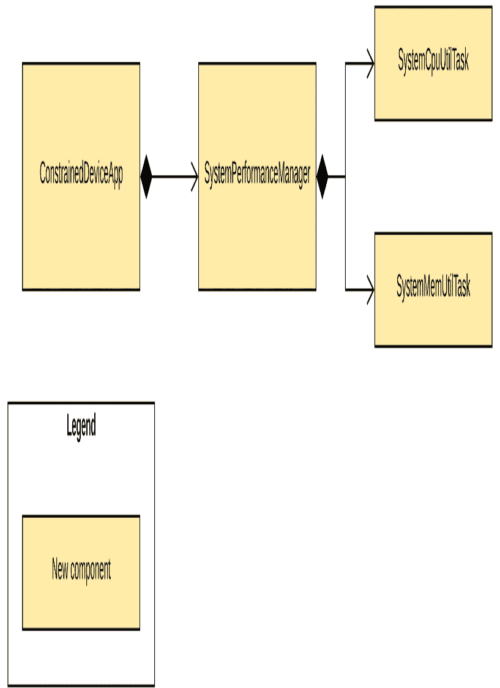
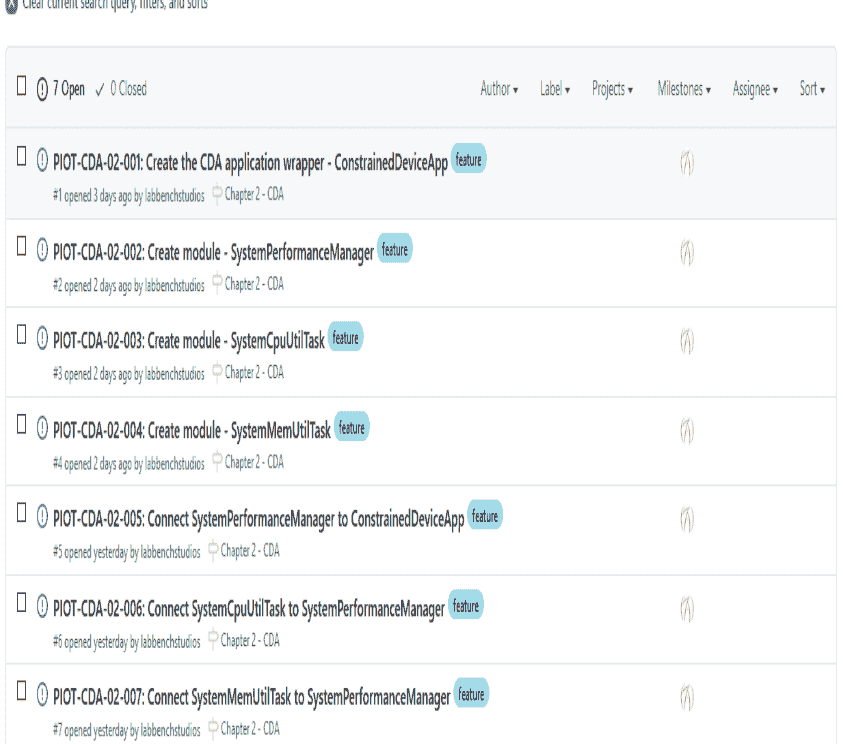
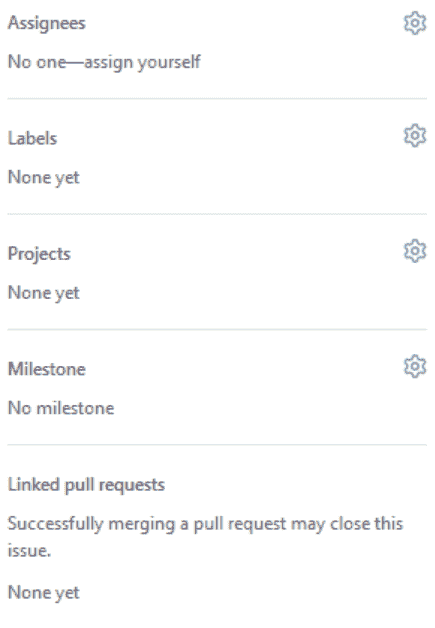

## 第 2 章. 构建两个简单的 IoT 监控应用程序

## 致早期发布读者的说明

使用 Early Release 电子书，您可以在这些标题正式发布之前很久就利用这些技术——作者在撰写过程中提供的原始未编辑内容。

这将是最终书籍的第 2 章。请注意，GitHub 仓库将在稍后激活。

如果您对如何改进本书的内容和/或示例有任何意见，或者如果您注意到本章中缺少材料，请联系作者 aking.em@gmail.com。

*我必须要有数据！*

*还剩下多少内存？*

*我不敢看。叹气。*

**基本概念：** 构建两个 IoT 性能监控应用程序——一个作为 IoT 网关，另一个作为 IoT 受限设备。

本章重点介绍让您的 IoT 解决方案运行起来的初始步骤。您将在后续章节中在此基础上进行构建，因此现在设置基本设计非常重要。第 1 章中介绍的整体架构将为您提供开始编码 IoT 解决方案所需的初始指导，我们将在本章及以后继续在此基础上构建。我相信您迫不及待地想要根据所学内容构建自己的解决方案，但重要的是要一步一步来。

我们将从两个简单的应用程序开始，它们收集有关设备（真实或虚拟）的一些简单遥测数据：将在您的“网关设备”上运行的网关设备应用程序（GDA），以及将在您的“受限设备”上运行的受限设备应用程序（CDA）。每个应用程序的设计为边缘层的所有代码提供了基础，因此您可能希望将第 1 章的设计保留在手边以供参考。

## 本章您将学到什么

这是您与 IoT 编程之旅的开始。您将学习如何为 GDA 和 CDA 定义详细设计，分离设计的逻辑组件，并使用 Java（GDA）和 Python（CDA）实现这两个应用程序的框架。

这些将是非常简单的应用程序，但它们将作为您整体解决方案的重要基础层。每个应用程序都将实现一个应用程序框架，并通过整合用于跟踪计算系统性能的外部库来使用该框架。您将使用它们生成的数据进行使用 CDA 和 GDA 创建遥测的初步尝试。

## 设计您的 IoT 应用程序

还记得第 1 章中的问题陈述吗？让我们现在简要回顾一下：

> *我想了解我家中的环境以及它如何随时间变化，并做出调整以提高舒适度同时节省开支。*

如果您思考应用程序为解决此问题需要做的一切，并考虑到测试系统行为和性能的重要性，有一些重要功能您希望从一开始就“内置”。一个是能够轻松添加新功能，另一个是跟踪每个应用程序的性能以便我们知道它是否工作良好。

设计 GDA 和 CDA 的第一步是创建一个应用程序包装器，该包装器可以确定需要加载哪些功能，然后一致地启动这些功能。我将在第 3 章中介绍使用配置文件进行应用程序配置，因此现在无需担心。

您的初始 GDA 和 CDA 设计将非常相似。它们将收集一些基本遥测数据，目前仅包括 CPU 利用率和内存利用率，并简单地将数据记录到控制台。不久之后，您将让两个应用程序相互通信。

让我们开始吧，好吗？

## 说明

本书中大部分设计图都将遵循统一建模语言（UML）表示法。我会在过程中进行解释，但您需要熟悉 UML 的类图和关系构造。查看 https://www.uml.org/resource-hub.htm 上的链接以获取教程和其他有用的 UML 资源。

## CDA

您的 CDA 需要四个组件：一个应用程序包装器、一个管理执行的管理器，以及两个用于读取我们作为遥测的一部分想要收集的基本系统性能数据的组件：CPU 利用率和内存利用率。

让我们使用图 2-1 来表示此设计：



图 2-1. - CDA 系统性能设计图

图 2-1 中的类图显示了四个主要组件及其相互关系：
ConstrainedDeviceApp，您会记得从第 1 章中它是您已下载的代码库的一部分，是应用程序包装器。

ConstrainedDeviceApp 是应用程序的入口点并创建 SystemPerformanceManager 的实例并管理它。还有另外两个组件 - SystemCpuUtilTask 和 SystemMemUtilTask。正如它们的名字所暗示的那样，这些是组件，它们将收集——您猜对了——系统 CPU 利用率和系统内存利用率。这些组件将由 SystemPerformanceManager 管理并作为异步线程运行，更新您将在 SystemPerformanceManager 中定义的方法。

> **说明**
> 
> 如果您已熟悉 Python 开发并且能够根据上面的 UML 设计舒适地实现解决方案，请随意浏览下一节作为参考并编写代码。我建议您还是阅读 CDA 测试细节，因为它将提供有关代码库中单元测试框架的一些见解。

## CDA 实现细节

在开始编写代码之前，您需要执行一些管理步骤来设置 CDA 代码仓库和问题跟踪器。这将让您轻松地在项目的看板中跟踪您的工作。让我们现在做这项管理工作。

## 说明

您可能会发现本节有点啰嗦。别担心！一旦您度过了接下来一些繁琐的工作，后面的代码示例将更容易消化并更快地推进。有两个原因：

+   1. 设置工作将在本节之后完成；您将知道如何添加任务、编写有意义的描述并将它们映射到您的看板。
+   2. 我将加快进度，只解释一些专门或独特于 IoT 环境的代码。我的期望是您会快速上手，不需要逐行描述您需要编写的一切。

正如我在第 1 章中提到的，您编写的任务称为“问题”。图 2-2 是我 GitHub 页面上的屏幕截图，显示了本章需要为 CDA 实现的所有任务。



图 2-2. - CDA 系统性能设计任务

如果您使用 GitHub，请现在使用网络浏览器导航到您的 CDA 的 Git 仓库页面。您会看到有一个“问题”选项卡——点击它，这将带您到一个类似图 2-2 的页面，但没有任何问题。

让我们先更改一个标签。点击“标签”，并查找“增强”。您可以保持原样或将其重命名为“功能”，我建议这样做。

返回问题页面，现在点击“里程碑”。让我们为每个章节添加一个里程碑，如图 2-3 所示。

## 标签

## 里程碑

新建里程碑

8 个打开  0 个已关闭

排序

## 第 2 章

无截止日期  最后更新 1 分钟前

0% 完成  7 个打开  0 个已关闭

编辑  关闭  删除

## 第 3 章

无截止日期  最后更新 1 分钟前

0% 完成  0 个打开  0 个已关闭

编辑  关闭  删除

## 第 4 章

无截止日期  最后更新 1 分钟前

0% 完成  0 个打开  0 个已关闭

编辑  关闭  删除

## 第 5 章

无截止日期  最后更新 1 分钟前

0% 完成  0 个打开  0 个已关闭

编辑  关闭  删除

## 第 6 章

无截止日期  最后更新不到一分钟前

0% 完成  0 个打开  0 个已关闭

编辑  关闭  删除

## 第 7 章

无截止日期  最后更新不到一分钟前

0% 完成  0 个打开  0 个已关闭

编辑  关闭  删除

## 第 8 章

无截止日期  最后更新不到一分钟前

0% 完成  0 个打开  0 个已关闭

编辑  关闭  删除

## 第 9 章

无截止日期  最后更新不到一分钟前

0% 完成  0 个打开  0 个已关闭

编辑  关闭  删除

图 2-3. - 所有 CDA 活动的里程碑列表


看到绿色的按钮了吗？只需点击它即可添加你的里程碑。我建议使用图 2-3 中提供的名称，这样可以在项目的看板中按章节跟踪你对所有工作的进展。你将在我们添加每个任务时看到这一点。

## 创建 CDA 应用模块

让我们创建一个包含 ConstrainedDeviceApp 要求的 Issue。返回到你的主 CDA 仓库页面并点击“Issues”。右上角仍然有一个绿色的按钮，但它叫做“New issue”。现在点击它。

> NOTE
> 问题跟踪工具通常会为你编号问题，通常按创建顺序排列。然而，为了便于搜索和排序，最好在问题标题中嵌入自己的命名约定。以下是我的建议并我自己使用的方法：PIOT-{app}-{chapter}-{order}，例如，PIOT-CDA-02-001。快速查看名称就知道该问题属于 Programming the Internet of Things (PIOT)、CDA、第 02 章、任务 #001。

将问题命名为 PIOT-CDA-02-001: Create the CDA application wrapper module，并将以下内容添加到描述中（如果愿意可以自定义，但保持模板不变）：

### Description

- Create the ConstrainedDeviceApp application in Python.

### Actions

- Create a new Python package in the programmingtheiot\cda source folder named app and navigate to that folder.
- Import the Python logging module: import logging
- Create a new Python module named ConstrainedDeviceApp. Define a class within the module by the same name of ConstrainedDeviceApp.
- Add the startApp() method, log info message indicating app was started.
- Add the stopApp() method, log info message indicating app was stopped.
- Add the main entry function to enable running as an application. It will create an instance of ConstrainedDeviceApp, call startApp(), wait 60 seconds, then call stopApp(), as follows:

```
def main():
    cda = ConstrainedDeviceApp()
    cda.startApp()

    while True:
        sleep(60)
    cda.stopApp()
if __name__ == '__main__':
    main()
```

### Estimate (Small = < 2 hrs ; Medium = 4 hrs ; Large = 8 hrs )

- Small

### Tests

- Run the ConstrainedDeviceAppTest unit tests. The log output should look similar to the following (you can ignore the non-INFO messages - these are generated by the PyUnit framework within Eclipse):

```
Finding files... done.
Importing test modules ... done.
2020-07-20 10:08:20,169:INFO:Initializing CDA...
2020-07-20 10:08:20,169:INFO:Loading configuration...
2020-07-20 10:08:20,169:INFO:Starting CDA...
2020-07-20 10:08:20,169:INFO:CDA started.
2020-07-20 10:08:20,169:INFO:CDA stopping...
2020-07-20 10:08:20,170:INFO:CDA stopped with exit code 0.
------------------------------------------------------------
--------------------
Ran 1 test in 0.001s
OK
```

注意模板包含 Description、Actions、Estimate 和 Tests 部分。这应始终应用于你的所有任务——这样，当你审阅需要完成的工作和已完成的工作时，你就有了一致的需求和测试标准。

#### NOTE

在开始实现时，你可以添加单独的注释来记录你的工作。添加诸如算法特殊性、测试设置要求、静态设计图像等具体细节通常很有用。

保存该问题，然后导航到最右边的列。它看起来应与图 2-4 相似。这里你可以分配问题（给自己），将标签设置为“Feature”，添加里程碑，并将问题与项目对齐（你在上一章创建的项目——这将确保它显示在你的看板项目板上。



*Figure 2-4. - You can set properties for each issue using the selections shown*

好的——CDA 应用包装器的当前所有需求都已明确，是时候开始编写代码了！

- 1. 打开你的 IDE 并导航到 piot-python-components。
- 2. 导航到“src -> main -> python -> programmingtheiot -> cda”并创建一个名为“app”的新文件夹。
- 3. 添加任务中指示的剩余代码，包括日志记录。

#### NOTE

由于主函数中有 sleep 调用，你需要使用以下代码导入 time 模块：

```
from time import sleep
```

按照 Test 说明执行 ConstrainedDeviceAppTest 单元测试（只有一个）。检查你的 IDE 控制台中的输出——它看起来应与我上面包含的内容相似。

你的 ConstrainedDeviceApp 开始成形了，但你仍然需要一种收集数据并生成第一个遥测数据的方法。我们接下来会处理这个问题。

## 创建 SYSTEMPERFORMANCEMANAGER 模块

要创建的下一个问题是关于 SystemPerformanceManager。让我们将其命名为 PIOT-CDA-02-002 - Create module SystemPerformanceManager。以下是描述内容：

### Description

- Create a new Python module named SystemPerformanceManager with class name SystemPerformanceManager.

### Actions

- Create a class within the module named SystemPerformanceManager.
- Add the startManager() method, log an info message indicating manager was started.
- Add the stopManager() method, log an info message indicating manager was stopped.

### Estimate (Small = < 2 hrs ; Medium = 4 hrs ; Large = 8 hrs )

- Small

### Tests

- Run the SystemPerformanceManagerTest unit test. The log output should look similar to the following:

```
2020-07-06 21:03:03,654:INFO:Initializing
SystemPerformanceManager...
2020-07-06 21:03:03,655:INFO:Started
SystemPerformanceManager.
2020-07-06 21:03:03,656:INFO:Stopped
SystemPerformanceManager.
```

该组件实际上将位于与应用程序不同的文件夹中，因此让我们现在创建它。在你的 IDE 中，导航到“src -> main -> python -> programmingtheiot -> cda”，并创建一个名为“system”的新文件夹。

SystemPerformanceManager 的要求相当直接，看看你是否能自己实现这些。你也可以在需要提示时查看我位于 python-solutions GitHub 页面的解决方案 (https://github.com/programmingtheiot/python-solutions)！

## 将 SYSTEMPERFORMANCEMANAGER 连接到 CONSTRAINEDDEVICEAPP

这个任务非常直接，应该只需要几分钟。你只需将 SystemPerformanceManager 的 start 和 stop 方法连接到 ConstrainedDeviceApp 的 start 和 stop 方法中，然后运行快速测试以确保一切正常。

你可以将此任务命名为 PIOT-CDA-02-003 - Connect SystemPerformanceManager to ConstrainedDeviceApp。以下是任务描述：

### Description

- Create an instance of SystemPerformanceManager within ConstrainedDeviceApp and invoke the manager’s start / stop methods within the app’s start / stop methods.

### Actions

- Create a class-scoped instance of SystemPerformanceManager within the ConstrainedDeviceApp constructor called sysPerfManager using the following:
  self.sysPerfManager = SystemPerformanceManager()
- Edit the startApp() method to include a call to self.sysPerfManager.startManager().
- Edit the stopApp() method to include a call to self.sysPerfManager.stopManager().

### Estimate (Small = < 2 hrs ; Medium = 4 hrs ; Large = 8 hrs )

- Small

### Tests

- Run the ConstrainedDeviceAppTest again. It will still call the startApp() and stopApp() methods on ConstrainedDeviceApp, but this time generate output that will look similar to the following:

```
Finding files... done.
Importing test modules ... done.
2020-07-20 10:23:00,146:INFO:Initializing CDA...
2020-07-20 10:23:00,147:INFO:Loading configuration...
2020-07-20 10:23:00,260:INFO:Starting CDA...
2020-07-20 10:23:00,260:INFO:Started SystemPerformanceManager.
2020-07-20 10:23:00,260:INFO:CDA started.
2020-07-20 10:23:00,260:INFO:CDA stopping...
2020-07-20 10:23:00,260:INFO:Stopped SystemPerformanceManager.
2020-07-20 10:23:00,260:INFO:CDA stopped with exit code 0.
------------------------------------------------------------
----------------
Ran 1 test in 0.115s
OK
```

很简单，对吧？好的——快完成了。让我们创建接下来将实际执行系统监控的不同模块，并将它们连接到 SystemPerformanceManager。你能看出我的思路了吗？

## 创建 SYSTEMCPUUTIL 任务模块

这是我们系统性能应用程序真正开始起作用的地方。SystemCpuUtilTask 将检索


current CPU utilization across all cores, average them together, and return the result as a float.

让我们将其命名为 *PIOT-CDA-02-003 - Create module SystemCpuUtilTask*。以下是描述内容：

### Description
- 创建一个名为 SystemCpuUtilTask 的新 Python 模块，类名为 SystemCpuUtilTask。

### Actions
- 导入 psutil 库。
- 在模块内创建一个名为 SystemCpuUtilTask 的类。
- 在构造函数中，添加以下内容：
  - self.perfMgr = psutil()
- 添加 getTelemetry() 方法，并添加以下内容：
  - cpuUtilPct = self.perfMgr.cpu_percent()
- 在 getTelemetry() 中，记录一条信息日志，指示已收集数据以及 cpuUtilPct 的值。

### Estimate (Small = < 2 hrs ; Medium = 4 hrs ; Large = 8 hrs )
- Small

### Tests
- 以 PyUnit 测试的形式运行 SystemCpuUtilTaskTest。所有测试都应通过。

#### NOTE
你可能记得 psutil 是你在设置 virtualenv 环境时导入的库之一，并使用 pip 安装了 basic_imports.txt。此库使你能够监控系统指标，例如 CPU 利用率和内存利用率。你可以在网上阅读其所有功能（https://psutil.readthedocs.io/en/latest/#）。

仔细查看指定以下代码行的操作：

```
cpuUtilPct = self.perfMgr.cpu_percent()
```

该库会将所有核心聚合为单个 CPU 百分比，这对你作为开发人员来说相当容易。这个类本质上归结为返回这一行代码的值。

好吧，在我们继续之前，为什么要在代码周围加上花哨的包装？这不是过度设计吗？简单来说，是的。但你会看到一种模式出现，你将以类似的方式编写代码来表示其他更复杂的传感器。本练习的重点当然是获取 CPU 利用率，但也是为了建立控制分离或关键功能分离的模式，以便它们可以与应用程序其余逻辑分开进行管理和更新。

#### NOTE
与任何软件设计一样，复杂性、巧妙编码和简单完成之间存在平衡。我将在整本书中尝试保持这种平衡。你可能有不同的想法——太好了！我鼓励你考虑如何以其他方式实现每个练习以满足你的特定需求。这正是编程富有创造性和乐趣的一部分。

## CREATE THE SYSTEMMEMUTIL TASK MODULE
假设你的 SystemCpuUtilTask 测试运行并且全部通过，你可以继续下一个模块，即创建 SystemMemUtilTask。这将检索当前虚拟内存利用率并以浮点数形式返回结果。

让我们将其命名为 *PIOT-CDA-02-004 - Create module SystemMemUtilTask*。以下是描述内容：

### Description
- 创建一个名为 SystemMemUtilTask 的新 Python 模块，类名为 SystemMemUtilTask。

### Actions
- 导入 psutil 库。
- 在模块内创建一个名为 SystemMemUtilTask 的类。
- 在构造函数中，添加以下内容：
  - self.perfMgr = psutil()
- 添加 getTelemetry() 方法，并添加以下内容：
  - memUtilPct = self.perfMgr.virtual_memory().percent
- 在 getTelemetry() 中，记录一条信息日志，指示已收集数据以及 memUtilPct 的值。

### Estimate (Small = < 2 hrs ; Medium = 4 hrs ; Large = 8 hrs )
- Small

### Tests
- 以 PyUnit 测试的形式运行 SystemMemUtilTask。所有测试都应通过。

关键功能封装在以下代码行中：

```
memUtilPct = self.perfMgr.virtual_memory().percent
```

你可以从对 virtual_memory() 的调用中提取其他属性，并且欢迎你进行实验。现在，只需返回百分比利用率即可。

在继续之前，请确保你的 SystemMemUtilTaskTest PyUnit 测试全部通过。现在，让我们将 SystemCpuUtilTask 和 SystemMemUtilTask 连接到 SystemPerformanceManager。

你可以对 SystemMemUtilTask 重复相同的步骤，当然使用正确的名称！我建议现在就这样做，然后运行 SystemMemUtilTaskTest 单元测试以确保它返回有效数据。

#### How to Poll for Sensor Updates
从传感器（模拟或真实）读取单个值是好的，但对我们的目的来说并不太有用，因为我们希望随着时间的推移监控这些值以查看它们是否发生变化。即使在将 SystemCpuUtilTask 和 SystemMemUtilTask 连接到 SystemPerformanceManager 之后，你也希望定期处理它们的数据。

在 Python 中有许多方法可以做到这一点：你可以使用 Python 的并发库构建自己的调度机制，或利用众多开源库之一为你完成此操作。我在 basic_imports.txt 中包含了 apscheduler¹，它提供了一种调度机制，非常适合我们的目的。

#### NOTE
Python 提供了两种使代码看起来与其它代码同时执行的方式。一种是使用并发，另一种是使用多进程。前者使用线程处理，而后者使用单独的子进程处理。一个关键区别是 Python 线程实际上使用与主应用程序相同的处理器核心按顺序运行，但它们以一种看起来同时运行的方式发生。多处理允许真正的并行，其中使用多处理器库编写的代码可以分发到单独的处理器核心上运行，可以与不同处理器核心上的其他代码并行执行。书中 CDA 特定的练习和示例将假设 Python 中的线程并发足以满足我们的需求，因此我不会讨论任何 CDA 开发中的多处理。

## INTEGRATING SYSTEMCPUUTIL TASK AND SYSTEMMEMUTIL TASK WITH SYSTEMPERFORMANCEMANAGER
在本节中，你将创建两个非常相似的任务：*PIOT-CDA-02-006 - Connect SystemCpuUtilTask to SystemPerformanceManager*，和 *PIOT-CDA-02-007 - Connect SystemMemUtilTask to SystemPerformanceManager。*

以下是 *PIOT-CDA-02-006 - Connect SystemCpuUtilTask and SystemMemUtilTask to SystemPerformanceManager* 的描述内容：

### Description
- 在 SystemPerformanceManager 中创建 SystemCpuUtilTask 和 SystemMemUtilTask 的实例，并使用 apscheduler 库以定期间隔运行每个任务。

### Actions
- 添加以下导入语句：
  - from apscheduler.schedulers.background import BackgroundScheduler
- 更新 SystemPerformanceManager 构造函数以接受名为 pollRate 的参数，并将其默认值设为 30：
  - def __init__(self, pollRate = 30):
- 在 SystemPerformanceManager 构造函数内创建 SystemCpuUtilTask 的类作用域实例，命名为 cpuUtilTask
- 在 SystemPerformanceManager 构造函数内创建 SystemMemUtilTask 的类作用域实例，命名为 memUtilTask
- 创建一个名为 handleTelemetry() 的公共方法，并添加以下代码行：
  ```
  cpuUtilPct = self.cpuUtilTask.getTelemetry()
  memUtilPct = self.memUtilTask.getTelemetry()
  ```
- 在 handleTelemetry() 中添加一条信息日志消息，记录 cpuUtilPct 和 memUtilPct 的值
- 在 SystemPerformanceManager 构造函数内创建 BackgroundScheduler 的类作用域实例，命名为 scheduler
- 使用以下代码行在 SystemPerformanceManager 中向调度器添加一个作业：
  ```
  self.scheduler.add_job('self.handleTelemetry', 'interval', seconds = pollRate)
  ```

### Estimate (Small = < 2 hrs ; Medium = 4 hrs ; Large = 8 hrs )
- Small

### Tests
- 向 SystemPerformanceManagerTest 添加一个单元测试，该测试将使用 pollRate = 10 创建 SystemPerformanceManager 实例，调用 startManager() 方法，等待 65 秒，然后调用 stopManager()。
- 测试应显示应用程序和 SystemPerformanceManager 启动日志消息，随后是表示六个（大部分）不同值的 CPU 利用率和内存利用率交错消息，最后是 SystemPerformanceManager 和应用程序停止日志消息。


#### NOTE

注意 apscheduler 的使用——它相对比较直接。这在一定程度上是因为在 Python 中，你能够传递函数指针（是的，我们称它们为方法）。这使得你在 SystemPerformanceManager 中已创建的回调 handleTelemetry() 可以被 apscheduler 轻松调用，并且使用并发。

你现在可以执行 ConstrainedDeviceApp 的完整功能单元测试 test 了。立即运行它，并查看日志输出。它应该看起来与以下类似（再次说明，你的日志消息可能与我的不同）：

```
2020-07-06 21:03:03,654:INFO:Attempting to load configuration...
2020-07-06 21:03:03,655:INFO:Starting CDA...
2020-07-06 21:03:03,655:INFO:Initialized SystemPerformanceManager.
2020-07-06 21:03:03,656:INFO:Starting SystemPerformanceManager...
2020-07-06 21:03:03,656:INFO:CDA ran successfully.
```

恭喜！你刚刚完成了 CDA 的第一次迭代。它是一个完全独立的 Python 应用，并且有一套完整的单元测试供你在接下来的章节中在此基础上构建。现在让我们转向 GDA 并开始编写一些 Java 代码。

## The GDA

你的 GDA 需要与你的 CDA 相同的三个组件：一个应用包装器、一个系统性能管理器，以及用于读取系统性能数据的组件，这些数据将构成你的 GDA 的遥测数据。

#### NOTE

在 IoT 系统中，网关设备可能生成也可能不生成自己的遥测数据。本书中你将构建的示例仅生成其自身的系统性能遥测数据。约束设备，即 CDA，将负责不仅生成其特定的系统性能遥测数据，还负责任何传感器特定的遥测数据。

让我们使用图 2-5 中的类图来表示 GDA 的设计。你会注意到它看起来与我们的 CDA 设计（图 2-1）惊人地相似，主要区别在于实现语言、应用包装器名称，以及——当然——任务的数量！

## Legend

New component

New optional component

ITaskDataListener

SystemPerformanceManager

GatewayDeviceApp

SystemCpuUtilTask

SystemMemUtilTask

SystemDiskUtilTask

SystemNetInputTask

SystemNetOutputTask

Figure 2-5. - GDA system performance design diagram

为什么网关设备要做所有这些工作？跟踪 CPU 和内存利用率是有意义的，因为你希望跟踪设备的整体负载和内存消耗。

但磁盘和网络利用率呢？在第 5 章中，我将讨论消息的本地缓存，因此这将是一个重要的跟踪指标。在第 6 章及以后，我将深入探讨设备之间传递消息（最终在第 10 章传递到云端），因此跟踪网络利用率也将非常有用。

难道没有工具可以做这些吗？当然有，而且在有意义时你应该使用它们。物联网边缘层的一部分设备并不总是容易管理，也并不总是能够参与网络监控环境。这并不意味着我们需要从头开始构建一切！但，我们还是会这么做。因为我们可以。而且很有趣 :).

回到图表。注意 GatewayDeviceApp 是应用程序的入口点，并创建实例并管理 SystemPerformanceManager，这与 CDA 设计相当相似。我们还拥有 SystemCpuUtilTask 和 SystemMemUtilTask，以及其他任务（SystemDiskUtilTask、SystemNetInputTask 和 SystemNetOutputTask），这些任务将在以后帮助我们。

#### NOTE

不言而喻，但如果你已经熟悉 Java 开发，并且能够根据图 2-5 中的 UML 设计舒适地实现你的解决方案，请随意这样做。但请务必先仔细查看下一节中的要求。

## GDA IMPLEMENTATION DETAILS

你会认识到接下来的这些步骤，当然，因为你已经为 CDA 做过类似的事情。由于 GDA 仓库与 CDA 仓库不同，你需要单独设置你的问题跟踪器。

图 2-6 为你提供了本章需要为 GDA 实现的需求的概览，我将逐一讲解。

图 2-7 列出了你应该创建的里程碑，但请注意它们与 CDA 里程碑有点不同。名称相同（出于设计考虑），但没有第 3 章和第 4 章的里程碑，而却有一个第 10 章的里程碑（CDA 里程碑在第 9 章结束）。

现在是创建这些里程碑的好时机，同时编辑“Enhancement”标签并将其重命名为“Feature”。

Filters isopen isissue sortcreated-asc Labels 9 Milestones 7 New issue

Clear current search query, filters, and sorts

8 Open 0 Closed Author Label Projects Milestones Assignee Sort

PIOT-GDA-02-001: Create the GDA application wrapper - GatewayDeviceApp feature #1 opened yesterday by labbenchstudios Chapter 2

PIOT-GDA-02-002: Create module - SystemPerformanceManager feature #2 opened yesterday by labbenchstudios Chapter 2

PIOT-GDA-02-003: Create module - SystemCpuUtilTask feature #3 opened yesterday by labbenchstudios Chapter 2

PIOT-GDA-02-004: Create module - SystemMemUtilTask feature #4 opened yesterday by labbenchstudios Chapter 2

PIOT-GDA-02-005: Connect SystemPerformanceManager to GatewayDeviceApp feature #5 opened yesterday by labbenchstudios Chapter 2

PIOT-GDA-02-007: Connect SystemCpuUtilTask to SystemPerformanceManager feature #6 opened 23 hours ago by labbenchstudios Chapter 2

PIOT-GDA-02-008: Connect SystemMemUtilTask to SystemPerformanceManager feature #7 opened 23 hours ago by labbenchstudios Chapter 2

PIOT-GDA-02-006: Create callback for tasks to invoke SystemPerformanceManager feature #8 opened 3 minutes ago by labbenchstudios Chapter 2

Figure 2-6. - GDA system performance design tasks

### Labels

## Milestones

New milestone

7 Open 0 Closed

Sort

## Chapter 10

No due date Last updated about 3 hours ago

0% complete 0 open 0 closed

Edit Close Delete

## Chapter 2

No due date Last updated about 3 hours ago

0% complete 7 open 0 closed

Edit Close Delete

## Chapter 5

No due date Last updated about 3 hours ago

0% complete 0 open 0 closed

Edit Close Delete

## Chapter 6

No due date Last updated about 3 hours ago

0% complete 0 open 0 closed

Edit Close Delete

## Chapter 7

No due date Last updated about 3 hours ago

0% complete 0 open 0 closed

Edit Close Delete

## Chapter 8

No due date Last updated about 3 hours ago

0% complete 0 open 0 closed

Edit Close Delete

## Chapter 9

No due date Last updated about 3 hours ago

0% complete 0 open 0 closed

Edit Close Delete

Figure 2-7. - Milestone listing for all GDA activities

准备好创建你的第一个 GDA 问题了吗？流程与你为第一个 CDA 问题遵循的流程相同。导航回你的主 GDA 仓库页面，点击“Issues”，然后点击绿色的“New issue”按钮。这是在任一仓库中为每个新问题遵循的流程。

让我们从 GDA 的应用包装器开始。

## CREATE THE GDA APPLICATION MODULE

与 CDA 类似，GDA 应用模块问题将被命名为 *PIOT-GDA-02-001: Create the GDA application wrapper module*。以下是详细信息：

### Description

- Create a new Java class named GatewayDeviceApp.

### Actions

- Create a new Java package in the programmingtheiot\gda source folder named app and navigate to that folder.
- Import the java.util.logging logging framework. You can import all, or just Level and Logger.
- Create a package-scoped constructor that accepts a single parameter as follows: private GatewayDeviceApp(String[] args)
- Add the public stopApp(int code) method, and log an info message indicating the app was stopped. Include a try / catch block to handle the stop code. On exception, log an error message along with the stack trace. Outside of the try / catch block, and as the last line of code, log an informational message with the code included.


- 添加公共的 startApp() 方法，并记录一条信息日志表示应用已启动。包含 try / catch 块以处理启动代码。出现异常时，记录错误消息以及堆栈跟踪，然后调用 stopApp(-1)。
- 添加私有的 initConfig(String fileName) 方法，并记录一条信息日志表示该方法已被调用。目前它将大部分保持为空。
- 添加私有的 parseArgs(String[] args) 方法，并记录一条信息日志表示该方法已被调用。目前可以忽略 args。在方法退出前，调用 initConfig(null)。
- 更新构造函数以包含对 parseArgs(args) 的调用。
- 添加公共的静态 void main(String[] args) 方法以支持作为应用程序运行。它将创建 GatewayDeviceApp 的一个实例，调用 startApp()，等待 60 秒，然后调用 stopApp(0)，如下所示：

```
public static void main(String[] args)
{
    GatewayDeviceApp gwApp = new
GatewayDeviceApp(args);

    gwApp.startApp();

    try {
        Thread.sleep(60000L);
    } catch (InterruptedException e) {
        // ignore
    }

    gwApp.stopApp(0);
}
```

### Estimate (Small = < 2 hrs ; Medium = 4 hrs ; Large = 8 hrs )

- Small

### Tests

- 运行名为 testRunGatewayApp() 的 GatewayDeviceAppTest 单元测试。日志输出应类似于以下内容：

```
Jul 19, 2020 12:53:45 PM
programmingtheiot.gda.app.GatewayDeviceApp <init>
INFO: Initializing GDA...
Jul 19, 2020 12:53:45 PM
programmingtheiot.gda.app.GatewayDeviceApp
parseArgs
INFO: No command line args to parse.
Jul 19, 2020 12:53:45 PM
programmingtheiot.gda.app.GatewayDeviceApp
initConfig
INFO: Attempting to load configuration: Default.
Jul 19, 2020 12:53:45 PM
programmingtheiot.gda.app.GatewayDeviceApp
startApp
INFO: Starting GDA...
Jul 19, 2020 12:53:45 PM
programmingtheiot.gda.app.GatewayDeviceApp
startApp
INFO: GDA started successfully.
Jul 19, 2020 12:53:45 PM
programmingtheiot.gda.app.GatewayDeviceApp
stopApp
INFO: Stopping GDA...
Jul 19, 2020 12:53:45 PM
programmingtheiot.gda.app.GatewayDeviceApp
```

```
stopApp
INFO: GDA stopped successfully with exit code 0.
```

如果您已下载示例代码，您会注意到此模块已为您创建好。模块内包含一些带注释的 ‘TODO’ 代码行作为占位符，供您日后添加更多功能。

如果您是从零开始，则只需按照上述说明实现您自己的应用程序包装器版本。

无论哪种方式，都按指定运行单元测试 - testRunGatewayApp() - 使用 JUnit 4 Runner。如果您使用 Eclipse 作为 IDE，只需右键单击 GatewayDeviceAppTest，然后选择“Run As -> JUnit Test”。您应该会看到绿色条以及“Tests”部分下所示的示例输出。

您的 GatewayDeviceApp 有一些不错的功能，但作为物联网网关应用程序来说并不太有用。让我们开始着手构建其他组件以使该应用焕发生机。

## CREATE THE SYSTEMPERFORMANCEMANAGER MODULE

下一个要创建的问题是 SystemPerformanceManager。让我们将其命名为 PIOT-GDA-02-002 - Create module SystemPerformanceManager。以下是说明内容：

### Description

- 创建 SystemPerformanceManager 模块。

### Actions

- 在 programmingtheiot\gda 源文件夹中创建一个名为 system 的新 Java 包并导航到该文件夹。
- 导入 java.util.logging 日志框架。您可以导入全部，或仅导入 Level 和 Logger。
- 创建一个私有变量如下：private int pollSecs = 60;
- 创建一个接受单个参数的公共构造函数如下：public SystemPerformanceManager(int pollSecs)
- 仅在验证 pollSecs 大于 1 且小于 Integer.MAX 后才将 this.pollSecs 设置为 pollSecs。您也可以选择其他约束。
- 添加 startManager() 方法，并记录一条信息日志表示管理器已启动。
- 添加 stopManager() 方法，并记录一条信息日志表示管理器已停止。

### Estimate (Small = < 2 hrs ; Medium = 4 hrs ; Large = 8 hrs )

- Small

### Tests

- 运行名为 testRunManager() 的 SystemPerformanceManagerTest 单元测试。日志输出应类似于以下内容：
```
Jul 19, 2020 1:01:38 PM
programmingtheiot.gda.system.SystemPerformanceManager
    startManager
INFO: SystemPerformanceManager is starting...
Jul 19, 2020 1:01:38 PM
programmingtheiot.gda.system.SystemPerformanceManager
```

```
stopManager
INFO: SystemPerformanceManager is stopped.
```

目前针对 SystemPerformanceManager 的活动单元测试相当简单且并非真正自动化，其唯一验证是通过日志文件审查。随着您将所有组件连接起来，您会看到其他类的单元测试如何可以自动验证，然后用于自动化系统的整个测试流程。

## CONNECT SYSTEMPERFORMANCEMANAGER TO GATEWAYDEVICEAPP

这是一个简单的任务，旨在将 SystemPerformanceManager 连接到 GatewayDeviceApp，其唯一目标是确保应用能够正确地将工作委托给 SystemPerformanceManager 组件。

您可以将此任务命名为 PIOT-GDA-02-003: Connect SystemPerformanceManager to GatewayDeviceApp。以下是任务详情：

### Description

- 将 SystemPerformanceManager 连接到 GatewayDeviceApp，以便它可以随应用程序一起启动和停止。此工作应在 GatewayDeviceApp 类中实现。

### Actions

- 创建一个类作用域变量名为 sysPerfManager。
- 在 GatewayDeviceApp 构造函数中创建 SystemPerformanceManager 的一个实例称为 this.sysPerfManager。使用 ‘10’ 作为构造函数的参数。
- 编辑 startApp() 方法：添加对 sysPerfManager.startManager() 的调用。
- 编辑 stopApp() 方法：添加对 sysPerfManager.stopManager() 的调用。

### Estimate (Small = < 2 hrs ; Medium = 4 hrs ; Large = 8 hrs )

- Small

### Tests

- 运行名为 testRunGatewayApp() 的 GatewayDeviceAppTest 单元测试。日志输出应类似于以下内容：

```
Jul 19, 2020 1:01:38 PM
programmingtheiot.gda.app.GatewayDeviceApp <init>
INFO: Initializing GDA...
Jul 19, 2020 1:01:38 PM
programmingtheiot.gda.app.GatewayDeviceApp
parseArgs
INFO: No command line args to parse.
Jul 19, 2020 1:01:38 PM
programmingtheiot.gda.app.GatewayDeviceApp
initConfig
INFO: Attempting to load configuration: Default.
Jul 19, 2020 1:01:38 PM
programmingtheiot.gda.app.GatewayDeviceApp
startApp
INFO: Starting GDA...
Jul 19, 2020 1:01:38 PM
```

```
programmingtheiot.gda.system.SystemPerformanceManager
  startManager
INFO: SystemPerformanceManager is starting...
Jul 19, 2020 1:01:38 PM
programmingtheiot.gda.app.GatewayDeviceApp
startApp
INFO: GDA started successfully.
Jul 19, 2020 1:01:38 PM
programmingtheiot.gda.app.GatewayDeviceApp
stopApp
INFO: Stopping GDA...
Jul 19, 2020 1:01:38 PM
programmingtheiot.gda.system.SystemPerformanceManager
  stopManager
INFO: SystemPerformanceManager is stopped.
Jul 19, 2020 1:01:38 PM
programmingtheiot.gda.app.GatewayDeviceApp
stopApp
INFO: GDA stopped successfully with exit code 0.
```

简单，对吧？请注意测试要求——它不是针对 SystemPerformanceManager 的；您只是重新运行名为 testRunGatewayApp() 的 GatewayDeviceAppTest 单元测试。此测试和 SystemPerformanceManager 测试均未更改——两者之间的连接现在已启用，因此输出略有不同。

在两个组件集成后，让我们构建实际的系统性能遥测收集逻辑。

## CREATE THE SYSTEMCPUUTIL TASK MODULE

这是我们系统性能应用程序真正开始发挥作用的地方。SystemCpuUtilTask 将检索所有核心的当前 CPU 利用率，对其进行平均，并将结果作为 float 返回。

让我们将其命名为 PIOT-CDA-02-004 - Create module SystemCpuUtilTask。以下是说明内容：

### Description

- 创建 SystemCpuUtilTask 模块并实现检索 CPU 利用率的功能。

### Actions

- 在 programmingtheiot.gda.system 包内，创建一个名为 SystemCpuUtilTask 的新 Java 类。
- 添加以下导入语句：
- import java.lang.management.ManagementFactory;
- 添加公共的 getTelemetry() 方法。它将检索 CPU 利用率（在任何/所有核心上平均）并将值作为 float 返回。使用以下代码作为值：ManagementFactory.getOperatingSystemMXBean().getSystemLoadAverage()

### Estimate (Small = < 2 hrs ; Medium = 4 hrs ; Large = 8 hrs )

- Small

### Tests

- 运行 SystemCpuUtilTaskTest 单元测试（只有一个）。如果您的操作系统支持检索 CPU 负载，每个测试都应通过，同时显示大于 0.0% 且（可能）小于 100.0% 的值。如果您的


Operating System doesn’t support this, each test will result in negative value, as follows:

```
Test 1: CPU Util not supported on this OS: -1.0
Test 2: CPU Util not supported on this OS: -1.0
Test 3: CPU Util not supported on this OS: -1.0
Test 4: CPU Util not supported on this OS: -1.0
Test 5: CPU Util not supported on this OS: -1.0
```

#### NOTE

你可能还记得 psutil 是你在设置 virtualenv 环境时导入的库之一，并且使用 pip 安装了 basic_imports.txt。这个库使你能够监控系统指标，例如 CPU 利用率和内存利用率。你可以在网上阅读其所有功能（https://psutil.readthedocs.io/en/latest/#）。

仔细查看指定以下代码行的操作：

```
puUtilPct = self.perfMgr.cpu_percent()
```

该库会将所有核心聚合为单一的 CPU 百分比，这对你作为开发者来说非常方便。这个类本质上就是返回这一行代码的值的简化。

好吧，在我们继续之前，为什么要在代码周围加上花哨的包装？这不是过度设计吗？简单来说，是的。但你会看到一种模式在形成，你将用类似的代码来表示其他更复杂的传感器。

每个练习的一个目标是建立 *控制分离* 的模式，或将关键功能分离，以便它们可以与应用程序其余逻辑分开管理和更新。

> **NOTE**
> 
> 就像任何软件设计一样，复杂性、巧妙编码和直接完成工作之间存在平衡。我将在整本书中尝试把握这种平衡。你可能有不同的想法——太好了！我鼓励你考虑如何以其他方式实现每个练习以满足你的特定需求。这正是编程富有创造性和乐趣所在。

## CREATE THE SYSTEMMEMUTILTASK MODULE

我相信你已经注意到了这里的模式。我们正在 CDA 中复制的一些功能也在 GDA 中复制。这是由分布式物联网设备以及各种操作系统或运行时环境的性质决定的，正如我在前言中提到的。

下一个任务是创建内存利用率收集逻辑。让我们将其命名为 *PIOT-GDA-02-005 - Create module SystemMemUtilTask*，并使用以下内容作为描述：

### Description

- 创建 SystemMemUtilTask 模块并实现检索 JVM 内存利用率的功能。

### Actions

- 在 programmingtheiot.gda.system 包中，创建一个名为 SystemMemUtilTask 的新 Java 类。
- 添加以下 import 语句：
- import java.lang.management.MemoryUsage;
- 添加 getTelemetry() 方法。它将检索 JVM 内存利用率并以 float 形式返回该值。使用以下代码作为值：ManagementFactory.getMemoryMXBean().getHeapMemoryUsage().getUsed()

### Estimate (Small = < 2 hrs ; Medium = 4 hrs ; Large = 8 hrs )

- Small

### Tests

- 运行 SystemMemUtilTaskTest 单元测试。它应该通过并记录 0.0% 到 100.0% 之间的值。

关键功能封装在以下代码行中：

```
memUtilPct = self.perfMgr.virtual_memory().percent
```

你可以从对 virtual_memory() 的调用中提取其他属性，并且欢迎你进行实验。现在，只需返回百分比利用率即可。

确保你的 SystemMemUtilTaskTest JUnit 测试全部通过后再继续。现在，让我们将 SystemCpuUtilTask 和 SystemMemUtilTask 都连接到 SystemPerformanceManager。

## RUNNING REPEATABLE TASKS IN JAVA

虽然你的 GDA 并没有收集传感器数据，但它显然需要收集和评估其自身的系统性能（例如 CPU 和内存利用率，当然）。这种类型的功能通常在后台以固定间隔收集，就像 Python 一样，Java 提供了创建轮询系统的选项。

幸运的是，没有必要导入任何单独的库，因为这是内置于核心 Java SDK 中的。

#### NOTE

Java 的并发库非常强大，允许你使用基本的 Timer 功能以及 ScheduledExecutorService（如果你真的想，当然也可以创建自己的线程轮询系统）。我们将使用 ScheduledExecutorService，因为它提供了一种半保证的方式以固定间隔轮询，为我们处理了大部分复杂性。现代 Java 虚拟机会在 CPU 架构上处理负载分配，意味着如果可能的话它将利用多个核心。

## INTEGRATING SYSTEMCPUUTIL TASK AND SYSTEMMEMUTIL TASK WITH SYSTEMPERFORMANCEMANAGER

在本节中，你将创建两个非常相似的任务：*PIOT-GDA-02-006 - Connect SystemCpuUtilTask and SystemMemUtilTask to SystemPerformanceManager。*

这个练习涉及的内容稍微多一些，即使完成它不需要太多代码行。这是因为你将同时使用并发和 *Runnable* 实现，

后者只是一个接口定义，用于可以由 Java 线程一次或多次调用的方法。

让我们使用以下描述来记录这项工作：

### Description

- 将 SystemCpuUtilTask 和 SystemMemUtilTask 连接到 SystemPerformanceManager，并在管理器启动时启动的线程中调用每个实例的 handleTelemetry() 方法，并在管理器停止时停止。此工作应在 SystemPerformanceManager 类中实现。

### Actions

- 添加以下 import 语句：

```
import java.util.concurrent.Executors;
import java.util.concurrent.ScheduledExecutorService;
import java.util.concurrent.ScheduledFuture;
import java.util.concurrent.TimeUnit;
```

- 向类添加以下成员：

```
private ScheduledExecutorService schedExecSvc = null;
private SystemCpuUtilTask sysCpuUtilTask = null;
private SystemMemUtilTask sysMemUtilTask = null;
private Runnable taskRunner = null;
private boolean isStarted = false;
```

- 创建一个名为 handleTelemetry() 的公共方法，包含以下内容：
  - cpuUtilPct = this.cpuUtilTask.getTelemetry()
  - memUtilPct = this.memUtilTask.getTelemetry()
  - 记录一条包含 cpuUtilPct 和 memUtilPct 值的 info 消息

- 在构造函数中，添加以下内容：

```
this.schedExecSvc =
Executors.newScheduledThreadPool(1);
this.sysCpuUtilTask = new SystemCpuUtilTask();
this.sysMemUtilTask = new SystemMemUtilTask();
this.taskRunner = () -> {
    this.handleTelemetry();
};
```

- 在 startManager() 方法中，添加以下内容：

```
if (! this.isStarted) {
    ScheduledFuture<?> futureTask =
    this.schedExecSvc.scheduleAtFixedRate(this.taskRunner,
    0L, this.pollSecs, TimeUnit.SECONDS);
    this.isStarted = true;
}
```

- 在 stopManager() 方法中，添加以下内容：
  - this.schedExecSvc.shutdown();

### Estimate (Small = < 2 hrs ; Medium = 4 hrs ; Large = 8 hrs )

- Medium

### Tests

- 在 GatewayDeviceAppTest 测试用例中，注释掉 testRunGatewayApp() 单元测试前的 @Test 注解，并取消注释 testRunTimedGatewayApp 单元测试前的 @Test 注解。运行后者测试——它应产生与以下类似的输出：

```
Jul 19, 2020 1:53:19 PM
programmingtheiot.gda.app.GatewayDeviceApp <init>
INFO: Initializing GDA...
Jul 19, 2020 1:53:19 PM
programmingtheiot.gda.app.GatewayDeviceApp
parseArgs
INFO: No command line args to parse.
Jul 19, 2020 1:53:19 PM
programmingtheiot.gda.app.GatewayDeviceApp
initConfig
INFO: Attempting to load configuration: Default.
Jul 19, 2020 1:53:19 PM
programmingtheiot.gda.app.GatewayDeviceApp
startApp
INFO: Starting GDA...
Jul 19, 2020 1:53:19 PM
programmingtheiot.gda.system.SystemPerformanceManager
  startManager
INFO: SystemPerformanceManager is starting...
Jul 19, 2020 1:53:19 PM
programmingtheiot.gda.app.GatewayDeviceApp
startApp
INFO: GDA started successfully.
Jul 19, 2020 1:53:20 PM
programmingtheiot.gda.system.SystemPerformanceManager
  handleTelemetry
INFO: Handle telemetry results: cpuUtil=-1.0,
memUtil=6291456.0
Jul 19, 2020 1:53:50 PM
programmingtheiot.gda.system.SystemPerformanceManager
  handleTelemetry
INFO: Handle telemetry results: cpuUtil=-1.0,
memUtil=6291456.0
Jul 19, 2020 1:54:20 PM
programmingtheiot.gda.system.SystemPerformanceManager
  handleTelemetry
INFO: Handle telemetry results: cpuUtil=-1.0,
memUtil=6291456.0
```


```
INFO: Handle telemetry results: cpuUtil=-1.0,
memUtil=6291456.0
Jul 19, 2020 1:54:24 PM
programmingtheiot.gda.app.GatewayDeviceApp
stopApp
INFO: Stopping GDA...
Jul 19, 2020 1:54:24 PM
programmingtheiot.gda.system.SystemPerformanceManager
stopManager
INFO: SystemPerformanceManager is stopped.
Jul 19, 2020 1:54:24 PM
programmingtheiot.gda.app.GatewayDeviceApp
stopApp
INFO: GDA stopped successfully with exit code 0.
```

要测试所有这些新功能，你只需要运行名为 testRunTimedGatewayApp() 的 GatewayDeviceAppTest 单元测试。按照上面“Test”部分列出的说明进行操作。

#### NOTE

JUnit 单元测试可以通过在单元测试方法前使用 @Test 注解来包含或排除在一次测试运行中。你可以根据需要简单地将其注释掉/取消注释。还请注意，单元测试并非设计为按特定顺序运行——你应该预期任何随机顺序，并将你的测试编写为独立的。

示例输出已在上方提供——请注意它相当详尽！这是因为你不仅在做很多很酷的事情，而且还让应用运行了超过一分钟。

如果你的测试运行产生类似的输出，太棒了！现在你可以真正庆祝了。你刚刚完成了 IoT Edge Tier 两个应用的第一次迭代——GDA 和 CDA。本书的其余部分将介绍如何为这些应用添加功能，将它们连接起来，并最终将一切连接到云服务。系好安全带！

## Additional Exercises

图 2-5 表明 GDA 实际上拥有不止两个遥测收集任务。这些是可选的，但仍然很重要。尝试使用 SystemCpuUtilTask 和 SystemMemUtilTask 的模式添加 SystemDiskUtilTask、SystemNetInTask 和 SystemNetOutTask 组件。

事实上，为 CDA 也实现这些组件并不是一个坏主意，尽管相关性较低，因为你的 CDA 不会收集和存储太多数据。

不要忘记为每个组件添加你的单元测试用例！
