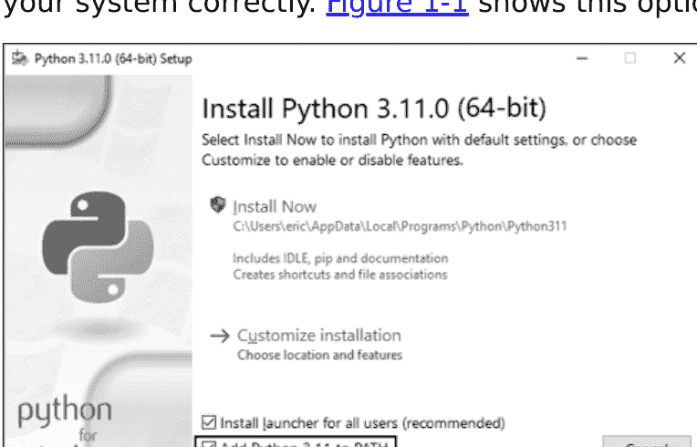

# 1
# 开始入门


在本章中，你将运行第一个 Python 程序 *hello_world.py*。首先，你需要检查电脑上是否安装了较新版本的 Python；如果没有，你需要安装它。你还需要安装一个文本编辑器来处理你的 Python 程序。文本编辑器能够识别 Python 代码，并在你编写时高亮显示各部分，让你更容易理解代码的结构。

## 设置编程环境

Python 在不同操作系统上略有差异，因此你需要牢记一些注意事项。在下面的内容中，我们会在某些情况下更高效地演示特定概念。当你在代码列表中看到三个尖括号时，你看到的是终端会话中的代码和输出。稍后我们将在你的系统上尝试在解释器中编写代码。

我们还会使用一个文本编辑器来创建一个简单的程序，名为 *Hello World!*，这已成为学习编程的经典入门程序。编程界有一个由来已久的传统：在新语言中，将 `Hello world!` 消息打印到屏幕上作为你的第一个程序，会给你带来好运。这样一个简单的程序有非常实际的意义。如果它能在你的系统上正确运行，那么你编写的任何 Python 程序也应该能正常运行。

## 关于 VS Code 编辑器

VS Code 是一款功能强大、专业品质的文本编辑器，免费且对初学者友好。VS Code 既适合简单项目，也适合复杂项目，因此如果你在学习 Python 的过程中熟悉了它，那么当你进阶到更大、更复杂的项目时，可以继续使用它。VS Code 可以安装在所有现代操作系统上，并且支持大多数编程语言，包括 Python。

附录 B 提供了其他文本编辑器的信息。如果你对其他选项感兴趣，此时可以浏览一下该附录。如果你想快速开始编程，可以直接使用 VS Code。等你积累了一些编程经验后，再考虑其他编辑器。在本章中，我将带你逐步在你的操作系统上安装 VS Code。

> **注意**
> 
> *如果你已经安装了文本编辑器，并且知道如何配置它来运行 Python 程序，你也可以使用该编辑器。*

# 不同操作系统上的 Python

Python 是一种跨平台编程语言，这意味着它可以在所有主流操作系统上运行。你编写的任何 Python 程序都应该能在安装了 Python 的任何现代计算机上运行。不过，在不同操作系统上设置 Python 的方法略有不同。

在本节中，你将学习如何在你的系统上设置 Python。首先你会检查系统上是否安装了较新版本的 Python，如果没有就安装它。然后你会安装 VS Code。这两个步骤是各操作系统之间仅有的不同之处。

在接下来的小节中，你将运行 *hello_world.py* 并解决任何不工作的问题。我会为每个操作系统逐一演示这个过程，这样你就会拥有一个可靠的 Python 编程环境。

## *Windows 上的 Python*

Windows 通常不预装 Python，因此你可能需要安装它，然后再安装 VS Code。

## 安装 Python

首先，检查你的系统上是否安装了 Python。在“开始”菜单中输入**command**（命令），然后点击**命令提示符**应用，打开一个命令窗口。在终端窗口中，输入小写的**python**。如果出现 Python 提示符（>>>），说明你的系统上已安装 Python。如果你看到一条错误消息，提示 python 不是可识别的命令，或者 Microsoft Store 被打开，则说明 Python 未安装。如果 Microsoft Store 打开了，请关闭它；最好下载官方安装程序，而不是使用 Microsoft 的版本。

如果你的系统上未安装 Python，或者你看到的版本早于 Python 3.9，你需要下载适用于 Windows 的 Python 安装程序。前往 [https://python.org](https://python.org)，将鼠标悬停在 **Downloads**（下载）链接上。你应该会看到一个用于下载最新版 Python 的按钮。点击该按钮，它应该会自动开始下载适用于你系统的正确安装程序。下载完成后，运行安装程序。确保你选中了 **Add Python to PATH**（将 Python 添加到 PATH）选项，这将使你的系统配置更加容易。[图 1-1](#) 显示了选中此选项的情况。



[图 1-1](#)：*请务必选中标有“Add Python to PATH”的复选框。*

## 在终端会话中运行 Python

打开一个新的命令窗口，输入小写的**python**。你应该会看到 Python 提示符（>>>），这意味着 Windows 已找到你刚刚安装的 Python 版本。

```
C:\> python
Python 3.x.x (main, Jun . . . , 13:29:14) [MSC v.1932 64 bit (AMD64)] on win32
Type "help", "copyright", "credits" or "license" for more information.
>>>
```

# 注意

> *如果你没有看到此输出或类似内容，请参阅附录 A 中更详细的设置说明。*

在 Python 会话中输入以下行：

```
>>> print("Hello Python interpreter!")
Hello Python interpreter!
>>>
```

你应该会看到输出 `Hello Python interpreter!` 每当你想运行一段 Python 代码时，打开一个命令窗口并启动一个 Python 终端会话。要关闭终端会话，请按 CTRL-Z，然后按 ENTER，或者输入命令 `exit()`。

## 安装 VS Code

你可以从 https://code.visualstudio.com 下载 VS Code 的安装程序。点击 **Download for Windows**（为 Windows 下载）按钮并运行安装程序。跳过下面关于 macOS 和 Linux 的小节，直接按照第 9 页“运行一个 Hello World 程序”中的步骤操作即可。

# macOS 上的 Python

最新版本的 macOS 默认不安装 Python，因此如果你还没有安装，则需要安装它。在本节中，你将安装最新版本的 Python，然后安装 VS Code 并确保其配置正确。

> 注意
> 旧版 macOS 中包含了 Python 2，但这是一个过时的版本，你不应该使用它。

## 检查是否安装了 Python 3

通过“应用程序”▶“实用工具”▶“终端”打开一个终端窗口。你也可以按 ⌘-空格键，输入 terminal，然后按 ENTER。要查看是否安装了足够新版本的 Python，请输入 python3。你很可能会看到一条关于安装命令行开发者工具的消息。最好在安装 Python 之后再安装这些工具，因此如果出现此消息，请取消弹出窗口。

如果输出显示你已安装 Python 3.9 或更高版本，你可以跳过下一节，直接进入“在终端会话中运行 Python”。如果你看到的版本早于 Python 3.9，请按照下一节的说明安装最新版本。

请注意，在 macOS 上，每当你在本书中看到 python 命令时，都需要改用 python3 命令，以确保你使用的是 Python 3。在大多数 macOS 系统上，python 命令要么指向一个仅供内部系统工具使用的过时 Python 版本，要么不指向任何内容并产生错误消息。

## 安装最新版本的 Python

你可以在 [https://python.org](https://python.org) 找到适用于你系统的 Python 安装程序。将鼠标悬停在 **Download**（下载）链接上，你应该会看到一个用于下载最新版 Python 的按钮。点击该按钮，它应该会自动开始下载适用于你系统的正确安装程序。文件下载完成后，运行安装程序。

安装程序运行后，应该会出现一个 Finder 窗口。双击 *Install Certificates.command* 文件。运行此文件将让你更容易安装真实项目所需的附加库，包括本书后半部分中的项目。

## 在终端会话中运行 Python

你现在可以通过打开一个新的终端窗口并输入 **python3** 来尝试运行 Python 代码片段：

```
```text
$ python3
Python 3.x.x (v3.11.0:eb0004c271, Jun . . . , 10:03:01)
[Clang 13.0.0 (clang-1300.0.29.30)] on darwin
Type "help", "copyright", "credits" or "license" for more information.
>>>
```
```

该命令会启动一个 Python 终端会话。你应该会看到 Python 提示符（>>>），这意味着 macOS 已找到你刚刚安装的 Python 版本。

在终端会话中输入以下行：

```
```python
>>> print("Hello Python interpreter!")
Hello Python interpreter!
>>>
```
```

你应该会看到消息 `Hello Python interpreter!`，它应该会直接打印在当前终端窗口中。


你可以通过按下 CTRL-D 或输入命令 `exit()` 来关闭 Python 解释器。

> **注意**
> 
> *在较新的 macOS 系统上，你会看到百分号 (%) 作为终端提示符，而不是美元符号 ($)。*

## 安装 VS Code

要安装 VS Code 编辑器，你需要从 [https://code.visualstudio.com](https://code.visualstudio.com) 下载安装程序。点击 **Download** 按钮，然后打开一个 **Finder** 窗口并前往 **Downloads** 文件夹。将 **Visual Studio Code** 安装程序拖到你的应用程序文件夹，然后双击安装程序运行它。

跳过下面关于 Linux 上 Python 的部分，并按照第 9 页“运行 Hello World 程序”中的步骤操作。

## Linux 上的 Python

Linux 系统专为编程而设计，因此大多数 Linux 电脑上已预装了 Python。编写和维护 Linux 的人员希望你在某个时候进行自己的编程，并鼓励你这样做。因此，几乎没有什么需要安装，也只有少数设置需要更改即可开始编程。

## 检查你的 Python 版本

通过在系统上运行终端应用程序打开一个终端窗口（在 Ubuntu 中，你可以按 CTRL-ALT-T）。要了解安装了哪个版本的 Python，请输入小写的 *p* 的 `python3`。当 Python 已安装时，此命令会启动 Python 解释器。你应该会看到指示已安装 Python 版本的输出。你还应该看到一个 Python 提示符 (>>>)，在那里你可以开始输入 Python 命令：

```text
$ python3
Python 3.10.4 (main, Apr   , 09:04:19) [GCC 11.2.0] on linux
Type "help", "copyright", "credits" or "license" for more information.
>>>
```

此输出表明 Python 3.10.4 目前是此计算机上安装的 Python 默认版本。当你看到此输出后，按 CTRL-D 或输入 `exit()` 以离开 Python 提示符并返回终端提示符。每当你在本书中看到 python 命令时，请改用 **python3**。

你需要 Python 3.9 或更高版本才能运行本书中的代码。如果你的系统上安装的 Python 版本早于 Python 3.9，或者你想更新到当前可用的最新版本，请参阅附录 A 中的说明。

## 在终端会话中运行 Python

你可以通过打开终端并输入 **python3** 来尝试运行 Python 代码片段，就像你在检查版本时所做的那样。再次执行此操作，并在 Python 运行后，在终端会话中输入以下行：

```python
>>> print("Hello Python interpreter!")
Hello Python interpreter!
>>>
```

消息应直接打印在当前终端窗口中。记住，你可以通过按下 CTRL-D 或输入命令 **exit()** 来关闭 Python 解释器。

## 安装 VS Code

在 Ubuntu Linux 上，你可以从 Ubuntu 软件中心安装 VS Code。点击菜单中的 Ubuntu 软件图标并搜索 *vscode*。点击名为 **Visual Studio Code** 的应用（有时称为 *code*），然后点击 **Install**。安装完成后，在你的系统上搜索 *VS Code* 并启动该应用。

## 运行 Hello World 程序

在安装了最新版本的 Python 和 VS Code 后，你几乎就可以在文本编辑器中运行第一个 Python 程序了。但在这样做之前，你需要为 VS Code 安装 Python 扩展。

### *为 VS Code 安装 Python 扩展*

VS Code 支持多种不同的编程语言；为了充分发挥其作为 Python 程序员的潜力，你需要安装 Python 扩展。此扩展增加了编写、编辑和运行 Python 程序的支持。

要安装 Python 扩展，请点击管理图标，它看起来像 VS Code 应用左下角的齿轮。在出现的菜单中，点击 **Extensions**。在搜索框中输入 **python** 并点击 **Python** 扩展。（如果看到多个名为 *Python* 的扩展，请选择由 Microsoft 提供的那个。）点击 **Install** 并安装系统完成安装所需的任何其他工具。如果看到需要安装 Python 的消息，而你已经安装了，可以忽略此消息。

> **注意**
> 
> *如果你使用的是 macOS 且弹出窗口要求你安装命令行开发工具，请点击 **Install**。你可能会看到一条消息说安装时间过长，但在一台合理的互联网连接上，它应该只需要 10 或 20 分钟。*

## 运行 hello_world.py

在编写第一个程序之前，在你的桌面上创建一个名为 *python_work* 的文件夹用于你的项目。最好在文件和文件夹名称中使用小写字母和下划线代替空格，因为 Python 使用这些命名约定。你可以在桌面以外的其他位置创建此文件夹，但如果你将 *python_work* 文件夹直接保存在桌面上，后续步骤会更容易跟随。

打开 VS Code，如果 **Get Started** 选项卡仍打开则关闭它。通过点击 **File▸New File** 或按 CTRL-N（macOS 上为 ⌘-N）新建一个文件。将文件保存为 *hello_world.py*，保存在你的 *python_work* 文件夹中。扩展名 *.py* 告诉 VS Code 你的文件是用 Python 编写的，并告诉它如何运行程序以及以有帮助的方式高亮文本。

保存文件后，在编辑器中输入以下行：

```python
print("Hello Python world!")
```

要运行你的程序，请选择 **Run▸Run Without Debugging** 或按 CTRL-F5。VS Code 窗口底部应出现一个终端屏幕，显示你的程序输出：

```
Hello Python world!
```

你可能会看到一些额外的输出，显示用于运行程序的 Python 解释器。如果你想简化显示的信息，只显示你的程序输出，请参阅附录 B。你也可以在附录 B 中找到有关如何更高效地使用 VS Code 的有用建议。

如果看不到此输出，程序中可能出了问题。检查你输入的行上的每个字符。你是否不小心将 `print` 大写了？你是否忘记了一个或两个引号或括号？编程语言期望非常具体的语法，如果你没有提供，就会得到错误。如果无法运行程序，请参阅下一节中的建议。

## 故障排除

如果无法运行 *hello_world.py*，以下是你可以尝试的几种补救措施，它们也是任何编程问题的良好通用解决方案：

当程序包含重大错误时，Python 会显示 *traceback*，即错误报告。Python 会浏览文件并尝试识别问题。检查 traceback；它可能会给你一个线索，说明是什么问题阻止了程序运行。

离开你的电脑，休息一下，然后再试一次。记住语法在编程中非常重要，因此像不匹配的引号或不匹配的括号这样简单的事情也会阻止程序正常运行。重新阅读本章的相关部分，查看你的代码，并尝试找到错误。

理清问题。一旦 *hello_world.py* 运行起来，你就可以开始学习 Python，你的编程工作将变得更有趣、更令人满意。

## 从终端运行 Python 程序

你将直接在文本编辑器中运行大部分程序。然而，有时直接从终端运行程序也很有用。例如，你可能想在不打开进行编辑的情况下运行现有程序。

只要你知道如何访问程序文件所在的目录，就可以在任何安装了 Python 的系统上执行此操作。要尝试此操作，请确保你已将 *hello_world.py* 文件保存在桌面上的 *python_work* 文件夹中。

### *在 Windows 上*

你可以使用终端命令 `cd`，即 *change directory*，在命令窗口中浏览文件系统。命令 `dir`，即 *directory*，会显示当前目录中存在的所有文件。

打开一个新终端窗口并输入以下命令以运行 *hello_world.py*：

```
C:\> cd Desktop\python_work
C:\Desktop\python_work> dir
hello_world.py
C:\Desktop\python_work> python hello_world.py
Hello Python world!
```

首先，使用 `cd` 命令导航到 *python_work* 文件夹，该文件夹位于 *Desktop* 文件夹中。接下来，使用 `dir`


command to make sure *hello_world.py* is in this folder. Then run the file using the command **python hello_world.py**.

Most of your programs will run fine directly from your editor. However, as your work becomes more complex, you’ll want to run some of your programs from a terminal.

### *On macOS and Linux*

Running a Python program from a terminal session is the same on Linux and macOS. You can use the terminal command **cd**, for *change directory*, to navigate through your filesystem in a terminal session. The command **ls**, for *list*, shows you all the nonhidden files that exist in the current directory.

Open a new terminal window and enter the following commands to run *hello_world.py*:

```
~$ cd Desktop/python_work/
~/Desktop/python_work$ ls
hello_world.py
~/Desktop/python_work$ python3 hello_world.py
Hello Python world!
```

First, use the **cd** command to navigate to the *python_work* folder, which is in the *Desktop* folder. Next, use the **ls** command to make sure *hello_world.py* is in this folder. Then run the file using the command **python3 hello_world.py**.

Most of your programs will run fine directly from your editor. But as your work becomes more complex, you’ll want to run some of your programs from a terminal.
