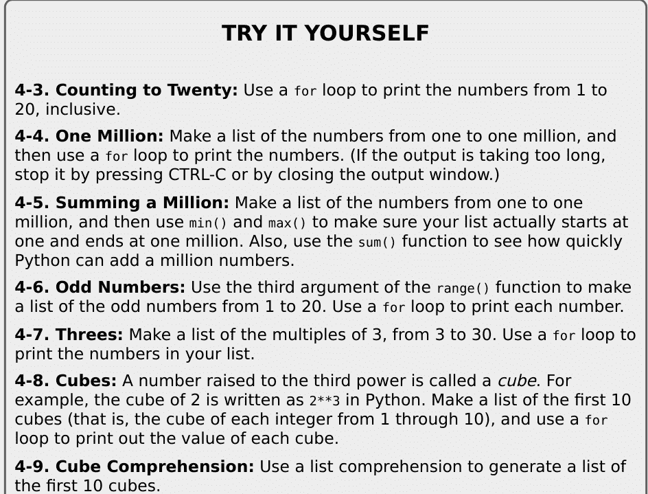

## 3
## 列表简介


在本章和下一章中，你将学习什么是列表，以及如何开始处理列表中的元素。列表允许你将信息集存储在一个地方，无论是只有几个项目还是数百万个项目。列表是 Python 最强大的功能之一，新手程序员很容易上手，而且它将编程中的许多重要概念联系在一起。

### 什么是列表？

*列表*是按特定顺序排列的项的集合。你可以创建一个包含字母表中字母、0 到 9 的数字或你所有家人姓名的列表。你可以将任何想要的东西放入列表，列表中的项不必以任何特定方式相关。因为列表通常包含多个元素，所以最好将列表名称设为复数形式，例如 `letters, digits, or names.`

在 Python 中，方括号（`[]`）表示列表，列表中的各个元素用逗号分隔。下面是一个包含几种自行车的简单列表示例：

*bicycles.py*

```
bicycles = ['trek', 'cannondale', 'redline', 'specialized']
print(bicycles)
```

如果你让 Python 打印一个列表，Python 会返回该列表的表示形式，包括方括号：

```
['trek', 'cannondale', 'redline', 'specialized']
```

因为这并不是你希望用户看到的输出，让我们学习如何访问列表中的各个项。

## 访问列表中的元素

列表是有序集合，因此你可以通过告诉 Python 所需项的位置（或*索引*）来访问列表中的任何元素。要访问列表中的元素，只需编写列表名称，后跟用方括号括起来的该项的索引。

例如，让我们取出列表 bicycles 中的第一辆自行车：

```
bicycles = ['trek', 'cannondale', 'redline', 'specialized']
print(bicycles[0])
```

当我们从列表中请求单个项时，Python 只返回该元素，不带方括号：

trek

你还可以对列表中的任何元素使用第 2 章中的字符串方法。例如，你可以使用 `title()` 方法将元素 `'trek'` 格式化得更美观：

```
bicycles = ['trek', 'cannondale', 'redline', 'specialized']
print(bicycles[0].title())
```

这个示例产生与前面示例相同的输出，只是 `'Trek'` 的首字母大写。

## 索引从 0 开始，而不是 1

Python 认为列表中的第一项位于位置 0，而不是位置 1。大多数编程语言都是如此，原因与列表操作在较低层级的实现方式有关。如果你得到了意想不到的结果，请问问自己是否犯了一个简单但常见的差一错误。

列表中的第二项的索引为 1。使用这种计数方式，你可以通过将列表中的位置减 1 来获得列表中的任何元素。例如，要访问列表中的第四项，你需要请求索引 3 处的项。

下面的代码请求索引 1 和索引 3 处的自行车：

```
bicycles = ['trek', 'cannondale', 'redline', 'specialized']
print(bicycles[1])
print(bicycles[3])
```

这段代码返回列表中的第二辆和第四辆自行车：

cannondale  
specialized

Python 有一种特殊的语法用于访问列表中的最后一个元素。如果你请求索引 -1 处的项，Python 总是返回列表中的最后一项：

```python
bicycles = ['trek', 'cannondale', 'redline', 'specialized']
print(bicycles[-1])
```

这段代码返回 `'specialized'` 值。这种语法非常有用，因为你经常需要访问列表中的最后几项，而又不知道列表的确切长度。这种约定也适用于其他负索引值。索引 -2 返回列表倒数第二项，索引 -3 返回倒数第三项，依此类推。

## 使用列表中的单个值

你可以像使用任何其他变量一样使用列表中的单个值。例如，你可以使用 f-字符串根据列表中的值创建消息。

让我们尝试从列表中取出第一辆自行车，并使用该值编写一条消息：

```python
bicycles = ['trek', 'cannondale', 'redline', 'specialized']
message = f"My first bicycle was a {bicycles[0].title()}."

print(message)
```

我们使用 `bicycles[0]` 处的值构建一个句子，并将其赋给变量 `message`。输出是关于列表中第一辆自行车的简单句子：

```text
My first bicycle was a Trek.
```

## 动手试一试

尝试这些简短的程序，以获得对 Python 列表的第一手经验。你可能希望为每章的练习创建一个新文件夹，以保持整洁。

- 3-1. **名字：** 将你几个朋友的名字存储在一个名为 `names` 的列表中。通过依次访问列表中的每个元素，打印每个人的名字。
- 3-2. **问候：** 从你在练习 3-1 中使用的列表开始，但不仅仅是打印每个人的名字，还要给他们打印一条消息。每条消息的文本应该相同，但每条消息都应包含该人的名字以进行个性化。
- 3-3. **你自己的列表：** 想想你最喜欢的交通方式，比如摩托车或汽车，并制作一个存储了几个示例的列表。使用你的列表打印一系列关于这些项的陈述，例如“我想拥有一辆本田摩托车。”

## 修改、添加和删除元素

你创建的大多数列表都将是*动态的*，这意味着你将在程序运行过程中构建一个列表，然后从中添加和删除元素。例如，你可能创建了一个玩家必须射击天空中的外星人的游戏。你可以将初始的外星人集合存储在列表中，然后每次击落一个外星人时从列表中删除它。每次屏幕上出现新的外星人，就将其添加到列表中。在游戏过程中，外星人列表的长度会增加和减少。

## 修改列表中的元素

修改元素的语法类似于访问列表中元素的语法。要更改一个元素，请使用列表的名称，后跟该元素的索引

和前面示例中相同的列表，我们将新元素 `'ducati'` 添加到列表的末尾：

```python
motorcycles = ['honda', 'yamaha', 'suzuki']
print(motorcycles)

motorcycles.append('ducati')
print(motorcycles)
```

在这里，`append()` 方法将 `'ducati'` 添加到列表末尾，而不影响列表中任何其他元素：

```text
['honda', 'yamaha', 'suzuki']
['honda', 'yamaha', 'suzuki', 'ducati']
```

`append()` 方法使动态构建列表变得容易。例如，你可以从一个空列表开始，然后使用一系列 `append()` 调用向列表添加项。让我们使用一个空列表，将元素 `'honda'`、`'yamaha'` 和 `'suzuki'` 添加到列表中：

```python
motorcycles = []

motorcycles.append('honda')
motorcycles.append('yamaha')
motorcycles.append('suzuki')

print(motorcycles)
```

生成的列表与前面示例中的列表完全相同：

```text
['honda', 'yamaha', 'suzuki']
```

以这种方式构建列表非常常见，因为你在程序运行后才会知道用户想要在程序中存储哪些数据。为了让用户拥有控制权，先定义一个空列表，该列表将用于存储


users' values. Then append each new value provided to the list you just created.

## 向列表中插入元素

你可以使用 `insert()` 方法在列表的任意位置添加一个新元素。你只需指定新元素的索引和新项的值即可：

```python
motorcycles = ['honda', 'yamaha', 'suzuki']

motorcycles.insert(0, 'ducati')
print(motorcycles)
```

在此示例中，我们在列表开头插入值 `'ducati'`。`insert()` 方法在位置 0 打开一个空间并将值 `'ducati'` 存储在该位置：

```text
['ducati', 'honda', 'yamaha', 'suzuki']
```

此操作会将列表中其他每个值向右移动一个位置。

## 从列表中删除元素

通常，你会想要从列表中删除一个或一组项目。例如，当玩家从天空中击落外星人时，你很可能想要将其从活动外星人列表中删除。或者当用户决定在你创建的 Web 应用程序上取消其账户时，你会想要将该用户从活动用户列表中删除。你可以根据列表中的位置或根据其值删除项目。

### 使用 del 语句删除项目

如果你知道要从列表中删除的项目的位置，可以使用 `del` 语句：

```python
motorcycles = ['honda', 'yamaha', 'suzuki']
print(motorcycles)

del motorcycles[0]
print(motorcycles)
```

这里我们使用 del 语句从摩托车列表中删除第一个项目 'honda'：

```text
['honda', 'yamaha', 'suzuki']
['yamaha', 'suzuki']
```

如果你知道其索引，可以使用 del 语句从列表中的任何位置删除项目。例如，以下是如何从列表中删除第二个项目 'yamaha'：

```python
motorcycles = ['honda', 'yamaha', 'suzuki']
print(motorcycles)

del motorcycles[1]
print(motorcycles)
```

第二个摩托车已从列表中删除：

```text
['honda', 'yamaha', 'suzuki']
['honda', 'suzuki']
```

在这两个示例中，在使用 del 语句后，你将无法再访问从列表中删除的值。

### 使用 pop() 方法删除项目

有时你会在从列表中删除项目后仍想使用该项目的值。例如，你可能想要获取刚刚被击落的外星人的 x 和 y 位置，以便在该位置绘制爆炸。在 Web 应用程序中，你可能想要从活跃成员列表中删除一个用户，然后将该用户添加到非活跃成员列表中。

`pop()` 方法会删除列表中的最后一个项目，但它允许你在删除后继续使用该项目。术语 *pop* 来自于将列表视为一堆项目的想法，并从堆栈顶部弹出一个项目。在这种类比中，堆栈的顶部对应于列表的末尾。

让我们从摩托车列表中弹出一个摩托车：

```python
motorcycles = ['honda', 'yamaha', 'suzuki']
print(motorcycles)

popped_motorcycle = motorcycles.pop()
print(motorcycles)
print(popped_motorcycle)
```

我们首先定义并打印列表 `motorcycles` ❶。然后我们从列表中弹出一个值，并将该值分配给变量 `popped_motorcycle` ❷。我们打印列表 ❸ 以显示列表中已删除一个值。然后我们打印弹出的值 ❹ 以证明我们仍然可以访问已删除的值。

输出显示值 `'suzuki'` 已从列表末尾删除并现在分配给变量 `popped_motorcycle`：

```text
['honda', 'yamaha', 'suzuki']
['honda', 'yamaha']
suzuki
```

这种 `pop()` 方法有什么用处？假设列表中的摩托车按我们拥有的时间顺序存储。如果是这种情况，我们可以使用 `pop()` 方法打印有关我们购买的最后一辆摩托车的语句：

```python
motorcycles = ['honda', 'yamaha', 'suzuki']

last_owned = motorcycles.pop()
print(f"The last motorcycle I owned was a {last_owned.title()}.")
```

输出是关于我们拥有过的最新摩托车的一句话：

```text
The last motorcycle I owned was a Suzuki.
```

### 从列表的任意位置弹出项目

你可以通过在括号中包含要删除的项目的索引来使用 `pop()` 从列表的任意位置删除项目：

```python
motorcycles = ['honda', 'yamaha', 'suzuki']

first_owned = motorcycles.pop(0)
print(f"The first motorcycle I owned was a {first_owned.title()}.")
```

我们首先弹出列表中的第一辆摩托车，然后打印有关该摩托车的留言。输出是一句描述我有史以来第一辆摩托车的简单句子：

```text
The first motorcycle I owned was a Honda.
```

请记住，每次使用 `pop()` 时，你所操作的那项将不再存储在列表中。

如果你不确定使用 `del` 语句还是 `pop()` 方法，这里有一个简单的方法来决定：当你想要从列表中删除一个项目并且不再以任何方式使用该项目时，使用 `del` 语句；如果你想在删除时使用该项目，请使用 `pop()` 方法。

### 按值删除项目

有时你可能不知道要从列表中删除的值的位置。如果你只知道要删除的项目的值，可以使用 `remove()` 方法。

例如，假设我们想从摩托车列表中删除值 'ducati'：

```python
motorcycles = ['honda', 'yamaha', 'suzuki', 'ducati']
print(motorcycles)

motorcycles.remove('ducati')
print(motorcycles)
```

这里 `remove()` 方法告诉 Python 确定 'ducati' 在列表中出现的位置并删除该元素：

```text
['honda', 'yamaha', 'suzuki', 'ducati']
['honda', 'yamaha', 'suzuki']
```

你也可以使用 `remove()` 方法来处理正在从列表中删除的值。让我们删除值 'ducati' 并打印删除它的原因：

```python
motorcycles = ['honda', 'yamaha', 'suzuki', 'ducati']
print(motorcycles)

too_expensive = 'ducati'
motorcycles.remove(too_expensive)
print(motorcycles)
print(f"\nA {too_expensive.title()} is too expensive for me.")
```

在定义列表 ❶ 之后，我们将值 'ducati' 分配给名为 `too_expensive` 的变量 ❷。然后我们使用此变量告诉 Python 要从列表中删除哪个值 ❸。值 'ducati' 已从列表中删除 ❹ 但仍可通过变量 `too_expensive` 访问，从而允许我们打印有关为何将 'ducati' 从摩托车列表中删除的语句：

## 组织列表

通常，你的列表会以不可预测的顺序创建，因为你无法控制用户提供数据的顺序。虽然在大多数情况下这是不可避免的，但你经常希望以特定顺序呈现信息。有时你希望保留列表的原始顺序，而其他时候你希望更改原始顺序。Python 提供了多种组织列表的方法，具体取决于情况。

### 使用 `sort()` 方法永久排序列表

Python 的 `sort()` 方法使排序列表变得相对容易。假设我们有一个汽车列表，并希望更改列表的顺序以按字母顺序存储它们。为了简化任务，让我们假设列表中的所有值都是小写的：

**cars.py**

```python
cars = ['bmw', 'audi', 'toyota', 'subaru']
cars.sort()
print(cars)
```

`sort()` 方法会永久更改列表的顺序。汽车现在按字母顺序排列，我们永远无法恢复到原始顺序：

```text
['audi', 'bmw', 'subaru', 'toyota']
```

你也可以通过向 `sort()` 方法传递参数 `reverse=True` 来按反字母顺序对列表进行排序。The

以下是排序后的列表：

```text
['audi', 'bmw', 'subaru', 'toyota']

以下是原始列表：
['bmw', 'audi', 'toyota', 'subaru']
```

请注意，在使用 `sorted()` 函数后，列表仍以其原始顺序 ① 存在。`sorted()` 函数也可以接受 `reverse=True` 参数，如果你想以反字母顺序显示列表。

> **NOTE**
> 
> *按字母顺序对列表进行排序在所有值都不为小写时有点复杂。当确定排序顺序时，大写字母有几种解释方式，并且指定确切顺序可能比我们现在想要处理的更复杂。然而，大多数排序方法将直接建立在你在本节中学到的内容之上。*

### 按相反顺序打印列表

要反转列表的原始顺序，可以使用 `reverse()` 方法。如果我们最初按拥有汽车的时间顺序存储汽车列表，我们可以轻松地将列表重新排列为反时间顺序：

```python
cars = ['bmw', 'audi', 'toyota', 'subaru']
print(cars)

cars.reverse()
print(cars)
```


请注意，reverse() 不会按字母逆序排序；它只是反转列表的顺序：

```text
['bmw', 'audi', 'toyota', 'subaru']
['subaru', 'toyota', 'audi', 'bmw']
```

reverse() 方法会永久性地改变列表的顺序，但你可以随时再次对同一个列表应用 reverse()，将其恢复到原始顺序。

## 查找列表的长度

通过使用 len() 函数，你可以快速获取列表的长度。本例中的列表包含四个元素，因此其长度为 4：

```python
>>> cars = ['bmw', 'audi', 'toyota', 'subaru']
>>> len(cars)
4
```

当你需要确定游戏中还有多少外星人需要被击落、确定要在可视化中管理多少数据，或统计网站注册用户数等任务时，你会发现 len() 非常有用。

> **注意**
>
> *Python 对列表中的元素从 1 开始计数，因此在确定列表长度时，你不会遇到差一错误。*

## 动手试一试

**3-8. 环游世界：** 想出世界上至少五个你想去的地方。

将这些地点存储在一个列表中。确保列表不是按字母顺序排列的。

- 按原始顺序打印你的列表。不必担心打印得是否整齐，直接将其作为原始 Python 列表打印即可。
- 使用 `sorted()` 按字母顺序打印你的列表，但不修改实际列表。
- 通过打印列表，证明你的列表仍然保持原始顺序。
- 使用 `sorted()` 按字母逆序打印你的列表，但不改变原始列表的顺序。
- 再次打印列表，证明它仍然保持原始顺序。
- 使用 `reverse()` 改变列表的顺序。打印列表，以显示其顺序已改变。
- 再次使用 `reverse()` 改变列表的顺序。打印列表，以显示它已恢复为原始顺序。
- 使用 `sort()` 改变列表，使其按字母顺序存储。打印列表，以显示其顺序已改变。
- 使用 `sort()` 改变列表，使其按字母逆序存储。打印列表，以显示其顺序已改变。

**3-9. 晚宴嘉宾：** 从练习 3-4 到 3-7（第 41-42 页）的程序中选一个，使用 `len()` 打印一条消息，指出你邀请了多少人参加晚宴。

**3-10. 每种函数：** 想一想可以存储在列表中的事物。例如，你可以制作一个包含山脉、河流、国家、城市、语言或任何其他你喜欢的元素的列表。编写一个程序，创建一个包含这些元素的列表，然后至少使用本章介绍的每个函数一次。

## 使用列表时避免索引错误

当你第一次使用列表时，有一种常见的错误类型。假设你有一个包含三个元素的列表，而你想访问第四个元素：

motorcycles.py

```python
motorcycles = ['honda', 'yamaha', 'suzuki']
print(motorcycles[3])
```

这个示例会导致一个*索引错误*。

```text
Traceback (most recent call last):
  File "motorcycles.py", line 2, in <module>
    print(motorcycles[3])
                     ^^^
IndexError: list index out of range
```

Python 试图给你索引 3 处的元素。但当它搜索列表时，`motorcycles` 中没有任何元素的索引为 3。由于列表索引的差一特性，这种错误很典型。人们认为第三个元素是编号为 3 的元素，因为他们从 1 开始计数。但在 Python 中，第三个元素是编号为 2 的元素，因为索引从 0 开始。

索引错误意味着 Python 在你请求的索引处找不到元素。如果你的程序出现索引错误，请尝试将请求的索引调整一位。然后再次运行程序，看看结果是否正确。

请记住，无论何时你想访问列表中的最后一个元素，都应该使用索引 -1。这始终有效，即使自上次访问以来列表的大小发生了变化：

```python
motorcycles = ['honda', 'yamaha', 'suzuki']
print(motorcycles[-1])
```

索引 -1 总是返回列表中的最后一个元素，在本例中为值 `'suzuki'`：

```text
suzuki
```

这种方法唯一会导致出错的情况是，当你从一个空列表中请求最后一个元素时：

```python
motorcycles = []
print(motorcycles[-1])
```

`motorcycles` 中没有元素，因此 Python 会再次返回索引错误：

```text
Traceback (most recent call last):
  File "motorcycles.py", line 3, in <module>
    print(motorcycles[-1])
          ~~~~~~~~~~~^^^^
IndexError: list index out of range
```

如果发生索引错误而你无法解决，请尝试打印你的列表，或者只打印列表的长度。你的列表看起来可能与你想的截然不同，特别是当它由程序动态管理时。查看实际列表或列表中元素的确切数量，有助于你理清这类逻辑错误。

## 动手试一试

**3-11. 故意制造错误：** 如果你还没有在程序中遇到索引错误，请试着制造一个。修改你的某个程序中的索引，以产生索引错误。确保在关闭程序之前改正该错误。

## 小结

在本章中，你学习了列表是什么以及如何处理列表中的各个元素。你学习了如何定义列表以及如何添加和删除元素。你学习了如何永久或临时地对列表进行排序，以便进行显示。你还学习了如何获取列表的长度，以及在使用列表时如何避免索引错误。

在第 4 章中，你将学习如何更高效地处理列表中的元素。只需用几行代码遍历列表中的每个元素，即使列表包含数千或数百万个元素，你也能高效地工作。

[OceanofPDF.com](OceanofPDF.com)

你经常会想遍历列表中的所有条目，并对每个元素执行相同的任务。例如，在游戏中，你可能希望将屏幕上的每个元素移动相同的量。在数字列表中，你可能希望对每个元素执行相同的统计操作。或者，你可能希望显示网站上一组文章列表中的每个标题。当你需要对列表中的每个元素执行相同操作时，可以使用 Python 的 `for` 循环。

假设我们有一个魔术师名字的列表，并且想要打印列表中的每个名字。我们可以通过单独从列表中取出每个名字来实现，但这种方法可能会导致一些问题。首先，对于很长的名字列表，这样做会很重复。另外，每次列表长度改变时，我们都必须修改代码。使用 `for` 循环可以让 Python 在内部管理这些问题，从而避免这两个问题。

让我们使用 `for` 循环打印魔术师列表中的每个名字：

**magicians.py**

```python
magicians = ['alice', 'david', 'carolina']
for magician in magicians:
    print(magician)
```

我们首先定义一个列表，就像在第 3 章中所做的那样。然后我们定义一个 `for` 循环。这一行告诉 Python 从列表 `magicians` 中提取一个名字，并将其与变量 `magician` 关联。接下来，我们告诉 Python 打印刚刚分配给 `magician` 的名字。然后，Python 会针对列表中的每个名字重复这两行。将这段代码理解为“对于魔术师列表中的每一位魔术师，打印这位魔术师的名字”可能会有所帮助。输出只是列表中每个名字的简单打印：

```text
alice
david
```

### 深入剖析循环

循环之所以重要，是因为它是计算机自动执行重复性任务的最常见方式之一。例如，在我们使用的像 *magicians.py* 这样的简单循环中，Python 最初读取循环的第一行：

```python
for magician in magicians:
```

这一行告诉 Python 从列表 magicians 中获取第一个值，并将其与变量 `magician` 关联。第一个值是 'alice'。然后 Python 读取下一行：

```python
print(magician)
```

Python 打印 `magician` 的当前值，该值仍然是 'alice'。因为列表中还有更多值，Python 返回到循环的第一行：

```python
for magician in magicians:
```

Python 获取列表中的下一个名字 'david'，并将该值与变量 `magician` 关联。然后 Python 执行这一行：

```python
print(magician)
```

Python 再次打印 `magician` 的当前值，现在是 'david'。Python 使用列表中的最后一个值 'carolina' 再次重复整个循环。因为列表中不再有值，Python 继续执行程序中的下一行。在这种情况下，for 循环之后没有其他代码，因此程序结束。


当你第一次使用循环时，请记住，无论列表中有多少项，这组步骤都会针对列表中的每一项重复执行一次。如果你的列表中有100万个项，Python会重复这些步骤100万次——而且通常非常快。

另外，在编写你自己的`for`循环时，请记住，你可以为与列表中每个值关联的临时变量选择任意名称。不过，选择一个能表示列表中单个项的有意义的名称会很有帮助。例如，下面是针对猫列表、狗列表和通用项目列表启动`for`循环的好方法：

```python
for cat in cats:
for dog in dogs:
for item in list_of_items:
```

这些命名约定可以帮助你跟踪`for`循环中对每个项执行的操作。使用单数和复数名称可以帮助你识别一段代码是在处理列表中的单个元素还是整个列表。

## 在 for 循环中做更多工作

你可以对`for`循环中的每个项执行几乎任何操作。让我们在前一个示例的基础上，向每位魔术师打印一条消息，告诉他们表演了一个很棒的魔术：

**magicians.py**

```python
magicians = ['alice', 'david', 'carolina']
for magician in magicians:
    print(f"{magician.title()}, that was a great trick!")
```

这段代码的唯一区别在于，我们为每位魔术师编写了一条以该魔术师姓名开头的消息。第一次循环时，`magician`的值是`'alice'`，因此Python以名字`'Alice'`开头。第二次循环时，消息将以`'David'`开头；第三次循环时，消息将以`'Carolina'`开头。

输出显示了对列表中每位魔术师的个性化消息：

```text
Alice, that was a great trick!
David, that was a great trick!
Carolina, that was a great trick!
```

你还可以在`for`循环中编写任意多行代码。跟在`for magician in magicians`这一行后面的每个缩进行都被视为*循环内部*，并且每个缩进行都会针对列表中的每个值执行一次。因此，你可以对列表中的每个值做尽可能多的工作。

让我们在消息中添加第二行，告诉每位魔术师我们期待他们的下一个魔术：

```python
magicians = ['alice', 'david', 'carolina']
for magician in magicians:
    print(f"{magician.title()}, that was a great trick!")
    print(f"I can't wait to see your next trick, {magician.title()}.\n")
```

因为我们对两次`print()`调用都进行了缩进，所以每一行都会针对列表中的每一位魔术师执行一次。第二个`print()`调用中的换行符（`"\n"`）会在每次循环结束后插入一个空行。这样可以为列表中的每个人创建一组整齐排列的消息：

```text
Alice, that was a great trick!
I can't wait to see your next trick, Alice.

David, that was a great trick!
I can't wait to see your next trick, David.

Carolina, that was a great trick!
I can't wait to see your next trick, Carolina.
```

你可以在for循环中使用任意多行。实际上，你通常会发现，使用for循环时，对列表中的每个项进行一些不同的操作会很有用。

## for 循环结束后要做的事

当for循环执行完毕后会发生什么？通常，你会想要总结一段输出，或者继续执行程序必须完成的其他工作。

for循环之后任何未缩进的代码行都会执行一次，不会重复。让我们向整个魔术师团队写一封感谢信，感谢他们奉献了一场精彩的表演。要在所有单独消息打印完之后显示这条团队消息，我们将感谢信放在for循环之后，且不缩进：

```python
magicians = ['alice', 'david', 'carolina']
for magician in magicians:
    print(f"{magician.title()}, that was a great trick!")
    print(f"I can't wait to see your next trick, {magician.title()}.\n")

print("Thank you, everyone. That was a great magic show!")
```

前两次`print()`调用针对列表中的每一位魔术师重复执行一次，正如你之前看到的那样。但是，由于最后一行没有缩进，它只打印一次：

```text
Alice, that was a great trick!
I can't wait to see your next trick, Alice.

David, that was a great trick!
I can't wait to see your next trick, David.

Carolina, that was a great trick!
I can't wait to see your next trick, Carolina.

Thank you, everyone. That was a great magic show!
```

当你使用for循环处理数据时，你会发现这是总结对整个数据集执行的操作的好方法。例如，你可能会使用`for`循环遍历角色列表并在屏幕上显示每个角色来初始化游戏。然后，你可能会在此循环之后编写一些额外的代码，在所有角色绘制到屏幕上后显示一个*立即开始*按钮。

## 避免缩进错误

Python使用缩进来确定一行或一组行与程序其余部分的关系。在前面的示例中，向个别魔术师打印消息的行是for循环的一部分，因为它们被缩进了。Python对缩进的使用使代码非常易于阅读。基本上，它利用空白强制你编写格式整洁、视觉结构清晰的代码。在较长的Python程序中，你会注意到一些代码块在不同级别缩进。这些缩进级别有助于你大致了解整个程序的组织结构。

当你开始编写依赖正确缩进的代码时，需要注意几个常见的*缩进错误*。例如，人们有时会缩进不需要缩进的代码行，或者忘记缩进需要缩进的代码行。现在看看这些错误的示例，将有助于你将来避免它们，并在它们出现在你自己的程序中时纠正它们。

```python
magicians = ['alice', 'david', 'carolina']
for magician in magicians:
    print(f"{magician.title()}, that was a great trick!")
print(f"I can't wait to see your next trick, {magician.title()}.\n")
```

第二个`print()`调用本应缩进，但因为Python在`for`语句之后发现至少一个缩进行，所以它不会报告错误。因此，第一个`print()`调用针对列表中的每个名字执行一次，因为它被缩进了。第二个`print()`调用没有缩进，所以它只在循环运行完成后执行一次。由于与`magician`关联的最终值是`'carolina'`，因此只有她收到了“期待下一个魔术”的消息：

```text
Alice, that was a great trick!
David, that was a great trick!
Carolina, that was a great trick!
I can't wait to see your next trick, Carolina.
```

这是一个*逻辑错误*。语法是有效的Python代码，但代码没有产生预期的结果，因为其逻辑中出现了问题。如果你期望某个操作对列表中的每个项重复执行一次，但它只执行了一次，请判断你是只需要缩进一行还是一组行。

### 不必要的缩进

如果你不小心缩进了不需要缩进的行，Python会告知你意外的缩进：

**hello_world.py**

```python
message = "Hello Python world!"
    print(message)
```

我们不需要缩进`print()`调用，因为它不是循环的一部分；因此，Python会报告该错误：

```text
File "hello_world.py", line 2
    print(message)
    ^
IndentationError: unexpected indent
```

你可以避免意外的缩进错误，方法是只在有特定原因时才缩进。在目前你正在编写的程序中，唯一应该缩进的行是你希望在`for`循环中为每个项重复执行的操作。

### 循环结束后不必要的缩进

如果你不小心缩进了本应在循环结束后运行的代码，该代码将对列表中的每个项重复执行一次。有时这会促使Python报告错误，但通常这会导致逻辑错误。

例如，让我们看看当我们不小心缩进了感谢魔术师团队奉献了一场精彩表演的那一行时会发生什么：

**magicians.py**

```python
magicians = ['alice', 'david', 'carolina']
for magician in magicians:
    print(f"{magician.title()}, that was a great trick!")
    print(f"I can't wait to see your next trick, {magician.title()}.\n")

    print("Thank you everyone, that was a great magic show!")
```

因为最后一行❶被缩进了，所以它会针对列表中的每个人打印一次。


Python 不知道你只是忘记了冒号，还是你打算编写额外的代码来设置更复杂的循环。如果解释器能够识别出可能的修复方法，它会提出建议，例如在行尾添加冒号，就像这里的响应预期 `:` 所做的那样。一些错误由于 Python 的追溯中的建议而具有简单、明显的修复方法。一些错误则更难解决，即使最终的修复只涉及一个字符。不要为一个小的修复花费很长时间而感到难过；在这个经历中，你绝对不是孤单的。

## TRY IT YOURSELF

- **4-1. Pizzas:** 想出至少三种你最喜欢的披萨。 将这些披萨名称存储在一个列表中，然后使用 `for` 循环打印每个披萨的名称。

  修改你的 `for` 循环以使用披萨名称打印一个句子，而不是只打印披萨名称。 对于每种披萨，你应该有一行输出，包含一个简单的陈述，例如 *I like pepperoni pizza.*

  在程序末尾、在 `for` 循环之外添加一行，说明你有多喜欢披萨。 输出应包含三行或更多关于你喜欢的披萨种类，然后是一句附加的话，例如 *I really love pizza!*

- **4-2. Animals:** 想出至少三种具有共同特征的不同动物。 将这些动物的名称存储在一个列表中，然后使用 `for` 循环打印出每种动物的名称。

  修改你的程序以打印关于每种动物的陈述，例如 *A dog would make a great pet.*

  在程序末尾添加一行，说明这些动物有什么共同点。 你可以打印一句，例如 *Any of these animals would make a great pet!*

## Making Numerical Lists

存在许多存储一组数字的原因。 例如，你需要跟踪游戏中每个角色的位置，并且你可能还想跟踪玩家的最高分。 在数据可视化中，你几乎总是会处理一组数字，例如温度、距离、人口规模或经纬度值，以及其他类型的数值集合。

列表非常适合存储一组数字，Python 提供了各种工具来帮助你高效地处理数字列表。 一旦你理解如何有效地使用这些工具，即使你的列表包含数百万个项目，你的代码也能很好地运行。

### Using the range() Function

Python 的 `range()` 函数使生成一系列数字变得容易。 例如，你可以使用 `range()` 函数像这样打印一系列数字：

```
first_numbers.py

for value in range(1, 5):
    print(value)
```

尽管这段代码看起来应该打印从 1 到 5 的数字，但它并没有打印数字 5：

```
1
2
3
4
```

在这个例子中，`range()` 只打印 1 到 4 的数字。 这是你在编程语言中经常看到的 off-by-one 行为的另一个结果。 `range()` 函数导致 Python 从你给出的第一个值开始计数，并在达到你提供的第二个值时停止。 因为它在该第二个值处停止，所以输出永远不包含结束值，在本例中该值为 5。

要打印从 1 到 5 的数字，你将使用 range(1, 6)：

```
for value in range(1, 6):
    print(value)
```

这次输出从 1 开始，到 5 结束：

```
1
2
3
4
5
```

如果你使用 range() 时输出与预期不同，请尝试将结束值调整 1。

你也可以只向 range() 传递一个参数，它将从 0 开始数字序列。 例如，range(6) 将返回从 0 到 5 的数字。

### Using range() to Make a List of Numbers

如果你想制作一个数字列表，你可以使用 list() 函数直接将 range() 的结果转换为列表。 当你将 list() 包裹在对 range() 函数的调用周围时，输出将是一个数字列表。

在上一节的示例中，我们只是打印出一系列数字。 我们可以使用 list() 将同一组数字转换为列表：

```
numbers = list(range(1, 6))
print(numbers)
```

结果是：

```
[1, 2, 3, 4, 5]
```

我们还可以使用 range() 函数告诉 Python 在给定范围内跳过数字。 如果你向 range() 传递第三个参数，Python 将在生成数字时使用该值作为步长。

例如，以下是如何列出 1 到 10 之间的偶数：

```
even_numbers = list(range(2, 11, 2))
print(even_numbers)
```

在这个例子中，range() 函数从值 2 开始，然后向该值添加 2。 它重复添加 2，直到达到或超过结束值 11，并产生以下结果：

```
[2, 4, 6, 8, 10]
```

你可以使用 range() 函数创建你想要的几乎任何一组数字。 例如，考虑你如何制作前 10 个平方数（即从 1 到 10 的每个整数的平方）的列表。 在 Python 中，两个星号（**）表示指数。 以下是如何将前 10 个平方数放入列表中：

```
squares = []
for value in range(1, 11):
    square = value ** 2
    squares.append(square)

print(squares)
```

我们从一个名为 `squares` 的空列表开始。 然后，我们告诉 Python 使用 range() 函数循环遍历从 1 到 10 的每个值。 在循环内部，当前值被提升到第二个幂并赋给变量 `square` ❶。 然后每个新的 square 值被附加到列表 squares ②。 最后，当循环运行完毕后，平方数列表将被打印：

```
[1, 4, 9, 16, 25, 36, 49, 64, 81, 100]
```

要更简洁地编写此代码，请省略临时变量 square 并直接将每个新值附加到列表：

```
squares = []
for value in range(1,11):
    squares.append(value**2)

print(squares)
```

这一行完成了与前一个列表中 for 循环内部行相同的工作。 循环中的每个值都被提升到第二个幂，然后立即附加到平方数列表。

当你制作更复杂的列表时，你可以使用这两种方法中的任何一种。 有时使用临时变量使你的代码更易于阅读；有时它使代码不必要地冗长。 首先专注于编写你清楚理解的代码，并且能做你想要它做的事情。 然后在审查代码时寻找更有效的方法。

### Simple Statistics with a List of Numbers

处理数字列表时，有几个 Python 函数很有帮助。 例如，你可以轻松找到数字列表的最小值、最大值和总和：

```
>>> digits = [1, 2, 3, 4, 5, 6, 7, 8, 9, 0]
>>> min(digits)
0
>>> max(digits)
9
>>> sum(digits)
45
```

NOTE

> 本节中的示例使用简短的数字列表，可以轻松地放在页面上。 如果你的列表包含一百万个或更多数字，它们同样适用。

### List Comprehensions

前面描述的生成列表 squares 的方法由三到四行代码组成。 列表推导式允许你在一行代码中生成相同的列表。 列表推导式将 for 循环和新元素的创建合并为一行，并自动附加每个新元素。 列表推导式并不总是向初学者介绍，但我在这里包含它们，因为你一旦开始查看其他人的代码，就会最有可能看到它们。

以下示例构建与前面看到的相同的平方数列表，但使用列表推导式：

```
squares.py

squares = [value**2 for value in range(1, 11)]
print(squares)
```

要使用此语法，首先以描述性名称开始列表，例如 squares。 接下来，打开一组方括号并定义你想要存储在新列表中的值的表达式。 在本例中表达式是 value**2，它将值提升到第二个幂。 然后，编写一个 for 循环来生成你想要输入表达式的数字，并关闭方括号。 for 循环在


此示例用于 `value in range(1, 11)`，将值 1 到 10 传入表达式 `value**2`。注意，for 语句末尾没有使用冒号。

结果与前面看到的平方数列表相同：

```
[1, 4, 9, 16, 25, 36, 49, 64, 81, 100]
```

编写你自己的列表推导式需要练习，但一旦你熟练创建普通列表，你就会发现它们是值得的。当你编写三四行代码来生成列表并开始感到重复时，可以考虑编写自己的列表推导式。



## 处理列表的一部分

在第 3 章中，你学习了如何访问列表中的单个元素，在本章中，你一直在学习如何处理列表中的所有元素。你还可以处理列表中的特定一组项目，在 Python 中称为*切片*。

### *对列表进行切片*

要创建切片，你需要指定要处理的第一个和最后一个元素的索引。与 `range()` 函数一样，Python 会在你指定的第二个索引之前的一个项目停止。要输出列表中的前三个元素，你可以请求索引 0 到 3，这将返回元素 0、1 和 2。

以下示例涉及一个团队中的球员列表：

**players.py**

```
```python
players = ['charles', 'martina', 'michael', 'florence', 'eli']
print(players[0:3])
```
```

这段代码打印列表的一个切片。输出保留列表结构，并包含列表中的前三个球员：

```
```python
['charles', 'martina', 'michael']
```
```

你可以生成列表的任意子集。例如，如果你想要列表中的第二个、第三个和第四个项，你应该从索引 1 开始切片，到索引 4 结束：

```
```python
players = ['charles', 'martina', 'michael', 'florence', 'eli']
print(players[1:4])
```
```

这次切片以 `martina` 开头，以 `florence` 结尾：

```
```python
['martina', 'michael', 'florence']
```
```

如果在切片中省略第一个索引，Python 会自动从列表开头开始切片：

```
```python
players = ['charles', 'martina', 'michael', 'florence', 'eli']
print(players[:4])
```
```

没有起始索引时，Python 从列表开头开始：

```
```python
['charles', 'martina', 'michael', 'florence']
```
```

如果你想得到一个包含列表末尾的切片，类似的语法也适用。例如，如果你想要从第三项到最后一项的所有项，可以从索引 2 开始并省略第二个索引：

```
```python
players = ['charles', 'martina', 'michael', 'florence', 'eli']
print(players[2:])
```
```

Python 返回从第三项到列表末尾的所有项：

```
```python
['michael', 'florence', 'eli']
```
```

这种语法允许你从列表中的任意点输出到末尾的所有元素，无论列表长度如何。回想一下，负索引返回距离列表末尾一定距离的元素；因此，你可以从列表末尾输出任何切片。例如，如果我们想输出名单上的最后三名球员，可以使用切片 `players[-3:]`：

```
```python
players = ['charles', 'martina', 'michael', 'florence', 'eli']
print(players[-3:])
```
```

这会打印最后三名球员的名字，并且在球员列表大小变化时仍然有效。

> **注意**
> 
> *你可以在括号中包含第三个值来表示切片。如果包含了第三个值，它告诉 Python 在指定范围内跳过多少项。*

### 遍历切片

如果你想循环遍历列表中元素的子集，可以在 for 循环中使用切片。在下一个示例中，我们遍历前三个球员，并将他们的名字作为简单名单的一部分打印出来：

```
```python
players = ['charles', 'martina', 'michael', 'florence', 'eli']

print("Here are the first three players on my team:")
for player in players[:3]:
    print(player.title())
```
```

Python 不会遍历整个球员列表，而是只遍历前三个名字❶：

```
```text
Here are the first three players on my team:
Charles
Martina
Michael
```
```

切片在很多情况下都非常有用。例如，当你在创建游戏时，你可以每次该玩家完成游戏后，将玩家的最终分数添加到一个列表中。然后，你可以通过按降序对列表排序并只取包含前三个分数的切片，来获得该玩家的前三个最高分。当你在处理数据时，可以使用切片按特定大小分块处理数据。或者，当你在构建 Web 应用程序时，可以使用切片在具有适当信息量的页面中显示一系列信息。

### 复制列表

通常，你会希望从现有列表开始，并根据第一个列表创建一个全新的列表。让我们探讨复制列表的工作原理，并检查一种复制列表很有用的情况。

要复制列表，你可以通过省略第一个索引和第二个索引 `[:]` 来制作一个包含整个原始列表的切片。这告诉 Python 创建一个从第一个项开始到最后一个项结束的切片，从而生成整个列表的副本。

例如，假设我们有一个最喜欢的食物列表，并且想制作一个朋友喜欢的食物的单独列表。这位朋友喜欢我们目前列表中的所有内容，所以我们可以通过复制我们的列表来创建他们的列表：

***foods.py***

```
```python
my_foods = ['pizza', 'falafel', 'carrot cake']
friend_foods = my_foods[:]

print("My favorite foods are:")
print(my_foods)

print("\nMy friend's favorite foods are:")
print(friend_foods)
```
```

首先，我们创建一个我们喜欢的食物列表 `my_foods`。然后我们创建一个名为 `friend_foods` 的新列表。我们通过请求 `my_foods` 的切片而不指定任何索引❶来复制 `my_foods`，并将副本分配给 `friend_foods`。当我们打印每个列表时，我们看到它们都包含相同的食物：

```
My favorite foods are:
['pizza', 'falafel', 'carrot cake']

My friend's favorite foods are:
['pizza', 'falafel', 'carrot cake']
```

为了证明我们实际上有两个独立的列表，我们将向每个列表添加一种新食物，并显示每个列表记录了相应人的最喜欢的食物：

```
my_foods = ['pizza', 'falafel', 'carrot cake']
❶ friend_foods = my_foods[:]

❷ my_foods.append('cannoli')
❸ friend_foods.append('ice cream')

print("My favorite foods are:")
print(my_foods)

print("\nMy friend's favorite foods are:")
print(friend_foods)
```

我们将 `my_foods` 中的原始项复制到新列表 `friend_foods`，就像我们在之前的示例中所做的那样❶。接下来，我们向每个列表添加一种新食物：我们将 `'cannoli'` 添加到 `my_foods`❷，并将 `'ice cream'` 添加到 `friend_foods`❸。然后我们打印这两个列表，看看这些食物是否都在适当的列表中：

```
My favorite foods are:
['pizza', 'falafel', 'carrot cake', 'cannoli']
```

```
My friend's favorite foods are:
['pizza', 'falafel', 'carrot cake', 'ice cream']
```

输出显示 `'cannoli'` 现在出现在我们最喜欢的食物列表中，但 `'ice cream'` 没有。我们可以看到 `'ice cream'` 现在出现在朋友列表中，但 `'cannoli'` 没有。如果我们只是简单地将 `friend_foods` 设置为等于 `my_foods`，我们就不会产生两个单独的列表。例如，当你尝试不使用切片复制列表时会发生以下情况：

```
my_foods = ['pizza', 'falafel', 'carrot cake']

# This doesn't work:
friend_foods = my_foods

my_foods.append('cannoli')
friend_foods.append('ice cream')

print("My favorite foods are:")
print(my_foods)

print("\nMy friend's favorite foods are:")
print(friend_foods)
```

我们没有将 `my_foods` 的副本分配给 `friend_foods`，而是将 `friend_foods` 设置为等于 `my_foods`。这种语法实际上告诉 Python 将新变量 `friend_foods` 与已经关联到 `my_foods` 的列表关联起来，因此现在两个变量指向同一个列表。结果，当我们向 `my_foods` 添加 `'cannoli'` 时，它也会出现在 `friend_foods` 中。同样，`'ice cream'` 也会出现在两个列表中，即使它看起来只被添加到 `friend_foods`。

输出显示这两个列表现在是相同的，这不是我们想要的：

```
My favorite foods are:
['pizza', 'falafel', 'carrot cake', 'cannoli', 'ice cream']
```


```
My friend's favorite foods are:
['pizza', 'falafel', 'carrot cake', 'cannoli', 'ice cream']
```

## 注意

> 暂时不必担心这个示例中的细节。如果你正在处理一个列表的副本，并且看到意外行为，请确保像在第一个示例中那样使用切片来复制列表。

## 动手试一试

- **4-10. 切片：** 使用你在本章编写的一个程序，在程序末尾添加几行代码，以完成如下操作：
    - 打印消息 *列表中的前三个元素是：*。然后使用切片打印该程序列表中的前三个元素。
    - 打印消息 *列表中中间的三项是：*。然后使用切片打印列表中间的三项。
    - 打印消息 *列表中最后三个元素是：*。然后使用切片打印列表中的最后三个元素。

- **4-11. 我的披萨，你的披萨：** 从你在练习 4-1（第 56 页）编写的程序开始。复制披萨列表，并将其命名为 friend_pizzas。然后，执行以下操作：
    - 在原始列表中添加一种新披萨。
    - 在列表 friend_pizzas 中添加一种不同的披萨。

    证明你有两个独立的列表。打印消息 *我最喜欢的披萨是：*，然后使用 for 循环打印第一个列表。打印消息 *我朋友最喜欢的披萨是：*，然后使用 for 循环打印第二个列表。确保每种新披萨都存储在相应的列表中。

- **4-12. 更多循环：** 本节中所有版本的 foods.py 在打印时都避免使用 for 循环，以节省空间。请选择一个版本的 foods.py，编写两个 for 循环来打印每个食物列表。

## 元组

列表非常适合存储可在程序生命周期内更改的元素集合。修改列表的能力在处理网站的用户列表或游戏中的角色列表时尤其重要。然而，有时你会想创建一个不能更改的元素列表。元组正好可以做到这一点。Python 将不能改变的值称为*不可变*，而不可变的列表称为*元组*。

### 定义元组

元组看起来就像列表，只不过使用圆括号而不是方括号。一旦定义了元组，就可以像访问列表一样，通过每个元素的索引来访问单个元素。

例如，如果我们有一个应该始终保持特定尺寸的矩形，可以通过将尺寸放入元组来确保其大小不会改变：

```
dimensions = (200, 50)
print(dimensions[0])
print(dimensions[1])
```

我们使用圆括号而不是方括号定义了元组 `dimensions`。然后，使用访问列表元素时所用的相同语法，逐一打印元组中的每个元素：

```
200
50
```

下面看看如果尝试修改元组 `dimensions` 中的一项会发生什么：

```
dimensions = (200, 50)
dimensions[0] = 250
```

这段代码试图更改第一个维度的值，但 Python 返回一个类型错误。由于我们试图修改元组，而这种操作不能针对这种类型的对象进行，因此 Python 告诉我们，不能给元组中的元素赋新值：

```
Traceback (most recent call last):
    File "dimensions.py", line 2, in <module>
        dimensions[0] = 250
TypeError: 'tuple' object does not support item assignment
```

这很有益，因为当一行代码试图更改矩形的尺寸时，我们希望 Python 引发错误。

> 注意
> 从技术上讲，元组是由逗号定义的；圆括号让它们看起来更整洁、更易读。如果要定义一个只有一个元素的元组，需要包含一个尾随逗号：

```
my_t = (3,)
```

只含一个元素的元组通常没有什么意义，但在元组自动生成时可能会发生这种情况。

### 遍历元组中的所有值

可以使用 for 循环遍历元组中的所有值，就像使用列表时那样：

```
dimensions = (200, 50)
for dimension in dimensions:
    print(dimension)
```

Python 会像返回列表中的所有元素一样，返回元组中的所有元素：

```
200
50
```

### 重新定义元组

虽然不能修改元组，但可以给表示元组的变量赋一个新值。例如，如果我们想改变这个矩形的尺寸，可以重新定义整个元组：

```
dimensions = (200, 50)
print("Original dimensions:")
for dimension in dimensions:
    print(dimension)

dimensions = (400, 100)
print("\nModified dimensions:")
for dimension in dimensions:
    print(dimension)
```

前四行定义了原始元组并打印初始尺寸。然后，我们将一个新元组赋给变量 `dimensions`，并打印新值。这次 Python 不会引发任何错误，因为重新给变量赋值是合法的：

```
Original dimensions:
200
50

Modified dimensions:
400
100
```

与列表相比，元组是简单的数据结构。当你想存储一组在程序生命周期内不应改变的值时，可以使用它们。

## 动手试一试

- **4-13. 自助餐：** 一家自助餐厅只提供五种基本食物。想出五种简单的食物，并将它们存储在一个元组中。

    使用 for 循环打印餐厅提供的每种食物。

    尝试修改其中一项，并确保 Python 拒绝该更改。

    餐厅更改了菜单，用不同的食物替换了其中两项。添加一行代码来重写该元组，然后使用 for 循环打印修改后菜单中的每一项。

## 设置代码格式

既然你在编写更长的程序，现在学习如何始终如一地设置代码风格是个好主意。花时间让代码尽可能易于阅读。编写易于阅读的代码有助于你跟踪程序正在做什么，也有助于他人理解你的代码。

Python 程序员已经就若干风格约定达成共识，以确保每个人的代码结构大致相同。一旦你学会了编写整洁的 Python 代码，只要别人遵循相同的指南，你就应该能够理解任何人的 Python 代码的整体结构。如果你希望有朝一日成为一名专业程序员，就应该尽早开始遵循这些指南，以养成良好的习惯。

### 风格指南

当有人想对 Python 语言进行修改时，他们会编写一份 *Python 增强提案（PEP）*。历史最悠久的 PEP 之一是 *PEP 8*，它指导 Python 程序员如何设置代码风格。PEP 8 相当长，但其中大部分内容涉及的代码结构比你目前见过的更复杂。

Python 风格指南的编写基于这样一种认识：代码被阅读的次数比被编写的次数多。你编写一次代码，然后在开始调试时就会阅读它。当你向程序中添加功能时，你会花更多时间阅读代码。当你与其他程序员共享代码时，他们也会阅读你的代码。

面对编写起来更容易的代码和阅读起来更容易的代码之间的选择，Python 程序员几乎总是会鼓励你编写更容易阅读的代码。以下指南将帮助你从一开始就编写清晰的代码。

### 缩进

PEP 8 建议每个缩进级别使用四个空格。使用四个空格可以提高可读性，同时为每行上的多级缩进留出空间。

在文字处理文档中，人们经常使用制表符而不是空格来缩进。这适用于文字处理文档，但是当制表符与空格混用时，Python 解释器会感到困惑。每个文本编辑器都提供了一项设置，允许你使用 Tab 键，但会将每个制表符转换为一定数量的空格。你应该使用 Tab 键，但也要确保编辑器设置为在文档中插入空格而不是制表符。

在文件中混用制表符和空格可能会导致非常难以诊断的问题。如果你认为你有一个


## 行长度

许多 Python 程序员建议每行应少于 80 个字符。历史上，这一准则的形成是因为大多数计算机在终端窗口的单行中只能容纳 79 个字符。目前，人们可以在屏幕上容纳更长的行，但仍有其他原因需要遵守 79 字符的标准行长度。

专业程序员通常在同一屏幕上打开多个文件，使用标准行长度可以让他们在并排打开的两个或三个文件中看到完整的行。PEP 8 还建议你将所有注释限制在每行 72 个字符以内，因为为大型项目生成自动文档的一些工具会在每一行注释开头添加格式字符。

PEP 8 关于行长度的准则并非一成不变，有些团队更喜欢 99 个字符的限制。在学习过程中不必过于担心代码的行长度，但要意识到协作工作的人几乎总是遵循 PEP 8 准则。大多数编辑器允许你设置视觉提示，通常是屏幕上的垂直线，以显示这些限制的位置。

**注意**

> *附录 B 展示了如何配置你的文本编辑器，使其在每次按下 TAB 键时始终插入四个空格，并显示垂直参考线以帮助你遵守 79 字符限制。*

## 空行

为了在视觉上对程序的各个部分进行分组，请使用空行。你应该使用空行来组织文件，但不要过度使用。按照本书提供的示例进行操作，你应该能取得适当的平衡。例如，如果你有五行代码构建一个列表，然后又有三行代码对该列表进行操作，那么在两个部分之间放置一个空行是合适的。但是，你不应在两个部分之间放置三到四个空行。

空行不会影响代码的运行方式，但会影响代码的可读性。Python 解释器使用水平缩进来解释代码的含义，但它会忽略垂直间距。

## 其他样式准则

PEP 8 有许多额外的样式建议，但大多数准则指的是比你目前编写的代码更复杂的程序。随着你学习更复杂的 Python 结构，我会分享 PEP 8 准则的相关部分。

## 亲手试一试

**4-14. PEP 8：** 查看原始 PEP 8 样式指南 [https://python.org/dev/peps/pep-0008](https://python.org/dev/peps/pep-0008)。你现在不会用到其中的大部分内容，但浏览一下可能会很有趣。

**4-15. 代码审查：** 选择本章中你编写的三个程序，并修改每个程序以符合 PEP 8。

- 对每个缩进级别使用四个空格。如果尚未设置，请将你的文本编辑器设置为每次按下 TAB 键时插入四个空格（有关如何执行此操作的说明，请参阅附录 B）。
- 每行使用少于 80 个字符，并将编辑器设置为在第 80 个字符位置显示垂直参考线。
- 不要在程序文件中过度使用空行。

## 总结

在本章中，你学习了如何高效地处理列表中的元素。你学习了如何使用 for 循环遍历列表，Python 如何使用缩进来结构化程序，以及如何避免一些常见的缩进错误。你学习了如何创建简单的数字列表，以及可以对数字列表执行的一些操作。你学习了如何切片列表以处理项目子集，以及如何使用切片正确复制列表。你还了解了元组，它提供了一定程度的保护，防止不应更改的值集不变，以及如何设置样式，使你日益复杂的代码易于阅读。

在第 5 章中，你将学习如何通过使用 if 语句对不同条件做出适当响应。你将学习如何将相对复杂的条件测试串联起来，以便对你正在寻找的那种情况或信息做出适当响应。你还将学习在遍历列表时使用 if 语句，以便对列表中的选定元素采取特定操作。
