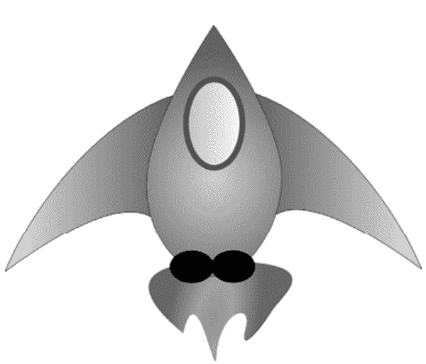
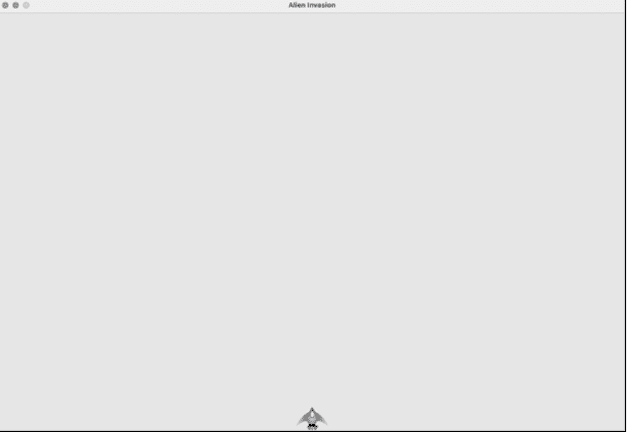
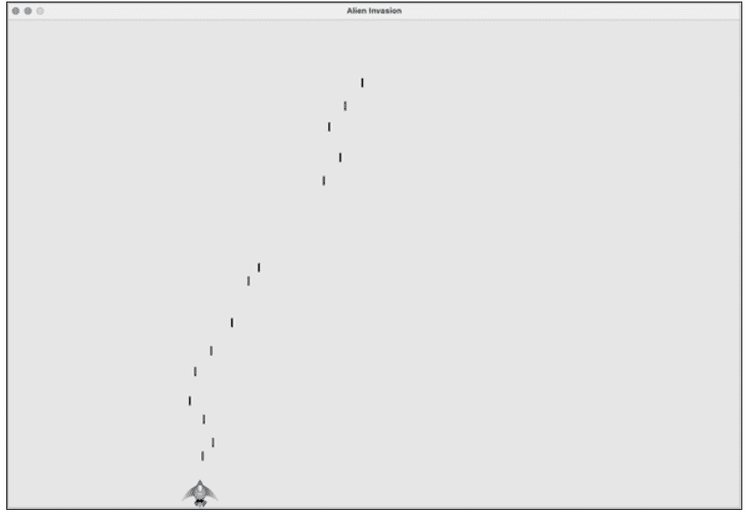

## 12
## 发射子弹的飞船


让我们来构建一个名为*外星人入侵*的游戏吧！我们将使用Pygame——一组有趣且功能强大的Python模块，它们可以管理图形、动画甚至声音，使你更容易构建复杂的游戏。有了Pygame来处理诸如在屏幕上绘制图像等任务，你就可以专注于游戏动态的高级逻辑。

在本章中，你将安装Pygame，然后创建一艘能够左右移动并根据玩家输入发射子弹的火箭飞船。在接下来的两章中，你将创建一支需要消灭的外星人舰队，然后通过限制你可以使用的飞船数量并添加记分牌来继续完善游戏。

在构建这个游戏的过程中，你还会学习如何管理跨多个文件的大型项目。我们将重构大量代码并管理文件内容，以组织项目并提高代码效率。

制作游戏是在学习语言的同时获得乐趣的理想方式。玩自己编写的游戏会带来深深的满足感，而编写一个简单的游戏也会让你学到很多关于专业人士如何开发游戏的知识。在学习本章时，请输入并运行代码，以识别每个代码块对整个游戏玩法的贡献。尝试不同的值和设置，以便更好地理解如何优化游戏中的交互。

> **注意**
> 
> 外星人入侵 *跨越多个不同文件，因此请在系统上新建* `alien_invasion` *文件夹。确保将项目的所有文件保存到该文件夹，这样你的* `import` *语句才能正常工作。*
> 
> *另外，如果你对使用版本控制感到顺手，可以考虑在本项目中使用它。如果你以前从未使用过版本控制，请参阅附录D以了解概况。*

## 规划你的项目

在构建大型项目时，重要的是在开始编写代码之前制定计划。你的计划将使你保持专注，并更有可能完成项目。

让我们来编写一个总体游戏玩法的描述。虽然以下描述并未涵盖*外星人入侵*的每一个细节，但它为如何开始构建游戏提供了清晰的思路：

在*外星人入侵*中，玩家控制一艘出现在屏幕底部中央的火箭飞船。玩家可以使用方向键左右移动飞船，并使用空格键发射子弹。游戏开始时，一支外星人舰队布满天空，并在屏幕上横向移动并向下移动。玩家射击并摧毁外星人。如果玩家摧毁了所有外星人，就会出现一支新舰队，其移动速度比之前的舰队更快。如果任何外星人击中玩家的飞船或到达屏幕底部，玩家将失去一艘飞船。如果玩家失去三艘飞船，游戏结束。

在第一个开发阶段，我们将制作一艘飞船，当玩家按下方向键时可以左右移动，当玩家按下空格键时可以发射子弹。设置好此行为后，我们就可以创建外星人并完善游戏玩法。

## 安装Pygame

在开始编码之前，请先安装Pygame。我们将采用与第11章中安装pytest相同的方式：使用pip。如果你跳过了第11章或需要回顾pip的用法，请参阅第210页的“使用pip安装pytest”。

要安装Pygame，请在终端提示符下输入以下命令：

```
$ python -m pip install --user pygame
```

如果你使用`python`以外的命令（如`python3`）来运行程序或启动终端会话，请确保改用该命令。

## 启动游戏项目

我们将通过创建一个空白的Pygame窗口来开始构建游戏。之后，我们将在这个窗口上绘制游戏元素，如飞船和外星人。我们还将让游戏响应用户输入、设置背景颜色并加载飞船图像。

## 创建Pygame窗口并响应用户输入

我们将通过创建一个表示游戏的类来制作一个空白的Pygame窗口。在文本编辑器中，创建一个新文件并将其保存为*alien_invasion.py*；然后输入以下内容：

```
alien_invasion.py

import sys

import pygame

class AlienInvasion:
    """Overall class to manage game assets and behavior."""

    def __init__(self):
        """Initialize the game, and create game resources."""
        pygame.init()

        self.screen = pygame.display.set_mode((1200, 800))
        pygame.display.set_caption("Alien Invasion")

    def run_game(self):
        """Start the main loop for the game."""
        while True:
            # Watch for keyboard and mouse events.
            for event in pygame.event.get():
                if event.type == pygame.QUIT:
                    sys.exit()

            # Make the most recently drawn screen visible.
            pygame.display.flip()

if __name__ == '__main__':
    # Make a game instance, and run the game.
    ai = AlienInvasion()
    ai.run_game()
```

首先，我们导入`sys`和`pygame`模块。`pygame`模块包含了制作游戏所需的功能。

当玩家退出游戏时，我们将使用`sys`模块中的工具来退出游戏。

*外星人入侵*以一个名为AlienInvasion的类开始。在`__init__()`方法中，`pygame.init()`函数会初始化Pygame正常工作所需的后台设置❶。然后我们调用`pygame.display.set_mode()`来创建一个显示窗口❷，我们将在其上绘制游戏的所有图形元素。参数`(1200, 800)`是一个元组，定义了游戏窗口的尺寸，即宽1,200像素、高800像素。（你可以根据自己的显示尺寸调整这些值。）我们将这个显示窗口赋给属性`self.screen`，这样它就可以在该类的所有方法中使用。

我们赋给`self.screen`的对象称为surface。Pygame中的*surface*是屏幕上可以显示游戏元素的一部分。游戏中的每个元素，如外星人或飞船，都有自己的surface。`display.set_mode()`返回的surface代表整个游戏窗口。当我们激活游戏的动画循环时，这个surface会在每次循环中被重新绘制，因此可以根据用户输入触发的任何变化进行更新。

游戏由`run_game()`方法控制。该方法包含一个持续运行的`while`循环❸。`while`循环中包含一个事件循环和管理屏幕更新的代码。*event*（事件）是玩家在玩游戏时执行的操作，例如按下一个键或移动鼠标。为了让程序响应事件，我们编写一个*事件循环*来*监听*事件，并根据发生的事件类型执行相应的任务。嵌套在`while`循环中的`for`循环❹就是一个事件循环。

要访问Pygame检测到的事件，我们将使用`pygame.event.get()`函数。该函数返回自上次调用该函数以来发生的事件列表。


function was called. Any keyboard or mouse event will cause this for loop to run. Inside the loop, we’ll write a series of if statements to detect and respond to specific events. For example, when the player clicks the game window’s close button, a `pygame.QUIT` event is detected and we call `sys.exit()` to exit the game **5**.

The call to `pygame.display.flip()` **6** tells Pygame to make the most recently drawn screen visible. In this case, it simply draws an empty screen on each pass through the `while` loop, erasing the old screen so only the new screen is visible. When we move the game elements around, `pygame.display.flip()` continually updates the display to show the new positions of game elements and hide the old ones, creating the illusion of smooth movement.

At the end of the file, we create an instance of the game and then call `run_game()`. We place `run_game()` in an if block that only runs if the file is called directly. When you run this *alien_invasion.py* file, you should see an empty Pygame window.

## Controlling the Frame Rate

Ideally, games should run at the same speed, or *frame rate*, on all systems. Controlling the frame rate of a game that can run on multiple systems is a complex issue, but Pygame offers a relatively simple way to accomplish this goal. We’ll make a clock, and ensure the clock ticks once on each pass through the main loop. Anytime the loop processes faster than the rate we define, Pygame will calculate the correct amount of time to pause so that the game runs at a consistent rate.

We’ll define the clock in the `__init__()` method:

***alien_invasion.py***

```python
def __init__(self):
    """Initialize the game, and create game resources."""
    pygame.init()
    self.clock = pygame.time.Clock()
    --snip--
```

After initializing pygame, we create an instance of the class `Clock`, from the `pygame.time` module. Then we’ll make the clock tick at the end of the `while` loop in `run_game()`.

```python
def run_game(self):
    """Start the main loop for the game."""
    while True:
        --snip--
        pygame.display.flip()
        self.clock.tick(60)
```

> **NOTE**
> 
> *Pygame’s clock should help the game run consistently on most systems. If it makes the game run less consistently on your system, you can try different values for the frame rate. If you can’t find a good frame rate on your system, you can leave the clock out entirely and adjust the game’s settings so it runs well on your system.*

## Setting the Background Color

Pygame creates a black screen by default, but that’s boring. Let’s set a different background color. We’ll do this at the end of the `__init__()` method.

***alien_invasion.py***

all these values in one place. This approach allows us to work with just one settings object anytime we need to access an individual setting. This also makes it easier to modify the game’s appearance and behavior as our project grows. To modify the game, we’ll change the relevant values in settings.py, which we’ll create next, instead of searching for different settings throughout the project.

Create a new file named settings.py inside your alien_invasion folder, and add this initial Settings class:

**settings.py**

```python
class Settings:
    """A class to store all settings for Alien Invasion."""

    def __init__(self):
        """Initialize the game's settings."""
        # Screen settings
        self.screen_width = 1200
        self.screen_height = 800
        self.bg_color = (230, 230, 230)
```

To make an instance of Settings in the project and use it to access our settings, we need to modify alien_invasion.py as follows:

**alien_invasion.py**

```python
--snip--
import pygame

from settings import Settings

class AlienInvasion:
    """Overall class to manage game assets and behavior."""

    def __init__(self):
        """Initialize the game, and create game resources."""
        pygame.init()
        self.clock = pygame.time.Clock()
        self.settings = Settings()
        self.screen = pygame.display.set_mode(
            (self.settings.screen_width, self.settings.screen_height))
        pygame.display.set_caption("Alien Invasion")

    def run_game(self):
        --snip--
        # Redraw the screen during each pass through the loop.
        self.screen.fill(self.settings.bg_color)

        # Make the most recently drawn screen visible.
        pygame.display.flip()
        self.clock.tick(60)
--snip--
```

We import Settings into the main program file. Then we create an instance of Settings and assign it to self.settings ❶, after making the call to pygame.init(). When we create a screen ❷, we use the screen_width and screen_height attributes of self.settings, and then we use self.settings to access the background color when filling the screen ❸ as well.

When you run alien_invasion.py now you won't yet see any changes, because all we've done is move the settings we were already using elsewhere. Now we're ready to start adding new elements to the screen.

## Adding the Ship Image

Let's add the ship to our game. To draw the player's ship on the screen, we'll load an image and then use the Pygame blit() method to draw the image.

When you're choosing artwork for your games, be sure to pay attention to licensing. The safest and cheapest way to start is to use freely licensed graphics that you can use and modify, from a website like https://opengameart.org.



Figure 12-1: The ship for Alien Invasion

## Creating the Ship Class

After choosing an image for the ship, we need to display it on the screen. To use our ship, we’ll create a new ship module that will contain the class Ship. This class will manage most of the behavior of the player’s ship:

ship.py

```python
import pygame

class Ship:
    """A class to manage the ship."""

    def __init__(self, ai_game):
        """Initialize the ship and set its starting position."""
        self.screen = ai_game.screen
        self.screen_rect = ai_game.screen.get_rect()

        # Load the ship image and get its rect.
        self.image = pygame.image.load('images/ship.bmp')
        self.rect = self.image.get_rect()

        # Start each new ship at the bottom center of the screen.
        self.rect.midbottom = self.screen_rect.midbottom

    def blitme(self):
        """Draw the ship at its current location."""
        self.screen.blit(self.image, self.rect)
```

Pygame is efficient because it lets you treat all game elements like rectangles (*rects*), even if they’re not exactly shaped like rectangles. Treating an element as a rectangle is efficient because rectangles are simple geometric shapes. When Pygame needs to figure out whether two game elements have collided, for example, it can do this more quickly if it treats each object as a rectangle. This approach usually works well enough that no one playing the game will notice that we’re not working with the exact shape of each game element. We’ll treat the ship and the screen as rectangles in this class.

We import the pygame module before defining the class. The `__init__()` method of `Ship` takes two parameters: the `self` reference and a reference to the current instance of the `AlienInvasion` class. This will give `Ship` access to all the game resources defined in `AlienInvasion`. We then assign the screen to an attribute of `Ship`, so we can access it easily in all the methods in this class. We access the screen’s rect attribute using the `get_rect()` method and assign it to `self.screen_rect`. Doing so allows us to place the ship in the correct location on the screen.

To load the image, we call `pygame.image.load()` and give it the location of our ship image. This function returns a surface representing the ship, which we assign to `self.image`. When the image is loaded, we call `get_rect()` to access the ship surface’s rect attribute so we can later use it to place the ship.


当你使用`rect`对象时，可以使用矩形上、下、左、右边缘以及中心的*x*和*y*坐标来放置该对象。你可以设置这些值中的任何一个来建立`rect`的当前位置。当你在居中游戏元素时，可以使用`rect`的`center`、`centerx`或`centery`属性。当你在屏幕边缘工作时，可以使用`top`、`bottom`、`left`或`right`属性。还有一些属性组合了这些属性，例如`midbottom`、`midtop`、`midleft`和`midright`。当你调整`rect`的水平或垂直位置时，可以直接使用`x`和`y`属性，它们是其左上角的*x*和*y*坐标。这些属性使你不必像以前的游戏开发者那样手动计算，你会经常使用它们。

> **注意**
>
> *在Pygame中，原点(0,0)位于屏幕左上角，坐标向下和向右增大。在1200×800的屏幕上，原点位于左上角，右下角的坐标为(1200,800)。这些坐标指的是游戏窗口，而不是物理屏幕。*

我们将飞船放置在屏幕的底部中央。为此，让`self.rect.midbottom`的值与屏幕的`rect`的`midbottom`属性匹配④。Pygame使用这些`rect`属性来定位飞船图像，使其水平居中并与屏幕底部对齐。

最后，我们定义`blitme()`方法⑤，它会在`self.rect`指定的位置将图像绘制到屏幕上。

## 将飞船绘制到屏幕

现在让我们更新alien_invasion.py，使其创建一艘飞船并调用飞船的blitme()方法：

# alien_invasion.py

```
--snip--
from settings import Settings
from ship import Ship

class AlienInvasion:
    """Overall class to manage game assets and behavior."""

    def __init__(self):
        --snip--
        pygame.display.set_caption("Alien Invasion")

        self.ship = Ship(self)

    def run_game(self):
        --snip--
        # Redraw the screen during each pass through the loop.
        self.screen.fill(self.settings.bg_color)
        self.ship.blitme()

        # Make the most recently drawn screen visible.
        pygame.display.flip()
        self.clock.tick(60)
--snip--
```

我们导入Ship，然后在屏幕创建后创建一个Ship实例①。调用Ship()需要一个参数：一个AlienInvasion实例。这里的self参数指的是当前AlienInvasion实例。这个参数让Ship能够访问游戏资源，例如屏幕对象。我们将这个Ship实例赋给self.ship。

填充背景后，我们通过调用ship.blitme()将飞船绘制到屏幕上，这样飞船就会出现在背景之上❷。

现在运行*alien_invasion.py*，你应该会看到一个空的游戏屏幕，火箭飞船位于底部中央，如[图 12-2](#)所示。



[图 12-2](#)：*飞船位于屏幕底部中央的《外星入侵》*

## 重构：`_check_events()`和`_update_screen()`方法

在大型项目中，你经常会在添加更多代码之前重构已编写的代码。重构简化了你已经编写的代码的结构，使其更容易扩展。在本节中，我们将把显得有些冗长的`run_game()`方法拆分成两个辅助方法。*辅助方法* 在类内部执行工作，但并不打算

为了进一步简化`run_game()`，我们将把更新屏幕的代码移到一个单独的名为`_update_screen()`的方法中。

# **alien_invasion.py**

```
def run_game(self):
    """Start the main loop for the game."""
    while True:
        self._check_events()
        self._update_screen()
        self._clock.tick(60)


def _check_events(self):
    --snip--


def _update_screen(self):
    """Update images on the screen, and flip to the new screen."""
    self.screen.fill(self.settings.bg_color)
    self.ship.blitme()

    pygame.display.flip()
```

我们将绘制背景和飞船以及翻转屏幕的代码移动到了`_update_screen()`中。现在`run_game()`中主循环的主体变得简单多了。很容易看出我们每次循环都会检查新事件、更新屏幕并让时钟滴答。

如果你已经构建过许多游戏，你可能会一开始就把代码拆分成这样的方法。但如果你从未处理过这样的项目，你可能一开始并不知道如何精确地组织代码。这种方法让你了解一个现实的开发过程：你一开始尽可能简单地编写代码，然后随着项目变得复杂再重构它。

既然我们已经重构了代码，使其更容易扩展，我们现在可以着手游戏的动态方面了！

## 动手试一试

- **12-1. 蓝天：** 创建一个带有蓝色背景的Pygame窗口。
- **12-2. 游戏角色：** 找一张你喜欢游戏角色的位图图像，或者将一张图像转换为位图。创建一个类，将角色绘制在屏幕中央，然后将图像背景色与屏幕背景色匹配，或反过来。

## 驾驶飞船

接下来，我们将让玩家能够左右移动飞船。我们将编写代码，在玩家按下右箭头键或左箭头键时做出响应。我们首先专注于向右移动，然后将相同的原则应用于控制向左移动。在添加这些代码时，你将学习如何控制屏幕上图像的移动并响应用户输入。

### 响应按键

每当玩家按下按键时，该按键在Pygame中都会被注册为事件。每个事件都由`pygame.event.get()`方法获取。我们需要在`_check_events()`方法中指定我们希望游戏检查哪些类型的事件。每次按键都会被注册为一个`KEYDOWN`事件。

当Pygame检测到`KEYDOWN`事件时，我们需要检查按下的键是否触发某个特定操作。例如，如果玩家按下右箭头键，我们希望增加飞船的`rect.x`值来向右移动飞船：

```
`alien_invasion.py`
```

```
def _check_events(self):
    """Respond to keypresses and mouse events."""
    for event in pygame.event.get():
        if event.type == pygame.QUIT:
            sys.exit()
        elif event.type == pygame.KEYDOWN:
            if event.key == pygame.K_RIGHT:
                # Move the ship to the right.
                self.ship.rect.x += 1
```

在`_check_events()`中，我们向事件循环添加了一个`elif`块，以在Pygame检测到KEYDOWN事件时做出响应❶。我们检查按下的键`event.key`是否为右箭头键❷。右箭头键由`pygame.K_RIGHT`表示。如果按下了右箭头键，我们通过将`self.ship.rect.x`的值增加1来将飞船向右移动❸。

现在运行*alien_invasion.py*时，每次按下右箭头键，飞船应该向右移动一个像素。这是一个开始，但这不是一种高效的飞船控制方式。让我们通过允许连续移动来改进这种控制。

### 允许连续移动

当玩家按住右箭头键时，我们希望飞船持续向右移动，直到玩家松开按键。我们将让游戏检测`pygame.KEYUP`事件，以便我们知道右箭头键何时被松开；然后我们将使用KEYDOWN和KEYUP事件以及一个名为`moving_right`的标志来实现连续运动。

当`moving_right`标志为False时，飞船将保持静止。当玩家按下右箭头键时，我们将该标志设置为`True`，当玩家松开按键时，我们再将标志设置为`False`。


Ship类控制飞船的所有属性，因此我们为它添加一个名为moving_right的属性，以及一个update()方法来检查moving_right标志的状态。如果该标志设置为True，update()方法将改变飞船的位置。我们将在每次通过while循环时调用这个方法，以更新飞船的位置。

以下是Ship类的更改：

ship.py

```python
class Ship:
    """A class to manage the ship."""

    def __init__(self, ai_game):
        --snip--
        # Start each new ship at the bottom center of the screen.
        self.rect.midbottom = self.screen_rect.midbottom

        # Movement flag; start with a ship that's not moving.
        self.moving_right = False

    def update(self):
        """Update the ship's position based on the movement flag."""
        if self.moving_right:
            self.rect.x += 1

    def blitme(self):
        --snip--
```

我们在__init__()方法中添加了一个self.moving_right属性，并将其初始设置为False ❶。然后添加update()，如果标志为True ❷，它将飞船向右移动。update()方法将从类外部调用，因此它不被视为辅助方法。

现在我们需要修改_check_events()，使得当按下右箭头键时moving_right设为True，当松开按键时设为False：

```python
def _check_events(self):
    """Respond to keypresses and mouse events."""
    for event in pygame.event.get():
        --snip--
        elif event.type == pygame.KEYDOWN:
            if event.key == pygame.K_RIGHT:
                self.ship.moving_right = True
        elif event.type == pygame.KEYUP:
            if event.key == pygame.K_RIGHT:
                self.ship.moving_right = False
```

这里，我们修改了游戏对玩家按下右箭头键时的响应方式：而不是直接改变飞船的位置，我们只需将`moving_right`设置为`True` ❶。然后我们添加一个新的`elif`块，它响应KEYUP事件 ❷。当玩家松开右箭头键（`K_RIGHT`）时，我们将`moving_right`设置为`False`。

接下来，我们修改`run_game()`中的`while`循环，使它在每次循环中调用飞船的`update()`方法：

```python
def run_game(self):
    """Start the main loop for the game."""
    while True:
        self._check_events()
        self.ship.update()
        self._update_screen()
        self.clock.tick(60)
```

飞船的位置将在我们检查键盘事件之后、更新屏幕之前进行更新。这允许飞船的位置根据玩家的输入进行更新，并确保在将飞船绘制到屏幕时使用更新后的位置。

当你运行*alien_invasion.py*并按住右箭头键时，飞船应该持续向右移动，直到你松开按键。

### 左右移动

现在飞船可以持续向右移动了，添加向左移动就很简单了。我们再次修改`Ship`类和`_check_events()`方法。以下是`Ship`中`__init__()`和`update()`的相关更改：

ship.py

```python
def __init__(self, ai_game):
    --snip--
    # Movement flags; start with a ship that's not moving.
    self.moving_right = False
    self.moving_left = False

def update(self):
    """Update the ship's position based on movement flags."""
    if self.moving_right:
        self.rect.x += 1
    if self.moving_left:
        self.rect.x -= 1
```

在`__init__()`中，我们添加了一个`self.moving_left`标志。在`update()`中，我们使用两个独立的`if`块，而不是`elif`，以允许当两个箭头键都被按住时，飞船的`rect.x`值先增加再减少。这会导致飞船静止不动。如果我们对向左移动使用`elif`，右箭头键将始终具有优先级。使用两个`if`块可以在玩家改变方向时可能短暂同时按住两个键的情况下，使移动更加准确。

我们需要对`_check_events()`做出两处添加：

alien_invasion.py

```python
def _check_events(self):
    """Respond to keypresses and mouse events."""
    for event in pygame.event.get():
        --snip--
        elif event.type == pygame.KEYDOWN:
            if event.key == pygame.K_RIGHT:
                self.ship.moving_right = True
            elif event.key == pygame.K_LEFT:
                self.ship.moving_left = True
        elif event.type == pygame.KEYUP:
            if event.key == pygame.K_RIGHT:
                self.ship.moving_right = False
            elif event.key == pygame.K_LEFT:
                self.ship.moving_left = False
```

如果发生针对K_LEFT键的KEYDOWN事件，我们将`moving_left`设置为True。如果发生针对K_LEFT键的KEYUP事件，我们将`moving_left`设置为False。这里我们可以使用`elif`块，因为每个事件只与一个键相关。如果玩家同时按下两个键，将检测到两个独立的事件。

现在当你运行*alien_invasion.py*时，你应该能够持续向右和向左移动飞船。如果你同时按住两个键，飞船应该停止移动。

接下来，我们将进一步优化飞船的移动。让我们调整飞船的速度，并限制飞船可以移动的范围，使其不会从屏幕两侧消失。

### 调整飞船速度

目前，飞船在`while`循环的每次循环中移动一个像素，但我们可以通过在Settings类中添加一个`ship_speed`属性来更精细地控制飞船的速度。我们将使用这个属性来确定每次经过循环时飞船移动的距离。以下是*settings.py*中的新属性：

settings.py

```python
class Settings:
    """A class to store all settings for Alien Invasion."""

    def __init__(self):
        --snip--

        # Ship settings
        self.ship_speed = 1.5
```

我们将`ship_speed`的初始值设置为1.5。现在当飞船移动时，它的位置在每次循环中会调整1.5像素（而不是1像素）。

我们使用浮点数作为速度设置，以便在后续加快游戏节奏时能更精细地控制飞船的速度。然而，`rect`属性（如x）只存储整数值，因此我们需要对`Ship`做出一些修改：

ship.py

```python
class Ship:
    """A class to manage the ship."""

    def __init__(self, ai_game):
        """Initialize the ship and set its starting position."""
        self.screen = ai_game.screen
        self.settings = ai_game.settings
        --snip--

        # Start each new ship at the bottom center of the screen.
        self.rect.midbottom = self.screen_rect.midbottom

        # Store a float for the ship's exact horizontal position.
        self.x = float(self.rect.x)

        # Movement flags; start with a ship that's not moving.
        self.moving_right = False
        self.moving_left = False

    def update(self):
        """Update the ship's position based on movement flags."""

        # Update the ship's x value, not the rect.
        if self.moving_right:
            self.x += self.settings.ship_speed
        if self.moving_left:
            self.x -= self.settings.ship_speed

        # Update rect object from self.x.
        self.rect.x = self.x

    def blitme(self):
        --snip--
```

我们为`Ship`创建了一个`settings`属性，以便在`update()`中使用它 ❶。由于我们是以像素的几分之一来调整飞船的位置，所以需要将位置赋值给一个可以存储浮点数的变量。你可以使用浮点数设置rect的属性，但rect只会保留该值的整数部分。为了准确跟踪飞船的位置，我们定义了一个新的`self.x` ❷。我们使用`float()`函数将`self.rect.x`的值转换为浮点数，并将该值赋给`self.x`。

现在当我们在`update()`中改变飞船的位置时，`self.x`的值会根据`settings.ship_speed`中存储的量进行调整 ❸。在`self.x`更新后，我们使用新值来更新`self.rect.x`，它控制飞船的位置 ❹。只有`self.x`的整数部分会被赋值给`self.rect.x`，但这对于显示飞船来说已经足够了。

现在我们可以更改`ship_speed`的值，任何大于1的值都会使飞船移动得更快。这将有助于飞船快速响应以击落外星人，并且让我们能够在玩家游戏过程中改变游戏的节奏。


## 限制飞船的移动范围

此时，如果你长时间按住方向键，飞船会从屏幕的任一边缘消失。让我们修正这个问题，使飞船在到达屏幕边缘时停止移动。我们通过修改 Ship 中的 `update()` 方法来实现：

**ship.py**

```python
    def update(self):
        """Update the ship's position based on movement flags."""
        # Update the ship's x value, not the rect.
        if self.moving_right and self.rect.right < self.screen_rect.right:
            self.x += self.settings.ship_speed
        if self.moving_left and self.rect.left > 0:
            self.x -= self.settings.ship_speed

        # Update rect object from self.x.
        self.rect.x = self.x
```

这段代码在更改 `self.x` 的值之前会检查飞船的位置。代码 `self.rect.right` 返回飞船 rect 右边缘的 *x* 坐标。如果该值小于 `self.screen_rect.right` 返回的值，则说明飞船尚未到达屏幕的右边缘 ❶。左边缘同理：如果 rect 左侧的值大于 0，则说明飞船尚未到达屏幕的左边缘 ❷。这确保了在调整 `self.x` 的值之前，飞船处于这些边界之内。

现在运行 *alien_invasion.py* 时，飞船应在屏幕任一边缘停止移动。这很酷；我们只是在一个 `if` 语句中添加了一个条件测试，但感觉飞船在屏幕任一边缘撞到了墙壁或力场！

## 重构 _check_events()

随着游戏的继续开发，_check_events() 方法会变得越来越长，因此让我们将 _check_events() 拆分为两个独立的方法：一个处理 KEYDOWN 事件，另一个处理 KEYUP 事件：

**alien_invasion.py**

```python
def _check_events(self):
    """Respond to keypresses and mouse events."""
    for event in pygame.event.get():
        if event.type == pygame.QUIT:
            sys.exit()
        elif event.type == pygame.KEYDOWN:
            self._check_keydown_events(event)
        elif event.type == pygame.KEYUP:
            self._check_keyup_events(event)


def _check_keydown_events(self, event):
    """Respond to keypresses."""
    if event.key == pygame.K_RIGHT:
        self.ship.moving_right = True
    elif event.key == pygame.K_LEFT:
        self.ship.moving_left = True


def _check_keyup_events(self, event):
    """Respond to key releases."""
    if event.key == pygame.K_RIGHT:
        self.ship.moving_right = False
    elif event.key == pygame.K_LEFT:
        self.ship.moving_left = False
```

我们创建了两个新的辅助方法：_check_keydown_events() 和 _check_keyup_events()。每个方法都需要 self 参数和 event 参数。这两个方法的正文复制自 _check_events()，我们用对新方法的调用替换了旧代码。现在 _check_events() 方法由于这种更清晰的代码结构而变得更简单，这将使进一步开发对玩家输入的响应变得更容易。

## 按 Q 退出

现在我们已高效地响应按键，可以再添加一种退出游戏的方式。每次测试新功能时都点击游戏窗口顶部的 X 来结束游戏会很麻烦，因此我们将添加一个键盘快捷键，在玩家按下 Q 时结束游戏：

**alien_invasion.py**

```python
def _check_keydown_events(self, event):
    --snip--
    elif event.key == pygame.K_LEFT:
        self.ship.moving_left = True
    elif event.key == pygame.K_q:
        sys.exit()
```

在 `_check_keydown_events()` 中，我们添加了一个新代码块，当玩家按下 Q 时结束游戏。现在，在测试时，你可以按 Q 关闭游戏，而不必使用光标关闭窗口。

## 以全屏模式运行游戏

Pygame 具有全屏模式，你可能更喜欢它而不是在普通窗口中运行游戏。一些游戏在全屏模式下看起来更好，而且在某些系统上，游戏在全屏模式下的整体性能可能更好。

要以全屏模式运行游戏，请在 `__init__()` 中进行以下更改：

**alien_invasion.py**

```python
def __init__(self):
    """Initialize the game, and create game resources."""
    pygame.init()
    self.settings = Settings()

    self.screen = pygame.display.set_mode((0, 0), pygame.FULLSCREEN)
    self.settings.screen_width = self.screen.get_rect().width
    self.settings.screen_height = self.screen.get_rect().height
    pygame.display.set_caption("Alien Invasion")
```

创建屏幕 surface 时，我们传递大小 `(0, 0)` 和参数 `pygame.FULLSCREEN` ❶。这告诉 Pygame 计算一个将填满屏幕的窗口大小。由于我们事先不知道屏幕的宽度和高度，因此在屏幕创建后更新这些设置 ❷。我们使用屏幕 rect 的 `width` 和 `height` 属性来更新 `settings` 对象。

如果你喜欢游戏在全屏模式下的外观或行为，就保留这些设置。如果你更喜欢游戏在自己的窗口中运行，可以恢复到原始方法，为游戏设置特定的屏幕大小。

> **NOTE**
> 
> *在全屏模式下运行游戏之前，请确保可以通过按 Q 退出；Pygame 在全屏模式下没有默认的退出游戏方式。*

## 快速回顾

在下一节中，我们将添加射击子弹的能力，这涉及添加一个名为 *bullet.py* 的新文件，并对我们已在使用的一些文件进行一些修改。现在，我们有三个包含多个类和方法的文件。为了明确项目的组织方式，让我们在添加更多功能之前回顾一下这些文件。

**alien_invasion.py**

## TRY IT YOURSELF

- **12-3. Pygame 文档：** 我们现在已经深入到游戏中，你可能想查看一些 Pygame 文档。Pygame 主页是 [https://pygame.org](https://pygame.org)，文档主页是 [https://pygame.org/docs](https://pygame.org/docs)。现在只需浏览文档即可。你不需要它来完成本项目，但如果你想修改 *Alien Invasion* 或之后制作自己的游戏，这将有所帮助。
- **12-4. 火箭：** 制作一个游戏，屏幕中央开始时有一个火箭。允许玩家使用四个方向键上下左右移动火箭。确保火箭永远不会超出屏幕的任何边缘。
- **12-5. 键：** 制作一个 Pygame 文件，创建一个空屏幕。在事件循环中，每当检测到 `pygame.KEYDOWN` 事件时，打印 `event.key` 属性。运行程序并按下各种键，看看 Pygame 如何响应。

## 射击子弹

现在让我们添加射击子弹的能力。我们将编写代码，当玩家按下空格键时发射子弹，子弹由一个小矩形表示。子弹然后会笔直向上移动，直到从屏幕顶部消失。

### 添加子弹设置

在 `__init__()` 方法末尾，我们将更新 *settings.py* 以包含我们为新的 Bullet 类所需的值：

**settings.py**

```python
def __init__(self):
    --snip--
    # Bullet settings
    self.bullet_speed = 2.0
    self.bullet_width = 3
    self.bullet_height = 15
    self.bullet_color = (60, 60, 60)
```

这些设置创建了深灰色的子弹，宽度为 3 像素，高度为 15 像素。子弹的移动速度会略快于飞船。

### 创建 Bullet 类

现在创建 *bullet.py* 文件来存储我们的 `Bullet` 类。以下是 *bullet.py* 的第一部分：

**bullet.py**

```python
import pygame
from pygame.sprite import Sprite

class Bullet(Sprite):
    """A class to manage bullets fired from the ship."""

    def __init__(self, ai_game):
        """Create a bullet object at the ship's current position."""
        super().__init__()
        self.screen = ai_game.screen
        self.settings = ai_game.settings
        self.color = self.settings.bullet_color

        # Create a bullet rect at (0, 0) and then set correct position.
        self.rect = pygame.Rect(0, 0, self.settings.bullet_width,
            self.settings.bullet_height)
        self.rect.midtop = ai_game.ship.rect.midtop

        # Store the bullet's position as a float.
        self.y = float(self.rect.y)
```

`Bullet` 类继承自 `Sprite`，我们从 `pygame.sprite` 模块导入它。当你使用精灵时，可以将游戏中相关的元素分组并同时对分组的元素执行操作。要创建子弹实例，`__init__()` 需要 `AlienInvasion` 的当前实例，我们调用 super() 以正确地从 `Sprite` 继承。我们还设置了


self.y ①. 我们随后使用 self.y 的值来设置 self.rect.y 的值 ②。

bullet_speed 设置允许我们在游戏进行过程中或根据需要增加子弹的速度以完善游戏的行为。一旦子弹发射，我们永远不会改变其 x 坐标的值，因此即使飞船移动，它也会沿直线垂直飞行。

当我们想要绘制子弹时，我们调用 draw_bullet()。draw.rect() 函数用 self.color ③ 中存储的颜色填充由子弹的 rect 定义的屏幕部分。

## Storing Bullets in a Group

现在我们有了 Bullet 类并且必要的设置已定义，我们可以编写代码以在玩家每次按下空格键时发射一颗子弹。我们将在 AlienInvasion 中创建一个组来存储所有活动子弹，以便我们可以管理已发射的子弹。该组将是 pygame.sprite.Group 类的一个实例，它的行为类似于列表，但具有一些在构建游戏时有用的额外功能。我们将使用此组在主循环的每次遍历中将子弹绘制到屏幕上并更新每颗子弹的位置。

首先，我们将导入新的 Bullet 类：

```
alien_invasion.py

--snip--
from ship import Ship
from bullet import Bullet
```

接下来我们在 __init__() 中创建保存子弹的组：

```
alien_invasion.py

    def __init__(self):
        --snip--
```

```
```python
self.ship = Ship(self)
self.bullets = pygame.sprite.Group()
```
```

然后我们需要在每次遍历 `while` 循环时更新子弹的位置：

# **alien_invasion.py**

```
```python
def _run_game(self):
    """Start the main loop for the game."""
    while True:
        self._check_events()
        self.ship.update()
        self.bullets.update()
        self._update_screen()
        self.clock.tick(60)
```
```

当你在组上调用 `update()` 时，组会自动为组中的每个精灵调用 `update()`。行 `self.bullets.update()` 为我们放置在组 `bullets` 中的每颗子弹调用 `bullet.update()`。

## Firing Bullets

在 `AlienInvasion` 中，我们需要修改 `_check_keydown_events()` 以便在玩家按下空格键时发射子弹。我们不需要更改 `_check_keyup_events()`，因为空格键释放时不会发生任何事情。我们还需要修改 `_update_screen()`，以确保在调用 `flip()` 之前将每颗子弹绘制到屏幕上。

发射子弹时需要做一些工作，所以让我们编写一个新方法 `_fire_bullet()` 来处理这项工作：

# **alien_invasion.py**

```
```python
def _check_keydown_events(self, event):
    --snip--
    elif event.key == pygame.K_q:
        sys.exit()
    elif event.key == pygame.K_SPACE:
        self._fire_bullet()
```
```

```
def _check_keyup_events(self, event):
    --snip--

def _fire_bullet(self):
    """Create a new bullet and add it to the bullets group."""
    new_bullet = Bullet(self)
    self.bullets.add(new_bullet)

def _update_screen(self):
    """Update images on the screen, and flip to the new screen."""
    self.screen.fill(self.settings.bg_color)
    for bullet in self.bullets.sprites():
        bullet.draw_bullet()
    self.ship.blitme()

    pygame.display.flip()

--snip--
```

我们会在按下空格键时调用 `_fire_bullet()` ❶。在 `_fire_bullet()` 中，我们创建一个 `Bullet` 的实例并将其命名为 `new_bullet` ❷。然后我们使用 `add()` 方法将其添加到组 `bullets` 中 ❸。`add()` 方法类似于 `append()`，但它专门为 Pygame 组编写。

`bullets.sprites()` 方法返回组 `bullets` 中所有精灵的列表。为了将所有发射的子弹绘制到屏幕上，我们遍历 `bullets` 中的精灵并对每个精灵调用 `draw_bullet()` ❹。我们将此循环放在绘制飞船的行之前，这样子弹就不会一开始就位于飞船之上。

现在运行 *alien_invasion.py* 时，你应该能够左右移动飞船并发射任意数量的子弹。子弹向上移动屏幕并在到达顶部时消失，如 [Figure 12-3](#) 所示。你可以在 *settings.py* 中更改子弹的大小、颜色和速度。



Figure 12-3: The ship after firing a series of bullets

## Deleting Old Bullets

目前，子弹在到达顶部时会消失，但只是因为 Pygame 无法在屏幕顶部上方绘制它们。子弹实际上仍然存在；它们的 y 坐标值只是变得越来越负。这是一个问题，因为它们会继续消耗内存和处理能力。

我们需要摆脱这些旧子弹，否则游戏会因做太多不必要的工作而变慢。为此，我们需要检测子弹的 rect 的底部值是否为 0，这表明子弹已穿过屏幕顶部：

alien_invasion.py

## Limiting the Number of Bullets

许多射击游戏限制玩家同时在屏幕上拥有的子弹数量；这样可以鼓励玩家准确射击。我们将在 *Alien Invasion* 中做同样的事情。

首先，在 *settings.py* 中存储允许的子弹数量：

```
**settings.py**

```python
# Bullet settings
--snip--
self.bullet_color = (60, 60, 60)
self.bullets_allowed = 3
```
```

这将玩家限制为一次三颗子弹。我们将在 `AlienInvasion` 中使用此设置在 `_fire_bullet()` 中创建新子弹之前检查存在多少子弹。

```
**alien_invasion.py**

```python
def _fire_bullet(self):
    """Create a new bullet and add it to the bullets group."""
    if len(self.bullets) < self.settings.bullets_allowed:
        new_bullet = Bullet(self)
        self.bullets.add(new_bullet)
```
```

当玩家按下空格键时，我们检查 `bullets` 的长度。如果 `len(self.bullets)` 小于三，我们就创建一个新子弹。但如果已有三颗子弹处于活动状态，按下空格键时不会发生任何事情。现在运行游戏时，你应该只能一次发射三组子弹。

## Creating the `_update_bullets()` Method

我们希望 `AlienInvasion` 类保持合理的有序，因此现在我们编写并检查了子弹管理代码后，我们可以将它移动到一个单独的方法中。

我们将在 `_update_screen()` 之前创建一个名为 `_update_bullets()` 的新方法：

```
**alien_invasion.py**

```python
def _update_bullets(self):
    """Update position of bullets and get rid of old bullets."""
    # Update bullet positions.
    self.bullets.update()

    # Get rid of bullets that have disappeared.
    for bullet in self.bullets.copy():
        if bullet.rect.bottom <= 0:
            self.bullets.remove(bullet)
```
```

`_update_bullets()` 的代码是从 `run_game()` 中剪切并粘贴过来的；我们在这里所做的只是澄清注释。

`run_game()` 中的 `while` 循环再次变得简单：

```
**alien_invasion.py**

```python
while True:
    self._check_events()
    self.ship.update()
    self._update_bullets()
    self._update_screen()
    self.clock.tick(60)
```
```

现在我们的主循环只包含最少的代码，因此我们可以快速阅读方法名称并了解游戏中发生了什么。主循环检查玩家输入，然后更新飞船和已发射的任何子弹的位置。然后我们使用更新后的位置绘制新屏幕，并在每次循环结束时滴答时钟。

再次运行 *alien_invasion.py*，并确保你仍然可以毫无错误地发射子弹。

## TRY IT YOURSELF

**12-6. Sideways Shooter:** 编写一个游戏，将飞船放置在屏幕左侧，并允许玩家上下移动飞船。使飞船在玩家按下空格键时发射一颗向右穿越屏幕的子弹。确保子弹在消失离开屏幕后被删除。

## Summary

在本章中，你学习了如何为游戏制定计划并学习了用 Pygame 编写的游戏的基本结构。你学习了如何设置背景颜色并将设置存储在单独的类中，以便更轻松地调整它们。你看到了如何将图像绘制到屏幕上并让玩家控制游戏元素的移动。你创建了自行移动的元素，例如向上飞行的子弹，并删除了不再需要的对象。你还学习了定期重构项目中的代码以促进持续开发。

在第 13 章中，我们将向 *Alien Invasion* 添加外星人。到本章结束时，你将能够击落外星人，希望在它们到达你的飞船之前！

*OceanoPDF.com*


