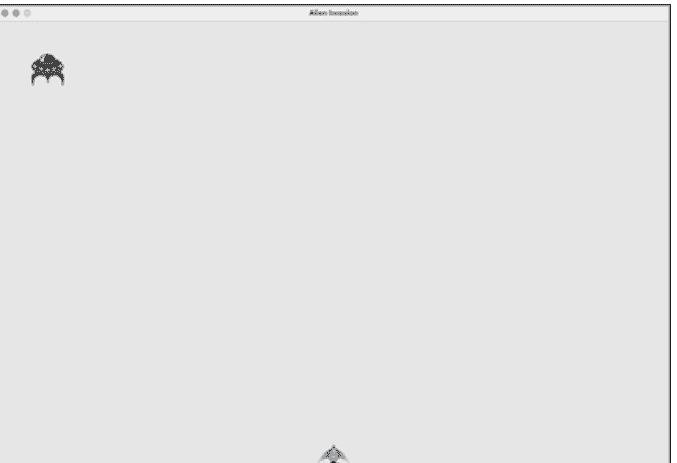
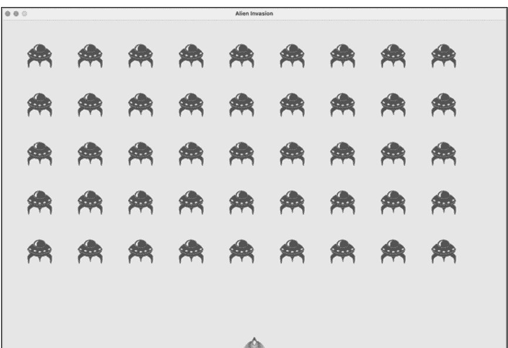
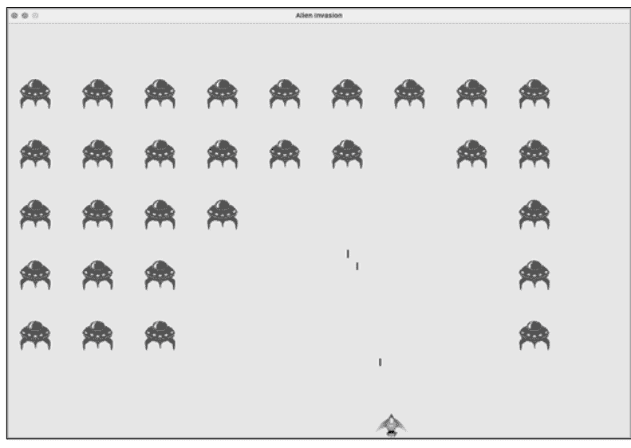

## 13 外星人！


在本章中，我们将为《*外星人入侵*》添加外星人。我们会在屏幕顶部附近添加一个外星人，然后生成一整支外星人舰队。我们将让舰队向侧面和下方移动，并清除被子弹击中的任何外星人。最后，我们将限制玩家拥有的飞船数量，并在玩家耗尽飞船时结束游戏。

在完成本章的过程中，你将进一步学习 Pygame 以及如何管理大型项目。你还将学习检测游戏对象（如子弹和外星人）之间的碰撞。检测碰撞有助于你定义游戏中元素之间的交互。例如，你可以将角色限制在迷宫的墙壁内，或者在两个角色之间传递球。我们将继续依据一份计划工作，并会不时回顾这份计划，以保持代码编写过程中的专注度。

在开始编写新代码向屏幕上添加外星人舰队之前，让我们先看一下项目并更新计划。

### 回顾项目

当你开始一个大型项目的新开发阶段时，回顾你的计划并明确你打算用即将编写的代码实现什么目标，始终是个好主意。在本章中，我们将完成以下工作：

-   在屏幕左上角添加一个外星人，并为其周围留出适当间距。
-   在屏幕上半部分水平方向上尽可能多地容纳外星人。然后创建更多外星人行，直到形成一支完整的舰队。
-   让舰队侧向和向下移动，直到整个舰队被击落、外星人撞击飞船或外星人到达地面。如果整个舰队被击落，我们将创建一支新舰队。如果外星人撞击飞船或地面，我们将摧毁飞船并创建一支新舰队。
-   限制玩家可以使用的飞船数量，并在玩家用完分配数量的飞船时结束游戏。

我们将在实现功能的过程中不断完善这个计划，但它已经足够具体，可以开始编写代码了。

在项目中开始处理一系列新功能时，你还应该回顾现有代码。因为每个新阶段通常都会使项目更加复杂，所以最好清理任何杂乱或低效的代码。我们一直在边写边重构，目前没有需要重构的代码。

### 创建第一个外星人

将一个外星人放在屏幕上，就像将飞船放在屏幕上一样。每个外星人的行为由一个名为 `Alien` 的类控制，我们将仿照 `Ship` 类的结构来设计它。为简单起见，我们继续使用位图图像。你可以为外星人找到自己的图像，或者使用图 13-1 中所示的图像，该图像可在本书的资源中找到，地址为 https://ehmatthes.github.io/pcc_3e。此图像具有灰色背景，与屏幕的背景颜色匹配。请确保将你选择的图像文件保存在 images 文件夹中。


图 13-1：我们将用来构建舰队的外星人

### 创建 Alien 类

现在我们来编写 `Alien` 类，并将其保存为 alien.py：

```python
import pygame
from pygame.sprite import Sprite

class Alien(Sprite):
    """A class to represent a single alien in the fleet."""

    def __init__(self, ai_game):
        """Initialize the alien and set its starting position."""
        super().__init__()
        self.screen = ai_game.screen

        # Load the alien image and set its rect attribute.
        self.image = pygame.image.load('images/alien.bmp')
        self.rect = self.image.get_rect()

        # Start each new alien near the top left of the screen.
        self.rect.x = self.rect.width
        self.rect.y = self.rect.height

        # Store the alien's exact horizontal position.
        self.x = float(self.rect.x)
```

这个类的大部分内容都与 `Ship` 类相似，不同之处在于外星人在屏幕上的位置。我们最初将每个外星人放置在屏幕的左上角附近；我们在其左侧添加一个等于外星人宽度的空间，并在其上方添加一个等于其高度的空间①，以便于观察。我们主要关注外星人的水平速度，因此我们将精确跟踪每个外星人的水平位置②。

这个 `Alien` 类不需要在屏幕上绘制它的方法；相反，我们将使用一个 Pygame 组方法，它自动将组中的所有元素绘制到屏幕上。

### 创建外星人的实例

我们想要创建一个 `Alien` 实例，以便在屏幕上看到第一个外星人。因为这是设置工作的一部分，我们将把该实例的代码添加到 `AlienInvasion` 的 `__init__()` 方法的末尾。最终，我们将创建一整支外星人舰队，这将是一项相当多的工作，因此我们将创建一个名为 `_create_fleet()` 的新辅助方法。

类中方法的顺序无关紧要，只要它们的放置方式保持一致即可。我将把 `_create_fleet()` 放在 `_update_screen()` 方法之前，但放在 AlienInvasion 中的任何位置都可以。首先，我们导入 `Alien` 类。

以下是 *alien_invasion.py* 中更新后的 `import` 语句：

***alien_invasion.py***
```
--snip--
from bullet import Bullet
from alien import Alien
```

以下是更新后的 `__init__()` 方法：

***alien_invasion.py***
```
def __init__(self):
    --snip--
    self.ship = Ship(self)
    self.bullets = pygame.sprite.Group()
    self.aliens = pygame.sprite.Group()

    self._create_fleet()
```

以下是新的 `_create_fleet()` 方法：

***alien_invasion.py***
```
def _create_fleet(self):
    """Create the fleet of aliens."""
    # Make an alien.
    alien = Alien(self)
    self.aliens.add(alien)
```

在此方法中，我们创建了一个 `Alien` 实例，然后将其添加到将容纳舰队的组中。外星人将被放置到屏幕默认的左上角区域。

为了让外星人出现，我们需要在 `_update_screen()` 中调用组的 `draw()` 方法：

***alien_invasion.py***
```python
def _update_screen(self):
    --snip--
    self.ship.blitme()
    self.aliens.draw(self.screen)

    pygame.display.flip()
```

当你对组调用 `draw()` 时，Pygame 会绘制组中的每个元素，位置由其 `rect` 属性定义。`draw()` 方法需要一个参数：一个用于绘制组中元素的表面。图 13-2 显示了屏幕上的第一个外星人。



图 13-2：第一个外星人出现了。

现在第一个外星人已正确显示，我们将编写代码来绘制整支舰队。

### 构建外星人舰队

要绘制一支舰队，我们需要弄清楚如何在不使游戏窗口过度拥挤的情况下，用外星人填满屏幕的上半部分。有多种方法可以达成这个目标。我们将采用在屏幕顶部横向添加外星人，直到没有空间放置新外星人的方式。然后，只要我们有足够的垂直空间来添加新行，就重复此过程。

### 创建一行外星人

现在我们准备生成一整行外星人。要制作一整行，我们首先创建一个外星人，以便获取外星人的宽度。我们将在屏幕左侧放置一个外星人，然后不断添加外星人，直到空间用完：

***alien_invasion.py***
```python
def _create_fleet(self):
    """Create the fleet of aliens."""
    # Create an alien and keep adding aliens until there's no room left.
    # Spacing between aliens is one alien width.
    alien = Alien(self)
    alien_width = alien.rect.width

    current_x = alien_width
    while current_x < (self.settings.screen_width - 2 * alien_width):
        new_alien = Alien(self)
        new_alien.x = current_x
        new_alien.rect.x = current_x
        self.aliens.add(new_alien)
        current_x += 2 * alien_width
```

我们从创建的第一个外星人获取其宽度，然后定义一个名为 `current_x` 的变量❶。它指的是我们打算放置在屏幕上的下一个外星人的水平位置。我们最初将其设置为一个外星人宽度，以使舰队中的第一个外星人偏离屏幕左边缘。


接下来，我们开始 while 循环②；只要有足够空间放置外星人，我们就继续添加。为了确定是否还有空间放置另一个外星人，我们将 current_x 与某个最大值比较。定义这个循环的首次尝试可能如下所示：

```
while current_x < self.settings.screen_width:
```

这看起来可能可行，但会把这一行的最后一个外星人放在屏幕的最右边缘。因此，我们在屏幕右侧添加一点边距。只要屏幕右边缘至少还有两个外星人宽度的空间，我们就进入循环，向舰队中添加另一个外星人。

每当有足够的水平空间继续循环时，我们需要做两件事：在正确的位置创建一个外星人，并确定这一行下一个外星人的水平位置。我们创建一个外星人并将其赋给 new_alien ③。然后，将精确的水平位置设置为 current_x 的当前值④。我们还将外星人的 rect 设置在这个相同的 x 值处，并将新外星人添加到编组 `self.aliens` 中。

最后，我们增加 current_x 的值⑤。我们在水平位置上加上两个外星人宽度，以越过刚添加的外星人，并在外星人之间留出一些空间。Python 将在 while 循环开始时重新评估条件，并决定是否还有空间放置另一个外星人。当没有空间时，循环结束，我们应该得到一整行外星人。

现在运行外星人入侵，你应该会看到第一行外星人出现，如图 13-3 所示。

## ***alien_invasion.py***

```
def _create_fleet(self):
    --snip--
    while current_x < (self.settings.screen_width - 2 * alien_width):
        self._create_alien(current_x)
        current_x += 2 * alien_width

def _create_alien(self, x_position):
    """Create an alien and place it in the row."""
    new_alien = Alien(self)
    new_alien.x = x_position
    new_alien.rect.x = x_position
    self.aliens.add(new_alien)
```

方法 `_create_alien()` 除了 `self` 之外还需要一个参数：指定外星人放置位置的 x 值❶。`_create_alien()` 方法体中的代码与 `_create_fleet()` 中的代码相同，只是我们使用参数名 `x_position` 代替了 `current_x`。这次重构将使我们更容易添加新的行并创建整个舰队。

## 添加行

要完成舰队，我们将继续添加更多行，直到没有空间为止。我们将使用一个嵌套循环——在当前的循环外层再包裹一个 `while` 循环。内层循环通过关注外星人的 x 值，在水平方向放置一行外星人。外层循环通过关注 y 值，在垂直方向放置外星人。当接近屏幕底部时，我们将停止添加行，为飞船留出足够的空间，并留出一些开始向外星人开火的空间。

下面演示如何在 `_create_fleet()` 中嵌套两个 `while` 循环：

```
def _create_fleet(self):
    """Create the fleet of aliens."""
    # Create an alien and keep adding aliens until there's no room left.
    # Spacing between aliens is one alien width and one alien height.
    alien = Alien(self)
    alien_width, alien_height = alien.rect.size
    current_x, current_y = alien_width, alien_height
    while current_y < (self.settings.screen_height - 3 * alien_height):
        while current_x < (self.settings.screen_width - 2 * alien_width):
            self._create_alien(current_x, current_y)
            current_x += 2 * alien_width
        # Finished a row; reset x value, and increment y value.
        current_x = alien_width
        current_y += 2 * alien_height
```

为了放置行，我们需要知道外星人的高度，因此我们使用外星人 rect 的 size 属性来获取其宽度和高度①。rect 的 size 属性是一个包含其宽度和高度的元组。

接下来，我们设置舰队中第一个外星人放置的初始 x 值和 y 值②。我们将其放置在距左侧一个外星人宽度、距顶部一个外星人高度的位置。然后，我们定义控制屏幕上放置多少行的 while 循环③。只要下一行的 y 值小于屏幕高度减去三个外星人高度，我们就继续添加行。（如果这没有留出合适的空间，我们可以在稍后调整。）

我们调用 _create_alien()，并将 y 值以及它的 x 位置④传递给它。稍后我们将修改 _create_alien()。

注意最后两行代码⑤的缩进。它们位于外层 while 循环内，但位于内层 while 循环外。这个代码块在内层循环结束后运行；它在每创建完一行后运行一次。每添加一行后，我们重置 `current_x` 的值，使下一行的第一个外星人与前几行的第一个外星人放置在相同的位置。然后，我们在 `current_y` 的当前值上加上两个外星人高度，使下一行放置在屏幕更下方的位置。缩进在这里非常重要；如果在本节末尾运行 *alien_invasion.py* 时没有看到正确的舰队，请检查这些嵌套循环中所有行的缩进。

我们需要修改 `_create_alien()`，以正确设置外星人的垂直位置：

```
def _create_alien(self, x_position, y_position):
    """Create an alien and place it in the fleet."""
    new_alien = Alien(self)
    new_alien.x = x_position
    new_alien.rect.x = x_position
    new_alien.rect.y = y_position
    self.aliens.add(new_alien)
```

我们修改方法的定义，让它接受新外星人的 y 值，并在方法体中设置 `rect` 的垂直位置。

现在运行游戏，你应该会看到一整支外星人舰队，如图 13-4 所示。



图 13-4：完整的外星人舰队出现。

在下一节中，我们将让舰队动起来！

> **试一试**
>
> **13-1. 星星：** 找一张星星的图片。在屏幕上显示一个星星网格。
>
> **13-2. 更好的星星：** 通过在每个位置放置星星时引入随机性，你可以做出更逼真的星空图案。回顾第 9 章，你可以这样获得一个随机数：
>
> ```python
> from random import randint
> random_number = randint(-10, 10)
> ```
>
> 这段代码返回一个介于 -10 和 10 之间的随机整数。使用你在练习 13-1 中的代码，将每颗星星的位置调整一个随机量。

## 让舰队移动

现在，让我们让外星人舰队向右移动，穿过屏幕，直到碰到边缘，然后向下移动一定的量，再向另一个方向移动。我们将继续这种移动，直到所有外星人都被击落、一个外星人与飞船相撞，或者一个外星人到达屏幕底部。让我们先让舰队向右移动。

### 向右移动外星人

为了移动外星人，我们将在 *alien.py* 中使用一个 `update()` 方法，该方法将针对外星人编组中的每个外星人进行调用。首先，添加一个设置来控制每个外星人的速度：

*settings.py*

```
def __init__(self):
    --snip--
    # Alien settings
    self.alien_speed = 1.0
```

然后在 *alien.py* 中使用这个设置来实现 `update()`：

*alien.py*

```
def __init__(self, ai_game):
    """Initialize the alien and set its starting position."""
    super().__init__()
    self.screen = ai_game.screen
    self.settings = ai_game.settings
    --snip--

def update(self):
    """Move the alien to the right."""
    self.x += self.settings.alien_speed
    self.rect.x = self.x
```

我们在 `__init__()` 中创建了一个 `settings` 参数，以便在 `update()` 中访问外星人的速度。每次更新外星人的位置时，我们都会将它向右移动 `alien_speed` 中存储的量。我们使用 `self.x` 属性来跟踪外星人的精确位置，该属性可以保存浮点值❶。然后我们使用 `self.x` 的值来更新外星人 rect 的位置❷。

在主 `while` 循环中，我们已经有了更新飞船和子弹位置的调用。现在，我们将添加一个调用，用于更新每个外星人的位置：

***alien_invasion.py***

```
while True:
    self._check_events()
    self.ship.update()
    self._update_bullets()
    self._update_aliens()
    self._update_screen()
    self.clock.tick(60)
```

我们即将编写一些代码来管理舰队的移动，因此我们创建了一个名为 `_update_aliens()` 的新方法。我们会在更新子弹之后更新外星人的位置，因为我们很快就要检查是否有子弹击中外星人。

在模块中放置这个方法的位置并不关键。但为了保持代码的组织性，我会将它放在 `_update_bullets()` 之后，以匹配 `while` 循环中方法调用的顺序。这是 `_update_aliens()` 的第一个版本：

***alien_invasion.py***

```
def _update_aliens(self):
    """Update the positions of all aliens in the fleet."""
    self.aliens.update()
```

我们在 `aliens` 编组上使用 `update()` 方法，它会调用每个外星人的 `update()` 方法。现在运行*外星人入侵*，你应该会看到舰队向右移动并从屏幕一侧消失。


def check_edges(self):
    """Return True if alien is at edge of screen."""
    screen_rect = self.screen.get_rect()
    return (self.rect.right >= screen_rect.right) or (self.rect.left <= 0)

def update(self):
    """Move the alien right or left."""
    self.x += self.settings.alien_speed * self.settings.fleet_direction
    self.rect.x = self.x

我们可以对任何外星人调用新方法 check_edges()，查看它是否位于左边缘或右边缘。如果外星人的 rect 的 right 属性大于或等于屏幕 rect 的 right 属性，那么它就在右边缘。如果它的 left 值小于或等于 0 ①，它就在左边缘。我们不是将这个条件测试放在 if 块中，而是直接将测试放在 return 语句中。如果外星人位于右边缘或左边缘，此方法将返回 True，否则返回 False。

我们通过将外星人的速度乘以 fleet_direction 的值来修改 update() 方法，以允许向左或向右移动 ②。如果 fleet_direction 为 1，则 alien_speed 的值会加到外星人的当前位置上，使其向右移动；如果 fleet_direction 为 −1，则会从外星人的位置中减去该值，使其向左移动。

## 让舰队下降并改变方向

当外星人到达边缘时，整个舰队都需要下降并改变方向。因此，我们需要在 AlienInvasion 中添加一些代码，因为我们要在那里检查是否有外星人位于左边缘或右边缘。我们将通过编写 _check_fleet_edges() 和 _change_fleet_direction() 方法，然后修改 _update_aliens() 来实现这一点。我会将这些新方法放在 _create_alien() 之后，不过同样，这些方法在类中的位置并不重要。

### alien_invasion.py

```python
def _check_fleet_edges(self):
    """Respond appropriately if any aliens have reached an edge."""
    for alien in self.aliens.sprites():
        if alien.check_edges():
            self._change_fleet_direction()
            break

def _change_fleet_direction(self):
    """Drop the entire fleet and change the fleet's direction."""
    for alien in self.aliens.sprites():
        alien.rect.y += self.settings.fleet_drop_speed
    self.settings.fleet_direction *= -1
```

在 _check_fleet_edges() 中，我们遍历舰队，并对每个外星人调用 check_edges() ❶。如果 check_edges() 返回 True，我们就知道有外星人位于边缘，整个舰队需要改变方向；于是我们调用 _change_fleet_direction() 并跳出循环 ❷。在 _change_fleet_direction() 中，我们遍历所有外星人，使用设置 fleet_drop_speed 让每个外星人下降 ❸；然后将 fleet_direction 的当前值乘以 −1，以改变其值。改变舰队方向的这行代码不属于 for 循环。我们想改变每个外星人的垂直位置，但只想让舰队改变一次方向。

下面是对 _update_aliens() 的修改：

### alien_invasion.py

```python
def _update_aliens(self):
    """Check if the fleet is at an edge, then update positions."""
```

```
self._check_fleet_edges()
self.aliens.update()
```

我们通过在每个外星人的位置更新之前调用 _check_fleet_edges() 来修改该方法。

现在运行游戏，舰队应该在屏幕边缘之间来回移动，并且每次碰到边缘都会下降。现在我们可以开始击落外星人，并留意是否有外星人撞到飞船或到达屏幕底部。

## 动手试一试

- 1. **13-3. 雨滴：** 找到一张雨滴图片，并创建一个雨滴网格。让雨滴向屏幕底部下落，直到消失。
- 2. **13-4. 持续降雨：** 修改你在练习 13-3 中的代码，让一排雨滴从屏幕底部消失后，新的一排雨滴会出现在屏幕顶部并开始下落。

## 射击外星人

我们已经建造了飞船和外星人舰队，但当子弹到达外星人时，它们只是穿过，因为我们没有检查碰撞。在游戏编程中，*碰撞* 发生在游戏元素重叠时。为了让子弹击落外星人，我们将使用 `sprite.groupcollide()` 函数来查找两个组中成员之间的碰撞。

## 检测子弹碰撞

我们希望在子弹击中外星人时能立即知道，以便外星人一被击中就消失。为此，我们将在更新所有子弹的位置后立即查找碰撞。

`sprite.groupcollide()` 函数将一个组中每个元素的 `rect` 与另一个组中每个元素的 `rect` 进行比较。在本例中，它将每颗子弹的 `rect` 与每个外星人的 `rect` 进行比较，并返回一个包含发生碰撞的子弹和外星人的字典。字典中的每个键将是一颗子弹，对应的值将是击中的外星人。（在第十四章实现计分系统时，我们也会使用这个字典。）

将以下代码添加到 `_update_bullets()` 的末尾，以检查子弹和外星人之间的碰撞：

*alien_invasion.py*

    def _update_bullets(self):
        """Update position of bullets and get rid of old bullets."""
        --snip--

        # Check for any bullets that have hit aliens.
        #   If so, get rid of the bullet and the alien.
        collisions = pygame.sprite.groupcollide(
            self.bullets, self.aliens, True, True)

我们添加的新代码会比较 `self.bullets` 中所有子弹和 `self.aliens` 中所有外星人的位置，并找出任何重叠的部分。每当子弹和外星人的 `rect` 重叠时，`groupcollide()` 就会在它返回的字典中添加一个键值对。两个 `True` 参数告诉 Pygame 删除发生碰撞的子弹和外星人。（要制作一颗强大的子弹，可以移动到屏幕顶部并摧毁其路径上的所有外星人，你可以将第一个布尔参数设置为 `False`，并将第二个布尔参数保持为 `True`。被击中的外星人会消失，但所有子弹都会保持活动状态，直到它们从屏幕顶部消失。）

现在运行*外星人入侵*，被你击中的外星人应该会消失。图13-5显示了一个被部分击落的舰队。



图13-5：*我们可以射击外星人了！*

## 制造更大的子弹进行测试

你可以通过运行游戏来测试*外星人入侵*的许多功能，但有些功能在游戏的标准版本中测试起来很乏味。例如，要多次击落屏幕上的每个外星人，以测试你的代码是否对空舰队做出了正确响应，这是很麻烦的。

要测试特定功能，你可以更改某些游戏设置，将重点放在特定区域。例如，你可以缩小屏幕以减少要击落的外星人数量，或者提高子弹速度，并一次给自己提供大量子弹。

为了使外星人舰队被摧毁后出现新的舰队，我们首先检查外星人组是否为空。如果是，我们就调用 `_create_fleet()`。我们将在 `_update_bullets()` 的末尾执行此检查，因为那里是单个外星人被销毁的地方。

### alien_invasion.py

```
def _update_bullets(self):
    --snip--
    if not self.aliens:
        # Destroy existing bullets and create new fleet.
        self.bullets.empty()
        self._create_fleet()
```

我们检查外星人组是否为空 ❶。空组的布尔值为 `False`，因此这是检查组是否为空的一种简单方法。如果是空组，我们就使用 `empty()` 方法删除所有现有的子弹，该方法会从组中移除所有剩余的精灵 ❷。我们还要调用 `_create_fleet()`，让外星人再次布满屏幕。

现在，你摧毁当前的舰队后，新的舰队会立即出现。

## 加快子弹速度

如果你曾尝试在游戏当前状态下向外星人开火，你可能会发现子弹的飞行速度并非游戏玩法的最佳速度。它们可能有点太慢或有点太快。此时，你可以修改设置，使游戏玩法更有趣。请记住，游戏会逐渐加速，所以一开始不要让游戏太快。

我们通过调整 *settings.py* 中 `bullet_speed` 的值来修改子弹速度。在我的系统上，我会将 `bullet_speed` 的值调整为 2.5，以便子弹飞得快一点：


整个舰队已被摧毁。这样做可以防止 _update_bullets() 变得过长，并简化后续开发。

## TRY IT YOURSELF

**13-5. Sideways Shooter Part 2:** 自练习 12-6 *Sideways Shooter* 以来，我们已经走了很远。对于本练习，尝试将 *Sideways Shooter* 开发到与我们将 *Alien Invasion* 推进到的相同程度。添加一群外星人，并使其向船只横向移动。或者，编写代码将外星人随机放置在屏幕右侧，然后让它们朝船只移动。此外，编写代码使外星人在被击中时消失。

## Ending the Game

玩一个无法输掉的游戏有什么乐趣和挑战呢？如果玩家没有及时击毁舰队，我们将让外星人在接触时摧毁船只。同时，我们将限制玩家可以使用船只的数量，并在外星人到达屏幕底部时摧毁船只。当玩家用完所有船只时，游戏结束。

### *Detecting Alien-Ship Collisions*

我们将首先检查外星人与船只之间的碰撞，以便在外星人撞到它时做出适当响应。我们将在 `AlienInvasion` 中更新每个外星人的位置后立即检查外星人-船只碰撞：

*alien_invasion.py*

```python
def update_aliens(self):
    --snip--
    self.aliens.update()

    # Look for alien-ship collisions.
    if pygame.sprite.spritecollideany(self.ship, self.aliens):
        print("Ship hit!!!")
```

`spritecollideany()` 函数接受两个参数：一个精灵和一个组。该函数查找组中与该精灵发生碰撞的任何成员，并在找到一个与精灵发生碰撞的成员后立即停止遍历组。在这里，它遍历组 `aliens`，并返回第一个与 `ship` 发生碰撞的外星人。

如果没有发生碰撞，`spritecollideany()` 返回 None，if 块不会执行 ①。如果它找到一个与船只发生碰撞的外星人，它将返回该外星人，if 块执行：它打印 Ship hit!!! ②。当外星人撞到船只时，我们需要执行许多任务：删除所有剩余的外星人和子弹，重新居中船只，并创建新的舰队。在编写执行所有这些操作的代码之前，我们希望知道我们检测外星人-船只碰撞的方法是否正确。编写一个 print() 调用是确保我们正确检测这些碰撞的简单方法。

现在当你运行 *Alien Invasion* 时，每当外星人撞到船只时，终端中都会出现消息 *Ship hit!!!*。在测试此功能时，将 `fleet_drop_speed` 设置为更高的值，例如 50 或 100，以便外星人更快地到达你的船只。

### Responding to Alien-Ship Collisions

现在我们需要弄清楚外星人与船只碰撞时会发生什么。不是销毁 `ship` 实例并创建一个新的，我们将通过跟踪游戏的统计数据来计算船只被击中的次数。跟踪统计数据对于计分也很有用。

让我们编写一个新的类 GameStats 来跟踪游戏统计数据，并将其保存为 *game_stats.py*：

### *game_stats.py*

```python
class GameStats:
    """Track statistics for Alien Invasion."""

    def __init__(self, ai_game):
        """Initialize statistics."""
        self.settings = ai_game.settings
        self.reset_stats()

    def reset_stats(self):
        """Initialize statistics that can change during the game."""
        self.ships_left = self.settings.ship_limit
```

我们将为 *Alien Invasion* 运行的整个时间创建一个 GameStats 实例，但每次玩家开始新游戏时都需要重置一些统计数据。为此，我们将在 `reset_stats()` 方法中初始化大多数统计数据，而不是直接在 `__init__()` 中初始化。我们将在 `__init__()` 中调用此方法，以便在首次创建 GameStats 实例时正确设置统计数据 ①。但我们也可以在玩家开始新游戏时随时调用 `reset_stats()`。目前我们只有一个统计数据，`ships_left`，其值会在游戏过程中发生变化。

玩家开始时拥有的船只数量应存储在 *settings.py* 中作为 `ship_limit`：

### *settings.py*

```python
# Ship settings
self.ship_speed = 1.5
self.ship_limit = 3
```

我们还需要在 *alien_invasion.py* 中进行一些更改以创建 GameStats 的实例。首先，我们将更新文件顶部的 `import` 语句：

```python
import sys
from time import sleep

import pygame

from settings import Settings
from game_stats import GameStats
from ship import Ship
--snip--
```

我们从 Python 标准库的 `time` 模块导入 `sleep()` 函数，以便在船只被击中时暂停游戏片刻。我们还导入了 `GameStats`。

我们将在 `__init__()` 中创建 `GameStats` 的实例：

```python
def __init__(self):
    --snip--
    self.screen = pygame.display.set_mode(
        (self.settings.screen_width, self.settings.screen_height))
    pygame.display.set_caption("Alien Invasion")

    # Create an instance to store game statistics.
    self.stats = GameStats(self)

    self.ship = Ship(self)
    --snip--
```

我们在创建游戏窗口后，但在定义其他游戏元素（如船只）之前创建该实例。

当外星人撞到船只时，我们将从剩余船只数量中减去 1，销毁所有现有的外星人和子弹，创建新的舰队，并将船只重新定位到屏幕中央。我们还将暂停游戏片刻，以便玩家注意到碰撞并在新舰队出现前重新集结。

让我们将大部分代码放在一个名为 `_ship_hit()` 的新方法中。当外星人撞到船只时，我们将从 `_update_aliens()` 中调用此方法：

### **alien_invasion.py**

```python
def _ship_hit(self):
    """Respond to the ship being hit by an alien."""
    # Decrement ships_left.
    self.stats.ships_left -= 1

    # Get rid of any remaining bullets and aliens.
    self.bullets.empty()
    self.aliens.empty()

    # Create a new fleet and center the ship.
    self._create_fleet()
    self.ship.center_ship()

    # Pause.
    sleep(0.5)
```

新方法 `_ship_hit()` 协调外星人撞到船只时的响应。在 `_ship_hit()` 内部，剩余船只数量减少 1 ❶，之后我们清空组 bullets 和 aliens ❷。

接下来，我们创建新的舰队并居中船只 ❸。 （我们将在稍后向 `Ship` 添加 `center_ship()` 方法。）然后我们在对所有游戏元素进行更新后，但在对屏幕进行任何更改绘制之前添加暂停，以便玩家可以看到他们的船只已被击中 ❹。 `sleep()` 调用将程序执行暂停半秒钟，时间足够让玩家看到外星人击中了船只。当 `sleep()` 函数结束时，代码执行继续到 `_update_screen()` 方法，该方法将新舰队绘制到屏幕上。

在 `_update_aliens()` 中，当外星人撞到船只时，我们用对 `_ship_hit()` 的调用替换 `print()` 调用：

### **alien_invasion.py**

```python
def _update_aliens(self):
    --snip--
    if pygame.sprite.spritecollideany(self.ship, self.aliens):
        self._ship_hit()
```

以下是属于 *ship.py* 的新方法 `center_ship()`：

### **ship.py**

```python
def center_ship(self):
    """Center the ship on the screen."""
    self.rect.midbottom = self.screen_rect.midbottom
    self.x = float(self.rect.x)
```

我们以与 `__init__()` 中相同的方式居中船只。居中后，我们重置 `self.x` 属性，这使我们能够跟踪船只的确切位置。

> **NOTE**
>
> 请注意，我们从不创建超过一艘船；我们为整个游戏只创建一个船实例，并在船只被击中时重新居中它。统计数据 `ships_left` 将告诉我们玩家何时用完船只。

运行游戏，射击几个外星人，让外星人撞到船只。游戏应暂停，并出现新的舰队，船只再次居中于屏幕底部。

### **Aliens That Reach the Bottom of the Screen**

如果外星人到达屏幕底部，我们将让游戏做出与外星人撞到船只时相同的响应


飞船。要检查这种情况是否发生，请在 *alien_invasion.py* 中添加一个新方法：

**alien_invasion.py**

```python
def _check_aliens_bottom(self):
    """Check if any aliens have reached the bottom of the screen."""
    for alien in self.aliens.sprites():
        if alien.rect.bottom >= self.settings.screen_height:
            # Treat this the same as if the ship got hit.
            self._ship_hit()
            break
```

*_check_aliens_bottom()* 方法检查是否有外星人到达了屏幕底部。当外星人的 *rect.bottom* 值大于或等于屏幕高度 ➊ 时，外星人即到达底部。如果外星人到达底部，我们就调用 *_ship_hit()*。如果有一个外星人撞到屏幕底部，就不需要检查其余的外星人了，因此在调用 *_ship_hit()* 后，我们跳出循环。

我们将从 *_update_aliens()* 中调用这个方法：

**alien_invasion.py**

```python
def _update_aliens(self):
    --snip--
    # Look for alien-ship collisions.
    if pygame.sprite.spritecollideany(self.ship, self.aliens):
        self._ship_hit()

    # Look for aliens hitting the bottom of the screen.
    self._check_aliens_bottom()
```

在更新所有外星人的位置并检查外星人与飞船碰撞之后，我们调用 *_check_aliens_bottom()*。现在，每次飞船被外星人击中或外星人到达屏幕底部时，都会出现一个新编队。

## 游戏结束！

*Alien Invasion* 现在感觉更完整了，但游戏永远不会结束。`ships_left` 的值只会越来越负。让我们添加一个 `game_active` 标志，这样当玩家用完飞船时，我们就可以结束游戏。我们将在 `AlienInvasion` 的 `__init__()` 方法末尾设置此标志：

**alien_invasion.py**

```python
def __init__(self):
    --snip--
    # Start Alien Invasion in an active state.
    self.game_active = True
```

现在我们在 `_ship_hit()` 中添加代码，当玩家用完所有飞船时，将 `game_active` 设置为 `False`：

**alien_invasion.py**

```python
def _ship_hit(self):
    """Respond to ship being hit by alien."""
    if self.stats.ships_left > 0:
        # Decrement ships left.
        self.stats.ships_left -= 1
        --snip--
        # Pause.
        sleep(0.5)
    else:
        self.game_active = False
```

`_ship_hit()` 的大部分内容没有改变。我们将所有现有代码移到一个 `if` 块中，该块检查以确保玩家至少还剩一艘飞船。如果是这样，我们创建一个新编队，暂停，然后继续。如果玩家没有剩余飞船，我们将 `game_active` 设置为 `False`。

## 确定游戏各部分的运行时机

我们需要确定游戏中哪些部分应该始终运行，哪些部分只在游戏处于活动状态时才运行：

**alien_invasion.py**

```python
def run_game(self):
    """Start the main loop for the game."""
    while True:
        self._check_events()

        if self.game_active:
            self.ship.update()
            self._update_bullets()
            self._update_aliens()

        self._update_screen()
        self.clock.tick(60)
```

在主循环中，即使游戏处于非活动状态，我们总是需要调用 `_check_events()`。例如，我们仍然需要知道用户是否按 Q 退出游戏，或点击按钮关闭窗口。我们也会继续更新屏幕，以便在等待玩家选择是否开始新游戏时，能够对屏幕进行更改。其余的函数调用只应在游戏处于活动状态时发生，因为当游戏处于非活动状态时，我们不需要更新游戏元素的位置。

现在当你玩 *Alien Invasion* 时，用完所有飞船后，游戏应该会冻结。

**试一试**

**13-6. 游戏结束：** 在 *Sideways Shooter* 中，记录飞船被击中的次数以及外星人被飞船击中的次数。决定一个合适的游戏结束条件，并在这种情况发生时停止游戏。

## 小结

在本章中，你学习了如何通过创建外星人编队向游戏中添加大量相同的元素。你使用嵌套循环创建了一个元素网格，并通过调用每个元素的 `update()` 方法使大量游戏元素移动起来。你学习了控制屏幕上物体的方向，并学会了对特定情况做出响应，例如当编队到达屏幕边缘时。你检测并响应了子弹击中外星人和外星人击中飞船时的碰撞。你还学习了如何在游戏中跟踪统计信息，并使用 `game_active` 标志来确定游戏何时结束。

在这个项目的下一章也是最后一章中，我们将添加一个 Play 按钮，让玩家可以选择何时开始他们的第一场游戏，以及在游戏结束时是否重新开始。每次玩家击落整个编队后，我们都会加快游戏速度，并添加一个计分系统。最终结果将是一个完全可以玩的游戏！
