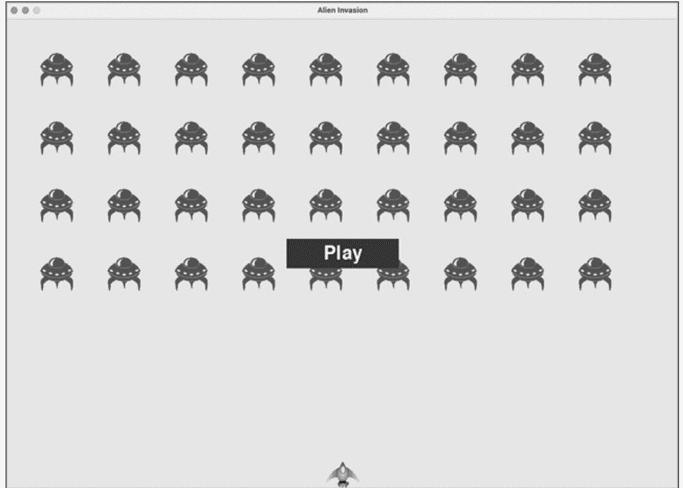
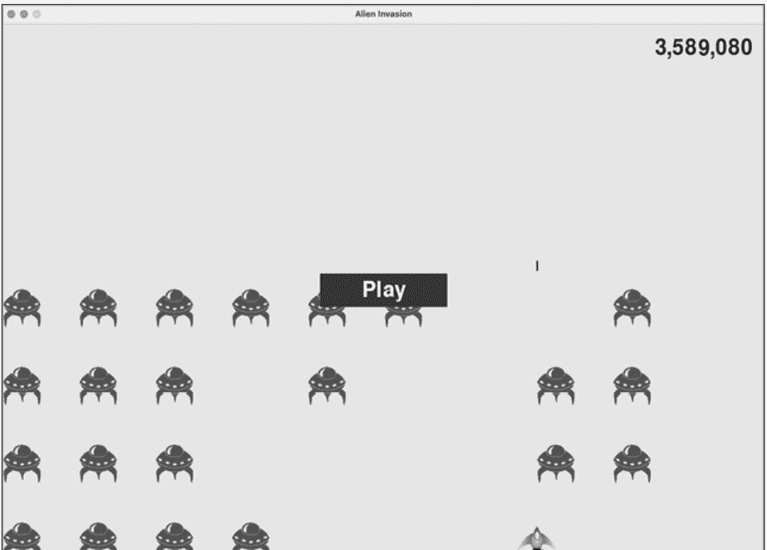
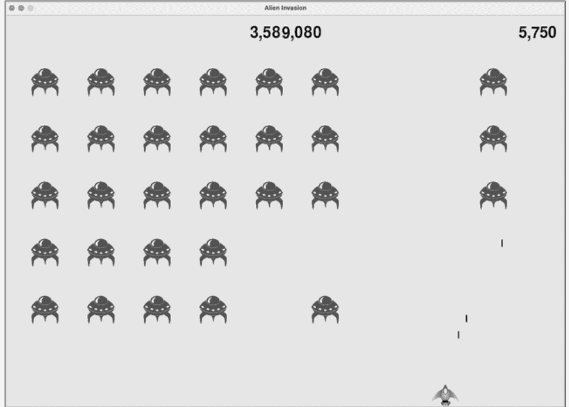
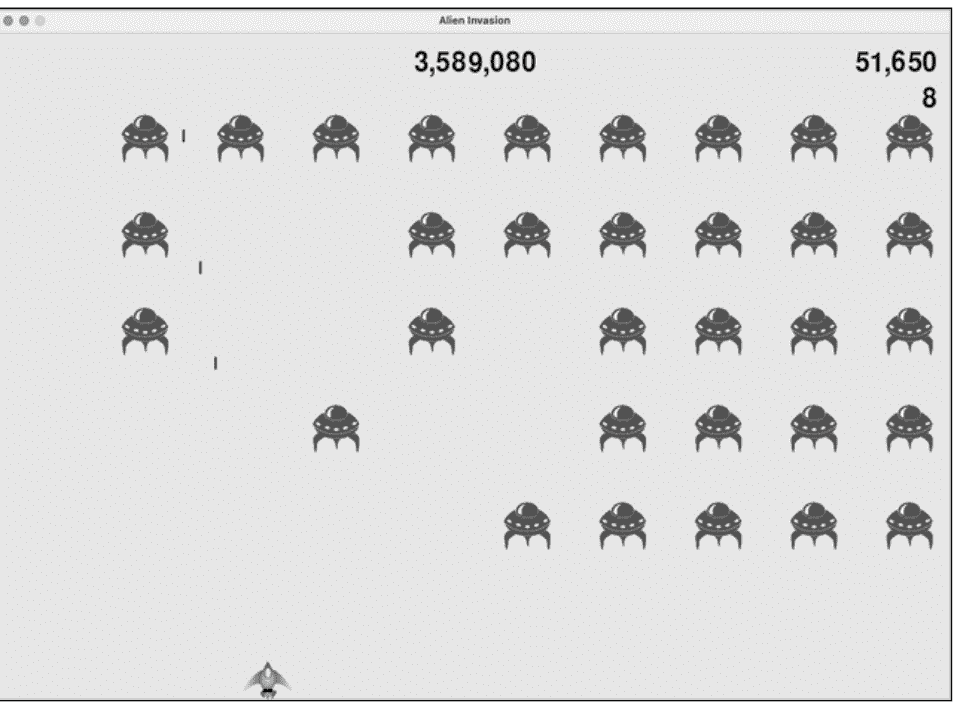
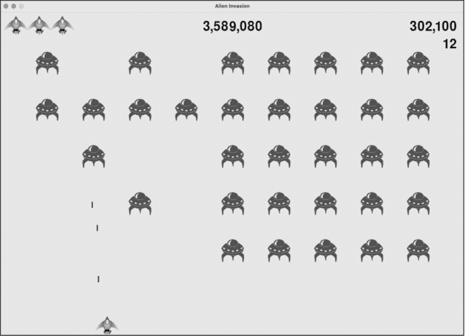

## 14
## 计分


在本章中，我们将完成 *Alien Invasion* 的构建。我们将添加一个 Play 按钮，以便按需开始游戏，并在游戏结束后重新开始游戏。我们还将修改游戏，使其在玩家升级时加速，并实现一个计分系统。在本章结束时，你将掌握足够的知识，能够开始编写随着玩家进步而难度增加、并具备完整计分系统的游戏。

### 添加 Play 按钮

在本节中，我们将添加一个 Play 按钮，它会在游戏开始前出现，并在游戏结束时重新出现，以便玩家可以再次游戏。

目前，只要你运行 *alien_invasion.py*，游戏就会开始。让我们让游戏以非活动状态启动，然后提示玩家点击 Play 按钮开始。为此，请修改 `AlienInvasion` 的 `__init__()` 方法：

*alien_invasion.py*

```python
def __init__(self):
    """Initialize the game, and create game resources."""
    pygame.init()
    --snip--

    # Start Alien Invasion in an inactive state.
    self.game_active = False
```

现在，游戏应该以非活动状态启动，在我们制作出 Play 按钮之前，玩家无法开始游戏。

### 创建 Button 类

由于 Pygame 没有内置的创建按钮的方法，我们将编写一个 Button 类来创建一个带标签的填充矩形。你可以使用这段代码在游戏中制作任何按钮。以下是 Button 类的第一部分；将其保存为 *button.py*：

*button.py*

```python
import pygame.font

class Button:
    """A class to build buttons for the game."""

    def __init__(self, ai_game, msg):
        """Initialize button attributes."""
        self.screen = ai_game.screen
        self.screen_rect = self.screen.get_rect()

        # Set the dimensions and properties of the button.
        self.width, self.height = 200, 50
        self.button_color = (0, 135, 0)
        self.text_color = (255, 255, 255)
        self.font = pygame.font.SysFont(None, 48)

        # Build the button's rect object and center it.
        self.rect = pygame.Rect(0, 0, self.width, self.height)
        self.rect.center = self.screen_rect.center

        # The button message needs to be prepped only once.
        self._prep_msg(msg)
```

首先，我们导入 `pygame.font` 模块，它让 Pygame 能将文本渲染到屏幕上。`__init__()` 方法接受参数 `self`、`ai_game` 对象和 `msg`，其中 `msg` 包含按钮的文本 ❶。我们设置按钮的尺寸 ❷，将 `button_color` 设置为深绿色以给按钮的 rect 对象着色，并将 `text_color` 设置为白色以渲染文本。

接下来，我们准备一个 `font` 属性来渲染文本 ❸。`None` 参数告诉 Pygame 使用默认字体，48 指定文本的尺寸。为了将按钮居中在屏幕上，我们为按钮创建一个 rect ❹，并将其 center 属性设置为与屏幕的 center 属性匹配。

Pygame 处理文本的方式是，将你想要显示的字符串渲染为图像。最后，我们调用 `_prep_msg()` 来处理这个渲染过程 ❺。

以下是 `_prep_msg()` 的代码：

*button.py*

```python
def _prep_msg(self, msg):
    """Turn msg into a rendered image and center text on the button."""
    self.msg_image = self.font.render(msg, True, self.text_color,
                                      self.button_color)
    self.msg_image_rect = self.msg_image.get_rect()
    self.msg_image_rect.center = self.rect.center
```


_prep_msg() 方法需要一个 self 参数以及要渲染为图像的文本（msg）。调用 font.render() 会将 msg 中存储的文本转换为图像，然后我们会将其存储在 self.msg_image 中 ①。font.render() 方法还接受一个布尔值，用于开启或关闭抗锯齿（抗锯齿会使文本边缘更平滑）。其余参数是指定的字体颜色和背景颜色。我们将抗锯齿设置为 True，并将文本背景设置为与按钮相同的颜色。（如果你不包含背景颜色，Pygame 会尝试使用透明背景来渲染字体。）

我们通过从图像创建一个 rect，并将其 center 属性设置为与按钮的 center 属性匹配，从而将文本图像居中于按钮上 ②。

最后，我们创建一个 draw_button() 方法，可以调用它来在屏幕上显示按钮：

button.py

```
def draw_button(self):
    """Draw blank button and then draw message."""
    self.screen.fill(self.button_color, self.rect)
    self.screen.blit(self.msg_image, self.msg_image_rect)
```

我们调用 screen.fill() 来绘制按钮的矩形部分。然后调用 screen.blit() 将文本图像绘制到屏幕上，向它传递一个图像和与该图像关联的 rect 对象。这样就完成了 Button 类。

## 将按钮绘制到屏幕

我们将使用 Button 类在 AlienInvasion 中创建一个 Play 按钮。首先，更新 import 语句：

alien_invasion.py

```
--snip--
from game_stats import GameStats
```

from button import Button

因为我们只需要一个 Play 按钮，所以我们将按钮创建在 `AlienInvasion` 的 `__init__()` 方法中。可以将这段代码放在 `__init__()` 的末尾：

**alien_invasion.py**

```
def __init__(self):
    --snip--
    self.game_active = False

    # Make the Play button.
    self.play_button = Button(self, "Play")
```

这段代码创建了一个标签为 Play 的 `Button` 实例，但没有将按钮绘制到屏幕上。要实现这一点，我们将在 `_update_screen()` 中调用按钮的 `draw_button()` 方法：

**alien_invasion.py**

```
def _update_screen(self):
    --snip--
    self.aliens.draw(self.screen)

    # Draw the play button if the game is inactive.
    if not self.game_active:
        self.play_button.draw_button()

    pygame.display.flip()
```

为了让 Play 按钮显示在屏幕所有其他元素之上，我们在绘制完所有其他元素之后、翻转屏幕之前绘制它。我们将其放在一个 `if` 代码块中，这样按钮只会在游戏未激活时出现。

现在运行 *《外星人入侵》*，你应该会在屏幕中央看到一个 Play 按钮，如图 14-1 所示。



图 14-1：游戏未激活时会出现一个 Play 按钮。

## 开始游戏

当玩家点击 Play 时启动新游戏，请在 `_check_events()` 的末尾添加以下 elif 代码块，以监听按钮上的鼠标事件：

alien_invasion.py

```
def _check_events(self):
    """Respond to keypresses and mouse events."""
    for event in pygame.event.get():
        if event.type == pygame.QUIT:
            --snip--
        elif event.type == pygame.MOUSEBUTTONDOWN:
            mouse_pos = pygame.mouse.get_pos()
            self._check_play_button(mouse_pos)
```

当玩家点击屏幕上的任意位置时，Pygame 会检测到 `MOUSEBUTTONDOWN` 事件 ❶，但我们希望游戏只对 Play 按钮上的鼠标点击做出响应。为此，我们使用 `pygame.mouse.get_pos()`，它会在鼠标按钮被点击时返回一个包含鼠标光标 x 和 y 坐标的元组 ❷。我们将这些值发送给新方法 `_check_play_button()` ❸。

下面是 `_check_play_button()`，我选择将其放在 `_check_events()` 之后：

**alien_invasion.py**

```python
def _check_play_button(self, mouse_pos):
    """Start a new game when the player clicks Play."""
    if self.play_button.rect.collidepoint(mouse_pos):
        self.game_active = True
```

我们使用 rect 方法 `collidepoint()` 来检查鼠标点击的位置是否与 Play 按钮的 rect 定义的区域重叠 ❶。如果是，我们将 `game_active` 设置为 `True`，游戏就开始了！

此时，你应该能够开始并玩一局完整的游戏。当游戏结束时，`game_active` 的值应变为 `False`，并且 Play 按钮应重新出现。

## 重置游戏

我们刚刚编写的 Play 按钮代码在玩家第一次点击 Play 时是有效的。但在第一局游戏结束后它就不起作用了，因为导致游戏结束的条件没有被重置。

为了在玩家每次点击 Play 时重置游戏，我们需要重置游戏统计信息，清除旧的外星人和子弹，创建新的外星人舰队，并将飞船居中，如下所示：

**alien_invasion.py**

```
def _check_play_button(self, mouse_pos):
    """Start a new game when the player clicks Play."""
    if self.play_button.rect.collidepoint(mouse_pos):
        # Reset the game statistics.
        self.stats.reset_stats()
        self.game_active = True

        # Get rid of any remaining bullets and aliens.
        self.bullets.empty()
        self.aliens.empty()

        # Create a new fleet and center the ship.
        self._create_fleet()
        self.ship.center_ship()
```

我们重置游戏统计信息 ❶，这会给玩家三艘新飞船。然后我们将 `game_active` 设置为 `True`，这样函数中的代码一运行完，游戏就会开始。我们清空外星人和子弹组 ❷，然后创建新的舰队并将飞船居中 ❸。

现在，每次点击 Play 时游戏都会正确重置，让你可以想玩多少次就玩多少次！

## 停用 Play 按钮

我们的 Play 按钮有一个问题：即使 Play 按钮不可见，屏幕上的按钮区域仍会继续响应点击。如果在游戏开始后不小心点击了 Play 按钮区域，游戏将重新开始！

要修复这个问题，请将游戏设置为仅在 `game_active` 为 `False` 时启动：

**alien_invasion.py**

```
def _check_play_button(self, mouse_pos):
    """Start a new game when the player clicks Play."""
    button_clicked = self.play_button.rect.collidepoint(mouse_pos)
    if button_clicked and not self.game_active:
```

```
```python
# Reset the game statistics.
self.stats.reset_stats()
--snip--
```
```

`button_clicked` 存储一个 True 或 False 值 ❶，游戏只会在 Play 被点击 *并且* 游戏当前不处于活动状态时重新开始 ❷。要测试此行为，请开始一个新游戏，并反复点击 Play 按钮应处的位置。如果一切正常，点击 Play 按钮区域应该不会对游戏过程产生任何影响。

## 隐藏鼠标光标

我们希望鼠标光标在游戏未激活时可见，但一旦游戏开始，它就会碍事。要解决这个问题，我们将在游戏变为活动状态时使其不可见。我们可以在 `_check_play_button()` 的 `if` 代码块末尾完成此操作：

```
```python
alien_invasion.py

def _check_play_button(self, mouse_pos):
    """Start a new game when the player clicks Play."""
    button_clicked = self.play_button.rect.collidepoint(mouse_pos)
    if button_clicked and not self.game_active:
        --snip--
        # Hide the mouse cursor.
        pygame.mouse.set_visible(False)
```
```

向 `set_visible()` 传递 False 会告诉 Pygame 在鼠标位于游戏窗口上时隐藏光标。

游戏结束后，我们将让光标重新出现，以便玩家可以再次点击 Play 开始新游戏。下面是实现该功能的代码：

```
```python
alien_invasion.py

def _ship_hit(self):
    """Respond to ship being hit by alien."""
```
```

我们首先重新组织 `Settings` 类，将游戏设置分为静态设置和动态设置。我们还要确保在开始新游戏时，任何在游戏过程中变化的设置都会被重置。下面是 *settings.py* 的 `__init__()` 方法：

# settings.py

```
def __init__(self):
    """Initialize the game's static settings."""
    # Screen settings
    self.screen_width = 1200
    self.screen_height = 800
    self.bg_color = (230, 230, 230)

    # Ship settings
    self.ship_limit = 3

    # Bullet settings
    self.bullet_width = 3
    self.bullet_height = 15
    self.bullet_color = 60, 60, 60
    self.bullets_allowed = 3

    # Alien settings
    self.fleet_drop_speed = 10

    # How quickly the game speeds up
    self.speedup_scale = 1.1

    self.initialize_dynamic_settings()
```

我们继续在 `__init__()` 方法中初始化保持不变的设置。我们添加了一个 `speedup_scale` 设置 ❶ 来控制游戏加速的速度：值为 2 会在玩家每次达到新关卡时使游戏速度翻倍；值为 1 会使速度保持不变。像 1.1 这样的值应该能够使速度提升到足以让游戏具有挑战性，但又不会无法完成。最后，我们调用 `initialize_dynamic_settings()` 方法来初始化那些需要在游戏过程中更改的属性的值 ❷。


**alien_invasion.py**

```python
def _check_bullet_alien_collisions(self):
    --snip--
    if not self.aliens:
        # Destroy existing bullets and create new fleet.
        self.bullets.empty()
        self._create_fleet()
        self.settings.increase_speed()
```

更改速度设置 ship_speed、alien_speed 和 bullet_speed 的值足以加快整个游戏的速度！

### 重置速度

现在我们需要在玩家每次开始新游戏时将所有更改过的设置恢复到初始值；否则，每次新游戏都会以上一局增加后的速度设置开始：

**alien_invasion.py**

```python
def _check_play_button(self, mouse_pos):
    """Start a new game when the player clicks Play."""
    button_clicked = self.play_button.rect.collidepoint(mouse_pos)
    if button_clicked and not self.game_active:
        # Reset the game settings.
        self.settings.initialize_dynamic_settings()
        --snip--
```

玩 *Alien Invasion* 现在应该更有趣也更具挑战性了。每次你清除屏幕时，游戏都会加速并变得稍微更困难一些。如果游戏变得太快太难，就降低 settings.speedup_scale 的值。或者如果游戏挑战性不够，就稍微增加该值。通过在合理的时间内逐步提升难度来找到一个合适的平衡点。前几个屏幕应该很简单，接下来的几个应该有挑战性但可以完成，而之后的屏幕应该几乎不可能完成。

## TRY IT YOURSELF

- **14-3. Challenging Target Practice:** 在练习 14-2（第 283 页）的基础上进行工作。随着游戏的进行使目标移动得更快，并在玩家点击 Play 时以原始速度重新开始目标。
- **14-4. Difficulty Levels:** 为 *Alien Invasion* 制作一组按钮，让玩家可以选择合适的游戏起始难度级别。每个按钮都应为 `Settings` 中创建不同难度级别所需的属性分配适当的值。

## Scoring

让我们实现一个计分系统，以实时跟踪游戏分数并显示最高分、等级和剩余飞船数量。

分数是游戏统计数据，因此我们将在 `GameStats` 中添加一个 `score` 属性：

**game_stats.py**

```python
class GameStats:
    --snip--
    def reset_stats(self):
        """Initialize statistics that can change during the game."""
        self.ships_left = self.ai_settings.ship_limit
        self.score = 0
```

为了在每次新游戏开始时重置分数，我们在 `reset_stats()` 中初始化 `score`，而不是在 `__init__()` 中。

### Displaying the Score

```python
score_str = str(self.stats.score)
self.score_image = self.font.render(score_str, True,
        self.text_color, self.settings.bg_color)

# Display the score at the top right of the screen.
self.score_rect = self.score_image.get_rect()
self.score_rect.right = self.screen_rect.right - 20
self.score_rect.top = 20
```

在 prep_score() 中，我们将数值 stats.score 转换为字符串 ❶，然后将此字符串传递给 render()，它创建图像 ❷。为了在屏幕上清晰地显示分数，我们将屏幕的背景颜色和文本颜色传递给 render()。

我们将分数定位在屏幕右上角，并使其随着分数增加和数字宽度变大而向左扩展。为了确保分数始终与屏幕右侧对齐，我们创建一个名为 score_rect 的 rect ❸，并将其右边缘设置在屏幕右边缘右侧 20 像素处 ❹。然后我们将顶部边缘放置在屏幕顶部下方 20 像素处 ❺。

然后我们创建一个 show_score() 方法来显示渲染后的分数图像：

**scoreboard.py**

```python
def show_score(self):
    """Draw score to the screen."""
    self.screen.blit(self.score_image, self.score_rect)
```

此方法将分数图像绘制到屏幕上，位置由 score_rect 指定。

### Making a Scoreboard

为了显示分数，我们将在 AlienInvasion 中创建一个 Scoreboard 实例。首先，让我们更新导入语句：

**alien_invasion.py**

```python
--snip--
from game_stats import GameStats
from scoreboard import Scoreboard
--snip--
```

接下来，我们在 __init__() 中创建 Scoreboard 的实例：

**alien_invasion.py**

```python
def __init__(self):
    --snip--
    pygame.display.set_caption("Alien Invasion")

    # Create an instance to store game statistics,
    #   and create a scoreboard.
    self.stats = GameStats(self)
    self.sb = Scoreboard(self)
    --snip--
```

然后我们在 _update_screen() 中在屏幕上绘制记分板：

**alien_invasion.py**

```python
def _update_screen(self):
    --snip--
    self.aliens.draw(self.screen)

    # Draw the score information.
    self.sb.show_score()

    # Draw the play button if the game is inactive.
    --snip--
```

我们在绘制 Play 按钮之前调用 show_score()。

现在运行 Alien Invasion 时，屏幕右上角应该会出现一个 0。（此时，我们只想确保分数出现在正确的位置，然后再进一步开发计分系统。）图 14-2 显示了游戏开始前分数的显示情况。

接下来，我们将为每个外星人分配分数值！


Figure 14-2: *The score appears at the top-right corner of the screen.*

### Updating the Score as Aliens Are Shot Down

为了在屏幕上写出实时分数，我们在外星人被击中时更新 `stats.score` 的值，然后调用 `prep_score()` 来更新分数图像。但首先，让我们确定玩家每次击落一个外星人时获得多少分：

**settings.py**

```python
def initialize_dynamic_settings(self):
    --snip--

    # Scoring settings
    self.alien_points = 50
```

```python
def _check_play_button(self, mouse_pos):
    --snip--
    if button_clicked and not self.game_active:
        --snip--
        # Reset the game statistics.
        self.stats.reset_stats()
        self.sb.prep_score()
    --snip--
```

我们在开始新游戏时重置游戏统计数据后调用 prep_score()。这会用 0 分为记分板做准备。

### Making Sure to Score All Hits

按当前写法，我们的代码可能会错过对某些外星人的计分。例如，如果在一次循环中两颗子弹与外星人相撞，或者如果我们制作了一颗更宽的子弹以击中多个外星人，玩家只会为击中其中一个外星人获得分数。为了解决这个问题，让我们改进子弹-外星人碰撞的检测方式。

**alien_invasion.py**

```python
def _check_bullet_alien_collisions(self):
    --snip--
    if collisions:
        for aliens in collisions.values():
            self.stats.score += self.settings.alien_points * len(aliens)
        self.sb.prep_score()
    --snip--
```

如果 collisions 字典已被定义，我们会遍历字典中的所有值。记住，每个值都是被一颗子弹击中的外星人列表。我们将每个外星人的值乘以每个列表中的外星人数量，并将此数量加到当前分数上。为了测试这一点，将子弹的宽度改为 300 像素并验证你是否能为用超宽子弹击中的每个外星人获得分数；然后将子弹宽度恢复到正常值。

### Increasing Point Values

由于游戏在玩家达到新等级时变得更困难，后期等级的外星人应该值更多的分数。为了实现此功能，我们将在游戏速度增加时添加增加分数值的代码：

**settings.py**

```python
class Settings:
    """A class to store all settings for Alien Invasion."""

    def __init__(self):
        --snip--
        # How quickly the game speeds up
        self.speedup_scale = 1.1
        # How quickly the alien point values increase
        self.score_scale = 1.5

        self.initialize_dynamic_settings()

    def initialize_dynamic_settings(self):
        --snip--

    def increase_speed(self):
        """Increase speed settings and alien point values."""
        self.ship_speed *= self.speedup_scale
        self.bullet_speed *= self.speedup_scale
        self.alien_speed *= self.speedup_scale

        self.alien_points = int(self.alien_points * self.score_scale)
```


我们定义了一个分数增长的速率，我们称之为 `score_scale` ❶。速度的微小提升（1.1）会让游戏迅速变得更具挑战性。但要看到得分上的更明显差异，我们需要以更大的幅度（1.5）改变外星人的分数值。现在当我们提升游戏速度时，我们也会提升每次击中的分数值 ❷。我们使用 `int()` 函数将分数值按整数递增。

要查看每个外星人的价值，请在 `Settings` 中的 `increase_speed()` 方法里添加一个 `print()` 调用：

**settings.py**

```python
def increase_speed(self):
    --snip--
    self.alien_points = int(self.alien_points * self.score_scale)
    print(self.alien_points)
```

每次达到新关卡时，新的分数值都应出现在终端中。

> **NOTE**
> 
> *在验证分数值确实在增加后，请务必移除 `print()` 调用，否则它可能会影响游戏性能并分散玩家的注意力。*

## Rounding the Score

大多数街机风格的射击游戏都会将分数报告为 10 的倍数，所以让我们也遵循这一做法来处理我们的分数。此外，让我们格式化分数以在较大数字中包含逗号分隔符。我们将在 `Scoreboard` 中进行此更改：

**scoreboard.py**

```python
def prep_score(self):
    """Turn the score into a rendered image."""
    rounded_score = round(self.stats.score, -1)
    score_str = f"{rounded_score:,}"
    self.score_image = self.font.render(score_str, True,
                                        self.text_color, self.settings.bg_color)
    --snip--
```

`round()` 函数通常将浮点数四舍五入到作为第二个参数给出的指定小数位数。然而，当你将负数作为第二个参数传递时，`round()` 会将值四舍五入到最接近的 10、100、1,000 等。这个代码告诉 Python 将 `stats.score` 的值四舍五入到最接近的 10 并将其赋给 `rounded_score`。

我们随后在 f-string 中使用格式说明符来处理分数。*格式说明符* 是一种特殊的字符序列，用于修改变量值的呈现方式。在这种情况下，序列 `:,` 告诉 Python 在提供的数值中插入逗号。这会产生像 `1,000,000` 这样的字符串，而不是 `1000000`。

现在运行游戏时，即使你累积了大量分数，也应能看到整洁格式化的、已四舍五入的分数，如 [Figure 14-3](#) 所示。



Figure 14-3: A rounded score with comma separators

## High Scores

每个玩家都想打破游戏的最高分，所以让我们跟踪并报告最高分，为玩家提供努力的目标。我们将在 GameStats 中存储最高分：

*game_stats.py*

```python
def __init__(self, ai_game):
    --snip--
    # High score should never be reset.
    self.high_score = 0
```

由于最高分永远不应被重置，我们在 __init__() 中初始化 high_score 而不是在 reset_stats() 中初始化。

第一次游玩 *Alien Invasion* 时，你的分数将是最高分，因此它会同时显示为当前分数和最高分。但当你开始第二局游戏时，你的最高分应出现在中间，当前分数应出现在右侧，如 Figure 14-4 所示。



Figure 14-4: *The high score is shown at the top center of the screen.*

## Displaying the Level

要在游戏中显示玩家的等级，我们首先需要在 `GameStats` 中有一个表示当前等级的属性。为了在每个新游戏开始时重置等级，请在 `reset_stats()` 中初始化它：

*game_stats.py*

```
def reset_stats(self):
    """Initialize statistics that can change during the g
```

```python
        self.ships_left = self.settings.ship_limit
        self.score = 0
        self.level = 1
```

为了让 Scoreboard 显示当前等级，我们从 __init__() 中调用一个新方法 prep_level()：

**scoreboard.py**

```python
    def __init__(self, ai_game):
        --snip--
        self.prep_high_score()
        self.prep_level()
```

以下是 prep_level()：

**scoreboard.py**

```python
    def prep_level(self):
        """Turn the level into a rendered image."""
        level_str = str(self.stats.level)
        self.level_image = self.font.render(level_str, True,
            self.text_color, self.settings.bg_color)

        # Position the level below the score.
        self.level_rect = self.level_image.get_rect()
        self.level_rect.right = self.score_rect.right
        self.level_rect.top = self.score_rect.bottom + 10
```

prep_level() 方法从 stats.level 中存储的值创建一张图像 ❶ 并将图像的 right 属性设置为与分数的 right 属性匹配 ❷。然后它将 top 属性设置为分数图像底部下方 10 像素，以在分数和等级之间留出空间 ❸。

我们还需要更新 show_score()：

**scoreboard.py**

```python
    def show_score(self):
        """Draw scores and level to the screen."""
        self.screen.blit(self.score_image, self.score_rect)
```

```
self.screen.blit(self.high_score_image, self.high_score_rect)
self.screen.blit(self.level_image, self.level_rect)
```

这一新行将等级图像绘制到屏幕上。

我们将在 `_check_bullet_alien_collisions()` 中递增 `stats.level` 并更新等级图像：

```
alien_invasion.py

```python
def _check_bullet_alien_collisions(self):
    --snip--
    if not self.aliens:
        # Destroy existing bullets and create new fleet.
        self.bullets.empty()
        self._create_fleet()
        self.settings.increase_speed()

        # Increase level.
        self.stats.level += 1
        self.sb.prep_level()
```
```

如果一个舰队被摧毁，我们递增 `stats.level` 的值并调用 `prep_level()` 以确保新等级正确显示。

为了确保在新游戏开始时等级图像能正确更新，我们在玩家点击 Play 按钮时也调用 `prep_level()`：

```
alien_invasion.py

```python
def _check_play_button(self, mouse_pos):
    --snip--
    if button_clicked and not self.game_active:
        --snip--
        self.sb.prep_score()
        self.sb.prep_level()
        --snip--
```
```

我们在调用 `prep_score()` 之后立即调用 `prep_level()`。

现在你可以看到已完成的关卡数，如 [Figure 14-5](#) 所示。



<span style="color:blue">Figure 14-5: The current level appears just below the current score.</span>

> **NOTE**
> *在某些经典游戏中，分数带有标签，例如 Score、High Score 和 Level。我们省略了这些标签，因为一旦你玩过游戏，每个数字的含义就会变得清晰。要包含这些标签，请在 Scoreboard 中调用 font.render() 之前将它们添加到分数字符串中。*

## Displaying the Number of Ships

最后，让我们显示玩家剩余的飞船数量，但这次让我们使用图形来实现。为此，我们将在屏幕左上角绘制飞船来表示剩余飞船数量，就像许多经典街机游戏所做的那样。

首先，我们需要让 Ship 继承自 Sprite，以便我们可以创建一个飞船组：

***ship.py***

```
import pygame
from pygame.sprite import Sprite

❶ class Ship(Sprite):
    """A class to manage the ship."""

    def __init__(self, ai_game):
        """Initialize the ship and set its starting position."""
❷      super().__init__()
        --snip--
```

在这里我们导入 Sprite，让 Ship 从 Sprite 继承 ❶，并在 __init__() 开始时调用 super() ❷。

接下来，我们需要修改 Scoreboard 以创建一个可以显示的飞船组。以下是 Scoreboard 的导入语句：

***scoreboard.py***

```
import pygame.font
from pygame.sprite import Group

from ship import Ship
```

由于我们要制作一个飞船组，我们导入了 Group 和 Ship 类。

以下是 __init__()：

***scoreboard.py***


```
def __init__(self, ai_game):
    """Initialize scorekeeping attributes."""
    self.ai_game = ai_game
    self.screen = ai_game.screen
    --snip--
    self.prep_level()
    self.prep_ships()
```

我们将游戏实例赋给一个属性，因为我们需要它来创建一些飞船。我们在调用 prep_level() 之后调用 prep_ships()。

以下是 prep_ships()：

scoreboard.py

```
def prep_ships(self):
    """Show how many ships are left."""
    self.ships = Group()
    for ship_number in range(self.stats.ships_left):
        ship = Ship(self.ai_game)
        ship.rect.x = 10 + ship_number * ship.rect.width
        ship.rect.y = 10
        self.ships.add(ship)
```

prep_ships() 方法创建一个空的组 self.ships 来存放飞船实例 ①。为了填充这个组，一个循环会为玩家剩下的每艘飞船运行一次 ②。在循环内部，我们创建一个新的飞船并设置每艘飞船的 x 坐标值，使飞船彼此相邻排列，并在飞船组左侧留出 10 像素的边距 ③。我们将 y 坐标值设置为距离屏幕顶部 10 像素下方，使飞船出现在屏幕左上角 ④。然后我们将每个新飞船添加到组 ships 中 ⑤。

现在我们需要将飞船绘制到屏幕上：

scoreboard.py

```
def show_score(self):
    """Draw scores, level, and ships to the screen."""
    self.screen.blit(self.score_image, self.score_rect)
    self.screen.blit(self.high_score_image, self.high_score_rect)
    self.screen.blit(self.level_image, self.level_rect)
    self.ships.draw(self.screen)
```

要将飞船显示在屏幕上，我们在组上调用 `draw()`，Pygame 会绘制每艘飞船。

为了让玩家知道新游戏开始时有多少艘飞船，我们在 AlienInvasion 中 `_check_play_button()` 开始新游戏时调用 `prep_ships()`。我们这样做：

# alien_invasion.py

```
def _check_play_button(self, mouse_pos):
    --snip--
    if button_clicked and not self.game_active:
        --snip--
        self.sb.prep_level()
        self.sb.prep_ships()
        --snip--
```

我们也在飞船被击中时调用 `prep_ships()`，以更新飞船图像的显示，当玩家损失一艘飞船时：

# alien_invasion.py

```
def _ship_hit(self):
    """Respond to ship being hit by alien."""
    if self.stats.ships_left > 0:
        # Decrement ships_left, and update scoreboard.
        self.stats.ships_left -= 1
        self.sb.prep_ships()
        --snip--
```

我们在减少 `ships_left` 值之后调用 `prep_ships()`，以便每次飞船被摧毁时都能正确显示剩余飞船的数量。

[Figure 14-6](#) 显示了完整的计分系统，剩余飞船显示在屏幕左上角。



[Figure 14-6](#): *Alien Invasion 的完整计分系统*

# TRY IT YOURSELF

**14-5. All-Time High Score:** 每次玩家关闭并重新启动 *Alien Invasion* 时，最高分都会被重置。通过在调用 `sys.exit()` 之前将最高分写入文件，并在 `GameStats` 中初始化其值时读取最高分来修复这个问题。

**14-6. Refactoring:** 寻找执行多项任务的方法，并重构它们以组织代码并使其高效。例如，将 `_check_bullet_alien_collisions()` 中在外星人舰队被摧毁时开始新关卡的代码移动到一个名为 `start_new_level()` 的函数中。此外，将 `Scoreboard` 中 `__init__()` 方法中的四个独立方法调用移动到一个名为 `prep_images()` 的方法中，以缩短 `__init__()`。`prep_images()` 方法也可以帮助简化 `_check_play_button()` 或 `start_game()`，如果您已经重构了 `_check_play_button()`。

# NOTE

> *在尝试重构项目之前，请参阅附录 D，了解如何在重构时引入错误的情况下将项目恢复到工作状态。*

**14-7. Expanding the Game:** 想办法扩展 *Alien Invasion*。例如，您可以编程让外星人向您的飞船发射子弹。您还可以为您的飞船添加可以躲藏的护盾，这些护盾可以被来自任一方的子弹摧毁。或者您可以使用类似 `pygame.mixer` 的模块来添加音效，例如爆炸和射击声音。

**14-8. Sideways Shooter, Final Version:** 继续开发 *Sideways Shooter*，使用我们在本项目中所做的一切。添加一个 Play 按钮，使游戏在适当的时候加快速度，并开发一个计分系统。务必在工作时重构代码，并寻找超越本章所示内容自定义游戏的机会。

# Summary

在本章中，您学习了如何实现一个 Play 按钮来开始新游戏。您还学习了如何检测鼠标事件并在游戏中隐藏光标。您可以使用所学知识创建其他按钮，例如 Help 按钮来显示游戏说明。您还学习了如何随着游戏进程修改游戏速度，实现渐进式计分系统，并以文本和非文本方式显示信息。

*OceanofPDF.com*
