# 15
GENERATING DATA


*数据可视化* 是使用视觉表示来探索和呈现数据集中的模式。它与 *数据分析* 紧密相关，数据分析使用代码来探索数据集中的模式和联系。数据集可以是适合单行代码的小数字列表，也可以是包含许多不同类型信息的数 TB 数据。

创建有效的数据可视化不仅仅是让信息看起来漂亮。当数据集的表示简单且视觉上吸引人时，其含义对观众来说变得清晰。人们会看到数据集中他们从未知道存在的模式和意义。

幸运的是，您不需要超级计算机来可视化复杂数据。Python 效率很高，只需一台笔记本电脑，您就可以快速探索包含数百万个独立数据点的<|message|>。这些数据点不必是数字；凭借您在本书记的第一部分学到的基础知识，您也可以分析非数值数据。

人们在遗传学、气候研究、政治和经济分析等数据密集型工作中使用 Python。数据科学家在 Python 中编写了令人印象深刻的可视化和分析工具集合，其中许多工具也对您可用。其中最受欢迎的工具之一是 Matplotlib，一个数学绘图库。在本章中，我们将使用 Matplotlib 制作简单的图表，例如线图和散点图。然后我们将基于随机游走的概念创建一个更有趣的数据集——随机游走是一种由一系列随机决策生成的可视化。

我们还将使用一个名为 Plotly 的包来分析掷骰子的结果，Plotly 创建的视觉效果在数字设备上效果很好。Plotly 生成的可视化会自动调整大小以适应各种显示设备。这些可视化还可以包括许多交互式功能，例如当用户悬停在可视化的不同部分时强调数据集的特定方面。学习使用 Matplotlib 和 Plotly 将帮助您开始可视化您最感兴趣的数据类型。

# Installing Matplotlib

要使用 Matplotlib 进行初始可视化，您需要使用 pip 安装它，就像我们在第 11 章中对 pytest 所做的那样（参见第 210 页的“使用 pip 安装 pytest”）。

要安装 Matplotlib，在终端提示符下输入以下命令：

```
$ python -m pip install --user matplotlib
```

我们创建一个名为 `squares` 的列表来保存我们将要绘制的数据。然后我们遵循另一个常见的 Matplotlib 惯例，即调用 `subplots()` 函数 ❶。该函数可以在同一图形中生成一个或多个绘图。变量 `fig` 代表整个 *图形*，即生成的绘图集合。变量 `ax` 代表图形中的单个绘图；这是我们在定义和自定义单个绘图时最常使用的变量。

然后我们使用 `plot()` 方法，该方法尝试以有意义的方式绘制给定的数据。函数 `plt.show()` 打开 Matplotlib 的查看器并显示绘图，如 [Figure 15-1](#) 所示。查看器允许您缩放和导航绘图，您可以通过单击磁盘图标保存任何绘图图像。

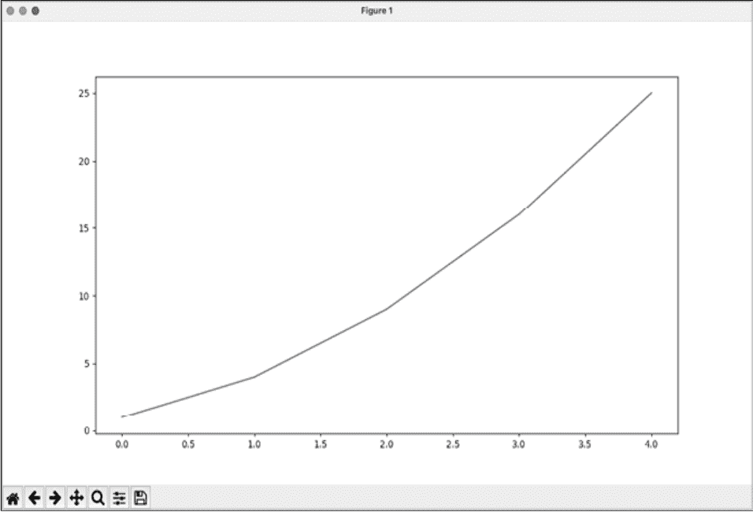

*Figure 15-1: 您可以在 Matplotlib 中制作的最简单的绘图之一*


## 更改标签类型和线宽

虽然图15-1中的图形显示数字在增加，但标签类型太小，线条有点太细，不易阅读。幸运的是，Matplotlib允许你调整可视化的每一个特征。

我们将使用一些可用的自定义选项来提高该图形的可读性。让我们从添加标题和标注坐标轴开始：

```python
# mpl_squares.py
import matplotlib.pyplot as plt

squares = [1, 4, 9, 16, 25]

fig, ax = plt.subplots()
# 1
ax.plot(squares, linewidth=3)

# Set chart title and label axes.
# 2
ax.set_title("Square Numbers", fontsize=24)
# 3
ax.set_xlabel("Value", fontsize=14)
ax.set_ylabel("Square of Value", fontsize=14)

# Set size of tick labels.
# 4
ax.tick_params(labelsize=14)

plt.show()
```

`linewidth`参数控制`plot()`生成的线条粗细❶。生成图形后，在显示图形之前有许多方法可以修改它。`set_title()`方法为图表设置一个整体标题❷。`fontsize`参数在代码中反复出现，用于控制图表中各种元素的文本大小。

`set_xlabel()`和`set_ylabel()`方法允许你为每个坐标轴设置标题❸，而`tick_params()`方法

通过向`plot()`同时提供用于计算平方数的输入值和输出值，来覆盖默认行为：

**mpl_squares.py**

```python
import matplotlib.pyplot as plt

input_values = [1, 2, 3, 4, 5]
squares = [1, 4, 9, 16, 25]

fig, ax = plt.subplots()
ax.plot(input_values, squares, linewidth=3)

# Set chart title and label axes.
--snip--
```

现在`plot()`不必再对输出数字的生成方式做任何假设。由此生成的图形如[图15-3](#)所示，是正确的。

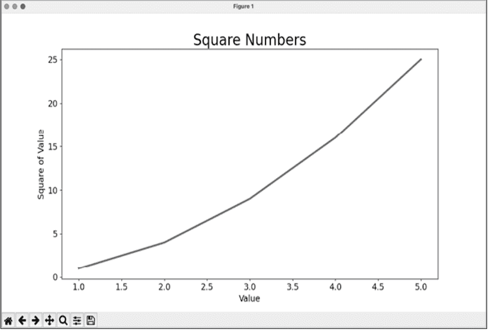

图15-3：*数据现在被正确绘制了。*

你可以在调用`plot()`时指定多个参数，并在生成图形后使用多种方法来定制它们。随着本章中使用更有趣的数据集，我们将继续探索这些定制方法。

## 使用内置样式

Matplotlib有许多预定义样式可用。这些样式包含各种默认设置，如背景颜色、网格线、线宽、字体、字号等。它们可以让你的可视化在不需要太多定制的情况下就显得很吸引人。要查看完整可用样式列表，请在终端会话中运行以下行：

```
>>> import matplotlib.pyplot as plt
>>> plt.style.available
['Solarize_Light2', '_classic_test_patch', '_mpl-gallery',
--snip--
```

要使用这些样式中的任何一种，只需在调用`subplots()`之前添加一行代码：

**mpl_squares.py**

```python
import matplotlib.pyplot as plt

input_values = [1, 2, 3, 4, 5]
squares = [1, 4, 9, 16, 25]

plt.style.use('seaborn')
fig, ax = plt.subplots()
--snip--
```

这段代码生成图15-4所示的图形。可用的样式种类繁多；可以试着使用这些样式，找到一些你喜欢的。

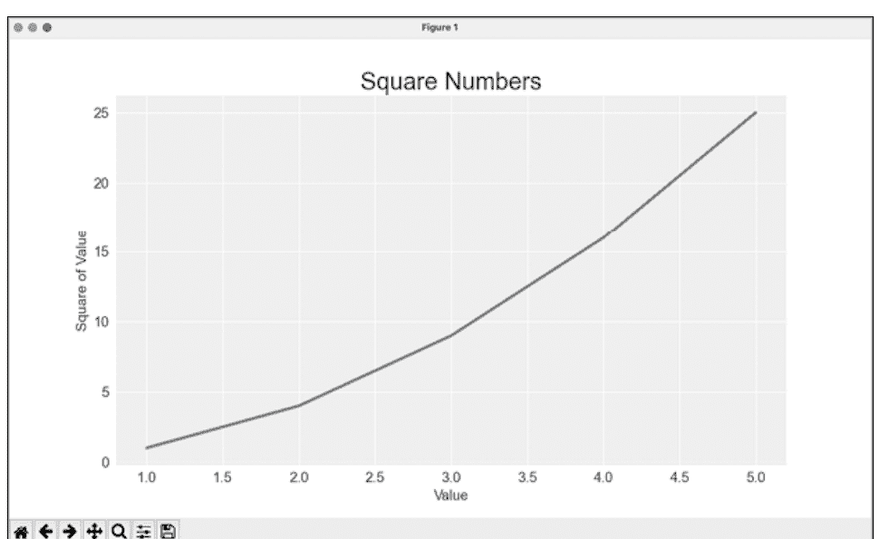

图15-4：内置的seaborn样式

## 使用scatter()绘制和样式化单个点

有时，根据某些特征绘制和样式化单个点很有用。例如，你可以用一种颜色绘制较小的值，用另一种颜色绘制较大的值。你也可以用一组样式选项绘制大型数据集，然后通过使用不同选项重新绘制来强调个别点。

要绘制单个点，请将该点的单个x值和y值传递给`scatter()`：

**scatter_squares.py**

```python
import matplotlib.pyplot as plt

plt.style.use('seaborn')
fig, ax = plt.subplots()
ax.scatter(2, 4)
```

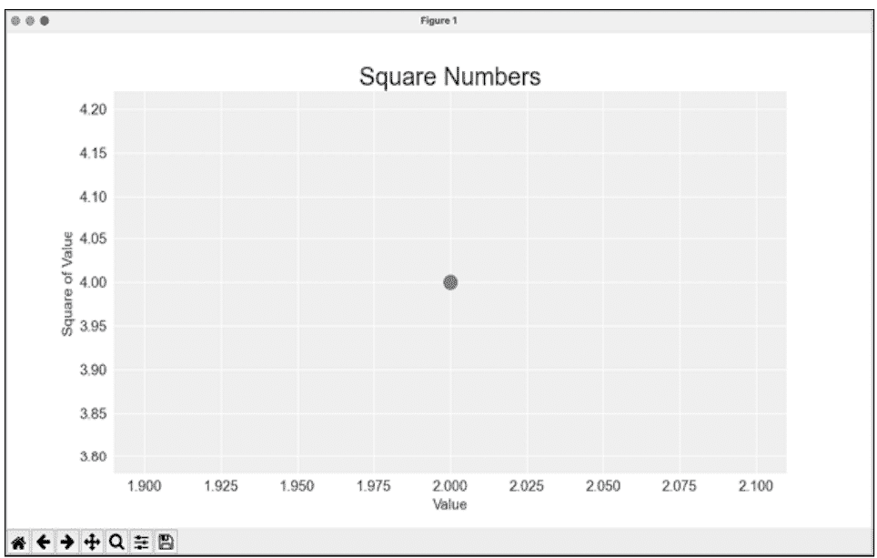

图15-5：绘制单个点

### 使用scatter()绘制一系列点

要绘制一系列点，我们可以将*x*值和*y*值的独立列表传给`scatter()`，如下所示：

**scatter_squares.py**

```python
import matplotlib.pyplot as plt

x_values = [1, 2, 3, 4, 5]
y_values = [1, 4, 9, 16, 25]

plt.style.use('seaborn')
fig, ax = plt.subplots()
ax.scatter(x_values, y_values, s=100)

# Set chart title and label axes.
--snip--
```

`x_values`列表包含要平方的数字，`y_values`包含每个数字的平方。当这些

`ticklabel_format()`方法允许你覆盖任意绘图的默认刻度标签样式。

### 定义自定义颜色

要更改点的颜色，请将`color`参数传递给`scatter()`，并使用引号括起来的颜色名称，如下所示：

```
ax.scatter(x_values, y_values, color='red', s=10)
```

你还可以使用RGB颜色模型定义自定义颜色。要定义颜色，请向`color`参数传递一个包含三个浮点值的元组（分别依次表示红色、绿色和蓝色），使用0到1之间的值。例如，以下行创建了一个带有浅绿色点的图形：

```
ax.scatter(x_values, y_values, color=(0, 0.8, 0), s=10)
```

值越接近0，颜色越深；值越接近1，颜色越浅。

### 使用颜色映射

*颜色映射*是一系列颜色构成的渐变，从起始颜色过渡到结束颜色。在可视化中，颜色映射用于强调数据中的模式。例如，你可以让低值使用浅色，高值使用深色。使用颜色映射可以确保可视化中的所有点沿着设计良好的颜色刻度平滑而准确地变化。

`pyplot`模块包含一组内置颜色映射。要使用其中一个颜色映射，你需要指定`pyplot`如何为数据集中的每个点分配颜色。下面是根据每个点的*y*值为其分配颜色的方法：

**scatter_squares.py**

```python
--snip--
plt.style.use('seaborn')
fig, ax = plt.subplots()
ax.scatter(x_values, y_values, c=y_values, cmap=plt.cm.Blues,
s=10)

# Set chart title and label axes.
--snip--
```

*c*参数与*color*类似，但它用于将值序列与颜色映射关联起来。我们将*y*值列表传递给*c*，然后通过*cmap*参数告诉*pyplot*使用哪个颜色映射。这段代码将*y*值较低的点着色为浅蓝色，将*y*值较高的点着色为深蓝色。[图15-8](#)显示了生成的图形。

**注意**

*你可以在[https://matplotlib.org](https://matplotlib.org)查看pyplot中所有可用的颜色映射。转到Tutorials，向下滚动到Colors，然后点击**Choosing Colormaps in Matplotlib**。*

| 试一试 |
| :--- |
| **15-1. 立方数：** 一个数的三次方称为*立方数*。绘制前五个三次方数，然后绘制前5,000个三次方数。<br>**15-2. 彩色立方数：** 为你的立方数图应用一个颜色映射。 |

## 随机漫步

在本节中，我们将使用Python为随机漫步生成数据，然后使用Matplotlib创建该数据的可视化表示。*随机漫步*是一条由一系列简单决策决定的路径，每个决策都完全由偶然因素决定。你可以将随机漫步想象成一只困惑的蚂蚁在每一步都朝随机方向走时所走的路径。

随机漫步在自然、物理学、生物学、化学和经济学中都有实际应用。例如，漂浮在水滴上的花粉颗粒会移动穿过水面，因为它不断被水分子推来推去。水滴中的分子运动是随机的，因此花粉颗粒在水面上留下的轨迹就是一条随机漫步。我们接下来编写的代码模拟了许多现实世界中的情况。

### 创建RandomWalk类

要创建随机漫步，我们将创建一个`RandomWalk`类，该类将随机决定漫步应该朝哪个方向走。这个类需要三个属性：一个变量用于跟踪漫步中的点数，两个列表用于存储漫步中每个点的*x*和*y*坐标。


我们只需要为 `RandomWalk` 类编写两个方法：`__init__()` 方法和 `fill_walk()`，后者用于计算随机漫步中的各点。我们先从 `__init__()` 方法开始：

`random_walk.py`

```python
from random import choice

class RandomWalk:
    """A class to generate random walks."""

    def __init__(self, num_points=5000):
        """Initialize attributes of a walk."""
        self.num_points = num_points

        # All walks start at (0, 0).
        self.x_values = [0]
        self.y_values = [0]
```

为了做出随机决策，我们将可能的移动存储在一个列表中，并使用 `choice()` 函数（来自 `random` 模块）来决定每次迈出一步时该选择哪种移动。我们将一次随机漫步的默认点数设置为 5000，这个数值足够大，能生成一些有趣的模式，但也足够小，能快速生成漫步。然后我们创建两个列表来保存 x 值和 y 值，并以点 (0, 0) 作为每次漫步的起点。

## 选择方向

我们将使用 `fill_walk()` 方法来确定漫步中点的完整序列。将此方法添加到 `random_walk.py` 中：

`random_walk.py`

```python
    def fill_walk(self):
        """Calculate all the points in the walk."""

        # Keep taking steps until the walk reaches the desired length.
        while len(self.x_values) < self.num_points:

            # Decide which direction to go, and how far to go.

            x_direction = choice([1, -1])
            x_distance = choice([0, 1, 2, 3, 4])
            x_step = x_direction * x_distance

            y_direction = choice([1, -1])
            y_distance = choice([0, 1, 2, 3, 4])
            y_step = y_direction * y_distance

            # Reject moves that go nowhere.
            if x_step == 0 and y_step == 0:
                continue

            # Calculate the new position.
            x = self.x_values[-1] + x_step
            y = self.y_values[-1] + y_step

            self.x_values.append(x)
            self.y_values.append(y)
```

我们首先设置一个循环，该循环一直运行，直到漫步被填满正确数量的点。`fill_walk()` 的主要部分告诉 Python 如何模拟四个随机决策：漫步是向右还是向左？在该方向上走多远？是向上还是向下？在该方向上走多远？

我们使用 `choice([1, -1])` 为 `x_direction` 选择一个值，该函数要么返回 1 表示向右移动，要么返回 −1 表示向左移动。接下来，`choice([0, 1, 2, 3, 4])` 随机选择在该方向上移动的距离。我们将此值赋给 `x_distance`。包含 0 允许出现只在单个轴上移动的步骤。

我们将运动方向乘以所选距离来确定 x 和 y 方向上每一步的长度。`x_step` 为正表示向右移动，为负表示向左移动，为 0 表示垂直移动。`y_step` 为正表示向上移动，为负表示向下移动，为 0 表示水平移动。如果 `x_step` 和 `y_step` 的值都为 0，则漫步不会去任何地方；发生这种情况时，我们继续循环。

要获得漫步的下一个 x 值，我们将 `x_step` 的值添加到 `x_values` 中存储的最后一个值，并对 y 值执行相同操作。有了新点的坐标后，我们将它们追加到 `x_values` 和 `y_values`。

## 绘制随机漫步

以下代码用于绘制漫步中的所有点：

`rw_visual.py`

```python
import matplotlib.pyplot as plt

from random_walk import RandomWalk

# Make a random walk.
rw = RandomWalk()
rw.fill_walk()

# Plot the points in the walk.
plt.style.use('classic')
fig, ax = plt.subplots()
ax.scatter(rw.x_values, rw.y_values, s=15)
ax.set_aspect('equal')
plt.show()
```

我们首先导入 `pyplot` 和 `RandomWalk`。然后创建一个随机漫步并将其赋给 `rw`，确保调用 `fill_walk()`。为了可视化漫步，我们将漫步的 x 值和 y 值传递给 `scatter()`，并选择合适的点大小。默认情况下，Matplotlib 会独立缩放每个轴。但这种方法会将大部分漫步在水平或垂直方向拉伸。这里我们使用 `set_aspect()` 方法指定两个轴在刻度之间具有相等的间距。

图 15-9 显示了包含 5,000 个点的结果图。本节中的图像省略了 Matplotlib 的查看器，但当你运行 *rw_visual.py* 时，你仍会看到它。

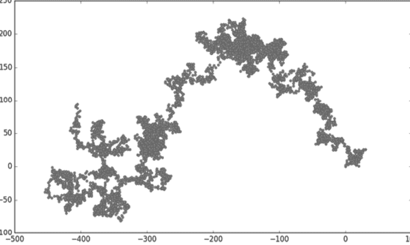

图 15-9：*包含 5,000 个点的随机漫步*

## 生成多个随机漫步

每一次随机漫步都不相同，探索可以生成的各种模式非常有趣。使用前面的代码生成多个漫步而不必多次运行程序的一种方法是将其包装在一个 `while` 循环中，如下所示：

`rw_visual.py`

```python
import matplotlib.pyplot as plt

from random_walk import RandomWalk

# Keep making new walks, as long as the program is active.
while True:
    # Make a random walk.
    --snip--
    plt.show()

    keep_running = input("Make another walk? (y/n): ")
    if keep_running == 'n':
        break
```

这段代码生成一个随机漫步，在 Matplotlib 的查看器中显示，并在查看器打开时暂停。当你关闭查看器时，系统会询问你是否要生成另一个漫步。如果你生成几个漫步，你会看到一些漫步停留在起点附近，一些主要朝一个方向游荡，一些通过狭窄的部分连接较大的点群，以及许多其他类型的漫步。当你想结束程序时，按下 N。

## 美化漫步

在本节中，我们将自定义图表，以强调每次漫步的重要特征，并弱化分散注意力的元素。为此，我们确定要强调的特征，例如漫步的起点、终点以及所走的路径。接下来，我们确定要弱化的特征，例如刻度线和标签。结果应是一个简单的可视化表示，清晰地传达每次随机漫步所走的路径。

### 为点上色

我们将使用颜色映射来显示漫步中各点的顺序，并移除每个点的黑色轮廓，以便点的颜色更清晰。要根据点在漫步中的位置为其着色，我们将包含每个点位置的列表传递给 `c` 参数。由于这些点按顺序绘制，因此该列表仅包含从 0 到 4,999 的数字：

`rw_visual.py`

```python
--snip--
while True:
    # Make a random walk.
    rw = RandomWalk()
    rw.fill_walk()

    # Plot the points in the walk.
    plt.style.use('classic')
    fig, ax = plt.subplots()
    point_numbers = range(rw.num_points)
    ax.scatter(rw.x_values, rw.y_values, c=point_numbers, cmap=plt.cm.Blues,
               edgecolors='none', s=15)
    ax.set_aspect('equal')
    plt.show()
--snip--
```

我们使用 `range()` 生成一个与漫步点数相等的数字列表。我们将此列表赋给 `point_numbers`，用来设置漫步中每个点的颜色。我们将 `point_numbers` 传递给 `c` 参数，使用 `Blues` 颜色映射，然后传递 `edgecolors='none'` 以去除每个点周围的黑色轮廓。结果是一个从浅蓝到深蓝变化的图，精确展示了漫步如何从起点移动到终点。如图 15-10 所示。

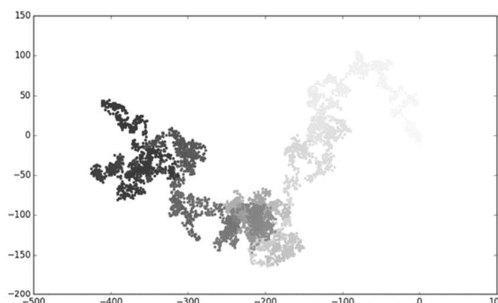

图 15-10：*使用 Blues 颜色映射着色的随机漫步*

### 绘制起点和终点

除了为点着色以显示它们在漫步中的位置之外，准确看到每次漫步的起点和终点也很有用。为此，我们可以在主序列绘制完成后，单独绘制第一个点和最后一个点。我们将端点放大并以不同颜色着色，使它们更加突出：

`rw_visual.py`

```python
--snip--
while True:
    --snip--
    ax.scatter(rw.x_values, rw.y_values, c=point_numbers, cmap=plt.cm.Blues,
               edgecolors='none', s=15)
    ax.set_aspect('equal')

    # Emphasize the first and last points.
    ax.scatter(0, 0, c='green', edgecolors='none', s=100)
    ax.scatter(rw.x_values[-1], rw.y_values[-1], c='red', edgecolors='none',
```


继续使用可视化时，你会经常看到这种链式方法来定制可视化的不同方面。

现在运行 *rw_visual.py*；你应该能看到一系列没有坐标轴的图。

### 添加绘图点

让我们增加点的数量，以便有更多数据可用。为此，我们在创建`RandomWalk`实例时增大`num_points`的值，并在绘图时调整每个点的大小：

**rw_visual.py**

```python
--snip--
while True:
    # Make a random walk.
    rw = RandomWalk(50_000)
    rw.fill_walk()

    # Plot the points in the walk.
    plt.style.use('classic')
    fig, ax = plt.subplots()
    point_numbers = range(rw.num_points)
    ax.scatter(rw.x_values, rw.y_values, c=point_numbers, cmap=plt.cm.Blues,
        edgecolors='none', s=1)
--snip--
```

这个示例创建了一个包含50,000个点的随机漫步，并以`s=1`的大小绘制每个点。生成的漫步纤细如云，如图15-11所示。我们从一个简单的散点图创造出了一件艺术品！

尝试修改这段代码，看看在系统明显变慢或图形失去视觉吸引力之前，你能将漫步中的点数增加到多少。

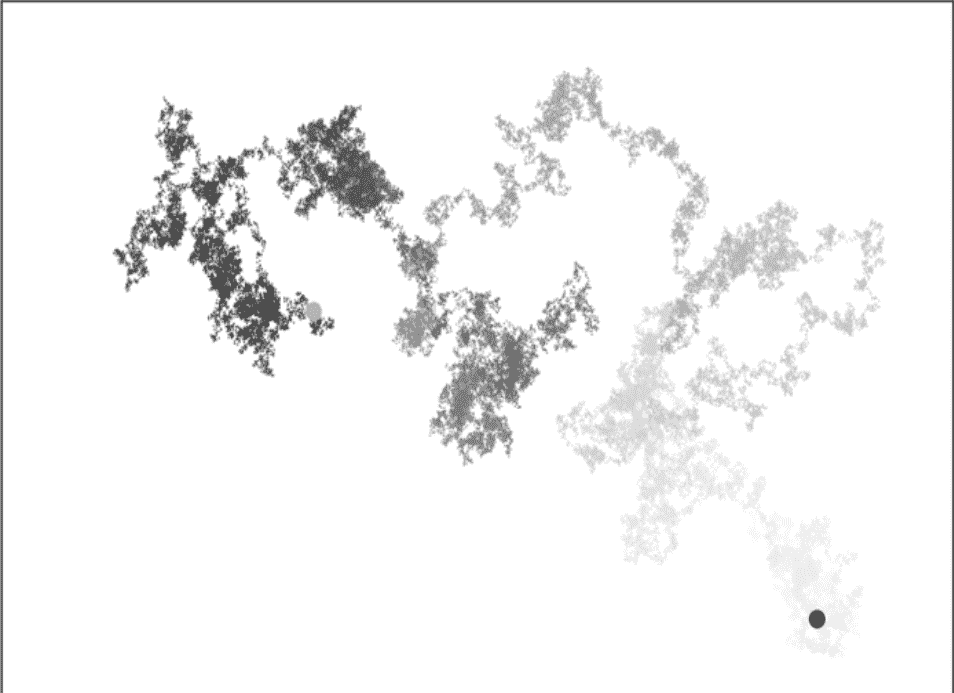

图15-11：包含50,000个点的漫步

### 调整尺寸以填满屏幕

如果可视化能很好地适应屏幕，它在传达数据模式方面会更加有效。为了使绘图窗口更好地适应屏幕，你可以调整Matplotlib输出的大小。这可以在`subplots()`调用中完成：

```
fig, ax = plt.subplots(figsize=(15, 9))
```

创建图形时，你可以向`subplots()`传递`figsize`参数，该参数设置图形的大小。`figsize`参数接受一个元组，告诉Matplotlib绘图窗口的尺寸（以英寸为单位）。

Matplotlib假设您的屏幕分辨率为每英寸100像素；如果此代码不能给出准确的图形大小，请根据需要调整数字。或者，如果您知道系统的分辨率，可以使用`dpi`参数将分辨率传递给`subplots()`：

```
fig, ax = plt.subplots(figsize=(10, 6), dpi=128)
```

这有助于最有效地利用屏幕上的可用空间。

| **自己试试** |
| :--- |
| **15-3. 分子运动：** 修改 *rw_visual.py*，用 `ax.plot()` 替换 `ax.scatter()`。为了模拟花粉颗粒在一滴水表面的路径，传入 `rw.x_values` 和 `rw.y_values`，并包含 `linewidth` 参数。使用5,000个点而不是50,000个，以免图形过于拥挤。 |
| **15-4. 修改随机漫步：** 在 `RandomWalk` 类中，`x_step` 和 `y_step` 由同一组条件生成。方向从列表 `[1, -1]` 中随机选择，距离从列表 `[0, 1, 2, 3, 4]` 中选择。修改这些列表中的值，看看漫步的整体形状会发生什么变化。尝试更长的距离选项列表，例如0到8，或者从 *x* 方向或 *y* 方向列表中删除 -1。 |
| **15-5. 重构：** `fill_walk()` 方法很长。创建一个名为 `get_step()` 的新方法，用于确定每一步的方向和距离，然后计算步长。在 `fill_walk()` 中应该会有两次对 `get_step()` 的调用：<br>`x_step = self.get_step()`<br>`y_step = self.get_step()`<br>这种重构可以减少 `fill_walk()` 的规模，使方法更容易阅读和理解。 |

## 使用Plotly掷骰子

在本节中，我们将使用Plotly来生成交互式可视化。当你在创建要在浏览器中显示的可视化时，Plotly特别有用，因为可视化会自动缩放以适应查看器的屏幕。这些可视化也是交互式的；当用户将鼠标悬停在屏幕上的某些元素上时，有关这些元素的信息会被突出显示。我们将使用*Plotly Express*（Plotly的一个子集，专注于用尽可能少的代码生成图形）编写几行代码来构建我们的初始可视化。一旦知道图形正确，我们将像使用Matplotlib一样自定义输出。

在这个项目中，我们将分析掷骰子的结果。当你掷一个普通的六面骰子时，掷出1到6中任何数字的机会均等。然而，当你使用两个骰子时，某些数字出现的可能性会更大。我们将尝试通过生成一个表示掷骰子的数据集来确定哪些数字最有可能出现。然后，我们将绘制大量投掷结果，以确定哪些结果比其他结果更有可能。

这项工作有助于模拟涉及骰子的游戏，但核心思想也适用于任何涉及机会的游戏，例如纸牌游戏。它还涉及许多随机性起重要作用的现实世界情况。

### 安装Plotly

使用pip安装Plotly，就像你安装Matplotlib一样：

```
$ python -m pip install --user plotly
$ python -m pip install --user pandas
```

Plotly Express依赖于*pandas*，这是一个用于高效处理数据的库，所以我们也需要安装它。如果你在安装Matplotlib时使用了`python3`或其它命令，请确保在这里使用相同的命令。

要了解Plotly可以创建哪些类型的可视化，请访问 https://plotly.com/python 上的图表类型画廊。

每个示例都包含源代码，因此你可以看到Plotly如何生成可视化。

### 创建Die类

我们将创建以下`Die`类来模拟掷一个骰子：

**die.py**

```python
from random import randint

class Die:
    """A class representing a single die."""

    def __init__(self, num_sides=6):
        """Assume a six-sided die."""
        self.num_sides = num_sides

    def roll(self):
        """Return a random value between 1 and number of sides."""
        return randint(1, self.num_sides)
```

`__init__()`方法接受一个可选参数❶。对于Die类，当创建骰子实例时，如果不包含参数，则面数将为6。如果包含参数，该值将设置骰子的面数。（骰子以其面数命名：六面骰是D6，八面骰是D8，依此类推。）

`roll()`方法使用`randint()`函数返回1到面数之间的随机数❷。此函数可以返回起始值（1）、结束值（`num_sides`）或两者之间的任何整数。

### 掷骰子

在基于Die类创建可视化之前，让我们先掷一个D6，打印结果，并检查结果是否合理：

**die_visual.py**

```python
from die import Die

# Create a D6.
die = Die()

# Make some rolls, and store results in a list.
results = []
for roll_num in range(100):
    result = die.roll()
    results.append(result)

print(results)
```

我们创建一个默认六面的Die实例①。然后掷骰子100次②，并将每次掷出的结果存储在results列表中。以下是一组结果示例：

```
[4, 6, 5, 6, 1, 5, 6, 3, 5, 3, 5, 3, 2, 2, 1, 3, 1, 5, 3, 6, 3, 6, 5, 4, 1, 1, 4, 2, 3, 6, 4, 2, 6, 4, 1, 3, 2, 5, 6, 3, 6, 2, 1, 1, 3, 4, 1, 4, 3, 5, 1, 4, 5, 5, 2, 3, 3, 1, 2, 3, 5, 6, 2, 5, 6, 1, 3, 2, 1, 1, 1, 6, 5, 5, 2, 2, 6, 4, 1, 4, 5, 1, 1, 1, 4, 5, 3, 3, 1, 3, 5, 4, 5, 6, 5, 4, 1, 5, 1, 2]
```

快速浏览这些结果可以看出Die类似乎工作正常。我们看到1和6的值，因此我们知道正在返回最小和最大可能值，并且由于没有看到0或7，我们知道所有结果都在适当范围内。我们还看到从1到6的每个数字，这表明所有可能的结果都出现了。让我们确定每个数字出现的次数。

### 分析结果


我们将通过统计每个数字被掷出的次数来分析掷一个 D6 骰子的结果：

```python
# die_visual.py

--snip--
# 进行多次掷骰，并将结果存储在列表中。
results = []
for roll_num in range(1000):
    result = die.roll()
    results.append(result)

# 分析结果。
frequencies = []
poss_results = range(1, die.num_sides+1)
for value in poss_results:
    frequency = results.count(value)
    frequencies.append(frequency)

print(frequencies)
```

由于我们不再打印结果，因此可以将模拟掷骰次数增加到 1000 次❶。为了分析掷骰结果，我们创建空列表 `frequencies`，用于存储每个数值被掷出的次数。然后我们生成可能出现的所有结果；在本例中，就是从 1 到骰子面数的所有数字❷。我们遍历这些可能的值，统计每个数字在 `results` 中出现的次数❸，然后将该值追加到 `frequencies` 中❹。在进行可视化之前，我们先打印这个列表：

```text
[155, 167, 168, 170, 159, 181]
```

这些结果看起来合理：我们看到 6 个频率，分别对应掷一个 D6 骰子时可能出现的每个数字。我们还看到，没有任何一个频率显著高于其他频率。现在让我们将这些结果可视化。

## 制作直方图

现在我们有了所需的数据，只需几行代码即可使用 Plotly Express 生成可视化：

```python
# die_visual.py

import plotly.express as px

from die import Die
--snip--

for value in poss_results:
    frequency = results.count(value)
    frequencies.append(frequency)

# 可视化结果。
fig = px.bar(x=poss_results, y=frequencies)
fig.show()
```

我们首先导入 `plotly.express` 模块，并使用惯用别名 `px`。然后使用 `px.bar()` 函数创建条形图。在这个函数最简单的用法中，我们只需传递一组 x 值和一组 y 值。这里 x 值是掷单个骰子的可能结果，y 值是每个可能结果对应的频率。

最后一行调用 `fig.show()`，它告诉 Plotly 将生成的图表渲染为 HTML 文件，并在新的浏览器选项卡中打开该文件。结果如图 15-12 所示。

这是一个非常简单的图表，当然还不完整。但这正是 Plotly Express 的预期用法；你编写几行代码，查看图表，并确保它按照你想要的方式表示数据。如果你对所见内容满意，就可以继续自定义图表的元素，如标签和样式。但如果你想探索其他可能的图表类型，现在就可以这样做，无需在自定义工作上额外花费时间。现在你可以自由尝试，将 `px.bar()` 改为 `px.scatter()` 或 `px.line()` 之类的函数。你可以在 https://plotly.com/python/plotly-express 找到可用图表类型的完整列表。

这个图表是动态且交互式的。如果你改变浏览器窗口的大小，图表会调整大小以匹配可用空间。如果你将鼠标悬停在任意一个条形上，会看到一个弹出窗口，突出显示与该条形相关的具体数据。

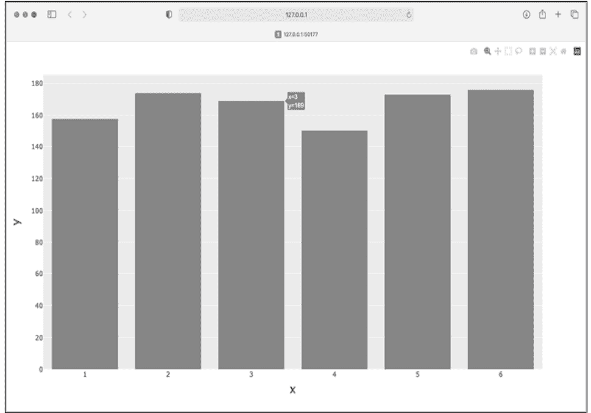

图 15-12：Plotly Express 生成的初始图表

## 自定义图表

现在我们知道了图表类型正确且数据表示准确，就可以专注于为图表添加合适的标签和样式。

使用 Plotly 自定义图表的第一个方法是在生成图表的初始调用中使用一些可选参数，在这里就是 `px.bar()`。下面是如何添加整体标题和每个轴的标签：

```python
# die_visual.py

--snip--
# 可视化结果。
title = "掷一个 D6 骰子 1,000 次的结果"
labels = {'x': '结果', 'y': '结果频率'}
fig = px.bar(x=poss_results, y=frequencies, title=title, labels=labels)
fig.show()
```

我们首先定义想要的标题，在这里赋给 `title`①。要定义轴标签，我们编写一个字典②。字典中的键表示我们要自定义的标签，值是我们想要使用的自定义标签。这里我们将 x 轴标签设为“结果”，将 y 轴标签设为“结果频率”。对 `px.bar()` 的调用现在包含了可选参数 `title` 和 `labels`。

现在生成图表时，它会包含合适的标题和每个轴的标签，如图 15-13 所示。

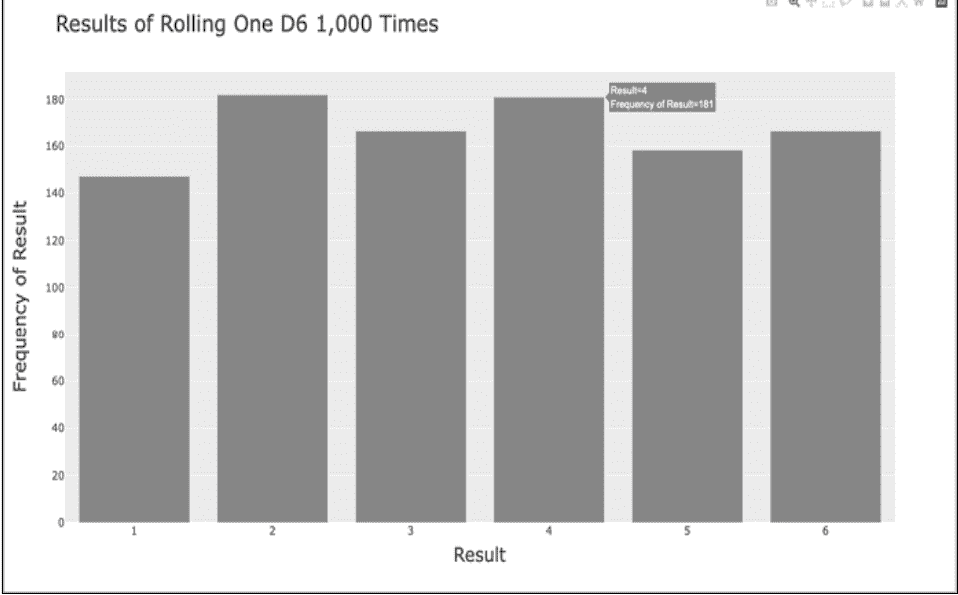

图 15-13：使用 Plotly 创建的简单条形图

## 掷两个骰子

掷两个骰子会产生更大的数字和不同的结果分布。让我们修改代码来创建两个 D6 骰子，模拟掷一对骰子的方式。每次掷这一对骰子时，我们将两个数字（每个骰子一个）相加，并将总和存储在 `results` 中。将 `die_visual.py` 保存一份副本并命名为 `dice_visual.py`，然后进行以下更改：

```python
# dice_visual.py

import plotly.express as px

from die import Die

# 创建两个 D6 骰子。
die_1 = Die()
die_2 = Die()

# 进行多次掷骰，并将结果存储在列表中。
results = []
for roll_num in range(1000):
    result = die_1.roll() + die_2.roll()
    results.append(result)

# 分析结果。
frequencies = []
max_result = die_1.num_sides + die_2.num_sides
poss_results = range(2, max_result+1)
for value in poss_results:
    frequency = results.count(value)
    frequencies.append(frequency)

# 可视化结果。
title = "掷两个 D6 骰子 1,000 次的结果"
labels = {'x': '结果', 'y': '结果频率'}
fig = px.bar(x=poss_results, y=frequencies, title=title, labels=labels)
fig.show()
```

创建两个 `Die` 的实例后，我们掷骰子并计算每次掷骰时两个骰子的总和①。最小的可能结果（2）是两个骰子上最小数字的总和。最大的可能结果（12）是两个骰子上最大数字的总和，我们将其赋给 `max_result`②。变量 `max_result` 使生成 `poss_results` 的代码更易于阅读③。我们本来可以写 `range(2, 13)`，但这只适用于两个 D6 骰子。在模拟现实世界的情况时，最好编写能够轻松模拟各种情况的代码。这段代码允许我们模拟掷任意面数的一对骰子。

运行此代码后，你应该会看到一个类似图 15-14 的图表。

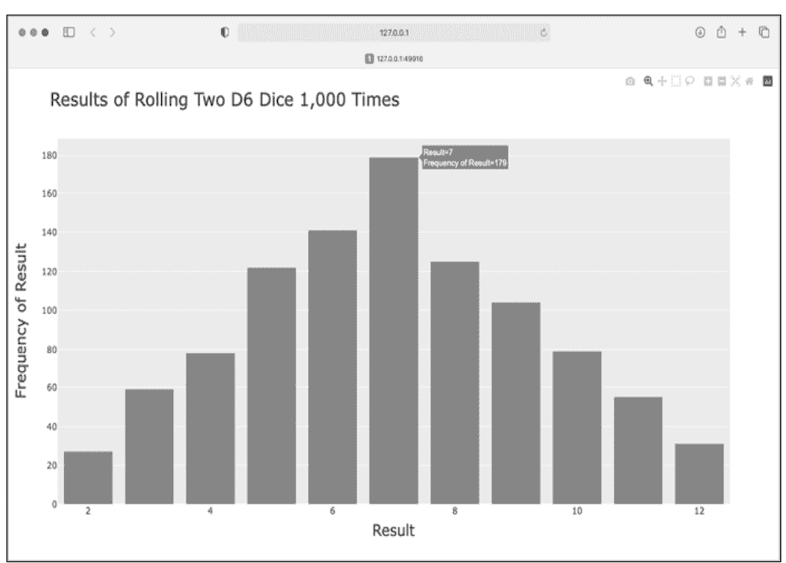

图 15-14：掷两个六面骰子 1,000 次的模拟结果

此图显示了掷一对 D6 骰子时可能得到的结果的大致分布。如你所见，掷出 2 或 12 的可能性最小，而掷出 7 的可能性最大。这是因为有六种方式可以掷出 7：1 和 6、2 和 5、3 和 4、4 和 3、5 和 2、6 和 1。

## 进一步自定义

对于我们刚生成的图表，有一个问题需要解决。现在有 11 个条形，默认的 x 轴布局设置会使一些条形没有标签。虽然默认设置对大多数可视化来说效果不错，但如果所有条形都有标签，这个图表看起来会更好。

Plotly 有一个 `update_layout()` 方法，可以在图形创建后对其进行各种更新。下面是如何告诉 Plotly 为每个条形提供自己的标签：

```python
# dice_visual.py

--snip--
fig = px.bar(x=poss_results, y=frequencies, title=title, labels=labels)

# 进一步自定义图表。
fig.update_layout(xaxis_dtick=1)

fig.show()
```

`update_layout()` 方法作用于表示整个图表的 `fig` 对象。这里我们使用 `xaxis_dtick` 参数，它指定 x 轴上刻度标记之间的距离。我们将间距设置为 1，以便每个条形都有标签。再次运行 *dice_visual.py* 时，你应该会看到每个条形上都有一个标签。

## 掷不同大小的骰子

让我们创建一个六面骰子和一个十面骰子，看看将它们掷 50,000 次会发生什么：

```python
# dice_visual_d6d10.py

import plotly.express as px

from die import Die

# 创建一个 D6 和一个 D10。
die_1 = Die()
die_2 = Die(10)

# 进行多次掷骰，并将结果存储在列表中。
results = []
for roll_num in range(50_000):
    result = die_1.roll() + die_2.roll()
```


```
results.append(result)

# Analyze the results.
--snip--

# Visualize the results.
② title = "Results of Rolling a D6 and a D10 50,000 Times"
labels = {'x': 'Result', 'y': 'Frequency of Result'}
--snip--
```

要制作一个 D10，我们在创建第二个 Die 实例时传入参数 10 ①，并将第一个循环改为模拟 50,000 次掷骰子而不是 1,000 次。我们也修改了图表的标题 ②。

图 15-15 显示了结果图表。现在不再只有一个最可能的结果，而是有五个这样的结果。这是因为掷出最小值和最大值仍然各只有一种方式（1 和 1、6 和 10），但较小的骰子限制了产生中间数字的方式数量。掷出 7、8、9、10 或 11 各有六种方式，这些是最常见的结果，而且掷出其中任何一个的概率相同。

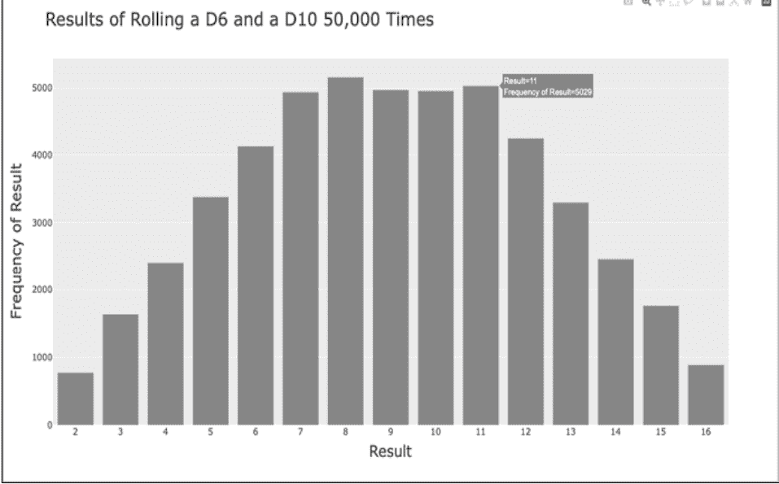

图 15-15：掷一个六面骰子和一个十面骰子 50,000 次的结果

我们能够使用 Plotly 对掷骰子进行建模，这让探索这一现象有了相当大的自由度。只需几分钟，你就可以使用多种多样的骰子模拟大量的掷骰次数。

### 保存图形

当你得到满意的图形时，你随时可以通过浏览器将图表保存为 HTML 文件。但你也可以通过编程方式实现。要将图表保存为 HTML 文件，请将对 fig.show() 的调用替换为对 fig.write_html() 的调用：

```
fig.write_html('dice_visual_d6d10.xhtml')
```

`write_html()` 方法需要一个参数：要写入的文件名。如果只提供文件名，文件将保存在 `.py` 文件所在的目录中。你也可以用一个 `Path` 对象调用 `write_html()`，将输出文件写到系统上的任何位置。

### 动手试一试

- **15-6. 两个 D8 骰子：** 创建一个模拟，展示掷两个八面骰子 1,000 次会发生什么。在运行模拟之前，试着想象你认为可视化结果会是什么样子，然后看看你的直觉是否正确。逐渐增加掷骰次数，直到你开始看到系统能力的极限。

- **15-7. 三个骰子：** 当你掷三个 D6 骰子时，能掷出的最小数字是 3，最大数字是 18。创建一个可视化，展示掷三个 D6 骰子时会发生什么。

- **15-8. 乘法：** 当你掷两个骰子时，通常会将两个数字相加得到结果。创建一个可视化，展示如果将这两个数字相乘会发生什么。

- **15-9. 骰子推导式：** 为清晰起见，本节中的代码清单使用了 `for` 循环的完整形式。如果你对列表推导式比较熟悉，试着为这些程序中的一个或两个循环编写推导式。

- **15-10. 练习使用两个库：** 尝试使用 Matplotlib 制作掷骰子可视化，并使用 Plotly 制作随机漫步可视化。（你需要查阅每个库的文档来完成这个练习。）

### 小结

在本章中，你学会了生成数据集并创建这些数据的可视化。你用 Matplotlib 创建了简单的图形，并使用散点图探索了随机漫步。你还用 Plotly 创建了直方图，并用它探索了不同大小骰子的掷骰结果。

用代码生成自己的数据集是一种有趣而强大的方式，可以对各种真实世界的情况进行建模和探索。在继续完成后续的数据可视化项目时，请留意那些也许可以用代码建模的情况。看看在新闻媒体中看到的可视化，试着识别出哪些是使用与你在这些项目中所学方法类似的方法生成的。

在第 16 章中，你将在线下载数据，并继续使用 Matplotlib 和 Plotly 来探索这些数据。

[OceanofPDF.com](OceanofPDF.com)
