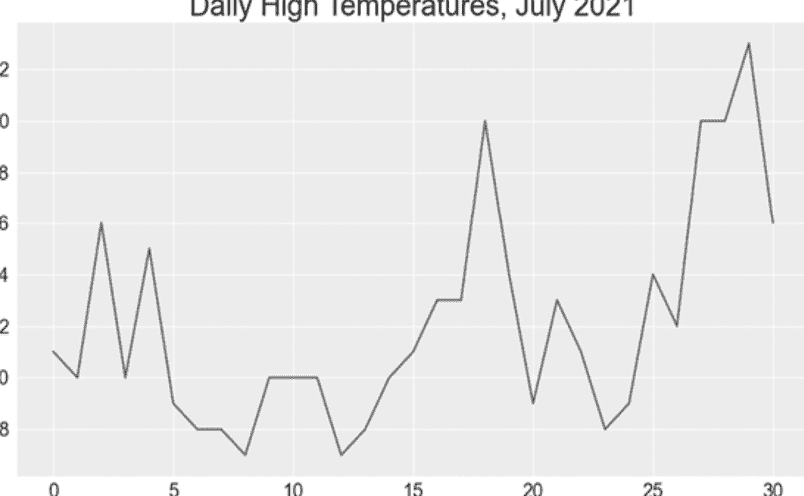
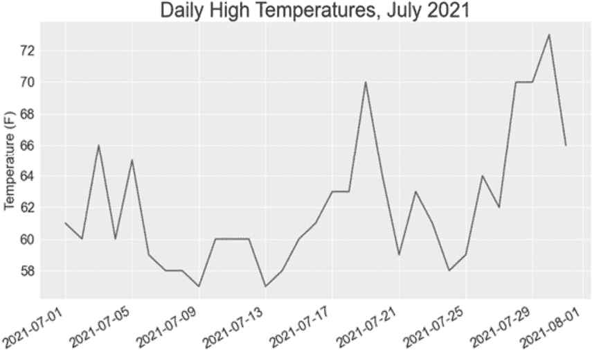
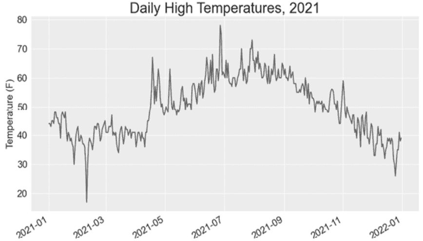
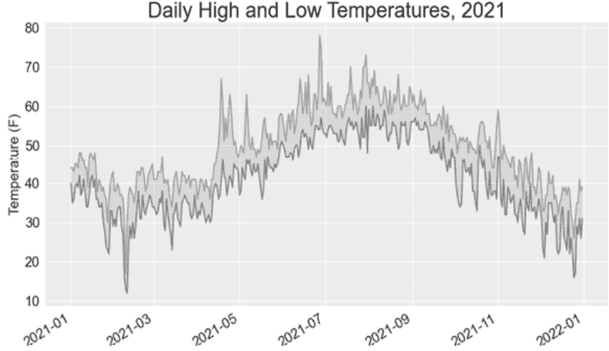
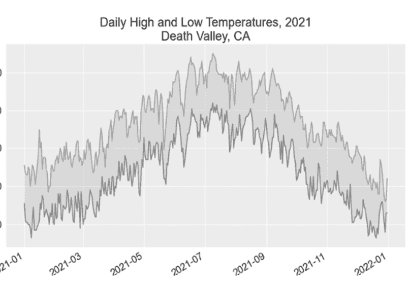
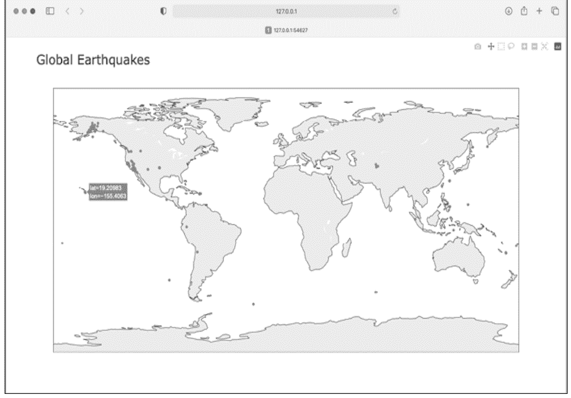
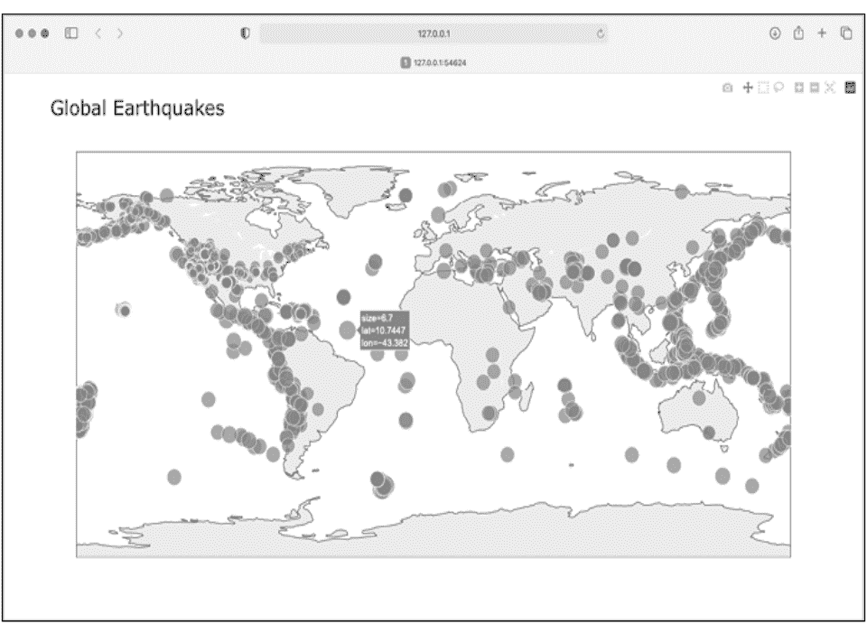
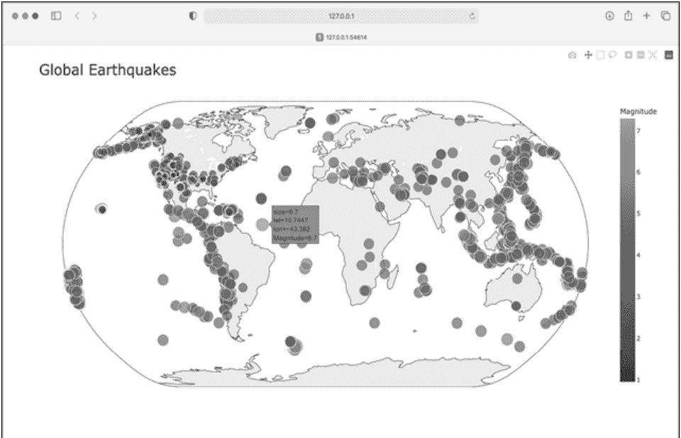
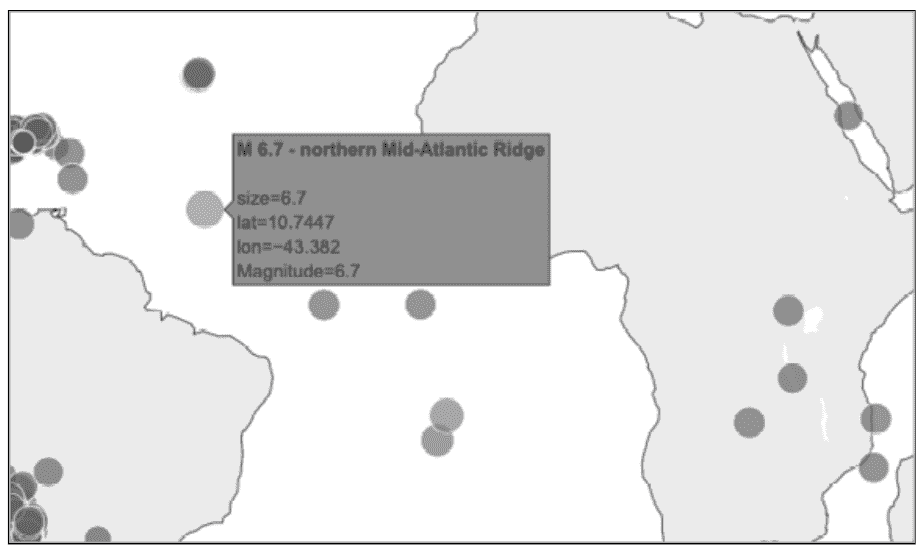

## 16 下载数据


在本章中，你将在线下载数据集并创建这些数据的可视化作品。你可以在网上找到种类多得惊人的数据，其中许多还没有被深入研究。分析这些数据的能力让你能够发现别人尚未发现的模式和关联。

我们将访问并可视化以两种常见数据格式存储的数据：CSV 和 JSON。我们将使用 Python 的 csv 模块处理以 CSV 格式存储的天气数据，并分析两个不同地点随时间的最高和最低气温。然后，我们将使用 Matplotlib 根据下载的数据生成图表，以显示两个不同环境中的温度变化：阿拉斯加的锡特卡（Sitka）和加利福尼亚的死谷（Death Valley）。在本章后面，我们将使用 `json` 模块访问以 GeoJSON 格式存储的地震数据，并使用 Plotly 绘制一张世界地图，显示近期地震的位置和震级。

到本章结束时，你将能够处理不同格式的各种类型数据集，并且对如何构建复杂的可视化有更深入的理解。能够访问和可视化在线数据，对于处理各种真实世界的数据集至关重要。

### CSV 文件格式

在文本文件中存储数据的一种简单方法是将数据写成一系列用逗号分隔的值，称为 *逗号分隔值*。生成的文件就是 CSV 文件。例如，下面是一段 CSV 格式的天气数据：

```
"USW00025333","SITKA AIRPORT, AK US","2021-01-01",,"44","40"
```

这是阿拉斯加州锡特卡 2021 年 1 月 1 日的天气数据片段。它包含了当天的高温和低温，以及当天的许多其他测量值。CSV 文件对人类来说读起来很繁琐，但程序可以快速准确地处理和提取其中的信息。

我们将从锡特卡记录的一小组 CSV 格式天气数据开始；这些数据可在此书的资源中获取：<https://ehmatthes.github.io/pcc_3e>。在你保存本章程序的文件夹内，创建一个名为 *weather_data* 的文件夹。将文件 *sitka_weather_07-2021_simple.csv* 复制到这个新文件夹中。（下载完此书的资源后，你将拥有这个项目所需的全部文件。）

**注意**

本项目的天气数据最初是从 <https://ncdc.noaa.gov/cdo-web> 下载的。

### 解析 CSV 文件头

标准库中的 Python `csv` 模块会解析 CSV 文件中的行，让我们能够快速提取感兴趣的值。让我们先看一下文件的第一行，其中包含一系列数据文件头。这些文件头告诉我们数据包含哪些类型的信息：

**sitka_highs.py**

```python
from pathlib import Path
import csv

path = Path('weather_data/sitka_weather_07-2021_simple.csv')
lines = path.read_text().splitlines()

reader = csv.reader(lines)
header_row = next(reader)
print(header_row)
```

这里我们只调用了一次 next()，因此得到文件的第一行，其中包含文件头 ③。我们将返回的数据赋给 header_row。正如你所见，header_row 包含了有意义的、与天气相关的文件头，它们告诉我们每一行数据包含哪些信息：

```
['STATION', 'NAME', 'DATE', 'TAVG', 'TMAX', 'TMIN']
```

reader 对象处理文件中第一行逗号分隔的值，并将每个值存储为列表中的一个元素。文件头 STATION 表示记录这些数据的天气站代码。该文件头的位置告诉我们，每一行的第一个值将是天气站代码。NAME 文件头表示每一行的第二个值是进行记录的天气站名称。其余文件头指明了每次读数中记录了哪些类型的信息。我们目前最感兴趣的数据是日期（DATE）、最高气温（TMAX）和最低气温（TMIN）。这是一个只包含温度相关数据的简单数据集。当你下载自己的天气数据时，可以选择包含与风速、风向和降水量相关的许多其他测量值。

### 打印文件头及其位置

为了更容易理解文件头数据，让我们打印每个文件头及其在列表中的位置：

sitka_highs.py

```
--snip--
reader = csv.reader(lines)
header_row = next(reader)

for index, column_header in enumerate(header_row):
    print(index, column_header)
```


`enumerate()` 函数会在你遍历列表时，返回每一项的索引和值。（注意，我们删除了 `print(header_row)` 这一行，改用这个更详细的版本。）

下面是显示每个标题索引的输出：

```
0 STATION
1 NAME
2 DATE
3 TAVG
4 TMAX
5 TMIN
```

我们可以看到，日期和最高温度存储在第 2 列和第 4 列。为了探索这些数据，我们将处理 *sitka_weather_07-2021_simple.csv* 中的每一行数据，并提取索引为 2 和 4 的值。

## 提取并读取数据

既然知道了需要哪些数据列，下面就来读取部分数据。首先，读取每天的最高温度：

*sitka_highs.py*

```python
--snip--
reader = csv.reader(lines)
header_row = next(reader)

# Extract high temperatures.
highs = []
for row in reader:
    high = int(row[4])
    highs.append(high)

print(highs)
```

我们创建了一个名为 `highs` 的空列表①，然后遍历文件中剩余的行②。`reader` 对象会从它在 CSV 文件中上次停止的位置继续读取，并自动返回当前位置之后的每一行。由于我们已经读取了标题行，循环将从第二行（实际数据开始的位置）开始。每次循环时，我们从索引 4（对应标题 TMAX）提取数据，并赋值给变量 `high` ③。我们使用 `int()` 函数将存储为字符串的数据转换为数值格式，以便后续使用。然后我们将这个值追加到 `highs`。

下面的列表显示了现在存储在 `highs` 中的数据：

```
[61, 60, 66, 60, 65, 59, 58, 58, 57, 60, 60, 60, 57, 58, 60,
 61, 63, 63, 70, 64, 59, 63, 61, 58, 59, 64, 62, 70, 70, 73,
 66]
```

我们已经提取了每个日期的最高温度，并将每个值存储在一个列表中。现在，让我们为这些数据创建可视化。

## 在温度图中绘制数据

为了可视化这些温度数据，我们将首先使用 Matplotlib 绘制一个简单的每日最高温度图，如下所示：

*sitka_highs.py*

```python
from pathlib import Path
import csv

import matplotlib.pyplot as plt

path = Path('weather_data/sitka_weather_07-2021_simple.csv')
lines = path.read_text().splitlines()
    --snip--

# Plot the high temperatures.
plt.style.use('seaborn')
fig, ax = plt.subplots()
ax.plot(highs, color='red')  # ❶

# Format plot.
ax.set_title("Daily High Temperatures, July 2021", fontsize=24)  # ❷
ax.set_xlabel('', fontsize=16)  # ❸
ax.set_ylabel("Temperature (F)", fontsize=16)
ax.tick_params(labelsize=16)

plt.show()
```

我们将 `highs` 列表传递给 `plot()`，并传入 `color='red'` 以红色绘制这些点❶。（最高温度用红色，最低温度用蓝色。）接着，与第 15 章一样，我们指定了一些其他格式细节，如标题、字号和标签❷。由于还没有添加日期，我们不会标注 x 轴，但 `ax.set_xlabel()` 会修改字号，使默认标签更易读❸。[图 16-1](#) 显示了生成的图表：一张展示阿拉斯加州锡特卡 2021 年 7 月最高温度的简单折线图。



图 16-1：一张显示阿拉斯加州锡特卡 2021 年 7 月每日最高温度的折线图

## datetime 模块

现在，让我们为图表添加日期，使其更有用。天气数据文件中的第一个日期位于文件的第二行：

```
"USW00025333","SITKA AIRPORT, AK US","2021-07-01",,"61","53"
```

该数据将以字符串形式读取，因此我们需要一种方法，将字符串 “2021-07-01” 转换为表示该日期的对象。我们可以使用 datetime 模块中的 strptime() 方法构造一个表示 2021 年 7 月 1 日的对象。让我们在终端会话中看看 strptime() 是如何工作的：

```
>>> from datetime import datetime
>>> first_date = datetime.strptime('2021-07-01', '%Y-%m-%d')
>>> print(first_date)
2021-07-01 00:00:00
```

我们首先从 `datetime` 模块中导入 `datetime` 类。然后调用 `strptime()` 方法，将包含待处理日期的字符串作为其第一个参数。第二个参数告诉 Python 日期的格式。在这个示例中，`'%Y-'` 告诉 Python 在第一个短横线前寻找四位数的年份；`'%m-'` 表示在第二个短横线前寻找两位数的月份；`'%d'` 表示字符串的最后部分是月份中的日期，范围从 1 到 31。

`strptime()` 方法可以接受多种参数来决定如何解释日期。表 16-1 显示了其中的一些参数。

**表 16-1**：*来自 `datetime` 模块的日期和时间格式参数*

| 参数 | 含义 |
|---|---|
| %A | 星期几，如星期一 |
| %B | 月份名称，如一月 |
| %m | 月份，用数字表示（01 到 12） |
| %d | 当月的第几天，用数字表示（01 到 31） |
| %Y | 四位数的年份，如 2019 |
| %y | 两位数的年份，如 19 |
| %H | 小时，24 小时制（00 到 23） |
| %I | 小时，12 小时制（01 到 12） |
| %p | 上午或下午 |
| %M | 分钟（00 到 59） |
| %S | 秒（00 到 61） |

## 绘制日期

我们可以提取每日最高温度读数的日期，并将这些日期用于 x 轴，从而改进图表：

*sitka_highs.py*

```python
from pathlib import Path
import csv
from datetime import datetime

import matplotlib.pyplot as plt

path = Path('weather_data/sitka_weather_07-2021_simple.csv')
lines = path.read_text().splitlines()

reader = csv.reader(lines)
header_row = next(reader)

# Extract dates and high temperatures.
dates, highs = [], []  # ❽
for row in reader:
    current_date = datetime.strptime(row[2], '%Y-%m-%d')  # ❾
    high = int(row[4])
    dates.append(current_date)
    highs.append(high)

# Plot the high temperatures.
plt.style.use('seaborn')
fig, ax = plt.subplots()
ax.plot(dates, highs, color='red')  # ❿

# Format plot.
ax.set_title("Daily High Temperatures, July 2021", fontsize=24)
ax.set_xlabel('', fontsize=16)
fig.autofmt_xdate()  # ⓫
ax.set_ylabel("Temperature (F)", fontsize=16)
ax.tick_params(labelsize=16)

plt.show()
```

我们创建两个空列表，分别用于存储文件中的日期和最高温度❽。然后，将包含日期信息的数据（row[2]）转换为 datetime 对象❾，并追加到 dates。我们将日期和最高温度值传递给 plot()❿。调用 fig.autofmt_xdate()⓫ 会将日期标签斜排，避免它们相互重叠。[图 16-2](#) 显示了改进后的图表。



图 16-2：x 轴有了日期后，图表更有意义了。

## 绘制更长的时间跨度

图表已经搭建好，现在让我们加入更多数据，以便更完整地了解锡特卡的天气。将文件 sitka_weather_2021_simple.csv 复制到你存放本章程序数据的文件夹中，该文件包含锡特卡一整年的天气数据。

现在我们可以生成全年天气的图表：

*sitka_highs.py*

```python
--snip--
path = Path('weather_data/sitka_weather_2021_simple.csv')
lines = path.read_text().splitlines()
--snip--
# Format plot.
ax.set_title("Daily High Temperatures, 2021", fontsize=24)
ax.set_xlabel('', fontsize=16)
--snip--
```

我们修改文件名以使用新的数据文件 *sitka_weather_2021_simple.csv*，并更新图表的标题以反映内容的变化。图 16-3 显示了生成的图表。



图 16-3：*一年的数据*

## 绘制第二个数据系列

加入最低温度可以让图表更有用。我们需要从数据文件中提取最低温度，然后将它们添加到图表中，如下所示：

*sitka_highs_lows.py*

```python
--snip--
reader = csv.reader(lines)
header_row = next(reader)

# Extract dates, and high and low temperatures.
dates, highs, lows = [], [], []  # ①
for row in reader:
    current_date = datetime.strptime(row[2], '%Y-%m-%d')
```


```python
high = int(row[4])
low = int(row[5])
dates.append(current_date)
highs.append(high)
lows.append(low)

# 绘制最高温度和最低温度。
plt.style.use('seaborn')
fig, ax = plt.subplots()
ax.plot(dates, highs, color='red')
ax.plot(dates, lows, color='blue')

# 设置图表格式。
ax.set_title("2021年每日最高和最低温度", fontsize=24)
--snip--
```

我们添加空列表 `lows` 用于存储最低温度❶，然后从每行的第六个位置（`row[5]`）提取并存储每个日期的最低温度❷。我们为最低温度添加了一次 `plot()` 调用，并将这些值设置为蓝色❸。最后，我们更新标题❹。结果图表见[图16-4](#)。

| 2021年每日最高和最低温度 |
| --- |
|  |

图16-4：同一图表上的两个数据系列

## 为图表添加阴影区域

添加两个数据系列后，我们现在可以检查每天的温度范围。让我们使用阴影来显示每天最高温度和最低温度之间的范围，为图表增添最后润色。为此，我们将使用 `fill_between()` 方法，该方法接受一个 x 值序列和两个 y 值序列，并填充两个 y 值序列之间的空间：

**sitka_highs_lows.py**

```python
--snip--
# 绘制最高温度和最低温度。
plt.style.use('seaborn')
fig, ax = plt.subplots()
# 1
ax.plot(dates, highs, color='red', alpha=0.5)
ax.plot(dates, lows, color='blue', alpha=0.5)
# 2
ax.fill_between(dates, highs, lows, facecolor='blue', alpha=0.1)
--snip--
```

`alpha` 参数控制颜色的透明度①。alpha 值为 0 时完全透明，值为 1（默认值）时完全不透明。将 `alpha` 设为 0.5 后，红色和蓝色的绘图线会显得更浅。

我们将列表 `dates` 作为 x 值传递给 `fill_between()`，然后将两个 y 值系列 `highs` 和 `lows` 传递给它②。`facecolor` 参数决定阴影区域的颜色；我们将其 alpha 值设为较低的 0.1，使填充区域连接两个数据系列，同时不会干扰它们所代表的信息。图16-5显示了最高温度和最低温度之间带有阴影区域的图表。



图16-5：两个数据集之间的区域已被阴影填充。

这种阴影有助于让我们立即看出两个数据集之间的范围。

## 错误检查

我们应该能够使用任何地点的数据来运行 `sitka_highs_lows.py` 代码。但一些气象站收集的数据与其他站点不同，有些站点偶尔会发生故障，未能收集到本应收集的部分数据。缺失的数据可能导致异常，除非我们妥善处理，否则这些异常会使程序崩溃。

例如，让我们看看尝试为加利福尼亚州死亡谷生成温度图时会发生什么。将文件 *death_valley_2021_simple.csv* 复制到你存储本章程序数据的文件夹中。

首先，让我们运行代码，查看此数据文件中包含的列标题：

**death_valley_highs_lows.py**

```python
from pathlib import Path
import csv

path = Path('weather_data/death_valley_2021_simple.csv')
lines = path.read_text().splitlines()

reader = csv.reader(lines)
header_row = next(reader)

for index, column_header in enumerate(header_row):
    print(index, column_header)
```

输出如下：

```
0 STATION
1 NAME
2 DATE
3 TMAX
4 TMIN
5 TOBS
```

日期的位置相同，索引为 2。但最高和最低温度在索引 3 和 4 处，因此我们需要修改代码中的索引以反映这些新位置。该站点没有包含当天的平均温度读数，而是包含 TOBS，即特定观测时间的读数。

将 `sitka_highs_lows.py` 修改为使用我们刚注意到的索引为死亡谷生成图表，并查看会发生什么：

**death_valley_highs_lows.py**

```python
--snip--
path = Path('weather_data/death_valley_2021_simple.csv')
lines = path.read_text().splitlines()
--snip--
# 提取日期、最高温度和最低温度。
dates, highs, lows = [], [], []
for row in reader:
    current_date = datetime.strptime(row[2], '%Y-%m-%d')
    high = int(row[3])
    low = int(row[4])
    dates.append(current_date)
--snip--
```

我们更新程序以读取死亡谷数据文件，并修改索引以对应此文件的 TMAX 和 TMIN 位置。

运行程序时，我们得到一个错误：

```
Traceback (most recent call last):
    File "death_valley_highs_lows.py", line 17, in <module>
        high = int(row[3])
① ValueError: invalid literal for int() with base 10: ''
```

回溯信息告诉我们，Python 无法处理其中一个日期的最高温度，因为它无法将空字符串（`''`）转换为整数①。我们不会浏览数据以找出哪个读数缺失，而是直接处理数据缺失的情况。

我们将在从 CSV 文件读取数值时运行错误检查代码，以处理可能出现的异常。

**操作方法如下：**

**death_valley_highs_lows.py**

```python
--snip--
for row in reader:
    current_date = datetime.strptime(row[2], '%Y-%m-%d')
    try:
        high = int(row[3])
        low = int(row[4])
    except ValueError:
        print(f"Missing data for {current_date}")
    else:
        dates.append(current_date)
        highs.append(high)
        lows.append(low)

# 绘制最高温度和最低温度。
--snip--

# 设置图表格式。
title = "2021年每日最高和最低温度\n加利福尼亚州死亡谷"
ax.set_title(title, fontsize=20)
ax.set_xlabel('', fontsize=16)
--snip--
```

每次检查一行时，我们都尝试提取日期、最高温度和最低温度①。如果任何数据缺失，Python 将引发 ValueError，我们通过打印一条包含缺失数据日期的错误消息来处理它②。打印错误后，循环将继续处理下一行。如果某个日期的所有数据都成功获取而无错误，则会运行 `else` 块，并将数据添加到相应的列表中③。由于我们正在为新的地点绘制信息，因此我们更新标题以在图表中包含该地点，并使用较小的字体大小来容纳更长的标题④。

现在运行 *death_valley_highs_lows.py* 时，你会看到只有一个日期缺少数据：

由于错误得到了妥善处理，我们的代码能够生成图表，并跳过缺失的数据。图16-6显示了结果图表。

将此图表与锡特卡图表进行比较，我们可以看到，死亡谷整体上比阿拉斯加东南部更温暖，这符合我们的预期。此外，沙漠中每天的温度范围更大。阴影区域的高度清楚地表明了这一点。



图16-6：死亡谷的每日最高和最低温度

你处理的许多数据集都可能存在缺失、格式不正确或错误的数据。你可以使用本书前半部分学到的工具来处理这些情况。这里我们使用 try-except-else 块来处理缺失数据。有时你会使用 `continue` 跳过某些数据，或使用 `remove()` 或 `del` 在提取后删除某些数据。只要结果是有意义的、准确的可视化，任何有效的方法都可以采用。

## 下载自己的数据

要下载你自己的天气数据，请按照以下步骤操作：

- 访问 NOAA 气候数据在线网站 https://www.ncdc.noaa.gov/cdo-web。在“Discover Data By”部分，单击“Search Tool”。在“Select a Dataset”框中，选择“Daily Summaries”。
- 选择日期范围，在“Search For”部分选择“ZIP Codes”。输入你感兴趣的邮政编码，然后单击“Search”。
- 在下一页，你将看到地图以及你所关注区域的一些信息。在地点名称下方，单击“View Full Details”，或单击地图，再单击“Full Details”。
- 向下滚动并单击“Station List”以查看该区域可用的气象站。单击其中一个站点名称，然后点击“Add to Cart”。这些数据是免费的，即使该网站使用了购物车图标。在右上角，单击购物车。
- 在“Select the Output Format”中，选择“Custom GHCN-Daily CSV”。确保日期范围正确，然后点击“Continue”。
- 在下一页，你可以选择所需的数据种类。你可以下载一种数据（例如专注于气温），也可以下载该站点可用的所有数据。做出选择后，点击“Continue”。
- 在最后一页，你将看到订单摘要。输入你的电子邮件地址，然后点击“Submit Order”。你会收到一封订单已收到的确认邮件，几分钟后


几分钟后，你应该会收到另一封邮件，其中包含下载数据的链接。

你下载的数据的结构应与我们在本节中处理的数据相同。它的标题可能与你在此处看到的有所不同，但只要你按照我们在这里使用的相同步骤操作，就应该能够为你感兴趣的数据生成可视化。

## 自己动手试一试

- **16-1. 锡特卡降雨量：** 锡特卡位于温带雨林，因此降雨量相当大。在数据文件 *sitka_weather_2021_full.csv* 中，有一个名为 PRCP 的标题，代表每日降雨量。制作一个可视化，重点关注此列中的数据。如果你好奇沙漠中的降雨量有多小，也可以对死亡谷重复此练习。

- **16-2. 锡特卡-死亡谷温度比较：** 锡特卡和死亡谷图表上的温度刻度反映了不同的数据范围。要准确比较锡特卡与死亡谷的温度范围，你需要在 y 轴上使用相同的刻度。修改图 16-5 和图 16-6 中一个或两个图表的 y 轴设置，然后直接比较锡特卡和死亡谷（或你想比较的任何两个地方）的温度范围。

- **16-3. 旧金山：** 旧金山的气温更接近锡特卡还是死亡谷？下载一些旧金山的数据，并生成一个旧金山的高低温图进行比较。

- **16-4. 自动索引：** 在本节中，我们硬编码了 TMIN 和 TMAX 列对应的索引。使用标题行来确定这些值的索引，这样你的程序就可以用于锡特卡或死亡谷。同时，使用站点名称自动为图形生成合适的标题。

- **16-5. 探索：** 生成更多可视化，检查你感兴趣的任何地点的任何其他天气方面。

## 映射全球数据集：GeoJSON 格式

在本节中，你将下载一个数据集，其中包含过去一个月内全球发生的地震。然后，你将制作一张地图，显示这些地震的位置以及每次地震的震级。由于数据以 GeoJSON 格式存储，我们将使用 `json` 模块处理它。使用 Plotly 的 `scatter_geo()` 绘图，你将创建能清晰显示全球地震分布的可视化。

## 下载地震数据

在保存本章程序的文件夹内创建一个名为 *eq_data* 的文件夹。将文件 *eq_1_day_m1.geojson* 复制到该新文件夹中。地震按里氏震级分类。该文件包含过去 24 小时内（截至撰写本文时）发生的所有震级为 M1 或以上的地震数据。这些数据来自美国地质调查局的地震数据源之一，网址为 https://earthquake.usgs.gov/earthquakes/feed。

## 检查 GeoJSON 数据

当你打开 *eq_1_day_m1.geojson* 时，你会发现它非常密集且难以阅读：

```json
{"type":"FeatureCollection", "metadata":{"generated":1649052296000,...
{"type":"Feature","properties":{"mag":1.6,"place":"63 km SE of Ped...
{"type":"Feature","properties":{"mag":2.2,"place":"27 km SSE of Ca...
{"type":"Feature","properties":{"mag":3.7,"place":"102 km SSE of S...
{"type":"Feature","properties":{"mag":2.92000008,"place":"49 km SE...
{"type":"Feature","properties":{"mag":1.4,"place":"44 km NE of Sus...
--snip--
```

这个文件更多是为机器而非人类格式化的。但我们可以看到该文件包含一些字典，以及我们感兴趣的信息，例如地震震级和位置。

`json` 模块提供了多种用于探索和处理 JSON 数据的工具。其中一些工具将帮助我们重新格式化文件，以便在我们以编程方式处理数据之前，更容易地查看原始数据。

让我们首先加载数据并以更易于阅读的格式显示。这是一个很长的数据文件，因此我们不会打印它，而是将数据重写到一个新文件中。这样我们就可以打开该文件，更轻松地在数据中来回滚动浏览：

### eq_explore_data.py

```python
from pathlib import Path
import json

# Read data as a string and convert to a Python object.
path = Path('eq_data/eq_data_1_day_m1.geojson')
contents = path.read_text()
all_eq_data = json.loads(contents)

# Create a more readable version of the data file.
path = Path('eq_data/readable_eq_data.geojson')
readable_contents = json.dumps(all_eq_data, indent=4)
path.write_text(readable_contents)
```

我们将数据文件作为字符串读取，并使用 `json.loads()` 将文件的字符串表示转换为 Python 对象 **❶**。这与我们在第 10 章中使用的方法相同。在这种情况下，整个数据集被转换为一个字典，我们将其赋值给 `all_eq_data`。然后我们定义一个新的 `path`，将相同的数据以更易读的格式写入其中 **❷**。你在第 10 章见过的 `json.dumps()` 函数可以接受一个可选的 `indent` 参数 **❸**，该参数

让我们看看表示单次地震的字典：

***readable_eq_data.json***

```json
--snip--
{
    "type": "Feature",
    "properties": {
        "mag": 1.6,
        --snip--
        "title": "M 1.6 - 27 km NNW of Susitna, Alaska"
    },
    "geometry": {
        "type": "Point",
        "coordinates": [
            -150.7585,
            61.7591,
            56.3
        ]
    },
    "id": "ak0224bju1jx"
},
```

键 `"properties"` 包含了关于每次地震的大量信息 ❶。我们主要关心每次地震的震级，它与键 `"mag"` 相关联。我们还对每个事件的 `"title"` 感兴趣，它提供了震级和位置的简要摘要 ❷。

键 `"geometry"` 帮助我们了解地震发生的位置 ❸。我们需要这些信息来绘制每个事件。我们可以在与键 `"coordinates"` 关联的列表中找到每次地震的经度 ❹ 和纬度 ❺。

这个文件包含的嵌套层级比我们在编写的代码中使用的要多得多，所以如果它看起来令人困惑，请不要担心：Python 将处理大部分复杂性。我们一次只会处理一两层嵌套。我们将首先为 24 小时时间段内记录的每次地震提取一个字典。

> **注意**
>
> 当我们谈论位置时，我们通常先说位置的纬度，然后是经度。这个约定可能源于人类在产生经度概念之前很久就发现了纬度。然而，许多地理空间框架先列出经度，然后列出纬度，因为这对应于我们在数学表示中使用的 (x, y) 约定。GeoJSON 格式遵循（经度，纬度）约定。如果你使用不同的框架，了解该框架遵循什么约定是很重要的。

## 制作所有地震的列表

首先，我们将制作一个列表，其中包含发生的每次地震的所有信息。

### eq_explore_data.py

```python
from pathlib import Path
import json

# Read data as a string and convert to a Python object.
path = Path('eq_data/eq_data_1_day_m1.geojson')
contents = path.read_text()
all_eq_data = json.loads(contents)

# Examine all earthquakes in the dataset.
all_eq_dicts = all_eq_data['features']
print(len(all_eq_dicts))
```

我们获取 `all_eq_data` 字典中与键 `'features'` 关联的数据，并将其赋值给 `all_eq_dicts`。我们知道此文件包含 160 条地震记录，输出验证了我们已捕获文件中的所有地震：

```
160
```

注意这段代码有多短。格式化的文件 `readable_eq_data.json` 有超过 6000 行。但只需几行代码，我们就可以读取所有这些数据并将其存储在 Python 列表中。接下来，我们将提取每次地震的震级。

## 提取震级

我们可以循环遍历包含每次地震数据的列表，并提取我们想要的任何信息。让我们提取每次地震的震级：

```python
eq_explore_data.py
--snip--
all_eq_dicts = all_eq_data['features']

mags = []
for eq_dict in all_eq_dicts:
    mag = eq_dict['properties']['mag']
    mags.append(mag)

print(mags[:10])
```

我们创建一个空列表来存储震级，然后遍历列表 `all_eq_dicts` ①。在此循环内部，每次地震由字典 `eq_dict` 表示。每次地震的震级存储在该字典的 `'properties'` 部分中，位于键 `'mag'` 下 ②。我们将每个震级存储在变量 `mag` 中，然后将其追加到列表 `mags` 中。


我们打印前 10 个震级值，这样就能确认是否获取到了正确的数据：

```python
[1.6, 1.6, 2.2, 3.7, 2.92000008, 1.4, 4.6, 4.5, 1.9, 1.8]
```

接下来，我们将提取每次地震的位置数据，然后绘制地震分布图。

## 提取位置数据

每次地震的位置数据都存储在键`"geometry"`下。几何字典中包含一个`"coordinates"`键，该列表中的前两个值分别是经度和纬度。我们将按以下方式提取这些数据：

```python
# eq_explore_data.py
--snip--
all_eq_dicts = all_eq_data['features']

mags, lons, lats = [], [], []
for eq_dict in all_eq_dicts:
    mag = eq_dict['properties']['mag']
    lon = eq_dict['geometry']['coordinates'][0]
    lat = eq_dict['geometry']['coordinates'][1]
    mags.append(mag)
    lons.append(lon)
    lats.append(lat)

print(mags[:10])
print(lons[:5])
print(lats[:5])
```

我们创建了用于存储经度和纬度的空列表。代码`eq_dict['geometry']`访问表示地震几何元素的字典❶。第二个键`'coordinates'`提取与`'coordinates'`关联的值列表。最后，索引`0`请求坐标列表中的第一个值，该值对应于地震的经度。

打印前 5 个经度和纬度时，输出结果表明我们获取到了正确的数据：

```python
[1.6, 1.6, 2.2, 3.7, 2.92000008, 1.4, 4.6, 4.5, 1.9, 1.8]
[-150.7585, -153.4716, -148.7531, -159.6267, -155.248336791992]
[61.7591, 59.3152, 63.1633, 54.5612, 18.7551670074463]
```

有了这些数据，我们就可以继续绘制每次地震的位置。

## 构建世界地图

利用目前提取出的信息，我们可以构建一张简单的世界地图。虽然它现在还不够美观，但在关注样式和呈现方式之前，我们需要先确保信息显示正确。下面是初始地图：

```python
# eq_world_map.py
from pathlib import Path
import json

import plotly.express as px

--snip--
for eq_dict in all_eq_dicts:
    --snip--

title = 'Global Earthquakes'
fig = px.scatter_geo(lat=lats, lon=lons, title=title)
fig.show()
```

我们使用别名`px`导入`plotly.express`，这与第 15 章中的做法相同。`scatter_geo()`函数❶允许你将地理数据的散点图叠加到地图上。在最简单的使用方式中，你只需要提供一个纬度列表和一个经度列表。我们将列表`lats`传递给`lat`参数，将`lons`传递给`lon`参数。

运行此文件后，你应该会看到一张类似图 16-7 的地图。这再次展现了 Plotly Express 库的强大之处：只需三行代码，我们就创建了一张全球地震活动地图。



图 16-7：显示过去 24 小时内所有地震发生位置的简单地图

现在，我们已经确认数据集中的信息被正确绘制出来了，接下来可以进行一些修改，让地图更有意义、更易于阅读。

## 表示震级

地震活动地图应该显示每次地震的震级。既然我们已经知道数据能够被正确绘制，现在还可以加入更多数据。



图 16-8：现在，地图显示了过去 30 天内所有地震的震级。

这张地图有所改进，但仍然很难分辨哪些点代表震级较大的地震。我们还可以使用颜色来表示震级，从而进一步改进地图。

## 自定义标记颜色

我们可以使用 Plotly 的颜色比例，根据相应地震的严重程度自定义每个标记的颜色。同时，我们还会为底图使用不同的投影方式。

```python
# eq_world_map.py
--snip--
fig = px.scatter_geo(
    lat=lats, lon=lons, size=mags, title=title,
    color=mags,
    color_continuous_scale='Viridis',
    labels={'color':'Magnitude'},
    projection='natural earth',
)
fig.show()
```

这里所有重要的变化都发生在`px.scatter_geo()`函数调用中。`color`参数告诉 Plotly 应该使用哪些值来确定每个标记在颜色比例中的位置❶。我们使用`mags`列表来确定每个点的颜色，这与使用`size`参数时的做法相同。

`color_continuous_scale`参数告诉 Plotly 使用哪种颜色比例❷。*Viridis*是一种从深蓝色渐变到亮黄色的颜色比例，非常适合这个数据集。默认情况下，地图右侧的颜色比例标记为*color*；这无法准确表示这些颜色的实际含义。第 15 章介绍过的`labels`参数接受一个字典作为值❸。在这张图中，我们只需要设置一个自定义标签，确保颜色比例显示为*Magnitude*而不是*color*。

我们再添加一个参数，用于修改绘制地震位置的底图。`projection`参数接受多种常见的地图投影❹。这里我们使用`'natural earth'`投影，它会使地图两端呈圆弧形。此外，请注意最后一个参数后面的逗号。当函数调用包含跨越多行的长参数列表时，通常会添加一个末尾逗号，这样就可以随时在下一行添加其他参数。

现在运行程序，你会看到一张美观得多的地图。在图 16-9 中，颜色比例表示每次地震的严重程度；最严重的地震以浅黄色点显示，与许多深色点形成对比。你还可以看出世界上哪些地区的地震活动更加显著。



图 16-9：在 30 天的地震数据中，使用颜色和大小表示每次地震的震级。

### 其他颜色比例

你还可以选择许多其他颜色比例。要查看可用的颜色比例，请在 Python 终端会话中输入以下两行：

```python
>>> import plotly.express as px
>>> px.colors.named_colorscales()
['aggrnyl', 'agsunset', 'blackbody', ..., 'mygbm']
```

你可以在地震地图中尝试这些颜色比例，也可以将它们用于任何能够通过连续变化的颜色来展示数据模式的数据集。

## 添加悬停文本

为了完成这张地图，我们将添加一些信息性文本，当你将鼠标悬停在表示某次地震的标记上时，这些文本就会显示出来。除了默认显示的经度和纬度外，我们还会显示震级，并提供近似位置的描述。

要进行这项修改，我们需要从文件中提取更多数据：

```python
# eq_world_map.py
--snip--
mags, lons, lats, eq_titles = [], [], [], []
for eq_dict in all_eq_dicts:
    mag = eq_dict['properties']['mag']
    lon = eq_dict['geometry']['coordinates'][0]
    lat = eq_dict['geometry']['coordinates'][1]
    eq_title = eq_dict['properties']['title']
    mags.append(mag)
    lons.append(lon)
    lats.append(lat)
    eq_titles.append(eq_title)

# --snip--
title = 'Global Earthquakes'
fig = px.scatter_geo(lat=lats, lon=lons, size=mags, title=title,
        projection='natural earth',
        hover_name=eq_titles,
)
fig.show()
```

首先，我们创建一个名为`eq_titles`的列表，用于存储每次地震的标题❶。数据中的`'title'`部分包含每次地震的震级和位置的描述性名称，以及其经度和纬度。我们提取这些信息，并将其赋给变量`eq_title`❷，然后将其追加到列表`eq_titles`中。

在`px.scatter_geo()`调用中，我们将`eq_titles`传递给`hover_name`参数❸。现在，Plotly 会将每次地震标题中的信息添加到每个点的悬停文本中。运行此程序后，将鼠标悬停在任意标记上，你应该能够看到该地震发生位置的描述，并读取其确切震级。图 16-10 展示了这种信息的一个示例。



图 16-10：*悬停文本现在包含了每次地震的摘要。*

这非常令人印象深刻！不到 30 行代码，我们就创建了一张具有视觉吸引力且信息丰富的全球地震活动地图，同时还展示了地球的地质结构。Plotly 提供了多种自定义可视化外观和行为的方式。利用 Plotly 提供的众多选项，你可以制作出完全符合需求的图表和地图。


## 动手试一试

- **16-6 重构：**从 `all_eq_dicts` 中提取数据的循环在将这些值附加到相应列表之前，使用了表示每次地震的震级、经度、纬度和标题的变量。选择这种方法是为了更清晰地展示如何从 GeoJSON 文件中提取数据，但在你的代码中并非必需。不要使用这些临时变量，而是从 `eq_dict` 中提取每个值，并在一行中将其附加到相应的列表。这样做应该能将循环体缩短到仅四行。

- **16-7 自动标题：**在本节中，我们使用了通用标题*全球地震*。不过，你可以使用 GeoJSON 文件元数据部分中数据集的标题。提取该值并将其赋给变量`title`。

- **16-8 最近的地震：**你可以在网上找到包含最近1小时、1天、7天和30天地震信息的数据文件。访问 https://earthquake.usgs.gov/earthquakes/feed/v1.0/geojson.php ，你会看到不同时间段数据集的链接列表，这些数据集关注不同震级的地震。下载其中一个数据集，并创建一幅最近地震活动的可视化。

- **16-9 全球火灾：**在本章的资源中，你会找到一个名为*world_fires_1_day.csv*的文件。该文件包含全球不同地点燃烧的火灾信息，包括每次火灾的纬度、经度和亮度。综合本章第一部分的数据处理工作和本节的地图绘制工作，制作一幅显示全球哪些地区受到火灾影响的地图。

  你可以从 https://earthdata.nasa.gov/earth-observation-data/near-real-time/firms/active-fire-data 下载更新版本的数据。在*SHP、KML 和 TXT 文件*部分可以找到 CSV 格式的数据链接。

## 小结

在本章中，你学习了如何处理真实世界的数据集。你处理了 CSV 和 GeoJSON 文件，并提取了想要重点关注的数据。通过历史天气数据，你更深入地了解了 Matplotlib 的使用，包括如何使用`datetime`模块以及如何在一张图表中绘制多个数据系列。你在 Plotly 中将地理数据绘制到世界地图上，并学习了如何自定义地图样式。

随着你积累处理 CSV 和 JSON 文件的经验，你将能够处理几乎任何想要分析的数据。你可以下载大多数在线数据集，它们通常采用这两种格式中的一种或两种。通过处理这些格式，你也会更容易学会如何处理其他数据格式。

在下一章中，你将编写程序，从在线来源自动收集数据，然后创建这些数据的可视化。如果你想把编程当作爱好，这些技能会很有趣；如果你有意从事专业编程，它们也是至关重要的技能。
