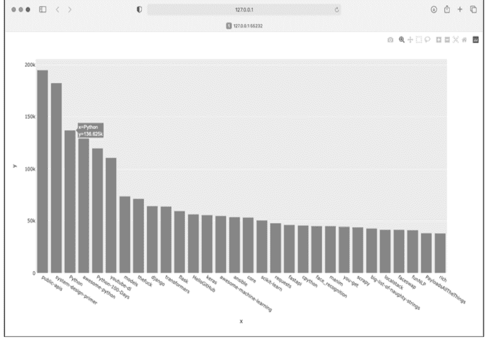
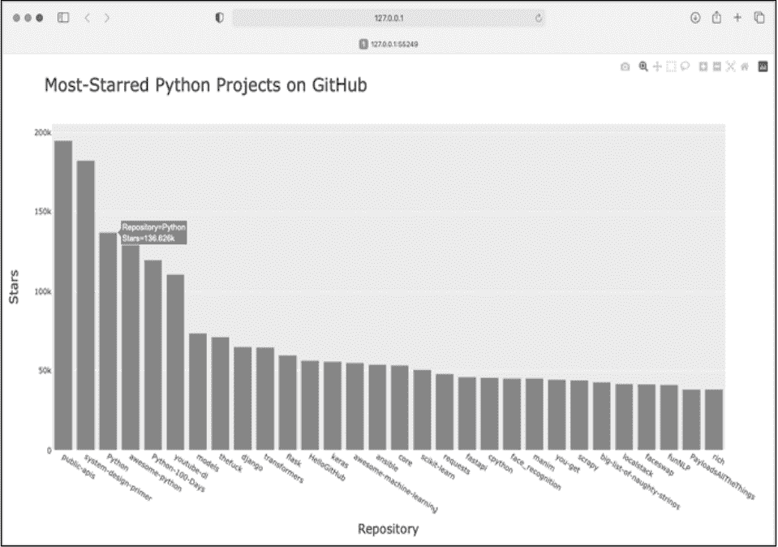
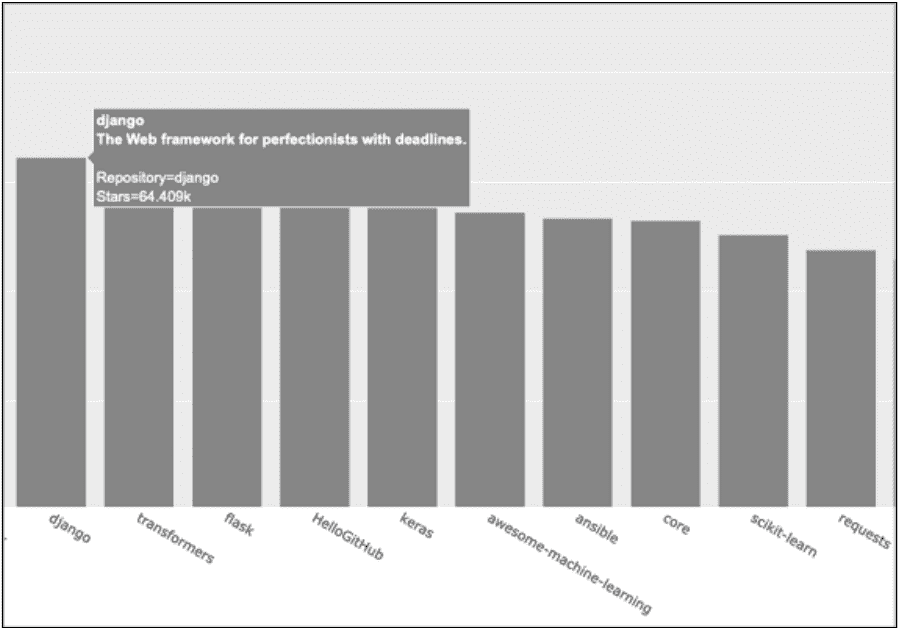

## 17 使用 API


在本章中，你将学习如何编写一个自包含的程序，根据它检索的数据生成可视化。你的程序将使用*应用程序编程接口（API）*自动向网站请求特定信息，然后使用这些信息生成可视化。由于以这种方式编写的程序总是使用当前数据来生成可视化，即使数据可能瞬息万变，可视化也将始终是最新的。

## 使用 API

API 是网站中用于与程序交互的一部分。这些程序使用非常具体的 URL 来请求特定信息。这种请求称为*API 调用*。请求的数据将以易于处理的格式返回，如 JSON 或 CSV。大多数使用外部数据源的应用（例如与社交媒体网站集成的应用）都依赖 API 调用。

### Git 和 GitHub

我们将基于来自 GitHub（*https://github.com*）的信息进行可视化。GitHub 是一个允许程序员在编码项目上进行协作的网站。我们将使用 GitHub 的 API 请求该网站上 Python 项目的信息，然后使用 Plotly 生成一个关于这些项目相对受欢迎程度的交互式可视化。

GitHub 得名于 Git，一种分布式版本控制系统。Git 帮助人们以一种防止某人的更改干扰其他人正在进行的更改的方式来管理他们在项目上的工作。当你在项目中实现一个新功能时，Git 会跟踪你对每个文件所做的更改。当你的新代码正常工作时，你*提交*所做的更改，Git 会记录项目的新状态。如果你犯了错误并想撤销更改，你可以轻松地返回到任何之前正常工作的状态。（要了解更多关于使用 Git 进行版本控制的信息，请参阅附录 D。）GitHub 上的项目存储在*仓库*中，仓库包含与项目相关的所有内容：代码、协作者信息、任何问题或错误报告等。

当 GitHub 用户喜欢一个项目时，他们可以“加星”以示支持，并跟踪他们可能想使用的项目。在本章中，我们将编写一个程序，自动下载 GitHub 上星标最多的 Python 项目信息。

```json
"node_id": "MDEwOlJlcG9zaXRvcnk1NDM0Njc5OQ==",
"name": "public-apis",
"full_name": "public-apis/public-apis",
--snip--
```

从响应中可以看出，这个 URL 主要不是供人类输入的，因为它采用的形式是供程序处理的。在撰写本文时，GitHub 找到了不到900万个 Python 项目❶。`"incomplete_results"`的值为 `true`，这告诉我们 GitHub 没有完全处理查询❷。GitHub 限制了每次查询的运行时间，以使 API 对所有用户保持响应。在这种情况下，它找到了一些最受欢迎的 Python 仓库，但没有时间全部找到；我们稍后会解决这个问题。返回的`"items"`显示在下面的列表中，其中包含 GitHub 上最受欢迎的 Python 项目的详细信息❸。

## 安装 Requests

*Requests* 包允许 Python 程序轻松地向网站请求信息并检查响应。使用 pip 安装 Requests：

```bash
$ python -m pip install --user requests
```

如果你使用不同于 **python** 的命令来运行程序或启动终端会话，例如 **python3**，你的命令将如下所示：

```bash
$ python3 -m pip install --user requests
```

## 处理 API 响应

现在，我们将编写一个程序，自动发出 API 调用并处理结果：

`python_repos.py`

```python
import requests

# Make an API call and check the response.
① url = "https://api.github.com/search/repositories"
url += "?q=language:python+sort:stars+stars:>10000"

② headers = {"Accept": "application/vnd.github.v3+json"}
③ r = requests.get(url, headers=headers)
④ print(f"Status code: {r.status_code}")

# Convert the response object to a dictionary.
⑤ response_dict = r.json()

# Process results.
print(response_dict.keys())
```

我们首先导入 requests 模块。然后我们将 API 调用的 URL 赋给 url 变量①。这个 URL 很长，因此我们将其分为两行。第一行是 URL 的主要部分，第二行是查询字符串。我们在原始查询字符串中增加了一个条件：`stars:>10000`，它告诉 GitHub 只查找拥有超过 10,000 颗星的 Python 仓库。这应该能让 GitHub 返回一组完整、一致的结果。

GitHub 目前使用的是 API 的第三版，因此我们为 API 调用定义了请求头，明确要求使用这一版本的 API，并以 JSON 格式返回结果②。然后我们使用 requests 调用 API③。我们调用 `get()`，向其传入 URL 和定义的请求头，并将响应对象赋给变量 r。

响应对象有一个名为 `status_code` 的属性，它告诉我们请求是否成功。（状态码 200 表示响应成功。）我们打印 `status_code` 的值，以确保调用成功完成④。我们请求 API 返回


信息以 JSON 格式返回，因此我们使用 `json()` 方法将信息转换为 Python 字典 ⑤。我们将得到的字典赋给 `response_dict`。

最后，我们打印 `response_dict` 中的键，并看到以下输出：

```text
Status code: 200
dict_keys(['total_count', 'incomplete_results', 'items'])
```

由于状态码为 200，我们知道请求成功了。响应字典只包含三个键：`'total_count'`、`'incomplete_results'` 和 `'items'`。让我们来看看响应字典内部。

## 使用响应字典

通过 API 调用获得的信息现在以字典形式表示，我们可以对其中存储的数据进行操作。让我们生成一些汇总信息的输出。这是一个很好的方法，可以确保我们收到了预期的信息，并开始检查我们感兴趣的信息：

`python_repos.py`

```python
import requests

# Make an API call and store the response.
--snip--

# Convert the response object to a dictionary.
response_dict = r.json()
① print(f"Total repositories: {response_dict['total_count']}")
print(f"Complete results: {not response_dict['incomplete_results']}")

# Explore information about the repositories.
② repo_dicts = response_dict['items']
print(f"Repositories returned: {len(repo_dicts)}")

# Examine the first repository.
③ repo_dict = repo_dicts[0]
④ print(f"\nKeys: {len(repo_dict)}")
⑤ for key in sorted(repo_dict.keys()):
    print(key)
```

我们通过打印与 `'total_count'` 关联的值来开始探索响应字典，该值表示此 API 调用返回的 Python 仓库总数 ①。我们还使用与 `'incomplete_results'` 关联的值，以了解 GitHub 是否能够完全处理查询。我们没有直接打印此值，而是打印其相反值：`True` 的值将表示我们收到了完整的结果集。

与 `'items'` 关联的值是一个包含多个字典的列表，每个字典都包含有关单个 Python 仓库的数据。我们将这个字典列表赋给 `repo_dicts` ②。然后我们打印 `repo_dicts` 的长度，以查看我们有多少仓库的信息。

为了更仔细地查看返回的每个仓库的信息，我们取出 `repo_dicts` 中的第一项并将其赋给 `repo_dict` ③。然后我们打印字典中的键数，以查看我们有多少信息 ④。最后，我们打印所有字典的键，以查看包含什么类型的信息 ⑤。

结果让我们更清楚地了解实际数据：

```text
Status code: 200
① Total repositories: 248
② Complete results: True
Repositories returned: 30

③ Keys: 78
allow_forking
archive_url
archived
--snip--
url
visibility
watchers
watchers_count
```

在撰写本文时，只有 248 个 Python 仓库的星标超过 10,000 ❶。我们可以看到 GitHub 能够完全处理 API 调用 ❷。在此响应中，GitHub 返回了与我们查询条件匹配的前 30 个仓库的信息。如果我们想要更多仓库，可以请求额外的数据页。

GitHub 的 API 返回了每个仓库的大量信息：`repo_dict` 中有 78 个键 ❸。当你浏览这些键时，你会了解到可以提取的项目信息的类型。（了解 API 可用信息的唯一方法是通过阅读文档或通过代码检查信息，就像我们在这里做的那样。）

让我们提取 `repo_dict` 中某些键的值：

`python_repos.py`

```python
--snip--
# Examine the first repository.
repo_dict = repo_dicts[0]

print("\nSelected information about first repository:")
❶ print(f"Name: {repo_dict['name']}")
❷ print(f"Owner: {repo_dict['owner']['login']}")
❸ print(f"Stars: {repo_dict['stargazers_count']}")
print(f"Repository: {repo_dict['html_url']}")
❹ print(f"Created: {repo_dict['created_at']}")
❺ print(f"Updated: {repo_dict['updated_at']}")
print(f"Description: {repo_dict['description']}")
```

当我们为此数据制作可视化时，我们希望包含不止一个仓库。让我们编写一个循环来打印 API 调用返回的每个仓库的选定信息，以便我们可以将它们全部包含在可视化中：

`python_repos.py`

```python
--snip--
# Explore information about the repositories.
repo_dicts = response_dict['items']
print(f"Repositories returned: {len(repo_dicts)}")

print("\nSelected information about each repository:")
for repo_dict in repo_dicts:
    print(f"\nName: {repo_dict['name']}")
    print(f"Owner: {repo_dict['owner']['login']}")
    print(f"Stars: {repo_dict['stargazers_count']}")
    print(f"Repository: {repo_dict['html_url']}")
    print(f"Description: {repo_dict['description']}")
```

我们首先打印一个介绍性消息 ❶。然后我们遍历 `repo_dicts` 中的所有字典 ❷。在循环内部，我们打印每个项目的名称、其所有者、其星标数、其在 GitHub 上的 URL 以及项目的描述：

```text
Status code: 200
Total repositories: 248
Complete results: True
Repositories returned: 30

Selected information about each repository:

Name: public-apis
Owner: public-apis
Stars: 191494
Repository: https://github.com/public-apis/public-apis
Description: A collective list of free APIs

Name: system-design-primer
Owner: donnemartin
Stars: 179952
Repository: https://github.com/donnemartin/system-design-primer
Description: Learn how to design large-scale systems. Prep for the system design interview. Includes Anki flashcards.
--snip--

Name: PayloadsAllTheThings
Owner: swisskyrepo
Stars: 37227
Repository: https://github.com/swisskyrepo/PayloadsAllTheThings
Description: A list of useful payloads and bypass for Web Application Security and Pentest/CTF
```

这些结果中出现了一些有趣的项目，值得一看。但不要花太多时间在这里，因为我们即将创建一个可视化，使结果更容易阅读。

## 监控 API 速率限制

大多数 API 都有 *速率限制*，这意味着在一定时间内你可以发出的请求数量是有限的。要查看你是否接近 GitHub 的限制，请在 Web 浏览器中输入 https://api.github.com/rate_limit。你应该会看到以以下内容开头的响应：

```json
{
  "resources": {
    --snip--
    "search": {
      "limit": 10,
      "remaining": 9,
      "reset": 1652338832,
      "used": 1,
      "resource": "search"
    },
    --snip--
```

我们感兴趣的信息是搜索 API 的速率限制 ①。我们看到限制是每分钟 10 次请求 ②，并且当前分钟剩余 9 次请求 ③。与键 `"reset"` 关联的值表示我们的配额将重置的时间，以 *Unix 或 epoch 时间*（自 1970 年 1 月 1 日午夜以来的秒数）表示 ④。如果达到配额，你会收到一个简短的响应，告知你已达到 API 限制。如果达到限制，只需等待配额重置即可。

> **NOTE**
> 许多 API 要求你注册并获取 API 密钥或访问令牌才能进行 API 调用。截至本文撰写时，GitHub 没有此类要求，但如果你获取访问令牌，你的限制会高得多。

## 使用 Plotly 可视化仓库

让我们使用我们收集的数据制作一个可视化，以显示 GitHub 上 Python 项目的相对受欢迎程度。我们将制作一个交互式条形图：每个条形的高度将表示项目获得的星标数，并且你可以点击条形标签转到该项目在 GitHub 上的主页。

将我们一直在处理的程序保存为副本 *python_repos_visual.py*，然后修改它，使其如下所示：

`python_repos_visual.py`

```python
import requests
import plotly.express as px

# Make an API call and check the response.
url = "https://api.github.com/search/repositories"
```


你应该能够在完善其外观之前尽快看到可视化效果。在这里我们使用 `px.bar()` 函数创建条形图。我们将列表 `repo_names` 作为 `x` 参数传递，并将 `stars` 作为 `y` 参数传递。

图 17-1 显示了生成的图表。我们可以看到，前几个项目比其他项目受欢迎得多，但它们都是 Python 生态系统中的重要项目。



图 17-1：GitHub 上获星最多的 Python 项目

## Styling the Chart

Plotly 支持多种方式来设置和自定义绘图，一旦你知道绘图中的信息是正确的。我们将在初始的 `px.bar()` 调用中进行一些更改，然后在创建后对 `fig` 对象进行进一步调整。

我们将通过添加标题和每个轴的标签来开始设置图表样式：

**python_repos_visual.py**

```python
--snip--
# Make visualization.
title = "Most-Starred Python Projects on GitHub"
labels = {'x': 'Repository', 'y': 'Stars'}
fig = px.bar(x=repo_names, y=stars, title=title, labels=labels)

fig.update_layout(title_font_size=28, xaxis_title_font_size=20,
    yaxis_title_font_size=20)

fig.show()
```

我们首先添加标题和每个轴的标签，就像我们在第 15 章和第 16 章中所做的那样。然后我们使用 `fig.update_layout()` 方法来修改图表的特定元素 ①。Plotly 使用一种约定，即图表元素的各个方面通过下划线连接。随着你熟悉 Plotly 的文档，你会开始看到图表不同元素命名和修改方式的一致模式。在这里我们将标题字体大小设置为 28，并将每个轴标题的字体大小设置为 20。结果如图所示 17-2。



图 17-2：*已为主图表添加标题，也为每个轴添加了标题。*

## Adding Custom Tooltips

在 Plotly 中，你可以悬停光标在单个条上以显示该条表示的信息。这通常称为 *tooltip*，在这种情况下，它目前显示项目拥有的星数。让我们创建一个自定义工具提示，以显示每个项目的描述以及项目的拥有者。

我们需要提取一些额外的数据来生成工具提示：

**python_repos_visual.py**

```python
--snip--
# Process repository information.
repo_dicts = response_dict['items']
repo_names, stars, hover_texts = [], [], []
for repo_dict in repo_dicts:
    repo_names.append(repo_dict['name'])
    stars.append(repo_dict['stargazers_count'])

    # Build hover texts.
    owner = repo_dict['owner']['login']
    description = repo_dict['description']
    hover_text = f"{owner}<br />{description}"
    hover_texts.append(hover_text)

# Make visualization.
title = "Most-Starred Python Projects on GitHub"
labels = {'x': 'Repository', 'y': 'Stars'}
fig = px.bar(x=repo_names, y=stars, title=title, labels=labels,
             hover_name=hover_texts)
fig.update_layout(title_font_size=28, xaxis_title_font_size=20,
                  yaxis_title_font_size=20)
fig.show()
```

我们首先定义一个新的空列表 `hover_texts`，用于保存我们希望为每个项目显示的文本 ❶。在处理数据的循环中，我们提取每个项目的拥有者和描述 ❷。Plotly 允许你在文本元素中使用 HTML 代码，因此我们生成一个标签字符串，并在项目拥有者的用户名和描述之间使用换行符 (`<br />`) ❸。然后我们将此标签附加到列表 `hover_texts`。

在 `px.bar()` 调用中，我们添加 `hover_name` 参数并传递 `hover_texts` ❹。这是我们用于自定义全球地震活动地图上每个点的标签的相同方法。当 Plotly 创建每个条时，它将从此列表中提取标签，并且只有在查看者悬停在条上时才显示它们。图 17-3 显示了其中一个自定义工具提示。



图 17-3：悬停在条上会显示项目的拥有者和描述。

## Adding Clickable Links

由于 Plotly 允许你在文本元素上使用 HTML，我们可以轻松地向图表添加链接。让我们使用 x 轴标签作为一种方式，让查看者访问任何项目在 GitHub 上的主页。我们需要从数据中提取 URL，并在生成 x 轴标签时使用它们：

**python_repos_visual.py**

```python
--snip--
# Process repository information.
repo_dicts = response_dict['items']
repo_links, stars, hover_texts = [], [], []
for repo_dict in repo_dicts:
    # Turn repo names into active links.
    repo_name = repo_dict['name']
    repo_url = repo_dict['html_url']
    repo_link = f"<a href='{repo_url}'>{repo_name}</a>"
    repo_links.append(repo_link)

    stars.append(repo_dict['stargazers_count'])
--snip--

# Make visualization.
title = "Most-Starred Python Projects on GitHub"
labels = {'x': 'Repository', 'y': 'Stars'}
fig = px.bar(x=repo_links, y=stars, title=title, labels=labels,
             hover_name=hover_texts)

fig.update_layout(title_font_size=28, xaxis_title_font_size=20,
                  yaxis_title_font_size=20)

fig.show()
```

我们将正在创建的列表的名称从 `repo_names` 更新为 `repo_links`，以更准确地传达我们为图表汇总的信息类型 ❶。然后我们从 `repo_dict` 中提取项目的 URL 并将其分配给临时变量 `repo_url` ❷。接下来，我们生成指向项目的链接 ❸。我们使用 HTML 锚点标签，其形式为 `<a href='URL'>link text</a>`，来生成链接。然后我们将此链接附加到 `repo_links`。

当我们调用 `px.bar()` 时，我们使用 `repo_links` 作为图表中的 x 值。结果看起来与之前相同，但现在查看者可以点击图表底部任何项目名称以访问该项目在 GitHub 上的主页。现在我们有一个通过 API 检索数据的交互式、信息丰富的可视化！

## Customizing Marker Colors

一旦图表创建完成，图表的几乎任何方面都可以通过更新方法进行自定义。我们之前使用过 `update_layout()` 方法。另一种方法 `update_traces()` 可用于自定义图表上表示的数据。

让我们将条形更改为较深的蓝色，并带有一定的透明度：

```python
--snip--
fig.update_layout(title_font_size=28, xaxis_title_font_size=20,
                  yaxis_title_font_size=20)

fig.update_traces(marker_color='SteelBlue', marker_opacity=0.6)

fig.show()
```

在 Plotly 中，*trace* 指的是图表上的一组数据。`update_traces()` 方法可以接受多种不同的参数；任何以 `marker_` 开头的参数都会影响图表上的标记。在这里我们将每个标记的颜色设置为 `'SteelBlue'`；任何命名的 CSS 颜色在这里都可以使用。我们还将每个标记的不透明度设置为 `0.6`。不透明度为 `1.0` 将完全不透明，而不透明度为 `0` 将完全不可见。

## More About Plotly and the GitHub API

Plotly 的文档内容广泛且组织良好；然而，很难知道从哪里开始阅读。一个好的起点是文章“Plotly Express in Python”，网址为 [https://plotly.com/python/plotly-express](https://plotly.com/python/plotly-express)。这是使用 Plotly Express 可以制作的所有绘图的概述，你可以在其中找到关于每种图表类型的更长文章的链接。

如果你想更好地了解如何自定义 Plotly 图表，文章“Styling Plotly Express Figures in Python”将扩展你在第 15–17 章中看到的内容。你可以在 https://plotly.com/python/styling-plotly-express 找到这篇文章。

有关 GitHub API 的更多信息，请参阅其文档 https://docs.github.com/en/rest。 在这里你将学习如何从 GitHub 提取各种信息。要扩展你在本项目中看到的内容，请查找侧边栏参考中的 Search 部分。如果你有 GitHub 账户，你也可以使用自己的数据以及其他用户存储库的公开可用数据。

## The Hacker News API

为了探索如何在其他网站上使用 API 调用，让我们快速了解一下 Hacker News（https://news.ycombinator.com）。在 Hacker News 上，人们分享关于编程和技术的文章并就这些文章进行热烈讨论。Hacker News API 提供了有关网站上所有提交和评论的数据访问，你可以使用 API 而无需注册密钥。

以下调用返回截至本文撰写时的当前热门文章信息：

```
https://hacker-news.firebaseio.com/v0/item/31353677.json
```

当你在浏览器中输入此 URL 时，你会看到页面上的文本被大括号括起来，意味着它是一个字典。但响应很难在没有更好格式的情况下检查。让我们像我们在第 16 章地震项目中所做的那样，通过 `json.dumps()` 方法运行此 URL，以便我们可以探索返回的有关文章的信息类型：

**hn_article.py**

```python
import requests
import json
```


```
# Make an API call, and store the response.
url = "https://hacker-news.firebaseio.com/v0/item/31353677.json"
r = requests.get(url)
print(f"Status code: {r.status_code}")

# Explore the structure of the data.
response_dict = r.json()
response_string = json.dumps(response_dict, indent=4)
print(response_string)
```

这个程序中的所有内容都应该很眼熟，因为在前两章中我们都用过。这里的主要区别在于，我们可以打印格式化后的响应字符串①，而不是将其写入文件，因为输出并不特别长。

输出是一个字典，包含 ID 为 31353677 的文章的信息：

```
{
    "by": "sohkamyung",
    "descendants": 302,
    "id": 31353677,
    "kids": [
        31354987,
        31354235,
        --snip--
    ],
    "score": 785,
    "time": 1652361401,
    "title": "Astronomers reveal first image of the black hole at the heart of our galaxy",
    "type": "story",
    "url": "https://public.nrao.edu/news/.../"
}
```

这个字典包含许多我们可以使用的键。键 `"descendants"` 告诉我们文章收到的评论数量①。键 `"kids"` 提供了所有直接回复该提交的评论 ID②。这些评论中的每一条可能还有自己的评论，因此一个提交的 descendants 数量通常大于其 kids 数量。我们可以看到正在讨论的文章的标题③，以及正在讨论的文章的 URL④。

下面的 URL 会返回一个简单的列表，包含 Hacker News 当前所有热门文章的 ID：

```
https://hacker-news.firebaseio.com/v0/topstories.json
```

我们可以使用这个调用来了解当前首页上有哪些文章，然后生成一系列类似于刚才所查看的 API 调用。通过这种方法，我们可以打印 Hacker News 当前首页上所有文章的摘要：

```
# hn_submissions.py

from operator import itemgetter

import requests

# Make an API call and check the response.
url = "https://hacker-news.firebaseio.com/v0/topstories.json"
r = requests.get(url)
print(f"Status code: {r.status_code}")

# Process information about each submission.
submission_ids = r.json()
submission_dicts = []
for submission_id in submission_ids[:30]:
    # Make a new API call for each submission.
    url = f"https://hacker-news.firebaseio.com/v0/item/{submission_id}.json"
    r = requests.get(url)
    print(f"id: {submission_id}\tstatus: {r.status_code}")
    response_dict = r.json()

    # Build a dictionary for each article.
    submission_dict = {
        'title': response_dict['title'],
        'hn_link': f"https://news.ycombinator.com/item?id={submission_id}",
        'comments': response_dict['descendants'],
    }
    submission_dicts.append(submission_dict)

submission_dicts = sorted(submission_dicts, key=itemgetter('comments'),
                          reverse=True)

for submission_dict in submission_dicts:
    print(f"\nTitle: {submission_dict['title']}")
    print(f"Discussion link: {submission_dict['hn_link']}")
    print(f"Comments: {submission_dict['comments']}")
```

首先，我们进行一次 API 调用并打印响应状态①。这个 API 调用会返回一个列表，其中包含调用发出时 Hacker News 上最多 500 篇最受欢迎文章的 ID。然后我们将响应对象转换为 Python 列表②，并将其赋值给 `submission_ids`。我们将使用这些 ID 来构建一组字典，每个字典包含当前某一提交的信息。

我们建立一个名为 `submission_dicts` 的空列表来存储这些字典③。然后遍历排名前 30 的提交的 ID。我们通过生成包含当前 `submission_id` 值的 URL 为每个提交发起一次新的 API 调用④。我们打印每个请求的状态及其 ID，以便查看是否成功。

接下来，我们为当前正在处理的提交创建一个字典⑤。我们存储提交的标题、该条目的讨论页面链接，以及该文章到目前为止收到的评论数。然后将每个 `submission_dict` 追加到列表 `submission_dicts` 中⑥。

Hacker News 上的每个提交会根据一个综合评分进行排名，该评分基于多个因素，包括被投票次数、收到的评论数以及提交的新鲜程度。我们想按评论数对字典列表进行排序。为此，我们使用名为 `itemgetter()`⑦ 的函数，它来自 `operator` 模块。我们向该函数传入键 `'comments'`，它会从列表中的每个字典中取出与该键关联的值。然后 `sorted()` 函数使用这个值作为排序依据。我们将列表按逆序排序，把评论最多的故事排在前面。

列表排序完成后，我们遍历列表⑧，并打印关于每个顶级提交的三条信息：标题、讨论页面的链接，以及该提交当前的评论数：

```
Status code: 200
id: 31390506      status: 200
id: 31389893      status: 200
id: 31390742      status: 200
--snip--

Title: Fly.io: The reclaimer of Heroku's magic
Discussion link: https://news.ycombinator.com/item?id=31390506
Comments: 134

Title: The weird Hewlett Packard FreeDOS option
Discussion link: https://news.ycombinator.com/item?id=31389893
Comments: 64

Title: Modern JavaScript Tutorial
Discussion link: https://news.ycombinator.com/item?id=31390742
Comments: 20
--snip--
```

你可以用类似的过程访问和分析任何 API 的信息。利用这些数据，你可以制作可视化图表，展示哪些提交引发了最近最活跃的讨论。这也是为 Hacker News 这类网站提供个性化阅读体验的应用的基础。要了解通过 Hacker News API 可以访问哪些类型的信息，请访问文档页面 [https://github.com/HackerNews/API](https://github.com/HackerNews/API)。

**注意**

*Hacker News 有时允许其支持的公司发布特殊的招聘帖，这些帖子的评论会被禁用。如果运行此程序时恰好有这样的帖子存在，你会遇到 KeyError。如果这导致问题，你可以将构建 `submission_dict` 的代码放在 try-except 块中，跳过这些帖子。*

## 动手试一试

- **17-1. 其他语言：** 修改 `python_repos.py` 中的 API 调用，使其生成一张显示其他语言最受欢迎项目的图表。尝试诸如 *JavaScript*、*Ruby*、*C*、*Java*、*Perl*、*Haskell* 和 *Go* 等语言。
- **17-2. 活跃讨论：** 使用 `hn_submissions.py` 中的数据，制作一张条形图，显示 Hacker News 上当前最活跃的讨论。每个条形的高度应对应该提交的评论数。每个条形的标签应包含该提交的标题，并作为该提交讨论页面的链接。如果在创建图表时遇到 KeyError，请使用 `try-except` 块跳过推广帖。
- **17-3. 测试 python_repos.py：** 在 `python_repos.py` 中，我们打印了 `status_code` 的值，以确保 API 调用成功。编写一个名为 `test_python_repos.py` 的程序，使用 pytest 断言 `status_code` 的值为 200。找出一些其他可以做的断言：例如，返回的项目数量符合预期，以及仓库总数大于某个数量。
- **17-4. 进一步探索：** 访问 Plotly 以及 GitHub API 或 Hacker News API 的文档。利用你在那里找到的一些信息，定制我们已经制作的图表样式，或者提取一些不同的信息并创建你自己的可视化。如果你对其他 API 感到好奇，可以看看 [https://github.com/public-apis](https://github.com/public-apis) 这个 GitHub 仓库中提到的 API。

## 小结

在本章中，你学习了如何使用 API 编写自包含的程序，自动收集它们所需的数据，并使用这些数据创建可视化。你使用 GitHub API 探索了 GitHub 上 star 最多的 Python 项目，还简要了解了 Hacker News API。你学习了如何使用 Requests 包自动发起 API 调用，以及如何处理该调用的结果。我们还介绍了一些 Plotly 设置，以进一步自定义你生成的图表的外观。


在下一章中，你将使用 Django 构建一个 Web 应用程序作为你的最终项目。

[OceanofPDF.com](OceanofPDF.com)

## 18
