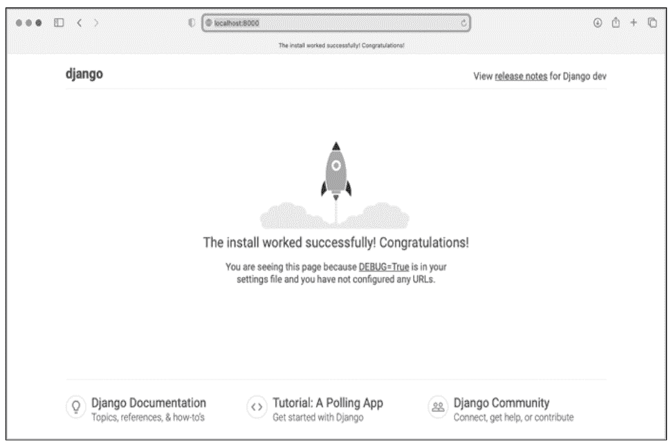
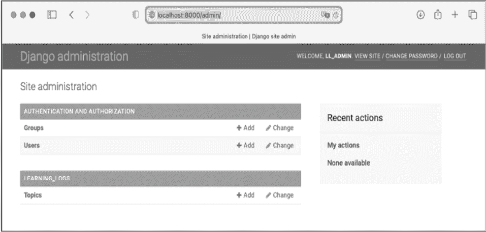
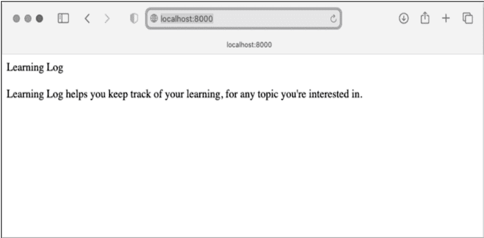
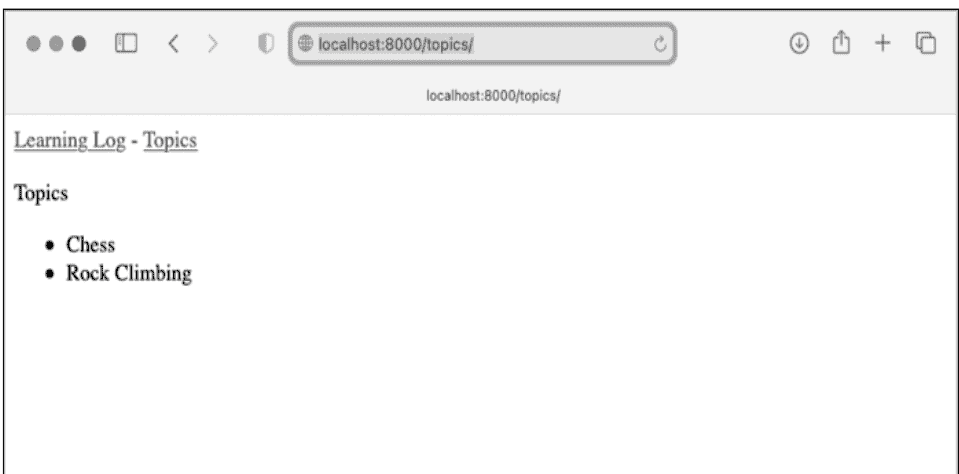

## 开始使用 Django


随着互联网的发展，网站和移动应用之间的界限已经模糊。网站和应用都以各种方式帮助用户与数据交互。幸运的是，你可以使用 Django 构建一个既能提供动态网站，又能提供一系列移动应用的单一项目。*Django* 是 Python 最流行的*Web 框架*，是一套用于构建交互式 Web 应用程序的工具。在本章中，你将学习如何使用 Django 构建一个名为“学习日志”（Learning Log）的项目，这是一个在线日志系统，让你能够

记录你所学到的关于不同主题的信息。

我们将为这个项目编写一份规范，然后为应用将要处理的数据定义模型。我们将使用 Django 的管理系统输入一些初始数据，然后编写视图和模板，以便 Django 能构建网站的页面。

Django 可以响应页面请求，并简化数据库的读写、用户管理以及更多操作。在第 19 章和第 20 章中，你将完善“学习日志”项目，然后将其部署到正式服务器上，这样你（以及世界上的其他人）都可以使用它。

## 设置项目

在开始像 Web 应用这样重要的项目时，你首先需要在一份规范（specification）或*规格说明*中描述项目的目标。一旦你有了清晰的目标，就可以开始确定实现这些目标的可管理任务。

在本节中，我们将为“学习日志”编写一份规范，并开始项目的第一阶段。这将涉及设置虚拟环境以及构建 Django 项目的初始内容。

### *编写规范*

一份完整的规范会详细说明项目目标、描述项目功能，并讨论其外观和用户界面。与任何好的项目或商业计划一样，规范应该让你保持专注，并帮助你的项目不偏离轨道。我们不会在这里编写完整的项目规范，但我们会列出

几个明确的目标，以保持开发过程的聚焦。以下是我们将使用的规范：

我们将编写一个名为“学习日志”的 Web 应用，允许用户记录他们感兴趣的主题，并在学习每个主题时写日志条目。“学习日志”的主页将描述该网站，并邀请用户注册或登录。登录后，用户可以创建新主题、添加新条目，以及阅读和编辑现有条目。

当你研究一个新主题时，维护一份关于所学内容的日志可以帮助你跟踪新信息和已经找到的信息。在学习技术主题时尤其如此。一个好的应用，比如我们即将创建的这个，可以帮助提高这一过程的效率。

## 创建虚拟环境

要使用 Django，我们首先需要设置一个虚拟环境。*虚拟环境*是你系统中的一个位置，你可以在其中安装包，并将它们与所有其他 Python 包隔离。将一个项目的库与其他项目分开是有益的，而且在我们于第 20 章将“学习日志”部署到服务器时，这也是必要的。

为你的项目创建一个名为 *learning_log* 的新目录，在终端中切换到该目录，然后输入以下代码来创建虚拟环境：

```
learning_log$ python -m venv ll_env
learning_log$
```

这里我们正在运行 `venv` 虚拟环境模块，并使用它创建一个名为 *ll_env* 的环境（请注意，这个名称以两个小写的 L 开头，而不是两个数字 1）。如果你在运行程序或安装包时使用类似 `python3` 的命令，请确保在这里使用该命令。

## 激活虚拟环境

现在我们需要使用以下命令激活虚拟环境：

```
learning_log$ source ll_env/bin/activate
(ll_env)learning_log$
```

该命令会运行 ll_env/bin/ 中的 activate 脚本。当环境处于激活状态时，你会看到环境名称出现在括号中。这表示你可以向该环境安装新包，并使用已经安装的包。当环境未激活时，你在 ll_env 中安装的包将不可用。

> 注意
> 如果你使用的是 Windows，请使用命令 ll_env\Scripts\activate（不包括单词 source）来激活虚拟环境。如果你使用的是 PowerShell，你可能需要将 Activate 大写。

要停止使用虚拟环境，请输入 deactivate：

```
(ll_env)learning_log$ deactivate
learning_log$
```

当你关闭运行虚拟环境的终端时，该环境也会变为非激活状态。

## 安装 Django

在虚拟环境激活的状态下，输入以下内容来更新 pip 并安装 Django：

```
(ll_env)learning_log$ pip install --upgrade pip
(ll_env)learning_log$ pip install django
Collecting django
--snip--
Installing collected packages: sqlparse, asgiref, django
Successfully installed asgiref-3.5.2 django-4.1 sqlparse-0.4.2
(ll_env)learning_log$
```

由于 pip 会从各种来源下载资源，因此它升级得相当频繁。每当你创建新的虚拟环境时，最好升级一下 pip。

我们现在在虚拟环境中工作，所以安装 Django 的命令在所有系统上都是一样的。不需要使用更长的命令，比如 python -m pip install package_name，也不需要包含 --user 标志。请记住，只有在 ll_env 环境处于激活状态时，Django 才可用。

注意

> Django 大约每八个月发布一个新版本，因此你在安装 Django 时可能会看到更新的版本。这个项目很可能像这里写的那样运行，即使是在更新版本的 Django 上也是如此。如果你想确保使用与这里看到的相同版本的 Django，请使用命令 pip install django==4.1.*。这将安装 Django 4.1 的最新版本。如果你在使用版本时遇到任何问题，请参阅本书的在线资源：https://ehmatthes.github.io/pcc_3e。

## 在 Django 中创建项目

在保持虚拟环境激活的状态下（记得在终端提示符中寻找括号中的 ll_env），

输入以下命令来创建一个新项目：

```
1  (ll_env)learning_log$ django-admin startproject ll_project .
2  (ll_env)learning_log$ ls
ll_env ll_project manage.py
3  (ll_env)learning_log$ ls ll_project
__init__.py asgi.py settings.py urls.py wsgi.py
```

startproject 命令 ① 告诉 Django 创建一个名为 ll_project 的新项目。命令末尾的句点 (.) 会创建新项目，并采用便于开发完成后将应用部署到服务器的目录结构。

注意
不要忘记这个句点，否则你在部署应用时可能会遇到一些配置问题。如果你忘记了句点，请删除已创建的文件和文件夹（除了 ll_env），然后重新运行该命令。

运行 ls 命令（Windows 上是 dir）② 会显示 Django 已创建了一个名为 ll_project 的新目录。它还创建了一个 manage.py 文件，这是一个短程序，用于接收命令并将其传送给 Django 的相关部分。我们将使用这些命令来管理任务，例如操作数据库和运行服务器。

ll_project 目录包含四个文件 ③；其中最重要的是 settings.py、urls.py 和 wsgi.py。settings.py 文件控制 Django 如何与你的系统交互并管理你的项目。随着项目的发展，我们将修改一些设置，并添加一些我们自己的设置。urls.py 文件告诉 Django 响应浏览器请求时应构建哪些页面。wsgi.py 文件帮助

Django 提供它创建的文件。该文件名是“web server gateway interface”（Web 服务器网关接口）的缩写。

## 创建数据库

Django 将项目的大部分信息存储在数据库中，所以接下来我们需要创建一个 Django 可以使用的数据库。输入以下命令（仍然在激活的环境中）：

```
(ll_env)learning_log$ python manage.py migrate
① Operations to perform:
    Apply all migrations: admin, auth, contenttypes, sessions
Running migrations:
    Applying contenttypes.0001_initial... OK
    Applying auth.0001_initial... OK
    --snip--
    Applying sessions.0001_initial... OK
② (ll_env)learning_log$ ls
db.sqlite3 ll_env ll_project manage.py
```

每当我们修改数据库时，我们就是在*迁移*数据库。首次发出 `migrate` 命令会让 Django 确保数据库与项目的当前状态匹配。当我们首次在一个使用 SQLite 的新项目中运行此命令时（稍后会详细介绍 SQLite），Django 会为我们创建一个新的数据库。在这里，Django 报告它将准备数据库以存储处理管理和身份验证任务所需的信息 ①。

运行 `ls` 命令会显示 Django 创建了另一个名为 *db.sqlite3* 的文件 ②。*SQLite* 是一种基于单个文件的数据库；它非常适合编写简单的应用，因为你不需要花太多精力来管理数据库。


> **注意**
> 
> *在激活的虚拟环境中，使用命令 `python` 来运行 `manage.py` 命令，即使你使用其他命令（如 `python3`）来运行其他程序。在虚拟环境中，`python` 命令指向用于创建虚拟环境的 Python 版本。*

## 查看项目

让我们确保 Django 已经正确设置了项目。输入 **runserver** 命令以查看项目的当前状态：

```text
(ll_env) learning_log$ python manage.py runserver
Watching for file changes with StatReloader
Performing system checks...

❶ System check identified no issues (0 silenced).
   May 19, 2022 - 21:52:35
❷ Django version 4.1, using settings 'll_project.settings'
❸ Starting development server at http://127.0.0.1:8000/
Quit the server with CONTROL-C.
```

Django 应该启动一个名为 *development server*（开发服务器）的服务器，这样你就可以在自己的系统上查看项目，了解其运行效果。当你在浏览器中输入 URL 请求页面时，Django 服务器会通过构建相应的页面并将其发送到浏览器来响应请求。

Django 首先检查项目是否设置正确❶；然后报告所使用的 Django 版本和设置文件名称❷。最后，它报告项目服务的 URL❸。URL *http://127.0.0.1:8000/* 表示项目正在监听你计算机上的 8000 端口，这被称为 localhost。术语 *localhost* 指的是只处理你系统上请求的服务器；它不允许任何人看到你正在开发的页面。

打开一个网页浏览器，输入 URL *http://localhost:8000/*，如果第一个无法使用，则输入 *http://127.0.0.1:8000/*。你应该会看到类似图 18-1 的内容：一个 Django 创建的页面，用于让你知道目前一切运行正常。暂时让服务器保持运行，但如果想要停止服务器，请在发出 `runserver` 命令的终端中按 CTRL-C。



图 18-1：*一切目前运行正常。*

> **注意**
> 
> *如果你收到错误信息“That port is already in use”（端口已被占用），请通过输入 **`python manage.py runserver 8001`** 告诉 Django 使用其他端口，然后依次尝试更高的端口号，直到找到一个空闲端口。*

### 自己尝试

- **18-1. 新项目：** 为了更好地了解 Django 的功能，创建几个空项目，看看 Django 会生成什么。新建一个简单名称的文件夹，比如 *tik_gram* 或 *insta_tok*（在你的 *learning_log* 目录之外），在终端中导航到该文件夹，并创建虚拟环境。安装 Django 并运行命令 **`django-admin.py startproject tg_project`**（确保在命令末尾包含点号）。
- 查看此命令创建的文件和文件夹，并与 Learning Log 进行比较。多试几次，直到你熟悉 Django 在启动新项目时创建的内容。如果愿意，之后可以删除这些项目目录。

## 启动应用

一个 Django *项目* 是由一组独立的 *应用* 组成的，这些应用协同工作，使项目整体运行。目前，我们将创建一个应用来完成项目的大部分工作。我们将在第 19 章添加另一个应用来管理用户账户。

你应该让之前打开的终端窗口中的开发服务器保持运行。打开一个新的终端窗口（或选项卡），导航到包含 *manage.py* 的目录。激活虚拟环境，然后运行 **`startapp`** 命令：

```text
learning_log$ source ll_env/bin/activate
(ll_env)learning_log$ python manage.py startapp learning_logs
① (ll_env)learning_log$ ls
db.sqlite3 learning_logs ll_env ll_project manage.py
② (ll_env)learning_log$ ls learning_logs/
__init__.py admin.py apps.py migrations models.py tests.py views.py
```

命令 `startapp appname` 告诉 Django 创建一个应用所需的基础设施。现在查看项目目录，你会看到一个名为 learning_logs 的新文件夹①。使用 `ls` 命令查看 Django 创建了什么②。最重要的文件是 models.py、admin.py 和 views.py。我们将使用 models.py 来定义要在应用中管理的数据。稍后会查看 admin.py 和 views.py。

## 定义模型

让我们先想一下我们的数据。每个用户都需要在学习日志中创建多个主题。他们创建的每条条目都与一个主题相关联，这些条目将显示为文本。我们还需要存储每个条目的时间戳，以便向用户展示他们何时创建了每条条目。

打开 models.py 文件并查看其现有内容：

**models.py**

```python
from django.db import models

# Create your models here.
```

这里导入了一个名为 models 的模块，并邀请我们创建自己的模型。模型告诉 Django 如何处理存储在应用中的数据。模型是一个类；它有属性和方法，就像我们讨论过的每个类一样。下面是用户将存储的主题的模型：

```python
from django.db import models

class Topic(models.Model):
    """A topic the user is learning about."""
    text = models.CharField(max_length=200)
    date_added = models.DateTimeField(auto_now_add=True)

    def __str__(self):
        """Return a string representation of the model."""
        return self.text
```

我们创建了一个名为 Topic 的类，它继承自 Model——Django 中包含的一个父类，它定义了模型的基本功能。我们向 Topic 类添加了两个属性：text 和 date_added。

text 属性是一个 CharField，一种由字符或文本组成的数据①。当你想要存储少量文本（如名称、标题或城市）时，可以使用 CharField。当我们定义 CharField 属性时，必须告诉 Django 它应该在数据库中预留多少空间。这里我们给它的 max_length 为 200 个字符，应该足以容纳大多数主题名称。

date_added 属性是一个 DateTimeField，一种将记录日期和时间的数据②。我们传递了参数 `auto_now_add=True`，这告诉 Django 每当用户创建新主题时，自动将此属性设置为当前日期和时间。

最好告诉 Django 你希望它如何表示模型的实例。如果模型有 `__str__()` 方法，Django 在需要生成引用该模型实例的输出时就会调用该方法。这里我们编写了一个 `__str__()` 方法，它返回分配给 text 属性的值③。

要查看可以在模型中使用的不同字段类型，请参阅 https://docs.djangoproject.com/en/4.1/ref/models/fields 上的“Model Field Reference”页面。你现在不需要所有信息，但在开发自己的 Django 项目时，它会非常有用。

## 激活模型

要使用我们的模型，我们必须告诉 Django 将我们的应用包含在整体项目中。打开 settings.py（位于 ll_project 目录中）；你会看到一个告诉 Django 项目中安装了哪些应用的部分：

**settings.py**

```python
--snip--
INSTALLED_APPS = [
    'django.contrib.admin',
    'django.contrib.auth',
    'django.contrib.contenttypes',
    'django.contrib.sessions',
    'django.contrib.messages',
    'django.contrib.staticfiles',
]
--snip--
```

通过修改 INSTALLED_APPS 将我们的应用添加到这个列表中，使其看起来像这样：

```python
--snip--
INSTALLED_APPS = [
    # My apps.
    'learning_logs',

    # Default django apps.
    'django.contrib.admin',
    --snip--
]
--snip--
```

将应用分组在一起有助于在项目增长到包含更多应用时跟踪它们。这里我们开始一个名为 My apps 的部分，目前只包含 `'learning_logs'`。将你自己的应用放在默认应用之前很重要，以防你需要用自定义行为覆盖默认应用的任何行为。

接下来，我们需要告诉 Django 修改数据库，以便它能够存储与模型 Topic 相关的信息。在终端中运行以下命令：

```text
(ll_env)learning_log$ python manage.py makemigrations learning_logs
Migrations for 'learning_logs':
  learning_logs/migrations/0001_initial.py
  - Create model Topic
(ll_env)learning_log$
```

命令 `makemigrations` 告诉 Django 弄清楚如何修改数据库，以便它能够存储与我们定义的任何新模型相关的数据。这里的输出显示 Django 已经创建了一个名为 0001_initial.py 的迁移文件。该迁移将在数据库中为模型 Topic 创建一个表。

现在我们将应用此迁移，让 Django 为我们修改数据库：

```text
(ll_env)learning_log$ python manage.py migrate
Operations to perform:
  Apply all migrations: admin, auth, contenttypes, learning_logs, sessions
Running migrations:
  Applying learning_logs.0001_initial... OK
```

此命令的大部分输出与我们第一次发出 migrate 命令时的输出相同。


```text
Superuser created successfully.
(ll_env)learning_log$
```

当你执行命令 `createsuperuser` 时，Django 会提示你为超级用户输入一个用户名 ①。这里我使用的是 `ll_admin`，但你可以输入任何你想要的用户名。你可以输入一个电子邮件地址，也可以将此字段留空 ②。你需要输入两次密码 ③。

> **NOTE**
>
> *某些敏感信息可以隐藏在网站管理员之外。例如，Django 不会存储你输入的密码；相反，它会存储从密码派生出的字符串，称为哈希。每次你输入密码时，Django 都会对你的输入进行哈希处理，并将其与存储的哈希进行比较。如果两个哈希匹配，你就通过了身份验证。通过要求哈希匹配，Django 确保如果攻击者获得了对网站数据库的访问权限，他们只能读取存储的哈希，而无法读取密码。当网站设置正确时，从哈希中获取原始密码几乎是不可能的。*

## Registering a Model with the Admin Site

Django 会自动在管理站点中包含一些模型，例如 `User` 和 `Group`，但我们创建的模型需要手动添加。

当我们启动 `learning_logs` 应用时，Django 在与 *models.py* 相同的目录中创建了一个 *admin.py* 文件。打开 *admin.py* 文件：

*admin.py*

```python
from django.contrib import admin
# Register your models here.
```

要将 Topic 注册到管理站点，请输入以下内容：

```python
from django.contrib import admin

from .models import Topic

admin.site.register(Topic)
```

此代码首先导入我们想要注册的模型 Topic。 models 前面的点告诉 Django 在与 admin.py 相同的目录中查找 models.py。代码 admin.site.register() 告诉 Django 通过管理站点管理我们的模型。

现在使用超级用户帐户访问管理站点。转到 http://localhost:8000/admin/ 并输入你刚刚创建的超级用户的用户名和密码。你应该会看到与图 18-2 所示类似的屏幕。此页面允许你添加新用户和组，并更改现有用户。你也可以处理与我们刚刚定义的 Topic 模型相关的数据。



图 18-2：包含 Topic 的管理站点

> **NOTE**
>
> *如果你的浏览器中出现网页不可用的消息，请确保 Django 服务器仍在终端窗口中运行。如果没有，请激活虚拟环境并重新发出命令 **`python manage.py runserver`**。如果你在开发过程中的任何时候都遇到查看项目的困难，关闭所有打开的终端并重新发出 **`runserver`** 命令是一个很好的初步故障排除步骤。*

## Adding Topics

现在 `Topic` 已在管理站点中注册，让我们添加第一个主题。点击 **Topics** 进入主题页面，目前几乎是空的，因为我们还没有要管理的主题。点击 **Add Topic**，添加新主题的表单会出现。在第一个框中输入 **`Chess`** 并点击 **Save**。你将被发送回主题管理页面，你会看到刚刚创建的主题。

让我们再创建一个主题，以便我们有更多的数据可供使用。再次点击 **Add Topic**，并输入 **`Rock Climbing`**。点击 **Save**，你将被再次发送回主主题页面。现在你会看到 Chess 和 Rock Climbing 被列出。

## Defining the Entry Model

为了让用户记录他们关于国际象棋和攀岩的学习内容，我们需要为用户可以在学习日志中进行的条目类型定义一个模型。每个条目都需要与特定的主题相关联。这种关系称为 *多对一关系*，意味着许多条目可以与一个主题相关联。

以下是 Entry 模型的代码。将其放在你的 *models.py* 文件中：

*models.py*

```python
from django.db import models

class Topic(models.Model):
    --snip--

① class Entry(models.Model):
    """Something specific learned about a topic."""
②   topic = models.ForeignKey(Topic, on_delete=models.CASCADE)
③   text = models.TextField()
    date_added = models.DateTimeField(auto_now_add=True)

④   class Meta:
        verbose_name_plural = 'entries'

    def __str__(self):
        """Return a simple string representing the entry."""
⑤       return f"{self.text[:50]}..."
```

Entry 类继承自 Django 的基础 Model 类，就像 Topic 一样 ①。第一个属性 topic 是一个 ForeignKey 实例 ②。*外键* 是一个数据库术语；它是数据库中另一条记录的引用。这是连接每个条目到特定主题的代码。每个主题在创建时都会被分配一个 *键*，或 ID。当 Django 需要在两条数据之间建立连接时，它会使用与每条信息相关联的键。我们将很快使用这些连接来检索与特定主题相关联的所有条目。 on_delete=models.CASCADE 参数告诉 Django 当主题被删除时，与该主题相关联的所有条目也应被删除。这被称为 *级联删除*。

接下来是一个名为 text 的属性，它是 TextField 的实例 ③。这种字段不需要大小限制，因为我们不想限制单个条目的大小。 date_added 属性允许我们按创建顺序呈现条目，并在每个条目旁边放置时间戳。

Meta 类嵌套在 Entry 类内部 ❶。Meta 类保存用于管理模型的额外信息；在这里，它允许我们设置一个特殊属性，告诉 Django 在需要引用多个条目时使用 Entries。如果没有这一点，Django 会将多个条目称为 Entrys。

`__str__()` 方法告诉 Django 在引用单个条目时显示哪些信息。因为条目可能是一长段文本，`__str__()` 只返回文本的前 50 个字符 ❷。我们还添加了一个省略号，以明确我们并不总是显示整个条目。

### Migrating the Entry Model

因为我们添加了一个新模型，所以需要再次迁移数据库。这个过程会变得非常熟悉：你修改 *models.py*，运行命令 `python manage.py makemigrations app_name`，然后运行命令 `python manage.py migrate`。

迁移数据库并通过输入以下命令检查输出：

```text
(ll_env)learning_log$ python manage.py makemigrations learning_logs
Migrations for 'learning_logs':
❶   learning_logs/migrations/0002_entry.py
    - Create model Entry
(ll_env)learning_log$ python manage.py migrate
Operations to perform:
--snip--
❷   Applying learning_logs.0002_entry... OK
```

生成了一个名为 *0002_entry.py* 的新迁移，它告诉 Django 如何修改数据库以存储与模型 Entry 相关信息 ①。当我们发出 `migrate` 命令时，我们看到 Django 应用了此迁移，一切正常 ②。

## Registering Entry with the Admin Site

我们还需要注册 Entry 模型。以下是 *admin.py* 现在应该的样子：

*admin.py*

```python
from django.contrib import admin

from .models import Topic, Entry

admin.site.register(Topic)
admin.site.register(Entry)
```

返回 *http://localhost:8000/admin/*，你应该会在 *Learning_Logs* 下看到 Entries。点击 Entries 的 **Add** 链接，或点击 **Entries** 然后选择 **Add entry**。你应该会看到一个下拉列表来选择你要创建条目的主题，以及一个用于添加条目的文本框。从下拉列表中选择 **Chess**，并添加一个条目。这是我的第一个条目：

开局是游戏的第一部分，大约是前十步左右。在开局时，做三件事是个好主意——出动你的主教和骑士，尝试控制棋盘中央，并将你的国王进行王车易位。

当然，这些只是指导方针。学习何时遵循这些指导方针以及何时忽略这些建议将非常重要。

当你点击 **Save** 时，你将被带回条目的主管理页面。在这里，你会看到使用 `text[:50]` 作为每个条目的字符串表示的好处；在管理界面中，如果你只看到条目的第一部分，而不是每个条目的全部文本，那么处理多个条目会容易得多。


为国际象棋创建第二个条目，并为攀岩创建一个条目，这样我们就有了一些初始数据。以下是为国际象棋准备的第二个条目：

在棋局的开局阶段，出动象和马很重要。这些棋子威力强大且机动灵活，足以在棋局的初始几步中发挥重要作用。

以下是为攀岩准备的第一个条目：

攀岩中最重要的概念之一就是尽可能将重心放在双脚上。有一种误区认为攀岩者可以整天用胳膊悬挂。实际上，优秀的攀岩者都练习过特定技巧，尽可能将重心保持在双脚之上。

这三个条目将为我们继续开发“学习日志”提供一些可用的数据。

## Django Shell

现在我们已经输入了一些数据，可以通过交互式终端会话以编程方式检查这些数据。这种交互式环境称为 Django shell，非常适合测试和排查项目问题。下面是一个交互式 shell 会话示例：

```
(ll_env)learning_log$ python manage.py shell
>>> from learning_logs.models import Topic
>>> Topic.objects.all()
<QuerySet [<Topic: Chess>, <Topic: Rock Climbing>]>
```

在激活的虚拟环境中运行命令 `python manage.py shell` 会启动一个 Python 解释器，你可以使用它来探索项目数据库中存储的数据。在这里，我们从 learning_logs.models 模块❶导入模型 Topic。然后使用 Topic.objects.all() 方法获取模型 Topic 的所有实例；返回的列表称为查询集。

我们可以像遍历列表一样遍历查询集。下面是如何查看分配给每个主题对象的 ID：

```
>>> topics = Topic.objects.all()
>>> for topic in topics:
...     print(topic.id, topic)
...
1 Chess
2 Rock Climbing
```

我们将查询集赋值给 topics，然后打印每个主题的 id 属性以及每个主题的字符串表示。可以看到，国际象棋的 ID 为 1，攀岩的 ID 为 2。

如果你知道某个对象的 ID，可以使用 Topic.objects.get() 方法检索该对象，并检查该对象拥有的任何属性。让我们看看国际象棋的 text 和 date_added 值：

```
>>> t = Topic.objects.get(id=1)
>>> t.text
'Chess'
>>> t.date_added
datetime.datetime(2022, 5, 20, 3, 33, 36, 928759,
    tzinfo=datetime.timezone.utc)
```

我们还可以查看与某个主题相关的条目。之前，我们为 Entry 模型定义了 topic 属性。这是一个外键（ForeignKey），用于连接每个条目和主题。Django 可以利用这种连接获取与某个主题相关的所有条目，如下所示：

```
① >>> t.entry_set.all()
<QuerySet [<Entry: The opening is the first part of the game, roughly...>, <Entry:
In the opening phase of the game, it's important t...>]
```

要通过外键关系获取数据，你需要使用相关模型的小写名称，后跟下划线和单词 set①。例如，假设你有模型 Pizza 和 Topping，而 Topping 通过外键与 Pizza 关联。如果你的对象名为 my_pizza，表示一个单独的披萨，你可以使用代码 my_pizza.topping_set.all() 获取该披萨的所有配料。

当我们开始编写用户可请求的页面时，会使用这种语法。shell 对于确保代码检索到你想要的数据非常有用。如果代码在 shell 中如预期那样工作，那么它在项目文件中也应该能正常工作。如果代码产生错误或没有检索到你预期的数据，在简单的 shell 环境中排查代码比在生成网页的文件中排查要容易得多。我们不会频繁提及 shell，但你应该继续使用它来练习 Django 访问项目中存储数据的语法。

每次修改模型后，都需要重启 shell 才能看到这些更改的效果。要退出 shell 会话，请按 CTRL-D；在 Windows 上，按 CTRL-Z，然后按 ENTER。

为了了解其工作原理，让我们为“学习日志”创建主页。我们将定义主页的 URL，编写其视图函数，并创建一个简单模板。

因为我们只是想确保“学习日志”能按预期工作，所以现在先做一个简单的页面。一个功能正常的 Web 应用在完成后再来美化会很有趣；一个看起来不错但运行不佳的应用毫无意义。目前，主页将只显示一个标题和一段简短描述。

## 映射 URL

用户通过在浏览器中输入 URL 和点击链接来请求页面，因此我们需要决定需要哪些 URL。首先是主页 URL：这是人们用来访问项目的基础 URL。目前，基础 URL *http://localhost:8000/* 返回默认的 Django 站点，这让我们知道项目已正确设置。我们将通过将基础 URL 映射到“学习日志”的主页来更改这一点。

在主目录 *ll_project* 文件夹中，打开 *urls.py* 文件。你应该会看到以下代码：

*ll_project/urls.py*

```
① from django.contrib import admin
from django.urls import path

② urlpatterns = [
③     path('admin/', admin.site.urls),
]
```

前两行导入了 `admin` 模块和用于构建 URL 路径的函数①。文件主体定义了 `urlpatterns` 变量②。在这个 *urls.py* 文件中，它定义了整个项目的 URL，`urlpatterns` 变量包含项目中各应用的 URL 集。该列表包含模块 admin.site.urls，它定义了可以从管理站点请求的所有 URL③。

我们需要包含 learning_logs 的 URL，因此添加以下代码：

```
from django.contrib import admin
from django.urls import path, include

urlpatterns = [
    path('admin/', admin.site.urls),
    path('', include('learning_logs.urls')),
]
```

我们导入了 include() 函数，并添加了一行来包含模块 learning_logs.urls。

默认的 urls.py 位于 ll_project 文件夹中；现在我们需要在 learning_logs 文件夹中创建第二个 urls.py 文件。创建一个新的 Python 文件，将其保存为 learning_logs 中的 urls.py，然后在其中输入以下代码：

learning_logs/urls.py

```
① """Defines URL patterns for learning_logs."""

② from django.urls import path

③ from . import views

④ app_name = 'learning_logs'
⑤ urlpatterns = [
    # Home page
⑥    path('', views.index, name='index'),
]
```

为了明确我们正在处理的是哪个 urls.py，我们在文件开头添加了一个文档字符串①。然后我们导入 path 函数，这在将 URL 映射到视图时需要用到②。我们还导入了 views 模块③；点号告诉 Python 从当前 *urls.py* 模块所在的同一目录导入 *views.py* 模块。变量 `app_name` 帮助 Django 区分项目内其他应用中同名的 *urls.py* 文件④。此模块中的 `urlpatterns` 变量是一个列表，包含可以从 `learning_logs` 应用请求的各个页面⑤。

实际的 URL 模式是对 `path()` 函数的调用，它接受三个参数⑥。第一个参数是一个字符串，帮助 Django 正确路由当前请求。Django 接收请求的 URL，并尝试将请求路由到视图。它通过搜索我们定义的所有 URL 模式来找到与当前请求匹配的模式。Django 会忽略项目的基础 URL（*http://localhost:8000/*），因此空字符串 ('') 匹配基础 URL。任何其他 URL 都不会匹配此模式，如果请求的 URL 与任何现有 URL 模式都不匹配，Django 将返回错误页面。

`path()` 中的第二个参数⑥指定调用 *views.py* 中的哪个函数。当请求的 URL 与我们定义的模式匹配时，Django 会调用 *views.py* 中的 `index()` 函数。（我们将在下一节中编写这个视图函数。）第三个参数为此 URL 模式提供了名称 *index*，以便我们在项目中的其他文件中更容易地引用它。每当我们想提供主页链接时，都会使用这个名称，而不是写出 URL。

## *编写视图*

视图函数接收请求中的信息，准备生成页面所需的数据，然后将数据发送回浏览器。它通常通过使用定义页面外观的模板来实现这一点。

*learning_logs* 中的 *views.py* 文件是在我们运行命令 `python manage.py` 时自动生成的。


startapp。以下是 *views.py* 目前的内容：

`views.py`

```python
from django.shortcuts import render

# Create your views here.
```

目前，该文件只导入了`render()`函数，该函数根据视图提供的数据渲染响应。打开 *views.py*，并为主页添加以下代码：

`views.py`

```python
from django.shortcuts import render

def index(request):
    """The home page for Learning Log."""
    return render(request, 'learning_logs/index.xhtml')
```

当URL请求与我们刚刚定义的模式匹配时，Django会在 *views.py* 文件中查找名为 `index()` 的函数。然后，Django 将 `request` 对象传递给该视图函数。在本例中，我们不需要为页面处理任何数据，因此函数中唯一的代码就是调用 `render()`。这里的 `render()` 函数传递两个参数：原始的 `request` 对象和可用于构建页面的模板。让我们来编写这个模板。

## 编写模板

模板定义了页面应有的外观，Django 每次在请求页面时都会填充相关数据。模板允许你访问视图提供的任何数据。由于我们的主页视图不提供任何数据，因此这个模板相当简单。

在 *learning_logs* 文件夹内，新建一个名为 *templates* 的文件夹。在 *templates* 文件夹内，再新建一个名为 *learning_logs* 的文件夹。这看起来可能有点多余（我们在名为 *learning_logs* 的文件夹内有一个名为 *templates* 的文件夹，其中还有一个名为 *learning_logs* 的文件夹），但这建立了一个 Django 可以明确解读的结构，即使在包含许多独立应用的大型项目中也是如此。在内层 *learning_logs* 文件夹中，新建一个名为 *index.xhtml* 的文件。该文件的路径将是 *ll_project/learning_logs/templates/learning_logs/index.xhtml*。在该文件中输入以下代码：

`index.xhtml`

```
<p>Learning Log</p>

<p>Learning Log helps you keep track of your learning, for any topic you're
interested in.</p>
```

这是一个非常简单的文件。如果你不熟悉 HTML，`<p></p>` 标签表示段落。`<p>` 标签开始一个段落，`</p>` 标签结束一个段落。我们有两个段落：第一个用作标题，第二个描述用户可以用 Learning Log 做什么。

现在，当你请求项目的基本 URL *http://localhost:8000/* 时，你应该会看到我们刚刚构建的页面，而不是默认的 Django 页面。Django 会获取请求的 URL，该 URL 将匹配模式 `''`；然后 Django 将调用函数 `views.index()`，该函数将使用 *index.xhtml* 中包含的模板渲染页面。图18-3显示了结果页面。



图18-3：Learning Log 的主页

虽然创建一个页面似乎是一个复杂的过程，但 URL、视图和模板之间的这种分离效果很好。它允许你分别考虑项目的每个方面。在较大的项目中，它允许项目中的每个人专注于他们最擅长的领域。例如，数据库专家可以专注于模型，程序员可以专注于视图代码，前端专家可以专注于模板。

## 注意

你可能会看到以下错误消息：

```
ModuleNotFoundError: No module named 'learning_logs.urls'
```

如果看到，请在你发出 runserver 命令的终端窗口中按 CTRL-C 停止开发服务器。然后重新发出命令 `python manage.py runserver`。你应该能够看到主页。任何时候遇到这样的错误，请尝试停止并重新启动服务器。

## 自己动手

- **18-5. 膳食规划器：** 考虑一个帮助人们规划一周膳食的应用。新建一个名为 *meal_planner* 的文件夹，并在该文件夹中启动一个新的 Django 项目。然后新建一个名为 `meal_plans` 的应用。为该项目制作一个简单的主页。
- **18-6. 披萨店主页：** 为你 18-4 练习（第388页）中启动的 Pizzeria 项目添加一个主页。

## 构建更多页面

既然我们已经建立了构建页面的常规流程，我们就可以开始完善 Learning Log 项目了。我们将构建两个显示数据的页面：一个列出所有主题的页面，以及一个显示特定主题所有条目的页面。对于每个页面，我们将指定一个 URL 模式，编写一个视图函数，并编写一个模板。但在此之前，我们将创建一个基础模板，项目中的所有模板都可以继承它。

### 模板继承

在构建网站时，某些元素需要在每个页面上重复。与其将这些元素直接写入每个页面，你可以编写一个包含重复元素的基础模板，然后让每个页面从基础模板继承。这种方法让你专注于开发每个页面的独特方面，并使项目的整体外观和感觉更容易改变。

#### 父模板

我们将在与 *index.xhtml* 相同的目录中创建一个名为 *base.xhtml* 的模板。该文件将包含所有页面共有的元素；每个其他模板都将继承自 *base.xhtml*。目前我们想在每个页面上重复的唯一元素是顶部的标题。因为我们将把这个模板包含在每个页面上，所以让我们将标题设为指向主页的链接：

`base.xhtml`

```
<p>
  <a href="">Learning Log</a>
</p>


```

该文件的第一部分创建了一个包含项目名称的段落，该段落也充当主页链接。为了生成链接，我们使用*模板标签*，它由花括号和百分号（``）表示。模板标签生成要在页面上显示的信息。此处显示的模板标签 `` 生成的 URL 与 *learning_logs/urls.py* 中定义的名称为 `'index'` ① 的 URL 模式匹配。在此示例中，`learning_logs` 是*命名空间*，`index` 是该命名空间中唯一命名的 URL 模式。该命名空间来自我们在 *learning_logs/urls.py* 文件中分配给 `app_name` 的值。

在简单的 HTML 页面中，链接由*锚标签* `<a>` 包围：

```
<a href="link_url">link text</a>
```

让模板标签为我们生成 URL，使得保持链接最新变得更加容易。我们只需要更改 *urls.py* 中的 URL 模式，Django 将在下次请求页面时自动插入更新后的 URL。我们项目中的每个页面都将继承 *base.xhtml*，因此从现在开始，每个页面都将有一个返回主页的链接。

在最后一行，我们插入了一对 `block` 标签 ②。这个名为 `content` 的块是一个占位符；子模板将定义放入 `content` 块中的信息类型。

子模板不必定义父模板中的每个块，因此你可以在父模板中根据喜好预留任意数量的块；子模板只使用它需要的块。

> **注意**
>
> 在 Python 代码中，我们缩进时几乎总是使用四个空格。模板文件往往比 Python 文件具有更多的嵌套级别，因此每个缩进级别仅使用两个空格是很常见的。

#### 子模板

现在我们需要重写 *index.xhtml* 以继承 *base.xhtml*。将以下代码添加到 *index.xhtml* 中：

`index.xhtml`

```
① 

② 
    <p>Learning Log helps you keep track of your learning, for any topic you're interested in.</p>
③ 
```

如果你将此与原始的 *index.xhtml* 进行比较，你会发现我们已用继承父模板 ① 的代码替换了 Learning Log 标题。子模板必须在第一行包含 `` 标签，以告诉 Django 要继承哪个父模板。文件 *base.xhtml* 是 `learning_logs` 的一部分，因此我们在父模板的路径中包含了 *learning_logs*。这一行引入了 *base.xhtml* 模板中包含的所有内容，并允许 *index.xhtml* 定义 `content` 块所保留空间中的内容。

我们通过插入名称为 `content` ② 的 `` 标签来定义内容块。我们没有从父模板继承的所有内容都放在 `content` 块内。在这里，这是描述 Learning Log 项目的段落。我们使用 `` 标签 ③ 来表示内容定义已完成。`` 标签不需要名称，但如果模板增长到包含多个块，知道哪个块正在结束会很有帮助。

你可以开始看到模板继承的好处：在子模板中，我们只需要包含该页面独有的内容。这不仅简化了每个模板，还使修改站点变得更加容易。要修改


如果要更改多个页面共有的元素，只需修改父模板即可。更改后会传递到继承该模板的每个页面。在包含数十个或数百个页面的项目中，这种结构可以使改进网站变得更加容易和快速。

在大型项目中，通常为整个站点设置一个名为 *base.xhtml* 的父模板，并为站点的每个主要部分设置父模板。所有部分模板都继承自 *base.xhtml*，站点中的每个页面都继承自一个部分模板。这样你可以轻松地修改整个站点的外观和感觉、站点中的任何部分，或任何单个页面。这种配置提供了一种非常高效的工作方式，并鼓励你随着时间的推移不断更新项目。

## 主题页面

现在我们已经有了构建页面的高效方法，我们可以专注于接下来的两个页面：通用主题页面和显示单个主题条目的页面。主题页面将显示用户创建的所有主题，并且是第一个涉及使用数据的页面。

### 主题 URL 模式

首先，我们定义主题页面的 URL。选择一个反映页面上呈现的信息类型的简单 URL 片段是很常见的。我们将使用单词 *topics*，因此 URL *http://localhost:8000/topics/* 将返回此页面。以下是我们如何修改 *learning_logs/urls.py*：

**learning_logs/urls.py**

```
"""Defines URL patterns for learning_logs."""
--snip--
urlpatterns = [
    # Home page
```

现在我们需要修改基础模板以包含指向主题页面的链接。将以下代码添加到 *base.xhtml*：

**base.xhtml**

```
<p>
  <a href="">Learning Log</a> -
  <a href="">Topics</a>
</p>


```

我们在指向主页的链接后添加一个破折号，然后再次使用 `` 模板标签添加指向主题页面的链接。此行告诉 Django 生成一个与 *learning_logs/urls.py* 中名称为 'topics' 的 URL 模式匹配的链接。

现在当你在浏览器中刷新主页时，你会看到一个 Topics 链接。点击该链接时，你会看到一个类似于图 18-4 的页面。



图 18-4：*主题页面*

## 单个主题页面

接下来，我们需要创建一个页面，可以专注于单个主题，显示主题名称和该主题的所有条目。我们将定义一个新的 URL 模式，编写一个视图，并创建一个模板。我们还将修改主题页面，以便列表中的每个项目都链接到其对应的主题页面。

### 主题 URL 模式

主题页面的 URL 模式与之前的 URL 模式略有不同，因为它将使用主题的 id 属性来指示请求了哪个主题。例如，如果用户想查看 Chess 主题的详情页（其中 id 为 1），URL 将为 http://localhost:8000/topics/1/。以下是匹配此 URL 的模式，你应该将其放在 learning_logs/urls.py 中：

**learning_logs/urls.py**

```
--snip--
urlpatterns = [
    --snip--
    # Detail page for a single topic.
    path('topics/<int:topic_id>/', views.topic, name='topic'),
]
```

让我们检查一下此 URL 模式中的字符串 'topics/<int:topic_id>/'。字符串的第一部分告诉 Django 查找在基本 URL 之后带有单词 topics 的 URL。字符串的第二部分 /<int:topic_id>/ 匹配两个正斜杠之间的整数，并将整数值分配给名为 topic_id 的参数。

当 Django 找到匹配此模式的 URL 时，它会调用视图函数 topic()，并将分配给 topic_id 的值作为参数传递。我们将在函数内部使用 topic_id 的值获取正确的主题。

### 主题视图

topic() 函数需要从数据库中获取主题和所有相关条目，就像我们在 Django shell 中之前所做的那样：

**views.py**

```
--snip--
def topic(request, topic_id):
    """Show a single topic and all its entries."""
    topic = Topic.objects.get(id=topic_id)
    entries = topic.entry_set.order_by('-date_added')
    context = {'topic': topic, 'entries': entries}
    return render(request, 'learning_logs/topic.xhtml', context)
```

这是第一个需要除 request 对象之外的参数的视图函数。该函数接受由表达式 `/<int:topic_id>/` 捕获的值并将其分配给 `topic_id`。然后它使用 `get()` 检索主题，就像我们在 Django shell 中所做的那样。接下来，它获取与此主题关联的所有条目并按 `date_added` 排序。`date_added` 前面的减号按降序对结果进行排序，这将首先显示最新的条目。它将主题和条目存储在上下文字典中，并使用 request 对象、`topic.xhtml` 模板和上下文字典调用 `render()`。

> **NOTE**
>
> 分配给 `topic` 和 `entries` 的代码短语称为查询，因为它们查询数据库以获取特定信息。当你在自己的项目中编写此类查询时，先在 Django shell 中尝试它们会很有帮助。你在 shell 中获得的反馈比编写视图和模板然后在浏览器中检查结果要快得多。

### 主题模板

模板需要显示主题的名称和条目。我们还需要告知用户如果该主题尚未创建条目。

**topic.xhtml**

```




    <p>Topic: {{ topic.text }}</p>

    <p>Entries:</p>
    <ul>
        
            <li>
                <p>{{ entry.date_added|date:'M d, Y H:i' }}</p>
                <p>{{ entry.text|linebreaks }}</p>
            </li>
        
            <li>There are no entries for this topic yet.</li>
        
    </ul>


```

我们扩展 *base.xhtml*，正如我们将为项目中的所有页面所做的那样。接下来，我们显示所请求主题的 text 属性。变量 `topic` 可用，因为它包含在上下文字典中。然后我们开始一个项目符号列表来显示每个条目并循环遍历它们，就像我们之前对主题所做的那样。

每个项目符号列出两条信息：时间戳和每个条目的完整文本。对于时间戳，我们显示属性 `date_added` 的值。在 Django 模板中，竖线 (|) 表示模板过滤器——一个在模板渲染过程中修改模板变量值的函数。过滤器 `date:'M d, Y H:i'` 以 *January 1, 2022 23:00* 的格式显示时间戳。下一行显示当前条目的 text 属性的值。过滤器 `linebreaks` 确保长文本条目包含浏览器可理解的换行格式，而不是显示一段不间断的文本。我们再次使用 `` 模板标签打印一条消息，告知用户尚未创建条目。

### 来自主题页面的链接

在浏览器中查看主题页面之前，我们需要修改主题模板，以便每个主题都链接到适当的页面。以下是你需要对 *topics.xhtml* 进行的更改：

**topics.xhtml**

```
--snip--

  <li>
    <a href="">
      {{ topic.text }}</a>
  </li>

--snip--
```

图 18-5：单个主题的详情页，显示该主题的所有条目

> **Learning Log - Topics**
>
> **Topic:** Chess
>
> **Entries:**
>
> - May 21, 2022 05:04
>
>   In the opening phase of the game, it’s important to bring out your bishops and knights. These pieces are powerful and maneuverable enough to play a significant role in the beginning moves of a game.
>
> - May 21, 2022 05:04
>
>   The opening is the first part of the game, roughly the first ten moves or so. In the opening, it’s a good idea to do three things— bring out your bishops and knights, try to control the center of the board, and castle your king.
>
>   Of course, these are just guidelines. It will be important to learn when to follow these guidelines and when to disregard these suggestions.

## 自己尝试

- **18-7. 模板文档：** 浏览 Django 模板文档 https://docs.djangoproject.com/en/4.1/ref/templates。你可以在自己的项目中工作时随时参考它。

- **18-8. 比萨店页面：** 为练习 18-6（第 392 页）中的 Pizzeria 项目添加一个页面，显示可用比萨的名称。然后将每个比萨名称链接到显示比萨配料的页面。确保使用模板继承高效地构建你的页面。

## 总结

在本章中，你学习了如何使用 Django 框架开始构建一个简单的 Web 应用。你看到了一个简短的项目规范，安装了 Django 到虚拟环境。


environment，设置 up a project，并检查项目是否设置正确。你设置了一个 app 并定义了模型来表示 app 的数据。你学习了数据库以及 Django 如何在你修改模型后帮助你迁移数据库。你为 admin 站点创建了一个超级用户，并使用 admin 站点输入了一些初始数据。

你还探索了 Django shell，它允许你在终端会话中处理项目的数据。你学习了如何定义 URL、创建视图函数以及编写模板来为你的站点制作页面。你还使用了模板继承来简化单个模板的结构，使项目演进时更容易修改站点。

在第 19 章，你将制作直观、用户友好的页面，允许用户在不通过 admin 站点的情况下添加新主题和条目并编辑现有条目。你还将添加用户注册系统，允许用户创建账户并建立自己的学习日志。这是一个 Web 应用的核心——能够创建任何数量的用户都可以交互的东西。
