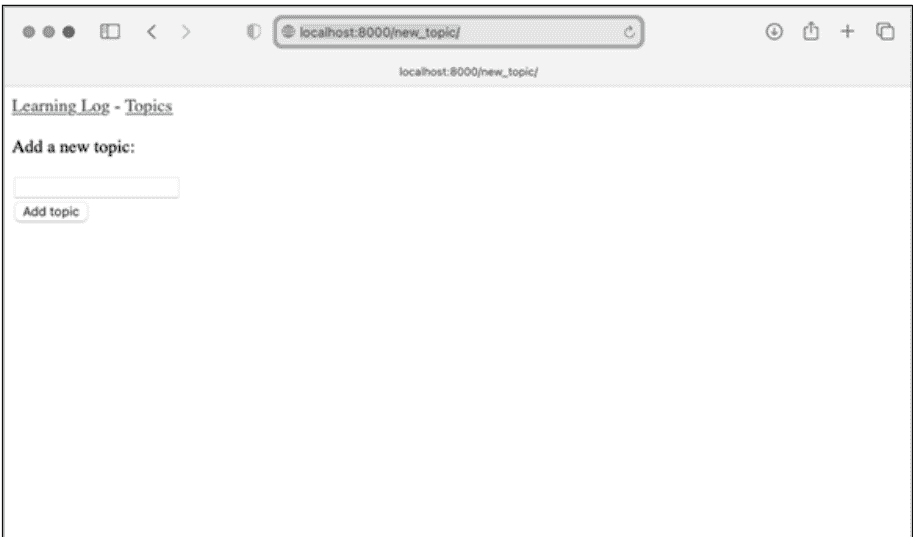
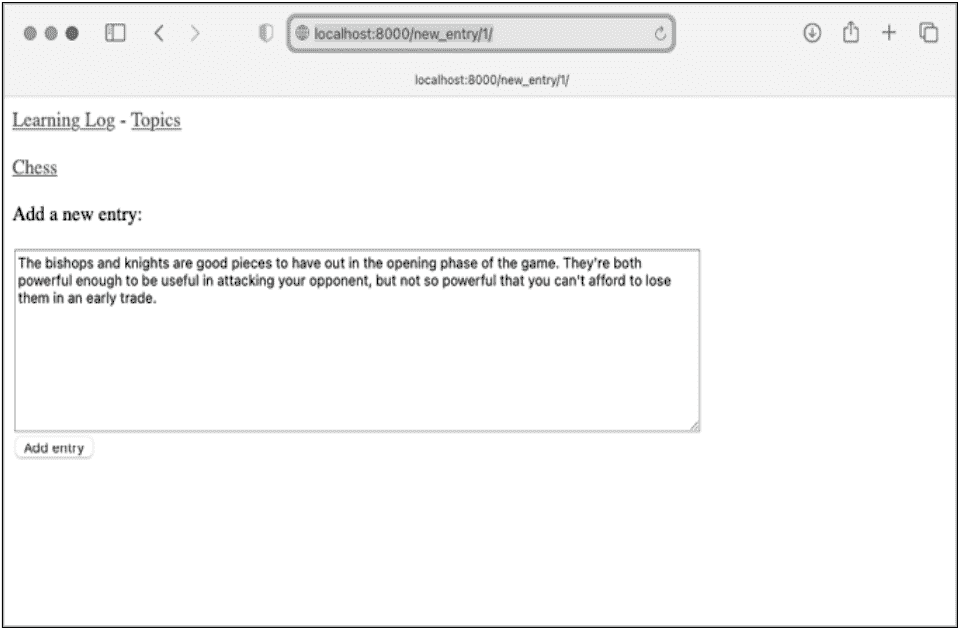
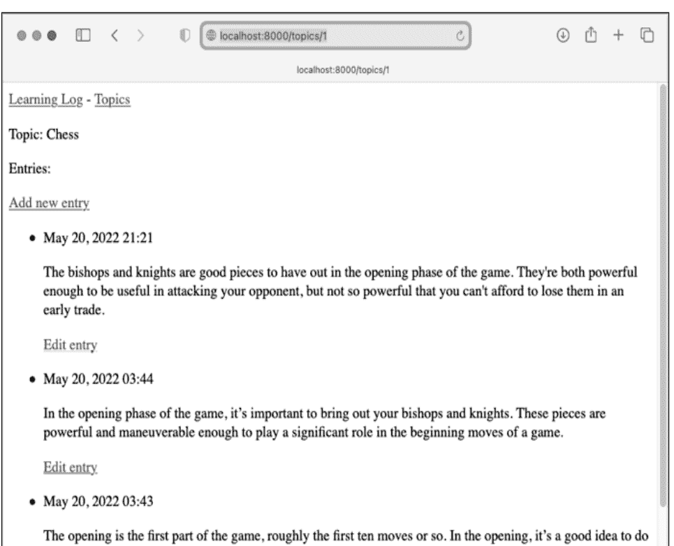

## 19 用户账户


Web 应用的核心是任何用户，无论身在世界何处，都可以为你的应用注册账户并开始使用。在本章中，你将构建表单，以便用户可以添加自己的主题和条目，并编辑现有条目。你还将学习 Django 如何防范针对基于表单页面的常见攻击，这样你就不必花费太多时间思考如何保护你的应用。

你还将实现一个用户认证系统。你将为用户创建账户构建一个注册页面，然后仅限制已登录用户访问某些页面。然后你将修改一些视图函数，以便用户只能看到自己的数据。你将学习如何让用户的数据安全可靠。

## 允许用户输入数据

在我们构建用于创建账户的认证系统之前，我们将先添加一些允许用户输入自己的数据的页面。我们将赋予用户添加新主题、添加新条目以及编辑其先前条目的能力。

目前，只有超级用户可以通过 admin 站点输入数据。我们不希望用户与 admin 站点交互，因此我们将使用 Django 的表单构建工具来构建允许用户输入数据的页面。

### 添加新主题

让我们先允许用户添加新主题。添加基于表单的页面与我们已构建的页面大体相同：我们定义一个 URL，编写一个视图函数，并编写一个模板。唯一显著的区别是新增了一个名为 forms.py 的模块，其中将包含表单。

### Topic ModelForm

任何允许用户在网页上输入和提交信息的页面都涉及一个名为 form 的 HTML 元素。当用户输入信息时，我们需要验证提供的信息是否为正确类型的数据且不具恶意，例如旨在中断我们服务器的代码。然后我们需要处理并将有效信息保存到数据库的适当位置。Django 自动化了其中的大部分工作。

在 Django 中构建表单最简单的方法是使用 ModelForm，它使用我们在第 18 章中定义的模型信息自动构建表单。在与 models.py 相同目录下创建 forms.py 文件，编写你的第一个表单：

`forms.py`

```python
from django import forms

from .models import Topic

class TopicForm(forms.ModelForm):
    class Meta:
        model = Topic
        fields = ['text']
        labels = {'text': ''}
```

我们首先导入 forms 模块和我们将要工作的模型 Topic。然后我们定义一个名为 TopicForm 的类，它继承自 forms.ModelForm ①。

ModelForm 的最简单版本由一个嵌套的 Meta 类组成，告诉 Django 基于哪个模型构建表单以及在表单中包含哪些字段。在这里我们指定表单应基于 Topic 模型 ②，并且只包含 text 字段 ③。labels 字典中的空字符串告诉 Django 不要为 text 字段生成标签 ④。

### new_topic URL

新页面的 URL 应简短且描述性强。当用户想要添加新主题时，我们将把他们发送到 http://localhost:8000/new_topic/。以下是 new_topic 页面的 URL 模式；将其添加到 learning_logs/urls.py 中：

`learning_logs/urls.py`

```python
--snip--
urlpatterns = [
    --snip--
    # Page for adding a new topic.
    path('new_topic/', views.new_topic, name='new_topic'),
]
```

此 URL 模式将请求发送到视图函数 new_topic()，我们将在下一步编写它。

### new_topic() 视图函数

new_topic() 函数需要处理两种不同的情况：对 new_topic 页面的初始请求，在这种情况下它应显示一个空白表单；以及处理表单中提交的任何数据。处理完提交表单的数据后，它需要将用户重定向回 topics 页面：

`views.py`

```python
from django.shortcuts import render, redirect

from .models import Topic
from .forms import TopicForm

--snip--
def new_topic(request):
    """Add a new topic."""
    if request.method != 'POST':
        # No data submitted; create a blank form.
        form = TopicForm()
    else:
        # POST data submitted; process data.
        form = TopicForm(data=request.POST)
        if form.is_valid():
            form.save()
            return redirect('learning_logs:topics')

    # Display a blank or invalid form.
    context = {'form': form}
    return render(request, 'learning_logs/new_topic.xhtml', context)
```

我们导入 redirect 函数，我们将在用户提交主题后使用它将用户重定向回 topics 页面。我们还导入了我们刚刚编写的表单 TopicForm。

### GET 和 POST 请求

在构建应用时，你将使用的两种主要请求类型是 GET 和 POST。你使用 *GET* 请求来获取仅从服务器读取数据的页面。你通常使用 *POST* 请求当用户需要通过表单提交信息时。我们将为处理所有表单指定 POST 方法。 （存在其他几种请求，但我们不会在该项目中使用它们。）

`new_topic()` 函数将 `request` 对象作为参数接收。当用户最初请求此页面时，其浏览器将发送 GET 请求。一旦用户填写并提交表单，其浏览器将提交 POST 请求。根据请求，我们将知道用户是请求空白表单（GET）还是要求我们处理已完成的表单（POST）。

我们使用 `if` 测试来确定请求方法是否为 GET 或 POST ①。如果请求方法不是 POST，则请求很可能是 GET，因此我们需要返回一个空白表单。 （如果它是另一种请求，返回空白表单仍然是安全的。）我们创建一个 `TopicForm` 的实例 ②，将其分配给变量 `form`，并在 `context` 字典中将表单发送到模板 ⑦。因为我们在实例化 `TopicForm` 时未包含任何参数，Django 创建了一个用户可以填写的空白表单。

如果请求方法是 POST，则 `else` 块运行并处理表单中提交的数据。我们创建一个 `TopicForm` 的实例 ③，并传递用户输入的数据，该数据分配给 `request.POST`。返回的 `form` 对象包含用户提交的信息。

在我们检查其有效性之前，我们不能将提交的信息保存到数据库中 ④。`is_valid()` 方法检查所有必填字段是否已填写（表单中的所有字段默认都是必填的）并且输入的数据是否与预期的字段类型匹配——例如，文本长度小于 200 个字符，正如我们在第 18 章的 *models.py* 中指定的那样。这种自动验证为我们节省了大量工作。如果一切有效，我们可以调用 `save()` ⑤，它将表单中的数据写入数据库。

保存数据后，我们可以离开此页面。`redirect()` 函数接收视图的名称并将用户重定向到与该视图关联的页面。在这里我们使用 `redirect()` 将用户的浏览器重定向到 topics 页面 ⑥，在那里用户应该在主题列表中看到他们刚刚输入的主题。

context 变量在视图函数末尾定义，并使用模板 *new_topic.xhtml* 渲染页面，我们将在下一步创建。此代码放置在任何 `if` 块之外；如果创建了空白表单，它将运行，如果提交的表单被判定为无效，它也将运行。无效表单将包含一些默认错误消息，以帮助用户提交可接受的数据。

### new_topic 模板

现在我们将创建一个名为 *new_topic.xhtml* 的新模板来显示我们刚刚创建的表单：

`new_topic.xhtml`

```html



    <p>Add a new topic:</p>

    <form action="" method='post'>
        
        {{ form.as_div }}
        <button name="submit">Add topic</button>
    </form>

```


```html

```

这个模板继承了 *base.xhtml*，因此它与学习日志中其他页面具有相同的基础结构。我们使用 `<form></form>` 标签来定义 HTML 表单 ❶。`action` 参数告诉浏览器将表单中提交的数据发送到哪里；在本例中，我们将数据发送回 `new_topic()` 视图函数。`method` 参数告诉浏览器以 POST 请求方式提交数据。

Django 使用模板标签 `` ❷ 来防止攻击者利用表单未经授权地访问服务器。（这种攻击称为*跨站请求伪造*。）接下来，我们显示表单；在这里你可以看到 Django 能让某些任务变得多么简单，例如显示表单。我们只需包含模板变量 `{{ form.as_div }}`，Django 就会自动创建显示表单所需的全部字段 ❸。`as_div` 修饰符告诉 Django 将所有表单元素渲染为 HTML `<div></div>` 元素；这是整齐显示表单的一种简单方式。

Django 不会为表单创建提交按钮，因此我们在关闭表单之前定义一个提交按钮 ❹。

## 链接到 new_topic 页面

接下来，我们在 topics 页面中包含一个指向 `new_topic` 页面的链接：

**topics.xhtml**

```html




  <p>Topics</p>

  <ul>
--snip--
</ul>

<a href="">Add a new topic</a>


```

将这个链接放在现有主题列表之后。图 19-1 显示了生成的表单；试着用这个表单添加几个你自己的新主题。



图 19-1：添加新主题的页面

## 添加新条目

既然用户现在可以添加新主题，他们也会想要添加新条目。我们将再次定义 URL、编写视图函数和模板，并链接到页面。但首先，我们要在 forms.py 中添加另一个类。

### Entry 的 ModelForm

我们需要创建一个与 `Entry` 模型关联的表单，但这一次要比 `TopicForm` 多一些定制：

**forms.py**

```python
from django import forms

from .models import Topic, Entry

class TopicForm(forms.ModelForm):
    --snip--

class EntryForm(forms.ModelForm):
    class Meta:
        model = Entry
        fields = ['text']
        labels = {'text': ''}
        widgets = {'text': forms.Textarea(attrs={'cols': 80})}
```

我们更新了 `import` 语句，使其既包含 `Topic` 也包含 `Entry`。我们创建了一个名为 `EntryForm` 的新类，它继承自 `forms.ModelForm`。`EntryForm` 类有一个嵌套的 `Meta` 类，列出它基于的模型以及要包含在表单中的字段。我们再次将 `'text'` 字段的标签留空 ❶。

对于 `EntryForm`，我们加入了 `widgets` 属性 ❷。*控件*是一种 HTML 表单元素，例如单行文本框、多行文本区域或下拉列表。通过加入 `widgets` 属性，你可以覆盖 Django 默认的控件选择。这里我们让 Django 使用宽度为 80 列的 `forms.Textarea` 元素，而不是默认的 40 列。这为用户提供了足够的空间来编写有意义的条目。

### new_entry 的 URL

新条目必须与特定主题关联，因此我们需要在用于添加新条目的 URL 中包含一个 `topic_id` 参数。下面是要添加到 *learning_logs/urls.py* 中的 URL：

**learning_logs/urls.py**

```python
--snip--
urlpatterns = [
    --snip--
    # Page for adding a new entry.
    path('new_entry/<int:topic_id>/', views.new_entry, name='new_entry'),
]
```

这个 URL 模式匹配任何形如 *http://localhost:8000/new_entry/id/* 的 URL，其中 *id* 是一个与主题 ID 对应的数字。代码 `<int:topic_id>` 会捕获一个数值并将其赋给变量 `topic_id`。当请求的 URL 与此模式匹配时，Django 会将请求和主题 ID 发送给 `new_entry()` 视图函数。

### new_entry() 视图函数

`new_entry` 的视图函数与添加新主题的函数非常相似。将以下代码添加到你的 *views.py* 文件中：

**views.py**

```python
from django.shortcuts import render, redirect

from .models import Topic
from .forms import TopicForm, EntryForm

--snip--
def new_entry(request, topic_id):
    """Add a new entry for a particular topic."""
    topic = Topic.objects.get(id=topic_id)

    if request.method != 'POST':
        # No data submitted; create a blank form.
        form = EntryForm()
    else:
        # POST data submitted; process data.
        form = EntryForm(data=request.POST)
        if form.is_valid():
            new_entry = form.save(commit=False)
            new_entry.topic = topic
            new_entry.save()
            return redirect('learning_logs:topic', topic_id=topic_id)

    # Display a blank or invalid form.
    context = {'topic': topic, 'form': form}
    return render(request, 'learning_logs/new_entry.xhtml', context)
```

我们更新了 import 语句，以包含刚创建的 EntryForm。`new_entry()` 的定义带有一个 `topic_id` 参数，用于存储它从 URL 接收的值。我们需要主题来渲染页面并处理表单数据，因此使用 `topic_id` 获取正确的主题对象 ①。

接下来，我们检查请求方法是 POST 还是 GET ②。如果是 GET 请求，则执行 if 块，并创建一个空的 EntryForm 实例 ③。

如果请求方法是 POST，我们通过创建一个 EntryForm 实例来处理数据，该实例用请求对象中的 POST 数据填充 ④。然后检查表单是否有效。如果有效，我们需要在将其保存到数据库之前设置 entry 对象的 topic 属性。调用 `save()` 时，我们加入参数 `commit=False` ⑤，告诉 Django 创建一个新的 entry 对象并将其赋给 `new_entry`，但暂不保存到数据库。我们将 `new_entry` 的 topic 属性设置为函数开头从数据库中取出的主题 ⑥。然后，我们不带任何参数调用 `save()`，将条目连同正确的关联主题保存到数据库。

`redirect()` 调用需要两个参数：我们要重定向到的视图名称，以及该视图函数所需的参数 ⑦。这里，我们重定向到 `topic()`，它需要参数 `topic_id`。该视图随后渲染用户添加条目的主题页面，他们应该会在条目列表中看到自己的新条目。

在函数末尾，我们创建一个上下文（context）字典，并使用 `new_entry.xhtml` 模板渲染页面。这段代码会在表单为空时执行，或者在表单已提交但无效时执行。

### new_entry 模板

如下面的代码所示，`new_entry` 的模板与 `new_topic` 的模板类似：

**new_entry.xhtml**

```html




①  <p><a href="">{{ topic }}</a></p>

  <p>Add a new entry:</p>
②  <form action="" method='post'>
    
    {{ form.as_div }}
    <button name='submit'>Add entry</button>
  </form>


```

我们在页面顶部显示主题 ①，以便用户知道他们正在为哪个主题添加条目。该主题也充当返回该主题主页面的链接。

表单的 action 参数在 URL 中包含了 `topic.id` 值，因此视图函数可以将新条目关联到正确的主题 ②。除此之外，这个模板看起来与 `new_topic.xhtml` 完全一样。

### 链接到 new_entry 页面

接下来，我们需要在每个主题页面的主题模板中包含一个指向 `new_entry` 页面的链接：

**topic.xhtml**

```html




  <p>Topic: {{ topic }}</p>

  <p>Entries:</p>
  <p>
    <a href="">Add new entry</a>
  </p>

  <ul>
  --snip--
  </ul>


```

我们将添加条目的链接放在显示条目之前，因为添加新条目将是此页面上最常见的操作。[图 19-2](#) 显示了 `new_entry` 页面。现在，用户既可以添加新主题，也可以为每个主题添加任意数量的条目。试着通过为你创建的一些主题添加几个条目来试用 `new_entry` 页面。




图 19-2：*new_entry 页面*

## 编辑条目

现在我们来创建一个页面，以便用户可以编辑他们添加的条目。

### edit_entry 的 URL

该页面的 URL 需要传递要编辑的条目的 ID。下面是 *learning_logs/urls.py*：

**urls.py**

```python
--snip--
urlpatterns = [
    --snip--
    # Page for editing an entry.
    path('edit_entry/<int:entry_id>/', views.edit_entry, name='edit_entry'),
]
```

这个 URL 模式匹配类似 `http://localhost:8000/edit_entry/id/` 的 URL。其中 `id` 的值会被赋给参数 `entry_id`。Django 会将匹配此格式的请求发送给视图函数 `edit_entry()`。

### `edit_entry()` 视图函数

当 `edit_entry` 页面收到 GET 请求时，`edit_entry()` 函数会返回一个用于编辑条目的表单。当页面收到包含修订后条目文本的 POST 请求时，它会将修改后的文本保存到数据库中：

```python
# views.py
from django.shortcuts import render, redirect

from .models import Topic, Entry
from .forms import TopicForm, EntryForm
--snip--

def edit_entry(request, entry_id):
    """Edit an existing entry."""
    entry = Entry.objects.get(id=entry_id)
    topic = entry.topic

    if request.method != 'POST':
        # Initial request; pre-fill form with the current entry.
        form = EntryForm(instance=entry)
    else:
        # POST data submitted; process data.
        form = EntryForm(instance=entry, data=request.POST)
        if form.is_valid():
            form.save()
            return redirect('learning_logs:topic', topic_id=topic.id)

    context = {'entry': entry, 'topic': topic, 'form': form}
    return render(request, 'learning_logs/edit_entry.xhtml', context)
```

我们首先导入 Entry 模型。然后获取用户想要编辑的条目对象①，以及与该条目关联的主题。在 if 代码块（针对 GET 请求执行）中，我们使用参数 instance=entry② 创建 EntryForm 实例。该参数告诉 Django 创建一个表单，并用现有条目对象的信息预填充。用户将看到自己的现有数据，并能够编辑这些数据。

处理 POST 请求时，我们同时传递 instance=entry 和 data=request.POST 这两个参数③。这些参数告诉 Django 基于与现有条目对象关联的信息创建一个表单实例，并使用 request.POST 中的任何相关数据进行更新。然后我们检查表单是否有效；如果有效，我们不带任何参数调用 save()，因为该条目已经与正确的主题关联④。然后我们重定向到主题页面，用户应该能看到他们编辑过的条目的更新版本⑤。

如果我们显示用于编辑条目的初始表单，或者提交的表单无效，我们就创建上下文字典，并使用 edit_entry.xhtml 模板渲染页面。

### edit_entry 模板

接下来，我们创建一个 edit_entry.xhtml 模板，它与 new_entry.xhtml 类似：

**edit_entry.xhtml**

```



    <p><a href="">{{ topic }}</a></p>
    <p>Edit entry:</p>
①  <form action="" method='post'>
    
    {{ form.as_div }}
②  <button name="submit">Save changes</button>
</form>


```

`action` 参数把表单发送回 `edit_entry()` 函数进行处理①。我们在 `` 标签中加入了 `entry.id` 作为参数，以便视图函数可以修改正确的条目对象。我们将提交按钮标记为 `Save changes`，以提醒用户他们是在保存编辑，而不是在创建新条目②。

### 链接到 edit_entry 页面

现在我们需要在主题页面上为每个条目包含一个指向 `edit_entry` 页面的链接：

**topic.xhtml**

```
--snip--
    
    <li>
        <p>{{ entry.date_added|date:'M d, Y H:i' }}</p>
        <p>{{ entry.text|linebreaks }}</p>
        <p>
            <a href="">
                Edit entry</a></p>
    </li>
--snip--
```

我们在显示每个条目的日期和文本之后包含编辑链接。我们使用 `` 模板标签来确定命名 URL 模式 `edit_entry` 的 URL，并结合循环中当前条目的 ID 属性（`entry.id`）。链接文本 `Edit entry` 会出现在页面上的每个条目之后。图 19-3 展示了添加这些链接后的主题页面。



图 19-3：*每个条目现在都有用于编辑该条目的链接。*

Learning Log 现在已具备其所需的大部分功能。用户可以添加主题和条目，也可以浏览他们想要的任何一组条目。在下一节中，我们将实现一个用户注册系统，以便任何人都可以注册 Learning Log 账户，并创建自己的一组主题和条目。

我们需要添加一行代码，以包含 accounts 应用中的 *urls.py* 文件。这一行将匹配任何以单词 *accounts* 开头的 URL，例如 `http://localhost:8000/accounts/login/`。

## 登录页面

我们将首先实现一个登录页面。我们将使用 Django 提供的默认登录视图，因此这个应用的 URL 模式看起来有些不同。在 `ll_project/accounts/` 目录中新建一个 `urls.py` 文件，并添加以下内容：

**accounts/urls.py**

```python
"""Defines URL patterns for accounts."""

from django.urls import path, include

app_name = 'accounts'
urlpatterns = [
    # Include default auth urls.
    path('', include('django.contrib.auth.urls')),
]
```

我们导入 `path` 函数，然后导入 `include` 函数，以便可以包含一些 Django 已定义的默认身份验证 URL。这些默认 URL 包含命名 URL 模式，例如 'login' 和 'logout'。我们将变量 `app_name` 设置为 'accounts'，以便 Django 能够将这些 URL 与属于其他应用的 URL 区分开来。即使是 Django 提供的默认 URL，当它们被包含在 accounts 应用的 *urls.py* 文件中时，也可以通过 accounts 命名空间访问。

登录页面的模式匹配 URL `http://localhost:8000/accounts/login/`。当 Django 读取这个 URL 时，单词 *accounts* 告诉 Django 在 *accounts/urls.py* 中查找，而 *login* 则告诉它将请求发送到 Django 的默认 *login* 视图。

### 登录模板

当用户请求登录页面时，Django 将使用默认的视图函数，但我们仍然需要为该页面提供一个模板。默认的身份验证视图会在名为 *registration* 的文件夹中查找模板，因此我们需要创建这个文件夹。在 *ll_project/accounts/* 目录中，创建一个名为 *templates* 的目录；在其中，再创建另一个名为 *registration* 的目录。下面是 *login.xhtml* 模板，它应保存在 *ll_project/accounts/templates/registration* 中：

**login.xhtml**

```




①   
        <p>Your username and password didn't match. Please try again.</p>
    

②   <form action="" method='post'>
        
③      {{ form.as_div }}

④      <button name="submit">Log in</button>
    </form>


```

该模板继承自 *base.xhtml*，以确保登录页面与网站其他部分具有相同的外观和感觉。请注意，一个应用中的模板可以继承另一个应用中的模板。

如果表单的 *errors* 属性已设置，我们会显示一条错误消息①，报告用户名和密码组合与数据库中存储的任何内容都不匹配。

我们希望登录视图处理该表单，因此我们将 `action` 参数设置为登录页面的 URL②。登录视图会向模板发送一个 `form` 对象，我们需要自己来显示表单③并添加提交按钮④。

### LOGIN_REDIRECT_URL 设置

用户成功登录后，Django 需要知道将该用户重定向到哪里。我们在设置文件中控制这一点。

在 `settings.py` 的末尾添加以下代码：

```python
# --snip--
# My settings.
LOGIN_REDIRECT_URL = 'learning_logs:index'
```

由于 `settings.py` 中包含所有默认设置，因此标注出我们正在添加新设置的部分会很有帮助。我们要添加的第一个新设置是 `LOGIN_REDIRECT_URL`，它告诉 Django 在登录尝试成功后应重定向到哪个 URL。

### 链接到登录页面

让我们将登录链接添加到 `base.xhtml` 中，以便它出现在每个页面上。我们不希望在用户已经登录时显示该链接，因此我们将其嵌套在 `` 标签内：

```html
<p>
    <a href="">Learning Log</a>
    - <a href="">Topics</a> -
    
        Hello, {{ user.username }}.
    
        <a href="">Log in</a>
    
</p>
```


```
</p>

```

在 Django 的认证系统中，每个模板都可以使用一个 user 对象，该对象始终具有 `is_authenticated` 属性：当用户已登录时该属性为 `True`，未登录时为 `False`。此属性允许你向已认证用户显示一条消息，向未认证用户显示另一条消息。

这里我们向当前已登录的用户显示问候语 ❶。已认证用户还具有额外的 `username` 属性，我们用它来个性化问候语并提醒用户他们已登录 ❷。对于未通过认证的用户，我们显示一个指向登录页面的链接 ❸。

### 使用登录页面

我们已经设置了用户账户，现在让我们登录以查看页面是否正常工作。前往 *http://localhost:8000/admin/*。如果你仍以管理员身份登录，请在页眉中查找 **logout** 链接并点击它。

注销后，前往 *http://localhost:8000/accounts/login/*。你应该会看到类似 [Figure 19-4](#figure-19-4) 所示的登录页面。输入之前设置的用户名和密码，你应该会被带回主页。主页的页眉应显示使用你的用户名个性化的问候语。

```
①  <hr />
②  <form action="" method='post'>
    
    <button name='submit'>Log out</button>
  </form>

```

注销的默认 URL 模式为 'accounts/logout/'。然而，请求必须作为 POST 请求发送；否则，攻击者可以轻松强制注销请求。为了使注销请求使用 POST，我们定义了一个简单的表单。

我们在页面的底部、水平规则元素 (<hr />) 之后放置表单 ①。这是一种简单的方法，可以始终将注销按钮保持在页面上任何其他内容之下的固定位置。表单本身将注销 URL 作为其 action 参数，并将 'post' 作为请求方法 ②。Django 中的每个表单都需要包含 ，即使是像这样简单的表单。此表单除了提交按钮外为空。

### LOGOUT_REDIRECT_URL 设置

当用户点击注销按钮时，Django 需要知道将他们发送到哪里。我们在 settings.py 中控制此行为：

settings.py

```text
--snip--
# My settings.
LOGIN_REDIRECT_URL = 'learning_logs:index'
LOGOUT_REDIRECT_URL = 'learning_logs:index'
```

此处显示的 LOGOUT_REDIRECT_URL 设置告诉 Django 将已注销用户重定向回主页。这是一种简单的方式来确认他们已注销，因为注销后他们不应再看到自己的用户名。

## 注册页面

接下来，我们将构建一个页面以便新用户注册。我们将使用 Django 的默认 UserCreationForm，但编写自己的视图函数和模板。

### register URL

以下代码为注册页面提供了 URL 模式，应放置在 accounts/urls.py 中：

accounts/urls.py

```python
"""Defines URL patterns for accounts."""

from django.urls import path, include

from . import views

app_name = 'accounts'
urlpatterns = [
    # Include default auth urls.
    path('', include('django.contrib.auth.urls')),
    # Registration page.
    path('register/', views.register, name='register'),
]
```

我们从 accounts 导入 views 模块，因为我们为注册页面编写了自己的视图。注册页面的模式匹配 URL http://localhost:8000/accounts/register/ 并将请求发送到我们即将编写的 register() 函数。

### register() 视图函数

register() 视图函数需要在首次请求注册页面时显示空白注册表单，然后在表单提交时处理已完成的注册表单。当注册成功时，函数还需要在登录新用户。将其以下代码添加到 *accounts/views.py*：

accounts/views.py

```python
from django.shortcuts import render, redirect
from django.contrib.auth import login
from django.contrib.auth.forms import UserCreationForm

def register(request):
    """Register a new user."""
    if request.method != 'POST':
        # Display blank registration form.
        form = UserCreationForm()
    else:
        # Process completed form.
        form = UserCreationForm(data=request.POST)

        if form.is_valid():
            new_user = form.save()
            # Log the user in and then redirect to home page.
            login(request, new_user)
            return redirect('learning_logs:index')

    # Display a blank or invalid form.
    context = {'form': form}
    return render(request, 'registration/register.xhtml', context)
```

我们导入 `render()` 和 `redirect()` 函数，然后导入 `login()` 函数以在注册信息正确时登录用户。我们还导入默认的 `UserCreationForm`。在 `register()` 函数中，我们检查是否正在响应 POST 请求。如果不是，我们创建一个没有任何初始数据的 `UserCreationForm` 实例 ❶。

如果我们正在响应 POST 请求，我们将基于提交的数据创建 `UserCreationForm` 实例 ❷。我们检查数据是否有效 ❸——在这种情况下，用户名具有适当的字符、密码匹配，并且用户没有在提交中尝试做任何恶意操作。

如果提交的数据有效，我们调用表单的 save() 方法将用户名和密码的哈希保存到数据库 ④。save() 方法返回新创建的用户对象，我们将其分配给 new_user。当用户信息保存后，我们通过使用 request 和 new_user 对象调用 login() 函数来登录他们 ⑤，这为新用户创建了一个有效的会话。最后，我们将用户重定向到主页 ⑥，主页页眉中的个性化问候语会告诉他们注册成功。

在函数末尾，我们渲染页面，该页面将是空白表单或无效的已提交表单。

### register 模板

现在为注册页面创建一个模板，它将与登录页面类似。确保将其保存在与 login.xhtml 相同的目录中：

register.xhtml

```html




<form action="" method='post'>
    
    {{ form.as_div }}

    <button name="submit">Register</button>
</form>


```

这应该看起来像我们一直在编写的其他基于表单的模板。我们再次使用 as_div 方法，以便 Django 适当显示表单中的所有字段。

> **NOTE**
>
> *我们设置的注册系统允许任何人为 Learning Log 创建任意数量的账户。某些系统要求用户通过发送确认邮件来确认身份，用户必须回复该邮件。通过这样做，系统产生的垃圾账户比我们在此使用的简单系统更少。然而，当你学习构建应用程序时，使用像我们在这里使用的这样简单的用户注册系统进行练习是完全合适的。*

### 试试看

**19-2. Blog Accounts:** 将用户认证和注册系统添加到你在练习 19-1（第 415 页）中开始的 Blog 项目中。确保已登录用户在屏幕上的某个位置看到他们的用户名，未注册用户看到注册页面的链接。

## 允许用户拥有自己的数据

用户应该能够在他们的学习日志中输入私有数据，因此我们将创建一个系统来确定哪些数据属于哪个用户。然后我们将限制对某些页面的访问，以便用户只能处理自己的数据。

我们将修改 `Topic` 模型，以便每个主题都属于特定用户。这也会处理条目，因为每个条目都属于特定主题。我们将首先通过限制对某些页面的访问开始。

### 使用 @login_required 限制访问


Django 通过 `@login_required` 装饰器可以轻松限制对某些页面的访问。回顾第 11 章，*装饰器*是放在函数定义前的一条指令，用于修改函数的行为方式。我们来看一个示例。

## 限制对主题页面的访问

每个主题都将归属于某个用户，因此只有注册用户才能请求主题页面。在 *learning_logs/views.py* 中添加以下代码：

*learning_logs/views.py*

```python
from django.shortcuts import render, redirect
from django.contrib.auth.decorators import login_required

from .models import Topic, Entry
--snip--

@login_required
def topics(request):
    """Show all topics."""
    --snip--
```

首先导入 `login_required()` 函数。通过在 `login_required` 前加上 @ 符号，我们将 `login_required()` 作为装饰器应用于 `topics()` 视图函数。这样，Python 就知道在运行 `topics()` 中的代码之前先运行 `login_required()` 中的代码。

`login_required()` 中的代码会检查用户是否已登录，只有已登录时 Django 才会运行 `topics()` 中的代码。如果用户未登录，则会被重定向到登录页面。

要使重定向生效，我们需要修改 *settings.py*，让 Django 知道登录页面在哪里。在 *settings.py* 末尾添加以下内容：

```python
--snip--
# My settings.
LOGIN_REDIRECT_URL = 'learning_logs:index'
LOGOUT_REDIRECT_URL = 'learning_logs:index'
LOGIN_URL = 'accounts:login'
```

现在，当未认证用户请求受 `@login_required` 装饰器保护的页面时，Django 会将用户发送到 *settings.py* 中由 `LOGIN_URL` 定义的 URL。

你可以通过退出所有用户账户并访问首页来测试此设置。单击**主题**链接，应该会被重定向到登录页面。然后登录你的任意账户，再从首页单击**主题**链接，你应该能够访问主题页面。

## 在整个学习日志中限制访问

Django 让限制页面访问变得很容易，但你必须决定保护哪些页面。最好先想清楚哪些页面需要不受限制，然后再限制项目中所有其他页面的访问。过度限制访问很容易修正，而且比让敏感页面不受限制更安全。

在学习日志中，我们将保持首页和注册页面不受限制。我们将限制其他所有页面的访问。

以下是应用了 `@login_required` 装饰器（除了 `index()` 之外的所有视图）的 *learning_logs/views.py*：

```python
--snip--
@login_required
def topics(request):
    --snip--

@login_required
def topic(request, topic_id):
    --snip--

@login_required
def new_topic(request):
    --snip--

@login_required
def new_entry(request, topic_id):
    --snip--

@login_required
def edit_entry(request, entry_id):
    --snip--
```

尝试在退出登录的状态下访问这些页面中的每一个；你应该会被重定向回登录页面。你也无法点击诸如 `new_topic` 之类的页面链接。但如果你直接输入 URL *http://localhost:8000/new_topic/*，你会被重定向到登录页面。你应该限制任何可公开访问且涉及用户私有数据的 URL。

### 将数据关联到特定用户

接下来，我们需要将数据与提交它的用户关联起来。我们只需要将层级最高的数据关联到用户，较低层级的数据会自动跟随。在学习日志中，主题是应用中最高层级的数据，所有条目都与某个主题关联。只要每个主题属于特定用户，我们就可以追踪数据库中每个条目的归属。

我们将通过向 `Topic` 模型添加与用户的外键关系来修改它。然后必须迁移数据库。最后，修改一些视图，使它们只显示当前登录用户相关的数据。

```text
④ Select an option: 1
⑤ Please enter the default value now, as valid Python
The datetime and django.utils.timezone modules are available...
Type 'exit' to exit this prompt
⑥ >>> 1
Migrations for 'learning_logs':
    learning_logs/migrations/0003_topic_owner.py
- Add field owner to topic
(ll_env)learning_log$
```

我们首先发出 makemigrations 命令 ①。在输出中，Django 表示我们试图向现有模型（topic）添加一个没有默认值且必需的（非空）字段 ②。Django 给了我们两个选项：我们可以立即提供默认值，或者退出并在 models.py 中添加默认值 ③。这里我选择了第一个选项 ④。然后 Django 要求我们输入默认值 ⑤。

为了将所有现有主题关联到原始管理员用户 ll_admin，我输入了用户 ID 1 ⑥。你可以使用你创建的任何用户的 ID；不一定是超级用户。然后 Django 使用该值迁移数据库，并生成迁移文件 0003_topic_owner.py，该文件将字段 owner 添加到 Topic 模型。

现在我们可以执行迁移了。在激活的虚拟环境中输入以下命令：

```text
(ll_env)learning_log$ python manage.py migrate
Operations to perform:
  Apply all migrations: admin, auth, contenttypes, learning_logs, sessions
Running migrations:
①   Applying learning_logs.0003_topic_owner... OK
(ll_env)learning_log$
```

Django 应用了新迁移，结果是 OK ①。

我们可以在 shell 会话中验证迁移是否按预期工作，如下所示：

```python
>>> from learning_logs.models import Topic
>>> for topic in Topic.objects.all():
...     print(topic, topic.owner)
...
Chess ll_admin
Rock Climbing ll_admin
>>>
```

我们从 `learning_logs.models` 导入 `Topic`，然后遍历所有现有主题，打印每个主题及其所属用户。你可以看到每个主题现在都属于用户 `ll_admin`。（如果你运行此代码时出错，请尝试退出 shell 并重新启动一个新的 shell。）

> **注意**
>
> *你可以直接重置数据库而不是迁移，但这会丢失所有现有数据。学习如何在维护用户数据完整性的同时迁移数据库是一种良好实践。如果你确实想从一个全新的数据库开始，请发出命令 `python manage.py flush` 来重建数据库结构。你将不得不创建一个新的超级用户，并且你所有的数据都会消失。*

### 限制主题访问仅限于相应用户

目前，只要你登录，无论登录的是哪个用户，你都能看到所有主题。我们将通过只显示属于当前用户的主题来改变这一点。

对 *views.py* 中的 `topics()` 函数进行以下更改：

```python
--snip--
@login_required
def topics(request):
    """Show all topics."""
    topics = Topic.objects.filter(owner=request.user).order_by('date_added')
    context = {'topics': topics}
    return render(request, 'learning_logs/topics.html', context)
--snip--
```

当用户登录时，`request` 对象具有一个 `request.user` 属性，其中包含有关用户的信息。查询 `Topic.objects.filter(owner=request.user)` 告诉 Django 仅从数据库中检索 owner 属性与当前用户匹配的 Topic 对象。由于我们没有更改主题的显示方式，因此完全不需要修改主题页面的模板。

为了验证这是否有效，请以你关联所有现有主题的用户身份登录，然后进入主题页面。你应该能看到所有主题。现在退出登录，再以不同用户身份登录。你应该会看到消息“尚未添加任何主题。”

### 保护用户的主题

我们还没有限制对主题页面的访问，因此任何注册用户都可以尝试一串 URL（例如 *http://localhost:8000/topics/1*）并检索恰好匹配的主题页面。

自己试试。以拥有所有主题的用户身份登录，复制某个主题的 URL 或记下 URL 中的主题 ID，然后退出登录并以不同用户身份登录。输入该主题的 URL。即使你以不同用户身份登录，也应该能阅读这些条目。


```python
--snip--
@login_required
def new_topic(request):
    --snip--
    else:
        # POST data submitted; process data.
        form = TopicForm(data=request.POST)
        if form.is_valid():
            new_topic = form.save(commit=False)
            new_topic.owner = request.user
            new_topic.save()
            return redirect('learning_logs:topics')

        # Display a blank or invalid form.
        context = {'form': form}
        return render(request, 'learning_logs/new_topic.html', context)
    --snip--
```

当我们第一次调用 `form.save()` 时，我们传递了 `commit=False` 参数，因为我们需要在将其保存到数据库之前修改新主题 ①。我们随后将新主题的 `owner` 属性设置为当前用户 ②。最后，我们在刚刚定义的主题实例上调用 `save()` ③。现在主题拥有所有必需的数据，将成功保存。

你应该能够为任意数量的用户添加任意数量的新主题。每个用户只能访问自己的数据，无论他们是查看数据、输入新数据还是修改旧数据。

### Try It Yourself

- **19-3. Refactoring:** 在 *views.py* 中，有两个地方我们确保主题关联的用户与当前登录用户匹配。将此检查的代码放入名为 `check_topic_owner()` 的函数中，并在适当的地方调用此函数。

- **19-4. Protecting new_entry:** 目前，用户可以通过输入属于另一用户的主题的 ID 的 URL 来向另一用户的学习日志添加新条目。通过在保存新条目之前检查当前用户是否拥有该条目的主题来防止此攻击。

- **19-5. Protected Blog:** 在你的 Blog 项目中，确保每篇博文都连接到特定用户。确保所有帖子都可以公开访问，但只有注册用户才能添加帖子和编辑现有帖子。在允许用户编辑其帖子的视图中，确保用户在处理表单之前正在编辑自己的帖子。

### Summary

在本章中，你学习了表单如何允许用户添加新主题和条目，并编辑现有条目。然后你学习了如何实现用户账户。你赋予现有用户登录和注销的能力，并使用 Django 的默认 `UserCreationForm` 让人们创建新账户。

在构建了简单的用户身份验证和注册系统后，你使用 `@login_required` 装饰器限制了对某些页面的登录用户访问。然后你通过外键关系将数据分配给特定用户。你还学习了在迁移需要你指定一些默认数据时如何迁移数据库。

最后，你学习了如何通过修改视图函数来确保用户只能看到属于他们的数据。你使用 `filter()` 方法检索适当的数据，并将请求数据的所有者与当前登录用户进行比较。

可能并不总是立即清楚你应该提供什么数据以及应该保护什么数据，但这种技能会随着练习而提高。我们在本章中为保护用户数据所做的决定也说明了在构建项目时与其他人合作是件好事：让别人审阅你的项目会更有可能发现脆弱区域。

你现在有一个在本地机器上完全运行的项目。在最后一章中，你将为 Learning Log 设计样式使其具有视觉吸引力，并将项目部署到服务器，以便任何拥有互联网访问权限的人都可以注册并创建账户。
