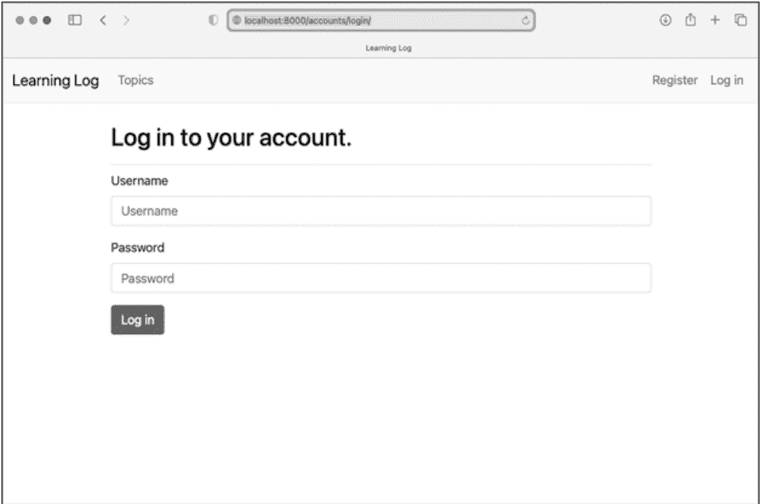

## 20 Styling and Deploying an App


Learning Log 现在完全可用，但它没有任何样式并且仅在你的本地机器上运行。在本章中，你将以简单但专业的方式为项目设计样式，然后将其部署到实时服务器，以便世界上的任何人都可以创建账户并使用它。

对于样式，我们将使用 *Bootstrap* 库，一组用于为各种现代设备从小手机到大桌面显示器，使 Web 应用程序看起来专业的工具。为了做到这一点，我们将使用 django-bootstrap5 应用，这也将让你练习使用其他 Django 开发者制作的应用。

我们将使用 *Platform.sh* 部署 Learning Log，这是一个让你将项目推送到其服务器之一的站点，使其可供任何拥有互联网连接的人使用。我们还将开始使用名为 Git 的版本控制系统来跟踪项目的更改。

完成 Learning Log 后，你将能够开发简单的 Web 应用程序，为其提供专业的外观和感觉，并将其部署到实时服务器。你还将能够在你发展技能时使用更高级的学习资源。

### Styling Learning Log

我们有意到现在为止忽略了样式，以便首先关注 Learning Log 的功能。这是一种很好的开发方法，因为应用程序只有在工作时才有用。一旦应用程序工作正常，其外观就至关重要，以便人们愿意使用它。

在本节中，我们将安装 django-bootstrap5 应用并将其添加到项目中。然后我们将使用它来为项目中的各个页面设计样式，以便所有页面都有一致的外观和感觉。

#### The django-bootstrap5 App

我们将使用 django-bootstrap5 将 Bootstrap 集成到我们的项目中。此应用下载所需的 Bootstrap 文件，将它们放置在项目中的适当位置，并使样式指令在项目模板中可用。

要在活动的虚拟环境中安装 django-bootstrap5，请发出以下命令：

```text
(ll_env)learning_log$ pip install django-bootstrap5
---snip---
Successfully installed beautifulsoup4-4.11.1 django-bootstrap5
```

接下来，我们需要在 *settings.py* 中的 INSTALLED_APPS 中添加 django-bootstrap5：

*settings.py*

```python
--snip--
INSTALLED_APPS = [
    # My apps.
    'learning_logs',
    'accounts',

    # Third party apps.
    'django_bootstrap5',

    # Default django apps.
    'django.contrib.admin',
    --snip--
```

启动一个名为 `Third party apps` 的新部分，用于其他开发者创建的应用，并将 `'django_bootstrap5'` 添加到此部分。确保将此部分放在 `My apps` 之后但在包含 Django 默认应用的部分之前。

#### Using Bootstrap to Style Learning Log

Bootstrap 是一个大型样式工具集合。它还提供了一系列你可以应用到项目中的模板，以创建整体样式。使用这些模板比使用单个样式工具要容易得多。要查看 Bootstrap 提供的模板，请转到 https://getbootstrap.com 并点击 **Examples**。我们将使用 *Navbar static* 模板，它提供了一个简单的顶部导航栏和页面内容的容器。

图 20-1 显示了我们在将 Bootstrap 的模板应用到 *base.html* 并稍微修改 *index.html* 后的主页的外观。

Figure 20-1: The Learning Log home page using Bootstrap

#### Modifying base.html

我们需要使用 Bootstrap 模板重写 *base.html*。我们将分段开发新的 *base.html*。这是一个大文件；你可能希望从在线资源复制此文件，可在 https://ehmatthes.github.io/pcc_3e 获取。如果你确实复制了文件，你仍应阅读以下部分以了解所做的更改。

#### Defining the HTML Headers

我们对 *base.html* 做的第一个更改定义了文件中的 HTML 标题。我们还将添加使用 Bootstrap 在模板中所需的一些要求，并为页面提供标题。删除 *base.html* 中的所有内容并将其替换为以下代码：

*base.html*

```html
<!doctype html>
<html lang="en">
<head>
    <meta charset="utf-8">
    <meta name="viewport" content="width=device-width, initial-scale=1">
    <title>Learning Log</title>

    
    
    

</head>
```

我们首先声明此文件为 HTML 文档 ① 用英语编写 ②。HTML 文件分为两个主要部分：head 和 body。文件的 head 部分以打开的 <head> 标签开始 ③。HTML 文件的 head 不包含页面的任何内容；它只是告诉浏览器它需要知道的内容以正确显示页面。我们为页面包含一个 <title> 元素，该元素将在浏览器标题栏中显示，只要 Learning Log 打开 ④。

在关闭 head 部分之前，我们加载 django-bootstrap5 中可用的模板标签集合 ⑤。模板标签  是来自 django-bootstrap5 的自定义标签；它加载实现 Bootstrap 样式所需的所有 CSS 文件。随后出现的标签启用了页面上可能使用的所有交互行为，例如可折叠导航栏。关闭的 </head> 标签出现在最后一行。

所有 Bootstrap 样式选项现在都可在继承自 base.html 的任何模板中使用。如果你想使用来自 django-bootstrap5 的自定义模板标签，每个模板都需要包含  标签。


## 定义导航栏

定义页面顶部导航栏的代码相当长，因为它需要在窄的手机屏幕和宽的桌面显示器上都能同样好地工作。我们将分段讲解导航栏。

下面是导航栏的第一部分：

### *base.xhtml*

```html
--snip--
</head>
<body>

①  <nav class="navbar navbar-expand-md navbar-light bg-light mb-4 border">
    <div class="container-fluid">
②      <a class="navbar-brand" href="">
            Learning Log</a>

③        <button class="navbar-toggler" type="button" data-bs-toggle="collapse"
            data-bs-target="#navbarCollapse" aria-controls="navbarCollapse"
            aria-expanded="false" aria-label="Toggle navigation">
            <span class="navbar-toggler-icon"></span>
        </button>

④      <div class="collapse navbar-collapse" id="navbarCollapse">
⑤        <ul class="navbar-nav me-auto mb-2 mb-md-0">
⑥          <li class="nav-item">
⑦            <a class="nav-link" href="">
                Topics</a></li>
        </ul> <!-- End of links on left side of navbar -->
      </div> <!-- Closes collapsible parts of navbar -->

    </div> <!-- Closes navbar's container -->
</nav> <!-- End of navbar -->
```

```html
⑧ 

</body>
</html>
```

第一个新元素是开头的 `<body>` 标签。HTML 文件的 *body* 包含用户在页面上看到的内容。接下来我们有一个 `<nav>` 元素，它打开了页面顶部导航栏的代码 ①。此元素中包含的所有内容都将根据 `navbar`、`navbar-expand-md` 以及此处看到的其他选择器定义的 Bootstrap 样式规则进行样式设置。*选择器* 决定页面上的哪些元素应用特定的样式规则。`navbar-light` 和 `bg-light` 选择器使用浅色主题背景为导航栏设置样式。`mb` 在 `mb-4` 中是 *margin-bottom* 的缩写；此选择器确保导航栏与页面其余部分之间留出一点空间。`border` 选择器在浅色背景周围提供细边框，使其与页面其余部分略有区分。

下一行的 `<div>` 标签打开了一个可调整大小的容器，用于容纳整个导航栏。术语 *div* 是 *division* 的缩写；你通过将网页划分为各部分并为该部分定义样式和行为规则来构建网页。在一个打开的 `<div>` 标签中定义的所有样式或行为规则都会影响直到其对应的闭合标签 `</div>` 的所有内容。

接下来我们将项目名称 `Learning Log` 设置为导航栏上的第一个元素 ②。这也将作为指向主页的链接，就像我们在前两章构建的极简样式版本中一直做的那样。`navbar-brand` 选择器对该链接进行样式设置，使其从其他链接中脱颖而出，并有助于为网站增加品牌感。

## 添加用户账户链接

我们仍需添加与用户账户相关的链接。我们将先添加所有账户相关链接，除了注销表单。

对 *base.xhtml* 做出以下更改：

### *base.xhtml*

```html
--snip--
</ul> <!-- End of links on left side of navbar -->

<!-- Account-related links -->
<ul class="navbar-nav ms-auto mb-2 mb-md-0">
    
    <li class="nav-item">
        <span class="navbar-text me-2">Hello, {{ user.username }}.</span></li>
    
    <li class="nav-item">
        <a class="nav-link" href="">Register</a></li>
    <li class="nav-item">
        <a class="nav-link" href="">Log in</a></li>
    
</ul> <!-- End of account-related links -->

</div> <!-- Closes collapsible parts of navbar -->
--snip--
```

我们通过另一个打开的 `<ul>` 标签开始一组新链接 ①。你可以在页面上拥有任意多组链接。选择器 `ms-auto` 是 *margin-start-automatic* 的缩写：此选择器检查导航栏中的其他元素并计算出一个左（起始）边距，将这组链接推到浏览器窗口的右侧。

if 块是我们之前用来根据用户是否登录显示适当消息的相同条件块 ②。现在块变长了一些，因为条件标签内部有一些样式规则。已认证用户的问候语被包裹在 `<span>` 元素中 ③。*span 元素* 用于对页面中较长行的一部分文本或元素进行样式设置。虽然 div 元素在页面中创建自己的分区，但 span 元素在较大区域内是连续的。这乍一看可能令人困惑，因为许多页面都有深层嵌套的 div 元素。在这里，我们使用 span 元素为导航栏上的信息文本设置样式：在本例中，为已登录用户的姓名。

在 else 块中，即针对未认证用户运行的块，我们包含了注册新账户和登录的链接 ④。这些链接应看起来与指向主题页面的链接一样。

如果你想在导航栏中添加更多链接，你只需向我们定义的 `<ul>` 组之一添加另一个 `<li>` 项，并使用与此处看到类似的样式指令。

现在让我们将注销表单添加到导航栏中。

### 将注销表单添加到导航栏

我们最初编写注销表单时，将其添加到 *base.xhtml* 的底部。现在让我们将其放在更好的位置，即导航栏中：

*base.xhtml*

```html
--snip--
</ul> <!-- End of account-related links -->


<form action="" method='post'>
    
    <button name='submit' class='btn btn-outline-secondary btn-sm'>
        Log out</button>
</form>


</div> <!-- Closes collapsible parts of navbar -->
--snip--
```

注销表单应放置在账户相关链接组之后，但仍在导航栏的可折叠部分内。表单中唯一的变化是在 `<button>` 元素中添加了若干 Bootstrap 样式类，这些类将 Bootstrap 样式元素应用于注销按钮 ①。

重新加载主页，你应该能够使用创建的任何账户登录和注销。

我们仍需要在 *base.xhtml* 中添加一些内容。我们需要定义两个块，供各个页面用于放置特定于这些页面的内容。

## 定义页面的主要部分

*base.xhtml* 的其余部分包含页面的主要部分：

### *base.xhtml*

```html
--snip--
</nav> <!-- End of navbar -->

<main class="container">
    <div class="pb-2 mb-2 border-bottom">
        
    </div>
    <div>
        
    </div>
</main>
</body>
</html>
```

我们首先打开一个 `<main>` 标签 ①。*main* 元素用于页面主体中最重要的部分。在这里我们分配 Bootstrap 选择器 `container`，这是一种简单地对页面上的元素进行分组的方法。我们将在此容器中放置两个 div 元素。

第一个 div 元素包含一个 `page_header` 块 ②。我们将使用此块为大多数页面添加标题。为了使此部分与页面其余部分区分开来，我们在标题下方放置一些内边距。*内边距* 指元素内容与其边框之间的空间。选择器 `pb-2` 是 Bootstrap 指令，提供样式化元素底部适量的内边距。*外边距* 是元素边框与其他页面元素之间的空间。选择器 `mb-2` 在此 div 底部提供适量的外边距。我们希望在此块底部有一个边框，因此使用选择器 `border-bottom`，它在 `page_header` 块底部提供细边框。

然后我们定义另一个包含块 `content` 的 div 元素 ③。我们不对此块应用任何特定样式，因此我们可以根据需要为每个页面的内容进行样式设置。*base.xhtml* 文件的末尾有 `main`、`body` 和 `html` 元素的闭合标签。

当你在浏览器中加载 Learning Log 的主页时，你应该会看到一个专业外观的导航栏，与 [Figure 20-1](Figure 20-1) 中显示的导航栏相匹配。尝试将窗口调整为非常窄，导航栏将被一个按钮取代。点击该按钮，所有链接都应以下拉列表形式出现。


## 使用 Jumbotron 设置主页样式

要更新主页，我们将使用 Bootstrap 中一种名为 *jumbotron* 的元素，也就是一个从页面其他部分中突显出来的大型区域。它通常用于主页，展示项目的简短介绍，并提供一个号召性按钮，邀请浏览者参与其中。

下面是修改后的 *index.xhtml* 文件：

*index.xhtml*

```


① 
②   <div class="p-3 mb-4 bg-light border rounded-3">
      <div class="container-fluid py-4">
③      <h1 class="display-3">Track your learning.</h1>

④      <p class="lead">Make your own Learning Log, and keep a list of the topics you're learning about. Whenever you learn something new about a topic, make an entry summarizing what you've learned.</p>

⑤      <a class="btn btn-primary btn-lg mt-1" href="">Register &raquo;</a>
    </div>
  </div>

```

首先，我们告诉 Django，接下来要定义 `page_header` 块的内容 ①。Jumbotron 由一对 div 元素实现，并为它们应用一组样式规则 ②。外层 div 设置了内边距和外边距、浅色背景以及圆角。内层 div 是一个会随窗口大小变化的容器，也设置了内边距。`py-4` 选择器会为 div 元素的顶部和底部添加内边距。你可以随意调整这些设置中的数值，看看主页会如何变化。

Jumbotron 中包含三个元素。第一个是简短的信息 `Track your learning`，让新访客了解 Learning Log 的作用 ③。`<h1>` 元素是一级标题，而 `display-3` 选择器让这个特定标题显得更细长。我们还加入了一段较长的信息，进一步说明用户可以用自己的学习日志做什么 ④。这段文字被格式化为 `lead` 段落，目的是让它比普通段落更加醒目。

我们没有只使用文本链接，而是创建了一个按钮，邀请用户注册 Learning Log 账号 ⑤。这个链接与页眉中的链接相同，但按钮在页面上更加醒目，也能让浏览者知道要开始使用这个项目需要做什么。这里的选择器会将它设置为一个大型按钮，用作号召性按钮。代码 `&raquo;` 是一个 *HTML 实体*，显示为两个组合在一起的右尖括号（>>）。最后，我们补上结束用的 div 标签，并关闭 `page_header` 块。由于这个文件中只有两个 div 元素，给结束用的 div 标签添加注释并没有太大帮助。我们不会在这个页面中添加其他内容，因此不需要在这个模板中定义 `content` 块。

现在的主页如图 20-1 所示。与未经样式处理的项目相比，这是一个显著的改进！

### 设置登录页面样式

我们已经改进了登录页面的整体外观，但登录表单本身还没有任何样式。让我们修改 *login.xhtml*，使表单与页面的其他部分保持一致：

*login.xhtml*

```



<h2>Log in to your account.</h2>


<form action="" method='post'>



</form>

```

首先，我们将 bootstrap5 模板标签加载到这个模板中 ①。然后定义 `page_header` 块，告诉用户这个页面的用途 ②。注意，我们从模板中删除了 `` 块；django-bootstrap5 会自动处理表单错误。

要显示表单，我们使用模板标签 `` ③；它取代了第 19 章中使用的 `{{ form.as_div }}` 元素。渲染表单时，`` 模板标签会将 Bootstrap 样式规则插入表单中的各个元素。要生成提交按钮，我们使用 `` 标签，并通过参数将其指定为提交按钮，再为其设置标签文本 `Log in` ④。

图 20-2 展示了现在的登录表单。页面整洁了许多，样式统一，目的也更加明确。试着使用错误的用户名或密码登录，你会看到，连错误消息的样式也保持一致，与整个网站的风格十分协调。



图 20-2：使用 Bootstrap 设置样式后的登录页面

### 设置主题页面样式

我们也要确保用于查看信息的页面具有恰当的样式，首先从主题页面开始：

*topics.xhtml*

```



<h1>Topics</h1>



<ul class="list-group border-bottom pb-2 mb-4">

<li class="list-group-item border-0">
<a href="">
    {{ topic.text }}</a>
    </li>
    
    <li class="list-group-item border-0">No topics have been added yet.</li>
    
    </ul>

    <a href="">Add a new topic</a>


```

我们不需要 `` 标签，因为这个文件中没有使用任何自定义的 bootstrap5 模板标签。我们将标题 `Topics` 移入 `page_header` 块，并将其改为 `<h1>` 元素，而不是简单的段落 ①。

此页面的主要内容是主题列表，因此我们使用 Bootstrap 的列表组组件来渲染页面。它会为整个列表以及列表中的各个项目应用一组简单的样式规则。打开 `<ul>` 标签时，我们首先加入 `list-group` 类，为列表应用默认样式规则 ②。我们还进一步自定义列表，在底部添加边框，在列表下方添加少量内边距（`pb-2`），并在底部边框下方添加外边距（`mb-4`）。

列表中的每个项目都需要 `list-group-item` 类，我们通过移除各个项目周围的边框来自定义其默认样式 ③。列表为空时显示的消息也需要使用这些类 ④。

现在访问主题页面，你应该会看到其样式与主页保持一致。

### 设置主题页面中条目的样式

在主题页面上，我们将使用 Bootstrap 的卡片组件，让每个条目都更加醒目。卡片由一组可嵌套的 div 组成，具有灵活的预定义样式，非常适合展示某个主题的条目：

*topic.xhtml*

```



  <h1>{{ topic.text }}</h1>



  <p>
    <a href="">Add new entry</a>
  </p>

  
    <div class="card mb-3">
      <!-- Card header with timestamp and edit link -->
      <h4 class="card-header">
        {{ entry.date_added|date:'M d, Y H:i' }}
        <small><a href="">edit entry</a></small>
      </h4>
      <!-- Card body with entry text -->
      <div class="card-body">{{ entry.text|linebreaks }}</div>
    </div>
    
    <p>There are no entries for this topic yet.</p>
  


```

首先，我们将主题放入 `page_header` 块中 ①。然后删除这个模板中之前使用的无序列表结构。我们不再将每个条目设为列表项，而是打开一个带有 `card` 选择器的 div 元素 ②。这张卡片包含两个嵌套元素：一个用于显示时间戳和编辑条目的链接，另一个用于显示条目正文。`card` 选择器负责这个 div 所需的大部分样式；我们通过在每张卡片底部添加少量外边距（`mb-3`）来进行自定义。

卡片中的第一个元素是一个标题，它是带有 `card-header` 选择器的 `<h4>` 元素 ③。这个标题包含条目的创建日期，以及编辑条目的链接。`edit_entry` 链接周围的 `<small>` 标签会让它比时间戳显示得稍小一些 ④。第二个元素是带有 `card-body` 选择器的 div ⑤，它会将条目文本放在卡片中的一个简洁区域里。请注意，用于将信息插入页面的 Django 代码并没有改变；改变的只有影响页面外观的元素。由于我们不再使用无序列表，因此将空列表消息周围的列表项标签替换成了简单的段落标签 ⑥。

图 20-3 展示了焕然一新的主题页面。Learning Log 的功能没有变化，但外观显著更加专业，也更能吸引用户。

如果你想在项目中使用其他 Bootstrap 模板，可以按照本章中介绍的类似流程进行操作。将你想使用的模板复制到 *base.xhtml* 中，并修改包含实际内容的元素，让模板显示项目的信息。然后使用 Bootstrap 的各项样式工具，为每个页面中的内容设置样式。

**注意**
*Bootstrap 项目提供了出色的文档。*
*访问主页 https://getbootstrap.com，然后点击 **文档**，了解 Bootstrap 提供了哪些功能。*


图 20-3：使用 Bootstrap 样式的主题页面

## 动手试一试

- 20-1. 其他表单：我们对登录页面应用了 Bootstrap 样式。请对其余基于表单的页面进行类似的更改，包括 new_topic、new_entry、edit_entry 和 register。
- 20-2. 美化博客：使用 Bootstrap 为你在第 19 章创建的 Blog 项目设置样式。

## 部署学习日志

现在我们已经拥有一个看起来很专业的项目，让我们将其部署到一台实时服务器上，这样任何能联网的人都可以使用它。我们将使用 Platform.sh，这是一个基于 Web 的平台，允许你管理 Web 应用的部署。我们将让学习日志在 Platform.sh 上运行起来。

### 创建 Platform.sh 账户

要创建账户，请访问 [https://platform.sh](https://platform.sh) 并点击**免费试用**按钮。Platform.sh 有一个免费层，截至本书写作时，它不需要信用卡。试用期允许你以最少的资源部署应用，让你在承诺付费托管方案之前，先在真实部署中测试项目。

> **注意**
>
> *试用计划的具体限制往往会定期变化，因为托管平台要应对垃圾信息和资源滥用。你可以在 [https://platform.sh/free-trial](https://platform.sh/free-trial) 查看免费试用的当前限制。*

### 安装 Platform.sh CLI

要在 Platform.sh 上部署和管理项目，你需要使用命令行界面（CLI）中提供的工具。要安装最新版本的 CLI，请访问 [https://docs.platform.sh/development/cli.xhtml](https://docs.platform.sh/development/cli.xhtml) 并按照适用于你的操作系统的说明进行操作。

在大多数系统上，你可以在终端中运行以下命令来安装 CLI：

```
$ curl -fsS https://platform.sh/cli/installer | php
```

此命令运行完成后，你需要打开一个新的终端窗口才能使用 CLI。

> **注意**
>
> *此命令在 Windows 的标准终端中可能无法运行。你可以使用适用于 Linux 的 Windows 子系统（WSL）或 Git Bash 终端。如果需要安装 PHP，可以使用来自 https://apachefriends.org 的 XAMPP 安装程序。如果你在安装 Platform.sh CLI 时遇到任何困难，请参阅附录 E 中更详细的安装说明。*

### 安装 platformshconfig

你还需要安装一个额外的包 `platformshconfig`。该包有助于检测项目是在本地系统还是 Platform.sh 服务器上运行。在激活的虚拟环境中，执行以下命令：

```
(ll_env)learning_log$ pip install platformshconfig
```

### 创建 requirements.txt 文件

远程服务器需要知道学习日志依赖哪些包，因此我们将使用 pip 生成一个列出这些包的文件。同样，在激活的虚拟环境中，执行以下命令：

```
(ll_env)learning_log$ pip freeze > requirements.txt
```

`freeze` 命令让 pip 将项目中当前安装的所有包的名称写入 *requirements.txt* 文件。打开此文件可查看项目中安装的包及其版本号：

requirements.txt

```
asgiref==3.5.2
beautifulsoup4==4.11.1
Django==4.1
django-bootstrap5==21.3
platformshconfig==2.4.0
soupsieve==2.3.2.post1
sqlparse==0.4.2
```

学习日志已经依赖七个不同包的特定版本，因此它需要在匹配的环境中才能在远程服务器上正常运行。（我们手动安装了其中三个包，另外四个是作为这些包的依赖项自动安装的。）

当我们部署学习日志时，Platform.sh 将安装 *requirements.txt* 中列出的所有包，从而创建一个与我们本地使用的包相同的环境。因此，我们可以确信部署后的项目会像在本地系统上一样运行。当你开始在系统上构建和维护多个项目时，这种项目管理方法至关重要。

> **注意**
>
> *如果你系统上列出的某个包版本号与这里显示的不同，请保留你系统上的版本。*

### 其他部署要求

实时服务器还需要两个额外的包。这些包用于在生产环境中提供项目服务，在这种环境中，许多用户可能同时发出请求。

在与 *requirements.txt* 相同的目录中，创建一个名为 *requirements_remote.txt* 的新文件。向其中添加以下两个包：

*requirements_remote.txt*

```
# Requirements for live project.
gunicorn
psycopg2
```

`gunicorn` 包用于响应进入远程服务器的请求；它取代了我们在本地一直使用的开发服务器。需要 `psycopg2` 包才能让 Django 管理 Platform.sh 使用的 Postgres 数据库。*Postgres* 是一个开源数据库，非常适合生产应用。

### 添加配置文件

每个托管平台都需要一些配置，项目才能在其服务器上正确运行。在本节中，我们将添加三个配置文件：

- **.platform.app.yaml** 这是项目的主配置文件。它告诉 Platform.sh 我们要部署什么类型的项目，以及项目需要哪些资源，并且还包含用于在服务器上构建项目的命令。
- **.platform/routes.yaml** 该文件定义了我们项目的路由。当 Platform.sh 收到请求时，正是此配置帮助将这些请求引导到我们的具体项目。
- **.platform/services.yaml** 该文件定义了项目需要的任何额外服务。

这些全都是 YAML（YAML Ain’t Markup Language，YAML 不是标记语言）文件。YAML 是一种专为编写配置文件而设计的语言；它既易于人类阅读，也易于计算机读取。你可以手动编写或修改典型的 YAML 文件，而计算机也能无歧义地读取和解释该文件。

YAML 文件非常适合部署配置，因为它们让你可以很好地控制部署过程中发生的一切。

### 显示隐藏文件

大多数操作系统会隐藏以点开头的文件和文件夹，例如 .platform。当你打开文件浏览器时，默认不会看到这类文件和文件夹。但作为程序员，你需要看到它们。下面介绍如何根据你的操作系统查看隐藏文件：

- 在 Windows 上，打开 Windows 资源管理器，然后打开一个文件夹（如“桌面”）。单击“查看”选项卡，并确保“文件扩展名”和“隐藏的项目”已勾选。
- 在 macOS 上，可以在任何 Finder 窗口中按 ⌘-SHIFT-.（点）来查看隐藏文件和文件夹。
- 在 Ubuntu 等 Linux 系统上，可以在任何文件浏览器中按 CTRL-H 来显示隐藏文件和文件夹。要使此设置永久生效，请打开文件浏览器（如 Nautilus）并单击选项选项卡（由三条线表示）。选中“显示隐藏文件”复选框。

### .platform.app.yaml 配置文件

第一个配置文件是最长的，因为它控制整个部署过程。我们将分部分展示；你可以自己在文本编辑器中输入，也可以从 https://ehmatthes.github.io/pcc_3e 的在线资源下载一份副本。

以下是 .platform.app.yaml 的第一部分，它应该与 manage.py 保存在同一目录中：

.platform.app.yaml

```
① name: "ll_project"
  type: "python:3.10"

② relationships:
        database: "db:postgresql"

  # The configuration of the app when it's exposed to the web.
③ web:
        upstream:
            socket_family: unix
        commands:
④         start: "gunicorn -w 4 -b unix:$SOCKET ll_project.wsgi:application"
⑤         locations:
            "/":
                passthru: true
            "/static":
                root: "static"
                expires: 1h
                allow: true

  # The size of the persistent disk of the application (in MB).
⑥ disk: 512
```

保存此文件时，请确保包含文件名开头的点。如果省略该点，Platform.sh 将找不到该文件，你的项目也就无法部署。

目前你不需要理解 .platform.app.yaml 中的一切；我将重点介绍配置中最重要的部分。文件首先以

指定项目名称，我们将其命名为 `ll_project`，为的是与启动项目时使用的名称保持一致 ❶。我们还需要指定当前使用的 Python 版本（撰写本文时为 3.10）。你可以在 https://docs.platform.sh/languages/python.xhtml 查看受支持版本的列表。

接下来是一个标记为 `relationships` 的部分 ❷，它定义了项目所需的其他服务。这里唯一的关系是 Postgres 数据库。其后是 `web` 部分 ❸。`commands:start` 部分告诉 Platform.sh 使用什么进程来处理传入的请求。这里我们指定由 gunicorn 来处理请求 ❹。该命令取代了我们在本地一直使用的 `python manage.py runserver` 命令。

`locations` 部分告诉 Platform.sh 将传入的请求发送到哪里 ❺。大多数请求应传递给 gunicorn；我们的 `urls.py` 文件会告诉 gunicorn 到底如何处理这些请求。对静态文件的请求将被单独处理，并且每小时刷新一次。最后一行表明，我们要在 Platform.sh 的一台服务器上申请 512MB 的磁盘空间 ❻。

`.platform.app.yaml` 的其余部分如下：

```yaml
--snip--
disk: 512

# Set a local read/write mount for logs.
mounts:
    "logs":
        source: local
        source_path: logs

# The hooks executed at various points in the lifecycle of the application.
hooks:
    build: |
        pip install --upgrade pip
        pip install -r requirements.txt
        pip install -r requirements_remote.txt
        mkdir logs
        python manage.py collectstatic
        rm -rf logs
    deploy: |
        python manage.py migrate
```

`mounts` 部分 ❶ 允许我们定义项目运行时可读写数据的目录。该部分为已部署项目定义了一个 `logs/` 目录。

`hooks` 部分 ❷ 定义了在部署过程的不同阶段执行的操作。在 `build` 部分，我们安装线上环境运行项目所需的所有软件包 ❸。我们还运行 `collectstatic` ❹，将项目所需的所有静态文件收集到一个位置，以便高效地提供它们。

最后，在 `deploy` 部分 ❺，我们指定每次部署项目时都应运行迁移。在简单的项目中，如果没有更改，这不会产生任何影响。

另外两个配置文件要简短得多；现在我们来编写它们。

## routes.yaml 配置文件

路由是请求在被服务器处理时所走的路径。当 Platform.sh 收到一个请求时，它需要知道将该请求发送到哪里。

在与 `manage.py` 相同的目录下新建一个名为 `.platform` 的文件夹。确保名称开头包含点号。在该文件夹内，创建一个名为 `routes.yaml` 的文件，并输入以下内容：

**.platform/routes.yaml**

```yaml
# Each route describes how an incoming URL will be processed by Platform.sh.

"https://{default}/":
    type: upstream
    upstream: "ll_project:http"

"https://www.{default}/":
    type: redirect
    to: "https://{default}/"
```

该文件确保类似 *https://project_url.com* 和 *www.project_url.com* 的请求都会被路由到同一个地方。

## services.yaml 配置文件

这最后一个配置文件指定了项目运行所需的服务。请将该文件保存在 *.platform/* 目录中，与 *routes.yaml* 放在一起：

**.platform/services.yaml**

```yaml
# Each service listed will be deployed in its own container as part of your
# Platform.sh project.

db:
    type: postgresql:12
    disk: 1024
```

该文件定义了一个服务，即 Postgres 数据库。

## 为 Platform.sh 修改 settings.py

现在我们需要在 *settings.py* 的末尾添加一部分内容，以针对 Platform.sh 环境修改一些设置。请将以下代码添加到 *settings.py* 的最末尾：

**settings.py**

```python
# --snip--
# Platform.sh settings.

from platformshconfig import Config

config = Config()
if config.is_valid_platform():
    ALLOWED_HOSTS.append('.platformsh.site')

    if config.appDir:
        STATIC_ROOT = Path(config.appDir) / 'static'
    if config.projectEntropy:
        SECRET_KEY = config.projectEntropy

    if not config.in_build():
        db_settings = config.credentials('database')
        DATABASES = {
            'default': {
                'ENGINE': 'django.db.backends.postgresql',
                'NAME': db_settings['path'],
                'USER': db_settings['username'],
                'PASSWORD': db_settings['password'],
                'HOST': db_settings['host'],
                'PORT': db_settings['port'],
            },
        }
```

通常我们会把 `import` 语句放在模块开头，但在这种情况下，将所有与远程环境相关的设置放在一个部分中是有帮助的。这里我们从 `platformshconfig` 导入了 `Config` ❶，它有助于确定远程服务器上的设置。只有当 `config.is_valid_platform()` 方法返回 True ❷ 时，我们才会修改设置，这表示这些设置正被用于 Platform.sh 服务器。

我们修改 `ALLOWED_HOSTS`，以允许项目通过以 `.platformsh.site` 结尾的主机提供服务 ❸。所有部署到免费层级的项目都将使用该主机提供服务。如果设置正在已部署应用的目录中加载 ❹，我们就设置 `STATIC_ROOT`，以便正确提供静态文件。我们还在远程服务器上设置了更安全的 `SECRET_KEY` ❺。

最后，我们配置生产数据库 ❻。只有在构建过程运行完毕并且项目正在提供服务时，才会进行此设置。你在这里看到的所有内容都是让 Django 与 Platform.sh 为项目搭建的 Postgres 服务器进行通信所必需的。

## 使用 Git 跟踪项目文件

正如第 17 章所讨论的，Git 是一个版本控制程序，允许你在每次成功实现一个新功能时为项目代码拍一张快照。如果出现问题，你可以轻松地回到项目上一个可用的快照；例如，如果你在开发新功能时意外引入了 bug。每个快照都称为一次*提交*。

使用 Git，你可以尝试实现新功能，而不必担心弄坏项目。当你部署到线上服务器时，需要确保部署的是项目的一个可用版本。要了解更多关于 Git 和版本控制的内容，请参阅附录 D。

### 安装 Git

你的系统上可能已经安装了 Git。要查明这一点，请打开一个新的终端窗口并执行命令 **git --version**：

```
(ll_env)learning_log$ git --version
git version 2.30.1 (Apple Git-130)
```

如果你看到一条消息，提示 Git 未安装，请参阅附录 D 中的安装说明。

### 配置 Git

Git 会跟踪谁在项目上做了更改，即使项目只有一个人在做也是如此。为此，Git 需要知道你的用户名和电子邮件。你必须提供用户名，但可以为练习项目编造一个电子邮件地址：

```
(ll_env)learning_log$ git config --global user.name "eric"
(ll_env)learning_log$ git config --global user.email "eric@example.com"
```

如果你忘记了这一步，Git 会在你首次提交时提示你提供这些信息。

### 忽略文件

我们不需要 Git 跟踪项目中的每一个文件，所以我们要让它忽略一些文件。在包含 `manage.py` 的文件夹中创建一个名为 `.gitignore` 的文件。请注意，这个文件名以点号开头，而且没有文件扩展名。以下是 `.gitignore` 中应包含的代码：

**.gitignore**

```
ll_env/
__pycache__/
*.sqlite3
```

我们让 Git 忽略整个 `ll_env` 目录，因为我们可以随时自动重新创建它。我们也不跟踪 `__pycache__` 目录，其中包含 `.py` 文件执行时自动生成的 `.pyc` 文件。我们不跟踪本地数据库的更改，因为这是一个坏习惯：如果你在服务器上使用 SQLite，那么在将项目推送到服务器时，你可能会不小心用本地测试数据库覆盖线上数据库。`*.sqlite3` 中的星号告诉 Git 忽略任何以 `.sqlite3` 扩展名结尾的文件。


此次提交，以及`-m`标志告诉Git记录一条日志消息③。

执行`git status`命令④表明我们位于main分支上，并且工作树是干净的。每次将项目推送到远程服务器时，这是你希望看到的状态。

## 在Platform.sh上创建项目

目前，Learning Log项目仍在本地系统运行，同时已经配置好可以在远程服务器上正确运行。我们将使用Platform.sh CLI在服务器上创建一个新项目，然后将项目推送到远程服务器。

确保你在终端中，位于`learning_log/`目录下，然后执行以下命令：

```
(ll_env)learning_log$ platform login
Opened URL: http://127.0.0.1:5000
Please use the browser to log in.
--snip--
① Do you want to create an SSH configuration file automatically? [Y/n] Y
```

此命令将打开一个浏览器标签页，你可以在其中登录。登录后，你可以关闭浏览器标签页并返回终端。如果系统提示是否创建SSH配置文件①，请输入Y，以便稍后连接到远程服务器。

现在我们来创建项目。由于输出内容很多，我们将分部分查看创建过程。首先执行创建命令：

```
(ll_env)learning_log$ platform create
* Project title (--title)
Default: Untitled Project
① > ll_project

  * Region (--region)
  The region where the project will be hosted
    --snip--
    [us-3.platform.sh] Moses Lake, United States (AZURE) [514 gCO2eq/kWh]
② > us-3.platform.sh
  * Plan (--plan)
  Default: development
  Enter a number to choose:
    [0] development
    --snip--
③ > 0

  * Environments (--environments)
  The number of environments
  Default: 3
④ > 3

  * Storage (--storage)
  The amount of storage per environment, in GiB
  Default: 5
⑤ > 5

Default branch (--default-branch)
The default Git branch name for the project (the production environment)
Default: main
⑥ > main

Git repository detected: /Users/eric/.../learning_log
② Set the new project ll_project as the remote for this repository? [Y/n] Y

The estimated monthly cost of this project is: $10 USD
③ Are you sure you want to continue? [Y/n] Y

The Platform.sh Bot is activating your project

The project is now ready!
```


Git仓库可以有多个分支；Platform.sh问我们项目的默认分支是否应为main ①。然后它询问是否要将本地项目的仓库连接到远程仓库②。最后，我们得知如果超出免费试用期后继续运行，该项目每月将花费约10美元③。如果你还没有输入信用卡，就不必担心这笔费用。如果你超出了免费试用的限制而没有添加信用卡，Platform.sh只会暂停你的项目。

## 推送到Platform.sh

在查看项目在线版本之前的最后一步是将代码推送到远程服务器。为此，执行以下命令：

```
(ll_env)learning_log$ platform push
① Are you sure you want to push to the main (production) branch? [Y/n] Y
--snip--
The authenticity of host 'git.us-3.platform.sh (...)' can't be established.
RSA key fingerprint is SHA256:Tvn...7PM
```

`platform url`命令会列出与已部署项目关联的URL；你会看到多个对该项目有效的URL供选择。选择一个，你的项目就会在新浏览器标签页中打开！它看起来和我们本地运行的项目一模一样，但你可以把这个URL分享给世界上任何人，他们都能访问并使用你的项目。

> **注意**
>
> *当你使用试用账户部署项目时，如果页面加载时间有时比平时长，不必惊讶。在大多数托管平台上，空闲的免费资源经常会被挂起，只有在收到新请求时才会重新启动。大多数平台在付费托管方案下响应速度会快得多。*

## 优化Platform.sh部署

现在我们将通过创建超级用户来优化部署，就像我们在本地所做的那样。我们还会将`DEBUG`设置改为`False`，以提高项目安全性，这样错误消息就不会向用户显示可用于攻击服务器的额外信息。

### 在Platform.sh上创建超级用户

在线项目的数据库已经设置好，但它完全是空的。我们之前创建的所有用户只存在于项目的本地版本中。

为了在项目在线版本上创建超级用户，我们将启动一个SSH（安全套接字Shell）会话，以便在远程服务器上运行管理命令：

```
(ll_env)learning_log$ platform environment:ssh

Welcome to Platform.sh.

web@ll_project.0:~$ ls
accounts    learning_logs   ll_project  logs    manage.py   requirements.txt
            requirements_remote.txt  static
web@ll_project.0:~$ python manage.py createsuperuser
Username (leave blank to use 'web'): ll_admin_live
Email address:
Password:
Password (again):
Superuser created successfully.
web@ll_project.0:~$ exit
logout
Connection to ssh.us-3.platform.sh closed.
(ll_env)learning_log$
```

首次运行`platform environment:ssh`命令时，你可能还会收到一个关于此主机真实性的提示。如果看到此消息，请输入Y，然后你应该会登录到远程终端会话。

运行`ssh`命令后，你的终端就像远程服务器上的终端一样。注意提示符已改变，表示你正处于与名为`ll_project`的项目关联的Web会话中①。如果执行`ls`命令，你会看到已推送到Platform.sh服务器的文件。

执行我们在第18章中使用的相同`createsuperuser`命令②。这次，我输入了一个管理员用户名`ll_admin_live`，与我在本地使用的用户名不同③。在远程终端会话中完成工作后，输入**exit**命令④。你的提示符将再次表明你正在本地系统上工作⑤。

现在你可以在在线应用的URL末尾添加`/admin/`，然后登录管理站点。如果其他人已经开始使用你的项目，请注意你将能够访问他们的所有数据！认真对待这一责任，用户才会继续信任你保存他们的数据。

**注意**

*Windows用户将使用此处显示的相同命令（例如使用`ls`而不是`dir`），因为你是在通过远程连接运行Linux终端。*

### 保护在线项目

我们项目当前的部署方式存在一个明显的安全问题：`settings.py`中的`DEBUG = True`设置会在发生错误时提供调试信息。Django的错误页面在开发项目时能为你提供重要的调试信息；但是，如果你在在线服务器上保持启用状态，它们会向攻击者泄露过多信息。

要了解这有多糟糕，请访问已部署项目的首页。登录用户账户，然后在首页URL末尾添加`/topics/999/`。假设你没有创建成千上万个主题，你应该会看到一个页面，上面显示消息“*在/topics/999/处不存在*”。如果向下滚动，你会看到大量关于项目和服务器信息。你不会想让用户看到这些，当然也不会想让任何有兴趣攻击站点的人看到这些信息。


我们可以通过在仅适用于项目部署版本的 `settings.py` 部分中设置 `DEBUG = False` 来防止此信息显示在生产站点上。这样你仍然可以在本地看到调试信息，在那里这些信息是有用的，但它不会显示在生产站点上。

在文本编辑器中打开 `settings.py`，并在修改 Platform.sh 设置的部分中添加一行代码：

**settings.py**

```
--snip--
if config.is_valid_platform():
    ALLOWED_HOSTS.append('.platformsh.site')
    DEBUG = False
    --snip--
```

为部署版本的项目设置配置所做的工作已经得到回报。当我们想要调整项目的生产版本时，我们只需更改之前设置的配置的相关部分即可。

## 提交和推送更改

现在我们需要提交对 `settings.py` 所做的更改并将其推送到 Platform.sh。以下是显示此过程第一部分的终端会话：

```
① (ll_env)learning_log$ git commit -am "Set DEBUG False on live site."
[main d2ad0f7] Set DEBUG False on live site.
    1 file changed, 1 insertion(+)
② (ll_env)learning_log$ git status
On branch main
nothing to commit, working tree clean
(ll_env)learning_log$
```

我们使用简短但描述性的提交信息发出 `git commit` 命令 ①。请记住 `-am` 标志

404 错误通常意味着你的 Django 代码是正确的，但被请求的对象不存在。500 错误通常意味着你编写的代码中存在错误，例如 `views.py` 中的函数错误。Django 目前在两种情况下都返回相同的通用错误页面，但我们可以编写自己的 404 和 500 错误页面模板，使其与 Learning Log 的整体外观相匹配。这些模板应放在根模板目录中。

## 创建自定义模板

在 `learning_log` 文件夹中，创建一个名为 `templates` 的新文件夹。然后创建一个名为 `404.html` 的新文件；该文件的路径应为 `learning_log/templates/404.html`。以下是此文件的代码：

**404.html**

```



  <h2>The item you requested is not available. (404)</h2>

```

此简单模板提供了通用的 404 错误页面信息，但样式与网站其余部分相匹配。

使用以下代码再创建一个名为 `500.html` 的文件：

**500.html**

```



  <h2>There has been an internal error. (500)</h2>

```

这些新文件需要对 `settings.py` 进行轻微更改。

**settings.py**

```
--snip--
TEMPLATES = [
    {
        'BACKEND': 'django.template.backends.django.DjangoTemplates',
        'DIRS': [BASE_DIR / 'templates'],
        'APP_DIRS': True,
        --snip--
    },
]
--snip--
```

此更改告诉 Django 在根模板目录中查找错误页面模板以及任何其他与特定应用无关的模板。

## 将更改推送到 Platform.sh

现在我们需要提交刚刚所做的更改并将其推送到 Platform.sh：

```
① (ll_env)learning_log$ git add .
② (ll_env)learning_log$ git commit -am "Added custom 404 and 500 error pages."
   3 files changed, 11 insertions(+), 1 deletion(-)
   create mode 100644 templates/404.html
   create mode 100644 templates/500.html
③ (ll_env)learning_log$ platform push
--snip--
   To git.us-3.platform.sh:wmye2fx7wwqgu.git
     d2ad0f7..9f042ef  HEAD -> main
(ll_env)learning_log$
```

我们发出 `git add .` 命令 ①，因为我们在项目中创建了一些新文件。然后我们提交更改 ② 并将更新后的项目推送到 Platform.sh ③。

现在当错误页面出现时，它应该具有与网站其余部分相同的样式，从而在出现错误时提供更流畅的用户体验。

## 持续开发

你可能希望在初始推送到生产服务器后继续开发 Learning Log，或者你可能希望开发自己的项目进行部署。在这样做时，更新项目的过程相当一致。

首先，你将对本地项目进行必要的更改。如果你的更改导致任何新文件，请使用命令 `git add .` 将这些文件添加到 Git 仓库中（确保在命令末尾包含点）。任何需要数据库迁移的更改都需要此命令，因为每次迁移都会生成一个新的迁移文件。

其次，使用 `git commit -am "commit message"` 将更改提交到你的仓库。然后使用命令 `platform push` 将你的更改推送到 Platform.sh。访问你的生产项目并确保你期望看到的更改已生效。

在此过程中很容易犯错，所以当出现问题时不要感到惊讶。如果代码无法工作，请回顾你所做的工作并尝试找出错误。如果找不到错误或无法弄清楚如何撤销它，请参考附录 C 中寻求帮助的建议。不要害羞地寻求帮助：每个人都是通过提出你可能提出相同的问题来学习构建项目的，所以有人会很乐意帮助你。解决出现的每个问题都有助于你稳步提高技能，直到你能够构建有意义、可靠的项目并回答其他人的问题。

## 在 Platform.sh 上删除项目

反复使用同一个项目或一系列小型项目多次进行部署过程是很好的练习，以便熟悉部署。但你会

信息突出，并学会一致地为网站的所有页面设置样式。

在项目的最后部分，你学习了如何将项目部署到远程服务器，以便任何人都可以访问它。你创建了一个 Platform.sh 账户并安装了一些有助于管理部署过程的工具。你使用 Git 将正在工作的项目提交到仓库，然后将仓库推送到 Platform.sh 上的远程服务器。最后，你学习了如何通过在生产服务器上设置 `DEBUG = False` 来开始保护你的应用。你还制作了自定义错误页面，因此不可避免的错误看起来处理得很好。

现在你完成了 Learning Log，你可以开始构建自己的项目。从简单开始，并在添加复杂性之前确保项目正常工作。享受你的持续学习，并祝你的项目好运！
