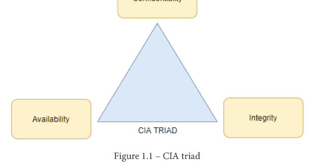
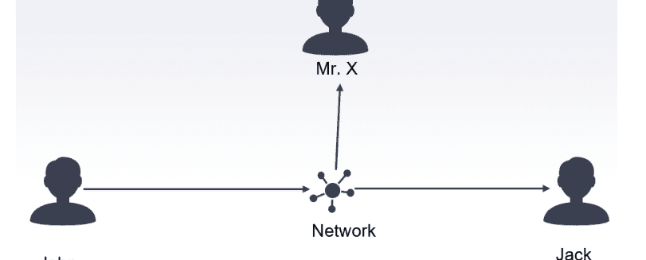
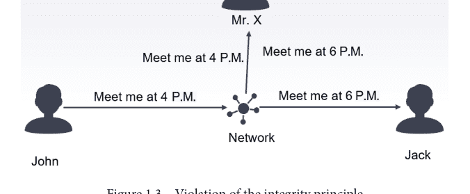
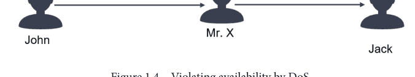
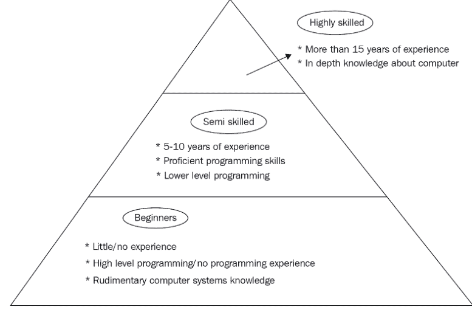
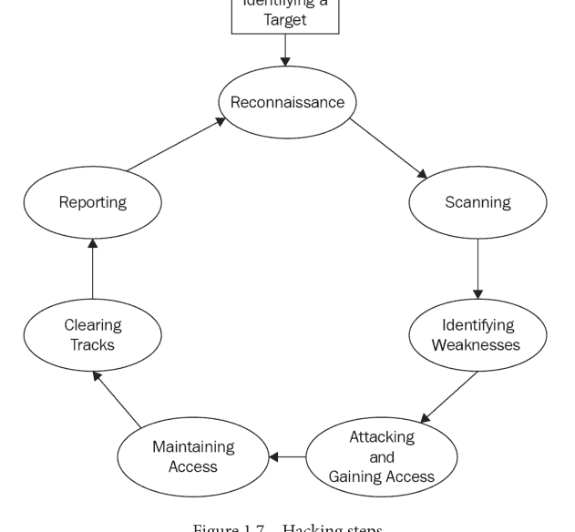

# 1
Introduction
to Hacking

This chapter will give you a quick introduction to the nuts and bolts of hacking. You will start exploring what the world of hacking entails and what it really takes to become a hacker. You will learn about what skill set is needed to become a successful hacker in the real world. We will also discuss some legal aspects of hacking and penetration testing and how you can avoid getting into legal trouble. Then, we will explore what the different kinds of hackers are and what categories they fall into. In the later sections of this chapter, we will explore the general steps and guidelines we should follow in order to carry out a successful attack. Lastly, we will conclude this chapter by talking about different attack vectors. We will talk about both technical and personal penetration testing techniques.

In this chapter, the following topics will be covered:

- What's all the fuss about hackers?
- What is hacking?
- Becoming a successful hacker
- Types of hackers
- Hacking phases and methodology
- Careers in cybersecurity
- Types of attacks

> **Disclaimer**
> All the information provided in this book is purely for educational purposes. The book aims to serve as a starting point for learning penetration testing. Use the information provided in this book at your own discretion. The author and publisher hold no responsibility for any malicious use of the work provided in this book and cannot be held responsible for any damages caused by the work presented in this book.
> 
> Penetration testing or attacking a target without previous written consent is illegal and should be avoided at all costs. It is the reader's responsibility to be compliant with all their local, federal, state, and international laws.

## What's all the fuss about hackers?

What comes to your mind when you think of the word hacker? In recent decades, the word hacker has almost become synonymous with the notion of a genius computer nerd who can get access to any system within seconds and can control anything. From someone who can control traffic signals through their computer to someone penetrating the Pentagon's network, the world of movies and fiction has created a specific image of a hacker. Like everything else in movies, this is just a work of fiction; the real world of hacking and penetration testing is quite different and vastly more complex and challenging.

The real world is filled with unknowns. Carrying out a successful attack on a victim requires a lot of patience, hard work, dedication, and probably a bit of luck. The world of computer security and hacking is a constant cat-and-mouse chase. Developers create a product, hackers try to break it and find vulnerabilities and exploit them, developers find out about these vulnerabilities and develop a patch for them, hackers find new vulnerabilities, and this cycle continues. Both actors try to outsmart each other in this constant race. With each iteration, the process becomes more and more complex, and attacks are becoming more and more sophisticated to bypass detection mechanisms. Similarly, detection mechanisms are also getting smarter and smarter. You can clearly see a pattern here.

以下列出的术语将在后续章节中使用。在深入了解细节时，熟悉这些术语是必要的。在阅读有关渗透测试的文献时，你经常会看到一个术语，即 CIA 三要素（代表 **机密性、完整性和可用性**）：

图 1.1 – CIA 三要素

黑客过程的大多数方面都涉及破坏其中一个或多个方面。让我们详细探讨这些术语。

## 机密性

机密性是指组织试图对其数据保持私密。这意味着在组织内部，没有人可以在未经授权的情况下访问数据。通常组织会有访问控制，规定每个用户对其数据的访问级别。访问级别通常分为以下几类：

| 实体 | 访问级别 | 谁 |
|---|---|---|
| Guests | 对组织的访问权限非常低 | 通常不是组织一部分的人拥有访客访问权限。 |
| Users | 中等 – 能够使用基础设施但无法修改它 | 组织的普通员工，需要对基础设施进行非常基础访问的人。 |
| Admins | 高级别 | 管理员通常是高级管理人员和 IT 人员。 |
| Root/super user | 完全控制 | 这些人大多对组织的基础设施拥有完全控制权。 |

当人们获得他们不应该访问的基础设施访问权限时，机密性就会被违反，例如，公司前员工使用之前的凭证登录系统，或访客在网络中获得不必要的更高访问级别。为了确保机密性，必须实施严格的控制以避免违反机密性标准。即使某人访问了公司数据但没有造成任何损害，机密性也会被违反。请看下面的例子：

图 1.2 – 机密性被违反

假设 John 在一个网络上向 Jack 发送一条消息。这条消息仅 intended for Jack，其他人不得查看。该网络与各种用户共享。未知人士 Mr. X 也在网络中，他正在监听网络上的所有流量（也称为嗅探）。机密性原则表明只有 Jack 才能解码这条消息。如果 Mr. X 拦截了这个数据包，阅读它，然后在不修改消息内容的情况下将其转发给 Jack，即使 John 和 Jack 都不知道他们的流量被拦截，机密性原则也被认为被违反了。网络嗅探/监控违反了机密性原则。

## 完整性

完整性原则确保数据未以任何形式被篡改并且是可靠的。数据完整性应在静态和事务模式下都得到保证。静态完整性意味着系统中的所有文件都保持完整，任何未经授权的修改都应立即被检测到。它还要求在传输介质上传输时保持数据完整性。用于确保数据完整性的技术各不相同。其中最常见的例子是使用校验和。校验和是为文件计算的一串字符，以确保其未被修改。你经常会在从互联网下载的文件中看到校验和。文件下载后，你可以计算校验和并将其与网站上的校验和进行比较；如果两者相等，则意味着下载过程中数据完整性得以保持。如果在下载过程中即使一个比特被更改，整个校验和字符串也会发生变化。它通常用于防止文件欺骗/伪装攻击，即黑客拦截你的下载请求，而非下载你请求的文件，而是将恶意恶意软件下载到你的电脑。你应始终比较文件的校验和，以确保你下载的文件确实与服务器上的文件相同。

为了更好地理解完整性原则，让我们看一下下面的例子：

图 1.3 – 完整性原则被违反

假设 John 向 Jack 发送一条消息，称他们应在下午 4 点会面。Mr. X 再次以一种使这两者之间所有流量都经过 Mr. X 的方式拦截网络流量。Mr. X 阅读了 John 的消息，将时间从下午 4 点改为下午 6 点，然后将消息发送给 Jack。Jack 收到消息后认为 John 想在下午 6 点而不是下午 4 点会面。Jack 没有办法知道实际消息。在这种情况下，完整性和机密性原则都被违反了。Mr. X 能够读取和更改数据。

## 可用性

可用性的最后一个原则要求数据在授权用户请求时可用。**拒绝服务 (DoS)** 攻击违反了这一原则。在 DoS 攻击中，攻击者试图用请求洪流使系统不堪重负，从而使服务器/系统对合法用户不可用。这是网站上最常见的攻击之一。攻击者用请求轰炸网站服务器，最终使其瘫痪。为了遏制 DoS 攻击，现在通常会设置几秒钟的等待时间来处理请求。可用性 simply 意味着网络、系统和服务器在用户需要时在线。即使中断几分钟，也会对组织造成严重破坏。让我们用同一个例子来更好地理解这一点：

图 1.4 – 通过 DoS 违反可用性

假设 John 再次在 Mr. X 正在拦截的同一网络上向 Jack 发送消息。John 向 Jack 发送消息称在下午 4 点会面。然而，Mr. X 拦截了这条消息并未将其转发。John 认为消息已发送。然而，Jack 将永远收不到这条消息。在这种情况下，可用性原则被违反了，因为消息对 Jack 不可用。违反可用性原则的另一种变体是延迟消息。假设 John 向 Jack 发送一条紧急消息，关于必须在特定时间范围内完成的某些任务。Mr. X 延迟了消息，使得消息在该时间范围过去后才被 Jack 收到。即使 John 收到了正确的消息，延迟也使消息变得毫无用处。这也是对可用性原则的严重违反。

为了保持系统安全可靠，CIA 三要素非常重要。每位网络安全专家的目标都是根据 CIA 特征维护系统。任何对这些原则的违反都会导致系统网络安全被破坏。接下来，让我们看看成为一名成功的黑客需要什么。

## 成为一名成功的黑客

为了成为一名成功的渗透测试员，你需要特定的技能集。
你首先需要的是强烈的学习新技术的渴望。计算世界正在以非常快的速度变化，每隔几年，老工具和技术就会被取代。你不能使用一次成功的漏洞利用并期望它在 10 年后仍然有用。本书将主要关注开发你自己的工具。你将无法用本书中开发的工具黑进 NASA，这也不是本书的想法。本书旨在作为你的起点。本书中描述的技术和工具的知识将帮助你入门，然后一切皆有可能。

为了在这一领域取得成功，你首先需要的是对计算机系统和计算机网络的了解。没有它们，你将无法取得很大进展。本书假设你熟悉计算机网络等。当必要时，新术语将被解释。本书还假设你对 Python 编程语言有基本了解。我们将在本书中使用 Python 3。

对这两个组件的知识应该足以跟随本书。渗透测试的世界相当庞大，要成为一名脱颖而出的黑客，你需要掌握大量技术。这包括 Linux、数据库、硬件和内存访问、逆向工程、密码学、网络和分析技能。如果你想成功，你应该主动并能够快速思考。

今天大多数系统都是在线的，基于网络的黑客攻击是渗透测试中最普遍的形式之一。这意味着要成为一名渗透测试员，了解网络如何工作是必不可少的。对基于网络的技术如 HTML、JavaScript、PHP 和 SQL 的基本知识是必不可少的。这些主题不会在本書中涵盖，因为它们不属于本书的范围；然而，在实际生活中，这些工具的知识对渗透测试非常有用。

一名成功的道德黑客所需的关键技能之一是像黑客一样思考。那么，*像黑客一样思考*意味着什么？黑客的目标是入侵系统。计算机系统以直观的方式设计，因此大多数人只需付出最小的努力就能与其交互。系统的所有安全方面都是以这种方法论为基础设计的。为了能够入侵系统，你的思维过程应该有点反直觉或更具创造性。你需要能够识别可被攻击的弱点，从而帮助你攻破系统。

创建一种能够帮助你攻击某个系统的工具是黑客过程的一方面，而能够在不被检测到的情况下成功地将你的恶意软件部署到目标系统则是方程的另一半。这几乎和黑客工具本身一样重要。一旦你确定了目标，你的目标就是思考一种可以将其部署到系统的方法论。部署代码的方法有很多，这取决于你能获得系统的何种访问权限。这些方法，例如钓鱼和特洛伊木马，将在后面讨论。如果你对这些术语感到陌生也不用担心。读完这本书后，你将熟悉其中大多数术语。

黑客需要你不断跟上新技术的发展。网络安全领域的格局变化非常迅速，你需要精通这些变化。一个好主意是关注专门讨论这些问题的论坛和网站。每天都有数百个漏洞被发现并得到修复；你需要在正确的时间出现在正确的地方以利用它们。机会窗口往往非常小。网络安全领域常用的一种术语是零日漏洞。零日漏洞是指尚未得到修补的漏洞。通常，只有极少数人知道这些漏洞，而且他们往往不会披露，以便最大化利用。一旦漏洞公开，很可能很快就会被修补，在某些情况下甚至只需几天。

图 1.5 – 黑客技能金字塔

上图显示了根据道德黑客专业程度划分的技能金字塔。达到顶峰需要经验、分析技能以及最重要的计算机系统的深入知识的结合。

## 合法性

渗透测试的经验法则是，你不应攻击你不被允许攻击的系统。即使你在一家网络安全公司担任渗透测试员，你也必须获得书面许可才能测试系统的安全性。如果没有书面同意，你可能会陷入严重的法律麻烦。渗透测试通常涉及使用不同的攻击向量攻击系统，这通常会导致系统崩溃。如果你没有事先许可，你将对对其基础设施造成的损害承担责任。

渗透测试涵盖了各种各样的测试。在实际案例中，用于测试的书面同意合同必须明确定义测试范围。它应提及将执行何种类型的测试以及测试中将针对哪些系统/资产。测试应严格限定在这些预定义的目标范围内。例如，除非明确提及，否则对软件代码的测试不应包括网络安全测试。

渗透测试可以在生产或实时系统上进行。如果被测试的资产是实时系统，用户必须就测试及其潜在损害得到适当通知。渗透测试在不同的环境中进行。有时组织中的用户知道正在进行渗透测试，而在其他情况下，只有高层管理知道，以便测试哪些个人对组织构成潜在威胁。如果组织中的用户已经知道将进行渗透测试，最好提前通知他们测试时间，以免干扰组织的日常活动。接下来，让我们了解黑客的类型。

## 黑客类型

如前所述，黑客一词附带了一个特定的形象。然而，在现实生活中，黑客根据其执行的操作类型被分为不同的类别。在接下来的章节中，我们将解释不同类型的黑客，他们需要什么样的经验，以及与每种类型相关的法律方面。

### 白帽黑客

*Aim:* 防御组织免受外部和恶意攻击，保护其业务和资产。

白帽黑客是指网络安全专家或渗透测试员，其目标是测试信息系统的安全性。他们也被称为*道德黑客*或*好人*。他们的意图是防御稍后将讨论的恶意黑客。白帽黑客使用相同的工具和技术，并具有相同的入侵系统专业知识。唯一的区别在于他们的意图。他们的目标是增强系统的强度并保护其免受外部攻击。

本书旨在帮助你成为一名道德黑客并帮助提高系统的安全性。成为一名成功的道德黑客需要多年的技术学习经验、理解黑客思维过程以及耐心。网络安全分析师和渗透测试员是计算机科学领域薪资最高的职位之一。

### 黑帽黑客

*Aim:* 怀有恶意意图入侵系统。

黑帽黑客通常是罪犯，其动机是获得经济利益或出于个人、机构或国家目标而对某人造成伤害。黑帽黑客尽可能隐藏自己的身份；他们大多使用化名来识别自己。怀有恶意意图的黑客行为在大多数国家都是非法的。黑帽黑客很难在系统中被检测到，除非他们选择暴露自己。很多时候，他们在资产的实际所有者不知道的情况下保持对系统的远程访问。他们也很擅长掩盖自己的踪迹。他们中的大多数只在造成损害后才暴露自己。很多时候，黑帽黑客是不同犯罪组织的一部分。这使他们更难被抓获。

严格来说，*黑帽黑客*是指其主要目标是经济利益的人。*黑帽黑客*一词源于在旧西部电影中，坏人经常戴黑帽子，因此使用黑帽来指代黑客的惯例变得流行。

### 灰帽黑客

*Aim:* 个人动机或为好玩。

现实世界不是二元的，黑客也不是。*灰帽*指的是在某种模糊地带运作的黑客。他们拥有与白帽或黑帽黑客相同的技能；然而，他们的动机通常不是财务上的。灰帽黑客喜欢为了好玩和享受而在系统中玩弄。大多数时候，他们是无害的，甚至会向负责人员暴露系统漏洞。他们之所以入侵系统，只是因为他们能做到。

灰帽黑客也喜欢在系统中窥探，测试其强度，一旦发现潜在弱点，他们通常会通知管理员并提供付费服务来纠正问题。这是他们赚钱的一种方式。这种做法的合法性值得怀疑；然而，对一些人来说，这是一种赚取可观收入的方式。

如前所述，灰帽黑客和黑帽黑客之间的界限相当模糊。你应该非常小心。一次错误或误算可能导致重大问题。灰帽黑客最终跨入黑帽类别的危险也存在。

这些是黑客的三个主要类别。然而，在现实生活中，还有其他术语使用，具体取决于你问谁，它们可能落入这些类别之一。很难将它们归类到单一类别，因此它们将在下一节中单独提及。

### 国家黑客

*Aim:* 攻击敌人的网络资产。

随着国家对基于计算机系统的依赖增加，保护和攻击网络系统变得极其重要。随着传统战争手段变得越来越强大和有限，网络战的使用变得越来越重要。*国家黑客*一词用于指一支专注于破坏敌对国家网络资产的黑客团队。

国家或*国家支持的黑客*的历史可以追溯到计算的早期。国家长期以来一直将黑客作为实现其战略目标的手段。国家支持黑客的工作是渗透敌方系统，获取信息，为远程控制植入后门，甚至破坏其关键基础设施。在这方面已经进行了多次高调的尝试，而且威胁非常真实。只要想象一下，如果敌对国家控制了某人的核电站会发生什么。这并不是科幻电影中的情节。这在现实生活中也发生过。

以感染伊朗核设施的*震网*病毒为例。震网是一种非常复杂的恶意软件，感染了**监控与数据采集（SCADA）**系统。SCADA系统用于监控和控制大型工业系统。该病毒利用了设施中**可编程逻辑控制器（PLC）**的一个漏洞。该恶意软件非常隐蔽，只有当目标系统是伊朗核设施时才会激活。尽管它感染了大量计算机系统，但大部分时间处于休眠状态，只有在到达预定目标时才会激活。根据大多数研究人员的说法，这次攻击的复杂性表明，它并非某个犯罪组织所为，而是需要一个高度专业化的程序员团队花费数月时间开发。这类资源通常只有国家级黑客才能动用。震网控制了离心机速度控制信号，并以极高的速度旋转离心机，最终导致其故障。震网还截获发往SCADA系统的速度状态消息，让这些系统以为离心机正以正常速度运行，而实际上它们的转速要高得多。这使得震网很难被检测到，并在相当长一段时间内未被发现，阻碍了该设施的核进展，最终在2010年被发现。

## 商业间谍

*目标：* 获得竞争优势。

公司的大量商业价值在于其拥有的**知识产权（IP）**。这种知识产权有时决定了公司的价值。近年来，公司一直是*商业攻击*的目标，有人试图窃取其知识产权。随着商业世界竞争加剧，商业间谍活动正变得司空见惯。公司经常受到*商业黑客*的攻击，这些黑客旨在窃取敏感信息，包括知识产权、商业计划、专利、财务数据和客户数据，以获得竞争优势。这些攻击可能直接来自竞争对手，也可能由竞争对手雇佣专业黑客实施。

这类黑客通常属于黑帽类别。然而，由于黑客攻击的性质，他们有时被归为单独的一类。商业黑客的唯一区别在于其主要目标通常是竞争对手，而在其他情况下，目标可能是任何人。

## 黑客行动主义者

*目标：* 发表政治/社会声明。

黑客行动主义者一词由*行动主义者*和*黑客*两个词组合而成。这类攻击通常是为了发表政治声明。这些黑客的目标是呼吁社会变革或引起人们对某些问题的关注。与尽量隐匿行踪的黑帽黑客不同，黑客行动主义者试图在隐藏真实身份的同时获得最大关注。他们的目标是将信息传播给大众。在大多数黑客行动主义案例中，黑客没有经济动机。他们使用与其他黑客相同的工具和技术。黑客行动主义是政治抗议的数字对应物。随着政治格局的变化，政治正在进军数字空间，黑客行动主义为一些人提供了发表声明的途径。

黑客行动主义者使用不同方法吸引注意。有时他们会破坏服务，例如对公司或政府网站发起DoS攻击。其他时候，他们获取关键敏感信息，并将这些机密信息泄露给公众，使政府或公司陷入极大尴尬。近年来重大泄密事件之一是维基解密风波。

这里需要注意的一点是，从法律角度看，黑客行动主义与黑帽黑客行为没有区别。即使你为了崇高事业参与某些活动而被抓住，你也会像黑帽黑客一样受到同等罪名的审判。因此，许多黑客倾向于保持匿名，并在行动中使用化名。

与黑客行动主义相关的最著名黑客组织之一是*匿名者*。据称，他们对多个政府组织发动了多次攻击，以表达对某项事业的支持或对某些立法的反对。匿名者自称是一个去中心化组织，人们汇聚在一起支持共同事业。他们常被称为数字范式中的*自由斗士*和*罗宾汉*。这个集体的去中心化特性意味着打击它变得非常困难：

图1.6 – 匿名者相关的标志

不同个人和小型组织声称负责管理该组织的运作；然而，这个组织的真实性质仍是一个谜。还有其他组织，如LulzSec和Fancy Bear，它们的运作性质更为专注，给网络安全专业人员带来了巨大困难。

## 脚本小子

在网络安全领域，*脚本小子*一词指的是初学者黑客，他们通常对网络安全或一般性的黑客技术没有深入了解。他们往往倾向于使用预先构建的工具进行黑客攻击，很像黑盒方法。他们本质上并不了解黑客工具的内部工作原理，只是使用它。脚本小子有时缺乏编程知识来构建自己的工具，并依赖现有工具进行黑客攻击。*脚本小子*这个术语源于他们使用预先构建的*脚本*或程序来实施攻击。

脚本小子经常获取诸如*反向Shell*之类的黑客工具，并通过观看互联网教程来部署它。他们的目标不是学习过程，而是达到最终目标——控制目标系统。只要工具能用，他们就不关心它是如何工作的。

网络安全专业人员常犯的一个错误是不把脚本小子当回事。即使是脚本小子精心部署的攻击也可能对资产造成巨大损害。攻击者要成功实施攻击，并不需要了解所用脚本的每个细节。只要攻击角度合适，就足以发动一次成功的攻击。网上有大量免费和付费的工具可供使用，帮助人们实施攻击。有些黑客组织专门制作这些工具，卖给脚本小子用于攻击。因此，不要认为对工具开发知之甚少的人不构成威胁。事实上，他们和经验丰富的黑客一样具有威胁性。攻击的成功既取决于攻击者，也取决于所使用的工具。

## 黑客攻击阶段与方法论

获得所需知识后，黑客攻击过程就开始了。与任何其他组织有序的任务一样，黑客攻击也有其自身的步骤顺序，必须遵循这些步骤才能成功实施攻击。现实中的黑客攻击是一个艰苦的过程，需要做大量工作。从收集信息到攻击，再到清除痕迹，每一步都需要完美执行。任何一个失误都可能暴露你的身份，破坏整个过程。图1.7展示了将在后续详细讨论的黑客攻击的不同阶段：

图1.7 – 黑客攻击步骤

在接下来的章节中，我们将详细探讨每个步骤。

## 规划

任何事情的第一步都是恰当规划。花时间进行恰当规划可能会节省因规划不当而浪费的大量时间。规划的重要性怎么强调都不为过。在下一章中，我们将重点讨论渗透测试方法论，即测试入侵系统或网络的难易程度。我们将对一个名为*知名组织有限公司*的虚构组织发起攻击，在组织内部，我们将聚焦于一个虚构人物，称他为*目标先生*。在专业的渗透测试方案中，你需要在规划过程中创建合适的工作流程，并以有序的方式保留过程中获得的所有相关信息，用于报告目的。

下一步是确定要攻击的目标人员或系统。从渗透测试的角度来看，我们在此将定义测试范围、包含内容、限制等。在执行渗透测试之前，我们应确保被测系统已准备好进行测试。这包括确保测试不会导致组织关键基础设施崩溃。

在开始渗透测试项目之前，还应明确说明将由谁执行攻击以及将有何种监督。应清晰界定渗透测试包含和不包含的边界。应事先妥善说明测试目标和时间表。渗透测试应与公司目标保持一致。在某些情况下，还会测试模拟场景，以了解攻击将如何影响公司的日常运营。规划阶段还应确定需要哪种类型的渗透测试。

## 侦察

一旦确定了目标并完成规划阶段，我们就开始渗透测试过程。简而言之，侦察意味着收集有关目标个人及组织的信息。在执行任何渗透攻击之前，我们的目标是尽可能多地获取有关目标的信息。我们掌握的目标信息越多，成功实施攻击的机会就越多。信息收集有两种方法，如下所示：

- 被动信息收集
- 主动信息收集

让我们在以下小节中学习它们。

## 被动侦察

被动侦察，顾名思义，是一种通过被动来源收集目标个人和公司信息的方法，而无需直接与预期目标交互。这是最安全的信息收集形式，因为与目标没有交互，所以无法追溯到你。被动侦察包括从公共来源收集信息，包括互联网上可用的信息。被动信息本身通常无害，但与攻击向量结合时，可能会被利用。例如，假设你访问目标的社交媒体资料，发现该人对狗非常感兴趣。这个信息本身并不是很有用。但是，如果你向他们发送一封包含网络钓鱼链接（稍后将解释网络钓鱼）的电子邮件，并包含一些关于狗的信息，那么目标更有可能点击此链接，并最终危及系统。被动侦察通常通过搜索引擎和公共数据库完成。被动侦察速度慢得多，通常只提供有关目标的有限技术数据。虽然速度较慢，但在被动侦察中被发现的风险非常低。

## 主动侦察

在主动侦察中，你直接与目标互动，无论是亲自还是通过计算机。主动侦察要快得多，并提供大量有关目标的信息，但代价是更高的风险。主动侦察包括查找有关目标所用系统的信息以及与目标系统相关的其他技术规格。以下是在主动侦察中寻求的最常用信息列表；但这并非详尽清单：

- **IP地址**：目标的互联网协议地址，包括私有和公共地址。
- **MAC地址**：标识目标用于连接网络的硬件接口的字段。
- **端口**：端口扫描是主动侦察中最常用的工具之一。系统上的开放端口可用于在目标不知情的情况下与目标建立连接。
- **目标机器上运行的服务/软件**：了解目标上运行的不同服务可能是发起攻击的良好起点。如果目标上运行的服务存在已知漏洞，则很容易被利用。
- **操作系统指纹识别**：确定目标所使用的操作系统。

## 识别弱点

网络扫描和侦察会为你提供大量信息。你必须以结构化的方式跟踪获得的所有信息，这将有助于你识别相关信息。在实际案例中，黑客会进行长时间的信息收集，从几个月到几年不等。一旦你确信自己掌握了足够的信息，就可以进入下一步，即识别弱点。此步骤包括检查上一步中获得的所有信息，并确定哪些信息可用于实施攻击。

## 攻击并获取访问权限

一旦你确定了弱点，下一步就是开始攻击。事件响应团队的目标是限制攻击范围，并为服务提供恢复操作。一旦黑客达到目标，他们应彻底清除痕迹；否则，法医取证很容易发现他们。清除痕迹的常见方法包括删除攻击阶段创建的日志和临时文件，清理注册表项、缓存，在某些情况下还有浏览器历史记录。渗透测试人员还应了解不同操作系统的日志记录机制。例如，Windows操作系统使用*跳转列表*维护最近访问和修改文件的记录。数字取证专家利用这些技术来确定攻击者以及攻击对系统的影响程度。

互联网上有许多开源工具可用于清除痕迹，这些工具在隐藏身份方面做得非常好。例如，在*Metasploit*中，你可以使用`clearv`等脚本清除Windows机器上的所有事件日志。

另一种清除痕迹的方法是使用*反向HTTP shell*。Shell是在系统上执行用户命令的代码。我们将在后面的章节中详细讨论。在大多数计算机中，端口80用于HTTP数据包；因此，端口80在计算机中经常是开放的。防火墙很难区分端口80上的合法数据包和恶意数据包。使用基于HTTP的反向shell，取证分析人员很难识别黑客。

一旦黑客获得系统访问权限，他们将在命令行界面上运行各种命令。一旦实现目标，黑客通常会删除命令历史记录以避免被检测。在基于Linux的系统中，可以使用`export HISTSIZE=0`命令完成此操作。

## 报告

渗透测试或道德黑客的最后一个阶段是编制一份关于系统所有弱点以及渗透测试实现目标的报告。渗透测试报告应列出有关攻击的所有必要细节。一份渗透测试报告通常包含以下内容。

## Summary

摘要应简要总结渗透测试。它应说明进行渗透测试的主要原因。撰写渗透测试摘要报告时应考虑以下几点：

- 渗透测试的目的和目标
- 渗透测试的范围
- 所执行的测试的简要列表
- 渗透测试的发现
- 渗透测试的结论

这些任务解释如下。

## Introduction

在介绍部分，应说明有关测试环境的所有相关信息。它应提及渗透测试从开始到结束的时间线。渗透测试花了多长时间？它应提及用于执行渗透测试的方法和方式。渗透测试期间针对了哪些系统，最后，执行了哪些类型的测试？

## Methodology

在本节中，我们应列出用于攻击目标的所有程序和方法。例如，我们是如何获取有关目标的信息以及我们获得了哪些信息？这些信息是如何在执行攻击中使用？使用了哪些投递载荷的方法？例如，攻击者是否向目标发送了恶意 PDF 文件？它还应提及攻击的难度级别，即哪些方面容易攻击，哪些部分困难。

## Findings

发现部分应提及在渗透测试中检测到的漏洞和威胁。最好根据其严重程度将发现的漏洞数量分为不同的级别。此测试的一个示例是对设备执行漏洞扫描并检测系统上是否正在运行任何易受攻击的服务。最后，发现还应提及系统的积极方面，例如强大的防火墙配置和强密码。对于严重的漏洞和威胁，应提及深入的细节。最好将必要的屏幕截图和发现附加到文档中。

## Careers in cybersecurity

网络安全是一个巨大的领域，撰写其各个方面可能需要另一本书。然而，我将尝试解释网络安全的主要趋势以及你需要掌握哪些技能。一些更常见的职业在以下各节中列出，尽管这绝不是一个详尽的列表。

### Systems security administration

就像系统管理员的工作是维护和在组织中管理系统一样，系统安全管理员的目标是专注于系统安全的管理。他们的任务是执行日常安全任务，例如系统监控和备份管理。

### Security architect

网络是现代计算机系统最重要的方面之一，而且在大多数情况下，它们是攻击者进入组织的入口点，因此管理、维护和保护网络对于组织来说极其重要。安全架构师的工作包括问题报告、漏洞分析等。

### Penetration tester

如前所述，渗透测试者的目标是测试组织防御的强度。简单来说，渗透测试者的目标是入侵系统并获得未经授权的访问。渗透测试者的工作还包括检测系统漏洞。有时，渗透测试人员也会在事件响应团队中工作，以防御真正的威胁。渗透测试人员通常被要求设计自己的工具，专注于组织的需求。本书的大部分内容将遵循成为渗透测试人员的粗略步骤。渗透测试员是网络安全领域薪资最高的职位之一，需要很多技能。

### Forensic analyst

顾名思义，计算机取证分析员的工作是对数字资产进行评估，并在系统入侵的情况下审查证据。他们的任务包括在入侵后保护数字和物理证据以用于分析，以及可能在法庭上对黑客使用。取证计算机分析员必须对雇主或客户的安全问题敏感，并在处理财务和个人信息时严格遵守所有隐私程序。

## Chief information security officer

**首席信息安全官（CISO）** 通常是一个高管职位。CISO 的工作是监督组织的系统、网络和数据安全需求的规划、协调和指导。他们的任务是确保安全合规，评估威胁态势，并制定政策和控制措施以确保组织的安全。

## Types of attacks

根据执行方式的不同，存在几种不同类型的网络攻击。这些攻击的性质可能因攻击者的意图和用于攻击的工具等各种因素而异。更常见的是，这些攻击的目的是要么完全控制系统，要么窃取敏感信息，或两者兼而有之。

### System control

攻击通常希望接管受害者的计算机并随意操作。这可能意味着使系统对受害者无用，或进行隐秘尝试在受害者不知情的情况下获得访问权限。此类别中非常著名的一组攻击称为 **远程访问工具攻击**。这些攻击使攻击者能够完全或几乎完全远程控制受害者的 PC。我们已经讨论过 *正向* 和 *反向* shell，它们经常被用于这些目的。

### Social engineering

另一种流行的攻击类型通常不需要或几乎不需要技术知识，即 **社会工程**。简单来说，社会工程意味着操纵或欺骗某人让你获得信息。与其编写冗长的代码并利用系统的技术弱点，你可以简单地欺骗某人提供信息以进行网络攻击。网络安全有两个基本方面：一个是技术方面，另一个是人为方面。安全系统与它的最薄弱环节一样好。更常见的是，系统安全的薄弱环节是人。如果有破解它的钥匙，没有系统是安全的。社会工程并不像看起来那么简单。它需要耐心和关注细节。一些更常见的社会工程技巧接下来会解释。

## Baiting

诱饵攻击 simply means luring the target to *bait* and then waiting for the target to make a mistake. 例如，黑客经常在组织办公室附近丢弃装有恶意软件的 USB 驱动器，然后等待某个员工好奇并将其插入计算机。一旦他们这样做，其余的工作就由恶意软件完成。

## Phishing

网络钓鱼是一种攻击技术，攻击者冒充目标信任的人。通常，他们会利用人们的兴趣。例如，如果某人是足球迷，他们更有可能打开与足球主题相关的电子邮件或链接，从而为攻击者提供攻击受害者的手段。这种攻击的一个常见例子是攻击者托管的克隆网站。攻击者会向目标发送一个假链接，该链接类似于目标所知的网站。然而，该网站将由攻击者托管，而不是去真正的网站，目标将被引导到该网站。这些克隆网站看起来与原始网站非常相似，如果你不小心，很难区分。由于这个克隆网站由黑客运营，用户输入的任何数据都会发送给黑客。检测这些假网站的一个好方法是检查网站名称以及协议。真正的网站大多在 https 协议上运行。

## Summary

在本章中，我们了解了黑客攻击的基础知识以及现实世界中不同类型的黑客。然后我们详细检查了黑客攻击的步骤以及每一步包含的内容。最后，我们看到了网络安全中的不同职业以及本书如何帮助我们在这些职业中。最后，我们探索了社会工程的不同方面以及它如何被用来进行攻击。在下一章中，我们将开始学习如何设置我们的实验室环境以及我们将在本书中使用的工具。

