# 2 开始使用 – 设置实验室环境

在开始深入了解如何开始道德黑客之前，我们需要配置一些东西。在本节中，我们将学习完成本书所需的工具。本书中我们将使用的大多数工具都是免费提供的。

我们将首先选择本书中使用的 Python 版本。然后，我们将把重点转移到本书中使用的集成开发环境（IDEs）。我们还将学习如何设置虚拟环境并了解它们的有用之处。之后，我们将深入研究选择操作系统（OSes），既针对攻击者也针对目标/受害者。我们将探索不同的操作系统，最后确定本书中使用的操作系统。我们还将在最后测试一个示例 Python 脚本，以检查一切是否配置正确，并看看我们是否准备就绪。

在本章中，我们将介绍以下主题：

- 设置 VirtualBox
- 安装 Python
- 探索 IDEs

## Kali Linux

要下载 Kali Linux 的虚拟镜像，请前往 Kali 的下载页面：https://www.kali.org/downloads/。

让我们开始安装过程：

- 1. 在下载部分，选择 Kali Linux 64-bit VirtualBox。这是一个已安装好的 Kali OS 的完整镜像，因此你无需安装任何东西：

| Kali Linux 64-bit VMware | 可在 Offensive Security VM 下载页面获得 |
| Kali Linux 32-bit (PAE) VMware | 可在 Offensive Security VM 下载页面获得 |
| Kali Linux 64-bit VirtualBox | 可在 Offensive Security VM 下载页面获得 |
| Kali Linux 32-bit (PAE) VirtualBox | 可在 Offensive Security VM 下载页面获得 |

图 2.2 – Kali Linux VirtualBox 镜像

- 2. 下载时间取决于你的网络速度。镜像下载完成后，只需将其导入 VirtualBox。要导入 Kali 机器，请在工具选项卡中点击导入按钮，如以下屏幕截图所示：

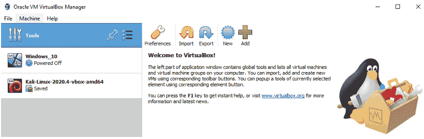

图 2.3 – 导入 Kali 虚拟机

- 3. 这将打开一个对话框，你可以选择刚刚下载的 kali 机器 ova 文件。

启动时，系统会要求你输入密码以登录 Kali Linux 系统。该镜像的默认凭据如下：

| 用户名 | Kali |
| 密码 | kali |

> **重要提示**
> 你可能需要在设置中禁用 USB 2 支持才能正常启动机器。

系统启动后，应该看起来像这样：

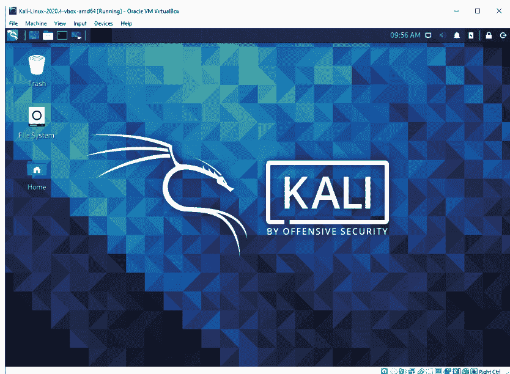

图 2.4 – Kali Linux 主屏幕

现在我们已经设置好了攻击者机器，让我们继续设置受害者机器。

## 受害者机器操作系统

对于受害者机器，我们将使用 Windows 10 作为操作系统。你有两个选择；要么使用 ISO 文件从头安装 Windows 10 操作系统，要么下载适用于 VirtualBox 的预构建镜像。第二种选项更简单，我推荐使用它。然而，其缺点是它相当大，约为 20 GB，并且只能使用 90 天，之后就会过期。不过，这段时间对于大多数用途来说已经足够了。如果你的需求超过 90 天，你可以手动在 VirtualBox 上安装 Windows 10。互联网上有大量教程可供此用途参考。

让我们在本章中使用预构建选项。使用以下链接下载预构建镜像：https://developer.microsoft.com/en-us/windows/downloads/virtual-machines/。

让我们看看如何在 VirtualBox 中使用它：

- 1. 下载 Windows 10 VirtualBox 镜像后，打开 VirtualBox 并点击 **添加**。
- 2. 将打开一个对话框；选择刚刚下载的 Windows 10 镜像。

如果步骤操作正确，你的 Windows 10 现在应该可以正常运行了。虚拟 Windows 的 VirtualBox 界面应如下所示：

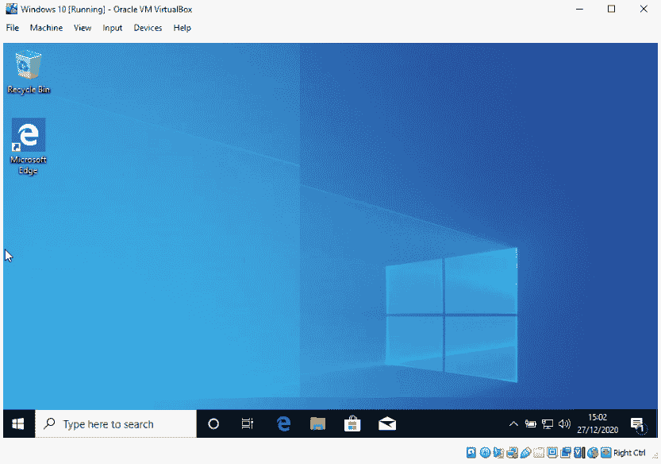

图 2.5 – Windows 虚拟机

我们系统的拓扑结构如下所示：

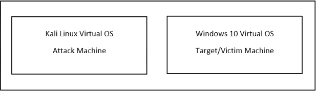

图 2.6 – 主机 Windows 10 操作系统

虚拟操作系统安装完成后，VirtualBox 软件应如下所示：

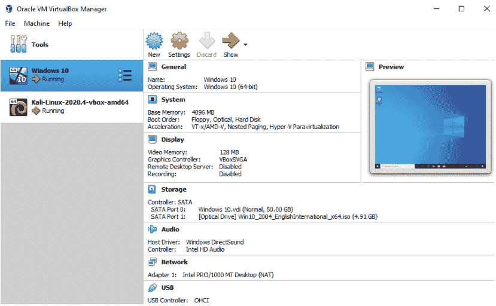

图 2.7 – VirtualBox

到目前为止，我们已在主机机器上安装了虚拟操作系统。接下来，我们将专注于根据我们的喜好配置这些机器，以便在本书剩余部分中使用。在下一节中，我们将在这些虚拟机上下载并安装 Python 3。

## 安装 Python

本章接下来需要设置的是 Python。本书中我们将使用 Python 版本 3，即 python3。Python 3 是 Python 的 *主要* 版本，与旧的版本 2 不兼容。要下载 Python，请前往 https://www.python.org/ 并下载最新版本。截至撰写时，Python 3.8 是推荐版本；然而，对于本书来说，3.2 以上的任何 Python 版本都应该可以。推荐使用 64 位版本的 Python。我将假设你使用 Windows 作为主要操作系统；然而，本书中提到的代码也应该在 Linux 和 macOS 上运行，因为我们将运行虚拟机。

### 在 Windows 上安装 Python

在 Windows 上安装 Python 的过程相当简单。打开你在 *安装虚拟操作系统* 部分中刚刚安装的 Windows 10 虚拟机。请注意，从现在开始，大多数工作将在这些虚拟机上完成，而不是承载这些虚拟机的访客操作系统。在安装过程中，只需勾选 **将 Python 3.8 添加到 PATH** 选项（版本号取决于你下载的版本），这样你就可以从命令提示符的任何位置访问 Python：

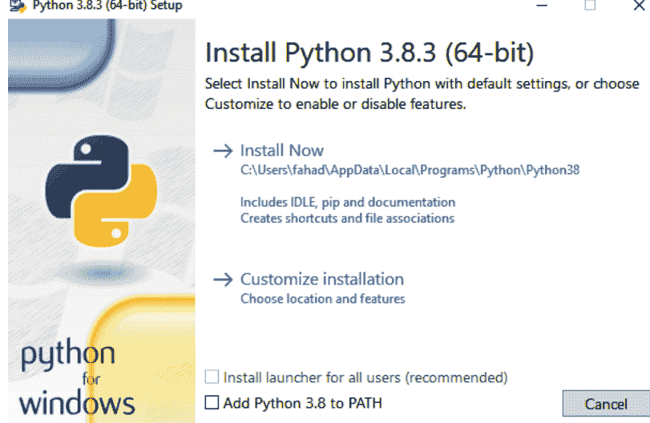

图 2.8 – Python 安装

选择图 2.8 中突出显示的此选项后，点击 **立即安装**。安装完成后，关闭安装窗口并打开终端/命令提示符。在命令提示符中，只需输入 python 命令。你应该在终端中看到以下输出。Python shell 现在应该已打开：

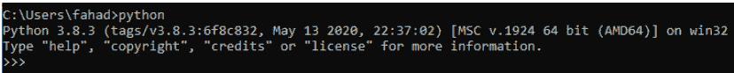

图 2.9 – Python shell

现在我们已在 Windows 中设置了 Python，让我们继续在 Kali 安装上进行设置。

### 在 Kali Linux 上安装 Python

大多数渗透测试操作系统都已预装了 Python。要检查你的发行版是否已安装 Python，请打开 Kali 并搜索终端。打开终端并在终端中输入以下命令：

```
python --version
```

你应该会看到以下输出：

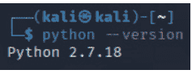

图 2.10 – Python 版本

前面的结果显示 Python 版本 2 已安装；然而，我们需要 Python 3。让我们再次使用以下命令检查：

```
python3 --version
```

你应该会看到以下输出：

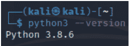

图 2.11 – Python 3 版本号

前面的屏幕截图显示 Kali 中也已安装 Python 3，因此我们无需再次安装。

## 集成开发环境

IDE 是一段帮助我们高效编写代码的软件。你也可以在记事本中编写 Python 脚本；然而，IDE 提供了帮助我们轻松编写代码的功能。有很多选择。我们将专注于免费的 IDE。我发现的最佳选择是 Visual Studio Code（VS Code），它完全免费。继续为两个虚拟操作系统 Windows 10 和 Kali 下载 VS Code：https://code.visualstudio.com/download。

在 Windows 上安装很简单：你需要按照安装程序进行操作。在 Linux 上安装需要你下载一个 Debian 软件包文件。打开终端并导航到下载文件的位置。然后，运行此命令：

```
sudo dpkg -i /path/to/file
```

它看起来会像这样：

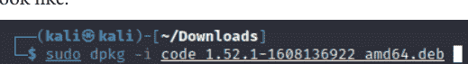

请注意，它会提示你输入密码以进行安装。

安装完成后，你需要安装扩展。打开 VS Code 并点击 VS Code 左侧的扩展选项卡，搜索 Python。它应该看起来像这样：


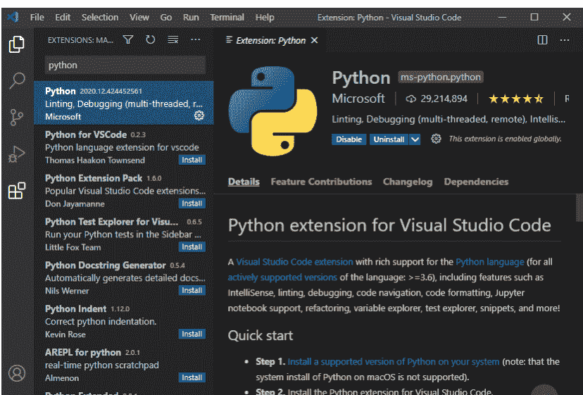

Figure 2.13 – Python extension

点击 Install 按钮，安装应该只需要几秒钟。现在你几乎已经准备好开始你的道德黑客之旅了。到目前为止，我们已经设置了虚拟操作系统，在这些机器上安装了 Python，并安装了 VS Code 以及相关的扩展，这些扩展将在我们的旅程中帮助我们。在下一节中，我们将进行一些网络配置以帮助我们。

### Setting up networking

默认情况下，所有虚拟机都会为网络创建一个单独的虚拟接口。这意味着虚拟操作系统设备与你的主机操作系统处于不同的子网中。为了确保所有操作系统都在同一个子网中，请执行以下操作：

1. 进入每个虚拟机的设置。
2. 在网络设置中，将 Attached to 选项选择为 Bridged Adapter。

请确保同时对 Windows 和 Kali 安装执行此操作：

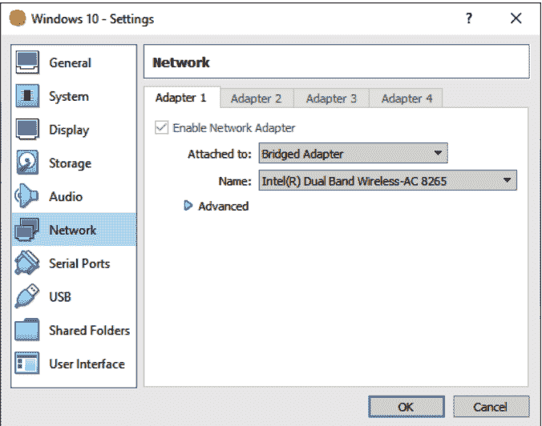

Figure 2.14 – Setting the network adapter

现在你的所有设备都将在同一个子网中。你应该能够从 Windows 10 安装 ping 通 Kali 安装。

### Updating Kali

在继续之前，最好先更新 Kali 以确保一切都是最新的。Kali 可以使用以下命令进行更新：

```
sudo apt-get update
sudo apt-get upgrade
```

更新过程需要一些时间，因为它会更新所有仓库。

### Using virtual environments

Python 有一个非常不错的功能叫做虚拟环境。使用这些虚拟环境，你可以跟踪不同 Python 项目的依赖关系，并将不同项目与主环境隔离开来。

让我们在 Kali 中创建一个新文件夹，所有项目文件都将放在这里：

1. 打开你的 Kali 主目录并创建一个名为 `python-hacking` 的新文件夹。所有未来的工作都将在此进行。

2. 在 VS Code 中打开此文件夹：

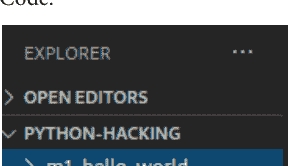

Figure 2.15 – Folder structure inside VS Code

3. 在 `python-hacking` 文件夹内，创建一个名为 `m1-hello-world` 的新文件夹。在这里我们将测试我们的虚拟环境。在 `m1-hello-world` 文件夹内，创建一个名为 `main.py` 的新文件。

4. 使用以下命令在终端中检查 Python 包管理器 `pip` 是否已正确安装在 Kali 中：

```
pip3 --version
```

你应该会看到以下输出：


Figure 2.16 – pip not installed

5. 如果你看到与前面类似的输出，这意味着 `pip` 未安装在系统上。要安装 `pip`，请运行以下命令。确保系统已更新：

```
sudo apt install python3-pip
```

一旦 pip 正确安装，输出将如下所示：

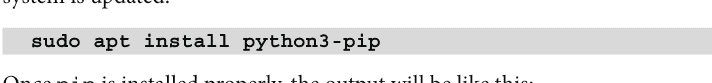

Figure 2.17 – pip installation

如果 Windows 中尚未存在，也请安装 pip3。

6. 现在打开 main.py 文件并编写一些 Python 代码。我们将只使用以下代码。要在 VS Code 中打开终端，请按 Ctrl + `。

7. 现在我们将安装一个 Python 虚拟环境模块。运行以下命令进行安装：

```
apt-get install python3-venv
```

8. 一旦 Python 虚拟环境模块安装完成，我们可以通过在终端中简单运行以下命令来创建一个 virtual-env 文件夹：

```
python3 -m venv my-virtualenv
```

9. 如果命令运行成功，你将看到一个名为 my-virtualenv 的新文件夹已创建。此文件夹包含一个与系统环境隔离的 Python 环境。要启用此环境，请运行以下命令：

```
source my-virtualenv/bin/activate
```

它看起来像 Figure 2.18 中的输出：

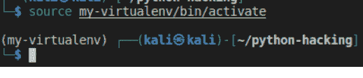

Figure 2.18 – Activating an environment

一旦环境被激活，你会看到环境名称 my-virtualenv 显示在每条终端行的开头。现在你在此 shell 中使用 pip 安装的每个包都只会安装在此环境中，并与主环境隔离。

在 python 文件中编写以下代码以测试一切是否正常工作：

```
if __name__ == "__main__":
    print("Hello world")
```

你应该会看到以下内容：

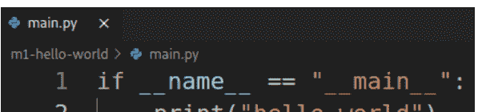

Figure 2.19 – Sample Python script

要运行它，请使用以下命令：

```
python3 main.py
```

你应该会看到以下内容：

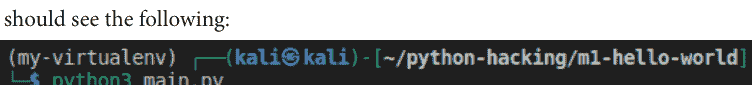

Figure 2.20 – Running the Python script

如果看到输出 hello world 显示出来，这意味着一切都已正确安装。

### Summary

让我们总结一下本章我们做了什么。我们从在主机上下载和安装虚拟操作系统开始。然后我们在系统中配置了 Python，我们将在本书其余部分中使用它。然后我们为虚拟机配置了网络，并在本章末尾学习了如何在 Python 中使用虚拟环境。这些在后面的章节中将非常有帮助，当我们想要从代码中创建可分发的二进制文件时。在下一章中，我们将介绍网络的介绍以及它如何用于道德黑客。
