## 3 Reconnaissance and Information Gathering

在本章中，我们将学习网络基础知识。如果没有对计算机网络的扎实理解，你将无法在渗透测试和道德黑客领域走得很远。我们将介绍网络工作原理的一些基本细节。我们还将了解网络中不同的抽象层以及每个层的作用。

每个道德黑客流程都始于收集有关目标的相关信息，本章专门介绍我们可以获得哪些类型的信息以及这些信息如何对我们有用。我们将讨论用于描述网络层的标准 OSI 模型以及该模型如何对我们有所帮助。本章将涵盖以下主题：

- What is a computer network?
- Classifying networks
- Network stack
- Network entities
- Protection
- Changing MAC

### What is a computer network?

在 **信息技术 (IT)** 领域，**网络** 意味着 *两台或更多设备* 能够 *通信* 并相互 *交换数据* 的 *能力*。在计算的早期，计算机无法相互通信，而是独立的系统。它们的功能非常有限。随着技术的进步，设备之间通信的需求日益增长。在最简单的形式中，两台通过 *介质* 相互连接的计算机形成了一个网络。这个介质是这些设备相互通信的 *链路*。随着我们的深入，你会看到计算机网络中的事情会变得非常复杂：

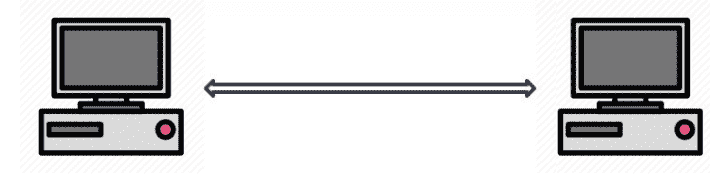

正如你在以下章节中会看到的那样，大多数现代计算机网络并非如此构建。为了让你的计算机与其他计算机通信，它需要与它拥有的计算机一样多的链路，这很快就会变得难以管理。我们将在 *Components of a computer network* 部分学习如何通过使用一个称为路由器的中间节点来避免这个问题。那么，当你想要一个包含 10 台设备的网络时会发生什么呢？为此，我们可以让每台设备与每台其他设备之间都运行电缆并让它们通信。下面的图表显示了四台计算机相互通信。正如你能想象的那样，这样的系统会变得指数级难以管理。这有几个缺点。例如，它增加了系统的复杂性并浪费了大量资源，因为即使它们 *通信* 的时间非常短，你也需要在两台计算机之间维护一根电缆：


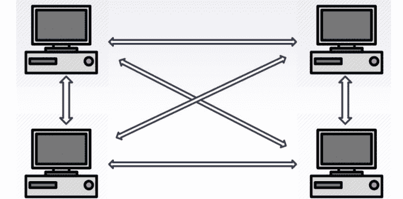

Figure 3.2 – Network with four nodes

为了消除这种冗余，我们可以引入一个中央设备来负责让不同的设备相互通信。有不同类型的中央设备，我们将在 Components of a basic computer network 部分中全部探讨：

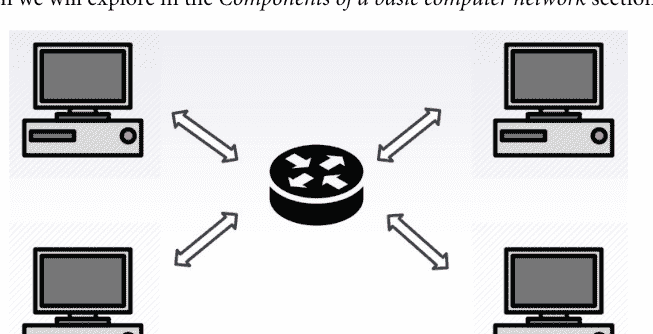

Figure 3.3 – Network with a central device

上图与我们家庭中的网络相似。一个中央设备——在我们的例子中是路由器——帮助我们与其他设备通信。这是一种非常原始的网络形式；现实生活中的网络比这个复杂得多。回到网络构成的概念，网络仅仅是两个通过介质相互通信并共享数据的设备。现在我们已经了解了网络是什么并开始讨论构建网络所需的内容，让我们详细查看组件。

## Components of a basic computer network

在本节中，我们将学习计算机网络的不同组件。在计算机网络文献中，你经常会看到 *node* 这个术语用来表示网络中的一台计算机。在网络领域中，使用特定的命名法来识别网络中的特定设备。我们接下来将查看这些术语。

### Node

节点通常是连接到 *central* 设备的设备。从某种意义上说，它是参与通信网络的计算机。这对于简单的小型网络是可行的，但随着网络中添加的设备越来越多，不同的设备开始承担不同的角色，因此我们只能在一定程度上将设备的角色在网络中简化为节点。在合格的场景中，节点可以是你的笔记本电脑、台式电脑、打印机、平板电脑、手机或任何其他网络连接设备。

### Server

服务器是保存一些可以通过网络共享给需要它们的设备的信息的计算机。服务器通常 *online*，这意味着它们通过持续可用于其他设备来 *serve* 设备。

### Transmission media

设备在网络中相互连接并能够通信所使用的资源/链路称为 *transmission media*。它可以是有线和无线的。有线传输介质的例子是 *Ethernet cable*，通常用于本地网络。*Wi-Fi* 是无线传输介质的例子。

### Network interface card

要参与网络，连接的节点/设备必须具有称为 **Network Interface Card (NIC)** 的东西。NIC 的作用是将你想要传输的内容转换为传输介质所接受的形式。

### Hub

集线器是网络中的中央设备。如果你想与网络中的一个节点通信，你可能不会直接链接到该节点。相反，你应该通过某个中央设备——在这种情况下是集线器——建立链接。你的消息/数据将发送到集线器，然后集线器会将其广播到整个网络。根据消息的内容，相应的设备会做出回应。

### Switch

交换机是一种特殊的集线器。与广播消息给所有节点的集线器不同，交换机只将消息发送给预期的接收者。这大大减少了网络上的流量，因为不打算接收消息的设备不应接收消息。

### Router

到目前为止，我们一直在谈论单个网络。如果一台计算机想与不在你网络中的计算机交谈怎么办？如果这台计算机在法国，而预期的接收计算机在美国的网络中怎么办？我们可以将计算机互连的概念扩展到网络互连。路由器是帮助我们与外部网络通信的设备。

### Gateway

网关是网络中的端点路由器。所有进出网络的流量都经过它。它充当互联网与本地设备之间的中介。对于我们自己的网络之外的设备来说，网关是本地网络中任何设备的通信主要点。

### Firewall

防火墙是某些网络中的可选设备。防火墙可以是基于软件的，例如操作系统的防火墙，也可以是整个网络的基于硬件的设备。防火墙的作用是增强系统的安全性并监控网络流量。这确保了不会对网络进行未经授权的访问。防火墙通常会阻止所有进入本地网络的连接请求，除非这些请求已被授权并在防火墙的规则引擎中提及：

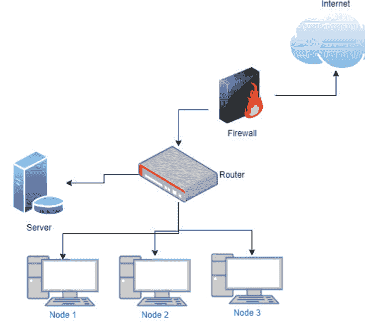

Figure 3.4 – Components in a network

顾名思义，它充当本地网络的入口点，也是出口点。出于实际原因和小型网络的原因，网络的小组件，如路由器、交换机、网关，有时甚至是防火墙，都合并到单个物理设备中。

在本节中，我们了解了网络的不同组件以及每个组件的作用。接下来，我们将讨论这些不同网络是如何分类的。

## Classifying network

随着越来越多的计算机开始连接，将它们分类到不同的类别变得至关重要，以便我们可以使用它们。有各种方法可以进行分类；然而，最常见的是基于地理的网络分类。我们接下来将讨论这一点。

### Local area network

当你将笔记本电脑或手机连接到家中 Wi-Fi 路由器时，你本质上参与了一个 **local area network (LAN)**。连接到 LAN 的方式有多种，例如使用 Wi-Fi，这是一种无线连接，或使用有线连接，例如以太网电缆。LAN 的构成没有严格定义。然而，LAN 通常由位于同一建筑物中同一区域的设备组成。LAN 可以简单到两个设备连接到路由器，也可以复杂到大学和办公室的 LAN。

### Ethernet

以太网是 LAN 中使用最广泛的技术之一。现代以太网协议在 LAN 中提供非常高的速度。与无线介质相比，它非常可靠且安全。以太网协议定义了数据如何在 LAN 上传输。现代以太网可以提供每秒吉比特量级的速度。

### Wi-Fi

作为以太网的补充，以太网使用物理电缆将设备连接到网络，而 Wi-Fi 允许设备通过无线介质相互连接。这消除了对电线的需求。需要注意的是，即使是无线，LAN 上设备之间的通信也不是直接的。数据仍然通过一个中央路由器，即 **Access Point (AP)**，转发给预期接收者。

这两种介质的比较如下：

| Feature | Wi-Fi | Ethernet |
|---|---|---|
| Transmission media | Over a wireless channel | Connected through cables |
| Accessibility | Everywhere we can receive signals | Only by cables |
| Speeds | Slow compared to cables | Fastest option |
| Reliability | Depends on the environment | Consistent |
| Security | If unencrypted, data can be intercepted easily over wireless channels | More secure due to the need for physical interception |
| deployment | Easy | Requires network infrastructure such as ports and cables to be setup |
| Latency | High and variable | Low and consistent |

Table 1.1 – Wi-Fi versus ethernet

这两种介质各有利弊。无线对于普通用户来说使用起来容易得多，并给予他们在网络中更大的移动自由，而基于电缆的以太网速度快得多，并且在网络对移动性需求较低时经常使用。现在我们已经了解了 LAN，我们将开始查看其他基于地理的网络。

### Personal area network

与 LAN 相比，个人区域网络 PAN 通常非常小。PAN 的范围仅在几十米量级。PAN 的一个例子是两个基于蓝牙的设备相互通信。在极少数情况下，PAN 也连接到 LAN。

### Metropolitan area networks

有时，我们倾向于将几个小型局域网合并为一个单一类别。它们通常称为 metropolitan area networks (MANs)。MAN 的一个例子是位于城市不同区域的政府办公室连接到单一网络。这些网络通常仅限于一个城市。


## 广域网

顾名思义，广域网（WAN）是指跨越较大地理区域的网络。WAN 通常构成一个国家内部的网络。

## 因特网

到目前为止，我们只讨论了同一地理位置内的网络。互联网络，或因特网，是一个将位于不同地理位置的网络相互连接起来的巨型网络。通过这个庞大的网络，只要它也连接到因特网，你就可以与世界任何地方的任何设备进行通信。不同的 WAN 通过超高速光纤网络相互连接：

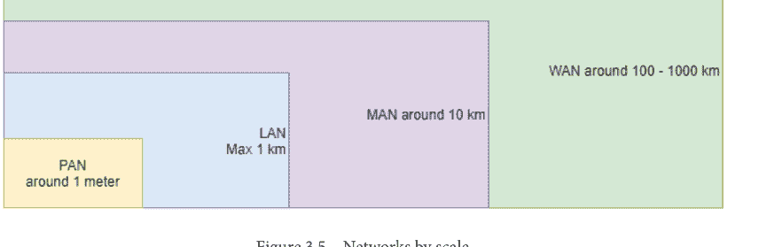

图 3.5 – 按规模划分的网络

到目前为止，我们讨论了网络的物理组件和不同类型的网络。这让我们对计算机网络有一个概览。现在我们了解了网络的基础知识，就可以开始深入探讨数据如何在网络中从一个设备传输到另一个设备。

## 网络栈

上一节为我们提供了网络的高层次介绍。现在，我们将学习实际的位和片段是如何在网络上传输的。

## OSI 模型简介

从你在应用程序上输入消息到它被交付给预期接收者，你的消息会经过通信系统中的不同层。为了帮助我们理解数据在到达目的地之前经过的所有通信过程和媒介，提出了一个框架来描述网络系统的功能。这个模型被称为开放系统互连（OSI）模型。这个模型不一定只适用于因特网，也可以应用于任何现代通信系统：

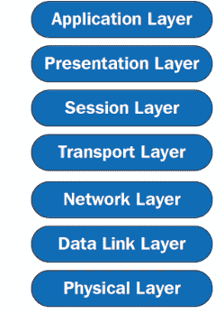

图 3.6 – 7 层 OSI 栈

OSI 模型包含 7 层，用来概念化数据如何在任何电子通信媒介上传输。让我们更详细地了解这些层。

## 应用层

应用层是 OSI 栈的最上层。这是用户交互的层。你使用的任何联网设备可能都有一个应用层界面。它充当用户输入/输出的端点。你发送的任何数据都会被添加到应用层，而你从他人接收的任何数据都会通过这一层显示。

## 表示层

这一层位于应用层之下，负责将数据转换为有用的格式。来自应用层的数据格式各不相同，通常对通信系统来说并不是最易读的形式。在这里，数据会被转换为合适的形式。此外，用户数据在应用层并未加密。在表示层，通常会为数据添加加密以确保安全。

## 会话层

在表示层之下是会话层。一旦数据准备好发送，发送设备和接收设备必须建立连接，以便它们可以通过通道发送数据。会话层正是帮助完成这一任务的——它在你的设备与接收设备之间建立连接。

## 传输层

一旦两个设备之间建立了会话，数据就可以通过通道发送。传输层将要发送的实际数据划分为更小且可管理的块，称为 *段*，这些块可以通过链路发送。它还负责接收来自其他设备的数据段并重新组装以供你使用。

传输层还负责流量控制和错误控制。不同的传输媒介具有不同的速度和不同的错误率。传输层的工作是确保正确的数据被传输。

## 网络层

当我们想要与不在同一网络中的设备通信时，网络层的角色就发挥作用了。网络层将来自传输层的 *段* 进一步分解为更小的 *数据包*。网络层还确定数据包到达目的地的最佳路径。

## 数据链路层

这与网络层 somewhat 相似；然而，它促进同一网络中设备之间的通信。数据链路层将数据包分解为帧。

## 物理层

这是栈的最底层，也是用户输入的数据被转换为可通过传输媒介传输的物理信号的地方。在数字系统的情况下，这意味着数据的 0 和 1 被转换为物理系统中的合适表示，例如电压电平。

## 完整周期

通信的完整周期如下：

## 开放系统互连模型

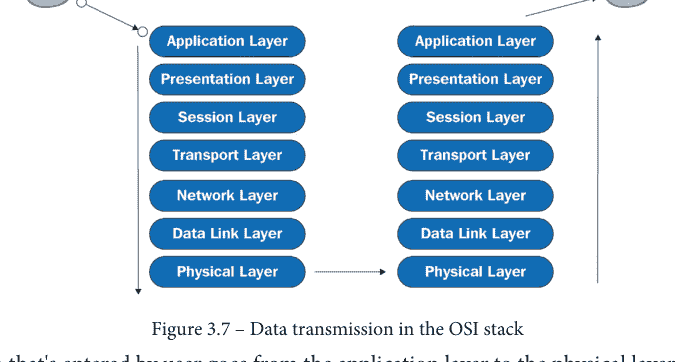

图 3.7 – OSI 栈中的数据传输

用户输入的数据从应用层到物理层，然后在另一端从物理层到应用层。

## TCP/IP 模型

前面显示的模型是一个非常通用的模型，用来概念化任何媒介中的通信。然而，计算机网络的工作方式是 OSI 模型的一个特例，通常被称为 TCP/IP 模型。你经常会在文献中看到这个模型，而不是更通用的 OSI 模型：

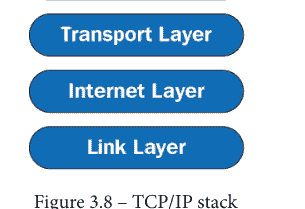

图 3.8 – TCP/IP 栈

与具有七层的 OSI 模型相比，因特网栈有四层。让我们更详细地了解它们。

## 应用层

这是最上层。该层负责进程到进程的通信。常见的应用层协议包括 HTTP、FTP、SSH、DNS 等。

## 传输层

TCP 和 UDP 是该层的常见协议。该层负责端到端通信和错误控制。TCP 是面向连接的，而 UDP 是无连接协议。

## 因特网层

这一层与 OSI 栈中的网络层相对应。它定义了负责在节点之间逻辑传输数据的协议。其中最著名的协议之一是 IP 协议，它使用 IP 地址在设备之间通信。

## 网络访问层

这一层结合了 OSI 栈中的数据链路层和物理层。

## 映射 OSI 和 TCP/IP 栈

OSI 和 TCP/IP 栈的层映射如下：

| OSI 模型 | TCP/IP 模型 |
|---|---|
| 应用层 | 应用层 |
| 表示层 | |
| 会话层 | |
| 传输层 | 传输层 |
| 网络层 | 因特网层 |
| 数据链路层 | 链路层 |
| 物理层 | |

图 3.9 – TCP/IP 和 OSI 栈的映射

## 公共 IP 地址与私有 IP 地址

公共 IP 地址与私有 IP 地址的主要区别如下：

| 公共 IP | 私有 IP |
|---|---|
| 公共 IP 是因特网所看到的 IP 地址。 | 私有 IP 用于你的本地网络内部。 |
| 允许直接访问。 | 你家庭网络中设备的 IP 地址。 |
| 全球唯一。 | 可以被视为一个昵称。 |
| 当你在 Google 中输入我的 IP 地址时看到的就是它。 | 在 Windows 或 Linux/macOS 中使用 ipconfig 或 ifconfig 查找此地址。 |
|  | 全球不唯一。相同的 IP 可以在不同的网络中使用。 |
|  | 通常形式为 192.168.1.X，其中 X 在 1-255 之间。注意，这可能因你的网络配置而异。 |

表 3.2 – 公共 IP 地址与私有 IP 地址之间的差异

我们迄今为止看到的 IP 地址是 IPv4 地址，它们非常流行。然而，还有其他地址。让我们来看看。

## IPv4 与 IPv6

到目前为止，我们所了解的 IP 地址称为 IPv4 地址。还有另一种 IP 地址版本称为 IPv6。这些是 128 位地址。它们被创建用于未来的计算系统。然而，由于 NAT 协议的使用，其采用速度缓慢。目前，只有 40% 的因特网支持 IPv6 地址。

## MAC 地址

MAC 地址也称为硬件地址，通常与 NIC 卡相关联。每个 NIC 都有自己的 MAC 地址。MAC 地址是由制造商分配的物理号码。每个制造商都被分配一个号码池，可用于制造其产品。MAC 地址是一个 48 位数字：


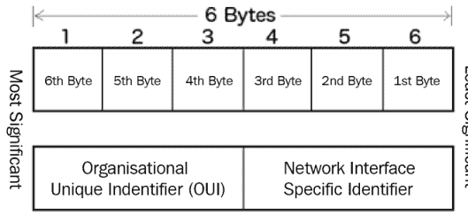

Figure 3.11 – MAC address bytes

接下来，让我们讨论端口。

## Ports

虽然 MAC 地址唯一标识了 NIC，数据使用它来识别应该发送到的正确设备，但端口标识了 PC 上运行的唯一服务。它充当通信的逻辑端点。每个设备都有多个应用程序通过网络发送或接收数据。例如，你可以在 PC 上浏览网页，同时在后台运行下载，另一个服务正在向服务器上传数据。一旦数据到达你的 PC，它会使用端口来区分数据所属的不同进程。系统总共有 65,535 个端口。其中前 1,024 个中有一些是保留的，不建议使用这些端口。

## Protection

到目前为止，本章我们学习了计算机网络的基础知识，这对于理解本书的其余部分至关重要。现在，我们将开始研究可以用哪些参数来追踪我们，以及我们如何保护自己。在上一章中，我们了解到道德黑客的第一步是信息收集。但在开始收集信息之前，我们必须确保我们的身份得到保护。否则，我们很容易被追踪。你的身份可以通过许多参数被追溯回你。最常见的是你的 IP 地址和你的 MAC 地址。

要掩盖你的公共 IP 地址，你可以使用 **Virtual Private Networks (VPNs)**。我们不会讨论 VPN，因为它们不在本书的范围之内。这里需要注意的一点是，你不应完全信任你的 VPN 提供商。从安全角度来看，使用 VPN 只是意味着你将信任从你的 **internet service provider (ISP)** 转移到另一家提供 VPN 服务的公司。你在选择 VPN 时应非常谨慎，从网络安全角度来看，你应非常谨慎对待免费 VPN，因为其中很多捆绑了恶意软件或使用你的 PC 资源用于其他目的，例如比特币挖矿。一些 VPN 即使声称可以掩盖你的身份，也会泄露你的 **domain name server (DNS)**，即用于将网站名称映射到 IP 地址的服务器。

然而，当我们扫描本地网络时，我们可以通过 MAC 地址被追踪。在 *Chapter 2, Getting Started – Setting Up Your Lab Environment* 中，我们安装了两台虚拟机：Kali 和 Windows 10。Kali 机器将是我们攻击机。我们的机器有一个 NIC，用于与其他设备通信。该 NIC 有一个 MAC 地址。在 *Changing our MAC address* 部分，我们将尝试伪造一个 MAC 地址，以便在扫描时更改它。通过这样做，即使 **intrusion detection system (IDS)** 发现我们在扫描 PC 上的端口，它也找不到我们的真实 MAC 地址。

## Changing our MAC address

在本节中，我们将尝试在 Kali 机器上更改 MAC 地址。让我们启动 Kali 机器并打开一个终端。要更改 MAC 地址，你需要安装 net-tools 包。在大多数 Linux 发行版中，该工具已经可用。但是，如果未安装，你可以使用以下命令安装它：

```
sudo apt-get update -y
```

```
sudo apt-get install -y net-tools
```

它会提示你输入密码，即 kali。安装工具后，你可以使用以下命令查看 MAC 地址：

```
sudo ifconfig
```

如果一切顺利，你将看到类似以下的输出：

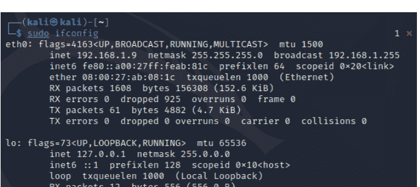

Figure 3.12 – ifconfig command output

这里有很多内容需要解析，让我们逐步分解。这里有两个值，称为 eth0 和 lo。eth0 是 NIC 的名称，而 lo 是回环适配器。现在我们可以忽略回环适配器。inet 字段代表 Kali 机器的私有 IP 地址。inet6 是 Kali 机器的 IPv6 地址。ether 是 MAC 地址，这就是我们想要更改的字段。

如果你想更改 MAC 地址，不能在 NIC 开启时进行。首先，你必须关闭网络接口。要关闭接口，你可以使用以下命令：

```
sudo ifconfig eth0 down
```

此命令将关闭名为 eth0 的 NIC。如果命令输出中没有错误，这意味着命令成功运行。

现在，如果你再次输入 ifconfig 命令，你将看到以下输出：

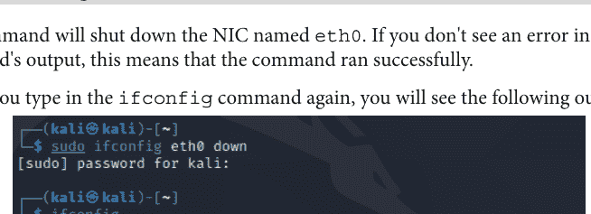

Figure 3.13 – Shutting down a network interface card

现在，你将只看到回环适配器，并且 eth0 已被关闭。要更改 MAC 地址，你可以运行以下命令。假设你希望新的 MAC 地址为 00:11:22:33:44:55。这里，你可以执行以下操作：

```
sudo ifconfig eth0 hw ether 00:11:22:33:44:55
```

此命令更改 eth0 接口和该 NIC 的 ether 参数：


Figure 3.14 – Changing MAC address

现在，如果没有错误，这意味着命令成功运行。此时，我们可以通过运行以下命令再次打开接口：

```
sudo ifconfig eth0 up
```

现在，让我们再次运行 ifconfig 命令，看看我们的更改是否生效：

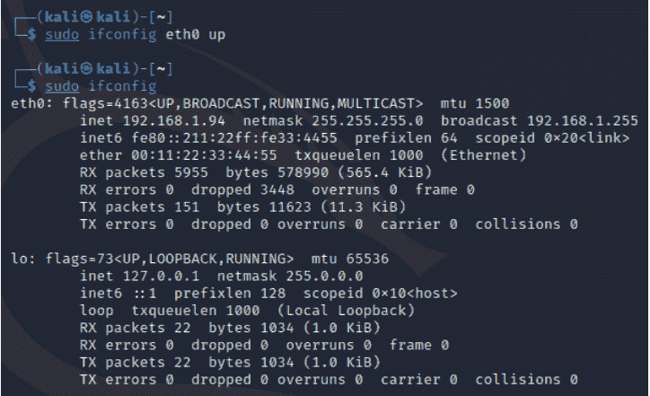

Figure 3.15 – Changed MAC address

在这里，你可以看到 MAC 地址已成功更改。现在，如果我们想在网络中扫描某物，将显示此 MAC 地址而不是我们的真实 MAC 地址。

## Creating a Python script

到目前为止，我们已经编写了手动命令来更改 MAC。理想情况下，我们希望编写一个 Python 脚本来帮助我们更改它。为此，我们需要找到一种方法借助 Python 运行 bash 命令。幸运的是，Python 有一个标准库用于运行系统命令，称为 subprocess。该库允许你与底层操作系统交互。

要将此库导入你的模块，你只需编写以下命令：

```
import subprocess
```

要运行命令，subprocess 有一个名为 run 的方法。使用此方法，你可以在操作系统上执行系统命令。如果你想查看 eth0 的信息，你可以运行以下命令：

```
subprocess.run(
    ["ifconfig", "eth0"],
    shell=True,
)
```

此函数需要一个命令列表。另一个参数 shell=true 意味着我们希望将输出打印到控制台。

如果你运行前一个文件，你将看到类似于运行 ifconfig eth0 命令的输出。请注意，你需要以 root 用户身份运行命令，因此它应如下所示：

```
sudo python3 main.py
```

以下是输出：

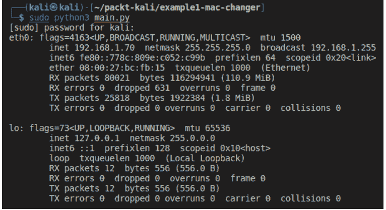

Figure 3.16 – Running system commands using Python

现在你知道了如何使用 Python 运行系统命令，你可以使用 Python 重复前面的命令。完整代码如下：

```
import subprocess

if __name__ == "__main__":
    interface = "eth0"
    new_mac = "22:11:22:33:44:57"

    print("Shutting down the interface")
    subprocess.run(["ifconfig", "eth0", "down"])

    print("changing the interface hw address of ", interface, " to ", new_mac)
    subprocess.run(["ifconfig", interface, "hw", "ether", new_mac])
    print("MAC address changed to ", new_mac)
    subprocess.run(["ifconfig", interface, "up"])

    print("network interfaced turned on")
```

如果你再次检查接口，你将能够看到新的 MAC 地址：

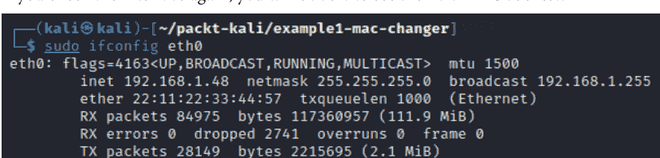

Figure 3.17 – New MAC address

现在我们已经学习了如何在系统上运行命令以及如何使用 Python 更改系统的 MAC 地址，我们将在此停止讨论。在下一章中，我们将研究信息收集。

## Summary

在本章中，我们学习了网络的基础知识，以及我们如何通过伪造 MAC 地址来保护自己在本地网络上的扫描目的。本章帮助我们更深入地了解计算机系统的网络方面，以及我们如何使用 Python 来保护和掩盖我们在本地网络中的身份。在下一章中，我们将学习如何扫描本地网络。


