# 4 网络扫描

本章介绍道德黑客的第一阶段：信息收集和侦察。信息收集是道德黑客最重要的方面之一。如果没有获得所需信息的适当访问权限，要成功实施攻击将极其困难。我们将学习什么是网络扫描以及它如何用于在网络中实施攻击。本章将介绍以下主题：

- 网络简介
- TCP/IP 中的数据封装
- Scapy 简介
- ARP 简介
- 基于 ARP 的 Scapy 网络扫描器

### 网络简介

在第 3 章《侦察和信息收集》中，我们从非常高的角度学习了网络的基础知识。我们了解了网络中存在的不同组件和设备，以及每个组件的作用。在本节中，我们将更深入地了解在网络上传输的实际数据包和数据。

### 数字系统中的数据表示

让我们首先了解你的计算机系统如何管理在网络上传输数据。计算机系统中数据的每个部分都由 **二进制逻辑电平** 定义。这些电平定义为 *低* 或 *高*。现代计算系统中存储的每张图像、文件、视频、语音记录或任何其他内容都由这些逻辑电平表示。在物理硬件中，这些电平映射为电压电平或开关状态。例如，在数字系统中，5 V 电压可能代表高逻辑，0 V 电压将代表低逻辑。你可能会想知道这些不同类型的数据是如何用逻辑电平表示的。让我们看看它是如何工作的。假设你想向朋友发送消息 Hello。为了简单起见，假设你的朋友在同一网络中。现在，我们假设底层通信是可行的。现在，为了发送这条 Hello 消息，我们需要将此消息转换为计算机可理解的形式。我们刚刚了解到计算机只理解低和高逻辑电平，所以我们必须将我们的消息 *编码* 为这些逻辑电平。现在，正如我们所见，Hello 包含五个字母，而我们只有两个逻辑电平，因此仅用一个 *实例* 的两个电平是不可能对完整消息进行编码的。这个实例称为 **位**。为了实现这种编码，开发了一种系统，称为 **美国信息交换标准代码（ASCII）**。使用这种编码方案，我们可以轻松表示英文字母以及一些其他符号和字母。英语字母表的每个字母都由称为 *字节* 的 8 位序列表示。为了表示我们的 Hello 消息中的字母 H，我们可以将其编码为以下位序列。H 在 ASCII 格式中为 01001000。该值在 ASCII 代码表中预定义；同样，其他字符也在相同格式中定义：

- H = 01001000
- e = 01000101
- l = 01101100
- l = 01101100
- o = 01101111

现在我们有一个数据流，可以使用任何数字系统发送。请注意，这是对数据表示的非常简化的解释。实际系统还使用其他编码，例如 Unicode 和字节表示，以发送复杂数据。

### 数据封装

现在我们了解了数据表示，让我们将注意力转回我们最初的话题，即如何发送这些数据。我们已经了解了 TCP/IP 栈中的不同层以及它们如何用于发送数据。在前一节中，我们说我们想向本地网络中的某人发送 Hello 消息。让我们称此消息为我们的数据：

| H | e | l | l | o |
|---|---|---|---|---|
| 01001000 | 01000101 | 01101100 | 01101100 | 01101111 |

图 4.1 – 数据表示

现在，为了使其成功到达另一台计算机，数据包必须知道其确切目的地，就像邮政投递系统的工作方式一样。你有一个国家、城市、邮政编码、街道和房屋号码。在数字系统中，你有 IP 地址、MAC 地址以及源端口和目的端口。假设你在浏览器应用程序中写下你的消息，你的朋友也在他们的浏览器中等待你的消息。为了成功地将消息发送到目标计算机中的完全相同的进程，IP 协议将为你的消息添加一个新报头。

从最上层开始，添加了 **应用层报头**。同样，应用层以下的每一层都会添加自己的报头。整体过程如图所示 4.2。图 4.2 显示了数据在通过网络发送之前在 TCP/IP 栈中的封装方式。我们将学习这些段中的每一个包含什么内容以及这如何帮助数据包到达其目的地：

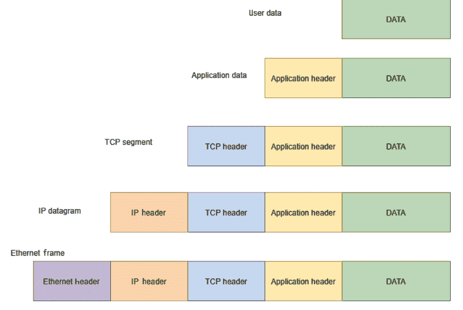

图 4.2 – 数据封装

我们将在下一节中详细介绍这些段。

### 数据包投递过程

数据包投递过程取决于目标设备是否位于同一本地网络中。如果设备位于同一子网中，我们可以直接使用以太网地址发送数据。这些报头中包含大量信息，对于本书的范围而言，你不会关心其中大部分，我只会解释与本书相关的字段。

### IP 报头

接下来，添加一个 IP 报头，如图 4.4 所示：

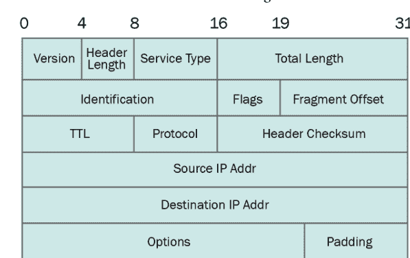

图 4.4 – IP 报头

这里，我们感兴趣的字段是源 IP 和目的 IP。这定义了你的数据包将去往何处以及它来自何处。一旦添加了 IP 报头，它就被称为 IP 数据报。

### 以太网报头

以太网报头有助于数据在本地网络中导航。这里最重要的字段是源 MAC 地址和目的 MAC 地址。顾名思义，源 MAC 地址将是你的 MAC 地址，目的地将是本地网络中接收者的 MAC 地址：

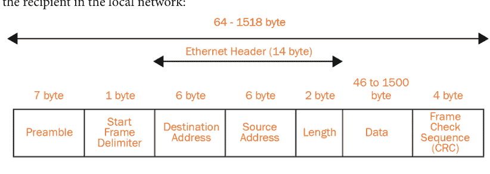

图 4.5 – 以太网报头

一旦添加了以太网报头，它现在就被称为 *以太网帧*。我们已经了解了在网络上传输的数据包中最重要的字段。我们还了解了数据如何被封装以及它使用哪些字段在网络上传输。在下一节中，我们将学习如何使用我们刚刚学到的信息创建我们的网络扫描器。

### Scapy 简介

为了创建网络扫描器，我们将使用一个名为 Scapy 的 Python 网络库。该库设计用于发送、嗅探、拆解和编辑网络数据包。Scapy 是一个非常强大的网络数据包操作工具。要了解有关该工具的更多信息，你可以访问以下链接：https://scapy.readthedocs.io/en/latest/introduction.html。

### 安装 Scapy

要安装 Scapy，首先打开终端。让我们先了解一些事情。在 Linux 中，有两种用户权限，用户和 root，并且两个用户的环境不同。系统级命令需要更高的权限。为了发送和接收数据包，我们需要将 Scapy 安装为 root 用户以及普通用户。我们将以普通用户身份编写程序，并在运行时以 root 身份运行它，因为在 Linux 中发送数据包需要更高的权限（你可以将其视为 Windows 中的 *以管理员身份运行* 等效项）。你很快就会明白我的意思。要以 root 用户身份安装 Scapy，请输入以下命令：

```
sudo pip3 install scapy
```

这将以管理员权限安装 Scapy。完成后，打开你的 Visual Studio Code 并为新项目创建一个新文件夹。我们将此文件夹命名为 `example2-introduction-scapy`。

请注意，如果你遇到一些问题，你将需要使用以下命令更新系统的 Python：

```
sudo apt-get update && sudo apt-get upgrade && sudo apt-get install python3-virtualenv -y
```

现在，我们将为此特定项目创建一个新的虚拟环境。要创建新的虚拟环境，请导航到刚刚创建的文件夹目录并输入以下命令：

```
python3 -m venv venv
```


现在，如果一切都操作正确，你将看到一个名为 venv 的文件夹被创建。

接下来，通过运行以下命令激活虚拟环境：

```
source venv/bin/activate
```

现在，你的虚拟环境应该已激活。激活后，你可以通过输入以下命令查看环境中已安装的软件包：

```
pip freeze
```

如果你在环境中已安装了一些软件包，它们将被列出；否则，你将看不到任何内容。现在，要安装 Scapy，编写以下命令：

```
pip3 install scapy
```

这需要一些时间来安装。完成后，你可以再次编写 pip freeze 命令来查看已安装的软件包：

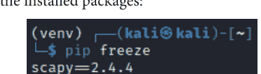

在本节中，我们学习了如何在虚拟环境中安装 Scapy 以及如何查看其是否已正确安装。请注意，Scapy 的某些功能要求程序以更高权限运行，否则它们将无法工作。在下一节中，我们将了解有关 Scapy 的更多使用方法以及如何使用 Scapy 操作网络数据包。

## 理解 Scapy 的工作原理

在本部分，我们将学习 Scapy 的工作原理以及如何使用它来创建自己的网络操作工具。让我们创建一个名为 main.py 的新文件并打开它。打开文件后，我们可以在文件中导入任何 Scapy 模块。在本节中，我们将创建一个向任何网站发送的小型 ping 请求。Ping 请求通常用于测试设备是否可用。Ping 请求（也称为回显请求）使用底层 ICMP 应用层协议。要在程序中导入一个包，编写以下代码：

```
from scapy.all import scapy
```

> **重要提示**
> 请注意，在最新版本的 Kali Linux 中，一些依赖项已更改，你可能会看到与缺少文件相关的错误。要纠正此问题，你可以编写以下命令：
> `cd /usr/lib/x86_64-linux-gnu/sudo ln -s -f libc.a liblibc.a`

要发送 ping 请求，你需要创建一个 IP 层数据包，这将帮助你设置源和目标 IP 地址。要导入 IP 层，我们可以编写以下命令：

```
from scapy.all import IP
```

最后，要发送和接收数据包，我们可以使用一个名为 sr 的函数。要导入此函数，使用以下命令：

```
from scapy.all import sr
```

此 IP 会根据你的系统而有所不同。你可以使用 sudo ifconfig 命令找到此 IP。

然后，我们将定义我们的源和目标 IP：

```
src_ip = "192.168.74.128"
```

然后，我们将定义目标 IP。我们希望向 google.com 服务器创建一个 ping 请求。你可以手动编写此服务器的 IP 地址，你可以通过在终端中编写 ping www.google.com 来找到它，或者你可以直接给出 www.google.com。

Scapy 将自动转换此地址：

```
dest_ip = "www.google.com"
```

现在，我们将创建一个 ip_layer 数据包并打印出来以查看其包含的内容：

```
from scapy.all import ICMP
from scapy.all import IP
from scapy.all import sr

if __name__ == "__main__":
    src_ip = "192.168.74.128"
```

接下来，要发送 ICMP 请求，你可以调用类来创建实例，如下所示：

```
icmp_req = ICMP(id=100)
```

id=100 有助于协议追踪数据包。要查看此请求中存在哪些字段，你可以编写以下命令：

```
print(icmp_req.show())
```

结果将看起来像这样：

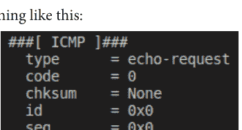

图 4.8 – ICMP 数据包内容

从这里，你可以看到数据包类型是回显请求，用于测试连接可用性。

根据我们之前的讨论，我们知道应用层位于 IP 层之上，我们到目前为止已创建了两个层。现在，下一个目标是将这两个层组合成一个可以在网络上传送的单个数据包。为此，我们可以编写以下代码：

```
packet = ip_layer / icmp_req
```

```
print(packet.show())
```

这将列出组合后的数据包。请注意 / 运算符。此运算符用于在 Scapy 中组合不同的层。你从较低层开始并继续使用此 / 运算符添加新层。打印结果将显示数据包的结果，其中之前的层组合成一个：

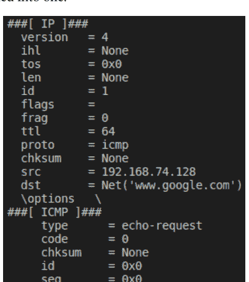

图 4.9 – 组合的层

现在，我们的请求已准备好发送。要发送它，我们可以使用我们已导入的 sr1 方法：

```
response = sr1(packet, iface="eth0")
if response:
    print(response.show())
```

响应将看起来像这样：

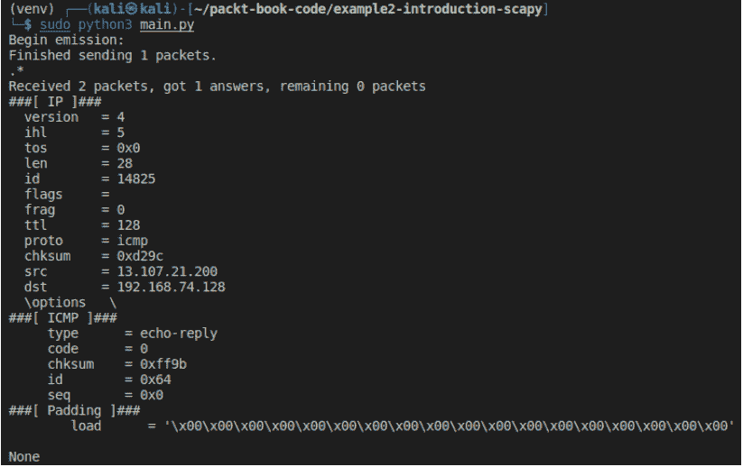

图 4.10 – ICMP 回复

你可以看到响应类型是 echo-reply，回复中的 src 字段是回复此 ping 请求的服务器的 IP 地址。

现在你已经学会了如何使用 Python 制作和发送数据包。理论上，你可以用 Scapy 创建任何网络应用程序。

前面提到的发送数据包的完整代码如下所示：

```
from scapy.all import ICMP
from scapy.all import IP
from scapy.all import sr

if __name__ == "__main__":
    src_ip = "192.168.74.128"
    dest_ip = "www.google.com"
    ip_layer = IP(src = src_ip, dst = dest_ip)
    icmp_req = ICMP(id=100)
```

```
packet = ip_layer / icmp_req
response = sr(packet, iface="eth0")
// to see available interfaces, write ifconfig command in
// terminal
if response:
    print(response.show())
```

Scapy 的好处在于它允许你创建 raw_packets，这意味着即使是包含错误信息的数据包（畸形数据包）也可以创建，并且没有机制来检查数据包是否具有正确的值。你可以更改计算机上的 src ip 字段并放入其他数据包的值，在某些情况下，目标将无法知道哪个 PC 实际生成了这些数据包（空闲扫描）。这样，你就可以伪造数据包。

所以，到目前为止，我们已经了解了 IP 堆栈和头部字段。我们还学习了如何安装 Scapy 并使用它来创建可以在网络上传送的原始数据包。现在，让我们看一下一些有用的函数，这将帮助我们更详细地了解 Scapy 的工作原理。

如果你想了解 Scapy 中某个特定层的更多详细信息以及该层中可用的选项以进行修改，你可以使用 Scapy 中的 ls 函数。要导入此函数，你可以使用此命令：

```
from scapy.all import ls, IP
```

要获取有关 ip_layer 的信息，我们可以像这样打印 ls：

```
dest_ip = "www.google.com"
ip_layer = IP(dst = dest_ip)
print(ls(ip_layer))
```

在下一个屏幕截图中，你将看到之前提到的代码的执行。屏幕截图显示了 IP 数据包中的字段列表：

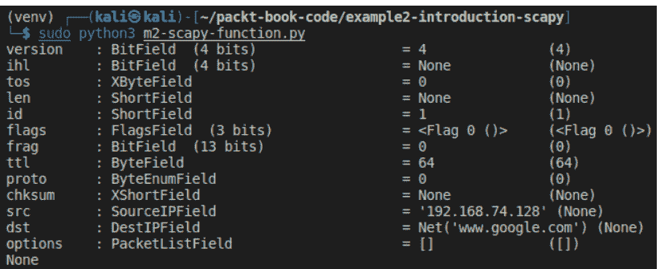

图 4.11 – ls 函数

如果你想访问任何层的单个字段，你可以简单地使用点（.）运算符。例如，如果你想打印 ip_layer 中的 dst，你可以编写以下代码：

```
ip_layer = IP(dst = dest_ip)
print("Destination = ", ip_layer.dst)
```

结果如下：

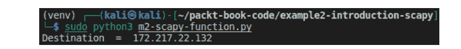

图 4.12 – 访问单个字段

如果你想查看层的快速摘要，你可以在层上调用 summary 方法：

```
print("Summary = ", ip_layer.summary())
```

摘要结果将如下所示：

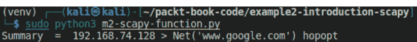

图 4.13 – 层摘要

所以现在，我们已经熟悉了 Scapy 及其工作原理。我们学习了如何创建基本数据包以及如何操作这些数据包。在下一节中，我们将转向如何使用 Scapy 进行信息收集。

## 使用 Scapy 的网络扫描器

在本节中，我们将创建一个简单的扫描器，扫描我们本地网络中的主机并查找它们的 MAC 地址。为了创建扫描器，我们首先需要了解地址解析协议（ARP）是什么以及它如何用于创建网络扫描器。

### 地址解析协议

ARP 在最简单的形式上是一种转换工具，帮助我们将 IP 地址转换为 MAC 地址。每当一台设备需要在同一本地网络内与另一台设备通信时，它需要该设备的 MAC 地址。IP 地址不用于本地通信。

假设设备 A 想要与本地网络中的设备 B 通信。为了找到设备 B 的 MAC 地址，计算机 A 首先会在其内部维护的一个名为 ARP 缓存的列表中查找，以查看计算机 B 的 IP 地址是否已映射到其表中的物理 MAC 地址。这也称为 ARP 表。你可以通过输入 arp -a 命令来检查你的 PC 上的 ARP 表。

以下是 Kali Linux 上运行 arp -a 命令的结果：

```
(venv) —(kali@kali)-[~/packt-book-code/example2-introduction-scapy]
└$ arp -a
? (192.168.74.2) at 00:50:56:ff:74:8b [ether] on eth0
? (192.168.74.254) at 00:50:56:f8:e6:bc [ether] on eth0
```

图 4.14 – ARP 表

你可以看到它列出了 IP 地址和与之关联的 MAC 地址。你也可以在 Windows 中使用相同的命令。

如果请求的设备的相应 MAC 地址在本地不存在，设备 A 将向整个网络发送广播请求，询问哪个设备具有相应的 IP。在我们的例子中，它将是设备 B。那些不是设备 B 的设备将忽略此请求，而设备 B 将回复设备 B 的相应 MAC 地址。这样，设备 A 将得知设备 B 的 MAC 地址。一旦两个设备相互得知，它们之间的通信就可以进行。一旦设备 A 得到设备 B 的 MAC 地址，它将更新其 ARP 表。图 4.15 显示了源设备如何生成 ARP 请求以及目标设备如何使用正确的 MAC 地址进行回复：


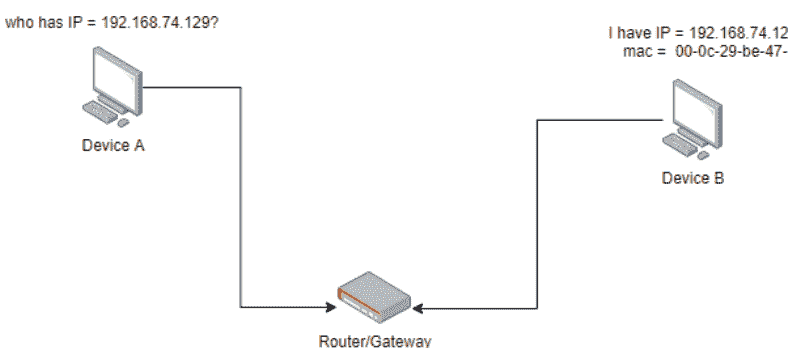

Figure 4.15 – ARP 请求

现在我们了解了 ARP 的工作原理，我们就可以开始使用 Scapy 创建自己的 ARP 扫描器来查找这些设备的 MAC 地址。你可能会想知道为什么我们需要 ARP 扫描器。好吧，了解设备的 MAC 地址可以帮助我们执行中间人攻击，我们将在第 5 章《中间人攻击》中执行此操作。

## 使用 Scapy 的 ARP 扫描器

ARP 协议工作在以太网层，因此使用 Scapy，我们将导入以太网层。让我们导入我们将使用的层和函数：

```
from scapy.all import Ether, ARP, srp
```

如果 MAC 地址的所有位都设置为 1，则意味着该数据包是广播，并且应该发送到网络中的每个设备。Scapy 使用十六进制表示法，因此我们将创建以下变量来表示广播地址：

```
broadcast = "FF:FF:FF:FF:FF:FF"
```

然后，我们可以创建一个以太网层数据包并将目标设置为广播。

我们还需要定义要扫描的 IP 范围。在我的例子中，我想扫描我的本地网络：

```
ip_range = "192.168.74.1/24"
```

完整的代码看起来像这样：

```
from scapy.all import Ether, ARP, srp

if __name__ == "__main__":
    broadcast = "FF:FF:FF:FF:FF:FF"
    ether_layer = Ether(dst = broadcast)
    ip_range = "192.168.74.1/24"
    arp_layer = ARP(pdst = ip_range)

    packet = ether_layer / arp_layer

    ans, unans = srp(packet, iface = "eth0", timeout=2)

    for snd, rcv in ans:
        ip = rcv[ARP].psrc
        mac = rcv[Ether].src
        print("IP = ", ip, " MAC = ", mac)
```

程序的输出如下所示：

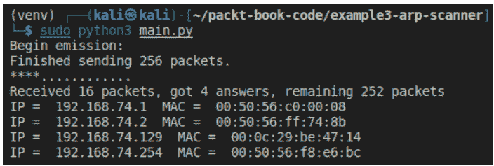

Figure 4.16 – ARP 扫描结果

现在你可以看到网络中所有可用设备的 MAC 和 IP 地址。第三个，IP = 192.168.72.129 是我的 Windows 机器，我将在后面的章节中将其用作受害者/目标机器。为了验证我们在程序中获得的结果是否正确，我们可以从网络连接设置中手动检查这些字段：

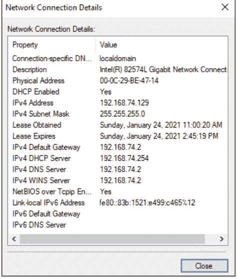

Figure 4.17 – 受害者的 IP 配置

在这里，你可以看到我们在扫描中获得的结果与这些值相匹配。MAC 地址也请看一下。其他设备也可以看到。

192.168.74.254 代表 DHCP 服务器。DHCP 服务器在设备配置为自动 IP 分配时为网络中的设备分配 IP 地址。192.168.72.2 代表网络中的默认网关。

## 总结

在本章中，我们学习了数据如何在网络上从一个设备发送到另一个设备。我们学习了数据如何在 TCP/IP 协议中封装，以及每个报头中添加了哪些字段。接下来，我们学习了一个非常重要的网络操纵和数据包制作工具，称为 Scapy。我们还学习了如何使用 Scapy 制作数据包以及这些数据包如何通过网络发送。然后，我们学习了 ARP 协议，最后，我们创建了一个 ARP 扫描器来获取网络中活动设备的 IP 和 mac 地址。在下一章中，我们将学习如何使用此扫描器创建中间人攻击以拦截受害者机器的网络流量。
